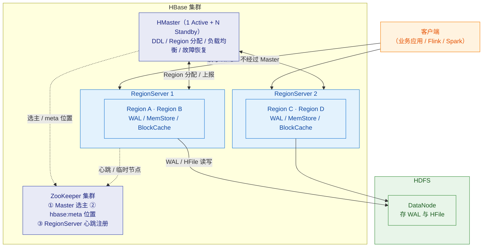
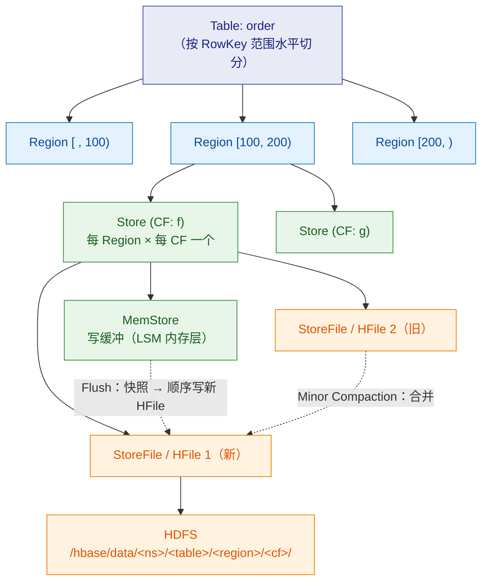
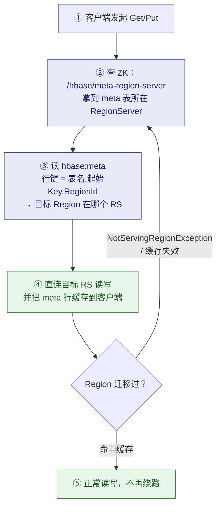
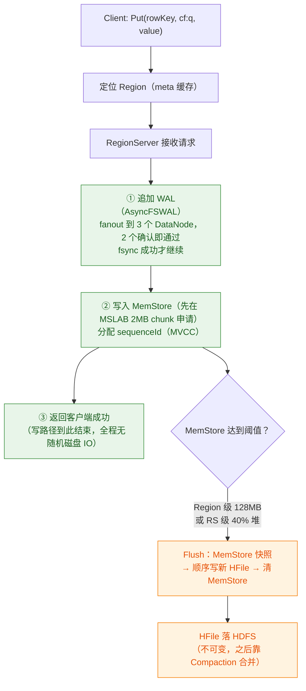
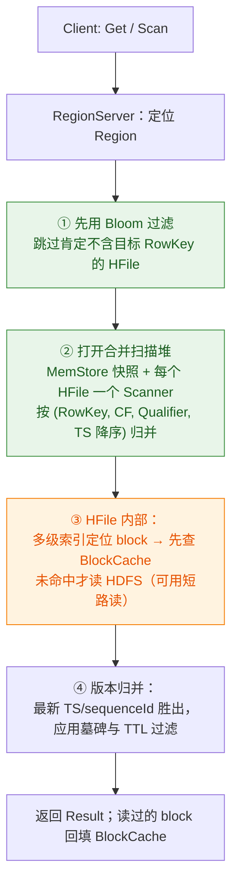
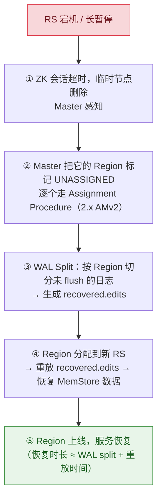
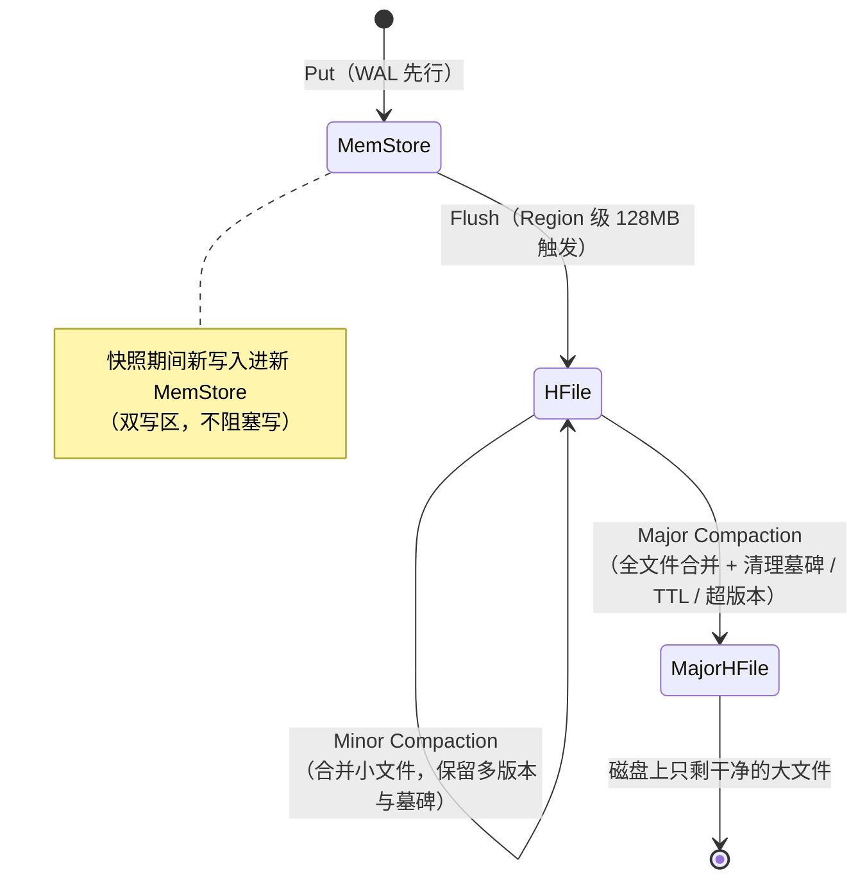

# 🏗️ 一、HBase 架构与原理

> 本篇建立 HBase 的**整体地图**：集群里有哪四个角色、Region/Store/HFile 怎么组织、一条数据的写路径和读路径、WAL 怎么保证不丢、Flush/Compaction/Split 三件套怎么联动。
> 读完应该能白板画出架构图，并回答"写为什么快、读为什么相对慢"。
> 关联：[[0-HBase总览]]、[[2-数据模型与RowKey设计]]（表的逻辑/物理模型）、[[3-开发API]]（客户端视角）、[[4-生产坑与调优]]（这里的每个机制都可能变成坑）。

---

## 一、HBase 是什么：先定位，再学架构

### 1.1 一句话定位

> HBase = **BigTable 论文的开源实现**：构建在 HDFS 之上的、面向列族的、**按 RowKey 强一致随机读写**的分布式 KV 存储。

| 特性 | 说明 |
|---|---|
| 数据模型 | 稀疏宽表：RowKey → CF → Qualifier → Cell，无强 schema |
| 一致性 | **行级强一致**（单行内的读写原子），跨行无事务 |
| 缩放 | Region 自动分裂 + 手工迁移，横向扩容 |
| 弱点 | 原生**没有二级索引**（只有 RowKey 一种寻址方式）、不支持 join、不擅长全表聚合 |

### 1.2 HBase 与 HDFS 的分工（必考）

HDFS 擅长**顺序读写**、不擅长低延迟随机读写，也不支持单行更新；HBase 在它上面加了三样东西把随机读写"变"出来：

| HBase 组件 | 解决什么 |
|---|---|
| **LSM-Tree**（MemStore + HFile） | 用"内存攒批 + 顺序刷盘"替代随机原地更新 |
| **多级索引 + Bloom**（HFile 内） | 把"随机读"变成"索引定位 + 顺序读块" |
| **Region 分布 + meta 表** | 把"文件"变成"可水平拆分移动的分片" |

> [!tip] 一句面试话术
> **HBase 本质上没做随机写：它只是把随机写重写成顺序写（WAL + 追加 HFile），把随机读优化成一次内存命中或一次磁盘顺序读。**

---

## 二、集群角色总图



### 2.1 角色职责表

| 角色 | 职责 | 关键认知 |
|---|---|---|
| **HMaster** | 表 DDL（create/alter/delete）、Region 分配与迁移、负载均衡、故障恢复（RS 宕机后把它的 Region 分给别人） | **不在读写数据路径上**：Master 挂了，已存在的读写短时间完全不受影响，只是 DDL 和均衡停摆 |
| **RegionServer** | 服务一组 Region 的读写：WAL、MemStore、BlockCache、Compaction、Split 都发生在 RS 上 | 干活的角色；堆内存大头给它 |
| **ZooKeeper** | Master 选举、`hbase:meta` 的位置（`/hbase/meta-region-server`）、RS 存活监控（临时节点） | **ZK 挂 = 整个集群不可用**；3~5 节点独立部署 |
| **HDFS** | 持久化 WAL 与 HFile，多副本容错 | RS 本地无状态，数据在 HDFS，所以 RS 是"可牺牲"的 |

> [!warning] 两个必考的"角色"问题
> **① Master 挂了会怎样？** 读写（已有 Region）短期不受影响；DDL / Region 分配 / 均衡 / RS 故障恢复停摆。因此**生产必须部署 Standby Master**（`master2` 进程预先启动才会自动接管）。
> **② 为什么读写不经过 Master？** 客户端从 ZK→meta 就能拿到"Region→RS"映射并缓存，数据面与 Master 解耦——这是 HBase 高吞吐的关键设计之一。

---

## 三、Region 与 RegionServer 内部结构

### 3.1 层级结构（这张图是全篇的地基）



| 层级 | 说明 |
|---|---|
| Table | 按 RowKey 范围切成多个 Region |
| Region | **分布/均衡/切分的单位**；一个 Region 只属于一个 RegionServer（+ 可选只读副本） |
| Store | Region × CF；物理目录与 HFile 的归属；**所以 CF 数量直接决定 Store 数量** |
| MemStore | 每 Store 一个；写缓冲 + MVCC 读快照 |
| StoreFile (HFile) | MemStore flush 的产物，**不可变**；同 Store 内多个 HFile 并存（等 Compaction 合并） |
| WAL | 每 RegionServer 一个（2.x：AsyncFSWAL），所有 Region 的写入共用 |

### 3.2 一条数据的定位：ZK → hbase:meta → RegionServer



- 老版本（0.9x）是 **-ROOT- → .META.** 两级索引，现在只需要 **ZK → meta** 一跳。
- **hbase:meta 自己也是一个 Region**，所以它的位置注册在 ZK 上；meta 也可能 RIT（全集群查询都会受影响，见 [[4-生产坑与调优]]）。
- 客户端缓存 meta 映射；收到 `NotServingRegionException` 才重查——这就是"**为什么建连接慢、用起来快**"。

---

## 四、写路径：为什么快



### 4.1 写路径三步（背下来）

| 步骤 | 动作 | 语义 |
|---|---|---|
| ① WAL 追加 | 顺序追加到 WAL 文件，**fsync 成功前不返回** | 崩机后可重放，保证不丢（这是强一致的基础） |
| ② 写 MemStore | 在内存的跳表中插入 KeyValue，分配递增 sequenceId | 只有 WAL 落盘成功后的数据才对读可见（MVCC） |
| ③ ACK | 返回客户端 | MemStore 并未持久化，但 WAL 已兜底 |

### 4.2 durability：WAL 的五个档位

| 值 | 行为 | 场景 |
|---|---|---|
| `USE_DEFAULT`（默认） | 跟随 CF/表配置（SYNC_WAL） | 常规 |
| `SYNC_WAL` | WAL fsync 后才 ACK | **默认语义，生产用这个** |
| `FSYNC_WAL` | 同上（更强调 fsync） | 同上 |
| `ASYNC_WAL` | WAL 追加即 ACK，不等 fsync | 换性能冒小概率丢失风险 |
| `SKIP_WAL` | **不写 WAL** | 只有不丢也无所谓的缓存型数据 |

> [!danger] 千万别为"提速"随手 SKIP_WAL
> RS 宕机时 MemStore 里的数据全没（连 flush 后也可能因为 HFile 是 BlockCache 中缓存而……不，问题是未 flush 的全部丢失）。历史上大量"写成功但重启后消失"的案例都源于此。见 [[4-生产坑与调优]] 坑 22。

### 4.3 写入的三道闸门（写阻塞从哪来）

```mermaid
flowchart LR
    A["MemStore 128MB<br/>(hbase.hregion.memstore.flush.size)"] -->|"触发本 Region Flush"| B
    B["Region 内存 4×128MB = 512MB<br/>(memstore.block.multiplier)"] -->|"达到则阻塞该 Region 写入<br/>(Flush 队列忙不过来时)"]
    B --> C["全 RS MemStore 40% 堆<br/>(global.memstore.size)"] -->|"触发全部 Region Flush<br/>超上限则阻塞所有写入"]
    C --> D["StoreFile 超过 blockingStoreFiles<br/>(1.x 默认10 / 2.x 默认16)"] -->|"Flush 被挂起<br/>→ CallQueueTooBig / 写超时"]
    classDef warn fill:#f8d7da,stroke:#dc3545,color:#721c24
    class B,C,D warn
```

这就是 [[4-生产坑与调优]] 坑 14~17 的原理基础：**写阻塞的本质是 Flush/Compaction 排队，而排队的原因通常是"小文件太多"或"Compaction 太慢"**。

---

## 五、读路径：为什么相对慢、以及怎么救



### 5.1 三个纠错（常见"简化版答案"的问题）

> [!important] 别答"先查 MemStore 再查 BlockCache 再查 HFile"
> 这句是简化话术，真实机制是**多路归并**：
> 1. **BlockCache 不是和 MemStore 并列的一层**——它是 HFile **block 级**的缓存，包在每个 HFile Scanner 前面；
> 2. MemStore 与所有 HFile 的 Scanner 组成**一个按 Key 排序的合并堆**，谁最新（sequenceId/Timestamp）谁胜出；
> 3. 所以读的正确性不依赖"查询顺序"，依赖 MVCC 序号。
> 面试答出"合并扫描 + Bloom 先过滤 + BlockCache 兜住 block 读"就是满分版。

### 5.2 读放大：读路径的先天成本

| 成本 | 来源 | 治理 |
|---|---|---|
| 一个点查可能摸 N 个 HFile | Store 里 HFile 数量 = flush 次数 - compaction 进度 | Minor Compaction 合并小文件 |
| block 读可能走磁盘 | BlockCache 未命中 | 足够大的 BlockCache（堆外 BucketCache） |
| 无谓的 HFile 打开 | 目标 RowKey 根本不在文件里 | **Bloom Filter**（ROW / ROWCOL） |
| 全列族返回 | 读放大：读一列也要加载整 block | 建表时**列族少而精**，查询只取所需列 |

### 5.3 读副本与最终一致（进阶）

- 建表时设 `REGION_REPLICATION => 2` 可让 Region 有只读副本（落其他 RS）。
- 客户端 `scan.setConsistency(Consistency.TIMELINE)` 读副本：牺牲一致性换读吞吐/容灾，**默认 STRONG 只读主副本**。
- 这套叫 **Timeline-consistent read replicas**，面试能提到就是加分。

---

## 六、HFile 与 KeyValue：磁盘上长什么样

### 6.1 KeyValue 二进制布局（ASCII 精确对齐）

```text
┌─────────── KeyValue ────────────┐
│ KeyLength │ ValueLength │ Key │ Value │
└──────────────────────────────────┘
Key:
┌────────────────────┬──────────────┬────────┬─────────┬───────────┬─────────┐
│ RowKeyLen │ RowKey │ CFLen+CF │ Qualifier │ Timestamp │ KeyType │
└────────────────────┴──────────────┴────────┴─────────┴───────────┴─────────┘
KeyType: Put / Delete / DeleteColumn / DeleteFamily ...
```

**三个重要推论**：
- **RowKey 在每个 KeyValue 里都完整存一份** → RowKey 越长，存储/索引/缓存全链路膨胀（RowKey 设计红线 ≤ 100B 的出处）。
- **CF 名在每个 KeyValue 里也存** → CF 名要短（1~2 字符），Qualifier 同理。
- 排序规则：`RowKey → CF → Qualifier → Timestamp 降序` → 同一行的所有列在物理上聚在一起。

### 6.2 HFile 结构

```text
┌──────────────── Data Blocks（默认 64KB/块，BlockCache 缓存单位）────────────────┐
├──────────────── Leaf Index Blocks ────────────────────────┤
├──────────────── Intermediate Index Blocks（大文件多层）─────────┤
├──────────── LoadOnOpen：Root Index + Bloom（打开时进内存）──────┤
├──────────────── Trailer（文件尾：指向各段入口）────────────────────┤
```

- **多级索引**：3 层索引可支撑 TB 级单文件；索引与 Bloom 在打开 HFile 时**常驻堆内 L1 缓存**。
- `BLOCKSIZE` 越小 → 索引越大但点查加载块越小；越大 → 顺序扫友好。**点查为主的表可调 8~16KB**。

---

## 七、WAL 与故障恢复：RS 是"可牺牲"的

### 7.1 AsyncFSWAL（2.x 默认）

| 维度 | 说明 |
|---|---|
| 写法 | WAL 文件同时 fanout 写 **3 个 DataNode**，收到**多数（2/3）确认**即算成功 |
| 好处 | 单个 DataNode 慢不再卡整条 pipeline（老 WALProvider 是串行 pipeline，一个慢节点拖全局写） |
| 坑 | 依赖 HDFS 新特性，**Hadoop 3.3.1 有已知兼容问题**（当时社区给过 `hbase.wal.provider=filesystem` 的回退方案；升级 Hadoop/HBase 前查 release notes） |
| 滚动 | 单 WAL 写满（默认 32 个文件上限）→ 滚动新 WAL，**并触发 Region flush**（把老 WAL 依赖的数据落盘） |

### 7.2 RegionServer 宕机恢复全流程（必背）



> [!warning] 两个推论（生产坑的根）
> 1. **恢复时长取决于 WAL 大小** → 写入洪峰期挂的 RS 恢复最慢（WAL 堆积多），期间这些 Region 不可用。
> 2. **ZK 会话超时 vs GC 停顿的赛跑**：GC 长暂停可能让"还活着"的 RS 被判死，开始 log split + Region 迁移，暂停结束后 RS 复活——"resurrection"风暴。所以 **session timeout（2.x 默认 90s）必须大于最坏 GC 停顿**。见 [[4-生产坑与调优]] 坑 11。

### 7.3 Master 侧的 Procedure V2（2.x 的架构升级）

- 2.x 把 **Region assign / unassign / RS crash 处理全部改写成 Procedure（可持久化、可重放的状态机）**，元数据操作崩溃后可恢复——这是 1.x 时代 RIT 频发被根治的地方。
- 但 procedure 卡住仍会发生（依赖组件异常），修复工具从 1.x 的 `hbck -fix` 换成 **HBCK2**（`assigns` / `unassigns` / `bypass`）。**在 2.x 集群跑 1.x hbck -fix 会写坏 meta**。

---

## 八、Flush / Compaction / Split：LSM 三件套

### 8.1 生命周期总图



### 8.2 三件套的触发与参数

| 机制 | 触发条件 | 关键参数（2.x 默认） | 注意 |
|---|---|---|---|
| **Flush** | ① Region 级 MemStore 128MB；② RS 级全部 MemStore 40% 堆；③ WAL 数量达上限（32）滚动时；④ 周期性兜底 | `hbase.hregion.memstore.flush.size`=128MB<br/>`hbase.regionserver.global.memstore.size`=0.4<br/>`hbase.regionserver.maxlogs`=32 | Flush 是 **Region 级**：一个 Store 满，同 Region 的**所有 Store 一起 flush** → 列族多 = 小文件放大 |
| **Minor Compaction** | Store 内 HFile 数 ≥ `min`（3），后台选取若干小文件合并 | `hbase.hstore.compaction.min`=3 / `max`=10 | 不清墓碑；产出仍是普通 HFile；**合并线程数**默认 1 大 1 小，堆积见坑 16 |
| **Major Compaction** | 默认 **7 天**一次（+50% 随机抖动错峰）或手动 | `hbase.hregion.majorcompaction`=7d<br/>`hbase.hregion.majorcompaction.jitter`=0.5 | **唯一清理墓碑与 TTL 的时机**；全 Region IO 放大，生产通常**关周期、低峰手动** |
| **Split** | Region 的 Store 大小超阈值；2.x 默认 `SteppingSplitPolicy`（小 Region 从约 256MB 起步，逐步升到 `maxFileSize` 10GB） | `hbase.hregion.max.filesize`=10GB | split 期间/之后的次生问题（Region 突变、缓存失效）见坑 17 |

### 8.3 一张图记住因果关系


> [!tip] 排障思路一句话
> **HBase 写入问题 80% 是"LSM 排队"问题**：看 RS 页面的 FlushQueueSize / CompactionQueueSize 两个指标，先确定卡在哪一层，再决定是改写端（攒批/降速）还是改 compaction（线程/阈值）。详见 [[4-生产坑与调优]]。

---

## 九、选型定位：HBase vs Doris/StarRocks vs Redis

| 维度 | HBase | Doris / StarRocks | Redis |
|---|---|---|---|
| 数据模型 | KV（RowKey 寻址） | 列式表 + SQL | 内存 KV |
| 随机点查（亿级行） | ✅ 强项，毫秒级 | ⚠️ 可以但非强项（点查高并发需 Unique 模型） | ✅ 最快，但容量/成本受限 |
| 复杂查询 / 聚合 | ❌ 灾难（全表 Scan） | ✅ 强项 | ❌ |
| SQL / 二级索引 | ❌ 原生无（Phoenix 补 SQL） | ✅ | 部分 |
| 高并发写入 | ✅ LSM 抗写 | ✅（攒批导入最佳） | ✅ 但持久化弱 |
| 典型职责 | 画像/Feed/特征 KV 存储层 | 报表/OLP 分析层 | 热点缓存层 |

> [!question] 面试常见追问："为什么你们既要 HBase 又要 Doris？"
> 答：**职责分离**。Flink 算出的结果按访问模式分流：服务端按主键高并发点查的（用户画像、订单 Feed）进 HBase；分析型、聚合型、看板型的进 Doris。HBase 不做分析，Doris 不扛十万级 QPS 的点查——各干各的，互为补充。

---

## 十、动手验证（在你的环境里跑一遍）

> 自测环境：[[服务器巡检-192.168.0.106/巡检报告|106 大数据机]] Docker 里的 HBase 2.6.6（UI 16010）。

```bash
# 进入容器
docker exec -it hbase /bin/bash

# 建表：预分区 + CF 参数（观察 Region 数量从建表起就是 3）
hbase shell
create 'order', {NAME => 'f', VERSIONS => 3, TTL => 2592000, BLOOMFILTER => 'ROW'}, SPLITS => ['100', '200']
list_regions 'order'

# 写入（观察行键字典序：'10' < '2'）
put 'order', 'u001', 'f:amount', '100'
put 'order', 'u002', 'f:amount', '200'
put 'order', 'u010', 'f:amount', '50'
scan 'order', {LIMIT => 5}

# 多版本与删除墓碑
put 'order', 'u001', 'f:amount', '300', 1700000000000   # 显式指定旧时间戳
scan 'order', {ROWPREFIXFILTER => 'u001', VERSIONS => 3}
delete 'order', 'u001', 'f:amount'
scan 'order', {ROWPREFIXFILTER => 'u001', RAW => true, VERSIONS => 5}   # RAW 能看到墓碑！

# 手动触发 flush / major，对照 UI 里的 StoreFile 数变化
flush 'order'
major_compact 'order'

# 集群状态与 Web UI
status 'simple'
# 浏览器打开 http://192.168.0.106:16010（Master）与 16030（RegionServer）
```

**观察点**：
- `list_regions`：预分区让 Region 从第 0 天就分布在多台 RS 上（单机环境看不出热点，但概念可验证）。
- `RAW => true`：删除后的 Cell 变成墓碑条目——**证明"删除不是立即物理删除"**。
- `major_compact` 后再用 RAW 查：墓碑消失——**证明 Major 才物理清理**。

---

## 十一、本篇必答（面试口径）

> [!question] 面试官可能这样问
> **Q：画一下 HBase 架构，说说各组件职责。**
> A：四个角色——**HMaster** 管元数据（DDL）、Region 分配与均衡、故障恢复，**不在读写路径上**；**RegionServer** 服务 Region 读写，内部有 WAL、MemStore、BlockCache、Compaction；**ZooKeeper** 负责 Master 选主、meta 表位置、RS 心跳；**HDFS** 存 WAL 和 HFile。客户端读写直连 RS：先查 ZK 找到 meta 位置，再查 meta 得到"Region→RS"映射并缓存。
>
> **Q：写路径和读路径分别讲一下。**
> A：写三步——**追加 WAL（fsync 成功才继续）→ 写 MemStore（MVCC 分配 sequenceId）→ ACK**；MemStore 到 128MB 触发 Flush 顺序写 HFile，小文件靠 Compaction 合并。**写快是因为全程顺序 IO + 内存攒批**。读是**合并扫描**：Bloom 先跳过不含目标 RowKey 的 HFile，MemStore 与各 HFile 的 Scanner 组成按 Key 归并的堆，HFile 内部用多级索引定位 block、先查 BlockCache 未命中再读 HDFS，最后按版本与墓碑归并出结果。**读天生比写多做合并与过滤，所以 HBase 写快读相对慢**。
>
> **Q：HMaster 挂了会怎么样？**
> A：**数据面短期不受影响**——客户端的 meta 缓存仍然有效，读写照常；受影响的是 DDL、Region 均衡和 RS 故障后的恢复。所以生产要部署 Standby Master（预启动进程），ZK 秒级完成选主切换。
>
> **Q：RS 宕机，数据会不会丢？多久恢复？**
> A：不丢。WAL 在每次写前已 fsync 到 HDFS；RS 掉线后 Master 走 crash procedure：**先 split 它的 WAL 生成 recovered.edits，把 Region 分给别的 RS 并重放日志**。恢复时长 ≈ WAL split + 重放时间，写入洪峰期掉线的 RS 恢复最慢。
>
> **Q：Compaction 的 Minor 和 Major 区别？为什么要错峰 Major？**
> A：Minor 合并部分小文件，保留多版本与墓碑；Major 合并全部文件并**真正清理墓碑、TTL 过期、超版本数据**。Major 读写放大严重（重写整个 Region），默认 7 天周期 + 抖动，生产一般**关闭周期（设 0）改低峰手动触发**，避免全集群同时 IO 雪崩。
>
> **Q：2.x 和 1.x 有什么大区别？**
> A：三个层面——①**Assignment 改为 Procedure V2**：Region 分配/宕机处理变成可重放的状态机，RIT 从机制上被治理，修复工具从 `hbck -fix` 换成 **HBCK2**；②**WAL 默认 AsyncFSWAL**：fanout 到 3 个 DataNode、2 个确认即成功，摆脱串行 pipeline 的慢节点拖累；③客户端新增 **Async API**（`AsyncConnection`），吞吐更高。

---

> 下一篇 → [[2-数据模型与RowKey设计]]：把架构落到"一张表怎么设计"上。
