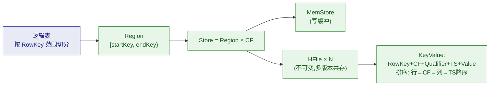
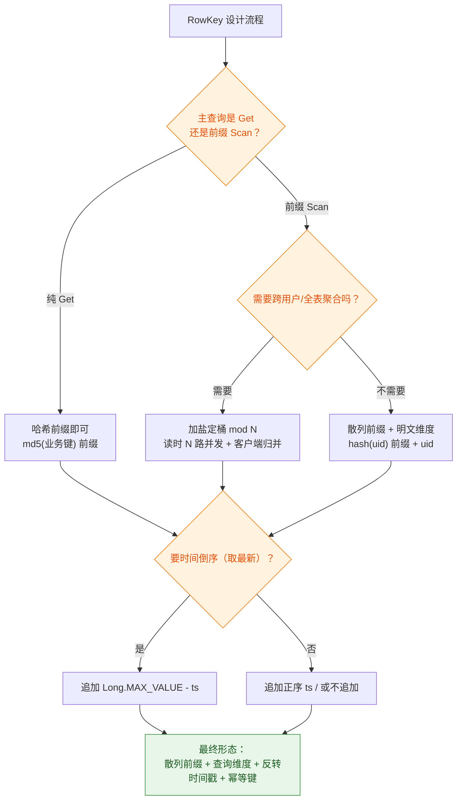

# 🧱 二、HBase 数据模型与 RowKey 设计

> 架构（[[1-架构与原理]]）决定了 HBase **怎么存**；本篇解决**怎么设计**：逻辑模型、版本/TTL/删除三大语义、以及 HBase 生产中**权重最高的一个决策——RowKey 设计**。
> 记住一句话：**HBase 只有 RowKey 一种索引，表设计 = RowKey 设计 + CF 设计**。
> 关联：[[3-开发API]]（设计要通过代码落地）、[[4-生产坑与调优]]（热点/大 Row 都源于本篇的设计失误）。

---

## 一、逻辑模型：稀疏宽表

### 1.1 一张表看懂数据模型

`user_profile`（用户画像表）示意：

| RowKey | CF: base | CF: base | CF: ext | CF: ext |
|---|---|---|---|---|
| `u0001` | name → 张三 (ts=173) | city → 杭州 (ts=173) | level → **v3 (ts=173)**<br/>**v2 (ts=172)** | tags → 空（稀疏，不占空间） |
| `u0002` | name → 李四 (ts=174) | city → **北京 (ts=174)**<br/>**上海 (ts=170)** | level → v1 | tags → 90后,极客 |
| `u0003` | name → 王五 (ts=175) | city → （null，直接跳过） | （整个 CF 可为空） | tags → 摄影党 |

要点（对照上表）：

1. **行 = RowKey 下的一组 Cell**；同一行内跨 CF 的写是**原子**的（行级事务边界）。
2. **Cell = (RowKey, CF, Qualifier, Timestamp)** 四元组唯一确定一个值；同一 Cell 可按 Timestamp 保留多版本（表中 level/city 的两个版本）。
3. **稀疏**：某行某列为空**不占任何存储**（对比 RDBMS 的 NULL 也占位）——这就是"亿级行、上万物种列"的宽表可行性来源。
4. **Qualifier 免 schema**：想加一列直接写，不用 DDL——但要自管命名与冲突。

### 1.2 排序规则：一切按字节序字典序

```text
排序优先级：RowKey → CF → Qualifier → Timestamp（降序，新的在前）

RowKey 排序是"字节序"而不是"数值序"：
  '10' < '2'          ← 字符串字典序的经典坑！
  100L < 99L          ← Bytes.toBytes(long)：负数符号位导致！(实际按二进制补码)
  'u1' < 'u10' < 'u2' ← 前缀相同的先短
```

> [!warning] 三个由此产生的工程铁律
> 1. **数字进 RowKey 要么补零（`%08d`）、要么二进制定长**（`Bytes.toBytes(long)` 8 字节）。
> 2. **二进制定长 long 要注意符号位**：负数排在所有正数前。要"无符号语义"用翻转技巧（见 §4.4）。
> 3. **前缀查询的 stopRow**：用"前缀最后一个字节 +1"（`Bytes.incrementBytes`）而不是手工猜。

### 1.3 CF 与 Qualifier 的分工（为什么有两层"列"）

| | Column Family | Qualifier |
|---|---|---|
| 数量级 | **1~3 个，越少越好** | 随意，几千上万都行 |
| 是否要预先定义 | 建表时定义（不可轻改） | 免定义，写时生成 |
| 承载配置 | TTL / VERSIONS / Bloom / 压缩 / BlockSize | 无 |
| 物理形态 | 一个 Store 目录、独立的 HFile | 只是 Cell Key 的一部分 |
| 命名长度 | 1~2 字符（每个 KeyValue 都要存！） | 同样越短越好 |

**分工口诀**：**"访问模式与生命周期不同的数据才拆 CF，只是字段不同的一律用 Qualifier。"** 拆 CF 的正当理由：TTL 不同（画像 30 天 vs 订单 5 年）、读写热点不同（常改 vs 只读）、一致性要求不同。**只有字段多少不同，就别拆**。

---

## 二、物理模型：逻辑表落到磁盘（速览）



三个推论（详细机制见 [[1-架构与原理]] §六）：
- **RowKey/CF/Qualifier 的字节都会复制进每个 KeyValue** → 命名长度 = 存储与索引的直接放大；
- **同一行所有 CF 的 KeyValue 物理上相邻** → 行原子性和"整行一次读"的效率来源；
- **HFile 不可变** → 一切"更新"都是追加新版本、一切"删除"都是墓碑——引出下面三节。

---

## 三、三大语义：版本、TTL、删除（最容易答错的地方）

### 3.1 版本（VERSIONS）：默认只有 1 个！

| 配置 | 默认 | 语义 |
|---|---|---|
| `VERSIONS` | **1** | 每个 Cell 最多保留几个版本；写入超出时**新挤旧** |
| `MIN_VERSIONS` | 0 | 配合 TTL：即使过期也至少保留几个"底版" |

```bash
# 同一 Cell 写三次
put 't', 'r1', 'f:q', 'v1', 100
put 't', 'r1', 'f:q', 'v2', 200
put 't', 'r1', 'f:q', 'v3', 300
# VERSIONS=1：只读到 v3；VERSIONS=3 + readVersions(3)：读到 v3,v2,v1（降序）
```

> [!danger] 经典生产事故
> 业务以为"HBase 天生多版本"，把 Put 写成覆盖 → **历史版本全被挤出**（默认 VERSIONS=1），审计/回滚数据丢失。**表评审第一项就是问 VERSIONS**。另外注意：**读取端**的 `Get/Scan.readVersions(3)` 是查询时参数，**不等于保留策略**——保留由表定义的 VERSIONS 决定，读到几个由查询决定。

### 3.2 Timestamp：版本号与幂等写入的钥匙

- 每个 Cell 的版本号默认 = 写入时的毫秒时间戳，也可 `put 't','r1','f:q','v', <ts>` 显式指定。
- **显式指定 ts 的两大用途**：
  1. **幂等写入**：ts 固定（如业务版本号），重复写覆盖同一版本 → 重放/重试不产生脏版本（Flink at-least-once 写 HBase 幂等的关键，见 [[5-bigdata/0-flink/11-端到端一致性]]）；
  2. **读时点回溯**：`get.setTimestamp(t)` 读"当时"的版本。

> [!warning] 时钟与乱序的坑
> ① **未来时间戳**（客户端时钟漂移/测试数据）会让"写成功了却读不到最新值"（读返回 ts 更小的旧版本）；
> ② 同一毫秒内多次写会产生**多个同 ts 版本**（靠 sequenceId 区分，行为反直觉）。
> 生产上要么统一服务端语义 ts，要么给 ts 拼上序列位。

### 3.3 TTL：过期是"读时屏蔽 + Major 物理删"

- TTL 在 **CF 级**设置（秒），默认 `FOREVER`。
- **读路径**：超出 TTL 的 Cell 在读时被屏蔽（不返回）；
- **物理删除**：只在 **Major Compaction** 时清理。
- 所以"TTL 过了怎么还占磁盘"是正常现象——**监控 Major Compaction 是否定期执行**。

### 3.4 删除：墓碑（Delete Marker）机制

| API | 墓碑类型 | 范围 |
|---|---|---|
| `Delete` 单列 | Delete | 只屏蔽该 Cell（≤墓碑 ts 的版本） |
| `Delete` 列族 | DeleteFamily | **整行/整 CF**（最重的墓碑，大行删除慎用） |
| `Delete` 列版本 | DeleteColumn / DeleteFamilyVersion | 屏蔽该列全部版本 |

四条必须说清的语义：

1. **删除 ≠ 物理删除**：打墓碑，读时过滤，**Major Compaction 才真正释放空间**。
2. **墓碑按 Timestamp 匹配**：`delete 't','r1','f:q', <ts>` 只屏蔽 ≤ts 的版本；删完用**更大的 ts 再写**，数据会"复活"出现在读结果里（这是特性不是 bug——按 ts 语义推导）。
3. **Minor Compaction 不清墓碑**（它可能还没合并到墓碑所在的文件），所以频繁写删的表即使 Minor 很勤，HFile 仍然"虚胖"。
4. **`KEEP_DELETED_CELLS => TRUE`**：保留被删数据（TTL 内可 `RAW` 读）——审计/时间旅行场景用。

> [!tip] 面试高分答法
> 把删除和 LSM 串起来答："HFile 不可变，所以删除只能追加墓碑；墓碑在读路径做时间序屏蔽、在 Major Compaction 做物理回收。这也解释了为什么 HBase 删除大范围数据（如按 CF 全删）会瞬间产生大量墓碑，Major 前的读写都要背着这些墓碑走。"

---

## 四、RowKey 设计（生产权重最高的章节）

### 4.1 为什么 RowKey 设计等于"全部设计"

HBase **没有二级索引**：Get 只能按完整 RowKey，Scan 只能按 RowKey 前缀范围。于是：

> **查询能走多快，完全取决于查询条件有多少能对上 RowKey 的前缀；写入均不均，完全取决于 RowKey 的散列性。**

### 4.2 三条硬原则

| 原则 | 红线 | 原因 |
|---|---|---|
| **① 打散写入** | 禁止单调递增（自增 ID / 时间戳开头） | 字典序 → 新写入永远落最后一个 Region → 热点 |
| **② 长度适中** | 建议 16~64B，≤ 100B | RowKey 复制进每个 KeyValue、meta 表、BlockCache；越长全链路越胖 |
| **③ 查询维度前置** | 高频查询字段放 RowKey 前缀 | 只有前缀能走范围扫描，非前缀条件 = 全表扫 + Filter 兜底 |

### 4.3 打散/排序的手法箱（六大手法）

| 手法 | 做法 | 散列性 | 范围查询 | 典型场景 |
|---|---|---|---|---|
| **加盐（Salting）** | 前缀 = `hash(key) % N`（N=桶数） | ✅ 均匀 | ⚠️ 跨桶查询要 N 路并发合并 | 写多读多的通用解 |
| **哈希前缀** | 前缀 = `md5(维度)[0,k]` 十六进制 | ✅ 均匀 | ⚠️ 失去原值语义 | 只 Get 不范围查 |
| **反转** | 手机号 `139xxxx` → `xxxx391`；域名 `a.b.com` → `moc.b.a` | ✅（尾号更散） | ⚠️ 原范围失效 | 低基数字段开头 |
| **反转时间戳** | `Long.MAX_VALUE - ts` | — | ✅ **升序扫描 = 时间倒序** | "取最近 N 条" |
| **复合拼接** | 维度1 + 维度2 + ... 定长二进制 | 取决于首位 | ✅ 前缀逐级命中 | 多维查询 |
| **补零/定长** | 数字 `%08d` 或 `Bytes.toBytes(long)` | — | ✅ 保证字典序=数值序 | 一切数值字段 |

### 4.4 设计流程图



**两个高阶技巧**：
- **无符号 long 排序**：`Bytes.toBytes(v ^ Long.MIN_VALUE)` 把符号位翻转，负数也排到正数之后——需要"无符号语义"时用；
- **幂等键**：同一业务对象固定 ts（或把版本号编进 RowKey），重复写入覆盖同一 Cell → 重试不脏数据。

### 4.5 完整案例：订单 Feed 表

**需求**：① 按 userId 查"最近 N 笔订单"（毫秒级、服务端高频）；② 按订单号精确查；③ 30 天过期；④ 高并发写入。

**设计**：

```text
RowKey = [1B 桶号][8B userId][8B Long.MAX-下单时间][订单号]
桶号   = hash(userId) % 16   → 16 个写入目标
```

```bash
create 'order_feed',
  {NAME => 'f', VERSIONS => 1, TTL => 2592000, BLOOMFILTER => 'ROW',
   COMPRESSION => 'SNAPPY', BLOCKSIZE => 16384},
  SPLITS => ['10','20','30','40','50','60','70','80','90','a0','b0','c0','d0','e0','f0']
# 桶号是 1 字节十六进制（00~0f），预分区边界与桶对齐 → 写入从第一天就均匀
```

```java
// RowKey 组装：Bytes 来自 org.apache.hadoop.hbase.util.Bytes
byte[] rk = Bytes.add(
        new byte[]{(byte) ((uid & 0x7FFFFFFF) % 16)},        // 1B 桶号 00~0f
        Bytes.toBytes(uid),                                  // 8B 定长 userId
        Bytes.toBytes(Long.MAX_VALUE - orderTs),             // 8B 反转时间：升序 = 最新在前
        Bytes.toBytes(orderId));                             // 变长订单号收尾

// “该用户最近 10 笔”：升序 scan 天然按时间倒序，数够 10 行就停
byte[] start = Bytes.add(new byte[]{(byte) ((uid & 0x7FFFFFFF) % 16)}, Bytes.toBytes(uid));
int n = 0;
try (Table t = HBaseConn.get().getTable(TableName.valueOf("order_feed"));
     ResultScanner s = t.getScanner(new Scan()
             .withStartRow(start)
             .withStopRow(Bytes.incrementBytes(start, 1))     // 语义化 stop：该用户区间末尾+1
             .setCaching(10))) {
    for (Result r : s) {
        if (++n > 10) break;                                 // 客户端计数控制 N
        // r.rawCells()[0] 的 value 就是最近第 n 笔订单
    }
}
```

> [!warning] 上例埋着两个"代价"，面试要主动说
> 1. **桶带来的读放大**：全表范围分析要 **16 路并发 Scan + 客户端归并**（或者干脆弱化成离线任务走 Spark）；
> 2. **Bloom 只对 Get 语义友好**：前缀 Scan 无法利用 Bloom 裁剪整段区间，靠 Region 分布 + 多路并发换并发度。

### 4.6 RowKey 反模式清单（对照自查）

- [ ] ❌ 时间戳/自增 ID 直接开头（热点）
- [ ] ❌ 用户手机号明文开头（同运营商段位集中 → 假散列）
- [ ] ❌ RowKey 超过 100 字节（存储、索引、BlockCache 三重膨胀）
- [ ] ❌ 数值字段不定长（字典序 ≠ 数值序）
- [ ] ❌ 一次性设计的"多维查询"都塞进 RowKey 却没有主次（哪个维度都不在最前面 = 哪个都查不快）
- [ ] ❌ 整条 RowKey 全散列导致范围语义全丢（hash 全段，想按时间扫就没了）

> [!tip] 两条选型话术
> **"一条 RowKey 满足不了所有查询模式怎么办？"** ——答：① 按主查询模式设计 RowKey，次模式靠**冗余表/索引表**（自己维护双写或 Flink 双流），这正是 Phoenix 二级索引的原理；② 或上 Doris/ES 承担次模式。**不要试图用一条 RowKey 拍死所有需求**。

---

## 五、建表参数速查（CF 级）

| 参数 | 默认 | 建议 | 说明 |
|---|---|---|---|
| `VERSIONS` | **1** | 按业务（要历史 3~5，否则 1） | 保留版本数（最大减分项：默认 1 不知道） |
| `TTL` | FOREVER | **必设** | 30 天 = 2592000；读屏蔽 + Major 物理删 |
| `BLOOMFILTER` | ROW | Get 为主用 ROW / 精确到列用 ROWCOL | 少数场景 NONE |
| `COMPRESSION` | NONE | **SNAPPY**（快）/ ZSTD（更压） | 省磁盘+省 IO，必开 |
| `BLOCKSIZE` | 64KB | 点查 8~16KB / 扫描 64KB+ | 点查越小越好，索引会变大 |
| `BLOCKCACHE` | true | true | 关了读性能崩 |
| `IN_MEMORY` | false | meta 类小表 true | 提示优先常驻 |
| `MIN_VERSIONS` | 0 | 搭配 TTL | 保底版本数 |
| `KEEP_DELETED_CELLS` | false | 审计场景 true | 删除后可 RAW 读 |
| `MOB` | 关 | 100KB~10MB 的大 Cell 用 | Medium Object，把大值挪出主 HFile |
| 预分区 `SPLITS` | 无（1 个 Region 起步） | **与散列桶对齐** | 防开局热点 |

```bash
# 模板：可复制的生产建表
create 'tbl',
  {NAME => 'f', VERSIONS => 1, TTL => 2592000,
   BLOOMFILTER => 'ROW', COMPRESSION => 'SNAPPY', BLOCKSIZE => 16384},
  SPLITS => ['1','2','3','4','5','6','7']
```

---

## 六、本篇必答（面试口径）

> [!question] 面试官可能这样问
> **Q：HBase 的数据模型是什么？CF 和 Qualifier 什么区别？**
> A：稀疏宽表：RowKey 唯一定位行，行内按 CF → Qualifier → Timestamp 定位到 Cell；空 Cell 不占存储。**CF 是物理与配置的边界**（一个 Store、独立 HFile、TTL/版本/压缩都在 CF 级），**Qualifier 是逻辑列**，免 schema、随意扩展。生产建议 1~3 个 CF。
>
> **Q：HBase 支持多版本吗？**
> A：支持，但**默认 VERSIONS=1**，也就是默认覆盖只留最新——这是最常被踩的默认值。版本号默认取写入时间戳，可显式指定：显式指定 ts 还能实现**幂等写入**（重复写覆盖同一版本），这是 Flink at-least-once 写 HBase 不脏数据的标准手法。
>
> **Q：删除是怎么实现的？为什么空间不立即释放？**
> A：追加**墓碑**（单列/列族级），读路径按时间序屏蔽，**Major Compaction 才物理清理**。Minor 不清墓碑，所以频繁写删的表在 Major 前一直"虚胖"。
>
> **Q：RowKey 怎么设计？（必考）**
> A：三原则——**打散写入、长度适中（16~64B）、查询维度前置**。手法：低基数散列用加盐/反转，`hash(uid) % N` 做桶前缀并预分区对齐；要时间倒序就拼 `Long.MAX_VALUE - ts`，升序扫描即最新在前；数值字段补零或定长二进制，注意 long 符号位要用 `^ Long.MIN_VALUE` 翻转。**代价要主动讲**：加盐后跨桶查询要 N 路并发归并；哈希会丢范围语义——所以按主查询模式设计，次模式靠索引表或 Doris。
>
> **Q：一条 RowKey 满足不了多种查询怎么办？**
> A：不做全需求 RowKey。主查询决定 RowKey；次查询走**自建索引表**（双写或 Flink 派生流），或者干脆放 Doris/ES。Phoenix 的二级索引本质也是"另一张索引表 + 查询改写"。

---

> 下一篇 → [[3-开发API]]：设计的表，用代码把它写好、读对、关干净。
