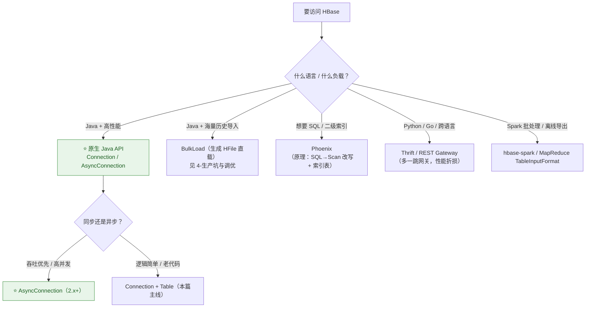
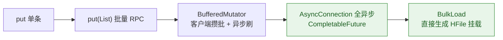

# 🧰 三、HBase 开发 API

> 本篇是**写代码时手边要翻的那一页**：连接怎么管、Put/Get/Scan/Delete 怎么写对、Filter 怎么选、批量与高吞吐怎么上、以及**最容易写错的 12 个反模式**。
> 与系列其他篇的分工：本篇讲"怎么写"；**为什么**由 [[1-架构与原理]]（机制）、[[2-数据模型与RowKey设计]]（RowKey/语义）负责；写错之后的代价见 [[4-生产坑与调优]]。
> 基线：HBase **2.x** 客户端（1.x 差异会标注；2.x 服务端兼容 1.x 客户端）。

---

## 〇、客户端全景：先选对入口



---

## 一、连接管理（工程上最重要的一节）

### 1.1 两类对象的生命周期（背下来）

| 对象 | 代价 | 线程安全 | 生命周期 | 类比 |
|---|---|---|---|---|
| **Connection** | **重**：ZK 会话、meta 缓存、线程池、RPC 连接 | ✅ | **JVM 单例**，进程退出才关 | 数据库连接池 |
| **Table** | 轻：只是一层 RPC 代理 | ❌ | 用完即关（try-with-resources） | Statement |
| **Admin** | 轻：DDL 代理 | ❌ | DDL 用完即关 | —— |

> [!danger] 头号反模式：每次请求 new Connection
> `ConnectionFactory.createConnection()` 要**建 ZK 会话、拉取 meta、初始化线程池**，一次可能几十毫秒。每条 Put 建一个 = 连接风暴 + ZK 压力 + 慢查询，这是 HBase 客户端**最常见的生产事故来源**。

### 1.2 标准连接模板（可直接抄）

```java
public final class HBaseConn {
    private static final Connection CONN;

    static {
        try {
            Configuration conf = HBaseConfiguration.create();
            conf.set("hbase.zookeeper.quorum", "zk1,zk2,zk3");
            conf.set("hbase.zookeeper.property.clientPort", "2181");
            // 生产：用 hbase-site.xml + conf.addResource，别硬编码
            CONN = ConnectionFactory.createConnection(conf);
        } catch (IOException e) {
            throw new ExceptionInInitializerError(e);
        }
    }

    public static Connection get() { return CONN; }

    private HBaseConn() {}
}

// 用法：Table 用完即关，Connection 永不手动关
try (Table t = HBaseConn.get().getTable(TableName.valueOf("order_feed"))) {
    t.put(put);
}
```

### 1.3 1.x → 2.x 的客户端差异速查

| 项 | 1.x | 2.x |
|---|---|---|
| 连接 | `HTable` / `HTableInterface`（可 new） | **HTable 全废弃**，只能 `connection.getTable()` |
| 异步 | 无原生 | ⭐ `AsyncConnection`（`ConnectionFactory.createAsyncConnection`） |
| CAS | `checkAndPut/checkAndDelete` | 新增 `CheckAndMutate` builder（旧签名仍在但标废弃） |
| 读版本 | `setMaxVersions(n)` | `readVersions(n)`（旧名保留） |
| 比较 | `CompareOp` | **`CompareOperator`**（Filter 用） |
| Scan | `setStartRow/setStopRow` | 推荐 `withStartRow/withStopRow`（可显式 inclusive） |

---

## 二、写：Put

```java
try (Table t = HBaseConn.get().getTable(TableName.valueOf("order_feed"))) {
    byte[] cf = Bytes.toBytes("f");
    byte[] rk  = Bytes.add(bucket, Bytes.toBytes(uid),
                           Bytes.toBytes(Long.MAX_VALUE - ts),
                           Bytes.toBytes(orderId));

    Put put = new Put(rk);
    put.addColumn(cf, Bytes.toBytes("amount"), Bytes.toBytes("99.9"));
    put.addColumn(cf, Bytes.toBytes("status"), Bytes.toBytes("PAID"));
    // 同一 Put 内跨 CF 的多个 Cell 一次 RPC，且行级原子
    t.put(put);
}
```

| 语法点 | 说明 |
|---|---|
| 行级原子 | 同一 Put（跨 CF）要么全成功要么全失败——这是行级事务的边界 |
| `addColumn` | 默认 ts = 服务器时间；**显式指定固定 ts → 幂等写入**（重试/重放覆盖同一版本） |
| durability | `put.setDurability(Durability.SYNC_WAL)` 默认；SKIP_WAL = 放弃持久性（[[1-架构与原理]] §4.2） |
| Cell 大小 | 单 KeyValue 默认上限 **10MB**（`hbase.client.max.keyvalue.size`），超了直接 RPC 报错 |
| 批量 | `t.put(List<Put>)` 服务端批量；更高速率用 §七 的 BufferedMutator |

> [!tip] 什么时候用显式时间戳？
> **要幂等就固定 ts**（Flink at-least-once 写入的标准做法）；**要历史版本就每次不同 ts**（VERSIONS>1 时）。随机乱指定 ts 是"写成功读不到"的头号原因。

---

## 三、读：Get（点查）

```java
Get get = new Get(rk);
get.addColumn(cf, Bytes.toBytes("amount"));   // 列裁剪：别整行整族全拿
get.readVersions(3);                          // 读 3 个版本（保留仍由表 VERSIONS 决定）

try (Table t = HBaseConn.get().getTable(TableName.valueOf("order_feed"))) {
    Result r = t.get(get);
    for (Cell c : r.rawCells()) {
        String q   = Bytes.toString(CellUtil.cloneQualifier(c));
        byte[]  v   = CellUtil.cloneValue(c);
        long    ts  = c.getTimestamp();
    }
    // 便捷方法：byte[] v = r.getValue(cf, Bytes.toBytes("amount"));

    boolean exists = t.exists(new Get(rk));    // 服务端 Bloom/索引判断，不回传数据
}
```

| 语法点 | 说明 |
|---|---|
| 列裁剪 | `addColumn` / `addFamily`：只取需要的，省网络也省 BlockCache 污染 |
| `exists` | 只要"有没有"别拿数据，走 Bloom，很快 |
| 批量点查 | `t.get(List<Get>)`：把 1000 次 Get 合成少量 RPC（**循环单 Get 是性能大忌**） |
| RowKey 拼错 | Get 是"整行匹配"语义：前缀查不到就返回空，不报错——注意排查 |

---

## 四、读：Scan（范围扫描）

### 4.1 参数全表（按重要性排序）

| 参数 | 作用 | 默认 | 生产建议 |
|---|---|---|---|
| `withStartRow(b)` | 起始行（**含**） | 无=全表 ⚠️ | **必设** |
| `withStopRow(b)` | 结束行（**不含**）⚠️ | 无=扫到底 | **必设**；前缀查询用 `Bytes.incrementBytes` 生成 |
| `setCaching(n)` | **每次 RPC 预取行数** | 100 | 大扫 500~1000；行大就调小 |
| `setBatch(n)` | 每批返回的**列数**（大行切片） | 无限 | 大行（几千列）设 100~1000，防单个 Result 过大 |
| `addColumn/addFamily` | 列裁剪 | 全列 | **必设** |
| `readVersions(n)` | 读取版本数 | 1 | 需要历史才开 |
| `setReversed(true)` | 倒序扫（从大到小） | false | startRow=扫描起点（最大行），**区间语义对调** |
| `setSmall(true)` | 小结果集：单 RPC 拉完、无租约 | false | 结果确定很小（几行）时用 |
| `setConsistency(TIMELINE)` | 读只读副本 | STRONG | 容灾/读扩容场景（见 [[1-架构与原理]] §5.3） |

### 4.2 标准写法

```java
Scan scan = new Scan()
        .withStartRow(start)
        .withStopRow(Bytes.incrementBytes(start, 1))   // 前缀区间末尾 +1
        .addColumn(cf, Bytes.toBytes("amount"))
        .setCaching(500);

try (Table t = HBaseConn.get().getTable(TableName.valueOf("order_feed"));
     ResultScanner scanner = t.getScanner(scan)) {      // ⭐ scanner 必须 try-with-resources
    for (Result r : scanner) {
        if (r.mayHaveMoreCellsInRow()) {
            // setBatch 时一个 Result 可能只是“行片段”，不要当整行用
        }
        // 处理…
    }
}
```

### 4.3 Scan 的四个隐藏语义（坑点）

> [!warning] 不理解这四条，Scan 必出事
> 1. **stopRow 是开区间**：`withStopRow(b)` **不含** b 本身（含要用 `withStopRow(b, true)`）；前缀匹配天然靠"区间开"实现。
> 2. **Scanner 是服务端租约资源**：客户端拿着不 `close()`，RS 端 scanner + lease 会一直堆积，直到 `scannerTimeout` 报错——**大客户端连着扫，RS 内存就是这么被拖死的**。
> 3. **空 Scan ≠ 无成本**：无 startRow 的 Scan 会从第一个 Region 开始排队——**生产代码要加"无边界即拒绝"的防御**。
> 4. **大 Result 会撑爆 RPC**：`caching × 行大小` 太大时 RPC 超时/队列堆积；行大调 `batch`，别硬拉。

---

## 五、Filter：服务端谓词，不是索引

### 5.1 常用 Filter 速查

| Filter | 用途 | 记忆点 |
|---|---|---|
| **PrefixFilter** | RowKey 前缀匹配 | ⚠️ **必须自己再设 startRow/stopRow**，否则照全表扫 |
| **RowFilter** + CompareOperator | 行键比较（=、>、regex、substring） | 灵活但慢 |
| **MultiRowRangeFilter** ⭐ | **一次 Scan 扫多个区间** | 加盐桶读/多用户批量查询的标配 |
| **FuzzyRowFilter** | 按掩码模糊匹配（`'??9?'`） | 比"全 Scan + 过滤"高效，按段跳过 |
| **SingleColumnValueFilter** ⭐ | 按某列值过滤行 | ⚠️ **必须 `setFilterIfMissing(true)`**，否则"没有该列的行"全放行 |
| ValueFilter | 按 Cell 值过滤（逐 Cell 生效） | 不同于 SCVF 的"整行语义" |
| **FirstKeyOnlyFilter** | 只取每行第一列 | 行数统计类任务必用，省网络 |
| KeyOnlyFilter | 只回 RowKey 不回值 | 同上 |
| PageFilter | 每个 Region 每页返回 n 行 | ⚠️ **按 Region 分页，不是全局**——全局分页要客户端聚合 |
| ColumnPrefixFilter | Qualifier 前缀 | 大行内选列 |
| ColumnPaginationFilter | 大行内分页取列 | 避免一次拉几万列 |
| TimestampsFilter / `setTimeRange` | 版本过滤 | 服务端时间裁剪 |
| RandomRowFilter | 按概率抽样 | 采样任务 |
| **FilterList** | 组合 | `MUST_PASS_ALL`（AND）/ `MUST_PASS_ONE`（OR）；**先严后松**，严的放前面早剪枝 |

```java
// 组合示例：多区间 + 单列值过滤
FilterList fl = new FilterList(FilterList.Operator.MUST_PASS_ALL);
fl.addFilter(new SingleColumnValueFilter(cf, Bytes.toBytes("status"),
        CompareOperator.EQUAL, Bytes.toBytes("PAID")));
((SingleColumnValueFilter) fl.getFilters().get(0)).setFilterIfMissing(true);

List<MultiRowRangeFilter.RowRange> ranges = List.of(
        new MultiRowRangeFilter.RowRange("10", true, "20", false),
        new MultiRowRangeFilter.RowRange("30", true, "40", false));
Scan scan = new Scan().setFilter(
        new FilterList(FilterList.Operator.MUST_PASS_ALL,
                new MultiRowRangeFilter(ranges), fl));
```

### 5.2 Filter 的真相（面试高分点）

> [!important] Filter 是"少传数据"，不是"少扫数据"
> Filter 在**服务端逐 Cell 执行**，能省网络与客户端开销，但**不能替代索引**：
> - 它不改变扫描范围——没有 startRow/stopRow，PrefixFilter 仍是全表逐行扫；
> - 真正的"高效查询"永远是**把条件编进 RowKey 前缀**，Filter 只做兜底微筛；
> - Bloom 只对 Get/精确行有裁剪意义，救不了纯 Filter 查询。
> **一句话：设计 RowKey 是进攻，Filter 是防守。**

---

## 六、原子操作与并发控制

| API | 语义 | 场景 |
|---|---|---|
| **checkAndPut / checkAndDelete**（CAS） | "若某 Cell == 期望值，才执行" | 状态机流转（INIT→PAID）、乐观锁 |
| **Increment** | 行内计数器原子 +N | 阅读/点赞数 |
| **Append** | 行内值原子拼接 | 尾部追加日志、聚合字符串 |

```java
// CAS：状态从 INIT 才能到 PAID，并发下不丢更新
Put put = new Put(rk).addColumn(cf, Bytes.toBytes("status"), Bytes.toBytes("PAID"));
boolean success = table.checkAndPut(rk, cf,
        Bytes.toBytes("status"), Bytes.toBytes("INIT"), put);
// 2.x 新写法：CheckAndMutate.newBuilder(rk).ifEquals(...).build(...) → 返回 CheckAndMutateResult

// 计数器
long pv = Bytes.toLong(
        table.increment(new Increment(rk).addColumn(cf, Bytes.toBytes("pv"), 1))
              .getValue(cf, Bytes.toBytes("pv")));
```

> [!tip] 原子性的边界
> 这三个操作都只保证**单行内**原子。跨行的一致性 HBase 原生不做——需要时用"以一行状态做协调者"的模式，或外置协调（外部事务/两阶段），别指望 HBase 事务。

---

## 七、批量与高吞吐

### 7.1 三档写吞吐



```java
// ① 混合批量：Put/Get/Delete 一个 List，一次往返
List<Row> actions = new ArrayList<>();           // Put、Get、Delete 可混
Object[] results = new Object[actions.size()];
table.batch(actions, results);                   // 失败的槽位是 Throwable，逐个判型！

// ② BufferedMutator：写缓冲 + 周期刷（日志/埋点类高吞吐首选）
try (BufferedMutator m = HBaseConn.get().getBufferedMutator(
        new BufferedMutatorParams(TableName.valueOf("order_feed"))
                .writeBufferSize(4 * 1024 * 1024))) {
    m.setExceptionCallback((e, mut) -> log.error("flush 失败，数据可能丢", e));  // ⭐ 必须挂
    for (Order o : orders) m.mutate(toPut(o));   // 只进客户端缓冲，不等
}                                                 // close 时冲刷

// ③ AsyncConnection（2.x）：全链路异步，连接数少、吞吐高
AsyncConnection aconn = ConnectionFactory.createAsyncConnection(conf).get();
AsyncTable<?> at = aconn.getTable(TableName.valueOf("order_feed"));
at.put(put).thenRun(() -> log.debug("ok"))
           .exceptionally(e -> { log.error("write fail", e); return null; });
List<Result> all = at.scanAll(scan).get();       // 小范围扫描一次性拉取
```

> [!warning] BufferedMutator 的坑
> 数据在客户端缓冲区时**进程崩溃即丢**（没进 RS 的 WAL）——异常回调里必须做记录/重投递；对不可丢数据要么改 `table.put`（同步），要么自建失败队列。

### 7.2 BulkLoad（换个象限看）

百万级以上的**历史/离线导入**不要走 Put（WAL + flush + compaction 全要陪你加班）：用 Spark/MR 直接**生成 HFile，再 completebulkload 挂载**——不写 WAL、不进 MemStore，集群几乎无感。要点（详见 [[4-生产坑与调优]] 坑 23）：

```bash
# 1) Spark/MR 产 HFile（要按目标表 Region 边界分区 → TotalOrderPartitioner）
hadoop jar hbase-mapreduce-*.jar importtsv -Dimporttsv.columns=... \
  -Dimporttsv.bulk.output=/tmp/hf order_feed /input.tsv
# 2) 挂载（工具会自动按当前 Region 边界切分文件）
hbase org.apache.hadoop.hbase.mapreduce.LoadIncrementalHFiles /tmp/hf order_feed
```

---

## 八、Delete：记得墓碑语义

```java
Delete d1 = new Delete(rk).addColumn(cf, q);        // 单 Cell 墓碑（默认屏蔽 ≤当前ts）
Delete d2 = new Delete(rk).addColumns(cf, q);      // 整列（该 qualifier 全版本）
Delete d3 = new Delete(rk).addFamily(cf);          // 整 CF（DeleteFamily，最重）
table.delete(d3);
table.delete(List<Delete>);                          // 批量
```

**必须带着语义写删除**（详见 [[2-数据模型与RowKey设计]] §3.4）：
- 删除只是**墓碑**，Major Compaction 前空间不释放；
- 墓碑可指定 ts：只删"当时及以前"的版本，之后写入的数据不受影响；
- **大批量过期清理优先 TTL**，别在应用里循环 Delete（墓碑风暴 + Major 慢）。

---

## 九、协处理器（能不用就不用）

| 类型 | 形态 | 典型用途 | 风险 |
|---|---|---|---|
| **Observer** | RegionObserver（prePut/postPut/preGet…） | 审计、权限校验、数据修正、自动派生列 | 逻辑散进集群、升级丢失、调试难 |
| **Endpoint** | Protobuf Service + RS 端聚合 | 服务端聚合（省网络） | 协议演进痛苦，2.x 起官方主推 Spark/镜像表替代 |

```xml
<!-- 配置文件加载（推荐，动态加载的坑多） -->
<property>
  <name>hbase.coprocessor.region.classes</name>
  <value>com.x.audit.AuditObserver</value>
</property>
<!-- 新版逐表配置用 TableDescriptorBuilder.coprocessor() -->
```

> [!tip] 面试口径
> "协处理器是 HBase 的触发器/存储过程机制，但我们生产**克制使用**：逻辑放 RS 里排障成本极高（代码版本、数据节点绑定），能用 Flink 算好再写、或用 Get 后聚合解决的，就不下推到 RS。真正用的地方是审计与简单的行级校准。"

---

## 十、Phoenix / REST / Thrift（一分钟版）

| 方式 | 一句话 |
|---|---|
| **Phoenix** | SQL over HBase：元数据在 HBase 里建 `SYSTEM.CATALOG`；SELECT 自动改写为 Scan；**二级索引 = 额外索引表 + 写放大**——读多写少用 Global Index（独立表），写多读少用 Local Index（同 Region 隐藏列） |
| **Thrift** | 跨语言网关（Python happybase 等）；多一跳，性能有折损；注意网关自身的连接池配置 |
| **REST** | 无语言依赖但最慢；只适合管理面、低频访问 |
| **Spark/Hive** | 离线处理用 `hbase-spark`（批量、走 `TableInputFormat`），**别拿它当在线 API** |

---

## 十一、API 反模式清单（代码评审对照表）

| # | 反模式 | 后果 | 修复 |
|---|---|---|---|
| 1 | 每请求 `createConnection` | 连接风暴、ZK 压力 | **JVM 单例** |
| 2 | Table 被多线程共享 | 非线程安全，行为错乱 | 每次 try-with-resources 新取 |
| 3 | Scanner 不 close | RS 端租约/句柄泄漏 | try-with-resources |
| 4 | Scan 无 startRow/stopRow | 全表扫描打死集群 | 强制边界 + 防御校验 |
| 5 | PrefixFilter 不设区间 | "用了过滤器"却全表扫 | Filter 前先给 RowKey 定界 |
| 6 | SCVF 忘 `setFilterIfMissing(true)` | 缺列的行全部漏网 | 必设 |
| 7 | 循环单 Get 上千次 | RPC 往返放大 | `get(List)` / batch / 改 Scan |
| 8 | caching 无脑调大 | RS 端大 Result / 超时 | 行大配 `batch`，caching 500~1000 封顶 |
| 9 | 默认 ts 乱覆盖又想要历史 | VERSIONS=1 下历史全丢 | 显式 ts + VERSIONS 评审 |
| 10 | SKIP_WAL 当性能优化 | 宕机丢数据 | 只给可丢数据用 |
| 11 | 单行几十万列、单 Cell 上 MB | Get 返回 GB、RPC 超时 | 拆行 / MOB / ColumnPaginationFilter |
| 12 | `Bytes.toString` 的 RowKey 直接拼数字 | 字典序错乱（'10'<'2'） | 定长二进制或补零（[[2-数据模型与RowKey设计]] §1.2） |

---

## 十二、本篇必答（面试口径）

> [!question] 面试官可能这样问
> **Q：HBase 客户端连接怎么管理？为什么？**
> A：**Connection 重**（ZK 会话、meta 缓存、线程池），**线程安全，JVM 单例**；**Table 轻**（RPC 代理），**非线程安全，用完即关**。首查要经历"ZK→meta→RS"两跳，之后靠客户端缓存直连——这就是建连慢、用起来快的原因，也是"每请求建连接"是事故的原因。
>
> **Q：Scan 的关键参数讲一下。**
> A：`withStartRow/withStopRow` 定界（**stopRow 开区间**，前缀查询用"末字节+1"）；`setCaching` 控制每次 RPC 预取行数，行大用 `setBatch` 切片防大 Result；Scanner 是服务端租约资源**必须 close**。多区间用 MultiRowRangeFilter；倒序用 setReversed 或把 `Long.MAX-ts` 编进 RowKey。
>
> **Q：Filter 和索引的区别？**
> A：Filter 是服务端逐 Cell 的谓词过滤，**省网络不省扫描**；HBase 唯一的索引就是 RowKey，所以**条件必须尽量前缀化到 RowKey**，Filter 只做兜底。二级索引要么 Phoenix，要么自建索引表双写。
>
> **Q：checkAndPut 是什么语义？**
> A：单行 CAS——服务端比较指定 Cell 与期望值，相等才执行写入，返回是否成功。用于状态机流转和乐观锁；配合固定 ts 的 Put 可实现幂等写入。**原子性边界是单行**，跨行没有事务。
>
> **Q：高吞吐写入怎么做？**
> A：四档递进——`put(List)` 合并 RPC → `BufferedMutator` 客户端攒批异步刷（挂异常回调）→ `AsyncConnection` 全异步（2.x）→ **历史大导入用 BulkLoad 直生 HFile**，绕过 WAL/MemStore/Compaction，集群几乎无感。

---

> 下一篇 → [[4-生产坑与调优]]：设计对了、代码对了，生产还会教做人。
