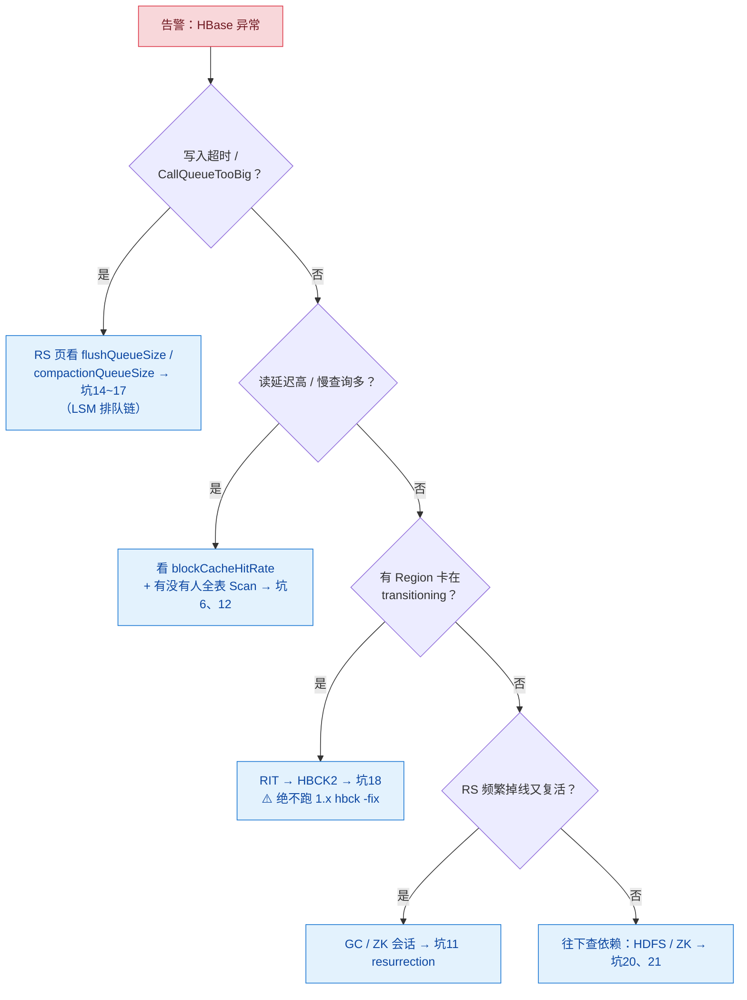
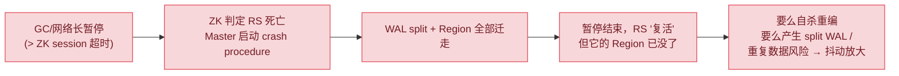

# 🚒 四、HBase 生产坑与调优

> 设计对了（[[2-数据模型与RowKey设计]]）、代码对了（[[3-开发API]]），生产还是可能出事——因为 **HBase 的每个机制（LSM、ZK、GC、HDFS 依赖）都有自己的"性格"**。
> 本篇按"**现象 → 根因 → 定位 → 修复**"整理 **23 个生产坑**，外加：排障决策树、参数速查表、监控指标表、上线 Checklist。
> 口径：HBase 2.x（1.x 差异标注）。参数默认值以你版本的 `hbase-default.xml` 为准。

---

## 〇、排障决策树（先看这个）



**两分钟定位三件套**：
1. Master UI（16010）：看 Regions in Transition、Dead RegionServers、Procedures 是否堆积；
2. RS UI（16030）：看 Request/Region 分布（热点）、Flush/Compaction 队列、BlockCache 命中率；
3. `hbase shell`：`status 'simple'` + 对可疑表 `list_regions` 看分布是否倾斜。

---

## 一、表设计坑（坑 1~5）

### 坑 1：RowKey 单调递增 → 写热点（头号坑）

- **现象**：写入集中在 1~2 台 RS（CPU/请求尖刺），其余空闲；`CallQueueTooBig` 偶发。
- **根因**：RowKey 用自增 ID / 时间戳开头 → 字典序使新写入永远落在**最后一个 Region**。
- **定位**：RS UI 按 Region 的 RequestCount 排序，前几名一骑绝尘。
- **修复**：加盐/哈希前缀 + **建表预分区对齐桶**（设计见 [[2-数据模型与RowKey设计]] §4）。已上线的表：新表双写迁移 + BulkLoad 回灌。

### 坑 2：RowKey 过长

- **现象**：存储与 BlockCache 膨胀明显，HFile 索引巨大，meta 表也胖。
- **根因**：RowKey 复制进**每个 KeyValue、每个索引块、meta 表**，100B 的 RowKey 在千万行 × 多版本下是 GB 级放大。
- **修复**：16~64B；定长二进制（`Bytes.toBytes(long)`）优于可读字符串；CF/Qualifier 命名压到 1~2 字符。

### 坑 3：大 Cell / 大 Row

- **现象**：单次 Get 响应慢、RPC 超时、RS 老年代暴涨；极端时写入直接报错（单 KeyValue 超 `hbase.client.max.keyvalue.size` **默认 10MB** 即拒）。
- **根因**：一行几十万列（大 Row）或单值上 MB（大 Cell）——整行/整块都要进内存。
- **修复**：拆行（一行变多行）、大值外置对象存储只存引用；**100KB~10MB 的中等值用 MOB**（`IS_MOB => TRUE`）；读侧用 `ColumnPaginationFilter` 分页取列。

### 坑 4：列族过多

- **现象**：小 HFile 风暴、Compaction 队列常年堆积、Flush 频率异常。
- **根因**：**Flush 是 Region 级**——任一 Store 满触发时，该 Region 的**每个 CF 都产一个 HFile**；CF 越多小文件越多（机制见 [[1-架构与原理]] §8.2）。
- **修复**：1~3 个 CF；TTL/访问模式一致的数据合到一个 CF，用 Qualifier 区分。

### 坑 5：建表默认值（评审清单）

- **现象**："历史被覆盖了"（`VERSIONS` 默认 1）、"磁盘只涨不降"（`TTL` 默认 FOREVER）、"开局就热点"（默认 1 个 Region）、"磁盘与 IO 双浪费"（`COMPRESSION` 默认 NONE）。
- **修复**：建表模板见 [[2-数据模型与RowKey设计]] §五——**VERSIONS / TTL / BLOOMFILTER / COMPRESSION / SPLITS 五项一个都不能省**。

---

## 二、读写使用坑（坑 6~10）

### 坑 6：无边界全表 Scan

- **现象**：集群读延迟整体抬升、BlockCache 命中率掉崖。
- **根因**：一条没有 startRow 的 Scan 从第一个 Region 排队扫到最后，**每个块的读取都污染 BlockCache**，几十个并发足以拖垮读路径。
- **定位**：RS UI 的 slow RPC / Request 分布；应用侧 grep `new Scan()` 不带边界。
- **修复**：强制 `withStartRow/withStopRow` + 代码评审加"无边界即拒绝"；分析需求迁 Spark/Doris。

### 坑 7：ResultScanner 泄漏

- **现象**：RS 端 scanner 数持续上涨，直到租约超时报错（`LeaseException` / scannerTimeout）才释放。
- **根因**：Scanner 是**服务端租约资源**，客户端不 close 就一直占着（含 lease 与服务端堆内存）。
- **修复**：try-with-resources（写法见 [[3-开发API]] §4.2），code review 清单化。

### 坑 8：Connection 滥用与 Table 跨线程

- **现象**：写入延迟抖动、ZK 连接数暴涨；偶发诡异的并发错乱。
- **根因**：① 每请求 `createConnection`（连接风暴）；② **Table 非线程安全**却被多线程共享。
- **修复**：Connection JVM 单例（[[3-开发API]] §1.2）；Table 用完即关。

### 坑 9：Scan caching/batch 失衡

- **现象**：RPC 超时 / RS 端老年代毛刺 / 客户端 OOM。
- **根因**：`caching` 太大 → 单次 RPC 回传巨大 Result；行太大又不设 `batch` → 一行直接几百 MB。
- **修复**：caching 500~1000 封顶；几千列的行必须 `setBatch`；永远列裁剪。

### 坑 10：时间戳与墓碑乱用

- **现象**："写成功了却查不到最新值"（未来时间戳 / 客户端时钟漂移）；"删了半天磁盘不降"（墓碑只屏蔽，Major 才清理）；大批量 Delete 后读写更慢（墓碑风暴）。
- **修复**：幂等写入用固定 ts；服务端时钟统一或 ts 用业务序号；批量过期靠 **TTL 而不是循环 Delete**（语义见 [[2-数据模型与RowKey设计]] §3）。

---

## 三、RegionServer 与 GC 坑（坑 11~14）

### 坑 11：GC 长暂停 → RS 假死复活（resurrection 风暴）⭐



- **现象**：RS 日志里出现 `Cannot connect to ZooKeeper` / session expired，Master 页面 `Dead RegionServers` 里它反复进出；恢复期间相关 Region 不可用。
- **根因**：**ZK 会话超时（2.x 默认 90s）必须大于最坏 GC 停顿**；一旦 GC 停顿 > 超时，就触发上面这条链。
- **修复（三层）**：
  1. **堆外化**：BucketCache 堆外读缓存（见坑 12）+ MemStore chunk（MSLAB 默认开）→ 大幅降低老年代压力；
  2. **GC 选型**：2.x 用 **G1**（大堆友好），RS 堆 ≤ 31GB（压缩指针上限），别追求一个大 RS，宁可多台小堆；
  3. **兜底**：`hbase.zookeeper.session.timeout` 保持 90s，同时把 GC 日志、ZK 延迟纳入告警——超时前的停顿必须可见。

### 坑 12：BlockCache 配置不当

- **现象**：读全走 HDFS（读延迟高、IO util 高），或堆内 LRU 常年 GC 压力大。
- **修复**：标准生产配置是 **CombinedBlockCache**——索引/Bloom 进堆内 L1，数据块进**堆外 BucketCache（L2）**：

```properties
hbase.bucketcache.ioengine=offheap
hbase.bucketcache.size=<给 L2 的总大小，如 24G>
# JVM 侧：-XX:MaxDirectMemorySize 要覆盖 bucketcache.size
# L1 用 hfile.block.cache.size 控制（默认堆的 0.4）
```

- **定位**：RS UI 的 blockCacheHitRate（>90% 健康）；低于它先查有没有全表 Scan（坑 6）再查容量。

### 坑 13：RPC handler 不足 → CallQueueTooBigException

- **现象**：高峰期客户端批量报 `CallQueueTooBig`，写入超时。
- **根因**：`hbase.regionserver.handler.count` **默认 30**，高并发读写场景根本不够；所有请求都挤同一队列。
- **修复**：线上经验 **100~200**（IO 密集可更高）；再做**读写队列分离**：`hbase.ipc.server.callqueue.read.ratio` 划一部分队列给读，避免慢读堵死写；handler 不是越大越好（每个 handler 都会占内存、加剧 GC）。

### 坑 14：MemStore 三道闸门 → 写阻塞

- **现象**：写入延迟周期性抬升甚至整表写不进（`CallQueueTooBig` / 超时）。
- **根因**：三道闸门依次触发（机制图见 [[1-架构与原理]] §4.3）：Region 级 128MB flush → 4×128MB **阻塞写入** → RS 级 40% 堆全局 flush。**Flush 挂起的常见真凶是下一节的 Compaction 排队**。
- **修复**：看 `flushQueueSize`：短暂尖刺正常；持续高 → 先治 Compaction（坑 16），再考虑调大 flushsize（大 Region 少次 flush）、`memstore.block.multiplier`，或**写端攒批降频**。

---

## 四、Compaction / Flush / Split 坑（坑 15~17）

### 坑 15：定期 Major Compaction 全集群雪崩 ⭐

- **现象**：每隔约一周（默认 **7 天 + 50% 抖动**），全集群 IO 打满、毛刺整齐排队出现。
- **根因**：Major 要**重写整个 Region**（唯一清理墓碑/TTL/超版本的时机），读写放大都大；默认周期让所有表"同一天大扫除"。
- **修复**（生产标配）：

```properties
hbase.hregion.majorcompaction=0        # 关闭周期 Major
```

改**低峰手动错峰**：每周对非核心表逐个 `major_compact 'table'`；新上表先手动 Major 一次再放量。

### 坑 16：小文件堆积 → Flush 挂起 → 写阻塞

- **现象**：StoreFile 数量逼近 `hbase.hstore.blockingStoreFiles`（1.x 默认 10 / 2.x 默认 16），写入开始挂起。
- **根因**：频繁 flush 或 BulkLoad 产出大量小 HFile，Minor Compaction（`min`=3，`max`=10，大/小线程各 1）跟不上产出速度。
- **修复**：① 调 `hbase.regionserver.thread.compaction.large/small`（加线程）；② 写端攒批降低 flush 频率；③ 提高 `compaction.min` 让合并更"值"；④ 2.x 大 Region 可试 Striped Compaction（把大 Region 分 stripe 合并）。
- **指标**：`compactionQueueSize` 持续 > 10 就要动手，别等到写阻塞。

### 坑 17：Split 风暴与 Region 过碎

- **现象**：写入高峰 Region 集中 split → 短暂请求抖动；或建表时拍脑袋预切几百个 Region，每个都是空 Region。
- **根因**：① Split 是"切割 + 双写 + meta 更新"的重动作，集中在热点 Region 上就是雪崩；② **过多小 Region 的代价**：meta 膨胀、Master 均衡调度开销、每 Region 一个 MemStore 的固定内存。
- **修复**：预分区数量按目标容量算（每 Region 预期几 GB~10GB）；大 Region 接受 10GB 默认；过碎的 Region 用 shell `merge_region` 合并；2.x Split 默认策略 `SteppingSplitPolicy`（小 Region 早切、长成后稳定在 `maxFileSize` 10GB）一般不用改。

---

## 五、集群与依赖故障（坑 18~21）

### 坑 18：RIT 卡死与 hbck 误用 ⭐（2.x 重灾区）

- **现象**：表长期有 Region 处于 `transitioning`（Master UI / `list_regions` 可见），相关数据不可读写。
- **根因**：2.x 的 assign/unassign 是 **Procedure（可重放状态机）**，依赖组件（ZK/HDFS/meta）异常时 procedure 卡住。
- **修复（2.x 唯一正解）**：

```bash
# 1) Master UI → Procedures & Locks 页找卡住的 procedure（pid、状态）
# 2) 用 HBCK2 修复：
hbase hbck -j /path/hbase-hbck2-*.jar assigns 'regionEncodedName'    # 强制上线
hbase hbck -j /path/hbase-hbck2-*.jar bypass -o <pid>                 # 跳过卡死的 procedure
# 3) hbase hbck（不带 -j）在 2.x 只做部分只读检查
```

> [!danger] 绝对红线
> **2.x 集群上运行 1.x 的 `hbck -fix` 会把 hbase:meta 写坏**。面试里能主动讲出这条，等于亲历过 2.x 运维。

- **预防**：Master 升级/重启演练；卡 procedure 常见诱因是 ZK 抖动，先把依赖治稳。

### 坑 19：Master 单点

- **现象**：Master 宕机后 DDL 全部挂起、RS 故障后 Region 无法恢复分配（数据面短时间无感——机制见 [[1-架构与原理]] §7.2）。
- **根因**：只部署了一个 Master，**Standby 必须预先启动进程**（不启动就不会自动接管）。
- **修复**：1 Active + 1~2 Standby，ZK 自动选主秒级切换；Master 状态纳入告警。

### 坑 20：ZooKeeper 故障与混部

- **现象**：全集群瘫痪（客户端找不到 meta）、RS 大批量掉线；或偶发大抖动。
- **根因**：HBase 是 **ZK 重依赖**架构：meta 位置、选主、RS 心跳全在 ZK。ZK 与其他大数据组件（Kafka、别的 HBase）混部时，一次网络抖动/GC 就是连锁反应。
- **修复**：ZK **3~5 节点独立部署**、独立磁盘；`session timeout` 与 RS 的最坏停顿对齐（坑 11）；ZK 连接数与延迟监控必须有。

### 坑 21：HDFS 抖动（性能问题的隐形真凶）

- **现象**：写入延迟尖刺与 HDFS DataNode IO 相关；读延迟高；`NotServingRegion` 假象。
- **三个子坑**：
  1. **短路读没开**：RS 与 DataNode 同机却仍走 TCP 栈 → 开 `dfs.client.read.shortcircuit=true` + `dfs.domain.socket.path`；
  2. **DataNode 慢节点**拖累 WAL/HFile 写 → AsyncFSWAL（fanout 写 3 个 DN、2 确认即过）已是缓解手段，仍慢就开 Hedged Read（`dfs.client.hedged.read.threadpool.size>0` + 阈值），并治慢盘；
  3. **版本兼容**：AsyncFSWAL 与个别 Hadoop 版本存在已知不兼容（如 3.3.1），升级前必查 release notes，必要时 `hbase.wal.provider=filesystem` 回退。

---

## 六、导入与数据安全（坑 22~23）

### 坑 22：SKIP_WAL 当"性能优化"

- **现象**：RS 重启/宕机后数据消失，且无法恢复。
- **根因**：WAL 是"写前日志"，SKIP_WAL = 放弃崩溃恢复能力（语义见 [[1-架构与原理]] §4.2）。
- **修复**：只有"可丢的缓存型数据"才允许 SKIP_WAL，并且写入代码里要注释说明。**要写吞吐的正确路径是攒批（BufferedMutator/Async）或 BulkLoad，不是关 WAL**。

### 坑 23：大导入硬写 + 无备份策略

- **现象**：① 历史数据回灌走 Put → WAL 打满、flush/compaction 风暴、线上读写全劣化；② 误删表后无路可退。
- **修复**：
  1. **百万级以上导入一律 BulkLoad**（直生 HFile 挂载，不写 WAL 不进 MemStore，操作步骤见 [[3-开发API]] §7.2）；导入期间锁 split 或让工具自动按边界切分；
  2. **备份三件套**：每日 `snapshot 'table','name'`（秒级、不复制数据）+ `ExportSnapshot` 异地容灾 + 跨集群 Replication；**restore_snapshot 前必须 disable 表**；
  3. 建表前问自己一句：这张表的数据丢了能不能重算？不能 → 备份方案先行。

---

## 七、参数速查表（按"什么时候动它"分组）

| 类别 | 参数 | 2.x 默认 | 什么时候动 |
|---|---|---|---|
| **写** | `hbase.hregion.memstore.flush.size` | 128MB | 大 Region 少 flush、写毛刺 |
| | `hbase.hregion.memstore.block.multiplier` | 4 | 写阻塞阈值（谨慎调大） |
| | `hbase.regionserver.global.memstore.size` | 0.4（堆占比） | RS 频繁全局 flush 时 |
| | `hbase.regionserver.maxlogs` | 32 | WAL 滚动触发 flush |
| **读** | `hfile.block.cache.size` | 0.4 | L1（堆内索引/Bloom） |
| | `hbase.bucketcache.ioengine / size` | 关 | **生产开 offheap**（坑 12） |
| | `hbase.regionserver.handler.count` | 30 | **调到 100+**（坑 13） |
| | `hbase.ipc.server.callqueue.read.ratio` | 0 | 读写队列分离 |
| **LSM** | `hbase.hstore.compaction.min / max` | 3 / 10 | 小文件策略（坑 16） |
| | `hbase.hstore.blockingStoreFiles` | 1.x 10 / 2.x 16 | 写挂起阈值 |
| | `hbase.hregion.majorcompaction` | 7 天 | **设 0 + 手动错峰**（坑 15） |
| | `hbase.regionserver.thread.compaction.large/small` | 1 / 1 | 合并排队时加线程 |
| **Region** | `hbase.hregion.max.filesize` | 10GB | Split 阈值 |
| **容错** | `hbase.zookeeper.session.timeout` | 90s | 与最坏 GC 停顿对齐（坑 11） |
| | `hbase.wal.provider` | asyncfs | Hadoop 兼容问题回退 |
| **客户端** | `hbase.client.scanner.caching` | 100 | Scan 吞吐 |
| | `hbase.client.scanner.timeout.period` | 60s | 大 Scan 租约 |
| | `hbase.client.max.keyvalue.size` | 10MB | 大 Cell 拒收线 |

---

## 八、监控指标表（RS UI / JMX 最小集）

| 指标 | 健康口径 | 异常指向 |
|---|---|---|
| `requestCount`（按 Region） | 分布均匀 | 坑 1 热点 |
| `flushQueueSize / compactionQueueSize` | 接近 0 | 坑 14~16 LSM 排队 |
| `blockCacheHitRatio` | > 90% | 坑 6 / 12 |
| `memstoreSize` | 远低于 40% 堆 | 坑 14 |
| GC 时间与频率（G1 日志） | 停顿 < 1s 级 | 坑 11 |
| `numOpenRegions` / Region 分布 | 各 RS 均衡 | 坑 17 / 坑 1 |
| slow RPC count | 0 | 哪类请求慢 |
| Dead RegionServers（Master UI） | 空 | 坑 11 / 20 |
| Procedures & Locks（Master UI） | 无长期卡住 | 坑 18 |

---

## 九、上线 Checklist（新表/新集群发布前过一遍）

- [ ] RowKey 有散列前缀（禁单调递增），长度 ≤ 64B，数值字段定长
- [ ] 预分区数量与散列桶对齐，单 Region 目标容量预估过
- [ ] CF ≤ 3；`VERSIONS / TTL / BLOOMFILTER / COMPRESSION / BLOCKSIZE` 五项显式声明
- [ ] 读代码：Scan 全部有边界 + 列裁剪；Scanner 全部 try-with-resources
- [ ] 写代码：Connection 单例；批量/BufferedMutator/Async；无 SKIP_WAL
- [ ] 压测过写热点（观察 per-Region request）与读延迟（BlockCache 命中率）
- [ ] 周期 Major 已关闭（=0），手动错峰计划已排
- [ ] handler、BucketCache、G1 与堆外参数按本文档基线配置
- [ ] ZK 独立部署；session timeout 与 GC 停顿对齐
- [ ] HBCK2 jar 就位，修复 SOP 演练过（**绝不用 1.x hbck -fix**）
- [ ] snapshot 定时任务 + 异地 Export 已配置；关键表明确"能否重算"
- [ ] 告警接全：flush/compaction 队列、BlockCache 命中率、GC、Dead RS、RIT

---

## 十、本篇必答（面试口径）

> [!question] 面试官可能这样问
> **Q：HBase 热点怎么产生、怎么治理？**
> A：RowKey 单调递增（自增 ID、时间戳开头）时，字典序使新写入永远压在最后一个 Region，单 RS 打满、其他空闲。治理：**写侧**加盐/哈希前缀把 key 打散 + 建表**预分区对齐桶**；**读侧**代价是跨桶要 N 路并发 Scan 归并；已上线的表用双写迁移 + BulkLoad 回灌。监控上盯**每 Region 的 requestCount 分布**，一眼就能看出来。
>
> **Q：Major Compaction 为什么生产要关周期？**
> A：Major 是唯一清理墓碑、TTL 和超版本的时机，但要**重写整个 Region**，IO 放大严重；默认 7 天 + 抖动会造成全集群周期性毛刺。生产标配是 `majorcompaction=0`，改低峰逐表手动触发，错峰进行。
>
> **Q：RS 假死（resurrection）是怎么回事？**
> A：GC 长暂停或网络抖动超过 ZK session 超时（默认 90s）→ ZK 判死 → Master 开始 WAL split 并把 Region 迁走 → RS 恢复后"复活"，但 Region 已经不在它身上，引发抖动放大甚至 split WAL 冲突。治理三层：**BucketCache 堆外 + MSLAB 降 GC 压力；G1 + 堆 ≤ 31GB；session timeout ≥ 最坏停顿**，并把 GC 和 ZK 延迟纳入告警。
>
> **Q：线上出现 Region In Transition 卡死怎么办？**
> A：2.x 里 Region 分配是 Procedure，Master UI 的 Procedures 页能看到卡住的 pid。修复用 **HBCK2**：`hbase hbck -j hbase-hbck2.jar bypass -o <pid>` 跳过卡死 procedure，`assigns` 强制上线。**2.x 上绝对不能跑 1.x 的 hbck -fix，会写坏 meta**。预防靠治稳 ZK，RIT 多由依赖抖动触发。
>
> **Q：几亿行历史数据怎么导入 HBase？**
> A：**BulkLoad**：Spark/MR 生成 HFile（按目标表 Region 边界用 TotalOrderPartitioner 分区），再用 `LoadIncrementalHFiles` 挂载。全程不写 WAL、不进 MemStore、不触发 compaction，对在线集群几乎无感。反过来用 Put 硬灌，WAL/flush/小文件三线全崩。导入前锁 split 或让工具按边界自动切分，挂载后立即手动 Major 一次。
>
> **Q：写入延迟突然抬升，说说你的排查顺序？**
> A：先看是**单表还是全集群**——单表查热点（per-Region request）；全集群看 **flushQueueSize/compactionQueueSize** 是否排队（LSM 写阻塞链），再看 GC 停顿与 ZK（假死链），最后查 HDFS 层（DataNode 慢、WAL 写延迟）。HBase 写问题 80% 落在前两层。

---

> 回到 [[0-HBase总览]] · 上一篇 → [[3-开发API]]
