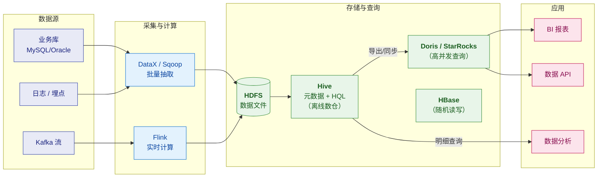

# 🐝 Hive 总览

> 这是 Apache Hive 系列笔记的**总入口（MOC）**，对应大数据存储版图里的「**把 HDFS 上的文件变成可查询的表**」这一环。
> 系列回答四个层次：**① 集群怎么运转（架构与执行引擎）② 表怎么建（数据模型与表设计）③ SQL 怎么写才快（HQL 与优化）④ 生产怎么不踩坑（坑与调优）**。
> 关联：[[5-bigdata/2-hbase/0-HBase总览|HBase 系列]]（随机读写）、[[5-bigdata/1-doris/0-Doris总览|Doris 系列]]（OLAP 查询）、[[5-bigdata/3-StarRocks/0-StarRocks总览|StarRocks 系列]]、[[5-bigdata/0-flink/0-Flink总览|Flink 系列]]（上游计算）。
> 简历口径（"精通 Hadoop/Hive/HBase"）的速答版见 [[面试准备/专业技能/05-大数据与流计算|05-大数据与流计算]]，本系列是它的深度展开。

> [!note] 版本口径
> 以 **Hive 3.x / 4.x 为基线**表述；涉及 1.x/2.x 的行为差异（如 `LOAD DATA` 语义、ACID 默认值、Spark/Tez 引擎切换）会明确标注。
> **你自己的自测环境**：[[服务器巡检-192.168.0.106/部署记录-Hadoop+Hue|106 大数据机]] 上 Docker 跑着
> **Hive 4.0.0 + Tez + HDFS(Hadoop 3.3.6) + MySQL Metastore + Hue**，可以直接动手验证。

> [!important] ⭐ 本系列与已有笔记的分工（重要，别重复读）
> 你在 `服务器巡检-192.168.0.106/` 下已经有一批**实战运维文档**，本系列**不重复它们**：
>
> | 已有笔记 | 是什么 | 本系列如何处理 |
> |---|---|---|
> | [[服务器巡检-192.168.0.106/Hive数据加载方案]] | **生产加载方案 v2**：七道关卡、故障矩阵、幂等脚本 | 本系列讲**原理与设计**，加载实践**指向它** |
> | [[服务器巡检-192.168.0.106/Kafka入Hive实操手册]] | Kafka→Flink→Hive 的**落地步骤** | 链路细节指向它 |
> | [[服务器巡检-192.168.0.106/部署记录-Hadoop+Hue]] | **环境搭建记录**（含踩坑） | 环境类问题指向它 |
> | [[服务器巡检-192.168.0.106/Hive数据加载方案]] §七 | 学习 vs 生产的**差距清单** | 见本系列 [[4-生产坑与调优]] |

---

## 一、系列导航

| # | 笔记 | 一句话定位 | 核心内容 |
|---|---|---|---|
| 1 | **[[1-架构与原理]]** | 集群怎么运转 | Metastore/HiveServer2/Driver 三角色、**HQL → 执行计划 → Tez/MR** 的全过程、Metastore 元数据模型、为什么 Hive "慢" |
| 2 | **[[2-数据模型与表设计]]** | 表怎么建才对 | **内部表 vs 外部表**、分区 vs 分桶、文件格式（TextFile/ORC/Parquet）、**ORC 为什么快**、建表参数速查 |
| 3 | **[[3-HQL与SQL优化]]** | 慢 SQL 怎么治 | 执行计划解读、**Join 优化与数据倾斜**、**小文件治理**、谓词下推、分区裁剪、常用调优参数 |
| 4 | **[[4-生产坑与调优]]** | 集群怎么不炸 | **高频生产坑**（现象→根因→定位→修复）、Metastore/Tez/YARN 故障、上线 Checklist |
| 5 | **[[5-Hive面试高频题]]** | 面试怎么答 | 八大必答 + 快问快答 + 易错陷阱 + 场景设计题 |

---

> [!tip] 画图约定
> 本库支持 Mermaid（已装 mermaid-popup / mermaid-zoom）。本系列的图**优先用 Mermaid**，只有"依赖精确对齐"的图（执行计划文本、命令输出样本）才保留 ASCII。规范详见 [[1-java/0-知识点/0-Java总览|Java 总览]] §七「文档写作约定」。

## 二、按需求的阅读路径

> [!tip] 三条路径
> **面试突击（1 天）**：[[5-Hive面试高频题]] → [[2-数据模型与表设计]]（内外表/分区/分桶/ORC）→ [[3-HQL与SQL优化]]（数据倾斜 + 小文件）
> **上手干活（3～5 天）**：[[1-架构与原理]] → [[2-数据模型与表设计]] → [[3-HQL与SQL优化]] → 再配合 [[服务器巡检-192.168.0.106/Hive数据加载方案|生产加载方案]] 动手
> **排障/调优（按需查）**：[[4-生产坑与调优]] → [[3-HQL与SQL优化]] → [[服务器巡检-192.168.0.106/Hive数据加载方案]] §六故障矩阵

---

## 三、30 秒速查表

| 问题 | 一句话答案 | 详见 |
|---|---|---|
| Hive 是什么 | **把 HDFS 上的文件映射成表，用 SQL（HQL）来查询**的数据仓库工具 | [[1-架构与原理]] |
| Hive 的本质 | ⭐ **不是数据库，是"SQL → 分布式计算作业"的翻译器**（自己不存数据、不做计算） | [[1-架构与原理]] |
| 三个核心组件 | **Metastore**（元数据）+ **HiveServer2**（服务）+ **Driver**（编译执行） | [[1-架构与原理]] |
| 元数据存在哪 | **关系型数据库**（MySQL/PostgreSQL/Derby）——**不是 HDFS** | [[1-架构与原理]] |
| 数据存在哪 | **HDFS**（Hive 只管元数据，不碰数据文件） | [[1-架构与原理]] |
| HQL 怎么执行 | 解析 → 编译 → 优化 → **生成 Tez/MR/Spark 作业** → YARN 执行 | [[1-架构与原理]] |
| Hive 为什么慢 | ⭐ **它是批处理引擎**：作业启动开销大（秒级～分钟级），**不是为交互式查询设计的** | [[1-架构与原理]] |
| **内部表 vs 外部表** | 内部表 `DROP` **删数据**；外部表 `DROP` **只删元数据** | [[2-数据模型与表设计]] |
| 什么时候用外部表 | ⭐ **数据是"共享的/原始的/别人产的"就用外部表**（如 ODS 层） | [[2-数据模型与表设计]] |
| 分区 vs 分桶 | **分区 = 目录级裁剪**（减少扫描）；**分桶 = 文件级**（采样/Join 优化） | [[2-数据模型与表设计]] |
| 分区字段能建索引吗 | ❌ **不能**——分区是**目录**，不是列 | [[2-数据模型与表设计]] |
| 选什么文件格式 | ⭐ **ORC（或 Parquet）**，不要用 TextFile 存分析表 | [[2-数据模型与表设计]] |
| ORC 为什么快 | **列存 + 谓词下推 + 统计信息（min/max）+ 压缩** | [[2-数据模型与表设计]] |
| 动态分区要注意什么 | ⚠️ **要设上限**（`hive.exec.max.dynamic.partitions`），否则小文件爆炸 | [[3-HQL与SQL优化]] |
| 数据倾斜怎么治 | ① **空值过滤** ② **加盐打散** ③ **Map Join** ④ `hive.groupby.skewindata` | [[3-HQL与SQL优化]] |
| 小文件怎么治 | **合并（`concatenate`/`merge`）+ 控制 Reduce 数 + 源头攒批** | [[3-HQL与SQL优化]] |
| 为什么会有小文件 | ⭐ **每个 Reduce/分区产生一个文件**——Reduce 数 × 分区数 = 文件数 | [[3-HQL与SQL优化]] |
| Map Join 是什么 | 小表**广播到每个 Map**，避免 Reduce 阶段——**消除倾斜的利器** | [[3-HQL与SQL优化]] |
| Sort Merge Bucket Join | 两表**按同一列分桶同数量** → 可做桶级 Join，**免全量 Shuffle** | [[2-数据模型与表设计]] |
| 谓词下推是什么 | 把过滤条件**尽量推到扫描阶段**，减少后续处理数据量 | [[3-HQL与SQL优化]] |
| 分区裁剪何时失效 | ⭐ **分区列上套函数/隐式转换**（如 `WHERE dt > date_sub(...)` 可能失效） | [[3-HQL与SQL优化]] |
| 元数据出错怎么办 | ⚠️ **元数据与 HDFS 不一致**（表指向不存在的目录 / 目录无对应分区） | [[4-生产坑与调优]] |
| 最常见的生产事故 | **小文件过多、数据倾斜、元数据不同步、OOM** | [[4-生产坑与调优]] |

---

## 四、核心概念最小记忆集

| 概念 | 精确定义 | 常见误解 |
|---|---|---|
| **Hive** | 建立在 Hadoop 之上的**数据仓库基础设施**，提供 HQL 与元数据管理 | 以为它是数据库（**它不存数据、不做计算**） |
| **Metastore** | 存**表结构/分区/列类型/存储位置**的元数据服务 | 以为元数据在 HDFS 上 |
| **HiveServer2** | 对外提供 JDBC/ODBC/Thrift 服务（beeline 连的就是它） | 与 Metastore 混淆 |
| **Driver** | 把 HQL 编译成执行计划并提交作业 | 以为 Hive 自己执行计算 |
| **内部表（Managed）** | Hive **管理数据生命周期**，`DROP` 删数据 | 以为内外表只是"权限差别" |
| **外部表（External）** | Hive **只管元数据**，`DROP` 不删数据 | 同上 |
| **分区（Partition）** | **目录级**的数据划分（如 `dt=2026-10-13`） | 以为是数据库的分区表（有索引） |
| **分桶（Bucket）** | 分区内**按 hash 切成固定数量文件** | 与分区混淆 |
| **ORC** | 列式存储格式，带索引与统计信息 | 以为只是"压缩格式" |
| **SerDe** | 序列化/反序列化器，决定**文件怎么解析成行** | 忽视它的作用（解析出错常见） |
| **数据倾斜** | 少数 key 的数据量远超其他，拖慢整体 | 以为只是"数据量大" |
| **小文件问题** | 大量小文件拖垮 NameNode 与查询性能 | 以为小文件只是"占空间" |
| **Tez** | DAG 执行引擎，**比 MR 少落地中间结果** | 以为和 MR 差不多 |
| **谓词下推** | 过滤条件尽量推到扫描层 | 以为优化器总会自动做好 |
| **ACID 表** | Hive 的事务表（支持行级更新/删除） | 以为 Hive 完全不能更新 |

> [!warning] 六个最经典的认知误区
> 1. **"Hive 是数据库"** —— ❌ Hive **不存数据**（在 HDFS）、**不做计算**（交给 Tez/MR/Spark）、
>    **不支持行级更新**（除非 ACID 表）。**它是"SQL 翻译器 + 元数据服务"。**
> 2. **"元数据存在 HDFS"** —— ❌ 存在**关系型数据库**（MySQL 等）。
>    **所以删了 MySQL 里的 metastore 库，HDFS 数据还在但表全没了。**
> 3. **"分区就是加索引"** —— ❌ 分区是**目录**，作用是**跳过不相关的目录**（减少扫描）。
>    **分区列上套函数会让"分区裁剪"失效。**
> 4. **"内部表和外部表没区别"** —— ❌ `DROP` 时**内部表删数据、外部表不删**。
>    **用错了会误删数据。**
> 5. **"Hive 慢是因为数据量大"** —— 更根本的原因是**作业启动开销大**（YARN 申请容器、Tez 初始化），
>    **哪怕查 1 行也可能跑几十秒**。
> 6. **"ORC 只是压缩格式"** —— ❌ 它是**列存**，附带**统计信息、谓词下推、索引**——
>    **这是它比 TextFile 快一个量级的原因，不是压缩比。**

---

## 五、Hive 在大数据版图里的位置

> [!important] Hive 的定位（要说准）
> **Hive 是"离线数仓的底座"**——
> - **存**：数据在 HDFS（Hive 只管元数据）
> - **算**：计算交给 **Tez / MR / Spark**（Hive 只负责"翻译"）
> - **用**：面向**批量、T+1、海量数据**的分析
>
> **它不是**：不是交互式查询引擎（那是 Doris/StarRocks 的地盘）、
> 不是随机读写存储（那是 HBase）、不是实时计算（那是 Flink）。
>
> 👉 **一条实用的选型判断**：
> | 需求 | 选谁 |
> |---|---|
> | **T+1 海量批处理、ETL 清洗** | ⭐ **Hive** |
> | **秒级/亚秒级高并发查询** | Doris / StarRocks |
> | **按 key 随机读写、点查** | HBase |
> | **实时流计算** | Flink |
> | **交互式 BI 探索** | Doris / StarRocks（或 Presto/Trino） |

---

## 六、学习检查清单

- [ ] ⭐ 能说清 **Hive 的本质**（不是数据库，是 SQL 翻译器 + 元数据服务）
- [ ] 能画出 **Metastore / HiveServer2 / Driver** 的分工，并说清元数据与数据分别在哪
- [ ] ⭐ 能完整讲出 **HQL 从提交到执行**的全过程（含涉及的组件）
- [ ] 能解释 **Hive 为什么慢**（作业启动开销，而非数据量）
- [ ] ⭐ 能说清**内部表与外部表的区别**，并判断什么场景用哪个
- [ ] 能说清**分区与分桶的区别**，以及各自的适用场景
- [ ] 能解释**为什么分区列不能建索引**、为什么分区列套函数会失效
- [ ] ⭐ 能说清 **ORC 为什么比 TextFile 快**（列存 + 统计信息 + 谓词下推）
- [ ] 能说清**数据倾斜的至少四种治法**
- [ ] ⭐ 能解释**小文件是怎么产生的**（Reduce 数 × 分区数）及治理思路
- [ ] 能说清 **Map Join 的原理**与适用条件
- [ ] 能说清 **Sort Merge Bucket Join** 的前提与收益
- [ ] ⭐ 能在 **Hive / Doris / HBase / Flink** 之间做出有理由的选型
- [ ] 能说出**至少三种 Hive 生产事故**（小文件/倾斜/元数据不同步）

---
> [!question] 还需要补充什么？
> 可继续扩展的方向：**Hive on Spark 深入**、**ACID 事务表与行级更新**、
> **Hive 3.x 的 LLAP**（交互式查询）、**元数据治理与数据血缘**、
> **Hive 与 Iceberg/Hudi 的湖仓集成**、**HiveServer2 高可用与权限（Ranger/Sentry）**。
> 需要哪块就新开一篇并在上方导航表登记。

#Hive #数仓 #大数据 #HQL #离线数仓 #MOC
