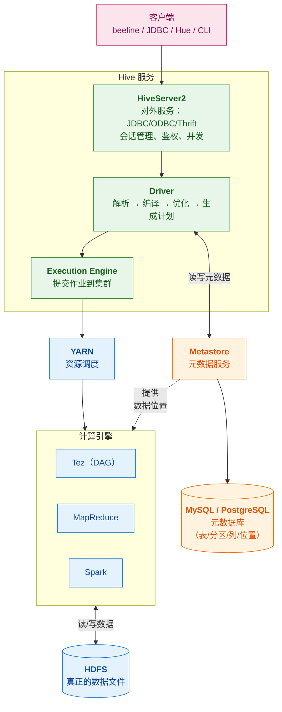
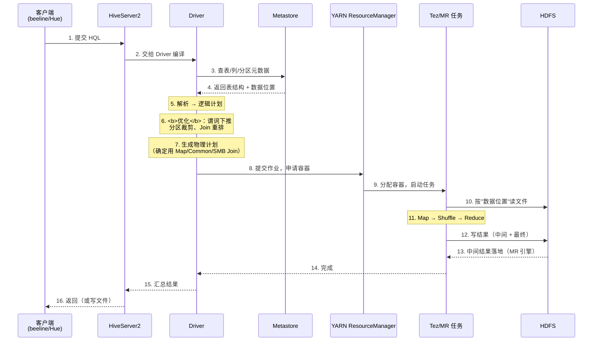
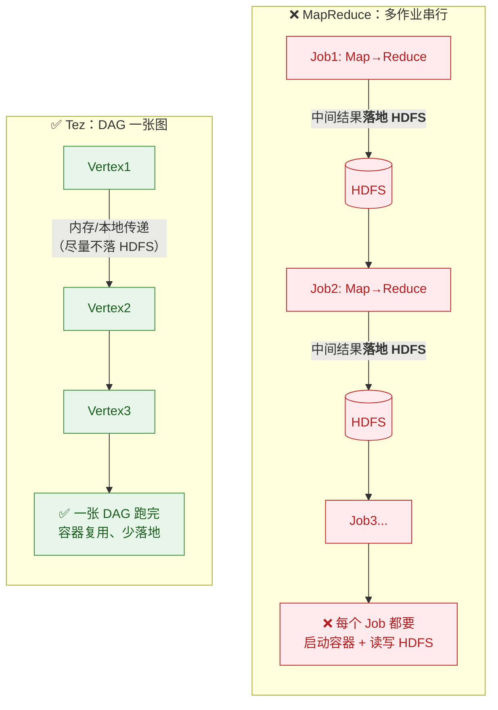
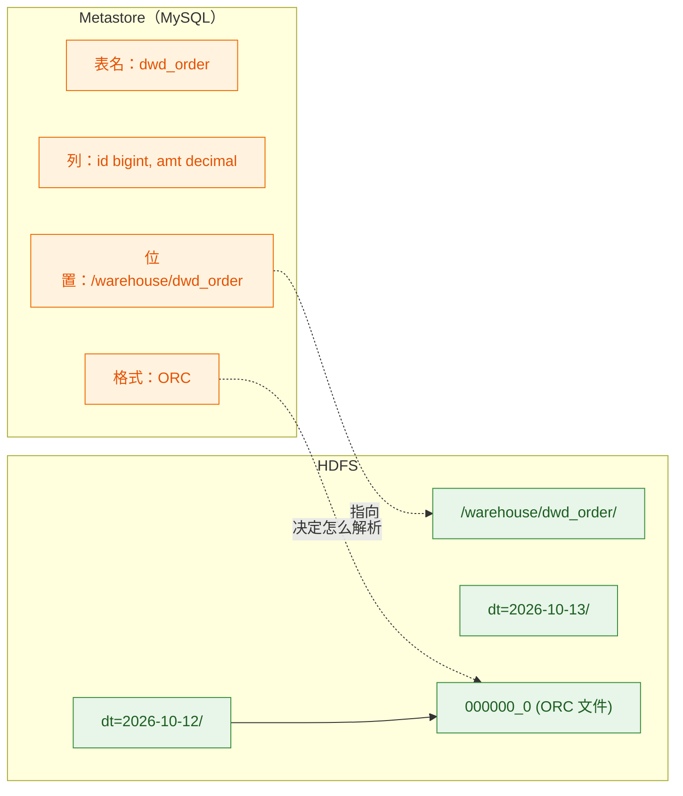

# 🏗️ 一、Hive 架构与原理

> 本篇回答五个问题：**Hive 到底由哪些组件构成**、**元数据和数据分别存在哪**？
> **一条 HQL 从提交到出结果经历了什么**？**Hive 为什么慢**？以及**Hive 与应用的关系**。
> 系列导航见 [[0-Hive总览]]；表设计与格式见 [[2-数据模型与表设计]]；慢 SQL 治理见 [[3-HQL与SQL优化]]。

---

## 一、Hive 是什么：先破除一个根本误解

> [!danger] ⭐ 最容易搞错的认知
> **Hive 不是数据库。**
>
> | Hive **不做什么** | 谁来做 |
> |---|---|
> | ❌ **不存数据** | **HDFS**（或对象存储 S3/OSS） |
> | ❌ **不做计算** | **Tez / MapReduce / Spark**（跑在 YARN/K8s 上） |
> | ❌ **不管理事务**（默认） | HDFS 无事务；只有 ACID 表才有 |
> | ❌ **不保证低延迟** | 作业启动就要秒级～分钟级 |
>
> **Hive 做的是两件事：**
> 1. **管理元数据**（表结构、分区、列类型、数据位置）→ **Metastore**
> 2. **把 HQL 翻译成分布式计算作业** → **Driver**

### 1.1 一句话定义

> [!important] 一句话
> **Hive = 把 HDFS 上的文件"映射成表"，并把 SQL 翻译成分布式计算作业的中间层。**
>
> 用户写的是 **SQL（HQL）**，跑起来的是 **Tez/MR/Spark 作业**——
> **Hive 是这两者之间的翻译器 + 元数据管理员。**

---

## 二、三大组件



### 2.1 Metastore（元数据服务）⭐ 最核心

> [!important] Metastore 存什么
> **它存的是"表长什么样、数据在哪"，不存数据本身：**
> - **库/表/视图**的定义
> - **列名、列类型、注释**
> - **分区信息**（有哪些分区、每个分区的 HDFS 路径）
> - **存储信息**（文件格式、SerDe、压缩方式、分隔符）
> - **表的类型**（内部表/外部表）
> - **统计信息**（行数、文件数、大小——供 CBO 用）

**两层结构**：

| 层 | 是什么 | 说明 |
|---|---|---|
| **Metastore Service** | 一个**服务进程**，对外提供 Thrift 接口 | 客户端/引擎通过它读写元数据 |
| **元数据库（RDBMS）** | **MySQL / PostgreSQL / Derby** 等 | 元数据实际**落库**的地方 |

> [!danger] ⭐ 三个由此推出的重要结论
> **① 元数据不在 HDFS 上，在关系型数据库里。**
> → **所以删了 MySQL 的 metastore 库，HDFS 上数据还在，但所有表都"消失"了。**
> → 这也是为什么 **Metastore 的 MySQL 必须备份**。
>
> **② Derby 只能单连接（生产禁用）。**
> → Hive 内置的 **Derby 是嵌入式单用户**数据库，**只适合本地试用**。
> → 生产必须换成 **MySQL/PostgreSQL**（支持多连接、可高可用）。
> → 👉 **你的环境用的就是 MySQL**（见 [[服务器巡检-192.168.0.106/部署记录-Hadoop+Hue]]）。
>
> **③ Metastore 是 Hive 的单点。**
> → 它挂了，**所有 HQL 都不能用**（连表结构都读不到）。
> → 生产要配**高可用**（多 Metastore 实例 + MySQL 主从）。

**元数据表长什么样**（MySQL 里能看到）：

| 表 | 存什么 |
|---|---|
| `DBS` | 数据库 |
| `TBLS` | 表 |
| `COLUMNS_V2` | 列定义 |
| `PARTITIONS` | **分区** |
| `SDS` | 存储描述（位置、格式、SerDe） |
| `TABLE_PARAMS` | 表属性（`external`、统计信息等） |

### 2.2 HiveServer2

| 职责 | 说明 |
|---|---|
| **对外协议** | **JDBC / ODBC / Thrift**——beeline、Hue、BI 工具都连它 |
| **会话管理** | 每个连接一个 session，管理会话级配置 |
| **鉴权** | 用户名密码 / Kerberos / LDAP |
| **并发** | 支持多客户端并发提交查询 |
| **执行隔离** | 可配队列、资源池 |

> [!note] 和 Metastore 的区别（常被混淆）
> - **Metastore**：管**元数据**，不执行 SQL
> - **HiveServer2**：管**会话与 SQL 执行入口**
>
> **beeline 连的是 HiveServer2（默认 10000 端口）**，
> 而不是 Metastore（默认 9083 端口）。
> 你的环境里两者都有：`hive-server:10000` 与 `hive-metastore:9083`。

### 2.3 Driver

**Driver 是"编译流水线"**，把 HQL 变成可执行的作业计划：

| 阶段 | 做什么 |
|---|---|
| **Parser（解析）** | HQL → **AST（抽象语法树）**；语法错误在这报 |
| **Semantic Analyzer（语义分析）** | 查 Metastore 校验表/列是否存在；AST → **逻辑计划（Operator Tree）** |
| **Logical Optimizer（逻辑优化）** | **谓词下推、列裁剪、分区裁剪、Join 重排** |
| **Physical Plan Generator** | 逻辑计划 → **物理计划**（决定用 Map Join 还是 Common Join 等） |
| **Physical Optimizer** | 物理层优化（如合并相邻 Map） |
| **Execution** | 提交到 **Tez/MR/Spark**，由 YARN 调度 |

> [!important] ⭐ 关键理解
> **Driver 本身不做计算，它只"编译"。**
> 真正的计算发生在**集群的容器里**（YARN 上的 Tez/MR 任务）。
>
> **所以"Hive 慢"的很大一部分，是慢在"编译 + 申请资源 + 启动容器"，
> 而不是慢在"算数据"。**

---

## 三、⭐ 一条 HQL 的完整生命周期



> [!important] ⭐ 从这张图能读出 Hive "慢"的三个来源
> | 阶段 | 耗时 |
> |---|---|
> | **① 编译 + 查元数据**（步骤 3~7） | 秒级（复杂 SQL 更久） |
> | **② 申请资源 + 启动容器**（步骤 8~9） | ⭐ **秒级～分钟级**（YARN 排队更久） |
> | **③ 真正计算**（步骤 10~14） | 取决于数据量与倾斜 |
>
> **所以"查 1 行也要几十秒"是正常的**——
> **主要开销在 ①②，不在计算本身。**
>
> 👉 **这也是为什么 Hive 不适合交互式查询**——
> 交互式需求应该用 **Doris/StarRocks**（常驻服务，无作业启动开销）。

### 3.1 为什么 Tez 比 MR 快



| 维度 | **MapReduce** | **Tez** |
|---|---|---|
| 执行模型 | **多个 Job 串行** | **一张 DAG** |
| 中间结果 | **每个 Job 落地 HDFS** | ⭐ **尽量不落**（内存/本地） |
| 容器 | 每个 Job 重新申请 | ⭐ **复用** |
| 启动开销 | **每个 Job 一次** | **整个 DAG 一次** |
| 性能 | 基准 | ⭐ **通常快数倍** |

> [!important] 结论
> **Tez 快的核心是"减少落地 + 复用容器 + 一次启动"。**
> 你的环境用的就是 **Tez**（见 [[服务器巡检-192.168.0.106/部署记录-Hadoop+Hue]]）——
> 所以你会感觉比"教科书上的 Hive on MR"快不少。

---

## 四、Hive 的存储与"表"是什么

### 4.1 表 = 目录 + 元数据

> [!important] ⭐ 这是理解 Hive 的关键
> **一张 Hive 表，本质上是：**
> **① HDFS 上的一个目录**（数据文件放在里面）
> **② Metastore 里的一条元数据记录**（指向那个目录，并描述怎么解析文件）
>
> **两者必须一致**——不一致就是常见故障（见 [[4-生产坑与调优]]）。



### 4.2 两种常见故障（先建立印象）

| 故障 | 现象 | 根因 |
|---|---|---|
| **元数据有、数据没了** | 查询报 `FileNotFoundException` / 返回空 | 有人直接删了 HDFS 目录，**但没删分区** |
| **数据有、元数据没了** | HDFS 有目录，但 `SHOW PARTITIONS` 看不到 | 有人直接 `put` 文件进去，**没 `ADD PARTITION`** |

> [!tip] 这两条对应你的生产方案里的"七道关卡"
> 见 [[服务器巡检-192.168.0.106/Hive数据加载方案]]——
> 那里的 **G3 挂载**（`ADD PARTITION`）和 **G6 终检**就是在保证这两者一致。
> **本系列讲原理，那篇讲流程。**

---

## 五、Hive 的版本演进与执行引擎选择

| 版本 | 关键变化 | 影响 |
|---|---|---|
| **1.x** | 基础版本，**只有 MR 引擎**；`LOAD DATA` 语义变化 | 慢 |
| **2.x** | **支持 Tez / Spark**；LLAP 引入；**`hive.exec.dynamic.partition.mode` 默认变 strict** | 性能提升，但动态分区要显式配 |
| **3.x** | **ACID 增强**（支持更多操作）；默认引擎倾向 **Tez**；**`LOAD DATA` 对内部表是移动** | 生产主流 |
| **4.x** | 继续演进（**你的环境是 4.0.0**） | —— |

### 5.1 三种执行引擎对比

| 引擎 | 特点 | 适用 |
|---|---|---|
| **MapReduce** | 最稳、最慢、资源占用可控 | 超大作业、稳定性优先；**现在很少用** |
| **Tez** | ⭐ **DAG 执行、少落地、容器复用** | **生产默认推荐** |
| **Spark** | 内存计算、与 Spark 生态统一 | 已有 Spark 集群；注意**内存调优** |

**切换方式**：

```sql
-- 会话级切换
SET hive.execution.engine=tez;      -- 或 mr / spark

-- 也可以写在 hive-site.xml 里持久生效
```

> [!warning] ⚠️ 引擎选择的实务建议
> **① 默认用 Tez**——在 Hive 场景里它通常是"性能与稳定"的最佳平衡。
> **② 不要频繁切换**——不同引擎的资源模型不同（Tez 吃容器、Spark 吃内存），
> **混用容易把集群资源算错。**
> **③ Spark 引擎的内存参数要单独调**——直接切过去很可能 OOM。

---

## 六、Hive 的局限性（⭐ 要能主动说）

> [!important] 知道边界比知道功能更显专业

| 局限 | 说明 | 替代方案 |
|---|---|---|
| **延迟高** | 作业启动开销大（秒级～分钟级） | Doris/StarRocks（交互式）、Presto/Trino |
| **不支持行级更新/删除**（默认） | 只能 `INSERT OVERWRITE` 整分区 | **ACID 表**（有限支持）、Hudi/Iceberg（湖格式） |
| **不支持高并发点查** | 为批处理设计 | **HBase**（按 key 随机读写） |
| **事务能力弱** | 默认无事务 | ACID 表 / 湖格式 |
| **优化器能力有限** | CBO 相对简单（尤其老版本） | 需要人工调优（见 [[3-HQL与SQL优化]]） |
| **依赖外部组件多** | Metastore + HDFS + YARN + 元数据库 | —— |

> [!success] 面试可以这样表述
> **"Hive 的定位很清楚：离线批处理。它不适合交互式查询、不适合随机读写。
> 所以一个成熟的数据平台通常是组合：Hive 做 T+1 海量 ETL 和明细存储，
> Doris/StarRocks 做高并发查询，HBase 做点查，Flink 做实时。
> **Hive 是底座，不是终点。**"

---

## 七、30 秒速查表

| 问题 | 一句话答案 |
|---|---|
| Hive 是什么 | **把 HDFS 文件映射成表 + 把 SQL 翻译成分布式作业**的中间层 |
| Hive 存数据吗 | ❌ **不存**——数据在 HDFS |
| Hive 做计算吗 | ❌ **不做**——交给 Tez/MR/Spark |
| 三个核心组件 | **Metastore**（元数据）+ **HiveServer2**（服务）+ **Driver**（编译） |
| 元数据存在哪 | ⭐ **关系型数据库**（MySQL/PostgreSQL），**不是 HDFS** |
| Derby 能用吗 | ⚠️ **只能单连接**，生产必须换 MySQL/PG |
| 删了 metastore 库会怎样 | ⭐ **HDFS 数据还在，但表全"消失"** |
| beeline 连谁 | **HiveServer2**（10000），不是 Metastore（9083） |
| HQL 执行流程 | **解析 → 语义分析 → 逻辑优化 → 物理计划 → 提交 Tez/MR** |
| Driver 做计算吗 | ❌ **只编译**，计算在集群容器里 |
| Hive 为什么慢 | ⭐ **作业启动开销**（申请资源+启容器），不是数据量 |
| Tez 为什么比 MR 快 | **DAG 一次跑完 + 中间结果少落地 + 容器复用** |
| 表到底是什么 | ⭐ **HDFS 目录 + Metastore 元数据**，两者必须一致 |
| 元数据与数据不一致会怎样 | 报错或查不到数据（见生产坑） |
| 生产用什么引擎 | ⭐ **Tez**（性能与稳定的平衡） |
| Hive 不适合什么 | 交互式查询、行级更新、高并发点查、实时计算 |

---

## 八、学习检查清单

- [ ] ⭐ 能说清 **Hive 不做什么**（不存数据、不做计算、不管事务）
- [ ] 能画出 **Metastore / HiveServer2 / Driver** 的架构图并说清分工
- [ ] ⭐ 能说清 **Metastore 的两层结构**（服务 + 元数据库）与它存什么
- [ ] ⭐ 能说出**元数据不在 HDFS** 这个结论及三个推论（备份/Derby/单点）
- [ ] 能区分 **HiveServer2（10000）与 Metastore（9083）**
- [ ] ⭐ 能完整讲出 **HQL 的生命周期**（含涉及的组件与顺序）
- [ ] ⭐ 能解释 **Hive 为什么慢**（三个来源，重点是作业启动）
- [ ] 能说清 **Tez 比 MR 快的三个原因**
- [ ] ⭐ 能解释"**表 = 目录 + 元数据**"，并说出两种不一致故障
- [ ] 能说出 **1.x / 2.x / 3.x / 4.x** 的关键变化
- [ ] 能对比 **MR / Tez / Spark** 三种引擎并给出选择建议
- [ ] ⭐ 能主动说出 **Hive 的六个局限**及各自的替代方案
- [ ] 能用"**Hive 是底座不是终点**"组织一段选型表述

---
> 下一篇 → [[2-数据模型与表设计]] ｜ 返回 [[0-Hive总览]]
> 实战环境 → [[服务器巡检-192.168.0.106/部署记录-Hadoop+Hue]] ｜ 加载方案 → [[服务器巡检-192.168.0.106/Hive数据加载方案]]
