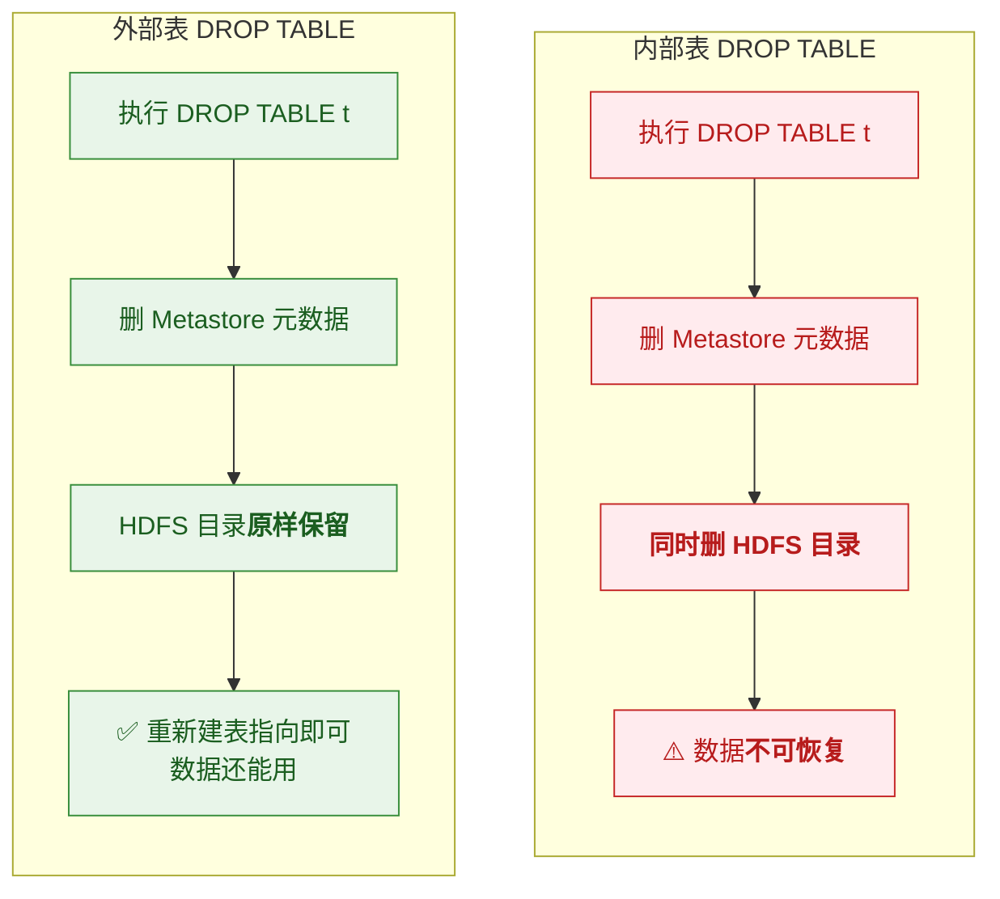
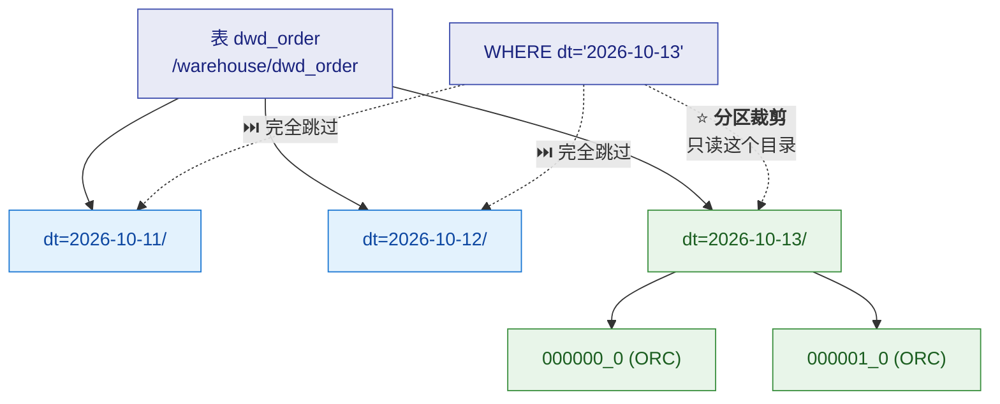
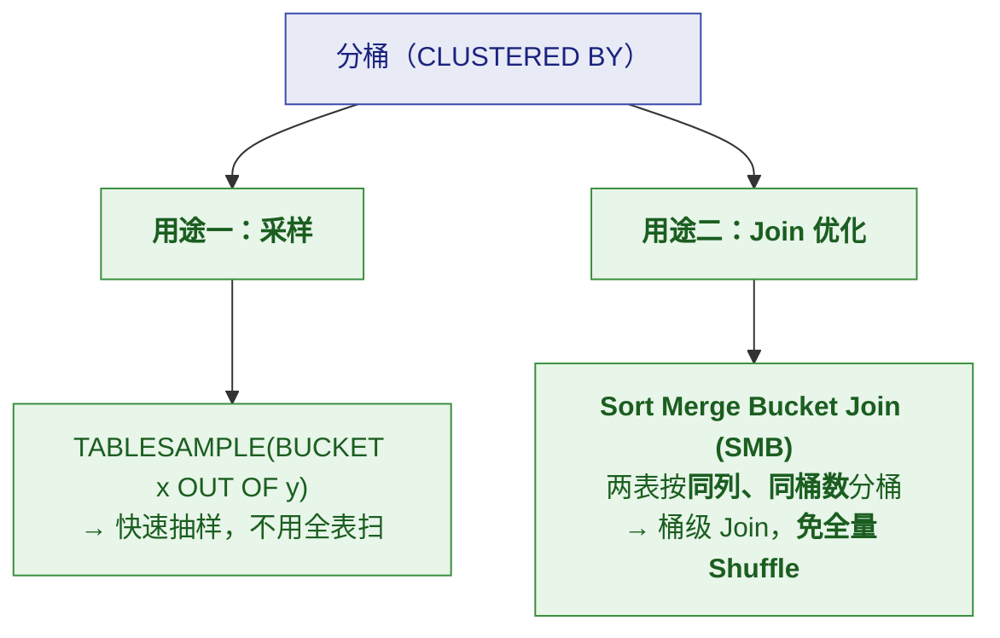
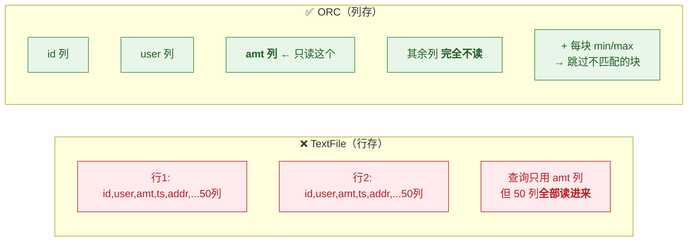
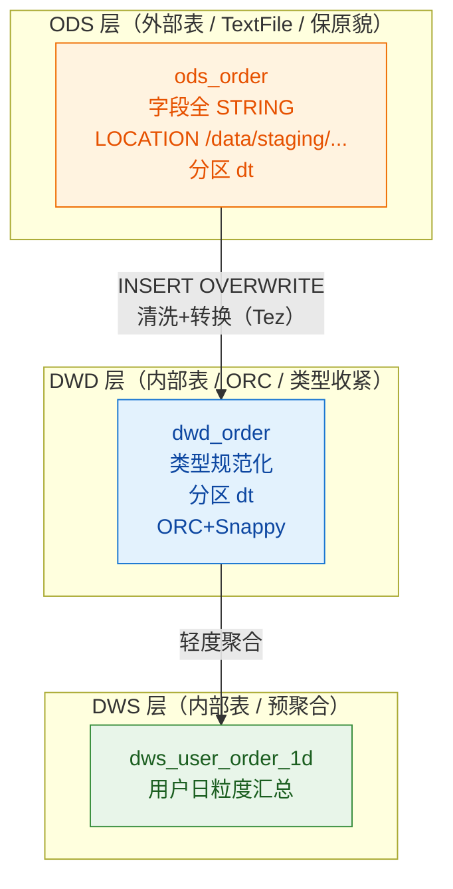

# 🗂️ 二、Hive 数据模型与表设计

> 本篇回答六个问题：**内部表和外部表怎么选**？**分区和分桶到底解决什么问题**？
> **文件格式选哪个、ORC 为什么快**？**SerDe 是什么**？**建表时哪些参数最关键**？
> 以及**一个完整的业务表怎么设计**。
> 前置见 [[1-架构与原理]]；优化见 [[3-HQL与SQL优化]]。

---

## 一、内部表 vs 外部表（⭐ 最必须分清）

### 1.1 一句话区别

> [!important] 核心差别只在 **`DROP TABLE` 时的行为**
>
> | | **内部表（Managed）** | **外部表（External）** |
> |---|---|---|
> | `DROP TABLE` | ⭐ **删元数据 + 删数据** | ⭐ **只删元数据，数据保留** |
> | 数据生命周期 | Hive 管理 | **不由 Hive 管理** |
> | 建表关键字 | 默认（或 `MANAGED`） | `CREATE EXTERNAL TABLE` |
> | 也常叫 | 管理表 | 外表 |



### 1.2 ⭐ 怎么选（判断标准）

> [!important] 一句话判断标准
> **"这份数据是 Hive 独占的，还是共享的/原始的/别人产的？"**
> - **Hive 独占、且可由 Hive 重建** → **内部表**
> - **共享的 / 原始的 / 别人产的 / 还要被别的引擎用** → **外部表**

| 层级 | 推荐 | 理由 |
|---|---|---|
| **ODS（贴源层）** | ⭐ **外部表** | 数据是"原始凭证"，**不能被 Hive 删掉**；可能被 Spark/Flink 共用 |
| **DWD / DWS（加工层）** | ⭐ **内部表** | 数据由 Hive 自己产出，**可以重建**（重跑 ETL 即可） |
| **ADS（应用层）** | 内部表 | 同上 |
| **临时中间表** | 内部表 | 用完就删 |
| **挂载外部系统数据**（如 HBase、其他集群） | 外部表 | 数据不属于 Hive |

> [!success] 你的生产方案正是这个思路
> 见 [[服务器巡检-192.168.0.106/Hive数据加载方案]] §二：
> **ODS 用 `EXTERNAL`**（"删表不删数据"，忠实保存原貌），
> **DWD 用内部表**（"ORC 列存 + 类型收紧，是给下游用的合格品"）。
>
> **这不是随意选的，而是数据生命周期管理的必然选择。**

> [!danger] ⚠️ 一个真实的误删场景
> **典型事故**：有人把 ODS 层建成**内部表**，
> 某次清理时 `DROP TABLE ods_xxx` → **原始数据被删**，
> 而上游数据源已经清理 → **数据永久丢失**。
>
> **所以 ODS 层强烈建议一律用外部表**——这是"成本极低的保险"。

### 1.3 建表示例

```sql
-- ✅ 外部表（ODS 层）：指定 LOCATION，数据由外部管理
CREATE EXTERNAL TABLE ods_order (
    order_id     STRING COMMENT '订单号',
    user_id      STRING,
    amount       STRING COMMENT '金额（先用 STRING 保原貌）',
    create_time  STRING
)
COMMENT '订单原始数据（贴源）'
ROW FORMAT DELIMITED FIELDS TERMINATED BY '\t'
STORED AS TEXTFILE
LOCATION '/data/staging/ods/order';

-- ✅ 内部表（DWD 层）：Hive 管理，ORC 列存
CREATE TABLE dwd_order (
    order_id     BIGINT,
    user_id      BIGINT,
    amount       DECIMAL(18,2) COMMENT '金额（类型收紧）',
    create_time  TIMESTAMP
)
COMMENT '订单明细（清洗后）'
PARTITIONED BY (dt STRING COMMENT '业务日期')
STORED AS ORC
TBLPROPERTIES ('orc.compress'='SNAPPY');
```

> [!tip] 注意"类型策略"的差异（这是好实践）
> **ODS 用 STRING 保原貌**（避免解析失败丢数据），
> **DWD 收紧为正确类型**（便于计算和优化）。
> **这是"贴源层忠实、加工层规范"的落地。**

---

## 二、分区（Partition）⭐ 最有效的优化手段

### 2.1 分区是什么

> [!important] ⭐ 分区 = **HDFS 上的子目录**
> ```
> /warehouse/dwd_order/
>     dt=2026-10-11/       ← 一个分区 = 一个目录
>     dt=2026-10-12/
>     dt=2026-10-13/
> ```
>
> **查询时通过 `WHERE dt='2026-10-13'` 只扫对应目录 → "分区裁剪"。**



### 2.2 分区键怎么选

| 原则 | 说明 |
|---|---|
| **选低基数的"切分维度"** | 常见：**日期（dt）**、地区、业务线 |
| ⭐ **日期是最常用的分区键** | 因为**绝大多数分析都按时间范围** |
| **基数不能太高** | ⚠️ 如果分区键有几十万个值 → **几十万个小目录** → 灾难 |
| **不能是唯一值** | ❌ 用 `order_id` 做分区 = 每个分区一个文件 → **小文件地狱** |
| **多级分区** | 如 `dt` + `region`，但**层级别太多**（每多一层，目录数翻倍） |

> [!danger] ⚠️ 分区键选错的后果
> **分区键基数过高 → 海量小目录 → 元数据压力暴增 + NameNode 内存爆。**
>
> **判断标准**：**每个分区的数据量应该在"几百 MB 以上"**——
> 如果某个分区只有几 KB，说明分区太细了。

### 2.3 静态分区 vs 动态分区

| | **静态分区** | **动态分区** |
|---|---|---|
| 写法 | `PARTITION (dt='2026-10-13')` | `PARTITION (dt)`（从 SELECT 最后一列取） |
| 分区数 | **固定**（你写几个就几个） | **自动**（按数据里的值生成） |
| 适用 | 明确知道要写哪个分区 | 一次性写多个分区（如补数） |

```sql
-- 静态分区：必须显式指定
INSERT OVERWRITE TABLE dwd_order PARTITION (dt='2026-10-13')
SELECT order_id, user_id, amount, create_time FROM ods_order WHERE dt='2026-10-13';

-- 动态分区：分区值来自 SELECT 的<b>最后一列</b>
INSERT OVERWRITE TABLE dwd_order PARTITION (dt)
SELECT order_id, user_id, amount, create_time, dt   -- ⭐ dt 放最后
FROM ods_order;
```

> [!danger] ⚠️ 动态分区的三个硬性注意点
> **① 默认是 `strict` 模式**——要求**至少指定一个静态分区**，
> 否则报错。要全动态必须显式开：
> ```sql
> SET hive.exec.dynamic.partition.mode=nonstrict;
> ```
>
> **② 必须设分区数上限**——否则一条 SQL 可能生成几十万分区：
> ```sql
> SET hive.exec.max.dynamic.partitions=10000;              -- 全局上限
> SET hive.exec.max.dynamic.partitions.pernode=1000;       -- 单节点上限
> ```
>
> **③ 动态分区会产生大量小文件**——因为**每个分区至少要写一个文件**。
> 分区数 × Reduce 数 = 文件数。**这是小文件的主要来源之一。**
>
> 👉 详见 [[3-HQL与SQL优化]] 的小文件治理。

### 2.4 分区元数据要与 HDFS 保持一致

> [!warning] ⚠️ 分区是"两份记录"，必须同步
> | 位置 | 记录什么 |
> |---|---|
> | **HDFS** | `dt=2026-10-13/` 这个**目录存在** |
> | **Metastore** | `PARTITIONS` 表里**有这条分区记录** |
>
> **手动 `put` 文件到 HDFS 后，必须 `ADD PARTITION`**（或 `MSCK REPAIR TABLE`）——
> **否则 Hive 看不见这个分区。**

```sql
-- 方式一：手动添加
ALTER TABLE dwd_order ADD IF NOT EXISTS PARTITION (dt='2026-10-13');

-- 方式二：自动修复（扫描 HDFS 目录补全元数据）
MSCK REPAIR TABLE dwd_order;

-- 方式三：删除分区元数据（不删数据）
ALTER TABLE dwd_order DROP PARTITION (dt='2026-10-13');
```

> [!tip] 对应你的生产方案
> [[服务器巡检-192.168.0.106/Hive数据加载方案]] 的 **G3 挂载**关卡就是这一步；
> 而 **G2 上传** 强调"**tmp → 原子 rename**"，
> 是**为了避免下游读到"写了一半"的分区**——这是很成熟的实践。

---

## 三、分桶（Bucket）

### 3.1 分桶是什么

> [!important] 分区 vs 分桶（⭐ 核心区别）
> | | **分区（Partition）** | **分桶（Bucket）** |
> |---|---|---|
> | 粒度 | **目录级** | **文件级** |
> | 切分方式 | **按值切**（如 `dt`） | ⭐ **按 hash 取模切** |
> | 数量 | 动态（有多少值多少目录） | **固定**（建表时指定） |
> | 主要作用 | ⭐ **裁剪（减少扫描）** | ⭐ **采样 + Join 优化 + 均衡** |

```sql
CREATE TABLE dwd_order_bucketed (
    order_id BIGINT,
    user_id  BIGINT,
    amount   DECIMAL(18,2)
)
PARTITIONED BY (dt STRING)
CLUSTERED BY (user_id) INTO 16 BUCKETS     -- ⭐ 按 user_id 分 16 桶
STORED AS ORC;
```

**物理表现**：每个分区内，按 `hash(user_id) % 16` 分成 **16 个文件**：
```
dt=2026-10-13/
    000000_0    ← hash(user_id) % 16 == 0
    000001_0    ← == 1
    ...
    000015_0    ← == 15
```

### 3.2 分桶的两大用途



**① 采样**（快速探查数据）：
```sql
-- 取 1/10 的数据做探查，不用全表扫
SELECT * FROM dwd_order TABLESAMPLE(BUCKET 1 OUT OF 10 ON user_id);
```
> 用于"看一眼数据长什么样"（如探查脏数据、看分布），**比 `LIMIT` 更均匀**。

**② Sort Merge Bucket Join**：
```sql
-- 两表都按 user_id 分成 32 桶
-- → Hive 可以做"桶对桶"Join，不需要把数据全量 Shuffle
SET hive.optimize.bucketmapjoin=true;
SET hive.optimize.bucketmapjoin.sortedmerge=true;
SET hive.auto.convert.sortmerge.join=true;
```

| Join 方式 | 前提 | 收益 |
|---|---|---|
| **Common Join** | 无 | 基准（全量 Shuffle） |
| **Map Join** | 小表能进内存 | ⭐ **免 Reduce 阶段** |
| ⭐ **SMB Join** | **两表同列同桶数分桶** | ⭐ **桶级 Join，免全量 Shuffle** |

> [!warning] ⚠️ SMB Join 的严格要求（容易失败）
> **① 两表必须按"同一列"分桶**
> **② 桶数必须相同**（或成整数倍）
> **③ 必须都排好序**（`SORTED BY`）—— 所以叫 **Sort Merge** Bucket
> **④ 必须开对应参数**
>
> **任何一条不满足，优化就会静默失效**（退化成 Common Join）。
> **实践中 SMB 用得不多**（约束太严），
> **更常用的是 Map Join 和调参解决倾斜。**

### 3.3 分桶还解决什么

| 作用 | 说明 |
|---|---|
| **数据均衡** | hash 分桶让数据更均匀，**减少倾斜** |
| **抽样效率** | 桶级采样，成本低 |
| **Join 优化** | SMB Join |
| ⚠️ **注意** | **分桶数要选合适**——太少没意义，太多产生小文件 |

---

## 四、⭐ 文件格式（性能的决定性因素）

### 4.1 四种主流格式对比

| 格式 | 类型 | 压缩 | 查询性能 | 适用 |
|---|---|---|---|---|
| **TextFile** | **行存** | 可（但整体压） | 🐢 **慢** | **贴源层（ODS）**、交换数据 |
| **ORC** | **列存** | ✅ 极好 | ⭐ **快** | ⭐ **数仓主力**（Hive 原生优化） |
| **Parquet** | **列存** | ✅ 极好 | ⭐ **快** | **跨引擎**（Spark/Presto 生态） |
| **SequenceFile** | 行存二进制 | ✅ | 中 | 已少用 |
| **Avro** | 行存 + Schema | ✅ | 中 | 需要 schema 演进 |

> [!important] ⭐ 一句话选择
> **ODS 层用 TextFile（保原貌、可读、便于排错）；DWD 及以上用 ORC（或 Parquet）。**
>
> **绝不要在分析表上长期使用 TextFile**——
> **这是性能差距最大的一项选择。**

### 4.2 ⭐ ORC 为什么快（不是"因为压缩"）

> [!important] ORC 快的四个原因（按重要性排序）
> | # | 机制 | 说明 |
> |---|---|---|
> | **①** | ⭐ **列存** | **只读用到的列**——查询 3 列就不读其他几十列 |
> | **②** | ⭐ **内置统计信息** | 每个 stripe/row group 存 **min/max/count** → **可跳过不相关的数据块** |
> | **③** | ⭐ **谓词下推** | 过滤条件**推到读取层**，不匹配的块直接不读 |
> | **④** | **压缩效率高** | 同列同类型 → 压缩比远超行存（**但这是结果，不是原因**） |
>
> **所以 ORC 的正确理解是"列存 + 索引 + 下推"，压缩只是附带好处。**

**直观对比**：



### 4.3 压缩格式选择

| 压缩 | 可切分 | 压缩比 | 速度 | 建议 |
|---|---|---|---|---|
| **Snappy** | ❌（ORC 内部可） | 中 | ⭐ **快** | ⭐ **ORC 默认搭档** |
| **Zlib/Gzip** | ❌ | ⭐ **高** | 慢 | 存储敏感、不常查 |
| **LZO** | ✅ | 中 | 快 | 需额外装 |
| **Bzip2** | ✅ | 高 | **很慢** | 少用 |
| **ZSTD** | ❌ | 高 | 快 | 新版本支持，值得试 |

```sql
-- ORC + Snappy（最常见组合）
STORED AS ORC
TBLPROPERTIES ('orc.compress'='SNAPPY');
```

> [!tip] 关键概念：**可切分（Splittable）**
> **如果一个压缩文件"不可切分"，它就整个交给一个 Map 处理**——
> **一个巨大的 .gz 文件 = 只能一个 Map 读 = 无法并行。**
>
> **ORC 规避了这个问题**（ORC 内部按 stripe 切分），
> 所以 **ORC + Snappy 是安全的组合**。

---

## 五、SerDe：文件怎么变成"行"

> [!note] SerDe = **Ser**ializer + **De**serializer
> **决定"文件里的字节"怎么解析成"一行行字段"。**

| SerDe | 用途 |
|---|---|
| **LazySimpleSerDe** | 默认，处理分隔符文本（`ROW FORMAT DELIMITED`） |
| **OpenCSVSerde** | 处理 CSV（支持引号转义） |
| **JsonSerDe** | 处理 JSON（`org.apache.hive.hcatalog.data.JsonSerDe`） |
| **RegexSerDe** | 正则解析（规律但非标准分隔的日志） |
| **OrcSerde / ParquetSerde** | ORC/Parquet 专用（通常自动） |

```sql
-- JSON 数据
CREATE TABLE ods_log (
    user_id STRING,
    event   STRING,
    ts      BIGINT
)
ROW FORMAT SERDE 'org.apache.hive.hcatalog.data.JsonSerDe'
STORED AS TEXTFILE;

-- 正则解析（如 Nginx 日志）
CREATE TABLE ods_nginx (
    ip    STRING,
    time  STRING,
    url   STRING
)
ROW FORMAT SERDE 'org.apache.hadoop.hive.serde2.RegexSerDe'
WITH SERDEPROPERTIES (
    "input.regex" = "^(\\S+) \\[([^\\]]+)\\] \\S+ \\S+ \"(\\S+)"
)
STORED AS TEXTFILE;
```

> [!danger] ⚠️ SerDe 相关的高频报错
> | 报错 | 常见原因 |
> |---|---|
> | **`NULL` 全部字段** | 分隔符写错（**制表符 vs 空格**）、正则不匹配 |
> | **字段错位** | 数据里有**未转义的分隔符**（如 CSV 里逗号） |
> | **`java.lang.ClassNotFoundException`** | SerDe 类不在 classpath（自定义 SerDe） |
> | **中文乱码** | 编码不是 UTF-8 |
>
> **排查套路**：先 `head` 看原始文件的真实分隔符（**别猜，用 `cat -A` 看清楚**）。

---

## 六、建表参数速查

```sql
CREATE [EXTERNAL] TABLE [IF NOT EXISTS] db.table (
    col1  TYPE  COMMENT '...',
    ...
)
COMMENT '表注释'
PARTITIONED BY (dt STRING)                    -- 分区（必须在普通列之后）
CLUSTERED BY (user_id) INTO 16 BUCKETS        -- 分桶（可选）
SORTED BY (user_id ASC) INTO 16 BUCKETS       -- 分桶 + 排序（SMB Join 用）
ROW FORMAT DELIMITED
    FIELDS TERMINATED BY '\t'                  -- 列分隔符
    COLLECTION ITEMS TERMINATED BY ','         -- 数组/Map 元素分隔
    MAP KEYS TERMINATED BY ':'
    LINES TERMINATED BY '\n'
STORED AS ORC                                  -- 文件格式
LOCATION '/warehouse/db/table'                 -- 数据位置
TBLPROPERTIES (
    'orc.compress' = 'SNAPPY',
    'skip.header.line.count' = '1'             -- 跳过 CSV 表头
);
```

| 参数 | 关键点 |
|---|---|
| **`EXTERNAL`** | ⭐ 决定 `DROP` 是否删数据 |
| **`PARTITIONED BY`** | ⭐ 分区列**不出现在普通列列表里**；它写在**数据里不存在**（是目录名） |
| **`CLUSTERED BY`** | 分桶列**必须是普通列** |
| **`STORED AS`** | ⭐ TextFile / ORC / Parquet |
| **`LOCATION`** | 外部表常显式指定 |
| **`skip.header.line.count`** | 处理带表头的 CSV 很实用 |

> [!warning] ⚠️ 三个常见建表坑
> **① 分区列重复定义**——`PARTITIONED BY (dt)` 里的列**不能再写到普通列里**。
> **② 分隔符与实际不符**——用 `\t` 但文件是逗号分隔 → **所有字段 NULL**。
> **③ 内部表建在已有数据的目录上**——`DROP` 时会**把别人的数据删掉**。

---

## 七、完整案例：订单数仓分层表设计

> [!example] 结合你的生产方案（ODS 外部表 + DWD 内部表）



```sql
-- ========== ODS：外部表 + TextFile（保原貌）==========
CREATE EXTERNAL TABLE ods_order (
    order_id     STRING COMMENT '订单号（原始字符串）',
    user_id      STRING,
    amount       STRING COMMENT '金额（不转类型，避免解析失败丢数据）',
    order_status STRING,
    create_time  STRING
)
COMMENT '订单原始数据'
PARTITIONED BY (dt STRING)
ROW FORMAT DELIMITED FIELDS TERMINATED BY '\t'
STORED AS TEXTFILE
LOCATION '/data/staging/ods/order';

-- ========== DWD：内部表 + ORC（类型收紧 + 清洗）==========
CREATE TABLE dwd_order (
    order_id     BIGINT,
    user_id      BIGINT,
    amount       DECIMAL(18,2),
    order_status STRING,
    create_time  TIMESTAMP
)
COMMENT '订单明细（清洗后）'
PARTITIONED BY (dt STRING)
STORED AS ORC
TBLPROPERTIES ('orc.compress'='SNAPPY');

-- 加载（幂等：OVERWRITE 分区）
INSERT OVERWRITE TABLE dwd_order PARTITION (dt='2026-10-13')
SELECT
    CAST(order_id AS BIGINT),
    CAST(user_id  AS BIGINT),
    CAST(amount   AS DECIMAL(18,2)),
    order_status,
    CAST(create_time AS TIMESTAMP)
FROM ods_order
WHERE dt = '2026-10-13'
  AND order_id IS NOT NULL            -- 清洗
  AND amount   IS NOT NULL;
```

> [!success] 这个设计的四个要点
> 1. **ODS 外部表**——原始数据不会被误删（生命周期由外部管）
> 2. **ODS 全 STRING**——**解析失败不丢数据**（脏数据也能进来，下游再处理）
> 3. **DWD 内部表 + ORC**——可重建、查询快
> 4. **加载用 `INSERT OVERWRITE` 分区**——⭐ **天然幂等**，重跑安全
>
> 第 4 点对应你生产方案的"**可重复执行（幂等）**"要求。

---

## 八、30 秒速查表

| 问题 | 一句话答案 |
|---|---|
| 内部表 vs 外部表 | ⭐ **只差在 `DROP` 时删不删数据**：内部表删、外部表不删 |
| 怎么选内外表 | **共享/原始/别人产的 → 外部表（ODS）；Hive 自己产出可重建 → 内部表（DWD+）** |
| 分区是什么 | ⭐ **HDFS 子目录**（如 `dt=2026-10-13/`），作用是**裁剪** |
| 分桶是什么 | ⭐ **分区内按 hash 取模切成固定数量文件** |
| 分区 vs 分桶 | **分区 = 目录级（按值切，数量动态）；分桶 = 文件级（按 hash，数量固定）** |
| 分区键怎么选 | **低基数、日期优先**；⭐ **基数过高 = 灾难** |
| 分区列能建索引吗 | ❌ **不能**——它是目录，不是列 |
| 动态分区要配什么 | ⚠️ `nonstrict` 模式 + **分区数上限**（否则小文件爆炸） |
| `MSCK REPAIR TABLE` 干什么 | **扫描 HDFS 目录，补全 Metastore 分区元数据** |
| 分桶的两大用途 | **采样 + Join 优化（SMB Join）** |
| SMB Join 前提 | ⭐ **同列、同桶数、都排序** + 开参数——**约束严，实践中少用** |
| ODS 用什么格式 | **TextFile**（保原貌、可读、便于排错） |
| 分析表用什么格式 | ⭐ **ORC（或 Parquet）**——**绝不要长期用 TextFile** |
| ORC 为什么快 | ⭐ **列存 + 内置统计信息（min/max）+ 谓词下推**（压缩是结果不是原因） |
| ORC 配什么压缩 | ⭐ **Snappy**（快，且 ORC 内部可切分） |
| 什么是"可切分" | ⭐ 不可切分的压缩文件**只能一个 Map 读**，无法并行 |
| SerDe 是什么 | **决定文件字节怎么解析成行**（分隔符/JSON/正则） |
| 字段全是 NULL 常见原因 | ⭐ **分隔符写错**（用 `cat -A` 看真实分隔符，别猜） |
| 建表最关键的三个参数 | **`EXTERNAL`（生命周期）+ `PARTITIONED BY`（裁剪）+ `STORED AS`（性能）** |
| 加载怎么保证幂等 | ⭐ **`INSERT OVERWRITE ... PARTITION`** |

---

## 九、学习检查清单

- [ ] ⭐ 能说清**内部表与外部表的唯一区别**（`DROP` 行为）
- [ ] ⭐ 能用"**共享/原始 vs 可重建**"判断该用哪种表，并解释 ODS 为什么用外部表
- [ ] 能说清**分区是目录**，并解释分区裁剪的原理
- [ ] ⭐ 能说出**分区键选错（基数过高）的后果**
- [ ] 能用**静态与动态分区**两种写法，并说出动态分区的三个注意点
- [ ] ⭐ 能解释**为什么手 `put` 文件后要 `ADD PARTITION`**，以及 `MSCK REPAIR` 的作用
- [ ] ⭐ 能说清**分区与分桶的区别**（粒度/切分方式/数量/作用）
- [ ] 能说出**分桶的两大用途**（采样、SMB Join）
- [ ] ⭐ 能说出 **SMB Join 的三个前提**及"约束严、实践少"的现实
- [ ] ⭐ 能说清 **ORC 快的三个真正原因**（而不是只说"压缩"）
- [ ] 能解释**"可切分"为什么重要**（决定能否并行）
- [ ] 能说出 **ODS 用 TextFile、DWD 用 ORC** 的理由
- [ ] 能说清 **SerDe 的作用**，并说出"字段全 NULL"的排查方法
- [ ] ⚠️ 能说出**三个常见建表坑**（分区列重复、分隔符不符、内部表建在已有数据上）
- [ ] ⭐ 能完整设计一套**ODS/DWD/DWS 分层表**，并解释每层的参数选择

---
> 上一篇 → [[1-架构与原理]] ｜ 下一篇 → [[3-HQL与SQL优化]] ｜ 返回 [[0-Hive总览]]
> 生产落地 → [[服务器巡检-192.168.0.106/Hive数据加载方案]]
