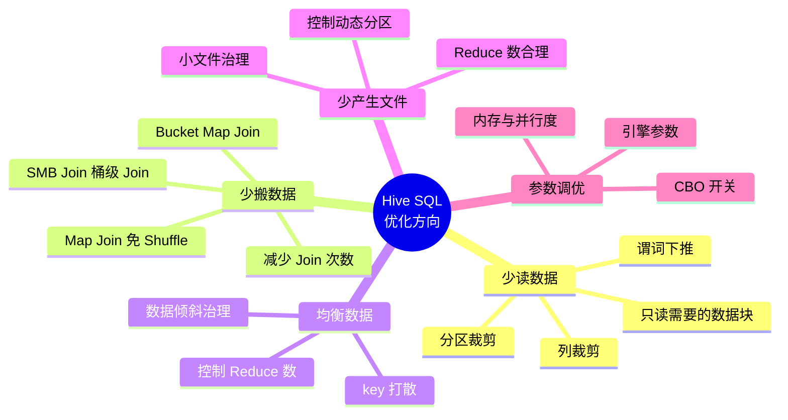
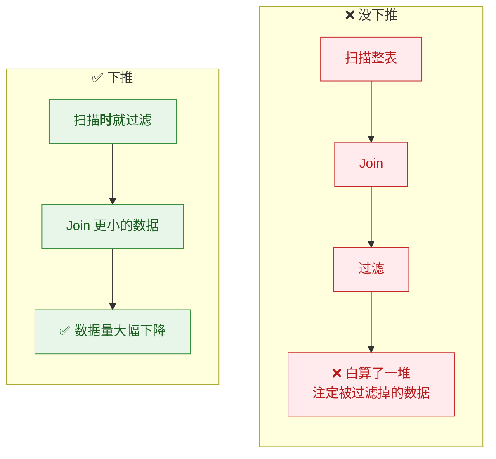
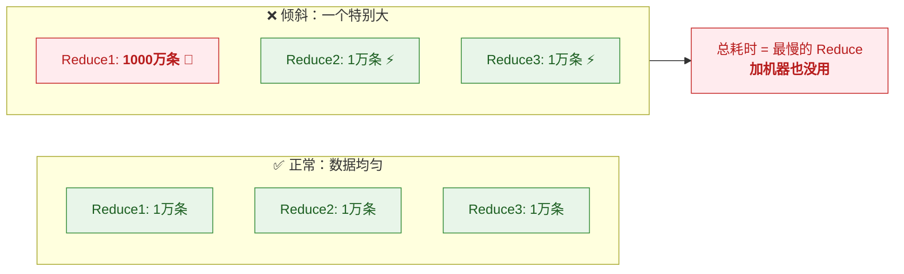
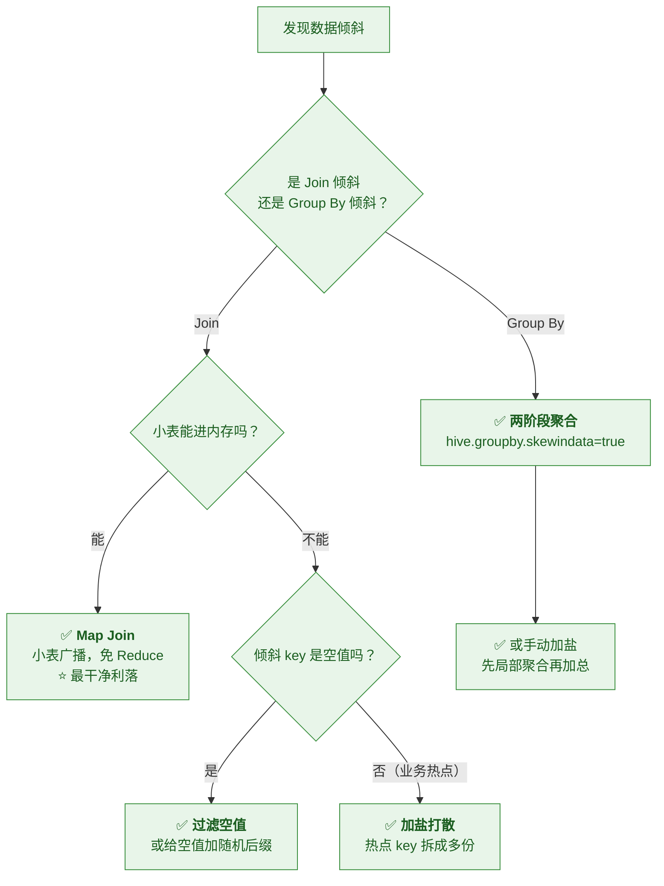
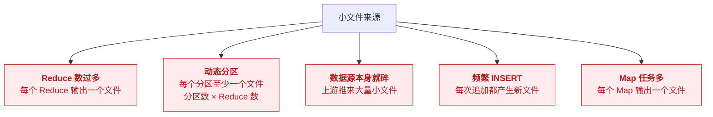
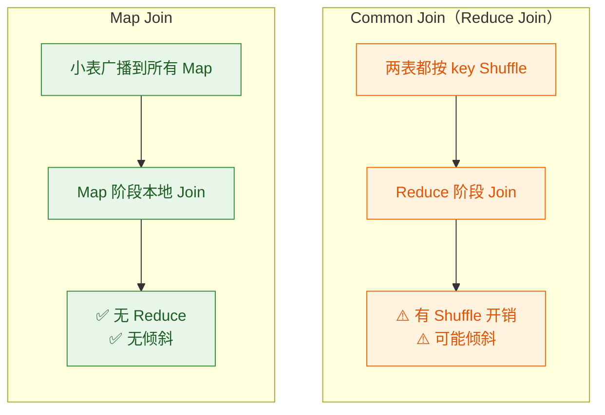

# ⚡ 三、Hive HQL 与 SQL 优化

> 本篇回答六个问题：**怎么读懂执行计划**？⭐ **数据倾斜怎么诊断和治理**？
> ⭐ **小文件问题从哪来、怎么治**？**Join 有哪些方式、怎么选**？
> **怎么减少 Shuffle**？以及**调优参数速查**。
> 前置见 [[2-数据模型与表设计]]；原理见 [[1-架构与原理]]。

---

## 一、先建立"优化地图"



> [!important] ⭐ 五条主线的优先级
> **① 少读数据**（最有效、最安全）→ **② 少搬数据** → **③ 均衡数据** → **④ 少产生文件** → **⑤ 调参数**
>
> **很多人的误区是直接跳到 ⑤ 调参数**——
> 但**如果你的分区裁剪失效了，调多少个参数也救不回来。**

---

## 二、读懂执行计划

### 2.1 `EXPLAIN` 三种形态

| 命令 | 输出 | 用途 |
|---|---|---|
| `EXPLAIN` | **逻辑计划**（AST → Operator Tree） | 看 SQL 被解析成什么 |
| **`EXPLAIN EXTENDED`** | 逻辑 + 更多细节 | 看**谓词下推**是否生效 |
| ⭐ **`EXPLAIN FORMATTED`** | **物理计划 + 表统计信息**（行数、大小） | ⭐ **排查倾斜与 Join 方式的首选** |

```sql
EXPLAIN FORMATTED
SELECT u.city, COUNT(*) cnt
FROM dwd_order o JOIN dim_user u ON o.user_id = u.user_id
WHERE o.dt = '2026-10-13'
GROUP BY u.city;
```

### 2.2 执行计划里该看什么

> [!important] ⭐ 重点看这五项

| 看什么 | 关注点 | 问题信号 |
|---|---|---|
| **① 分区裁剪** | `Partition Filters` | ⚠️ 出现 `(none)` → **裁剪失效** |
| **② 谓词下推** | `Predicate:` 位置 | 过滤没在 `TableScan` 上 → **没下推** |
| **③ Join 方式** | `Map Join` / `Common Join` / `SMB Join` | 大表被广播、或该 Map Join 却是 Common Join |
| **④ 表的行数** | `Statistics: Num rows` | ⚠️ **是 `-1` 或异常小 → 统计信息过期**，CBO 会选错 |
| **⑤ Reduce 数** | `NumReduceTasks` | 过大 → 小文件；过小 → 慢 |

> [!danger] ⚠️ 一个高频陷阱：统计信息缺失
> **如果 `EXPLAIN` 里看到 `Num rows: -1`**，说明**表/分区没有统计信息**——
> **CBO 就没有依据，可能选错 Join 方式、算错 Reduce 数。**
>
> **解决**：收集统计信息
> ```sql
> ANALYZE TABLE dwd_order PARTITION (dt='2026-10-13') COMPUTE STATISTICS;
> -- 列级统计（CBO 需要）
> ANALYZE TABLE dwd_order PARTITION (dt='2026-10-13') COMPUTE STATISTICS FOR COLUMNS;
> ```

### 2.3 谓词下推（Predicate Pushdown）

> [!note] 定义
> **把过滤条件"尽量推到扫描阶段"执行**——**尽早过滤掉数据，减少后续处理量。**



```sql
-- 开谓词下推（默认开）
SET hive.optimize.ppd=true;
```

### 2.4 ⭐ 分区裁剪失效的三种写法

> [!danger] ⚠️ 这是最常见也最容易忽视的性能杀手

| ❌ 失效写法 | 为什么 | ✅ 正确写法 |
|---|---|---|
| `WHERE date_format(dt,'yyyyMMdd')='20261013'` | **分区列上套函数** → 无法预计算 | `WHERE dt='2026-10-13'` |
| `WHERE cast(dt as date) > ...` | **隐式/显式类型转换** | 让两边类型一致 |
| `WHERE substr(dt,1,7)='2026-10'` | 同上（函数） | `WHERE dt LIKE '2026-10%'` 或用 `dt >= '2026-10-01' AND dt < '2026-11-01'` |

> [!success] 一条实用原则
> **"让分区列保持'裸'的，把运算放到常量侧。"**
>
> ```sql
> -- ❌ 对分区列做运算
> WHERE dt > date_sub(current_date(), 7)
>
> -- ✅ 对常量做运算（分区列在左侧裸着）
> WHERE dt > '2026-10-06'    -- 或先算好变量再传入
> ```
>
> 👉 **这是排查"明明加了 dt 条件还是很慢"的第一嫌疑。**

---

## 三、⭐ 数据倾斜（Hive 头号性能问题）

### 3.1 什么是数据倾斜

> [!note] 定义
> **少数 key 的数据量远超其他 key**，导致**个别 Reduce 任务处理量巨大**，
> **整体被最慢的那个拖住**（木桶效应）。



### 3.2 怎么发现倾斜

| 方法 | 看什么 |
|---|---|
| ⭐ **任务进度长时间卡在 99%** | 最典型的现象——**剩一两个 Reduce 跑不完** |
| **YARN/Tez UI 看各 task** | 某个 task 的**输入记录数远超其他** |
| **`EXPLAIN FORMATTED`** | 看 Join 两侧表的行数估计 |
| **直接查 key 分布** | `SELECT key, COUNT(*) FROM t GROUP BY key ORDER BY 2 DESC LIMIT 20` |

> [!tip] 最快的定位手段
> **先跑一句"看 key 分布"的 SQL**：
> ```sql
> SELECT user_id, COUNT(*) AS cnt
> FROM dwd_order WHERE dt='2026-10-13'
> GROUP BY user_id ORDER BY cnt DESC LIMIT 20;
> ```
> **如果第一名比第二名大几个数量级 → 就是它导致倾斜。**

### 3.3 倾斜的四种典型来源

| 来源 | 说明 |
|---|---|
| **① 空值 / 默认值** | ⭐ **最常见**——`NULL`、`-1`、`''`、`unknown` 全落到同一个 Reduce |
| **② 业务热点** | 大客户、头部商家、热门商品——**业务上真实存在的大 key** |
| **③ Join 键分布不均** | 大表 Join 时某一侧的 key 分布极偏 |
| **④ Group By 维度不均** | 按某个维度分组时，某值占比极高 |

### 3.4 ⭐ 治理手段（按场景选）



#### 手段一：过滤空值（最简单）

```sql
-- ❌ 空值全落到一个 Reduce
SELECT * FROM a JOIN b ON a.user_id = b.user_id;

-- ✅ 空值本来就 Join 不上，直接过滤
SELECT * FROM a JOIN b ON a.user_id = b.user_id
WHERE a.user_id IS NOT NULL AND b.user_id IS NOT NULL;
```

> [!tip] 空值为什么是"假倾斜"
> **因为 `NULL` Join 不上任何东西，参与计算毫无意义**——
> **过滤掉既解决倾斜，又不影响结果。**
>
> ⚠️ **但如果是 `LEFT JOIN` 且要保留左表空值行**，就不能直接过滤——
> 这时用**给空值加随机后缀**（让它散开）：
> ```sql
> ON COALESCE(a.user_id, CONCAT('null_', rand())) = b.user_id
> ```

#### 手段二：Map Join（小表场景最优）

```sql
-- 自动（小表小于阈值时自动转）
SET hive.auto.convert.join=true;
SET hive.mapjoin.smalltable.filesize=25000000;   -- 25MB

-- 手动强制（Hive 老版本 / 明确知道适用时）
SELECT /*+ MAPJOIN(b) */ * FROM big_a a JOIN small_b b ON a.id = b.id;
```

> [!important] ⭐ 为什么 Map Join 能解决倾斜
> **因为它把"Reduce 阶段的 Join"变成了"Map 阶段的广播 Join"**——
> **根本没有 Reduce，也就没有"某个 Reduce 特别慢"的问题。**
>
> **代价**：小表要**广播到每个 Map 节点**，所以**小表必须真的小**（否则网络打爆）。

#### 手段三：加盐打散（大表 Join 大表）

> [!important] ⭐ 思路：把"热点 key"拆成多个，让多个 Reduce 分担

```sql
-- 步骤1：给大表的热点 key 加随机前缀（打散到 N 个桶）
SELECT
    CONCAT(user_id, '_', CAST(FLOOR(RAND() * 10) AS INT)) AS salted_key,
    ...
FROM big_table;

-- 步骤2：小表按同样规则"膨胀"成 N 份
SELECT CONCAT(user_id, '_', CAST(n AS INT)) AS salted_key, ...
FROM small_table
LATERAL VIEW EXPLODE(ARRAY(0,1,2,3,4,5,6,7,8,9)) t AS n;

-- 步骤3：按 salted_key Join（此时热点被 10 个 Reduce 分担）
```

| 优点 | 缺点 |
|---|---|
| 能解决**真热点 key** 的倾斜 | ⚠️ **小表要膨胀 N 倍**；⚠️ 编码复杂；⚠️ 需要知道热点是谁 |

#### 手段四：两阶段聚合（Group By 倾斜）

```sql
-- 开参数：Hive 会先做一次局部聚合，再全局聚合
SET hive.groupby.skewindata=true;
```

> [!note] 它的原理
> **原本：所有数据按 key 直接分到一个 Reduce 聚合 → 热点 Reduce 累死。**
> **开启后：先随机分发做"局部聚合"（把量降下来），再按 key 做"最终聚合"。**
> **→ 把一次大聚合拆成两次小聚合。**

> [!warning] ⚠️ 这个参数的局限
> **它不能解决"单个 key 本身就巨大"的情况**——
> 比如某个 key 有 5000 万行，**局部聚合后它还是 5000 万行**（只是变成了多条局部结果）。
> **这种情况要靠加盐或从业务上拆解。**

### 3.5 倾斜治理速查

| 场景 | 首选手段 |
|---|---|
| **小表 Join 大表** | ⭐ **Map Join**（最省事） |
| **倾斜 key 是 NULL** | ⭐ **过滤** 或加随机后缀 |
| **真业务热点（大客户）** | ⭐ **加盐打散** |
| **Group By 倾斜** | **`hive.groupby.skewindata=true`** 或手动两阶段 |
| **两表都大且分桶一致** | **SMB Join**（前提严格） |
| **实在解决不了** | **业务侧拆解**（把大客户单独处理） |

---

## 四、⭐ 小文件问题

### 4.1 小文件从哪来

> [!important] ⭐ 核心公式
> **文件数 ≈ Reduce 数 × 分区数**
>
> 再加**每个 Map 任务产生一个文件**（如果是纯 Map 任务）。



### 4.2 小文件的危害

| 危害 | 说明 |
|---|---|
| **NameNode 压力** | ⭐ **每个文件在 NameNode 占约 150 字节内存**——**1 亿小文件 = 15GB 内存** |
| **查询慢** | 每个文件都要**单独打开、读元数据** → 启动开销巨大 |
| **Map 任务爆炸** | 每个文件至少一个 Map → **调度开销远超计算本身** |
| **元数据膨胀** | 分区/文件信息在 Metastore 里也占空间 |

> [!danger] ⭐ 一个量化感受
> **1000 个 1MB 的文件 vs 1 个 1GB 的文件：**
> - 数据量相同
> - **但前者要启动 1000 个 Map，后者只需 1 个（或几个）**
> - **差的是"启动开销"，不是"计算量"**
>
> **这就是为什么小文件问题在大数据里如此严重。**

### 4.3 治理手段

| 层面 | 手段 | 说明 |
|---|---|---|
| **源头** | **上游攒批** | ⭐ **最根本**——别让小文件产生（如 Flink 落盘按大小/时间滚动） |
| **写入** | **控制 Reduce 数** | `SET mapreduce.job.reduces=N`（或 `hive.exec.reducers.bytes.per.reducer`） |
| **写入** | **限制动态分区数** | ⚠️ 必须设上限 |
| **事后** | ⭐ **`ALTER TABLE ... CONCATENATE`** | **合并 ORC 小文件**（ORC 专用，最高效） |
| **事后** | **`hive.merge.*` 参数** | 作业结束时自动合并 |
| **事后** | **重跑一次带 `DISTRIBUTE BY` 的作业** | 通用但成本高 |

```sql
-- ⭐ 并发合并 ORC 小文件（最常用）
ALTER TABLE dwd_order PARTITION (dt='2026-10-13') CONCATENATE;

-- 作业结束时自动合并（对 MR 引擎）
SET hive.merge.mapfiles=true;               -- 合并只有 Map 的任务输出
SET hive.merge.mapredfiles=true;            -- 合并 Map-Reduce 任务输出
SET hive.merge.size.per.task=256000000;     -- 合并后目标大小（256MB）
SET hive.merge.smallfiles.avgsize=16000000; -- 平均小于此值就触发合并（16MB）
```

> [!important] ⭐ `CONCATENATE` 为什么高效
> **它只对 ORC 有效，且是"逻辑合并"**——
> **把多个小 ORC 文件的 stripe 直接拼进一个新文件，不重新解析数据。**
> **比"读出来再写回去"快得多。**

### 4.4 Reduce 数怎么定

```sql
-- 方式一：按数据量自动算（默认）
SET hive.exec.reducers.bytes.per.reducer=256000000;   -- 每个 Reduce 处理 256MB
SET hive.exec.reducers.max=1009;                       -- 上限

-- 方式二：直接指定
SET mapreduce.job.reduces=50;
```

> [!warning] ⚠️ Reduce 数的两难
> | Reduce 太少 | Reduce 太多 |
> |---|---|
> | 单任务数据量大、慢 | ⭐ **产生大量小文件** |
> | 并行度不足 | 调度开销大 |
>
> **经验**：**让每个 Reduce 输出接近"一个 HDFS block"（128MB~256MB）**。
> 既不太碎，也不太长。

---

## 五、Join 优化

### 5.1 三种 Join 方式

| Join | 原理 | 前提 | 适用 |
|---|---|---|---|
| **Common Join**（Reduce Join） | 两边按 key **Shuffle 到 Reduce** 再 Join | 无 | 默认 |
| ⭐ **Map Join** | **小表广播到每个 Map**，Map 阶段完成 Join | 小表能进内存 | ⭐ **小表 Join 大表（首选）** |
| **SMB Join** | 两表**同列同桶数** → 桶对桶 Join | **同列、同桶数、都排序** | 两表都大且已分桶 |



### 5.2 Map Join 的自动触发

```sql
-- 自动转换开关（默认开）
SET hive.auto.convert.join=true;
SET hive.mapjoin.smalltable.filesize=25000000;    -- 小表阈值（旧参数）
SET hive.auto.convert.join.noconditionaltask.size=20000000;  -- 新参数（更常用）
```

> [!tip] 实际调优中更常用的是后者
> `hive.auto.convert.join.noconditionaltask.size` 控制"**多小的表可以转成 Map Join**"，
> **调大它能让更多 Join 走 Map Join**（但要小心内存）。

### 5.3 Join 优化要点

| 要点 | 说明 |
|---|---|
| ⭐ **小表放右边** | 老版本 Hive 里 `JOIN` 右侧默认当"小表"（**新版本 CBO 会自己判断**） |
| ⭐ **优先 Map Join** | 免 Shuffle、免疫倾斜 |
| **避免笛卡尔积** | ⚠️ 忘写 `ON` 条件 = 全量乘积 |
| **多表 Join 时小表先 Join** | 先缩小数据量 |
| **相同 key 的 Join 合并** | 用 `JOIN ... ON a.k=b.k AND a.k=c.k` 一次完成 |
| **`LEFT JOIN` 的过滤位置** | ⚠️ **写在 `ON` 与 `WHERE` 里语义不同** |

> [!danger] ⚠️ `LEFT JOIN` 的经典陷阱
> ```sql
> -- ❌ 写在 WHERE：会过滤掉右表为 NULL 的行 → 变成 INNER JOIN
> SELECT * FROM a LEFT JOIN b ON a.id=b.id WHERE b.status='active';
>
> -- ✅ 写在 ON：保留左表所有行，只对匹配上的右表行做过滤
> SELECT * FROM a LEFT JOIN b ON a.id=b.id AND b.status='active';
> ```
> **这是 SQL 语义问题，不是 Hive 特性，但在大数据量下影响巨大。**

---

## 六、其他关键优化手段

### 6.1 列裁剪

```sql
-- ❌ SELECT *：读所有列（列存的优势全废）
SELECT * FROM dwd_order WHERE dt='2026-10-13';

-- ✅ 只读需要的列
SELECT order_id, amount FROM dwd_order WHERE dt='2026-10-13';
```

> [!important] 在列存（ORC）上，列裁剪的收益极其明显
> **50 列的表只读 3 列 → 只读 6% 的数据。**

### 6.2 `DISTRIBUTE BY` / `SORT BY` / `CLUSTER BY`

| 子句 | 作用 | 是否全局有序 |
|---|---|---|
| `ORDER BY` | 全局排序 | ✅ 全局有序（**只有一个 Reduce，慢**） |
| `SORT BY` | 每个 Reduce 内排序 | ❌ 局部有序 |
| **`DISTRIBUTE BY`** | **控制按什么 key 分发到 Reduce** | —— |
| `CLUSTER BY` | `DISTRIBUTE BY` + `SORT BY`（同列） | ❌ 局部有序 |

```sql
-- ✅ 常用组合：按 user_id 分发，再组内按时间排序（用于取每用户最新一条）
SELECT * FROM (
    SELECT *, ROW_NUMBER() OVER (PARTITION BY user_id ORDER BY create_time DESC) rn
    FROM dwd_order WHERE dt='2026-10-13'
) t WHERE rn = 1;
```

> [!danger] ⚠️ `ORDER BY` 在大数据量下是危险的
> **它只用一个 Reduce** → 所有数据集中到一个任务 →
> **数据量大时必然 OOM 或跑不完。**
> **需要全局有序时**：加 `LIMIT`，或改成"局部排序 + 合并"的思路。

### 6.3 窗口函数 vs 自连接

```sql
-- ✅ 窗口函数（Hive 支持，表达力强、通常更快）
SELECT user_id, amount,
       SUM(amount) OVER (PARTITION BY user_id) AS user_total
FROM dwd_order WHERE dt='2026-10-13';

-- ❌ 自连接实现同样逻辑（更慢、更啰嗦）
SELECT a.user_id, a.amount, b.user_total
FROM dwd_order a
JOIN (SELECT user_id, SUM(amount) user_total FROM dwd_order WHERE dt='2026-10-13' GROUP BY user_id) b
ON a.user_id = b.user_id;
```

---

## 七、调优参数速查

```sql
-- ========== 执行引擎 ==========
SET hive.execution.engine=tez;                      -- ⭐ 推荐 tez

-- ========== 并行执行 ==========
SET hive.exec.parallel=true;                        -- 无依赖的阶段并行
SET hive.exec.parallel.thread.number=8;

-- ========== Map Join ==========
SET hive.auto.convert.join=true;
SET hive.auto.convert.join.noconditionaltask.size=20000000;

-- ========== 动态分区 ==========
SET hive.exec.dynamic.partition=true;
SET hive.exec.dynamic.partition.mode=nonstrict;
SET hive.exec.max.dynamic.partitions=10000;          -- ⚠️ 必须设上限
SET hive.exec.max.dynamic.partitions.pernode=1000;

-- ========== 小文件 ==========
SET hive.merge.mapfiles=true;
SET hive.merge.mapredfiles=true;
SET hive.merge.size.per.task=256000000;
SET hive.merge.smallfiles.avgsize=16000000;

-- ========== Reduce 数 ==========
SET hive.exec.reducers.bytes.per.reducer=256000000;
SET hive.exec.reducers.max=1009;

-- ========== 倾斜 ==========
SET hive.groupby.skewindata=true;                    -- Group By 倾斜
SET hive.optimize.skewjoin=true;                     -- Join 倾斜（自动处理）

-- ========== 谓词下推 / 列裁剪 ==========
SET hive.optimize.ppd=true;
SET hive.optimize.cp=true;                           -- 列裁剪

-- ========== CBO ==========
SET hive.cbo.enable=true;
SET hive.compute.query.using.stats=true;
SET hive.stats.fetch.column.stats=true;

-- ========== 压缩 ==========
SET hive.exec.compress.intermediate=true;            -- 中间结果压缩
SET hive.intermediate.compression.codec=org.apache.hadoop.io.compress.SnappyCodec;
```

> [!warning] ⚠️ 参数的两个原则
> **① 不要盲目全开**——有些参数会**吃内存**（如 Map Join 阈值调太大 → OOM）。
> **② 会话级 vs 全局**——生产建议写在**作业模板**里，而不是靠人记。
>
> 👉 **参数是最后一步**——**先把 SQL 写对、把表设计好，再考虑调参。**

---

## 八、30 秒速查表

| 问题 | 一句话答案 |
|---|---|
| 优化优先级 | ⭐ **少读数据 > 少搬数据 > 均衡数据 > 少产生文件 > 调参数** |
| 看执行计划用哪个 | ⭐ **`EXPLAIN FORMATTED`**（含物理计划与统计信息） |
| 执行计划重点看 | **分区裁剪、谓词下推、Join 方式、行数统计、Reduce 数** |
| 行数是 `-1` 说明什么 | ⭐ **统计信息缺失** → CBO 会选错 → 要 `ANALYZE TABLE` |
| 分区裁剪失效的典型写法 | ⭐ **分区列上套函数**（如 `date_format(dt,...)`） |
| 分区裁剪的正确原则 | ⭐ **分区列保持裸的，运算放到常量侧** |
| 数据倾斜的典型现象 | ⭐ **任务卡在 99%，剩一两个 Reduce 跑不完** |
| 怎么快速定位倾斜 | 查 key 分布：`GROUP BY key ORDER BY COUNT(*) DESC` |
| 倾斜的头号来源 | ⭐ **空值/NULL** 全落到同一 Reduce |
| 倾斜治理首选 | ⭐ **小表 → Map Join；空值 → 过滤；真热点 → 加盐** |
| Group By 倾斜怎么治 | **`hive.groupby.skewindata=true`** 或手动两阶段 |
| 加盐的思路 | **把热点 key 拆成多份**，让多个 Reduce 分担 |
| **小文件公式** | ⭐ **文件数 ≈ Reduce 数 × 分区数** |
| 小文件的危害 | ⭐ **NameNode 内存**（每文件约 150 字节）+ **Map 启动开销** |
| 小文件治理首选 | ⭐ **源头攒批**；**事后 `ALTER TABLE ... CONCATENATE`**（ORC） |
| `CONCATENATE` 为什么快 | **逻辑拼接 stripe，不重新解析数据** |
| Reduce 数怎么定 | **让每个 Reduce 输出接近一个 block（128~256MB）** |
| 三种 Join | **Common（Shuffle）/ Map Join（广播）/ SMB（桶级）** |
| 小表 Join 大表首选 | ⭐ **Map Join**（免 Shuffle、免疫倾斜） |
| Map Join 为什么免疫倾斜 | **它没有 Reduce 阶段** |
| `ORDER BY` 能在大数据量用吗 | ❌ **只用一个 Reduce，会 OOM** |
| `LEFT JOIN` 过滤写哪 | ⚠️ **写在 `ON` 和 `WHERE` 语义不同**（写 WHERE 会退化成 INNER JOIN） |
| 参数调优的地位 | ⭐ **最后一步**——SQL 和表设计不对，调参无用 |

---

## 九、学习检查清单

- [ ] ⭐ 能说出**优化的五条主线及其优先级**
- [ ] 能说出 **`EXPLAIN` / `EXTENDED` / `FORMATTED`** 的区别，并知道排查时用哪个
- [ ] ⭐ 能说出**执行计划要重点看的五项**
- [ ] ⭐ 能解释**行数统计为 `-1` 意味着什么**及解决办法
- [ ] ⭐⭐ 能说出**分区裁剪失效的三种写法**与正确原则
- [ ] ⭐ 能说出**数据倾斜的典型现象**（卡 99%）与快速定位方法
- [ ] ⭐ 能说出**倾斜的四种来源**，尤其"空值"这个头号来源
- [ ] ⭐⭐ 能针对不同场景**选出合适的倾斜治理手段**（Map Join/过滤/加盐/两阶段）
- [ ] 能说清**加盐打散**的完整思路（大表加前缀 + 小表膨胀）
- [ ] 能说清 **`hive.groupby.skewindata` 的原理与局限**
- [ ] ⭐ 能背出**小文件公式**（Reduce 数 × 分区数）并说出**五类来源**
- [ ] ⭐ 能解释**小文件为什么危害大**（NameNode 内存 + Map 启动开销）
- [ ] ⭐ 能说出**小文件治理的四个层面**，并解释 `CONCATENATE` 为什么高效
- [ ] 能说出 **Reduce 数的定法**与两难
- [ ] ⭐ 能对比**三种 Join 方式**的适用场景
- [ ] ⭐ 能解释**Map Join 为什么免疫数据倾斜**
- [ ] ⚠️ 能说出 **`ORDER BY` 在大数据量下的危险**
- [ ] ⚠️ 能说清 **`LEFT JOIN` 过滤写在 `ON` 与 `WHERE` 的语义差异**
- [ ] ⭐ 能说出**参数调优的正确地位**（最后一步，不是第一步）

---
> 上一篇 → [[2-数据模型与表设计]] ｜ 下一篇 → [[4-生产坑与调优]] ｜ 返回 [[0-Hive总览]]
