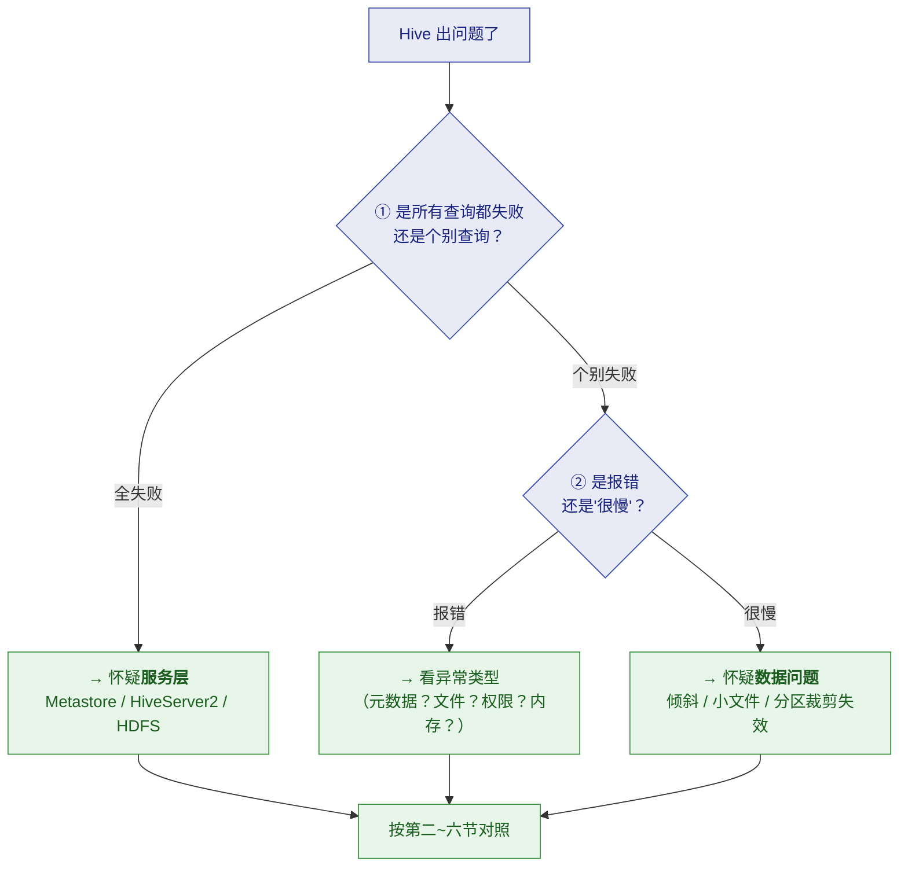
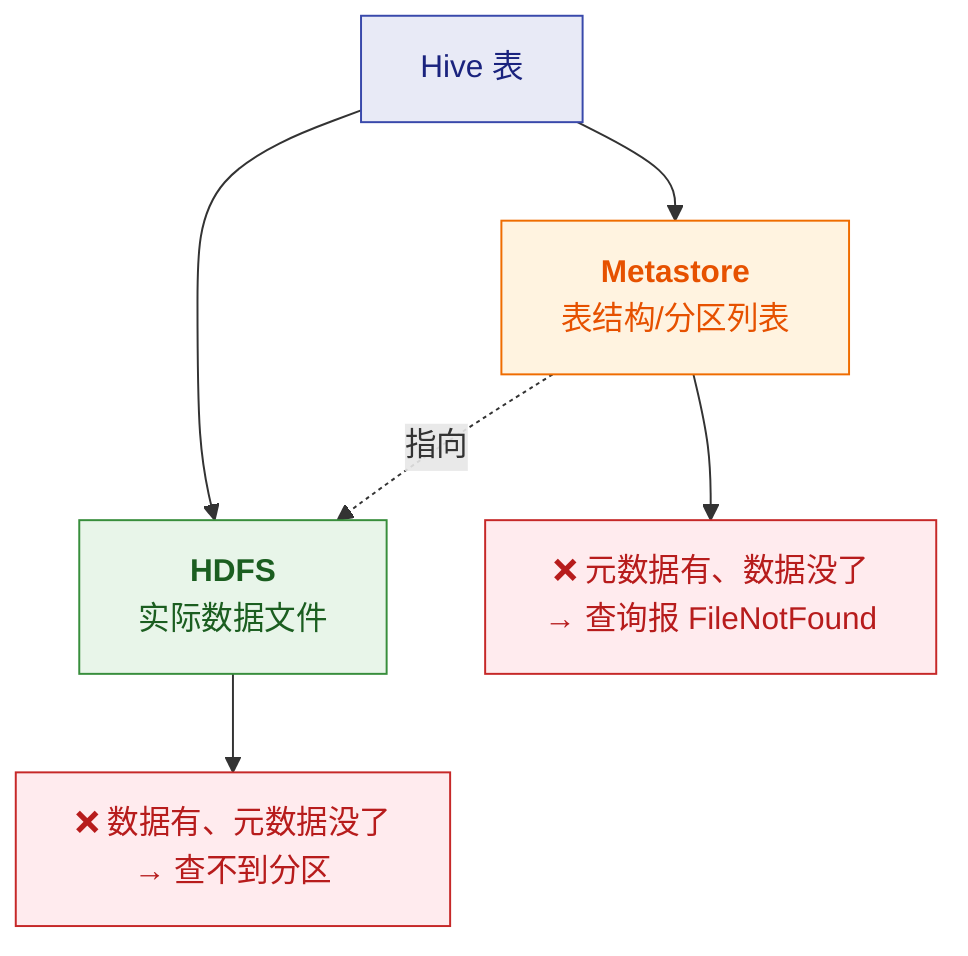

# 🚑 四、Hive 生产坑与调优

> [!abstract] 本篇是什么
> **Hive 线上会出什么问题、怎么定位、怎么修**。
> 按"**现象 → 根因 → 定位 → 修复**"组织，覆盖五大类：
> **元数据、存储与文件、计算引擎、SQL 与数据、服务与运维**。
>
> ⚠️ **本篇大量复用你自己的实战记录**——
> [[服务器巡检-192.168.0.106/Hive数据加载方案]] §六 的**故障矩阵**、
> [[服务器巡检-192.168.0.106/部署记录-Hadoop+Hue]] 的**部署踩坑**。
> **那些是你真实遇到过的（★ 标记），本篇补上"为什么会这样"。**

---

## 一、故障排查总入口

### 1.1 先问三个问题



### 1.2 五类问题速览

| 类别 | 典型现象 | 详见 |
|---|---|---|
| **元数据问题** | 表查不到、分区缺失、`FileNotFoundException` | §二 |
| **存储与文件** | 小文件慢、磁盘满、半截文件 | §三 |
| **计算引擎** | Tez OOM、作业卡 99%、staging 垃圾 | §四 |
| **SQL 与数据** | 倾斜、乱码、列错位、时区错 | §五 |
| **服务与运维** | Hue 报错、HS2 句柄失效、safemode | §六 |

---

## 二、元数据类问题（⭐ 最需要理解的）

### 2.1 核心原理：元数据与数据是"两份记录"

> [!important] 回顾 [[1-架构与原理]]
> **一张 Hive 表 = Metastore 元数据 + HDFS 目录。**
> **两者必须一致**——所有元数据类故障，本质都是**这两者不一致**。



### 2.2 故障：忘挂分区（HDFS 有文件，查不到数据）

| 项 | 内容 |
|---|---|
| **现象** | `hdfs dfs -ls` 能看到目录，但 `SELECT` 查不到数据 / `SHOW PARTITIONS` 没有这个分区 |
| **根因** | ⭐ **手动 `put` 文件到 HDFS，但没有 `ADD PARTITION`**——元数据里没这条分区记录 |
| **定位** | 对比 `hdfs dfs -ls /path/表/` 与 `SHOW PARTITIONS 表` |
| **修复** | ```ALTER TABLE t ADD PARTITION (dt='...')``` 或 **`MSCK REPAIR TABLE t`**（自动扫描补全） |
| **预防** | ⭐ **把"挂分区"做成流程关卡**——你的生产方案里是 **G3 关卡** + **对账兜底** |

> [!success] 这条你有实战记录
> 见 [[服务器巡检-192.168.0.106/Hive数据加载方案]] §6.4：
> **"忘挂分区 → HDFS 有文件查无数据 → 只 put 没 ADD PARTITION"**。
> 你把它列为流程问题，这是对的——**这类故障靠流程防，不靠人记性。**

### 2.3 故障：内表误 DROP（数据真没了）

| 项 | 内容 |
|---|---|
| **现象** | `DROP TABLE` 后数据消失，HDFS 目录也没了 |
| **根因** | ⭐ **建的是内部表（Managed Table）**——`DROP` 会**连数据一起删** |
| **定位** | `DESCRIBE FORMATTED t` 看 `Table Type` 是 `MANAGED_TABLE` 还是 `EXTERNAL_TABLE` |
| **修复** | ⚠️ **内部表删了基本无法恢复**——只能从上游/staging 重放 |
| **预防** | ⭐⭐ **ODS 层一律用 `EXTERNAL`**；DROP 前确认表类型 |

> [!danger] ⚠️ 这是最不可逆的故障之一
> **你的生产方案里明确写"ODS 一律外部表"**——
> **这不是风格偏好，而是"用极低成本买一份保险"。**
> 详见 [[2-数据模型与表设计]] §1.2。

### 2.4 故障：元数据与 HDFS 不一致（两种方向）

| 方向 | 现象 | 修复 |
|---|---|---|
| **元数据有、文件没了** | 查询报 `FileNotFoundException` / 返回空 | `DROP PARTITION`（清元数据）或从备份恢复文件 |
| **文件有、元数据没了** | 查不到数据、分区缺失 | `ADD PARTITION` / `MSCK REPAIR TABLE` |

> [!tip] `MSCK REPAIR TABLE` 的适用与代价
> **它会扫描 HDFS 目录，把"目录存在但元数据缺失"的分区补全。**
> ⚠️ **但分区极多时它会很慢**（要遍历所有目录）——
> **所以生产上更推荐"流程保证 + 精准 ADD PARTITION"**，把 `MSCK` 当应急手段。

### 2.5 故障：Metastore 不可用（全站瘫痪）

| 项 | 内容 |
|---|---|
| **现象** | ⭐ **所有查询都失败**，报连不上 metastore / 超时 |
| **根因** | Metastore 进程挂了、**元数据库（MySQL）挂了**、网络不通、连接数打满 |
| **定位** | ① 单独测 Metastore 端口（9083）；② 查 MySQL 是否可连；③ 看 Metastore 日志 |
| **修复** | 重启 Metastore；MySQL 恢复；清理泄漏连接 |
| **预防** | ⭐ **Metastore 高可用 + MySQL 主从 + 连接池配置** |

> [!danger] ⭐ Metastore 是 Hive 的单点（第 1 篇讲过）
> **它挂了，连"表结构"都读不到 → 所有 HQL 都不能用。**
> **这是 Hive 架构上最需要做高可用的地方。**
>
> **Derby 为什么不能用于生产？** 因为它**只能单连接**——
> 而且**换元数据库后元数据不共享**。详见 [[1-架构与原理]] §2.1。

---

## 三、存储与文件类问题

### 3.1 故障：小文件过多（查询越来越慢）

| 项 | 内容 |
|---|---|
| **现象** | ⭐ **查询逐渐变慢**、Metastore 内存上涨、NameNode 压力大、Map 任务数暴涨 |
| **根因** | ⭐ **文件数 ≈ Reduce 数 × 分区数**；高频小批 INSERT；动态分区过多 |
| **定位** | `hdfs dfs -count 目录` 看文件数；或 `SHOW PARTITIONS` 看分区数 |
| **修复** | **`ALTER TABLE t PARTITION(...) CONCATENATE`**（ORC）；或重写分区合并 |
| **预防** | ① **上游攒批** ② 控制 Reduce 数 ③ **限制动态分区数** ④ 开自动合并 |

> [!important] ⭐ 原理（这篇的"为什么"）
> **每个 Reduce 任务输出一个文件**，所以：
> - Reduce 数 = 100，分区数 = 30 → **可能产生 3000 个文件**
> - 而且**动态分区场景下，每个分区至少一个文件**
>
> **文件的代价不只是"占空间"：**
> | 代价 | 说明 |
> |---|---|
> | **NameNode 内存** | 每个文件约 **150 字节**元数据；1 亿文件 = **15GB** |
> | **Map 启动开销** | 每个文件至少一个 Map → **调度时间超过计算时间** |
>
> **所以小文件问题的本质是"启动开销打败了计算效率"。**
> 详见 [[3-HQL与SQL优化]] §4。

> [!success] 你的记录里也有这条
> [[服务器巡检-192.168.0.106/Hive数据加载方案]] §6.3：
> **"小文件爆炸 → 查询变慢、metastore 内存涨 → 高频小批量 INSERT →
> `hive.merge.tezfiles=true`；上游按天合文件"**。
> **注意你用的是 `hive.merge.tezfiles`**——这是 **Tez 引擎专用的合并参数**（MR 引擎用 `hive.merge.mapredfiles`）。

### 3.2 故障：HDFS 磁盘写满

| 项 | 内容 |
|---|---|
| **现象** | HDFS 节点挂、NameNode 报错、写入失败 |
| **根因** | ⭐ **没有水位监控 + 没有数据保留策略**（数据只进不出） |
| **定位** | `hdfs dfsadmin -report` 看各节点使用率 |
| **修复** | 删过期分区/临时文件；确认退出 safe mode |
| **预防** | ⭐ **df 告警（85% 预警 / 90% 熔断加载）** + 分区保留策略 |

> [!tip] 你的方案里的具体阈值很好
> **"df 告警（85% 预警/90% 熔断加载）"**——
> **"熔断加载"这个设计很关键**：**磁盘快满时主动停止新数据入库**，
> 而不是等写失败导致**半截文件**。
>
> **这体现了"把故障挡在门外"的思路**——不是"坏了再修"，而是"不让它坏"。

### 3.3 故障：半截文件入库

| 项 | 内容 |
|---|---|
| **现象** | ⭐ **下游 COUNT 波动、解析错位**；有时数据"缺一块" |
| **根因** | ⭐ **文件传到一半被读走**（网络中断 / 并发读取 / 直接 put 到正式目录） |
| **定位** | 对比文件大小、行数和上游源 |
| **修复** | 重跑该分区（幂等） |
| **预防** | ⭐⭐ **`.tmp` → 原子 rename + `_SUCCESS` 标记** |

> [!important] ⭐ 为什么"原子 rename"能解决
> **HDFS 的 `rename` 是原子的**——
> **文件要么"在临时目录"、要么"在正式目录"，不存在"中间态"。**
>
> **所以流程应该是：**
> 1. 先写到 `.tmp` 目录（下游看不见）
> 2. 写完后**原子 rename** 到正式目录
> 3. 放 `_SUCCESS` 标记（下游据此判断"可以读了"）
>
> **这样下游永远不会读到"写了一半"的文件。**
>
> 👉 **你生产方案的 G2 关卡就是这个设计**（"`.tmp` → 原子 rename，避免下游读到半截分区"），
> 这是很成熟的工程实践。

### 3.4 故障：编码乱码

| 项 | 内容 |
|---|---|
| **现象** | 中文变成 `?` 或 `锟斤拷` |
| **根因** | ⭐ **上游用 GBK 编码，Hive 按 UTF-8 解析** |
| **定位** | `file -i 文件` 看真实编码 |
| **修复** | 转码后重灌分区 |
| **预防** | ⭐ **统一 UTF-8**；入库前检测编码 |

### 3.5 故障：分隔符在字段内（列错位）

| 项 | 内容 |
|---|---|
| **现象** | 某些行"列错位"，字段串到隔壁列 |
| **根因** | ⭐ **字段内容里含有分隔符**（如地址里有逗号，而用逗号分隔） |
| **定位** | `head` 看原始数据；找错位的行 |
| **修复** | 用 `OpenCSVSerde`（支持引号转义）或重新导出 |
| **预防** | ⭐ **约定用 `\001`（不可见字符）分隔**，或**RFC4180 引号转义** |

> [!tip] 为什么大数据里爱用 `\001`
> **它是 ASCII 控制字符（SOH），正常文本内容里几乎不会出现**——
> **所以不会和字段内容冲突。**
> 相比之下逗号、制表符都可能出现在内容里。

---

## 四、计算引擎类问题（Tez / YARN）

### 4.1 故障：Tez AM OOM

| 项 | 内容 |
|---|---|
| **现象** | 作业重试后失败；日志有 `OutOfMemoryError`（AM 容器） |
| **根因** | ⭐ **大表 Join / 排序需要的内存超出 AM 配额**（AM 要维护 DAG 与任务元数据） |
| **定位** | 看 YARN 日志里 AM 容器的退出码与堆栈 |
| **修复** | 调 `tez.am.resource.memory.mb`；**分批处理** |
| **预防** | ① 合理设置 AM 内存 ② 避免超大 DAG ③ **控制 Reduce/Map 任务数** |

> [!warning] ⚠️ AM OOM 和 Task OOM 要分清
> | 类型 | 内存参数 | 症状 |
> |---|---|---|
> | **AM OOM** | `tez.am.resource.memory.mb` | ⭐ **整个作业失败**（AM 是大脑） |
> | **Task OOM** | `tez.task.resource.memory.mb` | 单个任务失败重试 |
>
> **调错参数会白忙** —— 先确认是哪个容器 OOM。

### 4.2 故障：作业卡在 99%（数据倾斜）

| 项 | 内容 |
|---|---|
| **现象** | ⭐ **进度长时间停在 99%**，剩一两个 Reduce 跑不完 |
| **根因** | **key 分布不均**——某个 Reduce 数据量远超其他 |
| **定位** | 查 key 分布：`GROUP BY key ORDER BY COUNT(*) DESC LIMIT 20` |
| **修复** | **加盐 / 两阶段聚合 / Map Join** |
| **预防** | 大 key 预检查 |

> [!important] 详见 [[3-HQL与SQL优化]] §3
> **那里有完整的倾斜治理决策树**（Map Join / 过滤空值 / 加盐 / 两阶段）。
> 这里只强调**定位方法**：**你的方案里写的是"大 key 预检查（GROUP BY 取 topN 看分布）"**，
> 这是**最实用的一招**——在作业跑之前就能发现。

### 4.3 故障：作业残留垃圾（`.staging` / tmp 目录）

| 项 | 内容 |
|---|---|
| **现象** | HDFS 冒出大量 `.staging` / `tmp` 目录，占用空间 |
| **根因** | ⭐ **作业被 kill，临时目录没被清理** |
| **定位** | 找表目录下的 `.hive-staging_*` |
| **修复** | `hdfs dfs -rm -r` 按白名单清理 |
| **预防** | ⭐ **定期清理脚本**（要谨慎，别误删正在跑的作业的 staging） |

> [!danger] ⚠️ 清理 staging 的风险
> **正在运行的作业也在用 staging 目录！**
> **盲目清理会导致运行中的作业失败。**
>
> **安全做法**：只清理**超过某个时间**（如 24 小时）且**没有活跃作业引用**的 staging。

---

## 五、SQL 与数据类问题

### 5.1 故障：schema 变更导致列错位

| 项 | 内容 |
|---|---|
| **现象** | ⭐ **某天起数据"串列"**——昨天的查询对，今天的不对 |
| **根因** | ⭐ **上游加了列/改了顺序，但没通知下游** |
| **定位** | 按日期切分区对比，找出"从哪天开始错" |
| **修复** | 按变更日切分区修复（之前的分区用旧 schema，之后的用新 schema） |
| **预防** | ⭐ **上游变更必须登记**；**对账加列数校验** |

> [!important] ⭐ 这是"契约问题"，不是技术问题
> **ODS 存 STRING 的价值在这里体现**——
> **如果 ODS 层就用严格类型，上游改 schema 会直接导入失败**；
> **用 STRING 至少数据能进来，问题暴露在下游清洗阶段**（更容易定位和修复）。
> 详见 [[2-数据模型与表设计]] §1.3。

### 5.2 故障：空值语义错乱

| 项 | 内容 |
|---|---|
| **现象** | `NULL` / `\N` / 空串混乱，`COUNT` 结果不符合预期 |
| **根因** | ⭐ **上游没定义 NULL 的表示方式**；Hive 默认把 `\N` 当 NULL |
| **定位** | `SELECT COUNT(*) WHERE col IS NULL` 与 `WHERE col=''` 对比 |
| **修复** | 清洗 SQL 兜底（统一成 NULL 或空串） |
| **预防** | ⭐ **约定 `\N` 表示 NULL**；外表设 `serialization.null.format='\\N'` |

```sql
-- 显式指定 NULL 的表示
ROW FORMAT SERDE 'org.apache.hadoop.hive.serde2.lazy.LazySimpleSerDe'
WITH SERDEPROPERTIES (
    'serialization.null.format' = '\\N'
)
```

### 5.3 故障：时区错位（dt 边界差 8 小时）

| 项 | 内容 |
|---|---|
| **现象** | ⭐ **dt 分区的边界数据落在错误的日期**（差 8 小时） |
| **根因** | ⭐ **脚本用 UTC 时间**，而业务是按北京时间切分 |
| **定位** | 对比数据里的时间字段与分区 dt |
| **修复** | 重跑正确日期的分区 |
| **预防** | ⭐ **`export TZ=Asia/Shanghai`** + **明确 T-1 的定义**（是自然日还是 24 小时） |

> [!warning] ⚠️ 时区问题很隐蔽
> **因为它不会报错**——数据看起来都"对"，只是**分到了错误的分区**。
> **往往要等业务方发现"某天的数据少了/多了"才暴露。**
>
> **最实用的预防**：**在加载脚本开头显式设时区**，
> 并且**把"T-1 的定义"写进文档**（避免不同人对"昨天"理解不同）。

### 5.4 故障：并发双跑写同一分区

| 项 | 内容 |
|---|---|
| **现象** | 数据重复、文件互相踩 |
| **根因** | ⭐ **调度器重复触发**（或手动补数时与定时任务撞车） |
| **定位** | 看调度记录与文件时间戳 |
| **修复** | 杀一个，重跑分区 |
| **预防** | ⭐ **`flock` 文件锁 + 幂等 `OVERWRITE`** |

> [!success] ⭐ 你的"幂等"设计很到位
> [[服务器巡检-192.168.0.106/Hive数据加载方案]] 的脚本注释写着
> **"可重复执行（幂等）"**，且用 **`OVERWRITE`**——
> **这意味着"重跑结果一致"，所以调度器的 at-least-once 语义不会导致数据错。**
>
> **这是"用幂等消化重复执行"的经典思路**——
> **比"想办法保证只跑一次"更可靠**（因为分布式下"精确一次"很难保证）。

---

## 六、服务与运维类问题

### 6.1 故障：Hue 报 `atomic block` 错误（★ 你真实遇到过）

| 项 | 内容 |
|---|---|
| **现象** | ⭐ **所有查询都报事务错误**，`An error occurred in the current transaction... atomic block` |
| **根因** | ⭐⭐ **Hue 自带的 sqlite 元数据库在编辑器并发请求下 `database is locked`**（你的日志里出现 34 次），事务被打断后 Django 的 `validate_no_broken_transaction` 把后续所有查询拦下 |
| **定位** | 看 Hue 的 `error.log`，搜 `database is locked` |
| **修复** | ⭐ **把 Hue 元数据库迁到 MySQL** |
| **预防** | 从一开始就用 MySQL，**别用 sqlite 跑多人环境** |

> [!important] ⭐ 这个案例的通用教训
> **sqlite 是"嵌入式单写入"数据库**——**多并发写必然锁库。**
> **Hue 默认用 sqlite** 是为了"开箱即用"，但**多人使用就会暴露问题。**
>
> **通用原则**：**任何"多人并发使用"的服务，元数据库都不要用 sqlite。**
> （这和第 1 篇讲的"Hive 生产不能用 Derby"是同一个道理。）

### 6.2 故障：`failed to resolve sockaddr for hive:10000`（★ 你真实遇到过）

| 项 | 内容 |
|---|---|
| **现象** | Hue 连不上 HiveServer2 |
| **根因** | ⭐ **`hue.ini` 写的是 `hive_server_host = hive`，但 compose 里容器名是 `hive-server`**——网络里没有叫 `hive` 的主机名（DNS 解析失败） |
| **定位** | 从 Hue 容器内 `ping hive` / `telnet hive 10000` |
| **修复** | 给 `hive-server` 服务加**网络别名** `aliases: [hive]` |
| **预防** | ⭐ **在真实调用方验证连通性** |

> [!important] ⭐ 这个坑的教训（很值钱）
> **你在记录里写了："容器内 `localhost` 的 beeline 测试验证不到这个问题，
> 跨容器连接必须用别名/服务名测。"**
>
> **这是通用原则**：
> **"在哪里用，就要在哪里测。"**
> **在 A 容器里测通了，不代表 B 容器能连上**——
> **网络命名空间不同，DNS 解析结果不同。**
>
> **很多"配置看起来对但就是连不上"的问题，根因都在这里。**

### 6.3 故障：HiveServer2 会话句柄失效

| 项 | 内容 |
|---|---|
| **现象** | `Invalid OperationHandle` |
| **根因** | ⭐ **HS2 容器重建后，Hue 还持有旧的会话句柄** |
| **修复** | 重启 Hue 清除会话 / 让用户刷新页面 |
| **预防** | 发布 HS2 后**主动清理客户端会话** |

### 6.4 故障：HDFS 处于 safemode（重启后任务全挂）

| 项 | 内容 |
|---|---|
| **现象** | ⭐ **机器重启后所有任务失败** |
| **根因** | ⭐ **NameNode 启动进入 safemode**（等待 DataNode 上报块信息） |
| **定位** | `hdfs dfsadmin -safemode get` |
| **修复** | 等 safemode 自动退出（或确认健康后手动 `leave`） |
| **预防** | ⭐ **重启后先确认 safemode 已退出，再跑任务** |

> [!tip] 这是一个"编排顺序"问题
> **服务之间有启动依赖**：HDFS（safemode 退出）→ YARN → Hive。
> **如果脚本不检查就依次启动，后面的服务会因前面的"还没准备好"而失败。**
>
> **正确做法**：**每步加健康检查**（不是"启动了"就算"就绪了"）。

### 6.5 故障：NN 格式化失败（★ 你真实遇到过）

| 项 | 内容 |
|---|---|
| **现象** | `Cannot create directory`，HDFS 起不来 |
| **根因** | ⭐ **挂载卷属主与容器运行用户不一致**（容器内非 root，读不了/写不了宿主目录） |
| **修复** | `chown 1000` 后重启 |
| **预防** | ⭐ **容器挂载卷的属主/权限写进部署清单** |

> [!note] 你的记录里还有个相关坑
> **"容器内非 root 用户读不了配置文件 → NameNode 报
> `error parsing conf core-site.xml (Permission denied)`"**
> —— **根因相同（权限）**，解法是 `chmod 644` 配置文件、`755` 脚本。
>
> **你还记录了一个重要区分**：
> **"脚本没读权限时报 `Permission denied`（解释器要先读文件），
> 和 CRLF 问题症状不同。"** —— **这种"症状相似但根因不同"的辨析很有价值。**

---

## 七、上线 Checklist

> [!important] ⭐ 上线前逐项确认（整合前面所有内容）

### 7.1 表设计

- [ ] **ODS 层用 `EXTERNAL`**（防误删）
- [ ] **分析表用 ORC/Parquet**（不是 TextFile）
- [ ] **分区键是低基数的**（日期优先，不要用唯一值）
- [ ] **动态分区设了上限**（`hive.exec.max.dynamic.partitions`）
- [ ] **SerDe 与真实数据格式匹配**（`cat -A` 确认分隔符）

### 7.2 加载链路

- [ ] ⭐ **写入用 `INSERT OVERWRITE` 分区**（幂等）
- [ ] ⭐ **`.tmp` → 原子 rename**（防半截文件）
- [ ] **`_SUCCESS` 标记门禁**（下游据此判断就绪）
- [ ] ⭐ **`ADD PARTITION` 或 `MSCK` 已执行**（元数据与 HDFS 一致）
- [ ] **时区显式设置**（`export TZ=Asia/Shanghai`）
- [ ] **并发保护**（`flock` 防双跑）

### 7.3 SQL 质量

- [ ] **分区裁剪生效**（没在分区列上套函数）
- [ ] **列裁剪**（没滥用 `SELECT *`）
- [ ] **倾斜风险已评估**（大 key 预检查）
- [ ] **没有超大 `ORDER BY`**（会单 Reduce OOM）
- [ ] **`LEFT JOIN` 过滤写在 `ON` 而非 `WHERE`**

### 7.4 运维保障

- [ ] ⭐ **小文件合并策略**（`CONCATENATE` / `hive.merge.*`）
- [ ] ⭐ **磁盘水位告警 + 熔断**（85% / 90%）
- [ ] **监控接上**（作业失败率、HS2 会话、NN 容量）
- [ ] **Metastore 高可用 + 元数据库备份**
- [ ] **重启顺序有健康检查**（HDFS safemode → YARN → Hive）

### 7.5 从"学习环境"到"生产"的差距（⭐ 面试高频）

> [!important] 这一节直接来自你的记录
> [[服务器巡检-192.168.0.106/Hive数据加载方案]] §七 列了 10 项差距——
> **这是非常有价值的清单，因为它说明了"能跑"和"能上生产"之间的距离。**

| # | 维度 | 学习环境 | 生产标准 |
|---|---|---|---|
| 1 | **HDFS** | 单节点、副本=1 | **NN HA**（2×NN+ZKFC+JN）、**副本=3**、机架感知 |
| 2 | **权限** | `dfs.permissions=false` | ⭐ **开权限 + Kerberos/Ranger**，按库表授权 |
| 3 | **YARN** | 8G/4 vcores | **队列划分、调度策略、用户配额** |
| 4 | **调度** | cron | ⭐ **Airflow/DolphinScheduler**（DAG 依赖、重试、告警、补数） |
| 5 | **元数据库** | MySQL 单实例 | ⭐ **主从/高可用 + 定期备份** |
| 6 | **监控** | 无 | ⭐ **Prometheus+Grafana** 接 JMX（容量、文件数、会话、失败率） |
| 7 | **数据质量** | 脚本内对账 | ⭐ **质量平台**（规则库、基线比对、阻断下发） |
| 8 | **格式** | ORC+Snappy | 同左，另评估 **Hudi/Iceberg**（免手工 ADD PARTITION） |
| 9 | **密码** | 明文在配置 | ⭐ **配置中心 / Vault** |
| 10 | **多环境** | 一套 | ⭐ **dev/test/prod 三套隔离** |

> [!success] 面试价值
> **能说出这 10 项差距，说明你不仅"会用 Hive"，还理解"生产级"的要求。**
> 尤其是：**权限（Ranger/Kerberos）、调度（DAG 依赖）、数据质量、多环境隔离**——
> 这四项是**学习环境最容易忽略、而生产最看重**的。

---

## 八、30 秒速查表

| 问题 | 一句话答案 |
|---|---|
| 排查入口 | 先问：**全失败还是个别的？报错还是慢？** |
| 全站查询失败先怀疑 | ⭐ **Metastore / 元数据库 / HDFS** |
| 元数据类故障的本质 | ⭐ **Metastore 与 HDFS 两份记录不一致** |
| HDFS 有文件查不到数据 | ⭐ **忘 `ADD PARTITION`** → `ADD PARTITION` 或 `MSCK REPAIR` |
| 查询报 `FileNotFoundException` | 元数据有、**文件没了** → 清分区元数据或恢复文件 |
| `DROP TABLE` 数据没了 | ⚠️ **建的是内部表** → ODS 一律用 `EXTERNAL` |
| Metastore 挂了会怎样 | ⭐ **所有 HQL 都不能用**（连表结构都读不到） |
| 生产能用 Derby 吗 | ❌ **只能单连接** → 必须 MySQL/PG |
| **小文件公式** | ⭐ **文件数 ≈ Reduce 数 × 分区数** |
| 小文件的双重危害 | ⭐ **NameNode 内存**（每文件 ~150 字节）+ **Map 启动开销** |
| 小文件合并（Tez） | ⭐ **`hive.merge.tezfiles=true`**；ORC 用 `CONCATENATE` |
| 磁盘满怎么防 | ⭐ **水位告警（85%）+ 熔断加载（90%）** |
| 怎么防半截文件 | ⭐ **`.tmp` → 原子 rename + `_SUCCESS`** |
| 为什么原子 rename 有效 | **HDFS rename 是原子的，不存在"中间态"** |
| 中文乱码根因 | **上游 GBK，Hive 按 UTF-8 解析** |
| 列错位根因 | **字段内容里含分隔符** → 用 `\001` 或引号转义 |
| Tez AM OOM 调哪个参数 | ⭐ **`tez.am.resource.memory.mb`**（不是 task 的） |
| 作业卡 99% 是什么 | ⭐ **数据倾斜** → 查 key 分布 → 加盐/Map Join |
| staging 垃圾怎么来的 | **作业被 kill，临时目录没清理** |
| 列错位（某天起）根因 | ⭐ **上游改 schema 没通知** |
| 时区问题为什么隐蔽 | **不报错**，数据只是分到了错误分区 |
| 并发双跑怎么防 | ⭐ **`flock` 锁 + 幂等 `OVERWRITE`** |
| Hue `atomic block` 根因 | ⭐ **Hue 自带 sqlite 并发锁库** → 迁 MySQL |
| `resolve sockaddr` 根因 | **配置里的主机名在容器网络里不存在** |
| 网络问题的教训 | ⭐ **"在哪里用，就要在哪里测"** |
| 重启后任务全挂 | ⭐ **HDFS 在 safemode** → 先确认退出再跑 |
| 权限类报错 | 挂载卷属主/权限与容器用户不一致 → `chown`/`chmod` |
| 生产 vs 学习最大差距 | ⭐ **权限（Ranger）、调度（DAG）、数据质量、多环境隔离** |

---

## 九、学习检查清单

- [ ] ⭐ 能用"**全失败还是个别的 / 报错还是慢**"两问快速分类
- [ ] ⭐ 能说清**元数据类故障的本质**（两份记录不一致）及两个方向的修复
- [ ] ⭐ 能解释**"忘挂分区"的成因**，并说出 `ADD PARTITION` / `MSCK` 的适用
- [ ] ⚠️ 能说清**内部表 `DROP` 的不可逆性**，并说出 ODS 用外部表的理由
- [ ] ⭐ 能解释**Metastore 是单点**，以及 Derby 为什么不能用于生产
- [ ] ⭐ 能背**小文件公式**并解释**双重危害**（NameNode + Map 开销）
- [ ] 能说出 **Tez 与 MR 的小文件合并参数不同**
- [ ] ⭐ 能说清**磁盘水位"告警 + 熔断加载"**的设计意图
- [ ] ⭐⭐ 能解释**"`.tmp` → 原子 rename + `_SUCCESS`"为什么能防半截文件**
- [ ] 能说出**乱码与列错位的根因**及预防（统一 UTF-8、`\001` 分隔）
- [ ] ⚠️ 能区分 **AM OOM 与 Task OOM**（调不同参数）
- [ ] ⭐ 能说出**倾斜的定位方法**（大 key 预检查）
- [ ] 能说出 **staging 垃圾的成因与清理风险**
- [ ] ⭐ 能解释**schema 变更导致列错位**，以及 ODS 存 STRING 的价值
- [ ] 能说清**空值语义**问题与 `serialization.null.format` 的用法
- [ ] ⭐ 能解释**时区问题为什么隐蔽**，及"明确 T-1 定义"的重要性
- [ ] ⭐ 能说清**幂等设计如何消化"调度器重复触发"**（比保证只跑一次更可靠）
- [ ] ⭐ 能讲清 **Hue `atomic block` 案例**的根因（sqlite 并发锁）与通用教训
- [ ] ⭐ 能讲清 **`resolve sockaddr` 案例**及"**在哪里用就在哪里测**"原则
- [ ] 能说出**重启后的启动顺序与健康检查**（safemode → YARN → Hive）
- [ ] ⭐ 能复述**生产 vs 学习的 10 项差距**，尤其权限/调度/质量/多环境

---
> 上一篇 → [[3-HQL与SQL优化]] ｜ 下一篇 → [[5-Hive面试高频题]] ｜ 返回 [[0-Hive总览]]
> 实战来源 → [[服务器巡检-192.168.0.106/Hive数据加载方案]]（§六故障矩阵、§七差距清单）· [[服务器巡检-192.168.0.106/部署记录-Hadoop+Hue]]
