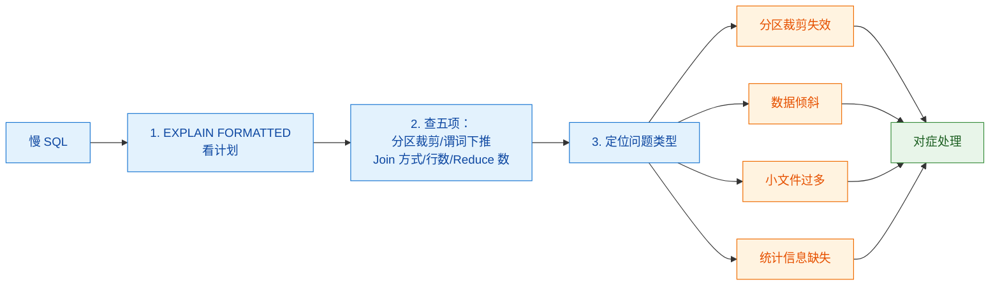
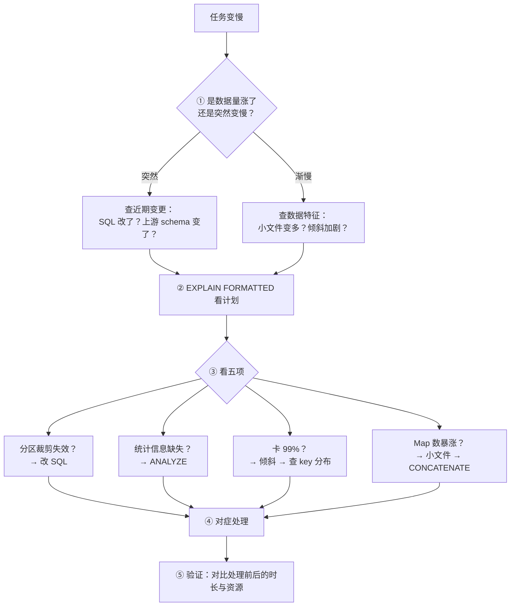

# 🎯 五、Hive 面试高频题

> 本篇按**面试问答**组织：每题先给"**得分骨架**"，再给深入追问与易错点，最后回链深度笔记。
> 答题原则：**骨架 + 一个具体机制 + 一个踩过的坑**最容易拿满分。
> 关联：[[0-Hive总览]]、[[1-架构与原理]]、[[2-数据模型与表设计]]、[[3-HQL与SQL优化]]、[[4-生产坑与调优]]。

---

## 一、十大必答题

### Q1. Hive 是什么？它和数据库有什么区别？

> [!important] 得分骨架
> **Hive 不是数据库**，它是「**把 HDFS 上的文件映射成表 + 把 SQL 翻译成分布式作业**」的中间层。
>
> | 维度 | Hive | 传统数据库（MySQL） |
> |---|---|---|
> | **存数据** | ❌ 在 HDFS | ✅ 自己存 |
> | **做计算** | ❌ 交给 Tez/MR/Spark | ✅ 自己算 |
> | **延迟** | **秒级～分钟级**（作业启动） | 毫秒级 |
> | **事务** | ❌ 默认无（ACID 表除外） | ✅ 完整 |
> | **更新** | ❌ 只能整分区覆盖 | ✅ 行级 |
> | **定位** | **离线批处理数仓** | **在线事务** |

**追问：那 Hive 做什么？**
→ **两件事**：① **管理元数据**（Metastore）② **编译 HQL 成分布式作业**（Driver）。

**追问：Hive 为什么慢？**
→ ⭐ **作业启动开销**：申请资源 + 启动容器要秒级～分钟级。
**"查 1 行也要几十秒"是正常的**——开销不在计算，在启动。
👉 [[1-架构与原理]]

---

### Q2. ⭐ Hive 的架构？元数据存在哪？

> [!important] 得分骨架
> **三大组件**：
> - **Metastore**：元数据服务 → 存 **表结构/分区/列/位置**
> - **HiveServer2**：对外提供 JDBC/ODBC/Thrift（beeline 连的 10000）
> - **Driver**：把 HQL 编译成执行计划（解析→语义分析→优化→物理计划）
>
> ```
> 客户端 → HiveServer2 → Driver → Metastore（查元数据）
>                              ↓
>                        提交 Tez/MR → YARN → 读 HDFS
> ```

> [!danger] ⭐⭐ 最容易答错的一点
> **元数据存在关系型数据库（MySQL/PostgreSQL），不在 HDFS！**
>
> **三个推论（能说出来就加分）**：
> 1. **删了 MySQL 的 metastore 库 → HDFS 数据还在，但表全"消失"**
> 2. **Derby 只能单连接**（嵌入式）→ **生产必须换 MySQL/PG**
> 3. ⭐ **Metastore 是 Hive 的单点** → 挂了所有 HQL 都不能用 → 要做高可用

**追问：数据存在哪？**
→ **HDFS**。Hive 只管元数据，**不碰数据文件**。

**追问：表到底是什么？**
→ ⭐ **HDFS 上的一个目录 + Metastore 里的一条记录**——
**两者必须一致**，不一致就是常见故障（忘 `ADD PARTITION` / 误删目录）。
👉 [[1-架构与原理]]

---

### Q3. ⭐ 内部表和外部表的区别？怎么选？

> [!important] 得分骨架
> **唯一区别在 `DROP TABLE`**：
> | | 内部表（Managed） | 外部表（External） |
> |---|---|---|
> | `DROP TABLE` | ⭐ **删元数据 + 删数据** | ⭐ **只删元数据，数据保留** |
>
> **选择标准（一句话）**：
> ⭐ **"数据是共享的/原始的/别人产的 → 外部表；Hive 独占且可重建 → 内部表。"**

| 层级 | 推荐 | 理由 |
|---|---|---|
| **ODS** | ⭐ **外部表** | 原始凭证，**不能被 Hive 删掉** |
| **DWD/DWS/ADS** | **内部表** | Hive 自己产出，**可重跑重建** |

**追问：为什么 ODS 一定要用外部表？**
→ ⭐ **因为误删不可逆**。典型事故：把 ODS 建成内部表，
`DROP TABLE` → **原始数据被删**，而上游已清理 → **永久丢失**。
**外部表是"成本极低的保险"。**

**追问：怎么查一个表是内部还是外部？**
→ `DESCRIBE FORMATTED t`，看 `Table Type`：
`MANAGED_TABLE` / `EXTERNAL_TABLE`。
👉 [[2-数据模型与表设计]]

---

### Q4. ⭐ 分区和分桶的区别？

> [!important] 得分骨架
> | | **分区（Partition）** | **分桶（Bucket）** |
> |---|---|---|
> | **粒度** | **目录级** | **文件级** |
> | **切分方式** | **按值切**（如 `dt`） | ⭐ **按 hash 取模切** |
> | **数量** | 动态（有多少值多少目录） | **固定**（建表指定） |
> | **主要作用** | ⭐ **裁剪（减少扫描）** | ⭐ **采样 + Join 优化 + 均衡** |
>
> **一句话**：**分区解决"读多少"，分桶解决"怎么并行/怎么 Join"。**

**追问：分区列能建索引吗？**
→ ❌ **不能**。分区是**目录**，不是列。
查询时通过 `WHERE dt='...'` **跳过不相关的目录**。

**追问：分区裁剪什么时候失效？**
→ ⭐⭐ **分区列上套函数**：
```sql
-- ❌ 裁剪失效
WHERE date_format(dt,'yyyyMMdd')='20261013'
WHERE substr(dt,1,7)='2026-10'
-- ✅ 正确：分区列保持"裸"的
WHERE dt='2026-10-13'
WHERE dt >= '2026-10-01' AND dt < '2026-11-01'
```

**追问：分区键怎么选？**
→ ⭐ **低基数、日期优先**。**基数过高 = 灾难**（几十万个小目录 → NameNode 崩）。
**判断标准**：每个分区数据量应在**几百 MB 以上**。

**追问：动态分区要注意什么？**
→ 三个：① 默认 `strict` 模式（需 `nonstrict`）② ⭐ **必须设分区数上限**
③ **会产生大量小文件**（分区数 × Reduce 数）。

**追问：分桶有什么用？**
→ ① **采样**（`TABLESAMPLE`）② **SMB Join**（两表同列同桶数 → 桶级 Join，免全量 Shuffle）。

**追问：SMB Join 的前提？**
→ ⭐ **同列 + 同桶数 + 都排序** → **约束很严，实践中用得不多**。
👉 [[2-数据模型与表设计]]

---

### Q5. ⭐⭐ 数据倾斜是什么？怎么解决？

> [!important] 得分骨架
> **定义**：少数 key 数据量远超其他 → **个别 Reduce 特别慢** → 整体被拖住（木桶效应）。
>
> **现象**：⭐ **任务卡在 99%，剩一两个 Reduce 跑不完**（加机器也没用）。

**治理手段（按场景选）**：

| 场景 | 手段 |
|---|---|
| **小表 Join 大表** | ⭐ **Map Join**（小表广播，**没有 Reduce，自然无倾斜**） |
| **倾斜 key 是空值** | ⭐ **过滤空值**（或加随机后缀） |
| **真业务热点**（大客户） | ⭐ **加盐打散**（热点 key 拆成多份） |
| **Group By 倾斜** | **`hive.groupby.skewindata=true`**（两阶段聚合） |
| **两表都大且分桶一致** | **SMB Join** |

**追问：怎么定位倾斜？**
→ ⭐ **查 key 分布**：
```sql
SELECT user_id, COUNT(*) cnt FROM t GROUP BY user_id ORDER BY cnt DESC LIMIT 20;
```
**如果第一名比第二名大几个数量级 → 就是它。**

**追问：为什么空值会导致倾斜？**
→ ⭐ **所有 `NULL` 都 hash 到同一个值** → 全落到同一个 Reduce。
**而且 `NULL` 本来就 Join 不上，过滤掉不影响结果**——所以过滤是最优解。

**追问：加盐怎么加？**
→ **大表**给热点 key 加随机前缀（打散到 N 个桶）；
**小表**用 `EXPLODE` 膨胀成 N 份；再按加盐后的 key Join。
⚠️ **代价：小表膨胀 N 倍**。

**追问：`hive.groupby.skewindata` 的局限？**
→ ⚠️ **它解决不了"单个 key 本身就巨大"**——局部聚合后它还是那么大。
**这种情况要靠加盐或业务拆解。**
👉 [[3-HQL与SQL优化]]

---

### Q6. ⭐⭐ 小文件问题怎么产生、怎么治？

> [!important] 得分骨架
> **⭐ 核心公式：文件数 ≈ Reduce 数 × 分区数**
>
> **五类来源**：
> ① **Reduce 数过多**（每个 Reduce 一个文件）
> ② **动态分区**（每个分区至少一个文件）
> ③ **数据源本身就碎**（上游推来大量小文件）
> ④ **频繁 INSERT**
> ⑤ **Map 任务多**（每个 Map 输出一个文件）

**危害（双重）**：
| 危害 | 说明 |
|---|---|
| ⭐ **NameNode 内存** | 每个文件约 **150 字节**；1 亿文件 = **15GB** |
| ⭐ **Map 启动开销** | 每个文件至少一个 Map → **调度时间超过计算时间** |

**治理（按层面）**：
| 层面 | 手段 |
|---|---|
| **源头** | ⭐ **上游攒批**（最根本） |
| **写入** | **控制 Reduce 数**、**限制动态分区数** |
| **事后** | ⭐ **`ALTER TABLE ... CONCATENATE`**（ORC）；`hive.merge.*` |

**追问：`CONCATENATE` 为什么高效？**
→ ⭐ **它只对 ORC 有效，且是"逻辑拼接"**——
**把多个小 ORC 文件的 stripe 直接拼进新文件，不重新解析数据**，
比"读出来再写回去"快得多。

**追问：Reduce 数怎么定？**
→ ⭐ **让每个 Reduce 输出接近一个 HDFS block（128~256MB）**。
太多 → 小文件；太少 → 并行不足。

**追问：Tez 和 MR 的合并参数一样吗？**
→ ❌ 不一样。**Tez 用 `hive.merge.tezfiles`**，MR 用 `hive.merge.mapredfiles`。
👉 [[3-HQL与SQL优化]]、[[4-生产坑与调优]]

---

### Q7. ⭐ 为什么用 ORC？它为什么快？

> [!important] 得分骨架
> **ORC 快的原因（四个，按重要性）**：
> | # | 机制 | 说明 |
> |---|---|---|
> | **①** | ⭐ **列存** | 只读用到的列 |
> | **②** | ⭐ **内置统计信息** | 每块存 **min/max/count** → **跳过不相关的块** |
> | **③** | ⭐ **谓词下推** | 过滤推到读取层，不匹配的块不读 |
> | **④** | **压缩效率高** | 同列同类型 → 压缩比远超行存 |

> [!danger] ⚠️ 常见错误答案
> **"因为 ORC 压缩比高所以快"** —— ❌ **压缩是结果，不是原因。**
> **核心是"列存 + 统计信息 + 下推"**——即使不压缩也比行存快得多。

**追问：ORC 和 Parquet 怎么选？**
→ 两者都是列存，性能接近。
**Hive 生态里 ORC 优化更充分**（Hive 原生）；**跨引擎（Spark/Presto）Parquet 更通用**。

**追问：ODS 层为什么用 TextFile？**
→ ① **保原貌**（不被格式限制）② **可读**（`head` 就能看，便于排错）
③ **可交换**（任何工具都能读）。
**分析层（DWD+）才用 ORC。**

**追问：压缩格式怎么选？**
→ ⭐ **ORC + Snappy**（常见组合）。
**关键概念：可切分**——不可切分的压缩文件**只能一个 Map 读**（如一个大 `.gz`）。
**ORC 内部按 stripe 切分，规避了这个问题。**
👉 [[2-数据模型与表设计]]

---

### Q8. Hive 的 Join 有哪几种？怎么优化？

> [!important] 得分骨架
> | Join | 原理 | 适用 |
> |---|---|---|
> | **Common Join**（Reduce Join） | 两边按 key **Shuffle 到 Reduce** | 默认，⚠️ 有 Shuffle 且可能倾斜 |
> | ⭐ **Map Join** | **小表广播到每个 Map**，Map 阶段完成 | ⭐ **小表 Join 大表（首选）** |
> | **SMB Join** | 两表**同列同桶数** → 桶对桶 | 两表都大且已分桶 |
>
> **优化顺序**：**Map Join > SMB Join > Common Join**。

**追问：Map Join 为什么能解决倾斜？**
→ ⭐ **因为它把 Join 从 Reduce 阶段移到了 Map 阶段——根本没有 Reduce，
> 也就没有"某个 Reduce 特别慢"的问题。**

**追问：Map Join 的代价？**
→ **小表要广播到每个 Map 节点** → **小表必须真的小**（否则网络打爆 / OOM）。

**追问：`LEFT JOIN` 的过滤条件写 `ON` 还是 `WHERE`？**
→ ⭐ 语义不同：
```sql
-- ❌ 写在 WHERE → 过滤掉右表 NULL 行 → 退化成 INNER JOIN
... LEFT JOIN b ON a.id=b.id WHERE b.status='active'
-- ✅ 写在 ON → 保留左表全部，只对匹配行过滤
... LEFT JOIN b ON a.id=b.id AND b.status='active'
```

**追问：多表 Join 有什么建议？**
→ ① **小表先 Join**（先缩小数据量）② **相同 key 的 Join 合并成一次**
③ 避免笛卡尔积（忘写 `ON`）。
👉 [[3-HQL与SQL优化]]

---

### Q9. ⭐ 怎么排查一条慢 SQL？

> [!important] 得分骨架（五步）
> **① `EXPLAIN FORMATTED` 看计划 → ② 查五项 → ③ 定位问题类型 → ④ 对症处理 → ⑤ 验证**
>
> 下图为展开：



| 看到什么 | 说明 | 怎么修 |
|---|---|---|
| **`Partition Filters: (none)`** | ⭐ **分区裁剪失效** | 改 SQL，分区列别套函数 |
| **行数 `-1` 或异常** | ⭐ **统计信息缺失** | `ANALYZE TABLE ... COMPUTE STATISTICS` |
| **该 Map Join 却是 Common Join** | 小表阈值太小 | 调 `hive.auto.convert.join.noconditionaltask.size` |
| **卡 99%** | ⭐ **数据倾斜** | 查 key 分布 → Map Join/加盐 |
| **Map 任务数巨大** | 小文件多 | `CONCATENATE` / 控制 Reduce 数 |
| **Reduce 数过大** | 会产生小文件 | 调 `hive.exec.reducers.bytes.per.reducer` |

**追问：优化的优先级？**
→ ⭐ **少读数据 > 少搬数据 > 均衡数据 > 少产生文件 > 调参数。**
**很多人直接跳到"调参数"——但如果分区裁剪失效了，调多少参数都没用。**
👉 [[3-HQL与SQL优化]]

---

### Q10. Hive 生产上遇到过什么问题？

> [!important] 得分骨架（挑 2~3 个讲，要有细节）
>
> ⭐ **这道题是你的优势——你有真实运维环境。**

| 问题 | 现象 | 根因 | 解决 |
|---|---|---|---|
| ⭐ **忘挂分区** | HDFS 有文件，查不到数据 | 只 `put` 没 `ADD PARTITION` | `ADD PARTITION` / `MSCK REPAIR`，**做成流程关卡** |
| ⭐ **半截文件** | 下游 COUNT 波动 | 文件写一半被读 | **`.tmp` → 原子 rename + `_SUCCESS`** |
| ⭐ **小文件爆炸** | 查询变慢、Metastore 内存涨 | 高频小批 INSERT | `hive.merge.tezfiles` + 上游按天合文件 |
| ⭐ **Hue `atomic block`** | 所有查询报事务错 | **Hue 自带 sqlite 并发锁库** | **元数据库迁 MySQL** |
| ⭐ **`resolve sockaddr`** | Hue 连不上 HS2 | 配置主机名与容器名不一致 | 加网络别名；**在真实调用方验证** |
| ⭐ **重启后任务全挂** | 全部失败 | **HDFS 在 safemode** | 先确认 safemode 退出再跑任务 |
| **并发双跑** | 数据重复 | 调度器重复触发 | **`flock` + 幂等 `OVERWRITE`** |

> [!success] ⭐ 加分答法
> **讲一个"根因不显然"的**——比如 Hue 的 `atomic block`：
> **"表面看是事务错误，根因其实是 Hue 用 sqlite 做元数据库，
> 并发下 `database is locked` 打断了 Django 事务。**
> **迁移到 MySQL 后解决。**
> **这让我意识到：任何多人并发使用的服务，元数据库都不该用 sqlite
> ——和 Hive 生产不能用 Derby 是同一个道理。"**
>
> **能把一个具体事故抽象成通用原则，是很强的信号。**
> 👉 [[4-生产坑与调优]]

---

## 二、快问快答

| 问题 | 要点 |
|---|---|
| Hive 存数据吗 | ❌ 数据在 HDFS |
| Hive 做计算吗 | ❌ 交给 Tez/MR/Spark |
| 三大组件 | **Metastore + HiveServer2 + Driver** |
| 元数据存哪 | ⭐ **关系型数据库**（MySQL/PG），**不是 HDFS** |
| beeline 连谁 | **HiveServer2**（10000），不是 Metastore（9083） |
| 生产能用 Derby 吗 | ❌ **只能单连接** |
| Metastore 挂了 | ⭐ **所有 HQL 都不能用** |
| 内部表 vs 外部表 | ⭐ **`DROP` 时删/不删数据** |
| ODS 用哪种表 | ⭐ **外部表** |
| 表 = 什么 | ⭐ **HDFS 目录 + Metastore 记录** |
| 分区是什么 | **HDFS 子目录**，作用是**裁剪** |
| 分桶是什么 | **分区内按 hash 切固定数量文件** |
| 分区列能索引吗 | ❌ 不能 |
| 分区键怎么选 | **低基数、日期优先** |
| 分区裁剪失效 | ⭐ **分区列上套函数** |
| 动态分区要配什么 | `nonstrict` + **分区数上限** |
| `MSCK REPAIR` 作用 | **扫描 HDFS 补全分区元数据** |
| ODS 用什么格式 | **TextFile** |
| 分析表用什么格式 | ⭐ **ORC / Parquet** |
| ORC 为什么快 | ⭐ **列存 + 统计信息 + 谓词下推** |
| ORC 配什么压缩 | **Snappy** |
| "可切分"为何重要 | 不可切分 → **只能一个 Map 读** |
| 三种 Join | **Common / Map Join / SMB** |
| 小表 Join 大表选谁 | ⭐ **Map Join** |
| Map Join 为何免疫倾斜 | **没有 Reduce 阶段** |
| SMB Join 前提 | **同列 + 同桶数 + 都排序** |
| 数据倾斜现象 | ⭐ **卡 99%** |
| 倾斜头号来源 | ⭐ **空值 NULL** |
| 倾斜首选解法 | **小表→Map Join；空值→过滤；热点→加盐** |
| Group By 倾斜参数 | `hive.groupby.skewindata=true` |
| 小文件公式 | ⭐ **Reduce 数 × 分区数** |
| 小文件双重危害 | **NameNode 内存 + Map 启动开销** |
| 小文件合并（ORC） | ⭐ **`CONCATENATE`** |
| 小文件合并（Tez） | `hive.merge.tezfiles=true` |
| Reduce 数怎么定 | **每 Reduce 输出 ~128-256MB** |
| `ORDER BY` 能用吗 | ⚠️ **只用一个 Reduce，会 OOM** |
| `EXPLAIN` 看什么 | **分区裁剪/谓词下推/Join 方式/行数/Reduce 数** |
| 行数 `-1` 说明 | ⭐ **统计信息缺失** |
| 优化优先级 | ⭐ **少读 > 少搬 > 均衡 > 少文件 > 调参** |
| Tez 比 MR 快在哪 | **DAG 一次跑完 + 少落地 + 容器复用** |
| 生产用什么引擎 | ⭐ **Tez** |
| 怎么防半截文件 | ⭐ **`.tmp` → 原子 rename + `_SUCCESS`** |
| 怎么防并发双跑 | **`flock` + 幂等 `OVERWRITE`** |
| 磁盘满怎么防 | **水位告警 + 熔断加载** |

---

## 三、易错陷阱 TOP 12

> [!danger] 这些答错比不答更扣分
> 1. **"Hive 是数据库"** —— ❌ 它**不存数据、不做计算**，是"SQL 翻译器 + 元数据服务"。
> 2. **"元数据存在 HDFS"** —— ❌ 在**关系型数据库**。
>    推论：**删了 metastore 库，HDFS 数据还在但表全没了。**
> 3. **"Hive 慢是因为数据量大"** —— ❌ 更根本是**作业启动开销**（查 1 行也要几十秒）。
> 4. **"内部表和外部表只是权限差别"** —— ❌ **`DROP` 时一个删数据一个不删**，用错会误删。
> 5. **"分区就是加了索引"** —— ❌ 分区是**目录**，作用是**裁剪**；**分区列不能建索引**。
> 6. **"ORC 快是因为压缩比高"** —— ❌ **核心是列存 + 统计信息 + 谓词下推**。
> 7. **"动态分区很方便，随便用"** —— ⚠️ **必须设上限**，否则小文件爆炸/元数据崩。
> 8. **"Map Join 越大越好"** —— ❌ 小表要**广播到每个 Map**，太大会**网络打爆/OOM**。
> 9. **"加盐能解决所有倾斜"** —— ⚠️ 代价是**小表膨胀 N 倍**；
>    且**单 key 巨大时两阶段聚合也无效**。
> 10. **"小文件只是占空间"** —— ❌ 更严重的是 ⭐ **NameNode 内存**（每文件 150 字节）
>     和 **Map 启动开销**。
> 11. **"调参能解决性能问题"** —— ❌ **分区裁剪失效的话，调多少参数都没用**。
>     **参数是最后一步。**
> 12. **"`LEFT JOIN` 的过滤写在 WHERE 也一样"** —— ❌ **会退化成 INNER JOIN**。

---

## 四、场景设计题

### 4.1 设计一个订单数仓的分层表

**答题框架**：

| 层 | 表类型 | 格式 | 分区 | 理由 |
|---|---|---|---|---|
| **ODS** | ⭐ **外部表** | **TextFile** | `dt` | 保原貌、防误删、可排错 |
| **DWD** | **内部表** | ⭐ **ORC+Snappy** | `dt` | 可重建、查询快、类型收紧 |
| **DWS** | 内部表 | ORC | `dt` | 预聚合，供报表用 |
| **ADS** | 内部表 | ORC | `dt` | 面向应用 |

**关键设计点**：
- ODS **全用 STRING**（解析失败不丢数据，问题暴露在下游）
- DWD **类型收紧 + 清洗**（`CAST` + `IS NOT NULL`）
- **加载用 `INSERT OVERWRITE ... PARTITION`**（⭐ 幂等）
- **写入用 `.tmp` → 原子 rename**（防半截）

👉 [[2-数据模型与表设计]]、[[服务器巡检-192.168.0.106/Hive数据加载方案]]

### 4.2 一个 ETL 任务突然变慢，怎么排查？

**答题框架（五步）**：



**加分点**：**先问"是突然还是渐变"**——
**突然**往往是**变更导致**（SQL/上游 schema/配置），**渐变**往往是**数据特征恶化**（小文件/倾斜累积）。
**这个区分能省很多时间。**

### 4.3 你会怎么设计一个 T+1 的幂等加载流程？

**答题框架（六道关卡）**：

| 关卡 | 做什么 | 为什么 |
|---|---|---|
| **① 上游就绪检查** | 等 `_SUCCESS` 标记 | 防"上游没写完就被加载" |
| **② 写入临时目录** | 写 `.tmp` | ⭐ 防半截文件 |
| **③ 原子 rename** | `.tmp` → 正式目录 | ⭐ HDFS rename 是原子的 |
| **④ 挂载分区** | `ADD PARTITION` | ⭐ 元数据与 HDFS 一致 |
| **⑤ 幂等转换** | `INSERT OVERWRITE` | ⭐ 重跑结果一致 |
| **⑥ 对账终检** | 行数/金额比对 | 兜底发现异常 |

**追问：为什么要"幂等"而不是"保证只跑一次"？**
→ ⭐ **因为分布式下"精确一次"很难保证**（调度器 at-least-once、网络重试）。
**用幂等"消化"重复执行，比"防止"重复更可靠、更简单。**
👉 [[服务器巡检-192.168.0.106/Hive数据加载方案]]

### 4.4 Hive 和 Doris 怎么选？

**答题框架**：

| 维度 | Hive | Doris/StarRocks |
|---|---|---|
| **延迟** | 秒级～分钟级 | **亚秒级～秒级** |
| **场景** | **T+1 海量批处理、ETL** | **高并发查询、交互式 BI** |
| **数据量** | PB 级 | TB～百 TB |
| **并发** | 低 | **高**（几百上千并发） |
| **更新** | 整分区覆盖 | **支持行级 upsert** |
| **存储** | HDFS（便宜） | 本地/对象存储 |

**结论**：
> **"Hive 做底座（T+1 ETL、明细存储），Doris 做服务层（高并发查询）。
> 两者不是替代关系，是分层配合——Hive 产出的结果同步到 Doris 对外服务。"**

👉 [[1-doris/0-Doris总览|Doris 系列]]、[[3-StarRocks/0-StarRocks总览|StarRocks 系列]]

---

## 五、面试前 10 分钟速记卡

> [!abstract] 记住这 15 句
> 1. **Hive 不存数据（HDFS）、不做计算（Tez/MR）**——它是"SQL 翻译器 + 元数据服务"。
> 2. **元数据在关系型数据库**，不在 HDFS；**Metastore 是单点**。
> 3. **表 = HDFS 目录 + Metastore 记录**，两者必须一致。
> 4. **内部表 `DROP` 删数据，外部表不删**；⭐ **ODS 一律外部表**。
> 5. **分区 = 目录（裁剪），分桶 = 文件（采样/Join）**。
> 6. ⭐ **分区列套函数 → 分区裁剪失效**（最常见性能杀手）。
> 7. **ORC 快 = 列存 + 统计信息 + 谓词下推**（不是压缩）。
> 8. **Hive 慢 = 作业启动开销**（不是数据量）。
> 9. ⭐⭐ **倾斜现象：卡 99%**；**空值是头号来源**；**Map Join 免疫倾斜**。
> 10. ⭐ **小文件公式：Reduce 数 × 分区数**；危害是 **NameNode 内存 + Map 开销**。
> 11. **优化优先级：少读 > 少搬 > 均衡 > 少文件 > 调参**。
> 12. ⭐ **参数是最后一步**——分区裁剪失效时调参无用。
> 13. **生产用 Tez**（DAG + 少落地 + 容器复用）。
> 14. ⭐ **幂等加载：`.tmp` → 原子 rename + `_SUCCESS` + `OVERWRITE`**。
> 15. **Hive 是底座不是终点**——高并发给 Doris/StarRocks，实时给 Flink。

> [!tip] 把两个"真实事故"准备好（你的优势）
> - **Hue `atomic block`**：sqlite 并发锁库 → 迁 MySQL。
>   **通用原则：多人并发用的服务，元数据库别用 sqlite。**
> - **`resolve sockaddr`**：配置主机名与容器名不一致。
>   **通用原则：在哪里用，就在哪里测。**
>
> **一个具体事故 + 一条抽象原则 = 很强的专业信号。**

---
> 上一篇 → [[4-生产坑与调优]] ｜ 返回 [[0-Hive总览]]
> 相关：[[面试准备/专业技能/05-大数据与流计算]] · [[1-doris/0-Doris总览|Doris 系列]] · [[2-hbase/0-HBase总览|HBase 系列]]
