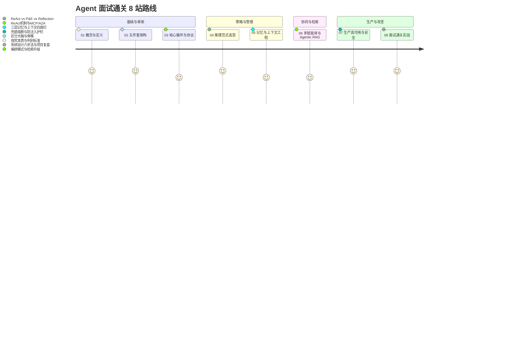
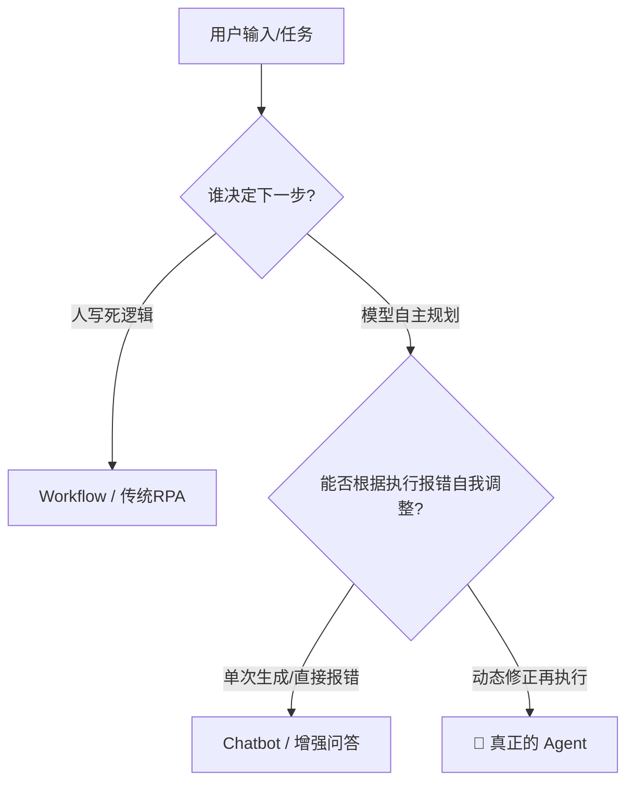
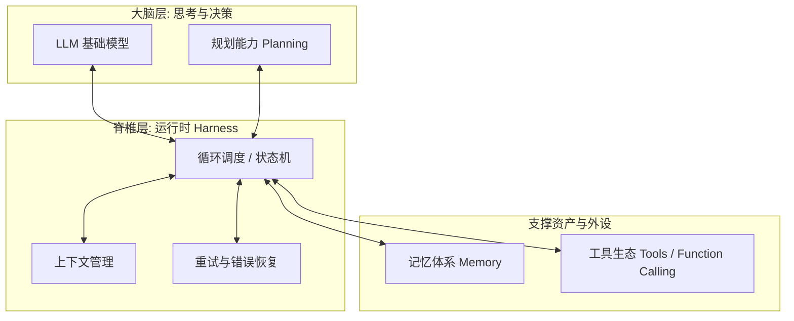
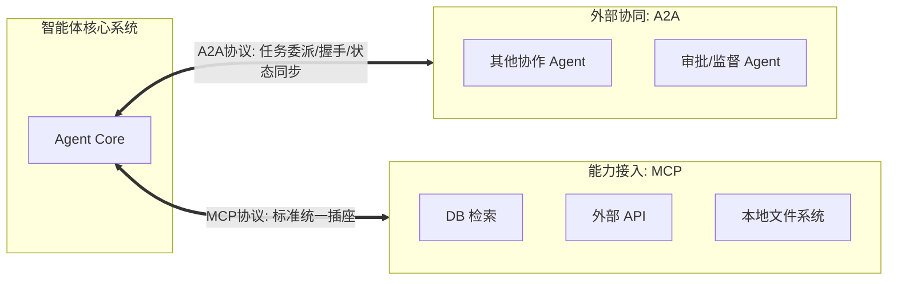
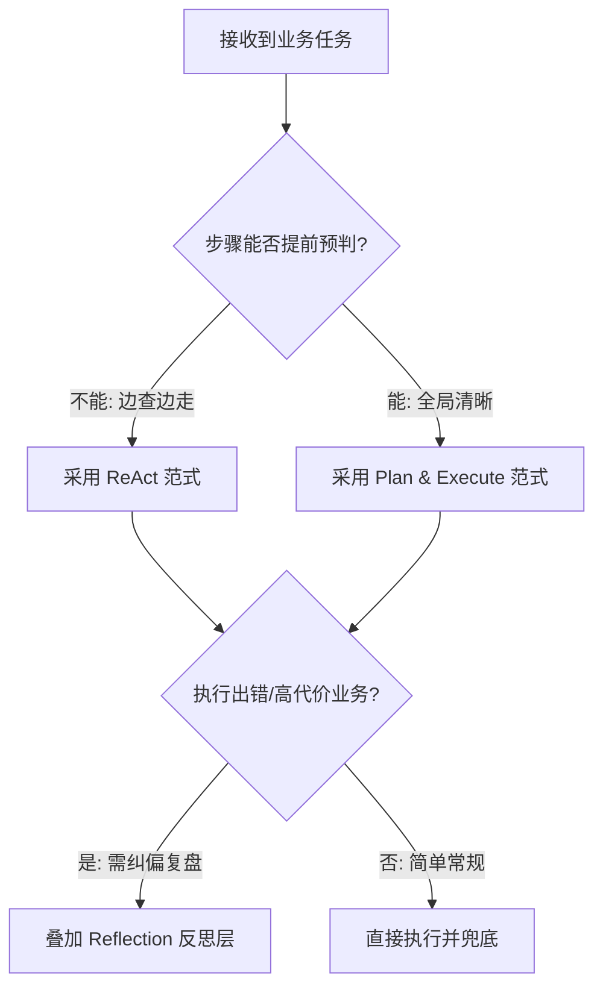
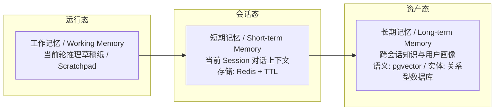
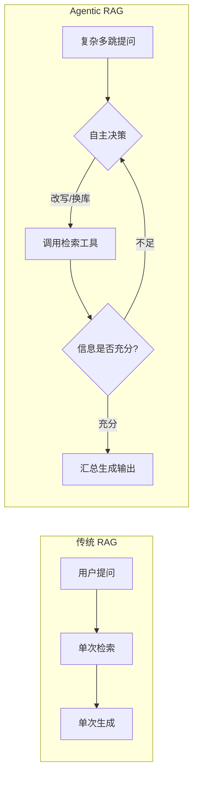
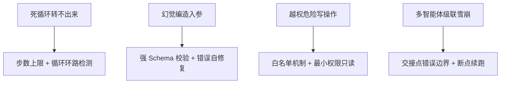
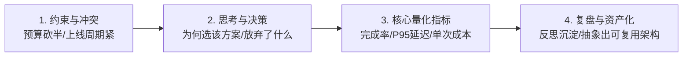

# 🗺️ Agent 面试通关：8 站通关作战地图

> [!abstract] 核心心智模型
> 面试官要的不是散乱的名词概念，而是一条贯穿**底层原理到工程落地**的主线。
> **工程总纲**：简单、可衡量、可持续用，能可靠解决问题的最简单架构。
> 
> 

---

## 🚉 第 1 站：概念与边界（立地基）

### 1. 核心定义

* **最小定义**：Agent 是**会调用工具的循环系统**。

* **系统**：非一次性调用，具备生命周期。

* **循环**：能感知环境并根据反馈进入下一轮。

* **工具**：具备与真实物理/软件环境交互的能力。

### 2. 决策权三判句（区分本质）

当面试官询问“如何判断一个系统是不是 Agent”时，用三判句快速过筛：

1. **谁来决定下一步？**（人类还是模型）

2. **能否感知环境变化？**（是否接收外部输入并理解）

3. **出错后会不会自我调整？**（能否形成闭环重试）

### 3. 学术界四特征 vs 常见形态对比

* **四张身份证**：自主性（自己决策）、反应性（感知环境）、主动性（目标导向行动）、社会性（与其他 Agent 协作）。

* **常见概念区分**：

* **Chatbot**：一问一答，答完即止，下一步由人类触发。

* **Workflow**：流程硬编码，遇到分支按既定逻辑执行，无法感知环境动态演进。

* **RPA**：按预设脚本点击，无推理与理解能力。

* **Agent**：三者皆备，自主决策 + 环境感知 + 错后自我调优。

---

## 🚉 第 2 站：五件套架构（拆骨架）

不要干背组件清单，用“大脑与脊椎”的层级讲出工程深度：

> [!tip] 核心考点：Harness（运行时骨架）
> 很多 Demo 级项目上线即崩溃，**崩的往往不是大脑（LLM），而是脊椎（Harness）**。Harness 承载了循环调度、错误重试、上下文持久化与安全校验。
> 
> 

---

## 🚉 第 3 站：核心循环与协议连接（通经脉）

### 1. 核心循环（Agent Loop）

$$Thought \longrightarrow Action \longrightarrow Observation \longrightarrow (Next\ Round\ Thought)$$

* 每一轮的 `Observation` 都会被贴在**上下文变迁墙**上，模型下一轮看到的是累积历史，而非单纯的单次输入。

### 2. 工具调用拓扑（Function Calling）

模型只决定“调用什么”与“入参是什么”**，真正执行的是**工程宿主代码。

* **并行拓扑**：无依赖的工具同时触发，节约响应时间。

* **链式拓扑**：有输入输出依赖，顺序排队执行。

* **条件分支**：依据前序工具返回动态决定走向。

* **嵌套调用**：工具内部依赖或借用其他子工具。

### 3. 工具规范四法则与标准化协议

* **工具编写规范**：
1. 名字采用清晰的**动宾结构**。

2. 详细描述**适用场景与边界限制**（给模型读的 API 文档）。

3. 参数类型严格限定（尽量使用枚举、明确数值范围）。

4. 单一职责：**一个工具只干一件事**。

5. 返回值严格约定为结构化 JSON，错误信息必须语义化、可被模型理解。

* **MCP (Model Context Protocol)**：向下连接工具，将 $M \times N$ 的网状集成降低为 $M + N$ 标准化接口（如同 AI 世界的 Type-C）。

* **A2A (Agent to Agent)**：向外连接同事，规范握手、任务分派与状态同步。

---

## 🚉 第 4 站：推理范式选型（定打法）

### 1. 三大范式对比

| 范式 | 运行逻辑 | 核心痛点 | 工业级解法 |
| --- | --- | --- | --- |
| **[[ReAct]]** | 走一步看一步（Thought-Action-Observation）

 | **局部贪心**，易陷入死循环或跑偏

 | 强制配齐三道保险：**步数上限、循环检测、超时熔断**  |
| **[[Plan & Execute]]** | 先画全局地图，拆解子任务后轻量分派执行

 | 中间步骤失败导致后续计划失效

 | 引入**动态重规划（Re-planning）**，定期将偏差回灌规划器

 |
| **[[Reflection]]** | 挂载在主循环外的自审机制（错题本）

 | Token 成本成倍上升，耗时增加

 | **计数器硬封顶**（限1~3次），将反思提炼沉淀为长期记忆

 |

---

## 🚉 第 5 站：记忆与上下文工程（控资产）

### 1. 记忆三层存储分级

* **入库最佳实践**：长期记忆必须经过 LLM 结构化提炼后沉淀，**避免每轮实时写入**，采取“攒几轮批量提炼”以降低噪音与成本。

### 2. 应对“上下文腐烂”（Context Rot）四招

长上下文不仅带来巨额延迟与成本，还会导致**中间段信息丢失（Lost in the Middle）**：

1. **压缩摘要**：冗长的工具返回必须精简成纯文本/结构体摘要。

2. **外部挂载**：超大内容写入外部对象存储/文件系统，上下文中仅保留路径句柄。

3. **按需拉取**：拒绝全量预加载，采用即查即载机制。

4. **窗口隔离**：多 Agent 协作时为子 Agent 开设独立精简窗口，仅下发必须字段。

---

## 🚉 第 6 站：多智能体与 Agentic RAG（上强度）

### 1. 多智能体（Multi-Agent）何时用？

> [!warning] 成本告警
> 多智能体系统 Token 消耗可达单 Agent 的 **15 倍**，且存在**错误级联放大**与**轨迹方差增大**问题。
> **坚决不用多 Agent 的场景**：严格顺序推理任务（准确率反而下降 39%~70%）、单 Agent 一轮即可解决的任务、成本极其敏感的业务。
> 
> 

* **协作与通信模式**：
* **管道式（Pipeline）**：串行流转，适合流水线，但受限于最慢环节。

* **协调编排式（Orchestrator-Workers）**：主控调度多个工人，主控易成瓶颈。

* **黑板模式（Blackboard）**：共享统一状态区，各取所需、灵活解耦（如 LangGraph 的 State 机制）。

### 2. 传统 RAG vs. Agentic RAG

* **硬核检索工程参数**：
* **切块策略**：Chunk 推荐 200~500 tokens，保持 10%~20% 语义重叠，按语义边界切分。

* **检索方式**：向量索引 + BM25 混合召回，后端接入 Cross-Encoder 进行重排（Rerank，可提升 20%~30% 准确率）。

---

## 🚉 第 7 站：生产高可用与安全护栏（防翻车）

### 1. 线上四大死法与对应防线

### 2. 分层兜底体系（字节面试高频考点）

* **调用层**：网络超时、限流 $\to$ 指数退避重试、熔断器、备用通道降级。

* **推理层**：工具返回异常 $\to$ 智能换源、跳过可选步骤、填充系统默认占位符。

* **模型层**：幻觉、格式错误 $\to$ 强纠错 Prompt 二次请求、自动回退备用小模型。

* **消费层**：下游业务无法解析 $\to$ 适配器层转换，异常告警并平滑转人工客服。

### 3. 安全防护体系（防 Prompt 注入）

* 提示词本身无法保证安全，**安全必须由代码系统兜底**。

* **四道安全护栏**：不可信数据隔离、输入消毒（独立 Guardrail 检测层）、权限最小化（只读先行）、高危写操作加人工卡点确认（Human-in-the-loop）。

---

## 🚉 第 8 站：面试实战与项目复盘（拿 Offer）

### 1. 答题武器库：系统设计六步法

遇到“设计一个特定场景的 Agent（如智能客服）”时，按以下节奏展开：

1. **需求澄清**：圈定支持的业务场景与 QPS/并发量级。

2. **能力拆解**：划分意图识别、检索、工具调用、长期记忆组件。

3. **数据流与架构图**：绘制 Thought-Action 拓扑与持久化 Checkpoint。

4. **模块时序设计**：强调异步非阻塞与并发工具调用。

5. **容量、兜底与降级**：**（拉开差距的关键）** 讲出只读降级开关、P95 延迟压制策略。

6. **成本与效果平衡**：强弱模型混用（规划用强模型、执行用轻量模型）。

### 2. 项目亮点阐述框架（四段论）

---

## 💡 终极快问快答（肌肉记忆清单）

> **Q1：检索不到数据怎么办？**
> 降级到 BM25 关键词检索；仍无结果则诚实返回“未知”，并主动反问用户索取补充信息，严禁幻觉脑补。
> 
> 
> **Q2：工具返回超时怎么解？**
> 触发超时熔断，配合退避重试；若失败则切换备用替代工具或降级填充默认占位符。
> 
> 
> **Q3：工具入参不符合规范怎么拦截？**
> 在代码层进行 Pydantic / JSON Schema 严格校验拦截，构造规范的报错信息回传给模型，提示其自我修复。
> 
> 
> **Q4：上线后系统 P95 延迟高如何优化？**
> 1. 无依赖工具改为并行执行；
> 
> 
> 2. 两级缓存：入参相同走 LRU 缓存，语义相似度 > 0.9 走语义缓存直接出结果；
> 
> 
> 3. 强弱模型解耦，非复杂推理环节采用轻量小模型。
> 
> 
> 
>