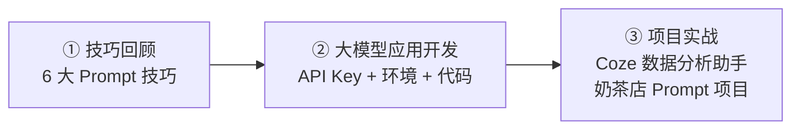
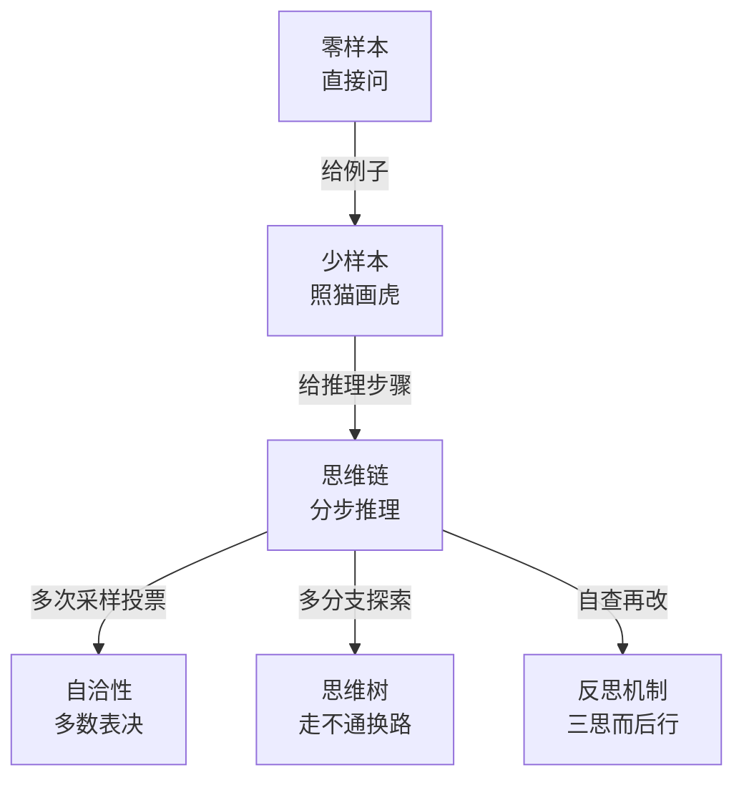
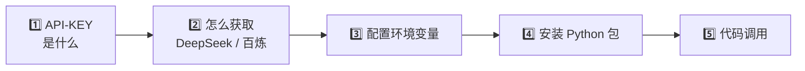
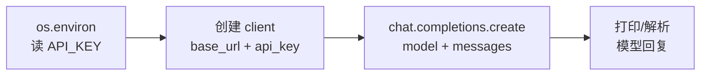
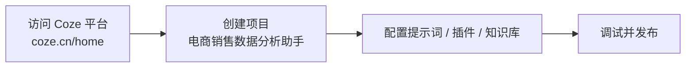

---
tags:
  - AI
  - Prompt工程
  - LLM
  - Python
  - 实战
source: L1_day04_提示工程特训与实战.pptx
讲师: Jeff老师
机构: 智泊AI大模型实战课 · MoPass「魔泊云」
上一讲: "[[1.2-Prompt Engineer 提示词工程]]"
创建时间: 2026-11-04
---

# 提示工程实战演练（L1_day04）

> [!abstract] 本讲定位
> 上一讲把**技巧**讲完，这一讲做三件事：**技巧回顾 → 打通工程环境（API Key / Python 包 / 代码调用）→ 项目实战**。
> 关联笔记：[[1.2-Prompt Engineer 提示词工程]]



---

## 一、Prompt 技巧回顾

### 1.1 六句话记住六大技巧

| 技巧 | 一句话理解 |
| --- | --- |
| **零样本 Zero-Shot** | 模型直接问答案 |
| **少样本 Few-Shot** | 模型参考例子回答 |
| **思维链 CoT** | 分步骤推理机制 |
| **自洽性 Self-Consistency** | 让模型多算几次，选出现多数的结果 |
| **思维树 ToT** | 让模型"尝试不同解法，走不通就换一条路" |
| **反思机制 Self-Reflection** | 初步输出 → 自我审查 → 优化结果 |



> [!note] 提示词领域的乔哈里视窗
> 课件第 5 页再次出现该图（以图片形式呈现，文字未能提取）。核心是借乔哈里视窗的四个象限，审视 Prompt 中**已知/未知 × 你说出口/没说出口**的信息分区，把"隐藏区"的关键背景显式写进提示词。详见上一讲笔记。

---

## 二、大模型应用开发：五步打通环境



### 2.1 API-KEY 是什么

> [!info] 一句话定义
> API-KEY（应用程序接口密钥）是你调用大模型接口时的**"身份证" + "计费账户"**。

- 形态：由字母和数字组成的长字符串，例如 `sk-xxxxxxxxxxxxxxxxxxxx`
- 性质：使用大模型服务的**必需凭证**
- 三个类比，一次说清：

| 类比 | 对应能力 |
| --- | --- |
| 🪪 **门禁卡** | 身份验证——证明"你是你" |
| 🔌 **水表 / 电表** | 计费与配额——按用量扣费、限制额度 |
| 🔑 **房间钥匙** | 权限范围——能进哪些模型/接口 |

### 2.2 怎么获取

| 平台 | 地址 |
| --- | --- |
| **DeepSeek** | https://platform.deepseek.com/api_keys |
| **阿里百炼（Qwen）** | https://bailian.console.aliyun.com/cn-beijing/model/settings/api-key |

> 详细步骤见课件《大模型APIKey获取.pptx》。

### 2.3 配置 API-KEY 到环境变量

> [!tip] 为什么用环境变量
> 配到本地环境变量后，**本机任何项目都能随时读取**，且密钥不写进代码、**不会暴露和泄露**。

| 模型 | 环境变量名 |
| --- | --- |
| Qwen | `DASHSCOPE_API_KEY` |
| DeepSeek | `DEEPSEEK_API_KEY` |

#### macOS 配置

```bash
# 1. 追加到 ~/.zshrc
echo "export DASHSCOPE_API_KEY='填你的Qwen API_KEY'" >> ~/.zshrc
echo "export DEEPSEEK_API_KEY='填你的DeepSeek API_KEY'" >> ~/.zshrc

# 2. 使变更立即生效
source ~/.zshrc
```

#### Windows 配置

```
我的电脑 → 右键 → 属性 → 高级系统设置 → 环境变量 → 系统变量 → 新建
→ 分别新建 DASHSCOPE_API_KEY 和 DEEPSEEK_API_KEY
```

> [!warning] 常见坑
> **PyCharm 已启动时不会感知环境变量变化，必须重启 PyCharm**；个别电脑重启 IDE 仍无效，需重启系统。

### 2.4 安装 Python 包

```bash
# ① 配置阿里云镜像加速（只需执行一次）
pip config set global.index-url https://mirrors.aliyun.com/pypi/simple/

# ② 方式一：单独安装
pip install openai

# ③ 方式二：按 requirements.txt 批量安装（需在该文件所在目录执行）
pip install -r requirements.txt
```

> Mac 上若 `pip` 不可用，替换为 `pip3`。

### 2.5 代码调用（DeepSeek / Qwen）

两页课件均为代码截图，未提取到源码文字。调用骨架一致——**读环境变量 → 建客户端 → 发 chat 请求**：



```python
# 参考骨架（非课件原文，用于理解调用结构）
import os
from openai import OpenAI

client = OpenAI(
    api_key=os.environ["DEEPSEEK_API_KEY"],
    base_url="https://api.deepseek.com",          # Qwen 换为百炼兼容地址
)

resp = client.chat.completions.create(
    model="deepseek-chat",
    messages=[
        {"role": "system", "content": "你是一个严谨的电商数据分析助手"},
        {"role": "user", "content": "帮我分析这份销售数据的异常点"},
    ],
)
print(resp.choices[0].message.content)
```

> 关键点：DeepSeek 与 Qwen 都提供 **OpenAI 兼容接口**，所以同一套 `openai` SDK 只改 `base_url` / `model` / 环境变量即可切换。

---

## 三、Prompt Engineering 实战项目

### 3.1 项目一览

| 项目 | 平台 | 目标 |
| --- | --- | --- |
| **项目 1：电商销售数据分析助手** | Coze（https://www.coze.cn/home） | 用低代码平台搭建一个能分析销售数据的 AI 助手 |
| **项目 2：连锁奶茶店 Prompt 项目** | Python | 用代码 + Prompt 完成业务场景落地 |

### 3.2 项目 1：电商销售数据分析助手（Coze）



操作起点：
1. 访问 Coze 平台：https://www.coze.cn/home
2. 创建项目，命名为「电商销售数据分析助手」

> 课件此页到此为止，后续配置步骤在课堂演示中完成。

### 3.3 项目 2：连锁奶茶店 Prompt 项目（Python）

用 Python 调用大模型，围绕连锁奶茶店的业务场景（如菜单推荐、销量分析、门店问答）设计并落地 Prompt。
课件此页仅列标题，具体需求与代码在课堂实操环节展开。

> [!tip] 两个项目的分工
> **Coze 项目**练"平台化搭建"——不写代码也能把 Prompt + 插件 + 知识库组装成应用；
> **奶茶店项目**练"工程化落地"——自己管环境、写代码、调 API，把 Prompt 嵌进真实业务流。

---

## 四、要点回顾

- **技巧复习**：六大技巧的核心差异在"给不给例子 / 要不要多步推理 / 要不要多次采样 / 要不要自我审查"
- **API-KEY = 身份证 + 计量表 + 钥匙**：既是身份，也是账单，还是权限边界
- **密钥管理铁律**：只进环境变量，绝不写进代码、绝不提交仓库
- **环境三件套**：镜像加速（快）→ 装包（`openai`）→ 环境变量（安全）
- **动手路径**：先跑通一次最简调用，再把 Prompt 塞进真实业务场景

> [!quote] 教学监督
> feedback@zhipoai.cn（智泊AI）

---

*整理自课件《L1_day04_提示工程特训与实战.pptx》（15 页）· Obsidian 笔记 · 2026-11-04*
