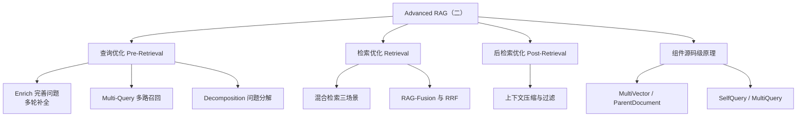
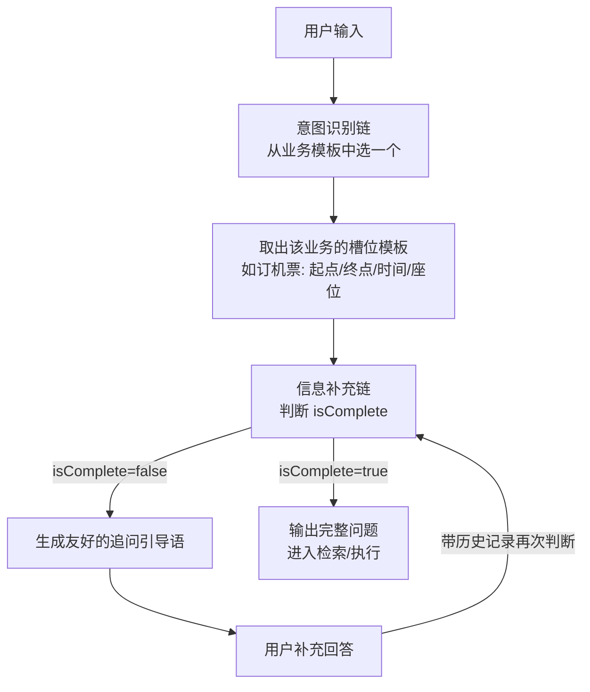
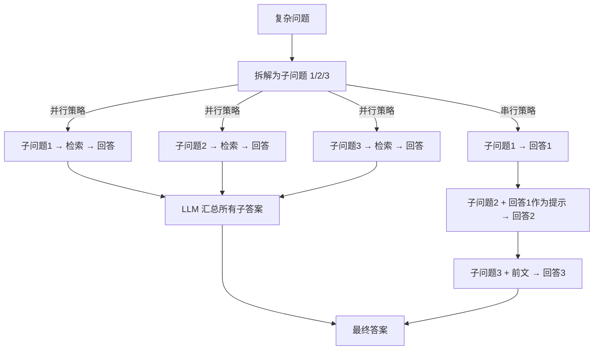
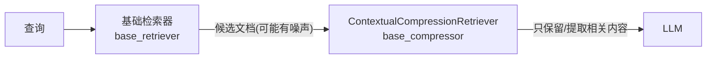

# Advanced RAG（二）：查询优化与检索组件核心原理

> [!abstract] 一句话定位
> Day08（[[9-AdvancedRAG一-七个故障点与高级索引技术]]）讲了**怎么改库**（索引优化四技术）；这一篇讲**怎么改问**（查询优化三招）和**怎么改查**（混合检索 + RRF 融合），最后把 LangChain 四个检索器/压缩器的**源码级原理**拆开。对应七故障点里的 **FP2 召回错位**——库里有但查不出来，病根多在查询侧。

## 🗺️ 知识地图



---

## 一、查询优化：三招解决「问得不好」

查询优化的目标：**提升用户意图理解的准确性**。三招各有分工：

| 技术 | 针对的痛点 | 一句话概括 |
|---|---|---|
| Enrich 完善问题 | 口语表达含糊、隐含要素缺失 | 让 LLM **主动追问**，把问题补全 |
| Multi-Query 多路召回 | 表述差异导致漏检 | 一个问题**变 N 个角度**分别检索 |
| Decomposition 问题分解 | 复合问题需要多步推理 | 把大问题**拆成子问题**逐个解决 |

### 1.1 Enrich 完善问题：建一个「智能翻译层」

**痛点**：用户说「帮我订个去上海的」，缺时间、缺人数、缺舱位——直接检索或调用工具必然失败。

**思路**：在用户和大模型之间建一个翻译层，通过**多轮对话**不断收集信息，补全执行需求所需的参数。

`5.Enrich.py` 的完整实现链路（这个文件的工程结构比 RAG 本身更值得学）：



代码里的三个关键件：

| 组件 | 作用 | 值得学的点 |
|---|---|---|
| `templates` 业务模板字典 | 每种意图对应一组**必填槽位** | 意图识别 → 取模板 → 逐槽位追问，是 function calling 参数收集的手工版 |
| `RunnableWithMessageHistory` | 自动注入历史 + 每轮后更新 | `input_messages_key` / `history_messages_key` 配置法，多轮补全的标配 |
| `JsonOutputParser` + `isComplete` 循环 | LLM 返回 JSON，`while not isComplete` 驱动追问 | **用 JSON 字段控制循环退出**，比解析自然语言可靠得多 |

> [!warning] 三个工程细节
> 1. 提示模板里的**输出示例 JSON 含字面量 `{}`**，f-string 场景要写成 `{{` `}}` 转义（代码里就是这么干的）；
> 2. `while` 循环里必须捕获 `json.JSONDecodeError`——LLM 偶尔返回非法 JSON，直接崩给用户不合适；
> 3. 追问的引导语用 `\033[1;33m` 着色打印——CLI 交互的体贴细节，Web 场景换成消息卡片。

**评估是否「完善得对」**，讲义给了 5 个指标：完善准确率、澄清效率（平均几轮补完）、用户满意度、任务完成率、响应时间（完善本身的延迟成本）。

### 1.2 Multi-Query 多路召回：一个查询变 N 个

**痛点**：`vectorstore.similarity_search("deepseek的应用场景")` 只从一个视角召回——表述稍有偏差就漏。

**基本思路**：LLM 基于原问题生成 N 个不同视角的子查询 → 每个子查询各自检索 → **合并去重**后喂给 LLM。

`6.multi_query.py` 给了两种实现，价值不同：

**方法一：一行代码的 `MultiQueryRetriever`**（适合快速上手）

```python
multi_retriever = MultiQueryRetriever.from_llm(retriever=retriever, llm=llm)
# 调试技巧：打开日志看它生成了哪些子查询
logging.getLogger("langchain_classic.retrievers.multi_query").setLevel(logging.INFO)
```

**方法二：自定义 prompt + 手动融合**（面试和定制都考这个）

```python
generate_queries = (prompt_perspectives | llm | StrOutputParser()
                    | (lambda x: x.split("\n")))          # 1. 生成 N 个查询

retrieval_chain = generate_queries \
    | retriever.map() \                                   # 2. 每个查询分别检索 → list[list[Document]]
    | RunnableLambda(get_unique_union)                    # 3. 展开去重

def get_unique_union(documents: list[list]):
    flattened = [dumps(doc) for sublist in documents for doc in sublist]
    unique = list(set(flattened))          # Document 不可哈希 → 先 dumps 成字符串再 set
    return [loads(doc) for doc in unique]
```

> [!important] 两个必须记住的实现细节
> 1. **去重的正确姿势**：`Document` 对象不可哈希，`set()` 直接放会报错。标准做法是 `dumps()` 序列化成 JSON 字符串去重，再 `loads()` 还原——这是 LangChain 官方 demo 的固定套路。
> 2. **`retriever.map()`**：对查询列表逐个调用检索器，返回 `list[list[Document]]`；批量场景用异步 `asyncio.gather` 并行更省时（`MultiQueryRetriever` 源码内部就是这么做的）。

**与 SelfQueryRetriever 的分工**（讲义原文表格，易考点）：

| 特性 | MultiQueryRetriever | SelfQueryRetriever |
|---|---|---|
| 目标 | 提高**召回率** | 提高**精确度** |
| 方法 | 查询扩展（多角度） | 查询解析 + 元数据过滤 |
| 适用 | 主题宽泛的探索性查询 | 带硬性条件的精确查询 |
| 代价 | LLM 多调一次 + 可能引入不相关结果 | 元数据描述要写准，解析错就全错 |

最佳实践：控制生成 3~5 个子查询、温度调低（0~0.3）保证稳定、结果再接重排器兜底。

### 1.3 Decomposition 问题分解：拆子问题，逐个击破

**痛点**：「新手如何制作番茄炒蛋？」——完整答案要覆盖**食材、步骤、注意事项**三块，但 `k=1` 的向量检索只能命中一块（代码实测演示了拆解前只召回「食材」块）。

**思路**：用 CoT 策略把复杂问题拆成子问题，然后两种执行策略：



`7.Decomposition.py` 展示了**自定义 Retriever 的标准姿势**——继承 `BaseRetriever`，这是 LangChain 扩展的通用模式：

```python
class DecompositionQueryRetriever(BaseRetriever):
    retriever: BaseRetriever        # 声明字段（Pydantic 校验）
    make_sub_chain: Runnable        # 拆解链: prompt | llm | LineListOutputParser
    resolve_sub_chain: Runnable     # 解答链: sub_prompt | llm

    def _get_relevant_documents(self, query, *, run_manager):
        sub_queries = self.generate_queries(query)     # 1. 拆
        return self.retrieve_documents(query, sub_queries)  # 2. 逐个检索+回答
```

子问题答案被包装成 `Document(page_content=子问题+答案)` 拼回上下文——**子答案即文档**，主问题最终靠这些「人工文档」作答。

> [!info] 顺带一个 Python 小知识
> `from_llm(...) -> "DecompositionQueryRetriever"` 返回值带引号是**前向引用**：方法定义在类体内时类还没定义完，字符串形式推迟解析；或者文件头 `from __future__ import annotations` 全局解决。纯类型提示，不影响运行。

**Multi-Query vs Decomposition 的分界**：前者是「换个说法再问一遍」（同义扩展，答案不变）；后者是「拆成几个必须都答的小问题」（问题变多，各自有答案）。宽泛主题用前者，复合任务用后者。

---

## 二、检索优化：混合检索与 RAG-Fusion

### 2.1 混合检索的三个适用场景

Day03（[[8-混合检索与NaiveRAG项目实战-BM25与HR智能问答]]）讲过原理和代码，Day09 讲义补全了**场景分类学**：

| 场景 | 核心挑战 | 解法 |
|---|---|---|
| **异构数据** | 结构化表格 + 非结构化文档混存 | 分工：关键词检索当「数据库专员」（精确匹配 ID/日期），向量检索当「内容理解专家」（语义段落） |
| **复杂查询** | 硬约束 + 软意图混合（"去年发布的、AI医疗的、提到伦理的 PDF"） | 分层：先用关键词过滤硬约束缩小候选集，再向量检索语义精排 |
| **动态知识 + 实时数据** | 订单状态（实时）+ 退货政策（静态） | 一问两查：关键词查订单库拉实时状态，向量查帮助文档拿流程，LLM 合成 |

> [!tip] 和 Day08 七故障点对上号
> 「复杂查询」场景的分层过滤正是元数据索引（SelfQueryRetriever）的思路——**先把硬约束变成过滤器，再把语义搜索留给向量**。两种技术是同一哲学在索引侧和查询侧的投影。

### 2.2 EnsembleRetriever：LangChain 的混合检索标准件

`8.hybrid_search.py` 用标准件替代了 Day03 的手写融合：

```python
ensembleRetriever = EnsembleRetriever(
    retrievers=[BM25_retriever, vector_retriever],
    weights=[0.5, 0.5],
)
```

> [!warning] 关键差异：EnsembleRetriever 用的不是分数归一化
> Day03 手写的 `hybrid_search.py` 是「min-max 归一化分数 → 线性加权」；而 `EnsembleRetriever` 内部用的是 **RRF（互惠排名融合）**——它根本不看分数，只看**排名**。代码注释原话：「归一化内部进行了封装，使用的不是分数归一化」。这意味着：
> - 权重 `weights=[0.5, 0.5]` 加权的是**每个列表的 RRF 贡献**，不是相似度分数；
> - BM25 分数和余弦相似度**量纲不可比**的问题在 RRF 下天然不存在。

### 2.3 RAG-Fusion 与 RRF 公式

RAG-Fusion = **Multi-Query + RRF 重排**：生成 N 个查询 → 各自检索 → 用 RRF 融合排名 → 取 Top-K 生成答案。它解决 Multi-Query 的遗留问题：**多路召回后文档一多，不相关的可能排在前面污染上下文**。

$$RRF(d) = \sum_{i=1}^{N} \frac{1}{k + rank_i(d)}$$

| 参数 | 含义 | 说明 |
|---|---|---|
| `N` | 参与融合的列表数 | BM25+向量 N=2；multi-query 生成 3 问 N=3 |
| `rank_i(d)` | 文档 d 在第 i 个列表中的排名 | 从 1 开始计 |
| `k` | 平滑常数，经典值 **60** | 防除零 + 控制排名权重衰减速度 |

**k 为什么是 60**（讲义考据很完整）：出自 Cormack 等人 2010 年的 RRF 原始论文，在 TREC 等评测集上实证稳健。直觉上：排名 1 的得分 1/61≈0.0164，排名 100 的得分 1/160≈0.00625——差距不至于极端，**多个列表「共识出现」的中排文档有机会胜过单列表的偶然第一**，融合是「民主投票」而非「赢者通吃」。

**调优方向**：信任头部排名 → k 调小（10~30）；要多样性或列表很长 → k 调大（60~100）。

**RRF vs 重排模型**（讲义金句：**RRF 是计票员，Rerank 是裁判**）：

| | 重排模型（如 gte-rerank-v2） | RRF |
|---|---|---|
| 输入 | 查询 + 候选文档**原始文本** | 每个文档的**排名序号** |
| 机制 | 深度语义模型打相关性分 | 纯数学公式 Σ1/(k+rank)，**不看内容** |
| 输出 | 相关性得分（0.93/0.34）→ 重排 | 融合分数 → 新排名 |

---

## 三、后检索优化：上下文压缩与过滤

**痛点**：分块时不知道用户会问什么——最相关的信息可能埋在一大段无关文本里，全喂给 LLM 又贵又降质（对应故障点 FP3「不在上下文」）。

**思路**：检索后加一道**压缩/过滤工序**，只把有用的送进 LLM。

### 3.1 核心角色：ContextualCompressionRetriever



> [!important] 名字里的陷阱
> `ContextualCompressionRetriever` **本身不压缩**——它只是个「组合器」，把 `base_retriever` 和 `base_compressor` 接起来。真正干活的是 compressor。讲义原话：「名字叫压缩器组合检索器更适当」。

三种压缩器，成本从高到低：

| 压缩器 | 干什么 | 成本 | 什么时候用 |
|---|---|---|---|
| `LLMChainExtractor` | 对每个文档**逐个调 LLM**，只提取与查询相关的句子 | 最贵最慢 | 质量优先，文档少 |
| `LLMChainFilter` | LLM 判断**整个文档留不留**，不改内容 | 中 | 粗筛 |
| `EmbeddingsFilter` | 算查询与文档的**嵌入相似度**，低于阈值丢弃 | 便宜快速 | 大候选集的初筛 |

> [!note] 阈值敏感性实测
> 课堂数据：`similarity_threshold=0.66` 过滤掉 2 个不相关文档；调到 **0.7 会把正确文档也滤掉**。阈值不是拍脑袋的——差 0.04 就是「能用」和「误杀」的区别，必须用自己的语料调。

### 3.2 组合流水线 DocumentCompressorPipeline

多个处理步骤按序串联，形成一个「本身就是压缩器」的管道：

```python
pipeline_compressor = DocumentCompressorPipeline(
    transformers=[splitter, redundant_filter, relevant_filter]
)   # 先分割 → 再去重 → 最后按相关性过滤
```

这里要分清两个基类（讲义花了整节辨析，易混）：

| | `BaseDocumentTransformer` | `BaseDocumentCompressor` |
|---|---|---|
| 是否依赖查询 | **不依赖**，只改文档本身 | **依赖**，必须传 query |
| 典型操作 | 拆分、合并、翻译、清洗 | 过滤、按相关性提取 |
| 关键方法 | `transform_documents(docs, **kwargs)` | `compress_documents(docs, query, ...)` |
| 流水线中的例子 | `splitter` | `redundant_filter`、`relevant_filter` |

**EmbeddingsRedundantFilter vs EmbeddingsFilter**（名字像，方向完全相反）：

| | EmbeddingsRedundantFilter | EmbeddingsFilter |
|---|---|---|
| 比较对象 | **文档之间**两两比相似度 | **文档与查询**比相似度 |
| 目标 | 去重（相似度 >0.9 判冗余，留一篇） | 相关性过滤（与查询 <阈值丢弃） |
| 类比 | 文档查重系统 | 智能检索系统 |

> [!tip] 排列顺序有讲究
> 流水线是**按列表顺序**执行的：先 `splitter`（Transform，不涉及查询）→ 再 `RedundantFilter` 去重 → 最后 `RelevantFilter`（依赖查询）。把去重放相关过滤前面，能减少重复内容对阈值判断的干扰。

---

## 四、组件源码级原理（讲义最硬核的部分）

### 4.1 MultiVectorRetriever：图书馆模式

**三存储结构**：

| 存储 | 存什么 | 类比 |
|---|---|---|
| `vectorstore` | **小片段/摘要**的向量（检索在这里发生） | 索引卡 |
| `docstore` | **完整父文档**（键值存储，值为 Document） | 书库 |
| `byte_store` | docstore 的底层字节支撑（可由它构建 docstore） | 书库的地基 |

**检索流程**：在 vectorstore 里搜小片段 → 从片段的 `metadata["doc_id"]` 提取父 ID → 用 `docstore.mget([id])` 取回完整父文档。

**典型用法**（`代码`示例的持久化版）：LLM 给每个块生成**摘要** → 摘要带 `doc_id` 入向量库 → 原文 `docstore.mset(zip(doc_ids, docs))` 入文件库。检索命中摘要，返回原文。

```python
# 摘要生成的批量写法，max_concurrency 限并发防限流
summaries = chain.batch(docs, {"max_concurrency": 5})
```

> [!note] 工程细节
> 重跑脚本要先查 `vectorstore._collection.count()`——非空就跳过摘要生成，否则每次启动都白花一遍 LLM 调用费。持久化 + 幂等检查是本地实验代码里少见的正经工程习惯。

### 4.2 MultiVectorRetriever vs ParentDocumentRetriever

| | ParentDocumentRetriever | MultiVectorRetriever |
|---|---|---|
| 专注 | **父子分层**：child_splitter 切小块检索，parent_splitter 切大块返回 | **通用多表示**：摘要、假设问题、任何替代向量都行 |
| 父块来源 | 由 `parent_splitter` 切出来 | 原始文档 / 你放进 docstore 的任何东西 |
| 自动化 | `add_documents()` 一把梭（切+建关联+入库全自动） | 手动分别写 vectorstore 和 docstore |

共同哲学与 Day08 一致：**检索用的表示**（小、准）与**回答用的内容**（大、全）解耦。

### 4.3 SelfQueryRetriever：LLM 当查询解析器

源码级的四步流程：


| 组件 | 职责 | 关键认知 |
|---|---|---|
| `query_constructor` | LLM 链：自然语言 → `StructuredQuery`（query + filter + limit） | 由 `get_query_constructor_prompt` 构建提示 |
| `AttributeInfo` | 描述元数据字段：name/description/type | **description 最重要**——LLM 全靠它理解字段，写「文档发布的年份，格式为YYYY」比写「年份」召回准得多 |
| `StructuredQueryOutputParser` | 解析 LLM 输出的 JSON（markdown 代码块内），`fix_invalid` 可修复非法过滤 | `filter="NO_FILTER"` → None 的特殊处理 |
| `structured_query_translator` | 把统一结构化查询翻译成各向量库的过滤语法 | Visitor 模式，Chroma/Milvus 各有实现 |

> [!important] 课堂实战技巧：日期字段拆成 year/month/day
> `created_date` 用 string 类型 LLM 容易生成比较失败的过滤；拆成 `year/month/day` 三个 integer 字段分别描述（「文档发布的年份，四位数字」「月份，1-12」），LLM 生成的过滤**成功率显著更高**。日期范围过滤的元数据设计首选这个模式。

### 4.4 MultiQueryRetriever 源码骨架

```python
output_parser = LineListOutputParser()   # 按行切分 → 每行一个查询
llm_chain = prompt | llm | output_parser
# include_original=True 时把原始查询也并入检索列表
```

默认提示：「生成 3-5 个不同的搜索查询，从不同角度探索这个问题，每个查询占一行，不要编号」。异步版用 `asyncio.gather` 并行检索所有子查询。

---

## 五、术语速查

| 术语 | 含义 |
|---|---|
| Enrich | 查询完善：LLM 主动追问补全槽位，输出完整问题 |
| Multi-Query | 多路召回：一个查询扩展为 N 个视角分别检索 |
| Decomposition | 问题分解：复杂问题拆子问题，并行/串行逐个解决 |
| RAG-Fusion | Multi-Query + RRF 重排融合的增强检索范式 |
| RRF | 互惠排名融合：Σ1/(k+rank)，只看排名不看分数 |
| k（RRF 平滑常数） | 经典 60，控制头部排名权重 vs 多列表共识的平衡 |
| Rerank Model | 语义重排模型（如 gte-rerank-v2），打相关性分的「裁判」 |
| ContextualCompressionRetriever | 压缩器组合检索器（本身不压缩，只组合） |
| LLMChainExtractor | 逐文档调 LLM 提取相关内容（贵、准） |
| LLMChainFilter | LLM 判断文档留不留（文档级粗筛） |
| EmbeddingsFilter | 嵌入相似度阈值过滤（便宜快速） |
| EmbeddingsRedundantFilter | 文档间两两去重（与查询无关） |
| DocumentCompressorPipeline | 压缩流水线：Transformer + Compressor 按序组合 |
| BaseDocumentTransformer | 不依赖 query 的文档变换（切分/清洗） |
| BaseDocumentCompressor | 依赖 query 的文档压缩（过滤/提取） |
| id_key | MultiVectorRetriever 中子片段→父文档的关联键，默认 "doc_id" |
| 前向引用 | `-> "ClassName"` 字符串注解，解决类内自引用的未定义问题 |

## 六、自检问答

> [!question]- Multi-Query 和 Decomposition 都是「把一个查询变成多个」，分界在哪？
> Multi-Query 的子查询是**同义变体**——答案不变，目的是多角度覆盖召回；Decomposition 的子问题是**必须分别作答的独立问题**——各有答案，最后汇总。前者治「表述偏差漏检」，后者治「复合问题需要多步推理」。

> [!question]- EnsembleRetriever 的 weights 和 Day03 手写的加权融合是一回事吗？
> 不是。手写版是**分数归一化 + 线性加权**（两路分数必须先拉到同一量纲）；EnsembleRetriever 内部是 **RRF**——只看排名不看分数，weights 加权的是每个列表的 RRF 贡献。后者天然免疫 BM25 分数与余弦相似度量纲不可比的问题。

> [!question]- ContextualCompressionRetriever 为什么说「叫压缩器组合检索器更适当」？
> 因为它自己不做任何压缩——只是把 base_retriever 的输出交给 base_compressor 处理再返回。压缩逻辑全在 compressor（Extractor/Filter/EmbeddingsFilter/Pipeline）里。

> [!question]- LLMChainFilter 和 EmbeddingsFilter 都会「丢文档」，差别是什么？
> LLMChainFilter 每个文档调一次 LLM 判断留不留——准但贵；EmbeddingsFilter 只算嵌入相似度比阈值——便宜快速，适合大候选集初筛。课堂实测阈值 0.66 保留正确文档，0.7 开始误杀，必须用自己语料调。

> [!question]- SelfQueryRetriever 里 AttributeInfo 的三个参数哪个最值得花时间写？
> description。LLM 完全靠它理解字段语义和取值格式，直接决定生成的过滤条件对不对。日期字段建议拆 year/month/day 三个 integer 并写清格式，比单个 string 日期成功率高得多。

> [!question]- MultiVectorRetriever 和 ParentDocumentRetriever 选哪个？
> 父块就是「原文档切大块」→ ParentDocumentRetriever（全自动，add_documents 一把梭）；父块是摘要、假设问题等**非原文表示** → MultiVectorRetriever（手动管理双库，更通用）。

---

## 七、与前面几篇的衔接


- [[6-NaiveRAG构建流程与文档分块]]：离线四步的前两步（清洗、分块）
- [[7-向量化与向量检索-Embedding相似度与向量数据库]]：向量化与向量库
- [[8-混合检索与NaiveRAG项目实战-BM25与HR智能问答]]：BM25/融合原理与手写实现（本篇 EnsembleRetriever 是它的标准件版）
- [[9-AdvancedRAG一-七个故障点与高级索引技术]]：FP1~FP7 框架 + 索引优化四技术（本篇的 SelfQuery 源码细讲是它的续集）
