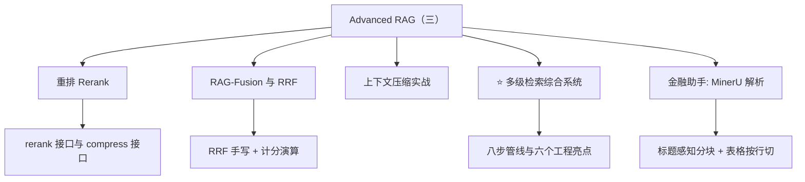
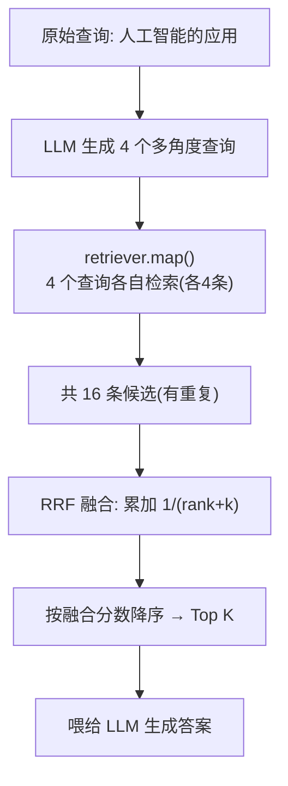
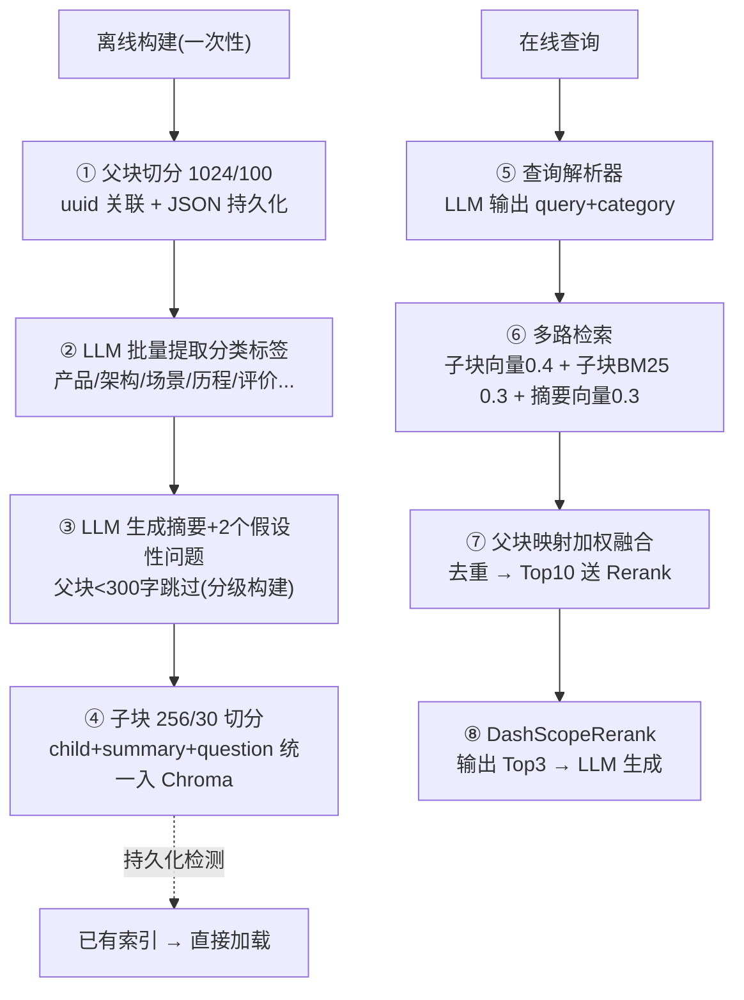
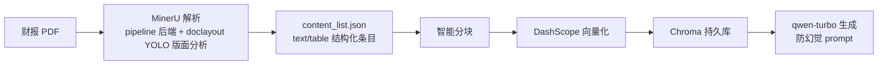

# Advanced RAG（三）：重排、RAG-Fusion 与多级检索综合实战

> [!abstract] 一句话定位
> 笔记 10 讲了查询优化与组件**原理**，本篇是它的**代码实战 + 综合收口**：Rerank 重排模型、RAG-Fusion（RRF 手写实现）、上下文压缩实测，最后用 500 行的**多级检索系统**把前面所有技术（元数据+父子+摘要+混合检索+RRF+Rerank）串成一条生产级管线，外加 MinerU 版金融助手项目。

## 📚 材料地图

| 材料 | 说明 | 处理 |
|---|---|---|
| 常用组件核心原理.md（1474 行） | **与 Day09 讲义完全相同**（diff 仅一个空行） | 原理已在 [[10-AdvancedRAG二-查询优化与检索组件核心原理]] 覆盖，本篇不重复 |
| PPT 51 页（扩充版） | Day09 是 32 页；扩充的第 43~51 页：混合检索 / Post-Retrieval / RAG-Fusion / 上下文压缩 / 金融助手 | 本篇采纳 |
| 代码 9.reank_model.py | 阿里 DashScopeRerank 两种调用接口 | 本篇精读 |
| 代码 10.rag_fusion.py | RRF 手写实现 + 逐行注释演算 | 本篇精读 |
| 代码 11.contextual_compression.py | 三种压缩器 + 流水线实测 | 原理见笔记 10，本篇补代码要点 |
| 代码 8.multi_level_retrieval.py | **综合实战**：约 500 行多级检索系统 | 本篇重点 |
| 金融助手_mineru/ | MinerU 解析财报 PDF → RAG 问答 | 本篇精读 |
| 作业.md | 10 道自测题（含答案解析） | 收进第六节 |

## 🗺️ 知识地图



---

## 一、Post-Retrieval：检索之后的最后一公里

PPT 的定位：检索完成后，对知识块做**重排序或过滤**，让「最需要、最合规」的块处于上下文最前端。三种手段：

| 手段 | 做什么 | 对应代码 |
|---|---|---|
| 重排序（Rerank） | 专业模型对候选**二次打分** | `9.reank_model.py` |
| RAG-Fusion | 多查询检索结果用 **RRF 融合重排** | `10.rag_fusion.py` |
| 上下文压缩和过滤 | 压缩掉无关文本 / 过滤无关文档 | `11.contextual_compression.py` |


---

## 二、Rerank 重排模型实战

### 2.1 为什么需要重排

向量检索是「**先求快**」：把文档压成向量做 ANN 近似搜索，牺牲精度换速度。Rerank 是「**再求准**」：拿候选文档的**原文**和查询一起送进专门的语义模型精算相关性——贵，但只对少量候选（Top 10~20）执行，总成本可控。

### 2.2 两种接口（`9.reank_model.py`）

| 接口 | 输入 | 输出 | 适用 |
|---|---|---|---|
| `reranker.rerank(documents, query)` | 字符串列表 | **得分列表**（不排序，数值越高越相关） | 自己控制排序逻辑 |
| `reranker.compress_documents(docs, query)` | `Document` 对象列表 | **按相关性降序的新列表**（带 `relevance_score` 元数据） | 直接接入 LangChain 管线 |

`compress_documents` 这个命名不是偶然——**Reranker 实现了 `BaseDocumentCompressor` 接口**，所以它能直接塞进 `ContextualCompressionRetriever` 的 `base_compressor` 位，和 EmbeddingsFilter 平级互换。

### 2.3 课堂例子：为什么「语义理解」值这个钱

查询「**孕妇感冒了怎么办**」，三个候选：

| 候选 | 关键词重合度 | Rerank 后位置 | 原因 |
|---|---|---|---|
| 感冒了可以吃感康，**但是孕妇禁用** | 中（有"孕妇"） | **第 1** | 语义上与"孕妇+用药"最相关——**禁用信息恰是孕妇最需要知道的** |
| 感冒应该吃999感冒灵 | 高（都是感冒用药） | 靠后 | 关键词像，但**没有回应"孕妇"这个约束** |
| 高血压患者感冒了吃什么 | 中 | 靠后 | 人群错位 |

> [!important] 这就是 RRF/Rerank 的分水岭
> 关键词检索和纯向量检索都可能把「999感冒灵」排前面（字面更像）。只有**交叉编码式的 Rerank 模型**能理解「问孕妇 → 禁用提醒才是最高相关」。RRF 是计票员（只看排名），Rerank 是裁判（读原文打分）——上一筆記的比喻在这里的例子中具象化了。

代价：`models.py` 注释原话——「语义重排序**会增加一定延迟**，适合对精度要求高的场景」。多级检索系统里的对策是 **Rerank 前先去重限流**（最多 10 个父块进 Rerank，输出 Top 3）。

---

## 三、RAG-Fusion 代码精读（`10.rag_fusion.py`）

### 3.1 流程



### 3.2 RRF 函数逐行拆解

```python
def reciprocal_rank_fusion(results: list[list], k=60):
    fused_scores = {}
    for docs in results:                          # 遍历每个查询的结果列表
        for rank, doc in enumerate(docs, 1):      # rank 从 1 开始
            doc_str = dumps(doc)                  # Document 不可哈希 → 序列化作 key
            fused_scores[doc_str] = fused_scores.get(doc_str, 0) + 1 / (rank + k)
    reranked = sorted(fused_scores.items(), key=lambda x: x[1], reverse=True)
    return [(loads(doc), score) for doc, score in reranked]
```

**计分演算**（代码注释里的例子，两个查询各返回 3 条）：

| 文档 | 查询1排名 | 查询2排名 | RRF 累计 |
|---|---|---|---|
| doc1 | 第 1 | 第 3 | 1/61 + 1/63 ≈ 0.0323 |
| doc2 | 第 2 | 第 1 | 1/62 + 1/61 ≈ 0.0325 ← **胜出** |
| doc4 | 未出现 | 第 2 | 1/62 ≈ 0.0161 |

doc2 在**两个列表都靠前**（共识），虽然单列表都不是第一，融合后反超——这正是 RRF「民主投票」的效果。

> [!warning] 教学代码里的一处注释矛盾（易考细节）
> `10.rag_fusion.py` 的 docstring 演算按 **rank 从 0 开始**（doc1 = 1/(0+60) = 1/60），但代码实际写的是 `enumerate(docs, 1)`——**rank 从 1 开始**（1/61）。PPT 第 49 页与讲义的公式定义都是「从 1 开始计数」。**记公式以「从 1 开始」为准**，注释是笔误；好在 k=60 的平滑作用让两种算法的排序结果几乎一致。

### 3.3 两个工程细节

- **`dumps/loads` 再度出现**：融合字典的 key 必须可哈希，`Document` 对象不行——序列化成 JSON 字符串是标准解法（Multi-Query 去重同款，见笔记 10）。
- **`retriever.map()`**：把一个检索器「复制」成 N 个，分别绑定 N 个查询并行执行，输出 `list[list[Document]]`——与 `generate_queries` 生成的查询列表一一对齐。

### 3.4 RAG-Fusion 解决了 Multi-Query 的什么遗留问题

Multi-Query 多路召回后文档**变多**，不相关文档可能排在前面污染上下文。RAG-Fusion 在「多查询」和「生成」之间插入了 **RRF 重排**这一步，只把融合后最相关的 Top K 送给 LLM。一句话：**Multi-Query 管召回的广度，RAG-Fusion 管输入 LLM 的质量**。

---

## 四、上下文压缩实战（`11.contextual_compression.py`）

原理与对比表见 [[10-AdvancedRAG二-查询优化与检索组件核心原理]] 第三、四节，这里只补代码视角的要点：

1. **三种压缩器在同一脚本里可插拔互换**——都实现 `BaseDocumentCompressor`，换 `base_compressor` 一行即可：
   - `LLMChainExtractor`：逐文档调 LLM **提取**相关句子（最贵最准）；
   - `LLMChainFilter`：LLM 判断**整个文档留不留**（不改内容）；
   - `EmbeddingsFilter`：嵌入相似度比阈值（免 LLM，最快）。
2. **流水线组合**：`DocumentCompressorPipeline(transformers=[splitter, redundant_filter, relevant_filter])`——先分割（Transformer，不依赖 query）→ 去冗余 → 相关性过滤（Compressor，依赖 query）。
3. `EmbeddingsRedundantFilter` 从 `langchain_community.document_transformers` 导入，`EmbeddingsFilter` 从 `document_compressors` 导入——**包路径本身就体现了 Transformer/Compressor 的分类**。

---

## 五、⭐ 多级检索综合系统（`8.multi_level_retrieval.py`，本篇压轴）

这是整个 Advanced RAG 系列的 **capstone**：约 500 行，把索引优化（元数据/父子/摘要/假设性问题）+ 查询优化（查询解析）+ 检索优化（多路混合）+ 后检索优化（Rerank）全部装进一条管线。

### 5.1 八步管线



### 5.2 六个工程亮点（这文件比技术本身更值得学）

| 亮点 | 实现 | 为什么重要 |
|---|---|---|
| **容错降级** | 元数据过滤后结果 < 3 条 → 自动放弃 category 过滤退回全量检索 | 过滤是双刃剑：滤得太狠会「检索为空」，宁可退回也不返回空答案 |
| **分级构建** | 父块 < 300 字跳过摘要生成 | 短块本身已是摘要，再摘要纯烧钱 |
| **批量并发 + 持久化** | `chain.batch(inputs, {"max_concurrency": 10})`；父块存 JSON、向量存 Chroma 目录；启动时检测索引存在则跳过构建 | 重启不重复烧 LLM 调用费（呼应笔记 10 的幂等检查） |
| **权重可调** | `RETRIEVAL_WEIGHTS = {child_vector: 0.4, child_bm25: 0.3, summary_vector: 0.3}` 集中定义 | 三路信号可信度不同，调参不用翻代码 |
| **去重限流** | 融合后按 doc_id 去重，只取 Top 10 父块进 Rerank | Rerank 按 token 计费且延迟线性增长，输入必须截断 |
| **全链路可观测** | `PipelineLogger` 每阶段打 `[耗时] [阶段] 数量`，最后输出执行摘要 | 排障时能一眼定位瓶颈在检索还是 Rerank |

### 5.3 融合打分的两个细节

- **三路分数不同质**：子块向量用 `similarity_search_with_relevance_scores` 的 0~1 分数；BM25 结果**不给分数**，代码用**排名倒数 1/(rank+1) 作分数代理**；摘要向量再乘权重。三路都归一到「越大越好」后按 doc_id 累加——这是 Day03 手写融合思路在多路场景的推广。
- **过滤条件组合**：Chroma 的 `filter` 支持 `$and`/`$or` 嵌套——`category` 过滤和 `chunk_type` 过滤叠加时写成 `{"$and": [category_filter, {"chunk_type": "child"}]}`。

> [!note] 模型混搭的启示
> 这个 demo 里 LLM 用 LongCat（元数据/摘要/解析/生成）、embedding 用本地 Ollama bge-m3、Rerank 用阿里 DashScope——**三个环节各自选型互不绑定**。生产上就该这样：生成要强模型、嵌入要快、重排要准，成本结构完全不同。

---

## 六、金融助手项目（MinerU 版）

`金融助手_mineru/financial_assistant.py`（317 行）：对《厦门灿坤实业 2019 年年度报告》PDF 做问答。

### 6.1 流程



### 6.2 两个分块设计（比「RecursionCharacter 一刀切」高明）

1. **标题感知分块**：遇到 `text_level > 0` 的条目（标题）强制断块，并把标题以 `## ` 前缀放进新块——**标题成为块的开头**，块向量天然携带章节语义。
2. **表格按行切块且每块带头**：超长表格按 `<tr>` 行切，但**每个块都重新拼上表头 `<table>+<tr>表头`**——否则第二块之后的行是「无表头的裸数据」，embedding 完全失去列语义。

### 6.3 防幻觉 Prompt（和 Day03 智识通同款思路）

> 「请你扮演专业的财务报告分析师……**严谨且仅依据这些信息**来回答……如果提供的信息不足以回答问题，请明确告知**"根据现有信息无法回答"**。」

另外两个工程习惯：建库前先 `collection.delete` 清旧数据（防重复入库）；已处理文件用 `*_content_list.json` 存在性检测跳过重复解析（幂等）。

> [!info] MinerU 是什么
> OpenDataLab 开源的 PDF 解析工具：版面分析（YOLO 模型识别标题/表格/图）+ OCR（Tesseract，扫描件可用）+ 结构化输出。对**财报这类「文字+密集表格」混排**的 PDF，比纯文本抽取（PyPDFLoader）保留的表格结构完整得多——作业第 10 题考的就是 Tesseract 在其中的角色。

---

## 七、作业自测（10 题，点开对答案）

> [!question]- 1. RAG-Fusion 中的重排序算法是？
> **B. 互逆排序融合（RRF）**。`reciprocal_rank_fusion` 通过 1/(rank+k) 计算并合并多查询结果。

> [!question]- 2. 上下文压缩中哪种方法不需要调用大模型？
> **C. EmbeddingsFilter**。基于嵌入相似度过滤，计算成本低；Extractor/Filter 都要调 LLM。

> [!question]- 3. MultiVectorRetriever 的核心设计是？
> **C. 分离存储摘要向量和原始内容**。摘要入向量库、原文入 docstore，靠 `id_key` 关联。

> [!question]- 4. Multi-Query 的核心目的？
> **B. 提高召回率**。多角度生成查询克服单一查询局限（注意：不是提精度，精度靠 Rerank/SelfQuery）。

> [!question]- 5. 问题分解中如何解决子问题？
> **B. 检索相关文档后生成答案**。每个子问题各自检索+回答，再组合成主问题答案。

> [!question]- 6. 混合检索结合了哪两种方法？
> **A. 向量检索 + 关键词检索**。EnsembleRetriever 组合 Chroma 与 BM25。

> [!question]- 7. DashScopeRerank 的主要功能？
> **C. 重新排序文档的相关性**。基于语义理解对匹配度二次评估。

> [!question]- 8. RAG-Fusion 如何生成多个查询？
> **C. 大模型生成相关查询**（如提示词要求"生成4个查询"）。

> [!question]- 9. DocumentCompressorPipeline 的典型流程？
> **A. 分割 → 去冗余 → 过滤**。Transformer（不依赖 query）在前，Compressor 在后。

> [!question]- 10. Tesseract OCR 在 PDF 解析中的作用？
> **B. 提取图像中的文字内容**。尤其适用于扫描版 PDF 的表格/文本。

---

## 八、术语速查与衔接

| 术语 | 含义 |
|---|---|
| Rerank | 语义重排：候选原文+查询送专业模型精算相关性（裁判） |
| `rerank()` vs `compress_documents()` | 前者返回分数列表，后者返回降序 Document 列表 |
| RAG-Fusion | Multi-Query + RRF 重排后取 Top K 再生成 |
| RRF | Σ1/(rank+k)，rank 从 1 计，k=60 平滑常数 |
| `retriever.map()` | 检索器对查询列表逐个执行，输出 list[list[Document]] |
| 多级检索 | 元数据过滤 + 多路混合 + 父块映射 + Rerank 的组合管线 |
| 容错降级 | 元数据过滤结果不足时退回全量检索 |
| 分数代理 | BM25 无分数时用排名倒数 1/(rank+1) 参与加权融合 |
| MinerU | OpenDataLab 的 PDF 解析工具（版面分析+OCR+结构化输出） |
| 标题感知分块 | 遇标题强制断块并携带 `## 标题` 前缀 |
| 表格表头回填 | 长表按行切块时每块重拼表头 |


- [[8-混合检索与NaiveRAG项目实战-BM25与HR智能问答]]：手写加权融合（本篇是多路升级版）
- [[9-AdvancedRAG一-七个故障点与高级索引技术]]：七故障点框架（多级检索系统是它的全面解法）
- [[10-AdvancedRAG二-查询优化与检索组件核心原理]]：Enrich/Multi-Query/Decomposition/压缩原理（本篇代码落地）
