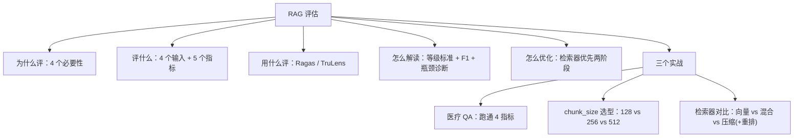
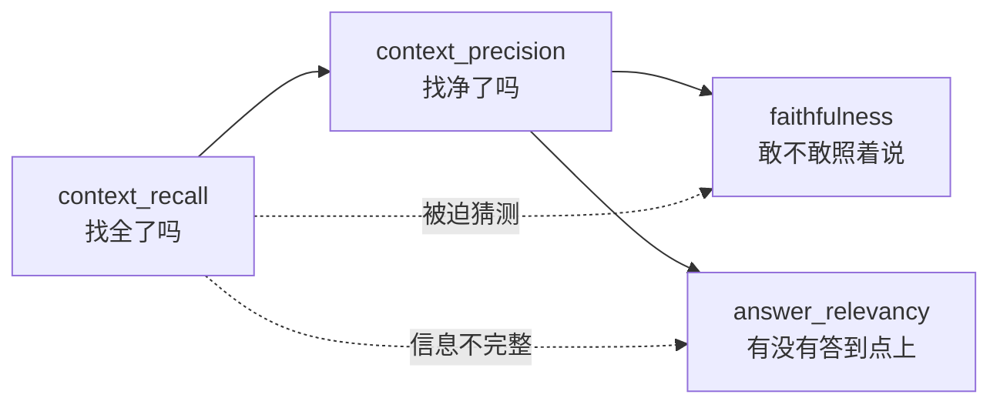
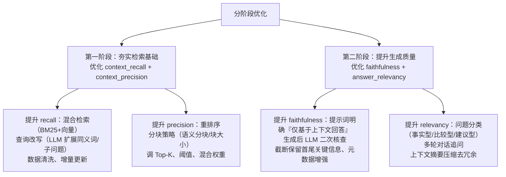
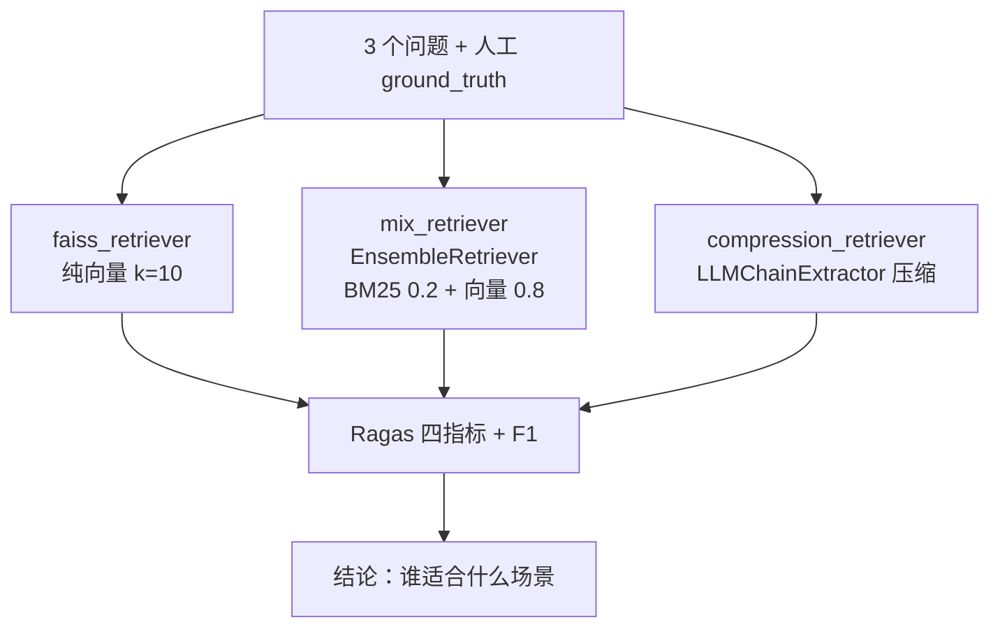
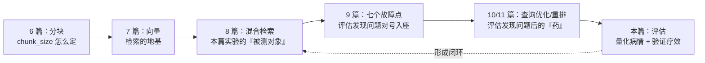

# 12 | RAG 评估：指标体系、Ragas 与检索器对比实验

> [!abstract] 本篇定位
> Advanced RAG 三部曲（9/10/11 篇）讲的是「怎么优化」；本篇讲的是**优化之前怎么量化现状、优化之后怎么证明有效**。核心是 Ragas 四大指标 + F1 综合分 + 三个评估实战（医疗 QA / chunk_size 选型 / 检索器对比）。评估闭环呼应第 9 篇论文的结论：**RAG 的验证只在实际操作中可行**。

## 🗺️ 知识地图



---

## 一、为什么必须评估：4 个必要性

RAG 应用上线前/后，有四类问题只能靠评估回答：

| # | 场景 | 评估回答的问题 |
|---|---|---|
| 1 | **上线前** | 大模型输出有不确定性，不可预知性必须靠科学测试来衡量 |
| 2 | **持续维护** | 这次改动是变好了还是变坏了？置信度上升 10% 还是下降 5%？ |
| 3 | **知识库动态变化** | 外挂知识库不断维护，新知识可能产生干扰 → 需定期检测与重新评估 |
| 4 | **模型选型/升级** | 几十个商业/开源模型选哪个？基座模型升级一次对应用影响多大？ |

> [!note] 评估方法的两条路线
> - **人工评估**：质量高（准确性/连贯性/相关性），但耗时费力、受主观性限制——是基础方法。
> - **自动化评估**：当前主流与发展方向，用 LLM + 算法打分，快速、可复用、低成本。
>
> 实际落地是「自动化跑量 + 人工抽查校准」的组合。

---

## 二、评什么：4 个输入与 5 个指标

### 2.1 评估对象：检索器 + 生成器

RAG 系统的有效性严重依赖两个核心组件，评估也按此分两条线：

- **检索评估**：评估**上下文相关性**——检索到的文档与查询的匹配程度，确保给生成器的上下文相关、准确。
- **响应评估**：评估**生成质量**——系统基于检索到的上下文生成回答的能力。

### 2.2 评估模块的 4 个输入

| 输入 | 含义 | 来源 |
|---|---|---|
| `question` | 用户输入的问题 | 用户 |
| `answer` | 待评估的 RAG 输出 | 被测系统 |
| `context` | 检索阶段返回的参考上下文 | 被测系统 |
| `reference_answer` | 真实正确答案 | **人工标注** |

### 2.3 五个指标总表（核心中的核心）

| 指标 | 归属 | 评估输入 | 含义 |
|---|---|---|---|
| `context_recall` | 检索 | context + reference_answer | 上下文覆盖用户问题所需**关键信息的比例** |
| `context_precision` | 检索 | context + reference_answer（或 question + context） | 关键信息**位置是否靠前** / 关键信息所占比例 |
| `faithfulness` | 响应 | answer + context | 答案是否**完全基于**提供的上下文（防幻觉） |
| `answer_relevancy` | 响应 | answer + question | 答案是否**直接、不冗余地**回答了问题（不管对错） |
| `context_relevancy` | 检索 | question + context | 上下文中有多少内容与问题相关，**较少使用** |

> [!tip] 五个指标各查一件「丑事」
> - `recall` 低 → 该找的没找全；`precision` 低 → 找回来一堆垃圾；
> - `faithfulness` 低 → 模型在编；`answer_relevancy` 低 → 答非所问；
> - `context_relevancy` 是老版指标，Ragas 主推前四个。

### 2.4 指标怎么算：逐个例子过一遍

**context_precision（1/4 案例）**：问「苹果总部在哪」，上下文 4 句只有 1 句相关（库比蒂诺）→ 精确率 = 1/4 = 25%。

**context_recall（100% vs 50%）**：问「《三体》作者和出版年份」，参考答案关键信息是「刘慈欣」「2006 年」；上下文两者都含 → 100%；只含作者 → 50%。

**faithfulness（多说的也算不忠实）**：问「爱因斯坦哪年获诺奖」，答案「1921 年因光电效应获奖」全部来自上下文 → 100%；若答案**多加**「他当时在普林斯顿任教」（上下文没有，即使事实正确）→ 忠实度下降。

**answer_relevancy（答非所问）**：问「如何煮咖啡」，答「研磨至中粗度、90℃ 冲泡 3 分钟」→ 相关性高；答「咖啡豆起源于埃塞俄比亚」→ 答的是「起源」不是「方法」，相关性低。

### 2.5 Ragas 的 context_precision：其实是 AP（平均精度）

Ragas 对 context_precision 的定义和传统 IR 略有不同：它按相关块位置 k 计算 **Precision@k**，反映**相关块是否排在前列**（排序质量），而传统定义反映整体相关性密度。代码 `ragas_context_precision.py` 手算了这个过程：

```
verdict_list = [1, 0, 1, 1, 0]   # 1=相关块 0=不相关块
第1块：(1/1)×1 = 1
第2块：(1/2)×0 = 0
第3块：(2/3)×1 = 0.6667
第4块：(3/4)×1 = 0.75
第5块：(3/5)×0 = 0
分子 = 2.4167，分母 = 相关块总数 3
AP = 2.4167 / 3 ≈ 0.8056
```

> [!important] 从这个公式读出两条直觉
> 1. **相关块越靠前，分越高**：把 [1,0,1,1,0] 换成 [1,1,0,1,0]，得分立刻更高——这就是「排序质量」的含义。
> 2. 不相关块不是简单扣分，而是**拉低后续相关块的累进精度**——垃圾排在前面惩罚最重。

---

## 三、F1 分数：recall 与 precision 打架时的裁判

召回率和精确率往往难以兼得（找全 vs 找净），比较两组「一高一低」的结果时引入 **F1（调和平均）**：

$$F1 = \frac{2 \times precision \times recall}{precision + recall}$$

PPT 里的原始例题（`f1_score.py`）：

| 组 | context_recall | context_precision | F1 |
|---|---|---|---|
| 第一组 | 0.6667 | 0.4511 | **0.5381** |
| 第二组 | 1.0000 | 0.3869 | **0.5579** |

第二组 F1 更高——**极致召回 + 低精度** 打赢 **中庸召回 + 中低精度**。但注意 F1 只综合了检索侧两个指标，faithfulness / answer_relevancy 相同的前提下才能这么比。

> [!warning] F1 是「调和平均」不是「算术平均」
> 调和平均会**惩罚短板**：一组 0.9 和 0.1，算术平均 0.5，F1 只有 0.18。所以 F1 高 = 两边都不差，单边极致拉不动。

---

## 四、评估工具：Ragas 与 TruLens

### 4.1 Ragas（本课主力）

- 定位：**评测 RAG Pipeline 的框架**，量化检索+生成两个组件层面的性能；支持 LangChain 和 LlamaIndex。
- 检索质量：`context_precision` / `context_recall`；生成质量：`faithfulness` / `answer_relevancy`。

Ragas 的完整工作流（`医疗评估.py` 头部注释写得非常清楚）：


> [!note] Ragas 的三个落地要点（来自代码注释）
> 1. **测试集可以自动生成也可以手动构造**：只要凑齐 4 个列表（question/answer/contexts/ground_truth）用 `Dataset.from_dict` 就能评估；自动生成注意用 `testdataset.to_pandas()` 转格式。
> 2. **评估器本身也是 LLM**：每个 metric 内部是一段固定的评分提示词 + 默认模型，「让大模型对比回答和输出给出分数」——即 LLM-as-Judge。
> 3. **默认用 GPT-4**，中文语境可能有不足，某些评估会生成空值导致结果为空；代码里用了 `raise_exceptions=False` 容错 + 阿里模型替换。

### 4.2 TruLens

独立于框架的 LLM 应用评估与改进工具，可集成 LangChain / LlamaIndex；用**反馈函数**程序化地衡量相关性、适用性、有害性，比人工反馈更快、更可扩展，支持快速迭代。

> [!tip] 选型一句话
> Ragas 管「指标算得准」，TruLens 管「迭代看得见」。课程实战全部基于 Ragas。

---

## 五、指标怎么解读：等级标准与瓶颈诊断

### 5.1 指标等级标准（医疗评估实战给出）

| 指标 | 高 | 中 | 低 | 满分 |
|---|---|---|---|---|
| context_recall | ≥ 0.8 | 0.5 ~ 0.8 | < 0.5 | 1.0 |
| context_precision | ≥ 0.7 | 0.4 ~ 0.7 | < 0.4 | 1.0 |
| faithfulness | ≥ 0.9 | 0.7 ~ 0.9 | < 0.7 | 1.0 |
| answer_relevancy | ≥ 0.9 | 0.7 ~ 0.9 | < 0.7 | 1.0 |

> [!question] 多高算高、多低算低？
> 这是相对业务场景的。下一节给出行业基准。

### 5.2 四指标的协同关系



- **检索器是生成器的基础**：Recall/Precision 直接决定输入给生成器的上下文质量。
- 上下文**不完整**（低 recall）→ 生成器缺信息答不全（拖累 relevancy），甚至被迫「猜测」（拖累 faithfulness）。
- 上下文**充满噪声**（低 precision）→ 生成器难以聚焦，答案冗余偏题（拖累 relevancy）或错误依据不相关信息（拖累 faithfulness）。
- 理想状态是高召回 + 高精确；现实里大 epoch 数据集两者难兼得，**很多业务（技术文档问答、客服）优先保证信息不遗漏 →「高召回 + 中等精确」是可接受甚至追求的目标**。

### 5.3 性能瓶颈诊断表（对症下药的前提）

| 指标低 | 可能的问题场景 | 指向 |
|---|---|---|
| context_recall 低 | 检索器未覆盖关键文档（知识库缺失）、嵌入模型语义匹配能力不足 | **检索器** |
| context_precision 低 | 返回大量无关文档、向量库索引策略有误、相关文档排名低 | **检索器** |
| faithfulness 低 | 提示词未要求「基于上下文回答」、上下文过长信息稀释 | **生成器** |
| answer_relevancy 低 | 未理解问题意图（复杂问题未用链式提示分解）、上下文与问题关联弱 | **生成器** |
| 四个都低 | 系统性问题：检索质量极差导致生成器输入混乱；或问题超出系统能力 | **检索器优先** |

### 5.4 优化路径：先固根基，再求精进

> **核心原则：检索器优先。** 生成器的输出上限受限于检索器的输入质量（Garbage In, Garbage Out）；且优化检索策略（调参、混合检索、重排）比微调大模型更快、更便宜。



### 5.5 行业阈值建议（因地制宜）

| 场景 | 核心指标 | 关注点 |
|---|---|---|
| 医疗 / 法律（高风险） | **faithfulness ≥ 0.9, recall ≥ 0.9** | 任何事实错误或信息遗漏都可能造成严重后果 |
| 客服 / 电商 / 咨询 | **answer_relevancy ≥ 0.8, precision ≥ 0.7** | 回答直接解决问题，避免冗余 |
| 通用问答 / 内容生成 | **answer_relevancy ≥ 0.7, recall ≥ 0.7** | 开放域平衡覆盖面与相关性 |

通用参考基准：faithfulness ≥ 0.85（< 0.7 可能存在严重幻觉）；answer_relevancy ≥ 0.8（开放域 ≥ 0.7 可接受，Ragas 默认测试集平均 0.72）；recall ≥ 0.7~0.8（允许部分缺失可降至 0.6）；precision ≥ 0.7 起步。

> [!summary] 持续评估闭环（4 步）
> **量化**（理解检索/生成环节表现）→ **诊断**（指标协同关系与瓶颈）→ **优化**（检索优先、生成增强、协同调优）→ **设定目标**（按业务定阈值）→ 循环。性能提升是持续迭代过程，定期评估 + 用户反馈。

---

## 六、实战 1：医疗评估（跑通 Ragas 四指标）

`医疗评估.py` 用 10 条中药 QA（坤泰胶囊/三七三醇皂苷/枇杷止咳/板蓝根…）手工凑齐 4 元组数据，走通全流程：

1. **构造数据**：4 个列表 `question / answer / contexts / ground_truth`，`contexts` 是**二维列表**（每个问题对应一组文档块）。
2. **构造评估器**：`LangchainLLMWrapper` + `LangchainEmbeddingsWrapper` 包装阿里模型，替换 Ragas 默认 GPT-4。
3. **评估**：`evaluate(dataset, llm=..., embeddings=..., metrics=[...], raise_exceptions=False)`。
4. **输出**：`result.to_pandas()` → 存 CSV 逐条复查。

> [!warning] 评估前准备好 Token 消耗的心理预期
> PPT 原话。每个指标都是一次 LLM 调用（还要把答案拆原子事实逐一核查），10 题 × 4 指标就是几十次调用；真实评估集通常是百题级别。课程代码里甚至写了 `time.sleep(60)` 防限流。

> [!tip] 手工测试集的价值
> 自动生成的测试集适合冷启动，但**真实评估集应该从业务问题里来**——本例的 10 个问题都是「药品性状/鉴别/处方」这类真实用户会问的口径，ground truth 直接取药典原文。呼应第 9 篇：测试集是业务积累的过程。

---

## 七、实战 2：用评估选 chunk_size

### 7.1 chunk_size 的两难

| chunk_size 小 | chunk_size 大 |
|---|---|
| 块多、粒度小、**语义精确** | 上下文**完整** |
| 携带上下文少 → top_k 小时关键信息可能不在顶部块里 | 语义不精确；上下文过多 → 窗口溢出、token 成本升高 |

且**合适大小与任务类型有关**：事实性问答只需少量特定块；摘要/总结/对比类任务需要更大甚至全部知识块。结论：没有放之四海皆准的数值，**用评估框架 + 评估数据集实测不同 chunk_size 再选**。

### 7.2 经验推荐值（调研结论）

| 场景 | 推荐 tokens | 依据 |
|---|---|---|
| 通用 | **128~512** | 平衡完整性与检索效率；微软：512 是小块基准，企业级甚至用 100 提精准度 |
| 通用（长上下文） | 512 + 256 重叠 | Databricks 实验 |
| 复杂任务 | 1024 | LlamaIndex：响应时间与质量的平衡点 |
| 技术文档 / 学术论文 | 200~300 | 过大导致术语稀释 |
| 长叙事文本（小说） | 500~1000 | 保留情节连贯性 |
| 社交媒体 / 短文本 | 100~200 | 适配碎片化内容 |

### 7.3 实验设计与结果（`chunk_size_eval.py`）

实验设置：LangChain `RecursiveCharacterTextSplitter`（默认分隔符）、overlap = chunk_size 的 20%、阿里百炼模型 + FAISS、**纯向量检索（无任何 Advanced RAG）**、top_k = 10、测试集 = 领克汽车手册 3 问（安全带/保养/座椅加热）。

| chunk_size | 分块数 | faithfulness | answer_rel | recall | precision | **F1** |
|---|---|---|---|---|---|---|
| **128** | 1546 | 0.9650 | 0.8994 | 0.8519 | **0.9044** | **0.8773** ✅ |
| 256 | 821 | 0.9697 | 0.8851 | 0.8889 | 0.7775 | 0.8295 |
| 512 | 462 | 0.9570 | 0.9301 | 0.8889 | 0.7680 | 0.8241 |

结论（PPT 原话提炼）：
- 三种分块性能都不错，**大部分指标差距在 3% 以内**——不是所有参数都值得死磕。
- 优中选优 **128 最优**：F1 最高 = 完整性与纯净度最佳平衡；且**分块多但每块小，token 成本反而占优**。
- 大块在召回/相关性略占优，但 precision 显著下降说明**引入了过多无关信息**。

> [!important] 实验里最容易被忽略的发现：改分隔符 = 换了一个系统
> 同样的 chunk_size，把「默认分隔符」改成「调整后的分隔符」，指标天翻地覆（256 组：precision 0.7775 → 0.3869，recall 反而升到 1.0，faithfulness 0.97 → 0.73）。
> **分块不只是大小，分隔符（切在哪）同样甚至更加致命。** 做对比实验时必须把分隔符作为受控变量写进记录。

---

## 八、实战 3：检索器对比实验（2023 全球智能汽车AI挑战赛）

### 8.1 实验设置

同一份汽车手册 PDF（chunk 128 / overlap 20% / FAISS / top_k=10），只换检索器，其余不动——典型的**控制变量评估**：



### 8.2 三检索器结果（top_k=10）

| 检索器 | faithfulness | answer_rel | recall | precision | **F1** |
|---|---|---|---|---|---|
| **faiss（纯向量）** | 0.9650 | 0.8994 | 0.8519 | **0.9044** | **0.8773** ✅ |
| mix（混合 0.2/0.8） | **0.9848** | **0.9160** | **1.0000** | 0.4811 | 0.6497 |
| compression（压缩） | 0.9770 | 0.8227 | 0.7037 | 0.8057 | 0.7513 |

分析（PPT 逐条）：

- **mix**：召回率拉满（1.0），忠实度/相关性也涨了——**提升召回的初衷实现了**；但 precision 掉到 0.4811，近一半是不相关文档，F1 只有 0.6497。适合「零遗漏」绝对需求场景（严格法律合规、医疗），但需继续改善 precision。
- **compression**：precision 尚可（0.8057）但 recall 掉到 0.7037——**压缩过程本身丢信息**，answer_relevancy 最低（0.8227）。只适合对检索效率有特殊要求、对完整性要求不高的场景。
- **faiss**：F1 最高，两高且均衡——**本数据集上的最优解**。

> [!tip] 这张表最大的价值：打破了「混合检索一定更好」的直觉
> 混合检索提升了 recall（1.0）和 faithfulness/相关性，但**引入的噪声把 precision 打崩**。评估的价值就在这里：不跑评估，你根本不知道该用哪个。结论原文：「faiss_retriever 指标最优，mix_retriever 是次优选择，但需对 precision 进一步提升，或严格限定使用场景。」

### 8.3 改进：给 mix 加重排（`automobile_handbook_rebank.py`）

召回已经满分，precision 太低 → 正好是**重排（Rerank）的适用场景**（第 11 篇：Rerank 管排序质量，正是 precision 的药）。代码思路：

```python
rerank_retriever = get_ali_rerank(10)          # DashScopeRerank
combin_retriever = ContextualCompressionRetriever(
    base_compressor=rerank_retriever,          # 压缩器换成重排模型
    base_retriever=mix_retriever)              # 底座仍是混合检索
```

即「**混合检索保召回 + Rerank 提精度**」的组合拳，呼应第 11 篇金融助手的做法。PPT 布置的作业还有两条：

1. top_k 从 10 降下来找性价比点（实验显示 top_k=4 时 faiss 的 precision 冲到 1.0、faithfulness 1.0，F1 0.875 与 k=10 几乎持平——**token 成本减半**）。
2. 用作业里的指标复现整套实验。

> [!warning] 代码里的两处可疑写法（照抄会翻车）
> 1. `_rebank.py` 用了 `MultiVectorRetriever(retrievers=[...], weight=[...])`——这是 `EnsembleRetriever` 的构造参数，`MultiVectorRetriever` 根本没有这两个参数，正确写法仍是 `EnsembleRetriever`。
> 2. `models.py` 的 `get_ali_rerank` 传入的是 `ALI_TONGYI_EMBEDDING`（向量模型名）当 rerank 模型——DashScope 的重排模型应是 `gte-rerank` 系列，跑之前先核对。
>
> 教学代码为演示流程服务，复用前先过一遍 API。

---

## 九、与前面各篇的衔接



评估把整条 RAG 链路串成了闭环：**指标低 → 按诊断表定位到检索器/生成器 → 回到 9/10/11 篇找对应技术 → 改完再用指标验证**。

---

## 十、术语速查

| 术语 | 全称 / 中文 | 一句话 |
|---|---|---|
| Ragas | RAG Assessment | RAG 评估框架，LLM-as-Judge 打分 |
| TruLens | — | 程序化反馈函数的 LLM 应用评估工具 |
| context_recall | 上下文召回率 | 关键信息覆盖比例，输入含 ground_truth |
| context_precision | 上下文精度 | Ragas 实现为 AP，关注相关块排名 |
| faithfulness | 忠实度 | 答案是否完全基于上下文（防幻觉） |
| answer_relevancy | 答案相关性 | 是否直接回答问题（不管对错） |
| AP | Average Precision | 按位置累进精度再平均 |
| F1 | F1 Score | 精确率与召回率的调和平均 |
| LLM-as-Judge | 模型评判 | 用 LLM 按提示词给输出打分 |
| Precision@k | 前k精度 | 前 k 个结果里相关的比例 |
| EnsembleRetriever | 混合检索器 | 多路检索加权融合（内部 RRF） |
| LLMChainExtractor | LLM 链提取器 | 逐文档提取相关内容的压缩器 |
| ground_truth | 参考答案 | 人工标注的标准答案 |
| Dataset.from_dict | — | HuggingFace datasets 的建表函数 |

---

## 十一、自测 6 问（先想再看）

> [!details]- 为什么 answer_relevancy 「不考虑正确性」？
> 它只衡量「是否直接、完整、不冗余地回答了问题」这道**形式关**；对错由 faithfulness（对照上下文）和 ground truth 把关。形式与事实分开评估，才能分别定位问题出在「理解」还是「编造」。

> [!details]- Ragas 的 context_precision 和传统 precision 差在哪？
> 传统 precision 反映整体相关性密度（相关块占比）；Ragas 按每个相关块位置 k 算 Precision@k 再平均（AP），**额外奖励相关块排在前面**。所以它同时衡量「找得准」和「排得好」。

> [!details]- 两组指标：A(0.6667, 0.4511) vs B(1.0, 0.3869)，F1 各是多少、谁赢？
> A = 0.5381，B = 0.5579，B 赢。极致召回 + 低精度险胜——但这是「业务要求不遗漏」场景下的结论；若业务重精度（如法规引用），F1 会误导，需回到加权场景判断。

> [!details]- mix_retriever 的 recall=1.0、faithfulness=0.9848，为什么还说它不能直接上线？
> precision 只有 0.4811——近一半上下文是噪声。短期靠「零遗漏」场景兜底；长期出路是加 Rerank 提 precision（rebank 思路），或调低 BM25 权重 / 限定使用场景。

> [!details]- chunk_size 从 128 到 512 指标几乎没差（3% 内），说明什么？
> 说明**这个数据集上 chunk_size 不是敏感参数**，评估帮你省下了死磕参数的时间；但分隔符一改指标崩了（precision 0.78→0.39），说明**切分位置才是敏感变量**。评估的另一个价值：识别哪些参数值得优化。

> [!details]- 评估医疗类应用，阈值该设多少？
> faithfulness ≥ 0.9 且 context_recall ≥ 0.9（高风险行业线），高于通用基准（0.85 / 0.7-0.8）。任何事实错误或信息遗漏都可能造成严重后果，宁可牺牲响应速度与成本。
