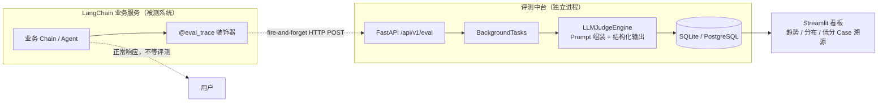

# 13 | LLM-as-a-Judge 评测与监控脚手架（工程整理）

> [!abstract] 本篇定位
> 一套**在线旁路评测中台**的设计：LangChain 业务链路加一行 `@eval_trace` 打点 → 异步上报 FastAPI 中台 → LLM 裁判按 Pydantic 契约结构化打分 → 落 SQLite → Streamlit 看板看趋势与 Case 溯源。
> 它补的是 [[12-RAG评估-指标体系Ragas与检索器对比实验]] 与 [[自动化评估驱动开发EDD-技术与工具整理]] 里**「方法论 / 指标」之外的一环：怎么把评估跑进生产流量里**。

> [!warning] 整理说明
> 第三节**原样保留设计稿四个模块的代码**，不作篡改。
> 第五、六节是整理时逐行核对后的增量分析：**设计稿宣称的能力里有几项代码并未实现**，另有若干工程风险；均给出定位与可直接替换的修正片段。这部分是审阅结论，不是原设计内容。

---

## 一、这套脚手架在评估体系里的位置

| 维度 | Ragas / Golden Dataset（离线） | LangSmith（平台） | **本脚手架（在线旁路）** |
|---|---|---|---|
| 触发时机 | 发版前跑固定数据集 | 平台侧 Trace + 数据集评估 | **每次真实请求后自动抽样评测** |
| 数据 | 人工标注 `ground_truth` | 平台托管 | 线上真实 `query / context / response`，**无需标注** |
| 回答的问题 | 这次改动整体变好还是变坏 | 链路哪里慢 / 哪里错 | **线上正在发生什么、哪条 Case 出了幻觉** |
| 成本 | 一次性、可控 | SaaS 费用 | 随流量线性增长，**必须做采样** |
|  blinded 盲区 | 覆盖不到长尾真实输入 | 需接入 SDK / 订阅 | 能捞到真实长尾，但**无标准答案，只能判忠实度/相关度** |

### 1.1 两个指标的归属

设计稿用 `faithfulness`（忠实度）和 `relevance`（相关度），正好是 RAG 三元组里的两条边：

| 指标 | 对应关系 | 在 [[12-RAG评估-指标体系Ragas与检索器对比实验]] 里的定义 |
|---|---|---|
| `faithfulness` | Answer ↔ Context | 回答中每个断言能否在上下文中找到证据，抗幻觉 |
| `relevance` | Answer ↔ Query | 回答是否直接、不冗余地回应问题 |

> [!note] 缺的两条边
> 这套设计**不采集检索结果的相关性与召回**（`context_precision` / `context_recall` 需要 ground_truth 或检索标注），也不记录检索器版本、chunk 配置、延迟与 Token 成本。
> 所以它只能回答「这次回答有没有编 / 跑没跑题」，**不能回答「是检索没找对还是模型没答好」**——故障定界要靠 [[04-RAG 数据连接与检索]] 那套链路信息补上。

---

## 二、架构与数据流



| 组件 | 技术 | 职责 | 关键性质 |
|---|---|---|---|
| 打点 SDK | `tracer.py` 装饰器 + `httpx` | 旁路抓 `query / context / response`，POST 上报 | **非阻塞**、失败静默、与业务解耦 |
| 接收 API | FastAPI + `BackgroundTasks` | 立即返回 `enqueued`，后台执行评测 | 客户端不等待；任务与进程同生命周期 |
| 裁判引擎 | `ChatOpenAI.with_structured_output(MetricResult)` | 组装 Prompt、调用裁判模型、解析为强类型 | Pydantic 契约保证字段与分值域 |
| 存储 | SQLite（可换 PostgreSQL） | 存评测流水与推理依据 | 支持 Case 级溯源 |
| 看板 | Streamlit + pandas | 均值、优良率、趋势、分布、低分明细 | 直接读库，无额外后端 |

**三条设计原则**（这套脚手架真正值得复用的地方）：

1. **旁路**：评测不在业务关键路径上，评测服务挂了不影响用户拿回答。
2. **强契约**：裁判输出不是自由文本，而是 `MetricResult`——`ge=1, le=5` 把分值框死，`reasoning` 强制可解释，便于人工复核。
3. **可溯源**：`trace_id` + 原始 `query/context/response` + `reasoning` 全落库，低分样本能逐条回放。

---

## 三、四个模块的实现（原设计稿代码）

### 3.1 评测契约与裁判逻辑 `evaluator.py`

**契约字段**：

| 字段 | 类型 | 约束 | 用途 |
|---|---|---|---|
| `faithfulness` | `int` | `1 ≤ x ≤ 5` | 是否捏造事实 / 幻觉 |
| `relevance` | `int` | `1 ≤ x ≤ 5` | 是否切题、有无车轱辘废话 |
| `reasoning` | `str` | 必填 | 判定依据与扣分点，供看板展示 |
| `hallucinations` | `list[str]` | 默认空 | 检出的幻觉片段（**注意：后两个模块没接住，见 §5**） |

```python
import asyncio
from typing import Optional
from pydantic import BaseModel, Field
from langchain_openai import ChatOpenAI
from langchain_core.prompts import ChatPromptTemplate


class MetricResult(BaseModel):
    faithfulness: int = Field(ge=1, le=5, description="忠实度：1-5分，是否有捏造事实或幻觉")
    relevance: int = Field(ge=1, le=5, description="相关度：1-5分，是否切题且直击痛点")
    reasoning: str = Field(description="详细判定推理依据与扣分点")
    hallucinations: list[str] = Field(default_factory=list, description="发现的幻觉片段列表")


JUDGE_PROMPT = ChatPromptTemplate.from_messages([
    ("system", """你是一个苛刻的 AI 评估裁判。请仔细比对以下内容：
[用户输入]: {query}
[检索上下文]: {context}
[模型回答]: {response}

请按照严格事实一致性评估：
1. 忠实度 (1-5): 回答中每一句话是否都有上下文支撑？有无虚构事实？
2. 相关度 (1-5): 回答是否解决用户疑问？是否有车轱辘废话？
输出必须包含具体推导逻辑 (reasoning)。"""),
    ("human", "请评分")
])


class LLMJudgeEngine:
    def __init__(self, model_name: str = "gpt-4o-mini"):
        # 使用强结构化输出模型作为裁判
        self.llm = ChatOpenAI(model=model_name, temperature=0).with_structured_output(MetricResult)
        self.chain = JUDGE_PROMPT | self.llm

    async def evaluate_single(self, query: str, response: str, context: Optional[str] = "") -> MetricResult:
        """单例评估：带错误保护"""
        try:
            return await self.chain.ainvoke({
                "query": query,
                "context": context or "无上下文",
                "response": response
            })
        except Exception as e:
            return MetricResult(
                faithfulness=1,
                relevance=1,
                reasoning=f"评测执行异常: {str(e)}",
                hallucinations=[]
            )
```

### 3.2 评测后端 API 与持久化 `server.py`

```python
import sqlite3
from fastapi import FastAPI, BackgroundTasks
from pydantic import BaseModel
from evaluator import LLMJudgeEngine

app = FastAPI(title="LLM Judge Central Service")
judge = LLMJudgeEngine()

# 初始化简易数据库
conn = sqlite3.connect("eval_metrics.db", check_same_thread=False)
with conn:
    conn.execute("""
        CREATE TABLE IF NOT EXISTS evaluations (
            id INTEGER PRIMARY KEY AUTOINCREMENT,
            trace_id TEXT,
            query TEXT,
            context TEXT,
            response TEXT,
            faithfulness INTEGER,
            relevance INTEGER,
            reasoning TEXT,
            created_at TIMESTAMP DEFAULT CURRENT_TIMESTAMP
        )
    """)


class EvalRequest(BaseModel):
    trace_id: str
    query: str
    response: str
    context: str = ""


async def run_async_evaluation(req: EvalRequest):
    result = await judge.evaluate_single(req.query, req.response, req.context)
    with conn:
        conn.execute(
            """INSERT INTO evaluations
               (trace_id, query, context, response, faithfulness, relevance, reasoning)
               VALUES (?, ?, ?, ?, ?, ?, ?)""",
            (req.trace_id, req.query, req.context, req.response,
             result.faithfulness, result.relevance, result.reasoning)
        )


@app.post("/api/v1/eval")
async def receive_trace(req: EvalRequest, background_tasks: BackgroundTasks):
    """LangChain 应用直接调用此接口上报，完全异步不阻塞业务主链路"""
    background_tasks.add_task(run_async_evaluation, req)
    return {"status": "enqueued", "trace_id": req.trace_id}
```

**落库表 `evaluations`**：8 列，一次评测一行；`created_at` 由数据库默认值生成。

### 3.3 无缝接入 SDK `tracer.py`

```python
import uuid
import asyncio
import httpx
from functools import wraps

EVAL_SERVER_URL = "http://127.0.0.1:8000/api/v1/eval"


def eval_trace(context_key: str = "context"):
    """
    通用评测切面装饰器：
    支持包裹同步/异步 LangChain 调用函数。
    """
    def decorator(func):
        @wraps(func)
        async def async_wrapper(*args, **kwargs):
            query = kwargs.get("query") or (args[0] if args else "")
            response = await func(*args, **kwargs)

            # 提取上下文（如果是 RAG chain 可以在内部通过 dict 携带或传参注入）
            context = kwargs.get(context_key, "")

            # 异步上报评测系统，不阻断业务链路，捕获异常防止崩溃
            async def _fire_and_forget():
                try:
                    async with httpx.AsyncClient(timeout=5.0) as client:
                        await client.post(EVAL_SERVER_URL, json={
                            "trace_id": str(uuid.uuid4()),
                            "query": str(query),
                            "response": str(response),
                            "context": str(context)
                        })
                except Exception:
                    pass

            asyncio.create_task(_fire_and_forget())
            return response
        return async_wrapper
    return decorator


# ================= 业务接入示例 =================
from langchain_core.prompts import PromptTemplate
from langchain_openai import ChatOpenAI
from langchain_core.output_parsers import StrOutputParser

chain = (
    PromptTemplate.from_template("参考资料：{context}\n问题：{query}\n请给出简短专业的回答。")
    | ChatOpenAI(model="gpt-4o-mini")
    | StrOutputParser()
)

@eval_trace(context_key="context")
async def run_business_rag(query: str, context: str):
    return await chain.ainvoke({"query": query, "context": context})
```

### 3.4 可视化看板 `dashboard.py`

```python
import sqlite3
import pandas as pd
import streamlit as st

st.set_page_config(page_title="LLM-as-a-Judge 评测与质检看板", layout="wide")
st.title("🛡️ LLM-as-a-Judge 自动化质量大盘")

conn = sqlite3.connect("eval_metrics.db")
df = pd.read_sql_query("SELECT * FROM evaluations ORDER BY id DESC", conn)

if df.empty:
    st.info("暂无评测数据。请启动业务服务并调用接口。")
else:
    avg_faith = df["faithfulness"].mean()
    avg_relevance = df["relevance"].mean()
    pass_rate = (len(df[(df["faithfulness"] >= 4) & (df["relevance"] >= 4)]) / len(df)) * 100

    col1, col2, col3, col4 = st.columns(4)
    col1.metric("总评估样本数", len(df))
    col2.metric("平均忠实度 (Faithfulness)", f"{avg_faith:.2f} / 5.0")
    col3.metric("平均相关度 (Relevance)", f"{avg_relevance:.2f} / 5.0")
    col4.metric("双达标优良率 (>=4分)", f"{pass_rate:.1f}%")

    st.markdown("---")
    tab1, tab2 = st.tabs(["📊 指标走势与分布", "🔍 Case 详细溯源与扣分依据"])

    with tab1:
        c1, c2 = st.columns(2)
        with c1:
            st.subheader("得分随时间变化")
            st.line_chart(df[["faithfulness", "relevance"]])
        with c2:
            st.subheader("忠实度分布直方图")
            st.bar_chart(df["faithfulness"].value_counts())

    with tab2:
        st.subheader("评测流水日志明细")
        min_score = st.slider("仅查看忠实度低于此阈值的样本 (排查幻觉):", 1, 5, 3)
        bad_cases = df[df["faithfulness"] <= min_score]

        for _, row in bad_cases.iterrows():
            with st.expander(f"Trace ID: {row['trace_id']} | 忠实度: {row['faithfulness']}分 | 相关度: {row['relevance']}分"):
                st.write("**【用户 Query】:**", row["query"])
                st.write("**【输入上下文 Context】:**", row["context"])
                st.write("**【模型生成 Response】:**", row["response"])
                st.info(f"**【裁判判定 Reasoning】:** {row['reasoning']}")
```

**看板能力清单**：4 张指标卡（样本数 / 平均忠实度 / 平均相关度 / 双达标率）、趋势折线、忠实度分布、按分数阈值过滤的低分 Case 展开明细（含原始三段文本与裁判推理）。

---

## 四、运行与验证

```bash
# 1. 依赖
pip install fastapi uvicorn streamlit langchain langchain-openai pydantic httpx pandas

# 2. 启动评测中台
uvicorn server:app --port 8000 --reload

# 3. 启动看板
streamlit run dashboard.py

# 4. 业务侧：导入 @eval_trace 装饰业务函数，调用后刷新看板
```

**补一个设计稿没给的最小冒烟验证**（不启动业务服务也能确认中台通不通）：

```bash
curl -X POST http://127.0.0.1:8000/api/v1/eval \
  -H 'Content-Type: application/json' \
  -d '{"trace_id":"smoke-001","query":"退款政策是什么？",
       "response":"签收后 7 天内可无理由退款。",
       "context":"订单签收之日起 7 天内支持无理由退货退款，特殊商品除外。"}'
# 期望立即返回 {"status":"enqueued","trace_id":"smoke-001"}
# 稍等裁判模型返回后，看板应出现该行
```

> [!important] 本机环境适配
> 设计稿硬编码 `gpt-4o-mini`，需要 `OPENAI_API_KEY` 且能访问 OpenAI。若按你现有的 **DashScope / DeepSeek OpenAI 兼容端点**跑，必须显式传 `base_url` + `api_key`（见 §6.4），否则 `LLMJudgeEngine()` 一初始化就会在第一次评测时失败，并按 §5 的降级逻辑写出一堆 1 分脏数据。

---

## 五、宣称能力 vs 代码现状（逐行核对）

按严重程度分组。前两条是**名实不符**，后面是工程风险。

### 5.1 名实不符

| # | 设计稿宣称 | 代码现状 | 影响 |
|---|---|---|---|
| 1 | 「内置**双向对调（Swap Evaluation）抗位置偏见**机制」 | `evaluate_single` 只做**一次单点绝对打分**，全文无 A/B 候选、无顺序交换、无一致性判定 | 该能力**完全没有实现** |
| 2 | 看板展示「**偏见检测**」 | DDL 无偏见字段、API 不写、看板不读 | 同上，UI 里根本没有这一项 |
| 3 | 契约里的 `hallucinations` | DDL 无该列、INSERT 只写 7 个字段、看板不展示 | 裁判检出的幻觉片段**被静默丢弃**，溯源能力打折 |
| 4 | SDK「支持包裹**同步/异步**函数」 | `decorator` 无条件返回 `async_wrapper`，内部 `await func(...)` | 装饰同步函数会得到协程对象，且 `await` 一个 `str` 直接 `TypeError` |

> [!danger] 关于第 1 条：不只是「没写」，是概念不成立
> **位置偏见（position bias）** 只出现在**成对比较（pairwise）**场景：裁判同时看两个候选回答 A / B 并选优时，会系统性偏向排在第一位的那个。
> 「双向对调」的标准做法是：先评 `(A, B)`，再评 `(B, A)`，把第二次结论映射回原编号；**两次结论不一致就说明该次判定受位置影响**，应记为 tie 或转人工。
> 而本设计是**给单个 response 打 1–5 分**的绝对评分（pointwise），压根没有 A/B 两个候选，**没有位置，也就无从对调**。
> 要兑现这个宣称只有两条路：
> - **改成 pairwise 模式**：中台接收 `response_a / response_b`，裁判输出 winner，跑两遍交换顺序（见 §6.3）——适合模型/Prompt A-B 对比选型；
> - **删掉这个宣称**：单点打分场景改用「多次采样一致性 / 裁判自洽校验」来降噪，别硬套 Swap。
>
> 二者选哪个取决于业务目标；**当前这版两者都不是**。

### 5.2 数据可靠性风险

| # | 问题 | 定位 | 后果 |
|---|---|---|---|
| 5 | `asyncio.create_task()` 不持有强引用 | `tracer.py` | 事件循环只弱引用 Task，**可能被 GC 中途回收**；进程退出时任务直接取消 → 评测数据静默丢失 |
| 6 | `except Exception: pass` + 5s 超时 | `tracer.py` | 上报失败**无任何日志、重试、告警**，中台不可用期间数据全丢且无人知晓 |
| 7 | `BackgroundTasks` ≠ 消息队列 | `server.py` | 任务与 API 进程同生命周期：重启即丢、无持久化队列、无重试、无限流/背压；单 worker 下慢评测还会占用事件循环 |
| 8 | 全局单 `sqlite3` 连接 + `check_same_thread=False` | `server.py` | 并发后台任务共享一个 connection，`with conn:` 的事务边界会互相交错，易触发 `database is locked` / `cannot start a transaction within a transaction` |
| 9 | 评测异常降级成 `faithfulness=1, relevance=1` | `evaluator.py` | **把「裁判挂了」记成「模型质量差」**，直接污染均值与优良率，且无法区分 |
| 10 | `context` 只从 `kwargs` 取 | `tracer.py` | 用位置参数调用 `run_business_rag("q", "c")` 时 context 为空 → 裁判收到「无上下文」→ **忠实度全判低分**，是假幻觉 |
| 11 | `trace_id` 每次 `uuid4` 且业务侧不留 | `tracer.py` | 无法与业务日志 / Trace 对账，只能在中台内部溯源 |

### 5.3 成本、安全与展示

| # | 问题 | 定位 | 说明 |
|---|---|---|---|
| 12 | 全量评测、无采样率 | 全局 | 每条请求都调一次裁判模型，Token 成本随流量线性增长，压测/高峰会打爆预算 |
| 13 | `/api/v1/eval` 无鉴权 | `server.py` | 任何人可灌数据、刷裁判调用、塞超长文本 |
| 14 | `query/context/response` 明文全量落库 | `server.py` | PII / 业务敏感信息直接进 SQLite，无脱敏、无 TTL、无清理策略 |
| 15 | 趋势图用 `ORDER BY id DESC` | `dashboard.py` | 折线图 x 轴是「最新 → 最旧」，**时间方向反了**；应按 `created_at` 升序再画 |
| 16 | `temperature=0` 当确定性保证 | `evaluator.py` | 多数 provider 下 `temperature=0` 不保证逐字节可复现；单点打分没做多次采样一致性校验 |
| 17 | 无 `status` 字段区分正常/异常 | `server.py` | 无法在看板里把评测故障样本排除出质量统计 |

---

## 六、关键修正片段（可直接替换）

### 6.1 装饰器：同步/异步双分支 + Task 强引用 + 位置参数 + 采样

```python
import inspect, logging, random, threading, uuid
from functools import wraps
import httpx

EVAL_SERVER_URL = "http://127.0.0.1:8000/api/v1/eval"


def eval_trace(context_key="context", sample_rate=1.0):
    def decorator(func):
        sig = inspect.signature(func)

        def _payload(args, kwargs, response):
            bound = sig.bind_partial(*args, **kwargs)   # 位置参数也能取到 context
            bound.apply_defaults()
            p = bound.arguments
            return {
                "trace_id": str(uuid.uuid4()),
                "query": str(p.get("query", "")),
                "response": str(response),
                "context": str(p.get(context_key, "")),
            }

        def _report(payload):
            if random.random() > sample_rate:
                return
            try:
                httpx.post(EVAL_SERVER_URL, json=payload, timeout=10.0).raise_for_status()
            except Exception:
                logging.exception("eval report failed: %s", payload["trace_id"])

        def _schedule(payload):
            threading.Thread(target=_report, args=(payload,), daemon=True).start()

        if inspect.iscoroutinefunction(func):
            @wraps(func)
            async def async_wrapper(*args, **kwargs):
                response = await func(*args, **kwargs)
                _schedule(_payload(args, kwargs, response))
                return response
            return async_wrapper

        @wraps(func)
        def sync_wrapper(*args, **kwargs):
            response = func(*args, **kwargs)            # 不再 await 同步返回值
            _schedule(_payload(args, kwargs, response))
            return response
        return sync_wrapper
    return decorator
```

> [!note] 为什么用独立线程而不是 `create_task`
> 同步函数没有运行中的事件循环，`create_task` 会直接抛 `RuntimeError`。用短生命周期线程上报，同步/异步两条路径行为一致；代价是每次评测开一个线程，高流量下应换成**有界队列 + 单个后台 worker**（见 §7 P1），并给 `_report` 加重试。

### 6.2 持久化：每次独立连接 + WAL + 状态与幻觉字段

```python
import json, sqlite3
from contextlib import closing

DB = "eval_metrics.db"

def init_db():
    with closing(sqlite3.connect(DB)) as c:
        c.execute("PRAGMA journal_mode=WAL")
        c.execute("PRAGMA busy_timeout=5000")
        with c:
            c.execute("""
                CREATE TABLE IF NOT EXISTS evaluations (
                    id INTEGER PRIMARY KEY AUTOINCREMENT,
                    trace_id TEXT, query TEXT, context TEXT, response TEXT,
                    faithfulness INTEGER, relevance INTEGER, reasoning TEXT,
                    hallucinations TEXT,          -- JSON 数组
                    status TEXT DEFAULT 'ok',     -- ok / judge_error
                    error TEXT,
                    created_at TIMESTAMP DEFAULT CURRENT_TIMESTAMP
                )
            """)

def save(req, result, status="ok", error=None):
    with closing(sqlite3.connect(DB, timeout=5)) as c:   # 每个任务独立连接
        with c:
            c.execute(
                """INSERT INTO evaluations
                   (trace_id, query, context, response, faithfulness, relevance,
                    reasoning, hallucinations, status, error)
                   VALUES (?, ?, ?, ?, ?, ?, ?, ?, ?, ?)""",
                (req.trace_id, req.query, req.context, req.response,
                 result.faithfulness, result.relevance, result.reasoning,
                 json.dumps(result.hallucinations, ensure_ascii=False), status, error),
            )
```

同时把 `evaluator.py` 的异常分支改成**明确的错误状态**，而不是伪造 1 分：评测失败时 `status='judge_error'`、`error=str(e)`，看板统计先 `WHERE status='ok'`。

### 6.3 兑现「双向对调」：改成 pairwise 模式

```python
from typing import Literal
from pydantic import BaseModel
from langchain_core.prompts import ChatPromptTemplate

class PairVerdict(BaseModel):
    winner: Literal["A", "B", "tie"]
    reasoning: str

SWAP_PROMPT = ChatPromptTemplate.from_messages([
    ("system", """对比以下两个回答，选出更忠实于上下文、更切题的一个。
[问题]: {query}
[上下文]: {context}
[回答 A]: {answer_a}
[回答 B]: {answer_b}
只输出 winner 与理由。"""),
    ("human", "请评判"),
])

class SwapJudge:
    def __init__(self, llm):
        self.chain = SWAP_PROMPT | llm.with_structured_output(PairVerdict)

    async def compare(self, query, context, resp_a, resp_b):
        def render(a, b):
            return {"query": query, "context": context, "answer_a": a, "answer_b": b}

        v1 = await self.chain.ainvoke(render(resp_a, resp_b))   # A=原 A
        v2 = await self.chain.ainvoke(render(resp_b, resp_a))   # 对调后
        flipped = {"A": "B", "B": "A", "tie": "tie"}[v2.winner]  # 映射回原编号

        consistent = (v1.winner == flipped)
        return {
            "winner": v1.winner if consistent else "tie",
            "position_bias": not consistent,   # 两次结论矛盾 → 命中位置偏见
            "raw": [v1.winner, v2.winner],
            "reasoning": [v1.reasoning, v2.reasoning],
        }
```

> [!tip] 代价
> 每次对比要**调两次裁判**，成本翻倍。因此 pairwise 只适合离线 A/B 选型 / 抽样复核，不适合套到全量在线流量上；在线监控继续用单点打分 + 多次采样一致性更划算。

### 6.4 裁判模型适配 OpenAI 兼容端点

```python
import os
from langchain_openai import ChatOpenAI

judge_llm = ChatOpenAI(
    model="qwen-max-latest",                 # 或 deepseek-chat
    api_key=os.getenv("DASHSCOPE_API_KEY"),
    base_url="https://dashscope.aliyuncs.com/compatible-mode/v1",
    temperature=0,
)

# 替换 evaluator.py 里 LLMJudgeEngine.__init__，让模型可注入而非硬编码
class LLMJudgeEngine:
    def __init__(self, llm=None):
        self.llm = (llm or judge_llm).with_structured_output(MetricResult)
        self.chain = JUDGE_PROMPT | self.llm
```

> `with_structured_output` 依赖模型支持 **JSON Schema / tool calling**，换国产模型前先用一个最小样例验证能否解析出 `MetricResult`，否则会走进 §5 的异常降级。

### 6.5 看板时间轴与异常样本过滤

```python
df = pd.read_sql_query(
    "SELECT * FROM evaluations WHERE status='ok' ORDER BY created_at ASC", conn
)
# 明细表另取一份倒序：detail = df.sort_values('id', ascending=False)
```

---

## 七、生产化演进路线

| 优先级 | 动作 | 解决 |
|---|---|---|
| **P0（上线前）** | 修装饰器同步分支、Task/线程上报可靠性、`bind_partial` 取 context | 功能直接不可用 / 假幻觉 |
| **P0** | 评测失败写 `status='judge_error'`，统计排除异常样本 | 指标被故障污染 |
| **P0** | SQLite 每次独立连接 + WAL + `busy_timeout` | 并发写报错 |
| **P0** | 明确删掉或真正实现 Swap Evaluation 宣称 | 名实不符 |
| **P1** | 采样率（如 5%）+ 按租户/场景分层；上报加指数退避重试与失败日志 | 成本失控、数据静默丢失 |
| **P1** | `BackgroundTasks` → 真正的队列（Celery / RQ / Redis Stream）+ 独立 worker | 重启丢任务、无背压 |
| **P1** | `/api/v1/eval` 加 API-Key / mTLS；字段脱敏与 TTL | 安全与合规 |
| **P1** | `trace_id` 复用业务侧 Trace ID（OpenTelemetry / LangSmith trace） | 无法与业务链路对账 |
| **P2** | SQLite → PostgreSQL；加 `model_version / prompt_version / retriever_config / latency / token` 列 | 支持版本回归对比与故障定界 |
| **P2** | 多次采样一致性、裁判校准集（人工标注样本定期核对裁判漂移） | 裁判自身可靠性 |
| **P2** | 低分告警（Webhook / 企业微信）、日报表、按版本看板 | 从「能看」到「能响应」 |

> [!note] 与平台方案的取舍
> 若已用 LangChain 生态且愿意接 SaaS，[[06-LangSmith：追踪、评估与运维]] 的 Trace + Dataset + 人工标注能省掉这套自建中台的大半工作量；自建的价值在于**数据不出内网、可与业务指标打通、成本可控**。这条权衡在 [[自动化评估驱动开发EDD-技术与工具整理]] 的框架对比里也有展开。

---

## 八、与已有笔记的衔接

| 想查什么 | 去哪 |
|---|---|
| 指标定义（faithfulness / answer_relevancy / Ragas 四指标） | [[12-RAG评估-指标体系Ragas与检索器对比实验]] |
| EDD 方法论、RAG 三元组、评估框架选型 | [[自动化评估驱动开发EDD-技术与工具整理]] |
| 官方 Trace + 评估平台方案 | [[06-LangSmith：追踪、评估与运维]] |
| 被评测的 RAG 链路长什么样、context 从哪来 | [[04-RAG 数据连接与检索]] |
| LCEL 的 `\|` 链与结构化输出、Runnable 契约 | [[03-链与 LCEL]]、[[02-Model I-O 模型提示词与输出解析]] |
| Agent 场景怎么打点（工具调用 / 中间件钩子） | [[05-Agent 工具调用与中间件]] |
| Python 异步与 `asyncio.create_task` 的行为 | [[16-专题-yield 关键字全景（从生成器到依赖注入）]] |

---

## 九、一句话结论

**架构方向是对的（旁路 + 异步 + 强契约 + 可溯源），代码是「能跑通的原型」，不是「生产级」。** 真正要补的不是功能，而是三件事：把宣称的 Swap Evaluation 讲清楚（单点打分用不上位置偏见）、把「评测失败」与「模型低分」分开记、把 fire-and-forget 换成有采样、有重试、有队列的可靠上报。前三步做完，这套脚手架才配得上「监控」两个字。
