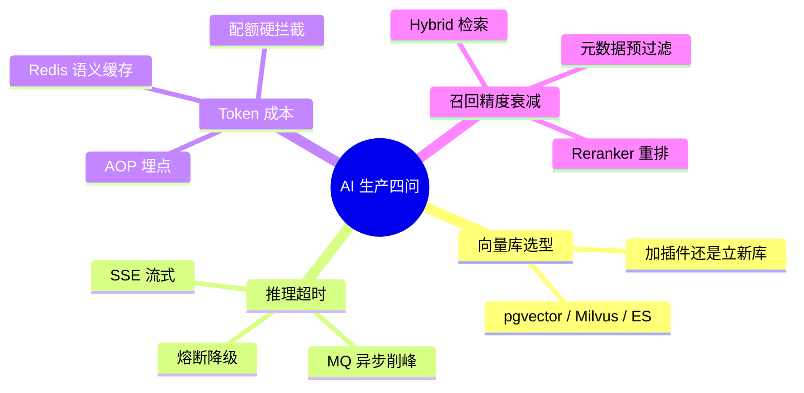
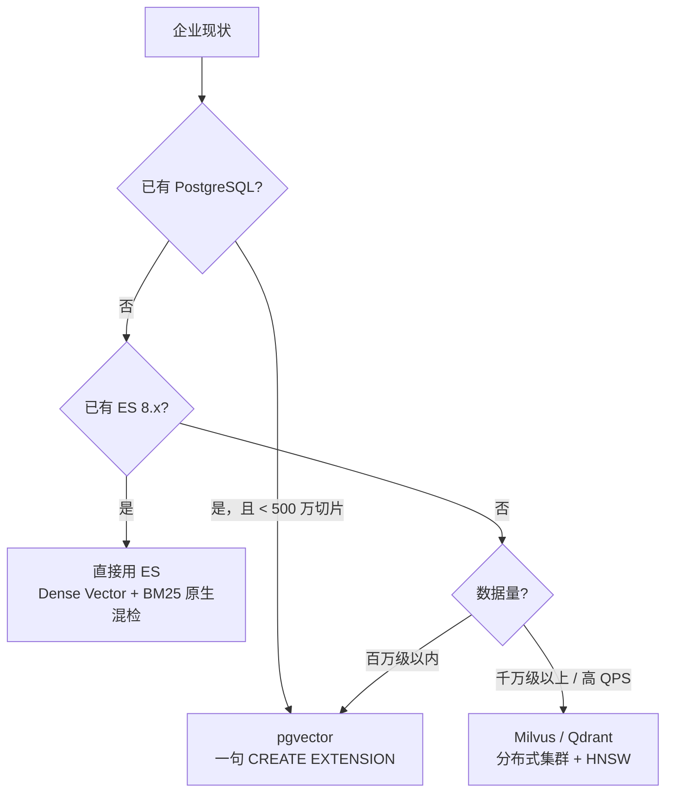
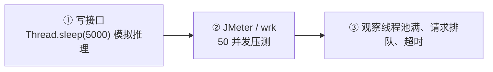
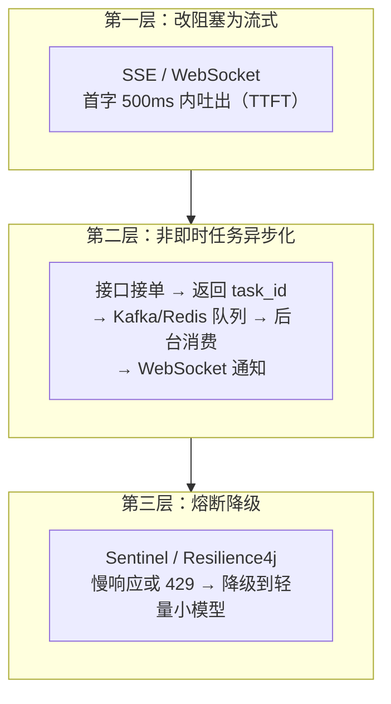
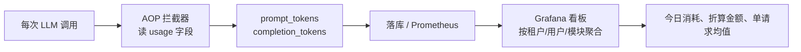
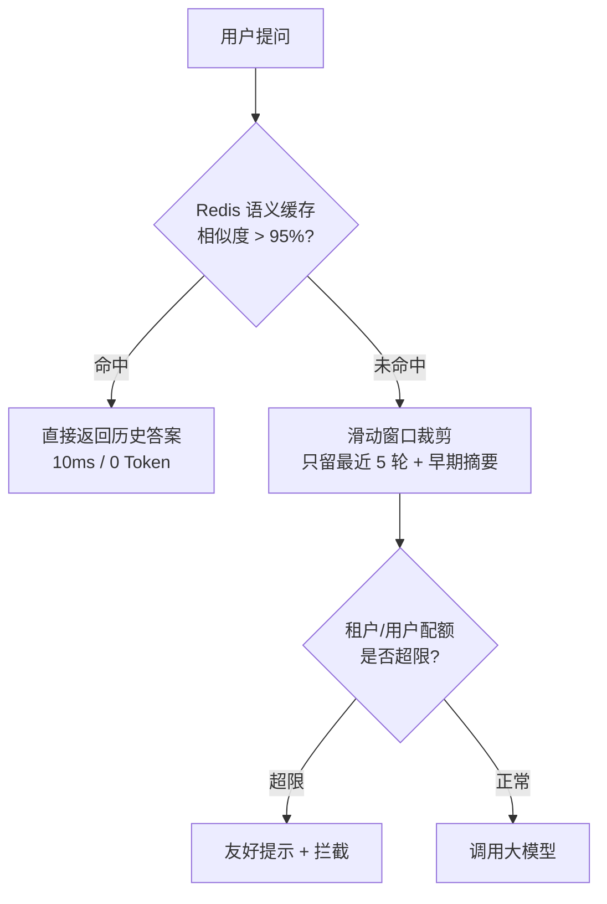
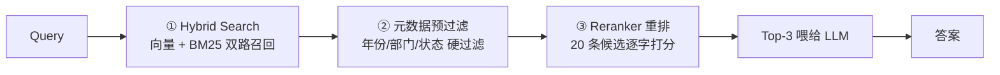

# AI 生产故障的工程本质

> [!abstract] 一句话
> 这些所谓的"AI 生产故障"，脱掉大模型的外衣，底层全是老程序员天天处理的**接口超时、缓存设计、搜索调优、账单计量**。
> 你缺的从来不是实现能力，只是不知道这批人给老问题换了新马甲。



---

## 零、一张表看穿全部

| AI 圈的说法 | 你熟悉的老问题 | 核心手段 |
| --- | --- | --- |
| RAG 知识库选型 | **数据库架构选型**：加插件还是立新库 | pgvector / Milvus / ES 三选一 |
| 高并发推理超时 | **慢接口 + 线程池打满 + 网关 504** | SSE 流式 + MQ 异步 + 熔断降级 |
| Token 成本控制 | **按量计费 + 缓存 + 流量限额** | AOP 埋点 + 语义缓存 + 配额拦截 |
| 向量召回精度衰减 | **搜索结果相关性下降 / 噪音召回** | 混合检索 + 元数据过滤 + 重排 |

---

## 一、向量库选型：加插件还是立新库

> [!tip] 选型逻辑就一句话
> **看你现在有什么库、有多少数据、要不要同时做关键词检索。**



### 三条路线

| 方案 | 触发条件 | 为什么 |
| --- | --- | --- |
| **pgvector** | 企业原本就在用 PostgreSQL | 一条 `CREATE EXTENSION vector;` 让现有关系表支持向量；**零额外运维**、原生 SQL 事务、业务字段（组织 ID/权限）与向量同表混查；**100 万~500 万切片内性能足够** |
| **Milvus / Qdrant** | 千万级以上 + 高吞吐 | 专用分布式向量库，集群扩展 + 内存 HNSW 索引，扛海量数据与高 QPS |
| **Elasticsearch 8.x** | 企业本来就有 ES | 原生支持 Dense Vector，**天然同时跑 BM25 + 向量语义**，工程上最省事 |

> [!important] 三个判断锚点
> 1. **有没有现成的库**——复用永远优先于新建
> 2. **数据量级**——百万级 pgvector、千万级专用库
> 3. **要不要混检**——要 BM25 + 向量，ES 或 Milvus 比"自己拼"省事

> 深入：[[pgvector vs Milvus 选型对比]] · [[Milvus 学习文档]] · [[pgvector 学习文档]]

---

## 二、推理超时：慢接口 + 线程池打满

### 2.1 本质

普通 Java 接口 50ms 返回；大模型一次推理 **3~10 秒**。
50 个人同时提问 → 后端线程池瞬间打满 → 网关（Nginx/Gateway）连接被打爆 → 用户看到 `504 Gateway Timeout`。


> 这就是经典的**同步阻塞调用慢下游**——和调用一个 8 秒的第三方支付接口没有本质区别。

### 2.2 本地怎么练



```java
// 第一步：造一个"慢接口"
@GetMapping("/chat")
public String chat(String q) throws InterruptedException {
    Thread.sleep(5000);            // 模拟大模型 5 秒推理
    return "answer";
}
```

```bash
# 第二步：压测（wrk，50 连接 10 秒）
wrk -t4 -c50 -d10s http://localhost:8080/chat?q=hello
```

你会立刻在本地看到：**线程数打满、QPS 个位数、大量超时**。

### 2.3 标准解法（面试就讲这三层）



| 手段 | 做什么 | 效果 |
| --- | --- | --- |
| **SSE 流式传输** | 不等 10 秒拿完整回答，逐字推给前端 | 首字 500ms 内可见，HTTP 连接不长时间占用，用户感知从"卡死"变"在打字" |
| **MQ 异步化** | 研报生成、长文档分析这类几十秒任务：接单即返 `task_id`，任务进 Kafka/Redis，后台 worker 消费，完成后 WebSocket 通知 | 接口 RT 从 30s 降到 50ms，线程不占用 |
| **熔断降级** | 主模型变慢或触发 429 时，网关策略自动切到更快的轻量模型（DeepSeek-R1 → Qwen-7B） | 系统整体不宕机，牺牲质量保可用 |

> [!note] 一句话对比
> **流式解决"等待感"，异步解决"长任务"，降级解决"下游挂了"。** 三者不互斥，通常一起上。

---

## 三、Token 成本：按量计费的账单管理

### 3.1 本质

Token 就是计费单位（类似字数）。不加控制地**把几十条历史记录每次都塞进请求**，或被恶意刷量，月账单能从几千块几天内飙到几万。

> 这和"接口不做限流、被刷爆带宽账单"是同一类问题。

### 3.2 监控：先把账算清楚



- **埋点**：在调用前后加拦截器（AOP），提取响应里的 `usage`（`prompt_tokens`、`completion_tokens`），写 Prometheus 或直接入库
- **看板**：Grafana 按**租户维度 / 用户维度 / 业务模块**聚合——今日消耗多少 Token、折多少人民币、每个请求平均花费分布

### 3.3 降本：三个最值钱的动作



| 手段 | 做法 | 收益 |
| --- | --- | --- |
| **语义缓存（Semantic Cache）** | 问题语义相似度 > 95% 时直接返回 Redis 里的历史答案 | 耗时 10ms、Token 花费 **0 元** |
| **上下文水位线裁剪** | 不全量塞长文档；滑动窗口保留最近 5 轮 + 早期历史用便宜模型生成"一句话摘要"压缩 | 输入 Token 降一个数量级 |
| **配额硬拦截（Quota）** | 网关层设单用户/单租户单日限额，超阈值直接友好提示 | **锁死公司账单上限**，防恶意刷量 |

> [!tip] 顺序很重要
> 先做**配额拦截止损**（防灾难），再做**埋点看账**（找钱花在哪），最后做**缓存与裁剪**（持续降本）。

---

## 四、向量召回精度衰减：搜索相关性下降

### 4.1 本质

50 篇文档时向量搜索"准得吓人"；5000 篇时**语义漂移 + 噪音**就爆发了。

> [!example] 一个真实场景
> 用户问：**"2026 年出差住宿报销上限是多少？"**
> 向量模型觉得"出差报销"很像，于是把《2021 年已作废差旅规定》《招待客户住宿标准》全排到前面 → 大模型一本正经地报出**过时的旧标准**。
> 这就是精度衰减——**不是模型不行，是召回的东西不对。**

### 4.2 三板斧



| 斧 | 做法 | 效果 |
| --- | --- | --- |
| **① 多路混合检索** | 向量（语义）+ BM25（死关键字）双路召回，用 **RRF 倒数排名融合** | 纯向量解决不了精确数字与专有名词；混检后准确率可从 60% 提到 85% |
| **② 元数据预过滤** | 切片入库时打标签：`年份=2026`、`部门=财务`、`状态=生效`；检索前先做硬过滤 | 把作废的、非财务部门的干扰项**排除在向量计算之外** |
| **③ Reranker 重排** | 前 20 条只是粗筛，喂给大模型前用专用重排模型（如开源 BGE-Reranker）逐字打分 | 选出真正相关的 Top-3，显著减少"答非所指" |

> [!important] 顺序不能反
> **过滤 → 召回 → 重排**。先过滤能减少无效计算，先重排再过滤是浪费算力。
> 另外：RRF 只负责"融合排序"，不负责"补召回"——某路没召回的内容，融合也救不回来。

---

## 五、迁移心法：把新词翻译成老问题


| 新名词 | 老问题 | 你的存量武器 |
| --- | --- | --- |
| 向量库选型 | 数据库架构选型 | PG / ES / 分布式库经验 |
| 高并发推理超时 | 慢接口阻塞、线程池打满 | SSE、Kafka、Sentinel、线程池调优 |
| Token 成本控制 | 按量计费 + 缓存 + 限流 | Redis、Prometheus、Grafana、网关限流 |
| 召回精度衰减 | 搜索相关性调优 | ES BM25、元数据过滤、重排、RRF |

> [!quote] 核心结论
> 你过去的十几年一直在跟高并发、分布式缓存、消息队列和数据调优打交道。
> **你缺的从来不是实现这些架构的能力，只是此前不知道这帮搞 AI 的人把这些老工程问题换了几个新马甲。**

---

## 六、动手清单

- [ ] 本地起一个 `Thread.sleep(5000)` 接口，用 wrk 50 并发压出 504
- [ ] 把接口改成 SSE，观察 TTFT 与连接占用变化
- [ ] 给 LLM 调用加 AOP，把 `usage` 落库并出一个日消耗报表
- [ ] 做一个 Redis 语义缓存（embedding 相似度 > 0.95 命中）
- [ ] 在 pgvector/Milvus 上复现"过滤后召回只剩 1 条"，再修好它
- [ ] 用 BM25 + 向量 + RRF 拼一次混合检索，对比纯向量结果

---

*整理：2026-11-04 · 关联 [[2-RAG]]、[[pgvector vs Milvus 选型对比]]*
