# 大模型核心原理与 Transformer 架构

> [!abstract] 一句话讲清
> 大模型本质上是一台**接话机器**：先把文字切成 token，把 token 变成向量，用**注意力**看清词与词的远近亲疏，然后**一个词一个词**地往下续——每续一个词，就把新词接回输入，再来一遍。

> [!info] 这份笔记怎么读
> 全文分两条线：**"它怎么思考"**（推理侧，第二、三章）和 **"它怎么被训练"**（训练侧，第四章）。
> 第三章是 Transformer 的内部细节，偏硬核；如果只想建立直觉，读完第一、二章 + 第五章就够了。

---

## 🗺️ 先看地图

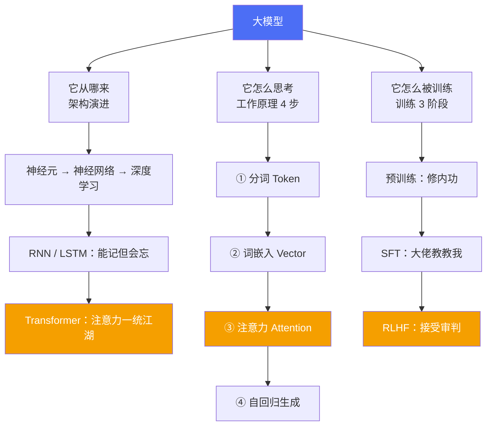

三块内容其实是同一个故事的三面：**架构**决定它有多大能耐，**推理**是它干活的过程，**训练**是它练功的过程。

---

## 一、大模型从哪来：从神经元到 Transformer

### 1.1 三个概念是包含关系，不是并列

很多人把"神经网络 / 深度学习 / Transformer"当成三个并列的技术，其实它们是**层层包含**的：


| 概念 | 是什么 | 一句话理解 |
|---|---|---|
| 神经元 | 最小计算单元，接收输入、加权、激活、输出 | 一个"小判断器" |
| 神经网络 ANN | 大量神经元连成的网络，模仿大脑结构 | 一堆小判断器投票 |
| 深度学习 | 层数很多的神经网络 | 判断器叠几十层，能抓抽象特征 |
| Transformer | 一种具体架构，核心是注意力机制 | 让每个词直接"看见"所有词 |

> [!tip] 想亲手感受一下神经网络
> 课程给了个可视化沙盒：`https://playground.tensorflow.org/`
> 拖拖层数和神经元，能直观看到"网络怎么学会分类"。

### 1.2 序列模型的三次进化

语言是**序列**（词有先后），所以处理语言的模型叫序列模型。这条路走了三代：

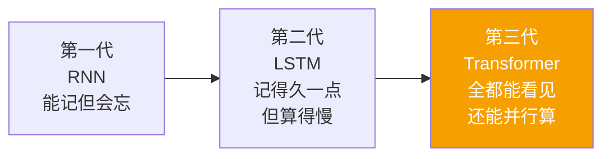

| 模型 | 擅长 | 致命问题 |
|---|---|---|
| **CNN** 卷积神经网络 | 图像、计算机视觉 | 不擅长处理变长序列的时序关系 |
| **RNN** 循环神经网络 | 序列数据，引入隐状态 h 记住历史 | 序列一长就忘；必须一步一步算，无法并行 |
| **LSTM** 长短期记忆网络 | RNN 改进版，能抓较长依赖 | 计算效率低、并行能力差；极长序列仍会丢 |
| **Transformer** | 长序列 + 并行 + 可扩展 | 显存开销随序列长度平方增长 |

### 1.3 RNN 为什么不行：两个死穴

**死穴一：信息要"传话"，传着传着就没了。**

RNN 的隐状态 `h` 像击鼓传花，第 100 个词想用第 1 个词的信息，得经过 99 次传递：

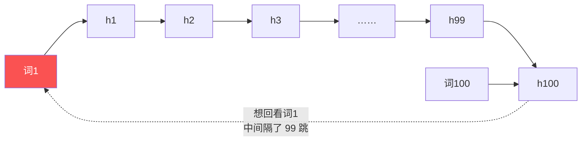

每传一次都会衰减一点，走到后面，前面的信息基本糊了——这就是经典的**长距离依赖丢失**。

**死穴二：只能串行，GPU 闲着。**

第 2 个词必须等第 1 个词算完，天生和 GPU 的并行能力冲突。训练一个超长文本，时间成本呈线性叠加。

> [!success] Transformer 的破局点
> 它直接让**每个词和所有词连一条线**，不管隔多远都是"一跳"；而且这些连线可以同时算，GPU 吃满。

### 1.4 Transformer 的四个优势

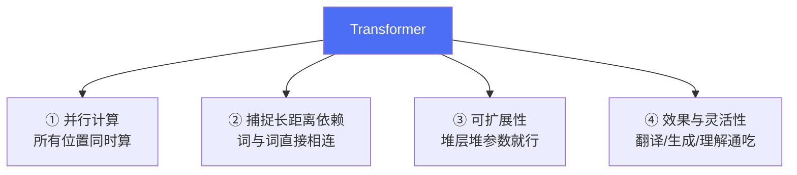

**1. 并行计算**：不像 RNN 要排队，整句话一次性喂进去算，训练速度量级提升。
**2. 捕捉长距离依赖**：自注意力让任意两个位置直接交互，"国王"和"女儿"隔多远都能对上眼。
**3. 可扩展性**：结构规整，加层加宽就能变大，这正是"缩放定律（Scaling Law）"能成立的前提。
**4. 灵活性和效果**：同一套架构能改造成 BERT（理解）、GPT（生成）、T5（转换），NLP 任务几乎通吃。

### 1.5 顺便记住这条时间线

| 时间 | 事件 | 意义 |
|---|---|---|
| 2017 | Transformer 论文诞生 | 注意力机制登场 |
| 2018.06 | GPT-1 | 首次把 Transformer + 无监督预训练结合 |
| 2018 | BERT | 双向理解路线的代表 |
| 2019.02 | GPT-2（15 亿参数） | 文本生成能力惊艳 |
| 2020.06 | GPT-3（1750 亿参数） | 理解与生成水平大幅跃升 |
| 2022.11.30 | ChatGPT（GPT-3.5） | 大模型走进大众 |
| 2023.03 | GPT-4（混合专家 MoE，支持图像） | 走向多模态 |
| 2024.05.14 | GPT-4o（文本/音频/图像） | 人机交互更自然 |
| 2025.02.27 | GPT-4.5 | 知识更广、幻觉减少 |
| 2025.08 | GPT-5.0 | 性能与可靠性显著提升 |
| 2026.03 | GPT-5.4 | 整合推理、编程、深度搜索，支持智能体执行复杂任务 |

> [!note] 关于这张表
> 以上为课程给出的演进脉络，用于建立"迭代节奏"的直观感受；具体参数量与能力描述以官方发布为准。

---

## 二、大模型怎么思考：四步走

这是全文最重要的一张图，建议背下来：


关键在最后那条回环箭头——**大模型没有"一次想好整段话"的能力，它就是个每秒钟接一次话的机器。**

### 2.1 第一步：分词（Tokenization）

模型不认识"字"，只认识 **token**。所谓分词，就是把一句话拆成一串最小处理单元。

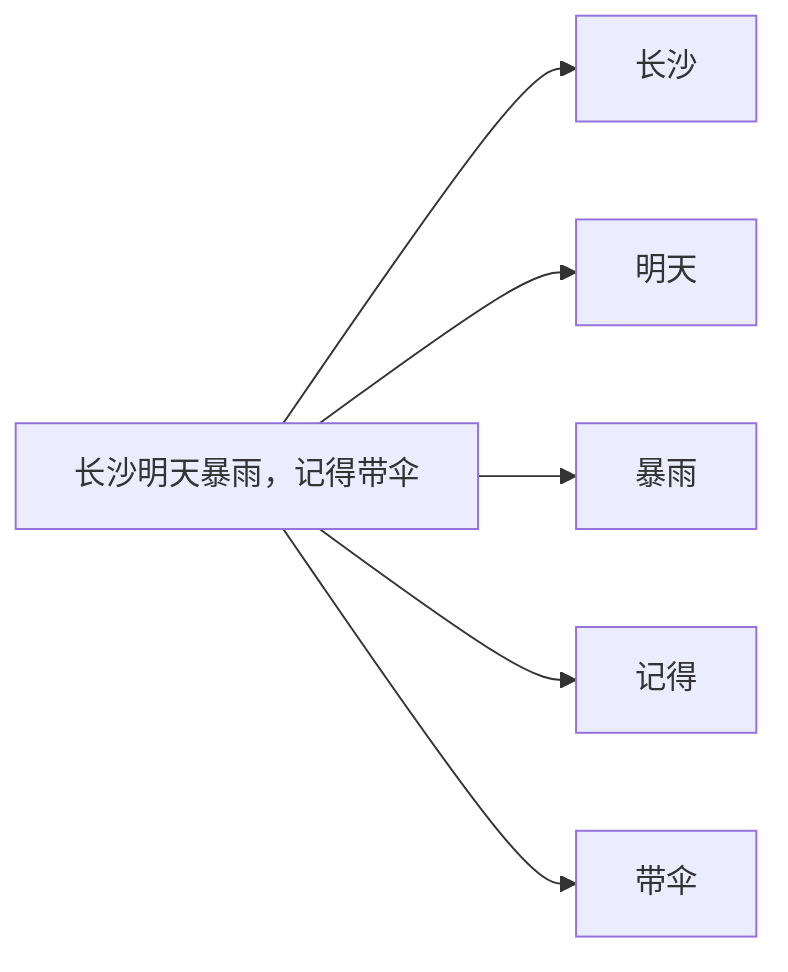

几个例子对照：

| 语言 | 原句 | 切分结果 | Token 数 |
|---|---|---|---|
| 中文 | 长沙的雨 | 长沙 / 的 / 雨 | 3 |
| 英文 | Rain in Changsha | Rain / in / Changsha | 3 |
| 中文 | 国王他有个女儿 | 国王 / 他 / 有个 / 女儿 | 4 |

> [!warning] Token ≠ 字，也 ≠ 词
> 通常 1 个中文词、1 个英文单词、1 个数字或符号算 1 个 token，**但不同模型的分词规则不一样**。
> 同一句话在 GPT 和 DeepSeek 上，token 数量可能不同——这直接影响计费和上下文长度。

**为什么要分词？** 因为计算机处理不了汉字和字母，只能处理数字。分词是把"人类语言"翻译成"机器可计算的离散单元"的第一步。每个 token 会对应一个唯一的**整数 ID**。

### 2.2 第二步：词嵌入（Word Embedding）

分完词，每个 token 还只是个编号。要把编号变成"有含义的东西"，就要靠词嵌入。

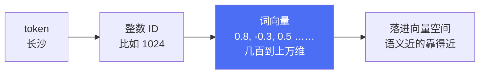

**词嵌入**是把 token 映射为**蕴含语义的向量**的技术。映射过程会捕捉单词的语义信息，使得语义相近的词在向量空间里距离也相近。

**词向量**就是这个映射的结果——一串数字，在坐标系里既有方向又有大小。比如简化成二维：

| 词 | 简化向量 |
|---|---|
| 长沙 | [4, 2] |
| 北京 | [4.2, 2.1] |
| 苹果（水果） | [1, 5] |

长沙和北京距离很近（都是城市），苹果离得远——**"相似的词距离更近"就是词向量的核心直觉**。

> [!tip] 工程上的做法
> 实际项目里没人自己训练词向量，直接用现成的**嵌入模型**（Embedding Model）就行。
> 比如 RAG 里把文档块向量化存进 Milvus，用的就是这类模型——原理和这里完全一致。

### 2.3 第三步：注意力机制（Attention）

为什么需要注意力？看这个例子：

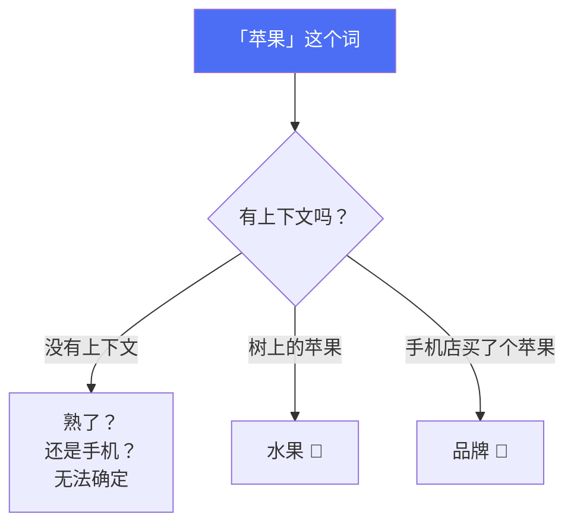

**同一个词，周围出现的词不同，含义就完全不同。** 模型必须有本事去捕捉"这个 token 在上下文中和谁关系近"，这个本事就是注意力机制。

用"国王的女儿"举例，注意力会算出：

| 词对 | 关联度 | 含义 |
|---|---|---|
| 女儿 ↔ 国王 | **0.684**（高） | 父女关系，强相关 |
| 女儿 ↔ 有个 | 0.646 | 领属关系，中等 |
| 女儿 ↔ 他 | 低 | 关系弱 |

> 数值是教学示意，实际由模型算出来。

> [!tip] 一句话理解注意力
> 就是**"其他词对我有多重要"**。重要的给高权重，不重要的给低权重，最后按权重把信息加权求和。

### 2.4 第四步：自回归生成

有了带上下文的向量，模型开始干正事：**预测下一个词**。

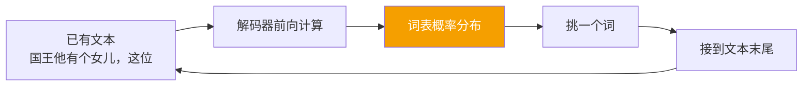

比如现在的输入是「国王他有个女儿，这位公主美丽又」，模型算出的下一个词概率可能是：

| 候选词 | 概率 |
|---|---|
| 善良 | 30% |
| 温柔 | 20% |
| 邪恶 | 5% |
| …… | …… |

它挑一个（通常取最高，也可以用采样增加多样性），接回句子末尾，再算下一个：

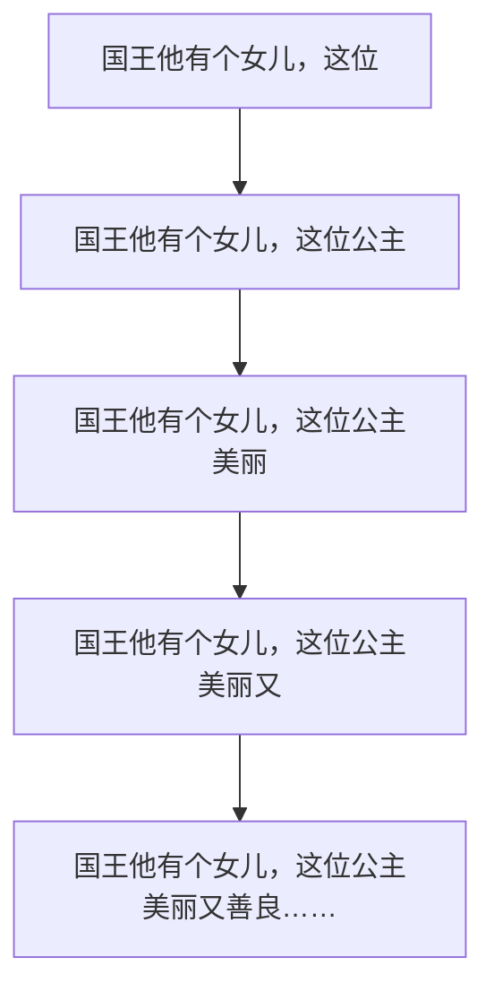

这个过程有个正式名字：**自回归生成（Autoregressive Generation）**——用自己的输出当下一步的输入，滚雪球式地往下写，直到生成结束符。

> [!important] 这里藏着两个重要认知
> 1. **大模型没有"全局规划"**：它每次只看概率，所以会出现前后矛盾、逻辑漂移。
> 2. **幻觉的根源之一就在这**：它优化的是"下一个词像不像人话"，不是"这句话是不是真的"。

---

## 三、Transformer 内部长什么样

前面讲的是"做什么"，这一章讲"怎么做到的"。看完你会明白：**所谓大模型，就是下面这套结构重复堆叠几十上百层。**

### 3.1 整体架构：编码器 + 解码器

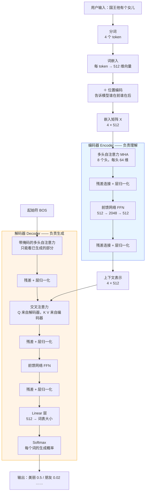

一句话分工：**编码器把话读懂，解码器把话写出来。**

### 3.2 输入层：三件事

**第一件，分词。** 「国王他有个女儿」→ 4 个 token。

**第二件，词嵌入。** 每个 token 变成 512 维向量：

| Token | 词向量 | 维度 |
|---|---|---|
| 国王 | [3.1, 0.9, ...] | 512 |
| 他 | [0.1, 0.3, ...] | 512 |
| 有个 | [2.1, 4.0, ...] | 512 |
| 女儿 | [4.1, 0.8, ...] | 512 |

**第三件，位置编码。** 这一步经常被忽略，但极其关键。

> [!question] 为什么必须要位置编码？
> 注意力机制本身是**无序**的——它把每个词和其他所有词比一遍，谁先谁后它不知道。
> 「狗咬人」和「人咬狗」在纯注意力下是同一堆向量，只是顺序不同。
> 所以必须额外塞一个"位置信号"进去，告诉模型**谁在第几位**。

位置编码的做法：偶数维用 **sin**，奇数维用 **cos**：

$$
PE_{(pos,\,2i)} = \sin\!\left(\frac{pos}{10000^{2i/d}}\right)
\qquad
PE_{(pos,\,2i+1)} = \cos\!\left(\frac{pos}{10000^{2i/d}}\right)
$$

展开看具体数值（d = 512）：

| Token | pos | 位置向量开头 |
|---|---|---|
| 国王 | 0 | [sin(0/10000^0), cos(0/10000^0), sin(0/10000^(2/512)), ...] |
| 他 | 1 | [sin(1/10000^0), cos(1/10000^0), sin(1/10000^(2/512)), ...] |
| 有个 | 2 | [sin(2/10000^0), cos(2/10000^0), ...] |
| 女儿 | 3 | [sin(3/10000^0), cos(3/10000^0), ...] |

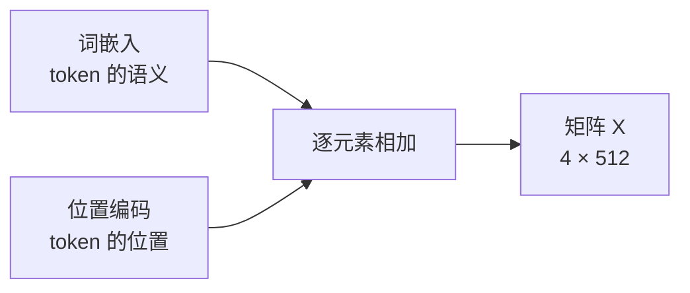

于是最终进入编码器的就是 **X（4 × 512）**：4 个 token，每个 512 维。

### 3.3 自注意力：Q、K、V 到底是什么

这是最容易卡住的地方。用**图书馆找资料**来类比，一下就通了：

| 角色 | 在图书馆里 | 在大模型里 | 一句话 |
|---|---|---|---|
| **Q**（Query） | 你想查的问题 | 当前 token 的状态 | "我该关注输入的哪部分？" |
| **K**（Key） | 每本书的标签/索引 | 每个 token 的标签 | "这个输入部分是什么？" |
| **V**（Value） | 书里的实际内容 | 每个 token 的真实信息 | "关注它，能提取到什么？" |

**流程**：拿你的问题（Q）去和每本书的标签（K）比一比，看哪本最相关；标签匹配度越高，那本书的内容（V）就越重要，给它更高权重，最后把重要内容加权汇总成答案。

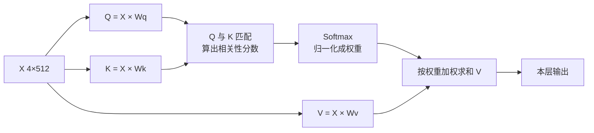

其中 `Wq / Wk / Wv` 是**预训练阶段就学好的参数矩阵**，不是临时算的。

写成公式就是教科书上那个著名的：

$$
\text{Attention}(Q,K,V) = \text{softmax}\!\left(\frac{QK^{\top}}{\sqrt{d_k}}\right)V
$$

> [!question] 为什么要除以 √dₖ？
> 维度越大，Q 和 K 点积的结果数值越大，softmax 会被推到极端（几乎变成 one-hot），梯度就消失了。
> 除以 √dₖ 相当于把数值拉回正常区间，让 softmax 输出平滑一些。这是个纯工程技巧，但很关键。

### 3.4 维度是怎么变的

课程里反复出现 `4×512`、`h=8`、`64`，其实就一个除法：**512 ÷ 8 = 64**。

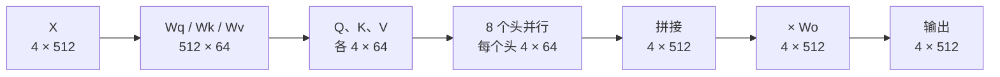

| 阶段 | 形状 | 说明 |
|---|---|---|
| 输入 X | 4 × 512 | 4 个 token，每个 512 维 |
| 单头投影后 Q/K/V | 4 × 64 | 512 维被切给 8 个头，每头 64 维 |
| 8 头拼接 | 4 × 512 | 8 × 64 = 512，拼回来 |
| 输出投影 | 4 × 512 | 乘 Wo 回到原维度 |

### 3.5 多头注意力：为什么要 8 个头

一个头只能学一种"关注方式"。8 个头就是 8 个不同视角：

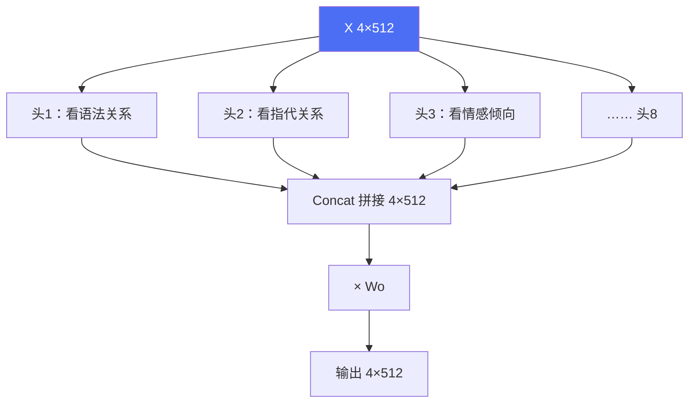

> 头的分工是训练中自发形成的，不是人为指定——但事后可解释性研究发现确实存在类似分工。

### 3.6 掩码注意力：不许偷看答案

解码器是"边写边猜"的，所以**不能让它看到还没生成的词**，否则就是作弊。

做法很粗暴：把未来位置的分数设成 **−∞**，过一遍 softmax 就变成 **0**。

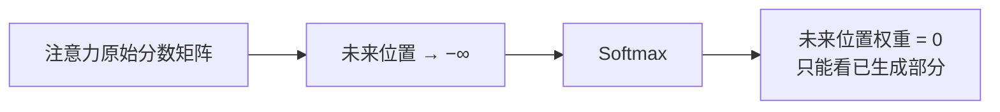

看一个 4×4 的示意（✅ 可见，🚫 屏蔽）：

| | 国王 | 他 | 有个 | 女儿 |
|---|---|---|---|---|
| 国王 | ✅ | 🚫 | 🚫 | 🚫 |
| 他 | ✅ | ✅ | 🚫 | 🚫 |
| 有个 | ✅ | ✅ | ✅ | 🚫 |
| 女儿 | ✅ | ✅ | ✅ | ✅ |

一个下三角。这就是 GPT 类模型能"从左往右一个字一个字写"的根本原因。

### 3.7 残差连接 + 层归一化

每个子层后面都跟着这两件套：

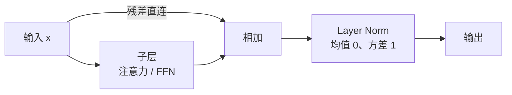

| 组件 | 做什么 | 解决什么问题 |
|---|---|---|
| **残差连接** | 输出 = 子层结果 + 原始输入 | 深层网络的**梯度消失**；同时保留原始信息 |
| **层归一化** | 对每个样本做标准化 | 加速训练、提升泛化能力 |

> [!tip] 记忆口诀
> **残差管"别忘"，归一化管"别飘"。** 一个保信息，一个稳训练。

### 3.8 前馈网络 FFN

注意力负责"词与词之间"的交流，FFN 负责"每个词自己想清楚"。

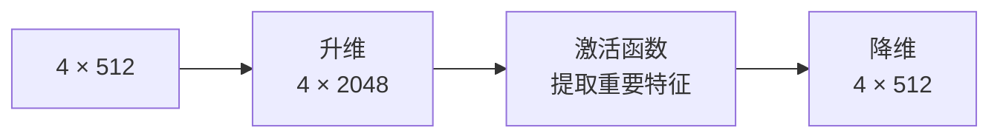

**目的**：把参数放大 4 倍再压回来，相当于给每个位置一个"私人小网络"来加工信息。整个 Transformer 里**参数量最大的部分其实就在 FFN**。

### 3.9 解码器怎么吐出一个词

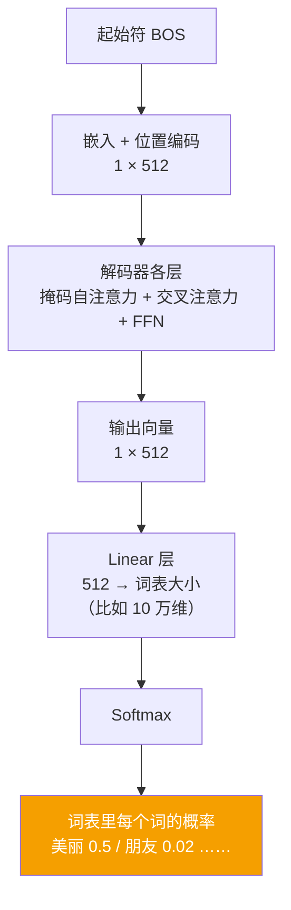

`Linear` 干的事很直白：把 512 维的语义向量，**映射成词表长度的分数**，再 softmax 成概率。

然后就是前面说的自回归：取概率最高的词接到 BOS 后面，变成 2 × 512，再算下一个……直到输出结束符 `EOS`。

### 3.10 三种架构变体

同样一套积木，留下不同的部分，就长成了不同的模型家族：

```mermaid
flowchart TB
    TF["Transformer"] --> A["Encoder-Decoder<br/>编码器 + 解码器"]
    TF --> B["Decoder-only<br/>只留解码器"]
    TF --> C["Encoder-only<br/>只留编码器"]

    A --> A1["翻译、摘要<br/>T5、原始 Transformer"]
    B --> B1["自回归生成<br/>GPT / DeepSeek / LLaMA<br/>⭐ 当前主流"]
    C --> C1["理解类任务<br/>BERT（分类、抽取）"]

    style B1 fill:#F59F00,color:#fff
```

> [!important] 记住这个结论
> 现在的大模型（GPT、DeepSeek、Claude、Qwen）**基本都是 Decoder-only**。
> 原因是：只要模型足够大，"预测下一个词"这个任务就能把理解、推理、生成全包了——任务简单，规模好扩。

---

## 四、大模型怎么被训练

### 4.1 前置知识：机器学习的四种范式

先搞清四种学习方式，后面三阶段才看得懂：

```mermaid
flowchart TB
    ML["机器学习"] --> S["监督学习<br/>数据带标签<br/>『这是猫』"]
    ML --> U["无监督学习<br/>数据没标签<br/>『自己找规律』"]
    ML --> SS["自监督学习<br/>自己造标签<br/>『把后一个字遮住猜』"]
    ML --> R["强化学习<br/>靠奖励试错<br/>『做对了加分』"]

    style SS fill:#4C6EF5,color:#fff
    style R fill:#F59F00,color:#fff
```

| 范式 | 数据 | 学习方式 | 典型应用 |
|---|---|---|---|
| 监督学习 | 有标注 | 输入 → 已知答案，对答案 | 分类、回归 |
| 无监督学习 | 无标注 | 自己发现聚类、结构 | 聚类、降维 |
| **自监督学习** | 无标注 | **从数据本身造标签** | 预训练（猜下一个词） |
| **强化学习** | 无标注 | 与环境交互，按奖励调策略 | AlphaGo、RLHF |

> [!tip] 自监督学习的比喻
> 像给你一张**没有答案的试卷**，你通过学习和推理自己去找答案。
> 大模型的预训练就是干这个：把文本的后半句遮住，让模型自己猜——答案本来就在原文里，所以不需要人工标注。

### 4.2 训练三阶段总览

```mermaid
flowchart LR
    A["① 预训练<br/>海量无标注文本<br/>自监督：猜下一个词"] --> B["基座模型<br/>Foundation Model"]
    B --> C["② 监督微调 SFT<br/>少量人工标注<br/>学会听指令"]
    C --> D["指令模型"]
    D --> E["③ RLHF<br/>人类偏好打分<br/>学会讨人喜欢"]
    E --> F["对齐后的模型<br/>ChatGPT / DeepSeek"]

    style A fill:#E7F5FF,stroke:#4C6EF5
    style C fill:#FFF9DB,stroke:#F59F00
    style E fill:#FFE3E3,stroke:#FA5252
```

课程给了一个非常好记的**成长比喻**：

| 阶段 | 比喻 | 干什么 | 数据量 |
|---|---|---|---|
| 预训练 | 婴儿 → 中学生 | **"修内功"**，积累知识 | 海量（TB 级） |
| SFT | 中学生 → 大学生 | **"大佬教教我"**，学会表达 | 少量（万级） |
| RLHF | 大学生 → 职场 | **"接受审判"**，学会得体 | 更少（千级） |

### 4.3 第一阶段：预训练（Pre-training）

```mermaid
flowchart LR
    W["互联网抓取<br/>网页、书籍、代码"] --> D["海量训练资料"]
    D --> T["自监督学习<br/>遮住后面的词自己猜"]
    T --> M["基座模型<br/>有知识，但不会聊天"]
```

**做什么**：用海量无标注文本，通过自监督学习，让模型学会"通用知识"。
**本质任务**：next token prediction——预测下一个词。
**产物**：**基座模型（Foundation Model）**，也叫基础大模型。

> [!warning] 基座模型的尴尬
> 它有知识，但**只会接话，不会回答问题**。
> 你问"你是谁？"，它可能续写成"你是谁？我是你爸爸"——因为它学到的是"文本怎么接"，不是"问题怎么答"。

### 4.4 第二阶段：监督微调 SFT

**做什么**：拿少量人工标注的"问题—标准答案"对，微调基座模型，让它**学会按指令作答**。

```mermaid
flowchart LR
    B["基座模型"] --> FT["微调<br/>人类标注的少量数据"]
    FT --> I["有偏好的模型<br/>会听指令、有固定风格"]
```

课程用了个很形象的例子说明"训练数据决定模型性格"：

```mermaid
flowchart TB
    P["Pre-train 基座"] --> M1["只用翻译数据微调"]
    P --> M2["只用旅游攻略微调"]
    M1 --> R1["翻译模型<br/>问『只有一天时间够吗』<br/>答非所问照样翻译"]
    M2 --> R2["旅游模型<br/>问啥都能扯到景点推荐"]

    style P fill:#4C6EF5,color:#fff
```

> **启示**：SFT 的数据分布决定了模型的"专业方向"和"说话风格"。这也是为什么企业做垂直模型，核心资产是那批高质量标注数据。

开源生态在这里很关键：Meta 开源了 **LLaMA** 系列，HuggingFace 上可以直接下载基座和微调版本。
`https://huggingface.co/`

### 4.5 第三阶段：RLHF 基于人类反馈的强化学习

**做什么**：让模型生成多个回答，人类给这些回答**排序打分**，训练出一个"奖励模型"，再用强化学习让大模型朝着高分方向优化。

```mermaid
flowchart TB
    Q["用户提问<br/>全宇宙最帅的男人是谁？"] --> M["微调模型生成候选回答"]
    M --> A1["回答 A：iKun"]
    M --> A2["回答 B：隔壁老王"]
    A1 --> H["人类打分"]
    A2 --> H
    H --> RM["训练奖励模型<br/>学会人类的偏好"]
    RM --> P1["✅ 正确 → 提高出现概率"]
    RM --> P2["❌ 错误 → 降低出现概率"]
    P1 --> M2["更新后的模型"]
    P2 --> M2

    style H fill:#FFE3E3,stroke:#FA5252
```

**核心机制**：不是告诉模型"正确答案是什么"，而是告诉它"**哪种回答人类更喜欢**"，然后调整概率分布——好的回答概率调高，差的调低。

> [!success] 三阶段各解决了什么
> - 预训练 → 让它**有知识**
> - SFT → 让它**会回答**
> - RLHF → 让它**回答得让人满意**（有用、无害、诚实）

---

## 五、一图串起来

把训练侧和推理侧拼在一起，就是完整的大模型生命周期：

```mermaid
flowchart TB
    subgraph TRAIN["训练侧：炼出一个模型"]
        direction TB
        T1["海量无标注文本<br/>网页 / 书籍 / 代码"] --> T2["① 预训练<br/>自监督猜下一个词"]
        T2 --> T3["基座模型<br/>有知识不会聊天"]
        T3 --> T4["② SFT<br/>人工标注问答对"]
        T4 --> T5["指令模型<br/>会听指令"]
        T5 --> T6["③ RLHF<br/>人类偏好打分"]
        T6 --> T7["对齐模型<br/>有用无害诚实"]
    end

    subgraph INFER["推理侧：用这个模型"]
        direction TB
        I1["你的问题"] --> I2["① 分词<br/>切成 token"]
        I2 --> I3["② 词嵌入 + 位置编码<br/>变成 4×512 矩阵"]
        I3 --> I4["③ 注意力<br/>看清上下文关系"]
        I4 --> I5["④ 预测下一个词"]
        I5 --> I6["接回输入<br/>循环直到结束符"]
        I6 --> I7["完整回答"]
    end

    T7 -->|"部署上线"| I1

    style TRAIN fill:#E7F5FF,stroke:#4C6EF5
    style INFER fill:#FFF4E6,stroke:#F59F00
```

再回头看那句"接话机器"，是不是每条线都对上了。

---

## 六、高频疑问

> [!question] Q1：token 一定要等于"一个词"吗？
> 不一定。它可能是子词、符号、甚至空格。中文常见的是 1~2 个字一个 token，英文常见的是词根+词缀拆开。**这直接影响 API 计费和上下文窗口**。

> [!question] Q2：为什么一定要位置编码？注意力不是已经看到所有词了吗？
> "看到"不等于"知道顺序"。注意力算的是相关性，是**集合内**的关系，天然无序。不加位置编码，「狗咬人」和「人咬狗」对模型是同一袋向量。

> [!question] Q3：多头注意力，8 个头一定比 1 个头好吗？
> 不是绝对。头数增加带来多视角，但总维度固定（512），每头分到的维度就变小（64）。所以是**视角数量**和**单视角精度**之间的权衡，靠实验调。

> [!question] Q4：Encoder 和 Decoder 到底啥区别？
> Encoder 是**双向**的，能看到整句话，负责理解；
> Decoder 是**单向**的（带 mask），只能看已生成部分，负责生成。
> 所以 BERT（Encoder-only）擅长理解类任务，GPT（Decoder-only）擅长生成。

> [!question] Q5：幻觉到底怎么来的？
> 三个来源叠加：① 训练目标是"下一个词像不像人话"，不是"是不是真的"；② 知识有截止日期；③ 生成是概率采样，可能选到低概率但流畅的错误答案。
> 这也是 RAG 存在的理由——用外部检索把事实喂给它。

> [!question] Q6：为什么现在都走 Decoder-only？
> 任务统一（都是预测下一个词）、结构简单（好扩展）、工程成熟（KV Cache 等优化到位）。一个足够大的 Decoder-only 模型，理解能力也顺带被训练出来了。

---

## 七、术语速查表

| 术语 | 英文 | 一句话解释 |
|---|---|---|
| 分词 | Tokenization | 把句子切成 token |
| 词元 | Token | 模型处理的最小单元 |
| 词嵌入 | Word Embedding | 把 token 变成有语义的向量 |
| 词向量 | Word Vector | 具体的数值表示，有方向有大小 |
| 位置编码 | Positional Encoding | 给向量补上"位置"信息 |
| 自注意力 | Self-Attention | 序列内部每个词对其他词的关注 |
| 查询/键/值 | Q / K / V | 我要找什么 / 这个是什么 / 里面有什么 |
| 多头注意力 | MHA | 多个视角并行做注意力 |
| 掩码 | Mask | 遮住未来位置，防止偷看答案 |
| 残差连接 | Residual Connection | 输出 = 子层结果 + 原输入 |
| 层归一化 | Layer Norm | 每个样本标准化，均值 0 方差 1 |
| 前馈网络 | FFN | 每个位置自己的小网络 |
| 自回归 | Autoregressive | 用自己输出当输入，逐词生成 |
| 预训练 | Pre-training | 海量无标注数据打底，学通用知识 |
| 监督微调 | SFT | 少量标注数据，学会听指令 |
| 人类反馈强化学习 | RLHF | 按人类偏好调整生成概率 |
| 基座模型 | Foundation Model | 预训练完、还没对齐的模型 |

---

## 八、延伸资源

课程里给的几个可视化工具，**强烈建议动手点一遍**，比看十页文字都管用：

| 资源 | 地址 | 看什么 |
|---|---|---|
| TensorFlow 游乐场 | `https://playground.tensorflow.org/` | 亲手搭神经网络，理解层和神经元 |
| LLM 可视化 | `https://bbycroft.net/llm` | 3D 视角看 token 在 Transformer 里怎么流动 |
| Transformer 解释器 | `https://poloclub.github.io/transformer-explainer/` | GPT-2 实时的注意力热力图，改词看变化 |
| HuggingFace | `https://huggingface.co/` | 下载模型与数据集 |
| LLaMA 3 合集 | `https://huggingface.co/collections/meta-llama/meta-llama-3-66214712577ca38149ebb2b6` | 开源基座模型 |

---

> [!cite] 来源
> 本文整合自智泊AI《L1-4 通俗易懂大模型的核心原理》（41 页）与《Transformer 架构解析（扩展）》（30 页），主讲 Jeff 老师。
> 已按理解重新组织叙事顺序，并补充了大量示意图与类比；原 PPT 中的动画演示（如掩码动画、自回归逐词生成）以 mermaid 流程图替代表达。
