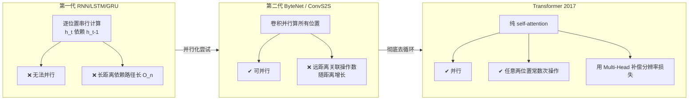
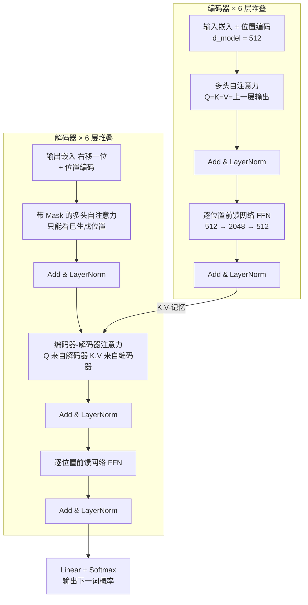
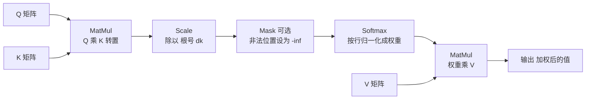
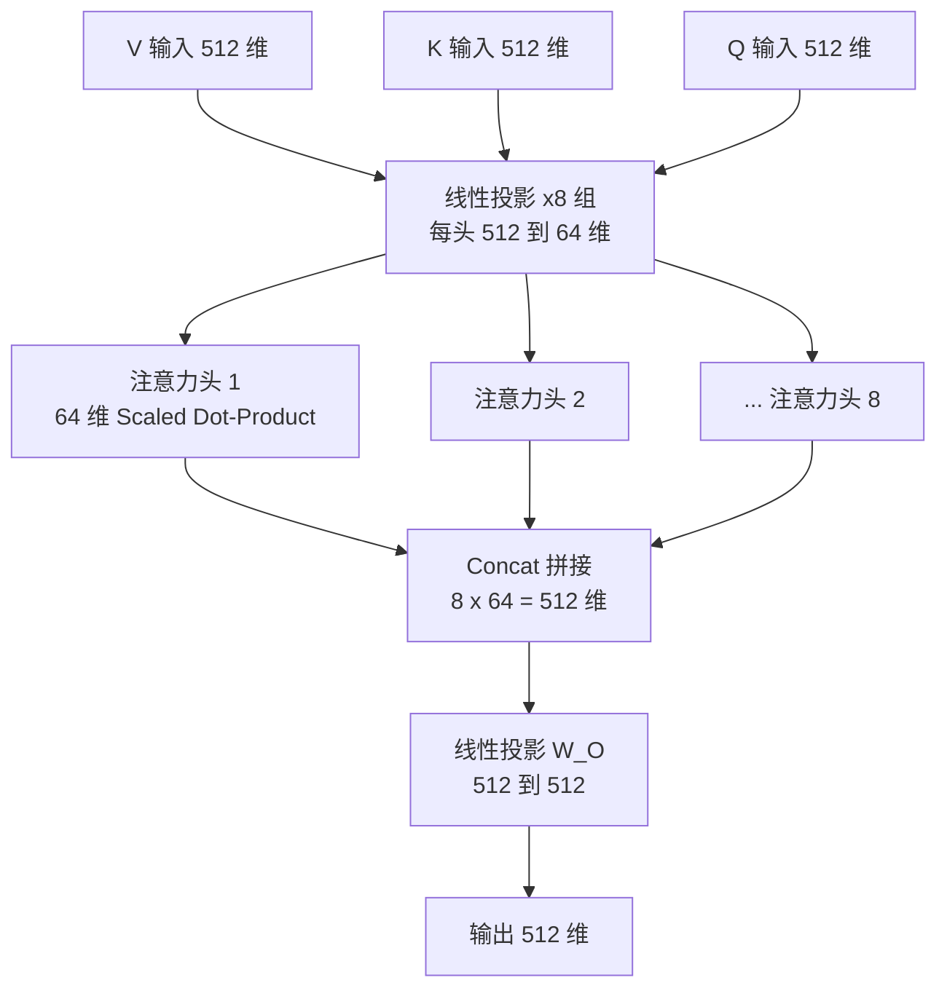
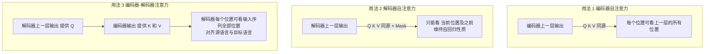
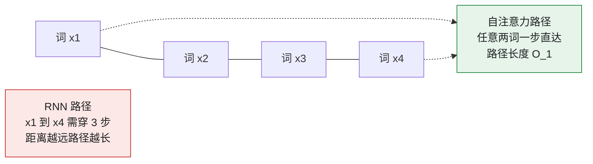
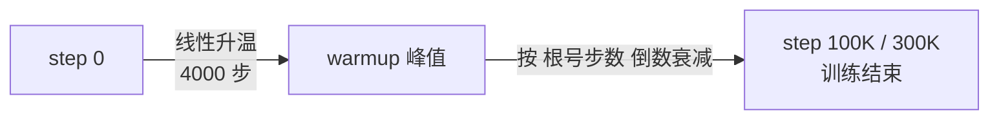
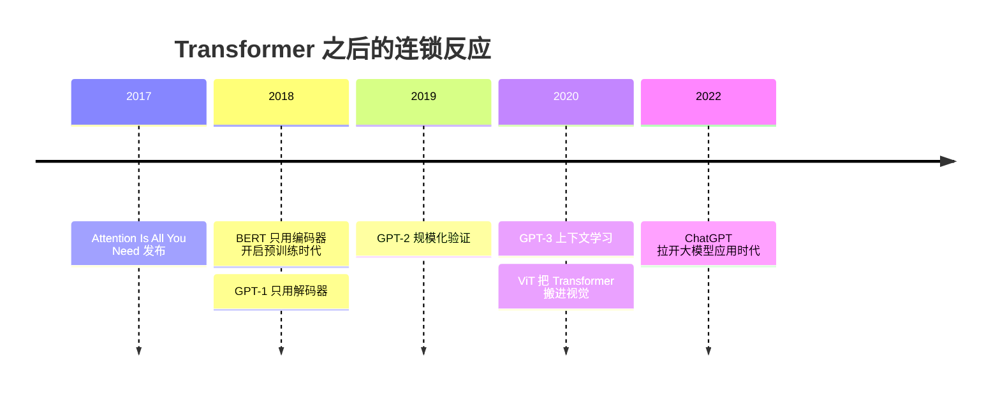

# Attention Is All You Need 论文精读

> [!abstract] 一句话总结
> 2017 年 Google 的 8 位作者提出 **Transformer**：**完全抛弃 RNN 和 CNN，只靠注意力机制**完成序列转换（翻译）。翻译质量刷新 SOTA，训练速度快一个数量级，成为后来 BERT、GPT 及整个大模型时代的地基。

> [!tip] 本笔记定位
> 逐节拆解论文的**关键步骤**和**关键节点**：每个公式为什么这么设计、每个组件解决什么问题、每组实验数字说明什么。配合 [[4-大模型核心原理与Transformer架构]]（通俗原理版）食用。

---

## 📇 论文信息卡

| 项目 | 内容 |
| --- | --- |
| 标题 | Attention Is All You Need（注意力就是你所需要的一切） |
| 作者 | Vaswani, Shazeer, Parmar, Uszkoreit, Jones, Gomez, Kaiser, Polosukhin（8 人，同等贡献） |
| 机构 | Google Brain / Google Research / 多伦多大学 |
| 会议 | NIPS 2017（NeurIPS 前身） |
| 代码 | `github.com/tensorflow/tensor2tensor` |
| 任务 | 机器翻译（WMT 2014 英德 / 英法）+ 英语成分句法分析 |

**核心贡献三点**：
1. **架构**：首个完全基于 self-attention 的序列转换模型，不含任何循环/卷积结构；
2. **效果**：英德翻译 28.4 BLEU（超此前最佳含 ensemble 2 个点以上），英法 41.8 BLEU 单模型 SOTA；
3. **效率**：8 块 P100 训练 3.5 天拿到 SOTA，训练成本是之前最佳模型的零头。

---

## 一、背景：它要解决什么问题

论文摘要页的讲师批注概括得很准：**Transformer 之前的主流序列模型是「RNN/CNN + encoder-decoder（+注意力）」；Transformer 彻底摒弃 RNN/CNN**。

### 1.1 RNN 的死穴：串行计算

RNN（含 LSTM/GRU）的计算方式是：隐藏状态 $h_t$ 必须等 $h_{t-1}$ 算完才能算——

$$h_t = f(h_{t-1}, x_t)$$

这个**天然串行**的性质带来两个后果：
- **训练无法并行**：一个句子内 t=1…n 必须顺序算，序列越长越慢；显存限制又让 batch 开不大；
- 各种优化技巧（因子分解、条件计算）只能缓解，**绕不开串行这个根本约束**。

### 1.2 注意力本来只是"外挂"

2014 年起 attention 已被广泛用于 seq2seq，但**始终作为 RNN 的附加模块**存在——RNN 负责序列计算，attention 负责拉通远距离依赖。Transformer 的大胆之处：**把 RNN 整个开除，让 attention 从配角变主角**。

### 1.3 CNN 方案的中间态，也不够好

ByteNet、ConvS2S 用卷积并行计算所有位置，但**任意两个位置建立关联所需的操作数随距离增长**（ConvS2S 线性、ByteNet 对数）——远距离依赖难学。Transformer 把它降为**常数次操作**，代价是注意力平均化损失了分辨率——用 Multi-Head Attention 补偿。

> [!note] Self-attention 早已存在，Transformer 的"第一"在哪？
> Self-attention（intra-attention）此前已用于阅读理解、摘要、文本蕴含等任务。论文声明的新颖性是：**Transformer 是第一个完全不依赖序列对齐的 RNN 或卷积、纯靠 self-attention 计算 input/output 表示的转换模型**。

---

## 二、整体架构（论文 Figure 1）⭐ 关键节点

标准的 encoder-decoder 结构：
- **编码器**：把输入符号序列 $(x_1,...,x_n)$ 映射为连续表示 $z=(z_1,...,z_n)$；
- **解码器**：**自回归**地逐个生成输出 $(y_1,...,y_m)$——每一步都把已生成的符号作为额外输入。

### 2.1 编码器（3.1 节）

- **N = 6 层**完全相同的层堆叠；
- 每层 2 个子层：① 多头自注意力 ② 逐位置全连接前馈网络（FFN）；
- 每个子层外面套**残差连接 + LayerNorm**：

$$\text{LayerNorm}(x + \text{Sublayer}(x))$$

- 为了让残差连接能直接相加，**所有子层和嵌入层的输出维度统一为 $d_{model}=512$**（这是设计上的强约束，后面维度流转全围绕它）。

### 2.2 解码器（3.1 节）

- 同样 N = 6 层，但每层 **3 个子层**：比编码器多一个「对编码器输出的多头注意力」（即 encoder-decoder attention）；
- **关键修改——Mask**：解码器自注意力子层中，阻止位置看到它后面的位置（把 softmax 输入里非法连接设为 $-\infty$）。配合输出嵌入**右移一位**，保证位置 $i$ 的预测只依赖 $<i$ 的已知输出 → 维持自回归性质（训练时才能并行算整个目标序列）。

---

## 三、核心步骤 1：Scaled Dot-Product Attention ⭐（3.2.1 节）

### 3.1 它是什么

注意力函数 = 把一个 **query** 和一组 **key-value 对**映射到输出：输出是 values 的加权和，**每个 value 的权重由 query 与对应 key 的兼容度算出**。一句话：**拿着问题（Q）去匹配每条记录的标签（K），按匹配度加权取内容（V）**。

### 3.2 核心公式（论文式 1）

$$\text{Attention}(Q, K, V) = \text{softmax}\left(\frac{QK^T}{\sqrt{d_k}}\right)V$$

Q/K 是 $d_k$ 维，V 是 $d_v$ 维；实际实现把一组 query 打包成矩阵 Q 一次算完（高度优化的矩阵乘法）。

### 3.3 计算流程（论文 Figure 2 左）⭐

### 3.4 关键设计 ①：为什么除以 $\sqrt{d_k}$

论文脚注 4 给出了漂亮的分析：假设 q 和 k 的各分量是**均值 0、方差 1 的独立随机变量**，则点积

$$q \cdot k = \sum_{i=1}^{d_k} q_i k_i \quad \Rightarrow \quad \text{均值 } 0,\ \text{方差 } d_k$$

$d_k$ 越大，点积绝对值越大 → softmax 被推进**梯度极小的饱和区**（近似 one-hot）→ 学不动。除以 $\sqrt{d_k}$ 把方差拉回 1，保住梯度。

### 3.5 关键设计 ②：为什么选点积而不是加性注意力

| 对比项 | 加性注意力 [Bahdanau] | 点积注意力 |
| --- | --- | --- |
| 兼容度函数 | 单隐层前馈网络 | 直接点积 |
| 理论复杂度 | 相近 | 相近 |
| 实际速度 | 慢 | **快**（可用优化过的矩阵乘法） |
| 大 $d_k$ 时不缩放 | 好 | 差 → **加 scaling 后两者相当** |

---

## 四、核心步骤 2：Multi-Head Attention ⭐（3.2.2 节）

### 4.1 动机

单个注意力头做 $d_{model}=512$ 维的整体注意力，**平均化会抑制不同位置的细节信息**。改进：先把 Q/K/V 用 h 组**可学习的**线性投影打到 $d_k, d_k, d_v$ 维子空间，各自并行做注意力，再拼接、再投影。

**多头 = 让模型同时在多个不同的表示子空间里关注不同位置的信息。**

### 4.2 公式

$$\text{MultiHead}(Q,K,V) = \text{Concat}(\text{head}_1,...,\text{head}_h)W^O$$
$$\text{head}_i = \text{Attention}(QW_i^Q,\ KW_i^K,\ VW_i^V)$$

### 4.3 本论文的超参数（关键数字）

| 参数 | 值 | 说明 |
| --- | --- | --- |
| 头数 $h$ | **8** | 8 个并行注意力头 |
| 每头维度 $d_k = d_v$ | **$d_{model}/h = 64$** | 每头比整体维度小 8 倍 |
| 总计算量 | ≈ 单头全维度 | **因为每头维度缩小，总成本基本不变** |

### 4.4 计算流程（论文 Figure 2 右）

---

## 五、核心步骤 3：注意力的三种用法 ⭐（3.2.3 节，易考）

同一个 Multi-Head 模块在模型里出现 **3 处**，区别只在 **Q/K/V 的来源**：

| 位置 | Q 来自 | K/V 来自 | Mask | 直觉 |
| --- | --- | --- | --- | --- |
| 编码器自注意力 | 编码器上一层 | 同左 | 无 | 源句内部互相看 |
| 解码器自注意力 | 解码器上一层 | 同左 | **有**（屏蔽未来） | 目标句生成时只准看过去 |
| 编码器-解码器注意力 | 解码器上一层 | **编码器最终输出** | 无 | 生成每个词时"查字典" |

---

## 六、其余组件（3.3–3.5 节）

### 6.1 逐位置 FFN（式 2）

$$\text{FFN}(x) = \max(0, xW_1 + b_1)W_2 + b_2$$

- 两层线性变换 + ReLU，**对每个位置独立、相同地施加**（等价于 kernel=1 的两层卷积）；
- 维度：$512 \to 2048 \to 512$（先升 4 倍再降回来）；
- 各层之间参数不共享，同层内所有位置共享。
- **角色**：注意力负责"跨位置混合信息"，FFN 负责"逐位置深度加工"。

### 6.2 Embeddings 和 Softmax：三处权重共享

1. 两个学习到的嵌入层（源/目标 token → $d_{model}$ 维向量）；
2. 解码器输出先过线性层再 softmax 得到下一 token 概率；
3. **共享**：两个嵌入层与 pre-softmax 线性变换**用同一个权重矩阵**（参考 [30]）；嵌入层里权重乘 $\sqrt{d_{model}}$。

### 6.3 Positional Encoding（式：正弦/余弦）⭐ 关键节点

模型里**没有任何循环和卷积**，必须显式注入位置信息。做法：在编码器/解码器栈底部，把位置编码**加到**输入嵌入上（维度同为 $d_{model}$ 才能相加）。

$$PE_{(pos, 2i)} = \sin(pos / 10000^{2i/d_{model}}) \qquad PE_{(pos, 2i+1)} = \cos(pos / 10000^{2i/d_{model}})$$

| 设计点 | 原因（论文原话的意图） |
| --- | --- |
| 波长从 $2\pi$ 到 $10000 \cdot 2\pi$ 几何级数 | 不同维度对应不同频率的正弦曲线，形成多尺度"位置指纹" |
| 选正弦函数 | 假设：对任意固定偏移 k，$PE_{pos+k}$ 可以表示成 $PE_{pos}$ 的线性函数 → **容易学相对位置关系** |
| 为什么不学位置嵌入 | 试过（Table 3 行 E），结果几乎一样；选正弦版是因为**它可能外推到比训练时更长的序列** |

---

## 七、Why Self-Attention（第 4 节）⭐ 论文的"辩论文"

拿自注意力层与循环层/卷积层比，同一任务：序列 $(x_1..x_n)$ 映射为等长 $(z_1..z_n)$，$x_i,z_i \in \mathbb{R}^d$。论文考察**三个指标**（Table 1）：

| 层类型 | 每层计算复杂度 | 串行操作数（越小越可并行） | 最大路径长度（越小越易学远依赖） |
| --- | --- | --- | --- |
| **Self-Attention** | $O(n^2 \cdot d)$ | **$O(1)$** | **$O(1)$** |
| Recurrent | $O(n \cdot d^2)$ | $O(n)$ | $O(n)$ |
| Convolutional | $O(k \cdot n \cdot d^2)$ | $O(1)$ | $O(\log_k(n))$ |
| Self-Attention（受限版） | $O(r \cdot n \cdot d)$ | $O(1)$ | $O(n/r)$ |

**三个论证要点**：
1. **复杂度**：句子级任务里 $n < d$ 很常见（word-piece/bpe 表示），此时 self-attention 比 recurrent 层快；
2. **并行**：self-attention 用常数次串行操作连接所有位置，recurrent 要 $O(n)$ 次；
3. **路径长度**：任意两位置间的前向/反向信号路径越短，越容易学长期依赖——self-attention 是 $O(1)$，这是卷积堆 $O(\log_k n)$ 层才勉强达到的；
4. **副作用红利**：注意力分布**可解释**——附录的可视化显示很多头学到了句法/语义行为。

> [!info] 复杂度上的自知之明
> 论文不回避 $O(n^2 \cdot d)$ 的代价，并提出「restricted self-attention」（只看邻域 r）作为超长序列的备选，路径长度退化为 $O(n/r)$——这就是后来各种稀疏注意力的先声。

---

## 八、训练设置（第 5 节）⭐ 关键步骤

### 8.1 数据与批次

| 任务 | 数据规模 | 词表 | 切词方式 |
| --- | --- | --- | --- |
| WMT 2014 英→德 | 约 **450 万**句对 | 约 37000 | byte-pair encoding（BPE，源目标共享） |
| WMT 2014 英→法 | 约 **3600 万**句对 | 32000 | word-piece |

- 批次按**句子长度近似**打包；每批约 25000 源 token + 25000 目标 token。

### 8.2 硬件与时长

| 模型 | 单步耗时 | 总步数 | 时长 |
| --- | --- | --- | --- |
| base | 0.4 秒/步 | 100,000 步 | **12 小时** |
| big | 1.0 秒/步 | 300,000 步 | **3.5 天** |

（一台机器，8 × NVIDIA P100。）

### 8.3 优化器与学习率调度（式 3）⭐

Adam，$\beta_1=0.9,\ \beta_2=0.98,\ \epsilon=10^{-9}$。学习率：

$$lrate = d_{model}^{-0.5} \cdot \min(step\_num^{-0.5},\ step\_num \cdot warmup\_steps^{-1.5})$$

- **前 warmup_steps=4000 步线性升温**，之后按步数的**平方根倒数衰减**；
- 直觉：训练初期大学习率会把注意力参数推崩，先小步慢走，稳定后再加速再缓退。

### 8.4 两种正则化

| 手段 | 设置 | 位置 | 论文观察 |
| --- | --- | --- | --- |
| Residual Dropout | $P_{drop}=0.1$（英法 big 用 0.3） | 每个子层输出（加残差、归一化**之前**）+ 两个栈的嵌入与位置编码之和 | 变体实验 (D)：不加 dropout 过拟合明显 |
| Label Smoothing | $\epsilon_{ls}=0.1$ | 训练目标 | 伤害 perplexity（模型被迫"更不确定"）但**提高 accuracy 和 BLEU** |

---

## 九、结果（第 6 节）⭐ 关键数字

### 9.1 翻译主结果（Table 2）

| 模型 | 英→德 BLEU | 英→法 BLEU | 训练成本（FLOPs，英→德） |
| --- | --- | --- | --- |
| GNMT+RL（最佳旧 RNN） | 24.6 | 39.92 | $2.3\times10^{19}$ |
| ConvS2S | 25.16 | 40.46 | $9.6\times10^{18}$ |
| 旧最佳 Ensemble | 26.36 | 41.29 | $\sim10^{20}$ |
| **Transformer base** | 27.3 | 38.1 | **$3.3\times10^{18}$** |
| **Transformer big** | **28.4** | **41.8** | $2.3\times10^{19}$ |

要点：**big 模型超过此前所有模型（连 ensemble 都超过）2 个 BLEU 以上**；base 模型用不到竞争者零头的成本就超过所有已发表单模型。

推理细节：base 平均最后 5 个 checkpoint（每 10 分钟存一次），big 平均 20 个；beam size = 4、长度惩罚 α=0.6；最大输出长度 = 输入长度 + 50，可提前终止。

### 9.2 消融实验（Table 3）——哪些设计真的重要

| 变体 | 结论 |
| --- | --- |
| (A) 改头数 h（保持计算量不变） | 单头比最佳差 0.9 BLEU；**头太多也变差** → h=8 恰当 |
| (B) 缩小 $d_k$ | 变差 → "判断兼容度并不容易"，点积之外可能还有更好的兼容函数 |
| (C) 加大模型 | 越大越好（$d_{model}=1024, d_{ff}=4096$ 时 BLEU 26.2） |
| (D) Dropout 0.0/0.2 | 0.0 明显过拟合变差 → dropout 很关键 |
| (E) 可学习位置嵌入替代正弦 | 几乎一样 → 正弦编码非唯一正解，但可外推是加分项 |

### 9.3 泛化能力：英语成分句法分析（Table 4）

- 只用 WSJ 4 万句（小数据）：F1 = **91.3**，超过 Berkeley Parser 90.4——对比之下 RNN seq2seq 在小数据场景一直拿不到 SOTA；
- 半监督 1700 万句：F1 = **92.7**；
- 仅微调 dropout/学习率/beam，其他超参照搬翻译模型 → **架构通用性**的直接证据。

---

## 十、注意力可视化（附录，Figure 3–5）三个发现

1. **长距离依赖**：第 5 层多个头在动词 "making" 上关注远处的 "more difficult"，补全跨 5+ 词的短语结构；
2. **指代消解**：第 5 层的两个头处理 "its" 的指代——注意力分布非常尖锐（几乎确定地指向被指代的实体）；
3. **结构涌现**：不同头自发学到了不同的"分工"，行为与句子结构（句法/语义）相关 → 也呼应了"可解释性"的卖点。

---

## 十一、结论与历史地位（第 7 节 + 后记）

论文结论：第一个**完全基于注意力**的序列转换模型；多头自注意力替换了 encoder-decoder 里最常用的循环层；两大翻译任务双双 SOTA，且训练显著更快。

作者展望（都应验了）：扩展到文本以外模态（图像/音频/视频）、研究受限注意力处理大输入、让生成更少串行。

---

## 十二、术语中英对照速查

| 英文 | 中文 | 备注 |
| --- | --- | --- |
| sequence transduction | 序列转换 | 输入序列 → 输出序列（翻译是典型） |
| auto-regressive | 自回归 | 已生成内容作为下一步输入 |
| self-attention / intra-attention | 自注意力 | 同一序列内部建立关联 |
| scaled dot-product attention | 缩放点积注意力 | 式 (1) |
| multi-head attention | 多头注意力 | h=8 个子空间并行 |
| encoder-decoder attention | 编解码注意力 | Q 解码器 / K,V 编码器 |
| positional encoding | 位置编码 | 正弦/余弦注入顺序信息 |
| residual connection | 残差连接 | x + Sublayer(x) |
| layer normalization | 层归一化 | 稳定训练 |
| mask（$-\infty$） | 掩码 | 屏蔽未来位置，保自回归 |
| label smoothing | 标签平滑 | 提 BLEU 降 PPL |
| warmup steps | 预热步数 | 学习率先升后降，4000 步 |
| BLEU | 机器翻译评价指标 | 越高越好 |
| perplexity（PPL） | 困惑度 | 语言模型评价指标，越低越好 |

---

## 十三、高频问答自检

> [!question]- 为什么除以 $\sqrt{d_k}$？
> 点积方差随维度线性增长（脚注 4：分量均值 0 方差 1 时，点积方差 = $d_k$），大数值把 softmax 推入梯度极小区域；除以 $\sqrt{d_k}$ 把方差归一回 1。

> [!question]- 每个头 64 维，为什么总计算量不比单头 512 维高？
> 单头是 512 维注意力 1 次；多头是 64 维注意力 8 次。注意力的矩阵乘成本与维度成比例，$8 \times 64 = 512$，总量近似持平。

> [!question]- 解码器为什么要 Mask？不加会怎样？
> 不加 mask，训练时位置 i 能"偷看"答案里 $>i$ 的词，与推理时逐词生成的分布不一致，模型学到作弊路径，推理质量崩坏。Mask + 输出嵌入右移一位，共同保证 $i$ 只依赖 $<i$。

> [!question]- 位置编码为什么用正弦而不是学习出来的？
> 效果几乎一样（Table 3 行 E），但正弦版对任意偏移 k 满足 $PE_{pos+k}$ 是 $PE_{pos}$ 的线性函数（利于相对位置），且**可外推到训练未见过的更长序列**。

> [!question]- self-attention 的 O(n²) 是缺陷吗？
> 是代价也是已知的：论文在 Table 1 公开列出，并提出 restricted self-attention（邻域 r）作为长序列方案——后来的稀疏注意力/FlashAttention 都是这个方向的延续。

---

## 🔗 延伸

- [[4-大模型核心原理与Transformer架构]] —— 通俗原理版（分词/词嵌入/注意力/训练三阶段全景）
- Jay Alammar《The Illustrated Transformer》—— 图解版
- 论文代码：`github.com/tensorflow/tensor2tensor`
