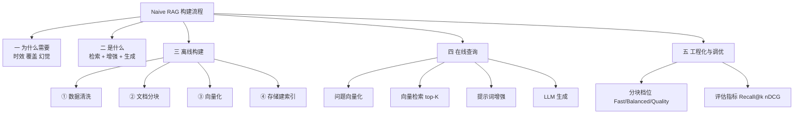
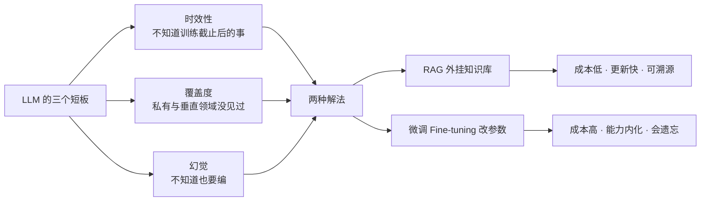
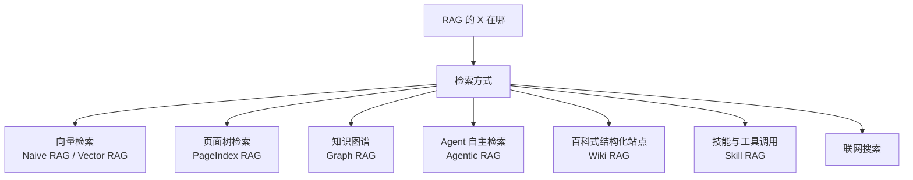
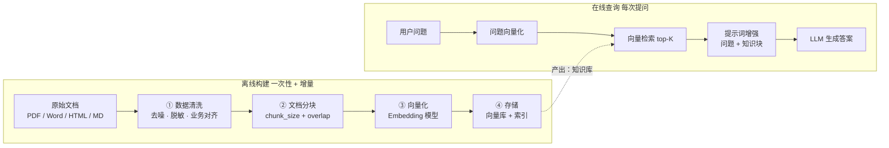
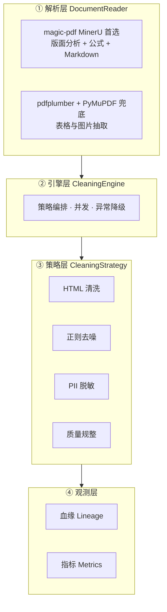
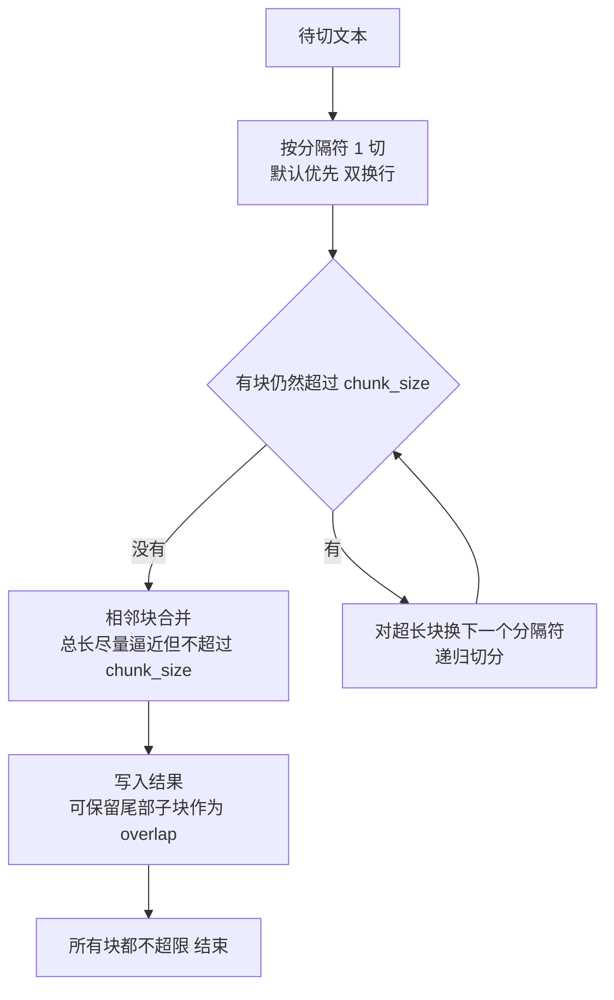
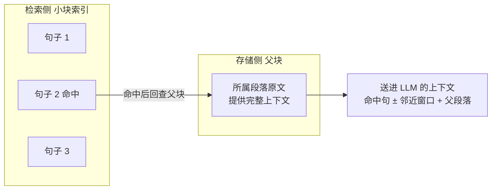
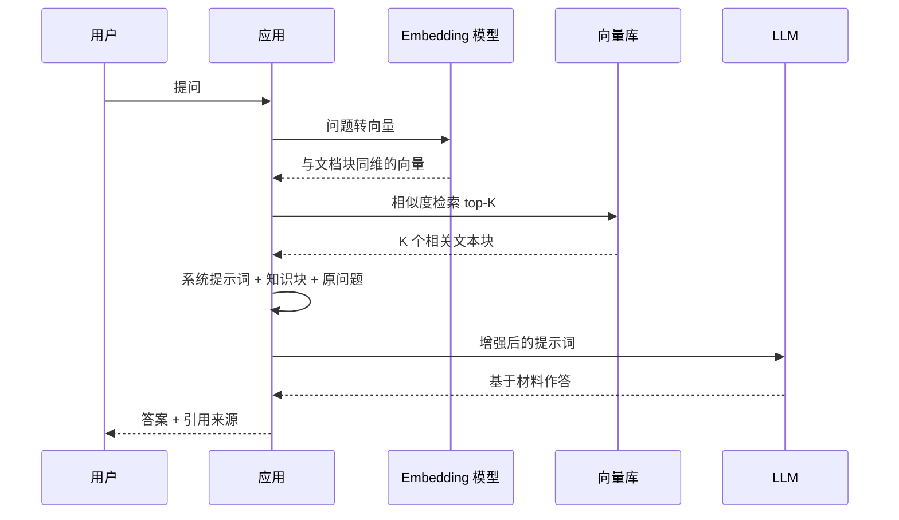
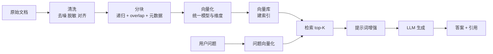

# Naive RAG 构建流程与文档分块

> [!abstract] 一句话总结
> RAG 就是让大模型**开卷考试**：先从知识库翻书（检索），把翻到的段落和问题拼成新提示词（增强），再让模型看着材料作答（生成）。
> 而整条链路**一半以上的功夫在离线**：数据清洗 → 文档分块 → 向量化 → 存储。**分块质量几乎决定了 RAG 的性能上限。**

> [!tip] 本笔记定位
> 把「随堂笔记 + 分块策略详解 + 课程 PPT + 企业级清洗 PRD/技术规格/扩展指南 + 4 份分块代码」压成一条主线：**为什么 → 是什么 → 离线四步 → 在线三步 → 工程落地与调优**。配 9 张 mermaid 图。

---

## 📚 材料地图（7 份材料各自贡献什么）

| 材料 | 类型 | 在本笔记里对应 |
| --- | --- | --- |
| `202060713随堂笔记.txt` | 课堂主线 | 第一~七章的主干（RAG 概念、离线/在线、四种基本分块、图片/Excel 处理） |
| `RAG的分块策略详解.md` | 专题深挖 | 第五章进阶：结构感知、语义/主题、小-大、父子块、Agent 分块、混合分块三档 |
| `L2-1_NaiveRAG构建流程与应用实践-1.pptx` | 课件 | 环境约定、FastGPT 三步走、RAG 三阶段（索引化/检索/增强生成） |
| `产品需求文档_企业级_RAG_数据清洗管道.md` | PRD | 第四章痛点、定位、KPI（压缩率、PII 检出率、耗时） |
| `技术规格说明书.md` | 技术设计 | 第四章四层架构、技术选型表、流水线 4 步 |
| `策略扩展与注册说明.md` | 开发指南 | 第四章插件化策略、如何注册新策略 |
| `自定义正则规则添加指南.md` | 开发指南 | 第四章三种加规则方式、优先级与性能提醒 |
| `代码/doc_split/*.py` | 代码 | 第五章四种策略的最小实现（含递归分块的合并算法说明） |

> 标注 **🔧 补充** 的内容是讲师材料之外我加的解释，方便理解，不算课程原文。

---

## 🗺️ 知识地图



---

## 一、为什么需要 RAG

### 1.1 大模型的三个短板

| 短板 | 表现 | 课堂例子 |
| --- | --- | --- |
| **时效性** | 训练数据有截止日期，之后发生的事一概不知 | 问"抗战胜利 80 周年阅兵展示了哪些武器"，答不出 |
| **知识覆盖度** | 再大的训练集也盖不住所有行业，尤其企业私有数据 | 律师行业的专业案件数据、公司内部文档 |
| **幻觉** | 不知道也硬答，"一本正经地胡说八道" | 提问方式不对或知识欠缺时，编造事实甚至欺骗性内容 |

### 1.2 两条解法：RAG 与微调



**微调的两个门槛（随堂笔记原话）**：

- **成本**：数据集整理 + 硬件成本 + 时间成本；
- **效果**：取决于数据集质量与基座模型选型。
  - 数据本身**非通用性越强**，微调成功概率越高；
  - **灾难性遗忘**：学了新领域，旧能力可能退化。

> [!note] RAG 的主场是"知识"，微调的主场是"行为"
> 知识会变（政策、价格、库存、内部文档）→ 用 RAG，改知识库即可，不动模型；
> 需要模型学会**说话风格、输出格式、领域推理套路**→ 用微调。
> 🔧 补充：两者不冲突，工业界常见「微调小模型 + RAG 喂知识」的组合，成本与效果都更可控。

---

## 二、RAG 是什么

### 2.1 三个词拆开看

**RAG = Retrieval Augmented Generation = 检索 + 增强 + 生成**

| 环节 | 做什么 | 关键动作 |
| --- | --- | --- |
| **检索** | 带着用户问题去外部知识库找相关材料 | 问题向量化 → 向量库相似度检索 → top-K |
| **增强** | 把检索到的材料塞进提示词 | 系统提示词 + 知识块 + 用户问题 |
| **生成** | 让 LLM 基于材料作答，而不是凭记忆 | 提示词约束"只依据给定材料回答" |

一句论文式的定义：**RAG 是一种结合检索与生成的技术，先检索相关文档，用检索结果增强提示词，再由大模型生成答案。**

更本质的一句话：**RAG = 大模型 LLM + 外部数据**。

课件里那个比喻最到位：**开卷考试**——先让 LLM 翻书，再回答问题。

### 2.2 "X" RAG：检索方式不同，就是不同的 RAG

随堂笔记里有个很关键的判断：**从 RAG 的角度看，检索方式的不同就催生了不同类型的 RAG**（XRAG 的 X 就是检索方式）。



| 类型 | 检索靠什么 | 典型擅长 |
| --- | --- | --- |
| Naive / Vector RAG | 向量相似度 | 语义相近的问答，本课主角 |
| PageIndex RAG | 文档的页面/章节树 | 长文档、需要"按目录定位" |
| Graph RAG | 实体与关系图谱 | 多跳关系推理（"A 的供应商的法人是谁"） |
| Agentic RAG | Agent 自主决定查什么、查几次 | 复杂问题拆解、多轮检索 |
| Wiki RAG | 结构化百科条目 | 概念解释、实体背景 |
| Skill RAG | 技能/工具库 | 需要"做事"而非"回答" |
| 联网搜索 | 搜索引擎 | 强时效问题 |

> [!info] 冷知识
> **RAG 最早被提出来是用在 Agent 里的记忆管理**——让 Agent 记住历史、按需召回，后来才成为知识库问答的主流范式。

---

## 三、RAG 系统全貌：离线 + 在线

### 3.1 两个阶段



| 阶段 | 输入 | 输出 | 频率 |
| --- | --- | --- | --- |
| **离线构建** | 垂直领域原始数据（图、文、音视频） | **知识库**（存好的块 + 向量 + 索引） | 一次性或增量更新 |
| **在线查询** | 用户问题 | 答案 | 每次提问 |

> [!note] offline / online 的词源
> 来自 Apache 服务器时代：**offline 指服务器还没对外开放访问权限，online 指已开放**。搬到 RAG 里，就是"提前把数据处理好"与"实时响应用户"的区别。

### 3.2 课件版：Naive RAG 三阶段

| 阶段 | 链条 |
| --- | --- |
| **1. 索引化** | 文档 → 分块 → 向量化 → 存储 |
| **2. 检索** | 用户提问 → 向量化 → 检索数据库 → 得到 top-K 个相关文档块 |
| **3. 增强生成** | 增强提示词（原始问题 + 相关文档块）→ LLM → 生成答案 |

---

## 四、离线构建 ①：数据清洗

### 4.1 为什么要清洗

企业原始数据普遍**格式混乱、类型复杂、数据不全**。PRD 里把这件事说得最狠：**Garbage In, Garbage Out**——脏数据直接入库，下游再好的模型也救不回来。

四个典型痛点：

| 痛点 | 后果 |
| --- | --- |
| 表格语义丢失 | PDF 文本提取把行列混排，模型看不懂结构化数据 |
| 上下文断裂 | 图片、附件在提取过程中丢失，多模态线索断了 |
| 隐私泄露 | 手机号、身份证直接进了提示词 |
| 清洗不可靠 | 没有数据血缘，出问题查不出是哪一步、哪条规则干的 |

产品定位很形象：**RAG 基础设施里的"净水器"**——把复杂原始文档变成模型易读、安全、高纯度的结构化文本。

### 4.2 常规清洗 vs 非常规清洗

| 类别 | 具体动作 |
| --- | --- |
| **常规清洗** | 格式处理（表头、页眉页脚、多余空格、标点统一、大小写对齐）、**数据脱敏**、**文档血缘追溯** |
| **非常规清洗**（业务层） | **数据增强**（人工或大模型给文档质量打分，低质量丢弃或增强）、**代词替换**（把"它/该公司/上述"还原成全称）、**业务对齐**（用户说 A，文档写 A1/A2/A3，需要映射）、特定数据筛选替换 |

> [!warning] 数据增强的现实
> 这一部分很多时候**只能靠人工**完成。质量和成本在这里是硬碰硬的取舍。

### 4.3 企业级清洗的三步策略

企业文档动辄上万份，不能上来就写脚本。随堂笔记给的顺序很务实：

1. **分类和抽样**
   - 按文档类型 / 业务分类 / 文档特征分组（可组合）；
   - 数量大才抽样（人工或随机），先摸清噪声长什么样；
2. **业务规则抽取**——先用大白话把规则说清楚，再决定实现方式：
   - 文档少 → **直接人工处理**；
   - 文档多且规则明确 → **代码批量处理**；
   - 字符串处理业界标准答案是**正则表达式**；
   - 🔧 补充（也是笔记里的技巧）：**把原始文本和需求丢给对话大模型，让它帮你写正则**，再人工校验。
3. **校验**——批量处理必须做**日志记录和溯源**，否则改错了无法回滚。

> 一个省力事实：**很多常见清洗规则，文档读取器（MinerU 这类框架）已经内置了**，先看工具再决定自己写多少。

### 4.4 工程化落地：四层架构

配套的 `enterprise_cleaner` 就是这套思路的工程实现，四层模型「读取 → 编排 → 清洗 → 追踪」：



**技术选型表（直接可抄）**：

| 维度 | 组件 | 为什么选它 |
| --- | --- | --- |
| PDF 解析（高级） | `magic-pdf`（MinerU） | 首选。高精度版面分析、公式识别、直接导 Markdown |
| PDF 解析（基础） | `pdfplumber` | 备选。表格区域提取、坐标对齐 |
| 图像提取 | `fitz`（PyMuPDF） | 快，可无损抽出位图/矢量图 |
| HTML 提取 | `Trafilatura` | 自动识别主文本块，降噪比高 |
| PII 脱敏 | `Regex` + `Presidio` | 准确率与性能兼顾，中文正则可定制 |
| Word | `python-docx` | 能按段落访问 XML，支持表格递归提取 |

**统一接口设计**：所有策略继承 `CleaningStrategy`，实现 `clean(content, context)`，返回 `(清洗后文本, 应用规则列表)`；`name` 是唯一标识，`supported_types` 声明支持的内容类型。**`CleanerFactory` 提供 `default / fast / deep` 三套配置快照**，用工厂切换档位。

### 4.5 清洗流水线 4 步

| 步骤 | 做什么 |
| --- | --- |
| 1. 输入扫描 | 遍历目录，按后缀匹配解析器（`.docx/.pdf/.html/.md/.txt`，顺带自动纠编码 UTF-8/GBK） |
| 2. 高级解析 | 产出 `ReadResult`：全文 String + 表格转 HTML `<table>` + 图片存盘并生成 `` 链接 |
| 3. 策略链 | HTML 清理 → 正则去噪（页码、乱码、标点）→ PII 脱敏 → 结构规整（Unicode 归一化、首尾空白） |
| 4. 持久化 | 写清洗后文件 + 生成 JSON 审计报告（成功率、压缩率、PII 分布、耗时） |

### 4.6 三种加自定义正则规则的方式

规则字段：`name`（唯一名）、`pattern`（正则）、`replacement`（替换文本，可为空）、`priority`（**数字越小越先执行**）、`description`、`content_types`（仅对特定类型生效）。

| 方式 | 写法 | 适用 |
| --- | --- | --- |
| ① 配置文件（推荐） | `config.yaml` 写 `rules:` 列表，`CleanerFactory.from_yaml("config.yaml")` | 换规则不改代码 |
| ② 字典动态注入 | `CleanerFactory.from_dict({...})` | 运行时动态生成规则 |
| ③ 改源码默认规则 | 改 `utils/config.py` 的 `DEFAULT_RULES` | 希望永久生效 |

> [!warning] 两个坑
> 1. **优先级**：多条规则命中同一处文本时，`priority` 小的先执行，顺序错了结果完全不同；
> 2. **性能**：规则不是越多越好，**带回溯的复杂正则会显著拖慢清洗**。YAML 里写正则建议用双引号并注意反斜杠转义。

### 4.7 清洗的验收标准（PRD 的 KPI）

| 指标 | 目标 |
| --- | --- |
| 数据压缩率 | 清洗后体积减少 **20%–80%**（取决于噪声程度）→ 直接省 token 成本 |
| 表格解析准确率 | 通过 RAG 问答回测验证模型能否正确读出表格内容 |
| 清洗耗时 | 中等长度 PDF **< 1s**（基于并发） |
| PII 漏检率 | 核心敏感字段检出率 **≥ 95%** |

---

## 五、离线构建 ②：文档分块（本课重点 ⭐）

### 5.1 为什么必须分块

| 层面 | 原因 | 后果 |
| --- | --- | --- |
| **技术** | 向量模型和 LLM 都有**上下文窗口上限** | 不分块根本喂不进去；块大小必须反过来由模型能力决定 |
| **业务 · token** | 文档过大或不做处理，token 消耗暴涨 | 成本失控、响应变慢 |
| **业务 · 噪声** | 一整篇文档里可能**超过 99% 与当前问题无关** | 无关内容稀释关键信息，模型答偏 |

专题材料的判断更直接：**即使模型很强、提示词很精，分块不当依然会导致上下文缺失、事实性错误、拼接不连贯、幻觉或错误引用。**

**高质量分块的三条标准**：

1. **贴合自然语义/结构边界**——按标题、段落、列表、表格切，不要硬切；
2. **适度重叠**——用 `chunk_overlap` 缓解边界断裂，别让"定义""条件"被拆散；
3. **保留元数据**——章节路径（如 `指南 > 安装`）、块类型、位置，为可追溯与重排服务。

**理想目标**：在「上下文完整性」与「信息密度」之间取动态平衡——块太大噪声多，块太小没上下文。

### 5.2 四种基本策略（附最小实现）

#### ① 固定大小分块（Fixed-size）

```python
def split_by_fixed_char_count(text, count):
    return [text[i: i + count] for i in range(0, len(text), count)]
```

| 优点 | 缺点 |
| --- | --- |
| 简单、快、性能好、天然适配模型窗口 | **语义割裂**（一句话被切成两半）→ 业务准确度下降 |

#### ② 带重叠窗口的固定分块（Sliding Window）

```python
def sliding_window_chunks(text, count, overlap):
    step = count - overlap          # 步长 = 块大小 - 重叠大小
    return [text[i: i + count] for i in range(0, len(text), step)]
```

关键就一行：**步长不是 `count`，而是 `count - overlap`**——每块往前只推进一小步，尾部自然和下一块的开头重合。

| 优点 | 缺点 |
| --- | --- |
| 用**冗余换语义完整**，跨块信息不容易断 | 空间冗余、引入重复噪声 |

**窗口大小怎么定**：一般是 `chunk_size` 的 **5%–20%**，**落地 10% 最常见**。

#### ③ 基于句子分块（Sentence）

```python
import re
sentences = re.split(r'[。？！]', text)      # 中文按句末标点切
```

**为什么按句子**：自然语言里**句子是最小的语义完整单位**。

| 优点 | 缺点 |
| --- | --- |
| 语义完整，利于问答匹配与引用 | 粒度太小 → 索引膨胀、检索变慢、**全局语义丢失** |

> [!warning] 中文分句别用 NLTK
> NLTK 的分句器不支持中文标点，会直接失效。用 **HanLP、Stanza 或正则**。
> **扩展思路**：既然"句子"太小，就换更大的完整单位——**按段落、按样式、按特定文本格式**（表格一行、代码块、对话一轮）。

#### ④ 递归分块（Recursive）⭐ 推荐默认

```python
from langchain_text_splitters import RecursiveCharacterTextSplitter

splitter = RecursiveCharacterTextSplitter(
    chunk_size=1000,
    chunk_overlap=100,
    separators=["\n\n", "\n", "。", "?", "，", ""],   # 中文建议显式加上句号逗号
)
chunks = splitter.split_text(text)
```

**它的核心算法值得单独记住（先分隔、再合并）**：



| 优点 | 缺点 |
| --- | --- |
| **兼顾语义边界与块大小控制**，即插即用；综合了语义、固定、重叠三种策略的好处 | 对高度格式化内容（表格、代码）效果一般 |

> [!warning] 关于 overlap 的一个反直觉事实
> `chunk_overlap` **只在"块尺寸大于 chunk_size、需要切"时才生效**。
> 如果某一层分隔符切出来的块本来就小于 `chunk_size`，切分器认为没必要重叠，**相邻块之间可能根本没有重叠**。
> 所以"我设了 overlap 就一定有重叠"是错的——要自己抽查。

### 5.3 四种基本策略速查

| 策略 | 切分依据 | 语义完整度 | 检索效率 | 适用 |
| --- | --- | --- | --- | --- |
| 固定大小 | 字符数 | 低 | 高 | 结构弱的纯文本、基线方案 |
| 固定 + 重叠 | 字符数 + 滑动窗 | 中 | 中 | 通用兜底，最常用的低成本方案 |
| 按句子 | 句末标点 | 高 | 低（块太碎） | 法规、新闻、FAQ 等句子主导文本 |
| **递归** | 分隔符优先级 | **高** | 中高 | **说明文档、报告、知识库条目（默认首选）** |

**中文参数建议**（两份材料给的区间，取交集更稳）：

| 参数 | 详解版建议 | 代码注释建议 | 落地取值 |
| --- | --- | --- | --- |
| `chunk_size` | 300–800 字 | 300–500 tokens | 先取 **300–500**，再按文档类型调 |
| `chunk_overlap` | 10%–20% | 5%–20% | **10%** 起步 |
| 分隔符 | 标题 → `\n\n` → `\n` → 空格/字符 | `["\n\n","\n","。","?"]` | 中文必须显式加 `。？！，` |

> [!tip] 调参前的两条红线
> - **别切太小**：小于 100 tokens 的块容易语义不完整；
> - **别切太大**：超过嵌入模型上限会直接失败（不是变慢，是嵌不进去）。

### 5.4 结构感知分块：让文档结构当边界

不按字符数，按**文档固有结构**切（标题、列表、代码块、表格、对话轮次）。

| 类型 | 做法 | 优点 |
| --- | --- | --- |
| **结构化文本**（Markdown/HTML） | 以标题层级为父节点聚合其后内容；超长章节二次细分；同父标题下过短块合并；**注入父级路径**（`指南 > 安装`） | 逻辑清晰、可追溯强、信噪比高 |
| **对话式** | 以"说话人 + 轮次"为单位按话题窗口聚合；重叠用**轮次重叠**（前后各 1–2 轮）而不是字符重叠；召回后做**邻接扩展**（拼接前后轮次） | 保持对话连贯，能回答"谁说的、在哪说的" |

实施要点：解析结构（BeautifulSoup / 正则）→ 合并过短块 → **写入父级节点路径**。

> [!tip] 通用建议
> **优先用"结构重叠"（父标题路径）替代大比例字符重叠**——同样的 token 预算，结构信息比重复字符有用得多。

### 5.5 语义与主题分块：不看结构，看意思

| 策略 | 原理 | 流程 | 适用 |
| --- | --- | --- | --- |
| **语义分块** | 算句向量，相邻句子**相似度骤降**处切（语义突变点） | 中文分句 → 句向量编码（如 BGE-M3）→ 检测 novelty/相似度下降 → 加最小/最大块长约束 | 论文、白皮书、技术论证（块内高内聚） |
| **主题分块** | 对句向量**聚类**（如 KMeans），按主题标签切换点切 | 句向量 + 聚类 → 序列平滑（防标签抖动）→ 主题命名（关键词/摘要） | 长篇报告、书籍、多主题综述 |

共同短板：**计算开销大**，短文档上收益不明显；主题分块还要预设主题数。

### 5.6 高级分块：小块检索、大块供上下文



| 策略 | 思想 | 关系 |
| --- | --- | --- |
| **小-大分块**（Small-Big） | 用**小块**（句子）高精度召回，用**大块**（段落）补上下文 | 一种**检索流程** |
| **父子段分块**（Parent-Child） | 显式维护「父块段落 ↔ 子块句子」映射，支持灵活组装、去重、回链 | 一种**数据建模方式**，常与小-大配合 |
| **代理式分块**（Agent-Based） | 用小 LLM Agent 动态判断边界；规则：不在代码/表格/公式中间切、保持标题链完整、输出带偏移量与理由的 JSON | 最贵，用于高度复杂的混合格式长文档 |

> [!warning] Agent 分块的护栏
> 必须加**规则护栏 + 自动回退机制**，否则成本失控、边界还可能切错。

### 5.7 混合分块：先粗后细，按需细化（生产推荐）

**核心思想**：单一策略盖不住所有场景。

| 步骤 | 动作 |
| --- | --- |
| 1. 粗切 | 按结构（标题/段落/代码块）初步分割 |
| 2. 细化 | 普通文本 → 递归或句子；超长/混杂 → 语义分块；对话 → 对话式；**原子块（代码/表格）保持完整** |
| 3. 索引 | 同时建"小块索引"与"大块存储" |
| 4. 检索 | 小块召回 → 父块聚合 → 局部上下文组装 |

**质量-成本三档**（照这个选型最省事）：

| 档位 | 策略组合 | 适用 |
| --- | --- | --- |
| **Fast** | 结构 → 递归 | 快速上线、资源有限 |
| **Balanced（推荐）** | 结构 → 递归 + 异常块语义分块 + 小-大检索 | 大多数生产环境 |
| **Quality** | Balanced + Agent 精修 + 强 rerank | 高精度要求场景 |

### 5.8 特殊格式怎么办

**图片的三条路**：

| 方案 | 做法 | 代价 |
| --- | --- | --- |
| ① base64 内嵌 | 图片转 base64 一起分块，**保证编码完整不被切断** | 块体积暴涨 |
| ② 单独保存 + 路径引用 | 原位留 Markdown 链接；对图片**生成摘要描述**写回正文；图片单独做**多模态向量**，检索时**多路召回** | 工程量最大，效果最好 |
| ③ 直接多模态向量化 | 用多模态向量模型把图片嵌进同一向量空间 | 依赖模型能力 |

**Excel / 表格的四条路**：

| 方案 | 做法 | 适用 |
| --- | --- | --- |
| 摘要化 | 把表内容概括成文字 | 表格小、只问结论 |
| 拆表 + 保留列名 | 大表按行拆小，**每个小表都带头部列名** | 大宽表，最常用 |
| 入关系库 + text2SQL | 结构化强的数据进 MySQL，用自然语言转 SQL 查 | 精确统计、过滤 |
| TableQA | 提前按业务场景**把"问题"存进库**，而不是存表格 | 问题模式固定（如报表问答） |

---

## 六、离线构建 ③④：向量化与存储

### 6.1 向量化：把语义变成坐标

在 Naive RAG 里，检索靠**向量相似度**，所以必须先把自然语言块转成向量（Vector）。用的模型叫**向量模型 / Embeddings 模型 / 索引模型**。

**关键点：问题和文档块必须用同一个模型、同一维度**——否则"不在一个坐标系里"，算相似度毫无意义。

```python
def get_embeddings(texts, model, dimensions=1024):
    data = client.embeddings.create(input=texts, model=model, dimensions=dimensions).data
    return [x.embedding for x in data]

vec = get_embeddings(["我爱你", "由此上溯到一千八百四十年……"],
                     model="text-embedding-v4", dimensions=64)
print(len(vec[0]))     # 64
```

> [!info] 🔧 补充：为什么可以改 dimensions
> 新一些的嵌入模型（如 `text-embedding-v3/v4`）支持**自定义输出维度**。维度低 → 存储省、检索快、精度略降；维度高 → 反之。课堂示例故意降到 64 维，就是为了让"维度"这件事看得见。

### 6.2 存储：重点不是存，是索引

随堂笔记这句话要划重点：

> **对向量数据库来说，存储不是重点，重点在于它会根据所存储的向量构建索引，从而实现快速检索。**

🔧 补充（常见索引思路，了解即可）：暴力检索（Flat）最准最慢；**HNSW** 图索引快且准、内存占用高；**IVF** 先聚类再只在少数簇里搜，省内存。选型时按"数据量 + 延迟要求 + 内存预算"三件套权衡。相似度一般用**余弦相似度**（很多库对归一化向量直接用内积）。

---

## 七、在线查询

### 7.1 四步流程



| 步骤 | 要点 |
| --- | --- |
| **检索** | 用**用户的问题**去检索；先把问题向量化（**和知识统一维度**），再在向量库里做相似度检索。**能检索到什么，取决于离线怎么建** |
| **提示词增强** | 把检索到的外部知识和用户问题**组装**在一起 |
| **LLM 交互** | **系统提示词 + 增强后的提示词**一起给模型，让它生成回答 |

### 7.2 为什么不直接把检索结果给用户

课堂问答：**检索到的是原始文档、原始数据**，往往排版混乱、上下文缺失、不适合直接展示；经过大模型**组织、提炼、按交互需要重写**之后才可用。检索负责"找对材料"，生成负责"讲人话"。

### 7.3 top-K 与 top-P：两种截断方式

| 指标 | 定义 | 特点 |
| --- | --- | --- |
| **top-K** | 按相关度排序后，取**前 K 个**结果 | 数量固定，最常用 |
| **top-P** | 按相关度排序后，取**累加相似度刚好超过 P** 的前 N 个 | 数量浮动，问题简单时少取、复杂时多取 |

**课堂示例**（检索得分 A:0.5、B:0.45、C:0.4、D:0.3、E:0.2）：

| 设置 | 累加过程 | 返回 |
| --- | --- | --- |
| top-P = 1 | 0.5 + 0.45 = 0.95 < 1；再加 0.4 = 1.35 > 1 | **A、B、C** |
| top-P = 1.5 | 1.35 + 0.3 = 1.65 > 1.5 | **A、B、C、D** |

> [!note] 命名容易混
> 这里的 top-P 是**检索截断**，和 LLM 采样里的 `top_p`（核采样）**不是一回事**，只是都叫"累积概率截断"。面试别混。

---

## 八、工程视角：一图串起来 + 常见坑

### 8.1 全链路



### 8.2 八个高频坑

| # | 坑 | 症状 | 处理 |
| --- | --- | --- | --- |
| 1 | 只调 `chunk_size`，不管分隔符 | 中文整段不断句，块里塞满半句话 | 显式加 `。？！，`，优先结构分隔符 |
| 2 | overlap 设到 50% | token 翻倍、检索结果高度重复 | 5%–20%，10% 起步 |
| 3 | 分块丢了标题路径 | 召回到"第三步"却不知道是哪一章的第三步 | metadata 写 `章节路径 > 小节` |
| 4 | 表格被当纯文本切 | 行列混排，数值对不上列名 | 表格转 HTML/Markdown，整表作为原子块 |
| 5 | 图片只塞 base64 | 块超长、检索噪声大 | 单独存盘 + 摘要描述 + 多模态向量 |
| 6 | 清洗过度且无血缘 | 正文被规则误删，查不出哪条规则 | 规则 ID + 原文件哈希入审计报告 |
| 7 | 用 NLTK 分中文句 | 一句都切不出来 | HanLP / Stanza / 正则 |
| 8 | 只做纯向量检索 | 编号、型号、人名等精确匹配很差 | 混合检索（向量 + BM25）+ rerank |

### 8.3 评估与调优方法论

**调参的正确姿势**：**固定检索与重排，只动分块参数**，否则变量混在一起，永远不知道是谁的功劳。

| 指标 | 看什么 |
| --- | --- |
| **Recall@k** | 相关块有没有被召回到前 k 个里（漏没漏） |
| **nDCG** | 排序质量（相关的有没有排前面） |
| **Context Precision** | 召回的块里真正相关的比例（噪声多不多） |
| **Context Recall** | 该召回的相关信息召回了多少（查全率） |
| **Faithfulness** | 答案是否忠于给定材料（有没有编） |

另外要**看块长分布**：如果大量块贴着 `chunk_size` 上限，说明分隔符设得不对，一直在硬切。

---

## 九、快速上手：环境与 FastGPT

| 项目 | 约定 |
| --- | --- |
| Python | **3.11** |
| LangChain | **1.0** |
| 依赖 | `pip install -r requirements.txt`（建议装在项目虚拟环境） |
| 模型接入 | 基本都用**兼容 OpenAI 接口的 SDK**；建议阿里云百炼、腾讯混元 |
| API-KEY | **统一放操作系统环境变量**，代码从环境变量读；改完要**重启 PyCharm/IDE** 才生效 |

**FastGPT 三步走**（先用可视化工具建立直觉，再回来写代码）：

1. 创建知识库（上传文档 → 选分块方式）
2. 创建 Agent（挂知识库 + 写提示词）
3. 对话调试

> 入口：`tryfastgpt.ai`（国内 `fastgpt.cn`），邮箱注册，新用户有免费积分。

---

## 十、术语速查

| 术语 | 含义 |
| --- | --- |
| RAG | 检索增强生成，检索 + 增强 + 生成 |
| Naive RAG / Vector RAG | 基于向量检索的基础 RAG |
| 离线构建 / 在线查询 | offline 建库、online 应答 |
| 知识库 | 清洗、分块、向量化后存好的数据集合 |
| chunk / 分块 | 文档切出来的小块 |
| chunk_size | 每块的目标大小 |
| chunk_overlap | 相邻块的重叠长度 |
| Embedding | 把文本映射为向量 |
| 向量数据库 | 存向量并建索引以支持快速相似检索 |
| top-K / top-P | 检索结果的两种截断方式 |
| 提示词增强 | 把知识块与问题组装成新提示词 |
| PII | 个人可识别信息（手机号、身份证等） |
| 数据血缘 Lineage | 每条输出可溯源到原文件与所应用规则 |
| 父子块 / 小-大分块 | 小块检索、父块供上下文 |
| rerank | 召回后二次精排 |
| BM25 | 传统关键词检索算法，常与向量检索混合 |

---

## 十一、自检问答

> [!question]- 为什么 RAG 一般比微调更适合"知识型"需求？
> 知识会变，RAG 只需更新知识库；微调要重训（数据 + 硬件 + 时间），还会灾难性遗忘。而且 RAG 的答案可溯源到原文，出问题能查。

> [!question]- 分块为什么不能只按固定字符数切？
> 会切断句子、定义、条件、表格行，导致语义割裂；检索到的块缺前因后果，模型只能猜。固定切只适合做基线。

> [!question]- 设了 chunk_overlap 就一定有重叠吗？
> 不一定。只有当块超过 `chunk_size` 被切分时才应用重叠；如果某一层分隔符切出的块本身就小于上限，相邻块可能完全没有重叠。

> [!question]- 递归分块"递归"在哪？
> 分隔符按粒度从大到小排列，先用粗分隔符（`\n\n`）切；仍有超长块就换更细的分隔符（`\n` → 句号 → 逗号 → 字符）继续切，同时对同层小块做合并，直到所有块都不超限。

> [!question]- 检索到文档为什么还要过一遍 LLM？
> 原始文档排版乱、上下文不全、不适合直接读。LLM 负责按交互需要组织、提炼、改写；检索只保证"材料对"。

> [!question]- 企业文档上万份，清洗怎么起步？
> 先分类 + 抽样摸清噪声形态 → 用大白话把业务规则写出来 → 文档少人工、文档多且规则明确就写正则批量处理 → 全程记日志、留血缘。

---

## 🔗 延伸

- [[2-RAG]] —— RAG 的概念与评估维度（5W1H 版笔记）
- [[专题-RAG端到端设计]]、[[05-RAG评测与复盘]] —— 端到端设计与评测
- 递归分块源码：`langchain_text_splitters.RecursiveCharacterTextSplitter`
- 版面解析：MinerU (`magic-pdf`)、`pdfplumber`、PyMuPDF
- 课堂提到的 Vector + 实体方向论文：`arxiv.org/abs/2603.29875`
