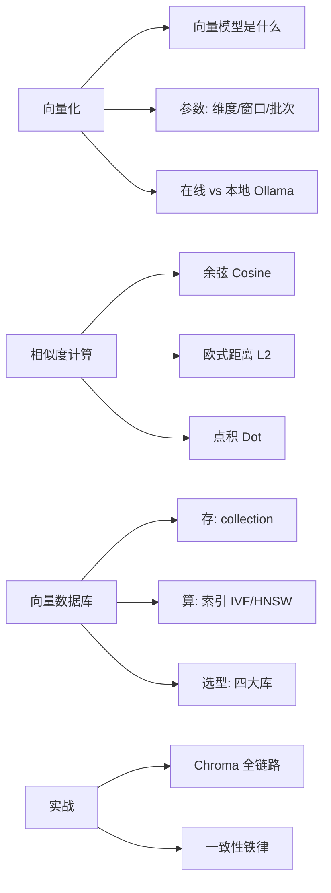
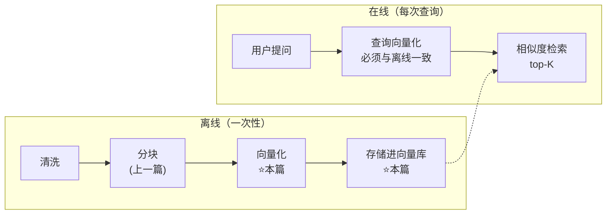
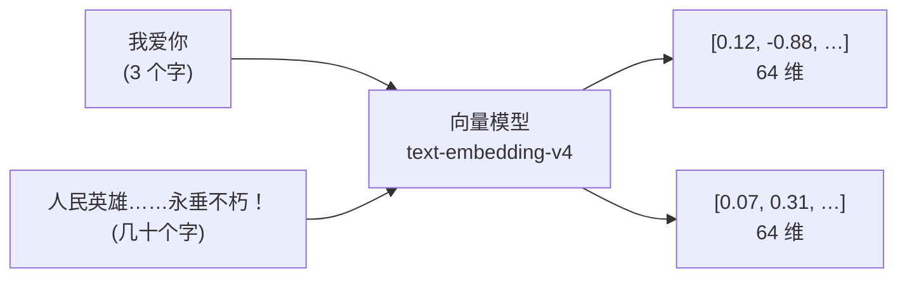
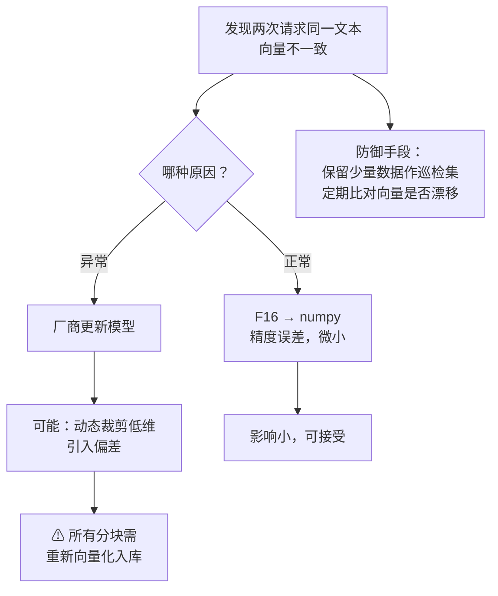
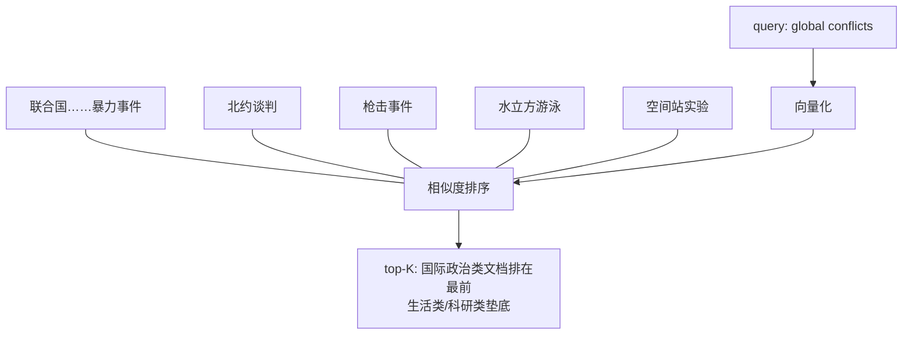
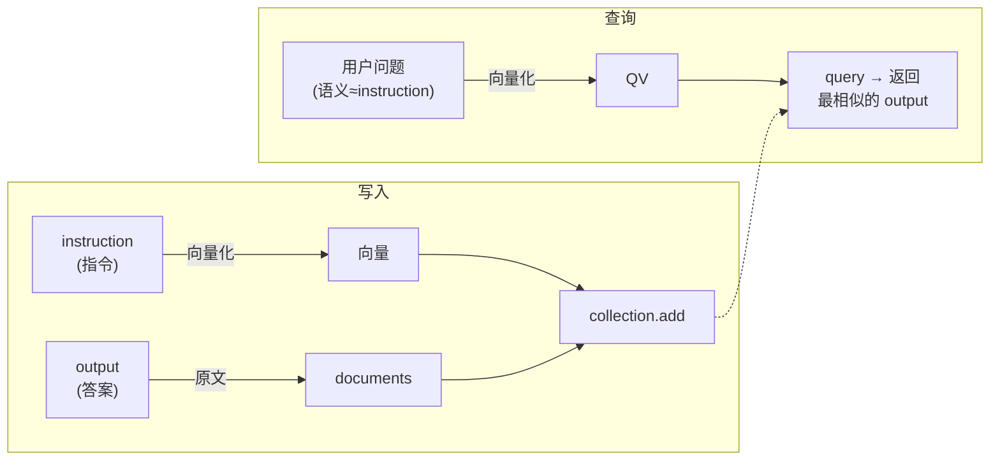
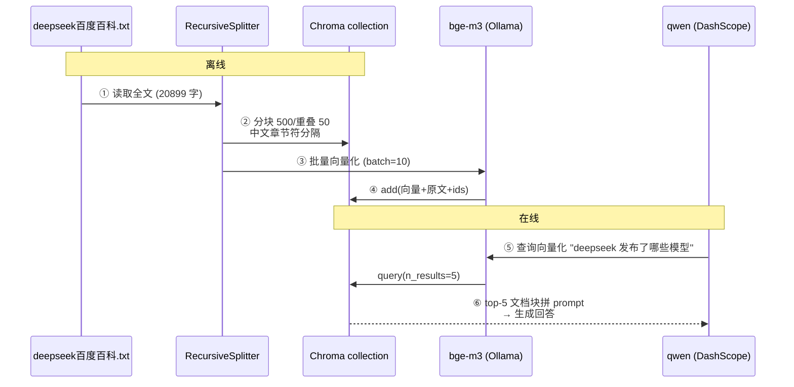

# 07 · 向量检索：Embedding、相似度计算与向量数据库

> [!tldr] 一句话
> 离线四步走到了第三步「向量化」和第四步「存储」：**文本块 → 向量模型 → 向量 → 向量数据库（HNSW 索引）**，查询侧用**同模型同维度**向量化后按相似度取 top-K。本篇的核心铁律只有一条：**查询和分块的向量化必须完全一致**。

## 📚 材料地图

| 材料 | 贡献了什么 |
|---|---|
| 202060716随堂笔记.txt | 向量模型参数解读、**在线模型向量会变**的原因与巡检、IVF/HNSW、一致性铁律 |
| L2-2 PPT（45 页） | 词向量概念、BGE-M3 介绍、Ollama 部署流程、相似度三法、四大向量库对比、Chroma API |
| `代码/Embedding/向量和Embeddings.py` | `dimensions` 参数、**不同长度文本 → 同维度向量**的验证 |
| `代码/Ollama/RAG_向量的相似度计算.py` | 余弦/欧氏距离实现 + **跨语言检索实验** |
| `代码/Ollama/RAG_Ollama.py` | ollama 嵌入接口、显存不足时 `num_gpu=0` |
| `代码/ChromaDB/ChromaDB使用1.py` | **MyVectorDBConnector 完整类** + 递归分块 + 全链路 RAG |
| `代码/ChromaDB/ChromaDB使用2.py` | **instruction 向量化、output 存原文**的分离技巧 |
| `models.py` | DashScope `text-embedding-v3/v4`、API-KEY 放系统变量的约定 |

## 🗺️ 知识地图



---

## 一、回顾：向量化在 RAG 流程中的位置

离线构建四步：**数据清洗 → 数据分块 → 向量化 → 存储**。本篇覆盖后两步；查询侧则是「用户提问 → 向量化 → 检索数据库 → top-K」。

> [!info] 为什么离线和在线都绕不开向量
> RAG 三个阶段里至少有两个和向量有关：索引阶段要把文本变成向量**保存**，检索阶段要做向量相似度计算。这两个活儿分别交给向量模型和向量数据库。



---

## 二、Embedding：把文字变成向量

### 2.1 什么是向量 / 词向量

数学上的向量：有大小和方向的量，可画成带箭头的线段。在 NLP 里，**一个词/一个文本块用一串数字表示**：

```text
"长沙" = [0.8, -0.3, 0.5, 0.34, 0.12, 1.78, 9.12, 2.34, -0.23, 0.5]   ← 10 维（示意）
"长沙" = [4, 2]                                                        ← 2 维（示意）
"长沙" = [5, 9, ……, -0.23, 0.5]   ← 1024 个数字组成（实际常用维度）
```

都可以——**维度本身没有定数，取决于向量模型**。向量检索的本质：根据用户输入，与向量数据库里存放的文本向量做相似度计算，返回最相似的内容。

### 2.2 向量模型：一个输入对应一个输出

> [!important] 向量模型与普通 LLM 的本质区别
> 向量模型的**训练过程**和普通大模型差不多，但**工作原理**不同：它不负责预测下一个词，只把输入的自然语言（语句、文本块）转成一个向量。
>
> **不论输入多长，输出始终是一个固定维度的向量** —— 一个输入（语句块）对应一个输出（向量）。

这意味着：向量模型本身的质量，**直接决定后续检索的上限**——它分不清的语义，检索永远找不回来。

课堂代码实测验证「长度无关、维度一致」：

```python
test_query = ["我爱你",
              "中国为了反对内外敌人，争取民族独立和人民自由幸福，"
              "在历次斗争中牺牲的人民英雄们永垂不朽！"]   # 两个字 vs 几十个字

vec = get_embeddings(test_query, model="text-embedding-v4", dimensions=64)
print(len(vec[0]), len(vec[1]))   # 64 64 —— 与文本长度无关
```



### 2.3 向量模型选型

| 语言 | 推荐模型 | 备注 |
|---|---|---|
| 中文 | **qwen-text-embedding**（阿里百炼） | 在线 API，支持 `dimensions` 参数 |
| 中文 | **bge-m3**（BAAI 智源） | 可 Ollama 本地部署，企业常用 |
| 英文 | text2vec | 课堂提及 |

> [!note] BGE-M3 的「3M」
> BGE-M3 是北京智源（BAAI）BGE 系列的成员，很多企业常用的优秀嵌入模型：
> - **多功能**（Multi-Functionality）：同时支持嵌入模型常用的检索功能
> - **多语言**（Multilinguality）：支持 100+ 种工作语言
> - **多粒度**（Multi-Granularity）：从短句子到最多 **8192 token** 的长文档都能处理

> [!tip] 选型不合适可以微调
> RAG 构建中发现公共开源向量模型不准确，可以考虑**微调**。判断是否需要微调的方法：**构建自己的测试集**去测试模型是否符合诉求，用数据说话，不凭感觉。

### 2.4 🔧 补充：为什么「语义」能被向量捕捉

向量模型在海量语料上训练后，**语义相近的文本在向量空间中距离更近**：「我爱你」和「我喜欢你」的向量几乎同向，「我爱你」和「股票行情」则相差很远。这就是后面能用余弦相似度做检索的原理。这也是为什么课堂实验里英文 query `"global conflicts"` 能召回中文文档「联合国就苏丹……发出警告」——bge-m3 是多语言模型，把两种语言映射到了**同一个向量空间**。

---

## 三、向量模型的参数解读

| 参数 | 含义 | 影响 |
|---|---|---|
| **向量维度** | 用多少个数字表示一个向量 | 维度越小 → 信息有限、省资源；维度越大 → 信息更丰富准确、但存储和检索消耗都增加 |
| **context window** | 单批次最大处理 token 数 | 超长文本会被截断，选型时注意分块长度要装得下 |
| **批次大小** batch size | 一次给向量模型的分块数量 | 批次 1：`['分块1']` → `[[向量1]]`；批次 3：`['分块1','分块2','分块3']` → `[[向量1],[向量2],[向量3]]` |

> [!warning] 维度不是越大越好
> 维度是**信息量与资源的权衡**。1000 万个 1024 维向量 vs 1000 万个 256 维向量，存储和检索成本差数倍。课堂演示中 `text-embedding-v4` 支持传 `dimensions=64`（低维演示用），生产常用 1024。

> [!note] batch_size 为什么要自己控制
> 各平台对**一次能处理的文本条数有限制且各不相同**。所以课堂代码专门写了 `get_embeddings_batch()`：按 batch_size 分批循环调用，结果 extend 拼接——`for i in range(0, len(texts), batch_size)`。

---

## 四、在线模型 vs 本地部署

### 4.1 ⭐ 在线向量模型的「向量漂移」问题

> [!important] 在线向量模型，向量会变
> 同一段文本，今天和上周请求同一个在线模型，返回的向量可能不一样。两个原因：
>
> 1. **正常情况**：模型最终输出 F16 浮点向量，转成 numpy 数组时**精度问题导致微小变化**
> 2. **非正常情况**：厂商**偷偷更新模型**

模型偷偷变更的两种可能解释：
- 单纯是 bug
- 新模型**不是原生支持** 1024/256 等低维度——低维向量是**动态裁剪**技术从原生维度裁出来的，裁剪会引入偏差



> [!danger] 由此推出的运维铁律
> 如果使用在线向量模型，**一旦模型发生变更，库里所有分块必须重新向量化入库**。应对方法：
> - **保留少数数据作为测试/巡检集**，定期请求比对向量，尽早发现漂移
> - 生产环境尽量把向量模型**本地化**（版本完全自己控），或者记录模型版本号、把重新向量化做成流水线

### 4.2 Ollama 本地部署

很多大模型可以本地部署，最方便的方式是 **Ollama**——一个专为本地便捷部署和运行大模型设计的开源框架。

```bash
ollama                          # 验证安装成功
ollama pull bge-m3              # 下载向量模型
ollama list                     # 查看本地已有模型

# 局域网内测试另一台机器的 ollama 是否可达
curl http://192.168.110.242:11434/api/tags
```

课堂代码调用：

```python
from ollama import Client
client = Client(host="http://127.0.0.1:11434")   # 11434 是 ollama 默认端口

def get_embedding(text, model_name="bge-m3", dimensions=1024):
    response = client.embed(
        model_name, text,
        dimensions=dimensions,
        # options={'num_gpu': 0}   # 有显卡但显存不足时，强制不用 GPU
    )
    return response['embeddings']
```

> [!tip] 概念区分：推理引擎 vs 向量模型
> Ollama、vLLM 这类叫**推理引擎**——大模型运行的**底座**，偏向底层。很多大厂会基于 Rust、Go 自研推理引擎。本地部署一般都依赖推理引擎；向量模型（bge-m3）只是跑在引擎上的模型之一。

### 4.3 两种方式怎么选

| 维度 | 在线 API（DashScope 等） | 本地 Ollama + bge-m3 |
|---|---|---|
| 质量 | 通常更好、维度可调 | 够用，多语言强 |
| 成本 | 按量付费 | 一次下载，吃自己显卡/CPU |
| **版本可控性** | ⚠ 可能偷偷更新 → 向量漂移 | ✅ 版本完全固定 |
| 运维 | 无 | 要管显存（`num_gpu=0` 可降级 CPU） |
| 数据安全 | 文本出网 | 数据不出内网 |

> [!note] 🔧 补充：与本项目的关系
> 你 ruoyi-chat 项目的 embedding 已从 OpenAI text-embedding-ada-002 迁到 DashScope——正好踩在「在线模型」这一栏，上面 4.1 的巡检与「模型变更需全量重建向量」两条对本项目同样适用；接入 Milvus（192.168.0.106）时，切换 embedding 模型同样意味着集合要全量重灌。

---

## 五、向量间的相似度计算

### 5.1 三种方法

| 方法 | 公式 | 方向 | 适合 |
|---|---|---|---|
| **余弦相似度** Cosine | $\cos(\theta)=\frac{A \cdot B}{\|A\|\|B\|}$ | **越大越相似**（范围 [-1,1]） | 关注方向不考虑长度，文本检索最常用 |
| **欧式距离** L2 | $d=\sqrt{\sum_{i}(A_i-B_i)^2}$ | **越小越相似** | 关注绝对位置差异 |
| **点积** Dot | $A \cdot B = \sum_{i} A_i B_i$ | 越大越相似 | **适合归一化后的向量** |

> [!note] 🔧 补充：为什么点积「适合归一化后的向量」
> 向量归一化（长度变为 1）后，分母 $\|A\|\|B\|=1$，余弦相似度**在数值上就等于点积**——所以归一化向量直接算点积更快，省掉两次开方。很多向量库内部就是这么优化的。

课堂实现（numpy 十行搞定）：

```python
import numpy as np
from numpy import dot
from numpy.linalg import norm

def cos_sim(a, b):
    '''余弦相似度 -- 越大越相似'''
    return dot(a, b) / (norm(a) * norm(b))

def l2(a, b):
    '''欧式距离 -- 越小越相似'''
    x = np.asarray(a) - np.asarray(b)
    return norm(x)
```

### 5.2 课堂实验：跨语言检索

```python
query = "global conflicts"          # 英文
documents = [
    "联合国就苏丹达尔富尔地区大规模暴力事件发出警告",     # ← 召回第 1
    "土耳其、芬兰、瑞典与北约代表将继续就瑞典“入约”问题进行谈判",
    "日本岐阜市陆上自卫队射击场内发生枪击事件 3人受伤",
    "国家游泳中心（水立方）：恢复游泳、嬉水乐园等水上项目运营",
    "我国首次在空间站开展舱外辐射生物学暴露实验",
]
```

要点：`cos_sim(query_vec, query_vec) == 1`（自己和自己的相似度为 1，可当校验基准）；英文 query 成功召回中文的国际争端类文档，验证了 **bge-m3 跨语言对齐到同一向量空间**的能力。



---

## 六、向量数据库

### 6.1 为什么需要专门的向量数据库

索引阶段产生海量向量需要保存、检索阶段要做海量相似度计算——**谁来存？谁来算？** 答案是向量数据库：专门设计用来**存储和查询向量嵌入数据**的数据库。

> [!important] 存储是基操，索引才是灵魂
> 为了提升查询效率，向量数据库要**提前按特定向量检索算法对数据构建索引**（数据库层面）。课堂提到两个算法：
> - **IVF**（笔记写作 TVF-IVF，即倒排文件索引）：先聚类分桶，查询只搜最近的几个桶
> - **HNSW**（分层可导航小世界图）：多层图结构，逐层跳着找
>
> **目前主流向量数据库都基于 HNSW。**（算法细节课后有录播，下一篇展开）

### 6.2 四大向量库对比（PPT 原始内容整理）

| | Pinecone | Milvus | Faiss | Chroma |
|---|---|---|---|---|
| 出身 | 闭源商业 | **中国公司 ZILLIZ 研发** | **Meta** AI 研究院 | 开源社区 |
| 开源 | ❌ | ✅ | ✅ | ✅ |
| 定位 | 全托管云服务 | 毫秒级搜索**十亿级**向量 | 库/工具集（非完整数据库） | **轻量级、易集成** |
| 亮点 | 重复检测、排名跟踪、分类 | 分布式、混合搜索、企业应用多 | 批量搜索多向量、多种距离度量、向量量化；**腾讯率先国内大规模应用**；适合图像检索和推荐 | Python 笔记本到集群同一套 API；LangChain 等框架原生支持 |
| 适合 | 不想运维 | 企业级生产 | 科研/大规模密集向量 | **中小项目、开发测试**（课堂实战用它） |

> [!tip] Faiss 严格说是「向量检索库」不是数据库
> Faiss 没有存储管理、持久化、增删改查服务那一套，它只负责**算得快**。所以要「数据库」语义时选 Milvus/Chroma，要「极致检索性能」时用 Faiss。🔧 补充

### 6.3 Chroma 实战（课堂主线）

**Client 层：**

```python
client = chromadb.Client()                          # 内存模式
client = chromadb.PersistentClient(path="路径")      # 持久化到磁盘

client.list_collections()                           # 2.1 列出
client.create_collection(name="xx", embedding_function=fn)  # 2.2 创建
client.get_collection(name="my_collection")         # 2.3 获取
client.get_or_create_collection(name="xx")          # 2.4 没有则建，有则取
client.delete_collection(name="my_collection")      # 2.5 删除
```

**Collection 层：**

```python
collection.add(
    documents=[...],            # 原始文本内容（可选）
    embeddings=[[...], [...]],  # 文档的向量表示（必须）
    ids=[...],                  # 每个文档的唯一 ID（必须）
)
results = collection.query(
    query_embeddings=[0.1, 0.2, ...],
    n_results=5,                # 返回前 5 个最相似
)
```

### 6.4 课堂代码精读：MyVectorDBConnector

`ChromaDB使用1.py` 把整条链路封装成一个类，值得整体记住：

```python
class MyVectorDBConnector:
    def __init__(self, collection_name):
        chroma_client = chromadb.Client(Settings(allow_reset=True))
        # 持久化改用: chromadb.PersistentClient(path="./chroma_data")
        self.collection = chroma_client.get_or_create_collection(
            name=collection_name,
            # 向量相似度计算方法： l2(默认), cosine, ip(点积)
            metadata={'hnsw:space': 'l2'})
        self.client = Client(host="http://127.0.0.1:11434")   # 本地 Ollama

    def get_embeddings_batch(self, texts, model="bge-m3",
                             batch_size=10, dimensions=1024):
        all_embeddings = []
        for i in range(0, len(texts), batch_size):
            batch_text = texts[i: i + batch_size]
            data = self.client.embed(
                input=batch_text, model=model,
                dimensions=dimensions)['embeddings']
            all_embeddings.extend(data)
        return all_embeddings

    def add_documents(self, documents):
        embeddings = self.get_embeddings_batch(documents)
        self.collection.add(
            embeddings=embeddings,        # 每个文档的向量
            documents=documents,          # 文档原文
            ids=[f"id{i}" for i in range(len(documents))],
        )

    def search(self, query, top_k):
        return self.collection.query(
            query_embeddings=self.get_embeddings_batch([query]),
            n_results=top_k)
```

> [!warning] `hnsw:space` 一旦选定就别换
> `l2` 是 Chroma 默认度量。**建 collection 时选了什么度量，后面所有查询都按它算**——写入和查询的度量不一致没有意义。改动等于重建集合。🔧 补充

### 6.5 变体实战：查询字段与答案字段分离 ⭐

`ChromaDB使用2.py` 处理 `train.json`（instruction/output 对）时有个精妙设计：

```python
instructions = [d['instruction'] for d in data]   # 会被查询 → 向量化
outputs      = [d['output'] for d in data]        # 对应答案 → 只存原文

vector_db.add_documents(instructions, outputs)
#   add(instructions, outputs):
#     embeddings = 向量化(instructions)     ← 用 instruction 算向量
#     collection.add(embeddings=…,
#                    documents=outputs,     ← 存的却是 output
#                    ids=…)
```



> [!important] 这个模式价值很大
> **用什么字段算向量，决定了「按什么语义搜」；documents 存什么，决定了「搜到后返回什么」。** 两者可以不同——FAQ 场景用「问题」建索引、返回「答案」正是这个套路。很多检索质量问题（搜到了却答非所问）根因就是拿错误字段去算向量。🔧 补充

---

## 七、全链路串联：从 txt 到 RAG 回答

`ChromaDB使用1.py` 一共六步，就是上一篇「Naive RAG 流程」的代码化：



课堂用的分块参数（中文文档）：

```python
splitter = RecursiveCharacterTextSplitter(
    chunk_size=500,     # 分割长度
    chunk_overlap=50,   # 重叠窗口
    separators=["\n\n", "\n", "。", "?", "，", ""],  # 中文标点前置
)
```

生成的防幻觉 prompt 模板也值得抄走：

```text
你是一个问答机器人。
你的任务是根据下述给定的已知信息回答用户问题。
确保你的回复完全依据下述已知信息。不要编造答案。
如果下述已知信息不足以回答用户的问题，请直接回复"我无法回答您的问题"。

已知信息:
{contents}
----
用户问：
{user_query}
请用中文回答用户问题。
```

---

## 八、铁律与高频坑

> [!danger] 一致性铁律（本篇最重要）
> **查询的向量化和分块的向量化必须保持一致——包括模型和维度都要一致。**
> 不同模型的向量空间互不相通（连维度都可能不同），拿 A 模型的查询向量去 B 模型的库里检索，结果等于随机数。

| # | 坑 | 后果 / 解法 |
|---|---|---|
| 1 | 在线模型偷偷更新 | 向量漂移 → 全量重新向量化；保留巡检集定期比对 |
| 2 | 低维 ≠ 原生低维 | 动态裁剪引入偏差，能选原生维度就选原生 |
| 3 | batch 不控制 | 各平台单次条数限制不同，统一走 `get_embeddings_batch` |
| 4 | 显存不足 | Ollama 加 `options={'num_gpu': 0}` 降到 CPU |
| 5 | 忘记 `PersistentClient` | `chromadb.Client()` 只存内存，进程结束数据没了 |
| 6 | `hnsw:space` 乱选 | l2/cosine/ip 建库即定，写入查询度量必须同源 |
| 7 | 拿答案字段算向量 | 应该拿「会被查询语义命中的字段」（问题/instruction）做向量化 |
| 8 | 换 embedding 模型不清库 | 新模型向量 + 旧模型向量混存 → 检索错乱，必须重建集合 |

---

## 九、术语速查

| 术语 | 英文 | 一句话解释 |
|---|---|---|
| 嵌入/向量化 | Embedding | 把文本映射为固定维度浮点向量 |
| 词向量 | Word/Text Vector | 用一串数字表示一个词/句/块 |
| 向量维度 | Dimension | 向量里数字的个数 |
| 上下文窗口 | Context Window | 单批次最大处理 token 数 |
| 批次大小 | Batch Size | 一次送给模型处理的文本条数 |
| 余弦相似度 | Cosine Similarity | 夹角余弦，越大越相似 |
| 欧式距离 | Euclidean / L2 | 空间直线距离，越小越相似 |
| 点积 | Dot Product / Inner Product (ip) | 归一化后等价于余弦 |
| 倒排文件索引 | IVF | 聚类分桶的检索算法 |
| 分层可导航小世界图 | HNSW | 主流向量库的索引结构 |
| 动态裁剪 | Matryoshka / Dynamic Truncation | 从原生维度裁出低维向量，可能引入偏差 |
| 推理引擎 | Inference Engine | Ollama/vLLM 等大模型运行底座 |
| 向量漂移 | Vector Drift | 同一文本不同时间得到不同向量 |

## 十、自检问答

> [!question]- 为什么「我爱你」和长文本得到的向量维度一样？
> 向量模型的工作方式是「一个输入 → 一个输出（固定维度向量）」，输出维度由模型决定，与输入长度无关。这正是不管多长的文本块都能放进同一个向量库检索的前提。

> [!question]- 在线模型返回的向量每次不一样，一定是厂商改模型了吗？
> 不一定。正常情况下 F16 → numpy 的精度转换就会带来微小差异；只有差异显著且持续时才大概率是模型变更（可能是动态裁剪低维引入偏差）。用巡检集定期比对来区分。

> [!question]- 余弦、L2、点积选哪个？
> 文本检索默认余弦；向量已归一化时用点积（等价且更快）；关心绝对距离差异（如图像特征）时用 L2。Chroma 建库时用 `metadata={'hnsw:space': ...}` 指定，默认 l2。

> [!question]- 换了 embedding 模型，向量库里的旧数据还能用吗？
> 不能。不同模型的向量空间互不相通，必须全部重新向量化重建集合。这也是「一致性铁律」的推论。

> [!question]- FAQ 场景该拿问题还是答案去算向量？
> 拿**问题**算（向量化 instruction），答案只存 documents。因为用户查询的语义和「问题」同分布，和「答案」往往不同构。

---

## 附：环境备忘

- 课程环境：Python 3.11、LangChain 1.0；依赖以老师 `requirements.txt` 为准（chromadb==1.5.8、ollama==0.6.1、langchain-text-splitters==1.1.2）
- API-KEY 统一放**操作系统系统变量**（`DASHSCOPE_API_KEY`），代码从环境变量读取，不硬编码
- Ollama 默认端口 `11434`；局域网测试 `curl http://主机:11434/api/tags`
