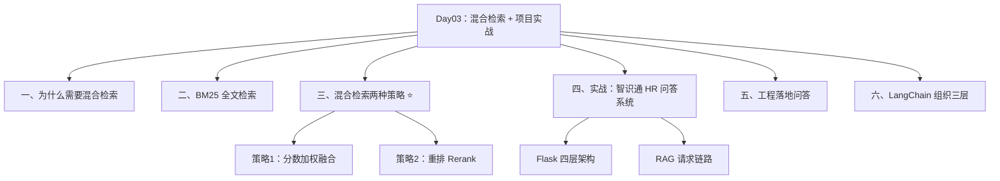
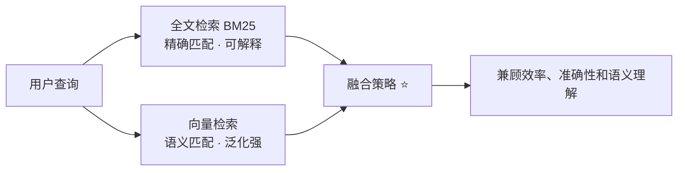
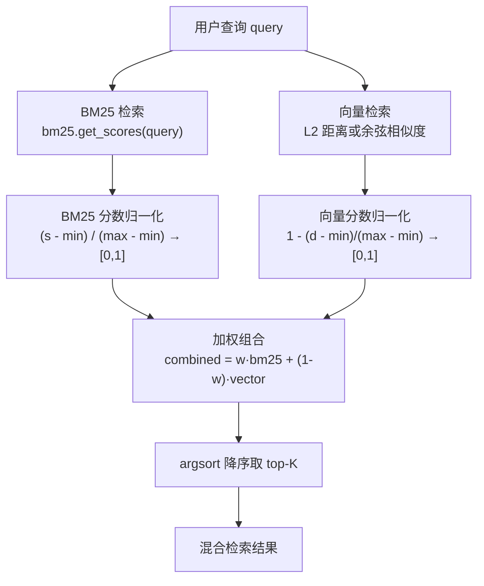
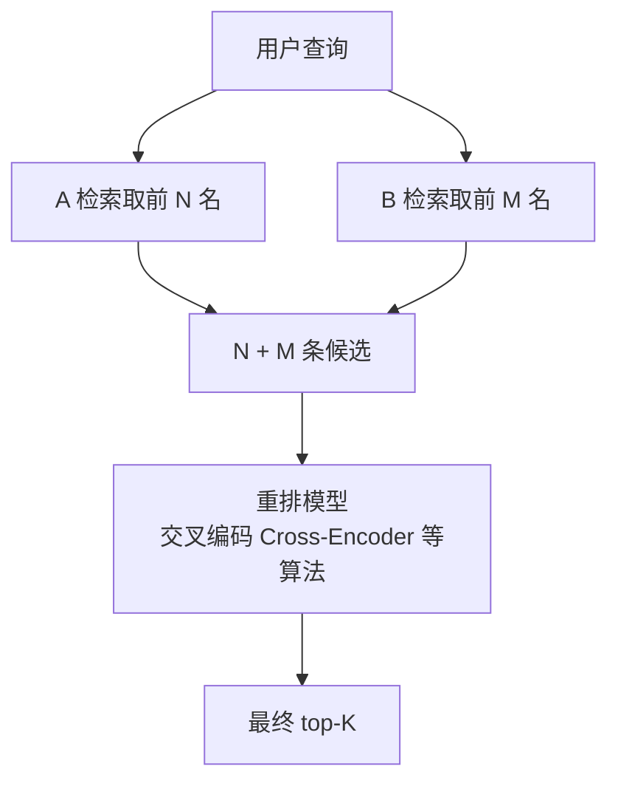
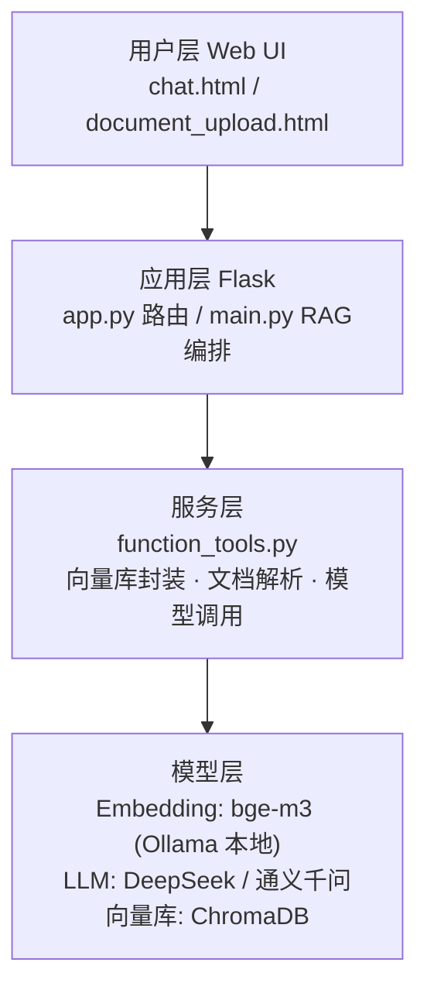
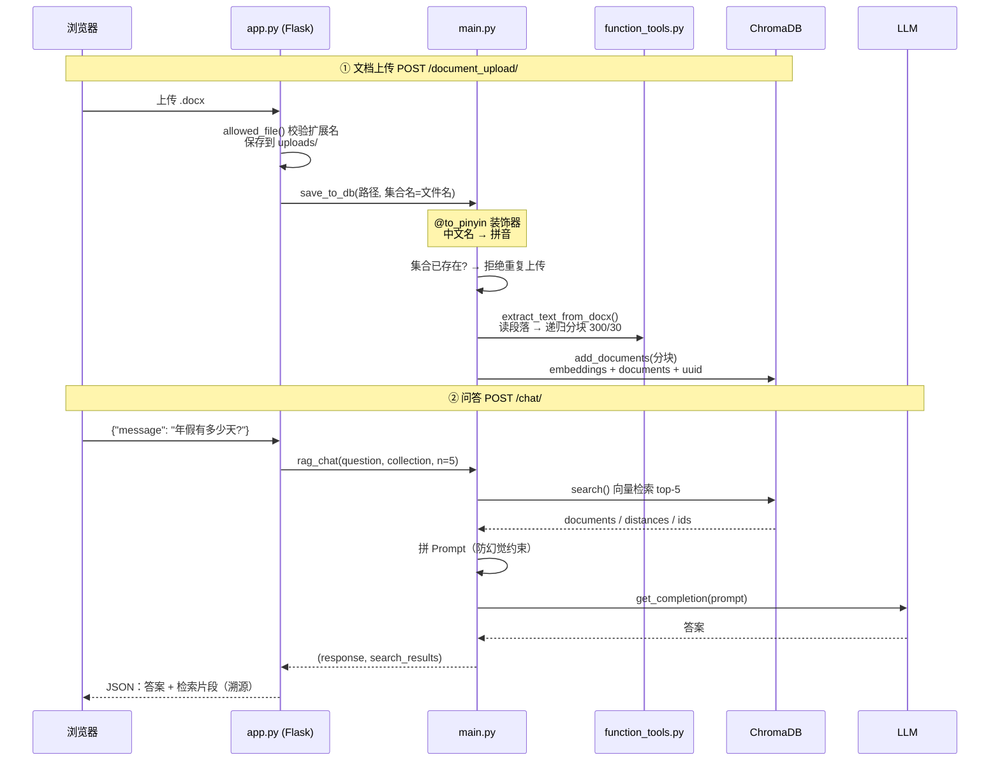
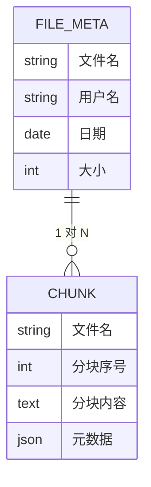
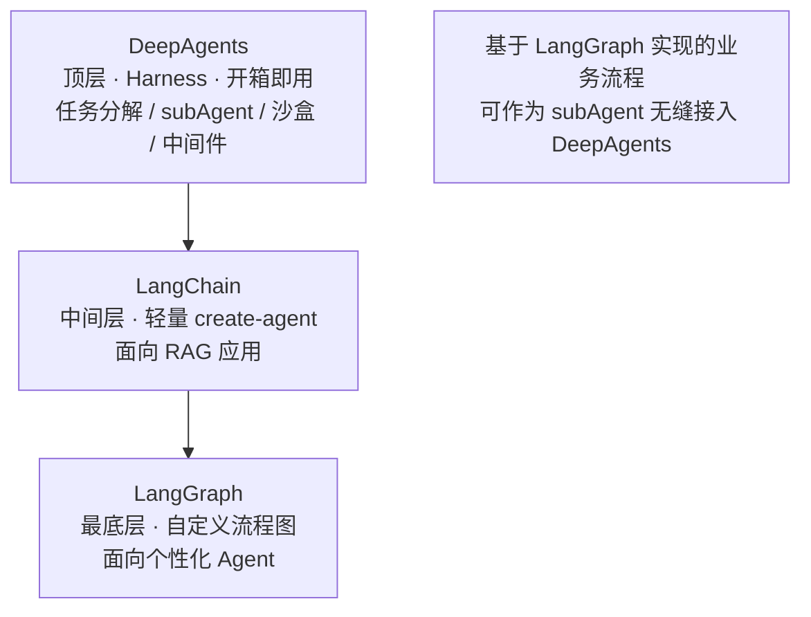

# L2-Day03 混合检索与 Naive RAG 项目实战

> [!abstract] 这一篇讲什么
> Day01 讲了「怎么分块」，Day02 讲了「怎么向量化、怎么用向量库」，Day03 把两者拼起来做**两个完整的东西**：
> 1. **混合检索（Hybrid Search）**——BM25 全文检索 + 向量语义检索，解决单一检索方式的局限；
> 2. **「智识通」HR 智能问答系统**——一个能上传文档、能问答的完整 Flask 项目（Naive RAG 全流程落地）。

## 📚 材料地图

| 材料 | 位置 | 贡献 |
|---|---|---|
| 随堂笔记 | `202060720随堂笔记.txt` | 混合检索动机、归一化、加权公式与 0.7 经验值、**加权失效场景**、重排思路、去重策略、落地问答、LangChain 组织三层 |
| 课程 PPT（54 页） | `L2-3-NaiveRAG构建流程与应用实践-3.pptx` | 三种检索技术对比、全文检索 vs 向量检索、BGE-M3、向量库对比、Chroma API、两个实战 |
| 产品说明文档 | `智识通--产品说明文档.md/pdf` | 项目定位、四层架构、技术栈版本、API 接口、配置参数 |
| 代码 | `L2Project03/` | `bm25_search.py`、`hybrid_search.py`、`RAG_Project/`（app.py / main.py / function_tools.py） |

## 🗺️ 知识地图



---

## 一、为什么需要混合检索

> [!important] 核心动机
> **任何一种检索方式都有优点和缺点（局限性）。** 当构建 VectorRAG（Naive RAG）时，如果发现**向量检索的结果不理想**，就可以考虑混合检索来提升效果。目前除向量检索外比较好的方案就是**全文检索，代表算法 BM25**。

### 1.1 信息检索领域常用的三种技术

| 技术 | 原理 | 优点 | 缺点 |
|---|---|---|---|
| **关键字检索** | 文本中查找特定关键字，事先建关键字索引 | 检索速度快 | 只能精确匹配关键字本身 |
| **全文检索**（BM25/TF-IDF） | 对**所有词汇**建索引，查询先分词，再按词频/逆文档频率等统计特征计算匹配度 | 更全面、更准确；**得分计算透明、可解释** | 停留在词级/短语级匹配，**无法理解语义**（“计算机”和“电脑”是两个词，除非配同义词库） |
| **向量相似度检索** | 文本 → 语义向量 → 空间距离 | **语义级理解**（同义词、上下文、泛化） | 向量是语义的**黑盒表征**，结果难以直观解释 |

> [!tip] PPT 原文的经典例子
> - 查询「如何修复**笔记本**故障」 vs 文档「**电脑**主板维修指南」→ 向量检索因语义相似判为高相关，全文检索则匹配不上；
> - 反过来，查询某个**精确的产品编号、人名、条款编号**时，全文检索往往比向量检索准。

### 1.2 结论：两者互补 → 混合架构



---

## 二、BM25 全文检索

### 2.1 BM25 是什么

**BM = Best Matching（最佳匹配），更新到了第 25 版**。它基于关键词的**统计特征**（词频 TF、逆文档频率 IDF、文档长度归一化等）计算查询与文档的匹配得分，得分计算过程透明。

### 2.2 最小示例（`bm25_search.py`）

```python
from rank_bm25 import BM25Okapi
import jieba

corpus = ["这是第一个文档", "这是第二个文档", "这是第三个文档"]

# ① 中文必须先分词（jieba.lcut 返回词列表）
tokenized_corpus = [jieba.lcut(doc) for doc in corpus]
# [['这是','第一个','文档'], ['这是','第二个','文档'], ['这是','第三个','文档']]

# ② 用分词后的语料库初始化 BM25 对象（内部预计算统计信息）
bm25 = BM25Okapi(tokenized_corpus)

# ③ 查询同样要分词
tokenized_query = jieba.lcut("第一个文档")

# ④ 计算查询与每篇文档的得分 / 直接取 top-n
scores = bm25.get_scores(tokenized_query)
top_n  = bm25.get_top_n(tokenized_query, corpus, n=1)   # ['这是第一个文档']
```

> [!warning] 两个易错点
> 1. **文档和查询都必须分词**，且要用**同一个分词器**——语料用 jieba 切、查询用空格切，得分就全乱了。这和 Day02 的「查询与分块必须同模型同维度」是同一条一致性铁律在全文检索上的翻版。
> 2. 中文分句/分词**不能用 NLTK**（它是为英文设计的），中文场景用 jieba。

---

## 三、混合检索  ⭐

### 3.1 策略一：分数加权融合（代码实现的就是这种）

#### 整体流程



#### 归一化的目的（随堂笔记原文）

- **统一比例（scale）**：BM25 分数和向量距离的量纲完全不同，直接加权没有意义；
- **统一分数区间到 [0,1]**：分数数值变了，但**原有的排名并没有发生变化**（min-max 归一化是单调变换）。

#### 加权公式与经验权重

```python
combined_scores = bm25_weight * bm25_scores_normalized \
                + (1 - bm25_weight) * vector_scores_normalized
```

> [!tip] 权重取值
> **落地默认以 0.7（偏 BM25）为主，但最终要以实际测试结果为准。** 课程代码 `hybrid_search.py` 里演示用的是 0.5。

#### ⚠️ 加权的前提假设（随堂笔记重点，容易忽略）

加权融合建立在**两种检索的结果都具备一定可信度、且两者差异没有想象中大**的基础上。

如果某种检索**明显优于**另一种，加权会失效：

> 假设 BM25 效果明显优于向量检索——归一化之后，BM25 的**最后几名**分数依然排不进向量检索的**前几名**之上。也就是说，归一化只统一了区间，**救不了整体质量差的那一路**，加权反而把坏结果混进了好结果。

#### 代码走读（`hybrid_search.py` 精华）

```python
# ---- BM25 侧：分数归一化 ----
bm25_scores = np.array(bm25.get_scores(tokenized_query))
bm25_scores_normalized = (bm25_scores - bm25_scores.min()) / \
                         (bm25_scores.max() - bm25_scores.min())

# ---- 向量侧：注意是"距离"，越小越相似，所以反过来 ----
vector_scores = np.linalg.norm(query_emb - doc_embs, axis=1)      # 欧氏距离
vector_scores_normalized = 1 - (vector_scores - vector_scores.min()) / \
                              (vector_scores.max() - vector_scores.min())
#                    ↑ 距离转相似度：1 - 归一化距离

# ---- 融合 + 排序 ----
combined = 0.5 * bm25_n + 0.5 * vector_n
top_index = combined.argsort()[::-1]        # 降序索引
results   = np.array(outputs)[top_index[:top_k]]
```

> [!warning] 别搞混"分数"和"距离"
> BM25 的 `get_scores` 返回的是**得分**（越大越好），向量侧返回的 `np.linalg.norm` 是**距离**（越小越好）。所以向量侧归一化时要用 `1 - ...` 反转方向，否则两路信号打架，融合结果必然出错。

#### 数据集与「一进一出」模式的复用

`hybrid_search.py` 用的是医疗数据集 `train.json`（40 条）：`instruction` = 症状描述，`output` = 症状解释/治疗方案。

- **BM25 对 instructions（问题）建索引**；
- **向量侧对 instructions 算向量**（`add_documents(instructions, outputs)`：向量来自问题，`documents` 存的却是 outputs 原文）。

这正是 Day02 笔记 6.4 的 **⭐ instruction 算向量、output 存原文** 分离模式——检索发生在"问题空间"，回答输出的是"答案原文"。演示查询「嘴唇肿起来了，怎么办啊」能同时命中两路检索。

### 3.2 策略二：重排 Rerank

随堂笔记给出的另一条路：



**两种策略对比**：

| | 加权融合 | 重排 Rerank |
|---|---|---|
| 原理 | 两路分数归一化后线性组合 | 两路候选合并后交给**重排模型**统一打分 |
| 是否需要额外模型 | 不需要 | 需要 Rerank 模型（交叉编码器） |
| 前提假设 | 两路可信度相当 | 无此要求（重排模型自己判断） |
| 成本 | 低，纯数学运算 | 高（N+M 条都要过一遍模型） |

> [!important] 混合检索的代价
> **混合检索的目标是提升检索效果，会牺牲性能**——两路都要查、融合/重排还要额外计算。这是典型的"效果换速度"。

### 3.3 存储要求

混合检索对存储的要求：

- **向量**放在**向量数据库**（Chroma/Milvus…）；
- **文本**放在**支持全文检索的数据库**（Elasticsearch、PostgreSQL tsvector，或课程里直接用 rank_bm25 在内存里建索引）。

> [!note] 🔧 补充：生产上的常见组合
> 课程代码为教学把 BM25 索引放在内存里（每次运行重建）。生产环境通常是 **Milvus/Chroma 存向量 + Elasticsearch/OpenSearch 存全文**，两路写入时保持同一批 chunk id，检索后按 id 对齐融合。Milvus 2.4+ 也内置了 BM25 稀疏检索，可以做单库混合检索。

---

## 四、实战：智识通——HR 制度智能问答系统

### 4.1 项目定位

**基于 Naive RAG 的企业级智能知识库问答系统（v1.0）**：上传 Word 文档 → 自动分块 → 向量化入库 → Web 问答。课程强调：**这个项目的目的是帮助零基础学员理解"面向过程的演示代码"向"工程化"转化的基本分解思路**。

### 4.2 四层架构



| 技术栈 | 选型 | 说明 |
|---|---|---|
| Web 框架 | Flask | 轻量，三个路由搞定 |
| 向量库 | ChromaDB（PersistentClient 持久化） | 数据落 `./chroma/chroma.sqlite3` |
| Embedding | **bge-m3（Ollama 本地部署）** | 代码默认走本地 Ollama，在线 text-embedding-v4 被注释保留 |
| LLM | DeepSeek（`deepseek-v4-flash`）/ 通义 | 兼容 OpenAI 接口，temperature=0 |
| 分块 | `RecursiveCharacterTextSplitter` | chunk_size=300，overlap=30 |
| 文档解析 | python-docx | 只支持 .docx（PDF 开发中） |

### 4.3 请求链路



### 4.4 值得学的工程细节

| 细节 | 代码位置 | 学到什么 |
|---|---|---|
| **`@to_pinyin` 装饰器** | function_tools.py | 中文文件名 → 拼音再当集合名（"人事管理流程.docx"→"renshiguanliliuchengdocx"），规避部分存储不支持中文标识符的问题。装饰器用法 ≈ Java 注解 + AOP |
| **集合存在性检查** | `collection_exists()` | 上传前先查 `list_collections()`，同名直接拒绝——这就是 Day03 随堂笔记「RAG 更新要考虑去重」在项目里的最小落地 |
| **防幻觉 Prompt 模板** | main.py `rag_chat` | 「只依据已知信息回答；信息不足就直说无法回答」三句约束 + 明确分隔已知信息与问题 |
| **temperature=0** | get_completion | 知识库问答要确定性输出，不要创造性 |
| **溯源返回** | `rag_chat` 返回 `(response, retrieved_docs)` | 把检索到的原始片段一并返回给前端，回答可追溯 |
| **批量向量化** | `get_embeddings_batch(batch_size=10)` | 各平台单次请求条数有限制，分批处理 |
| **切换知识库** | `/collection/` 路由 | 每个文档一个 collection，按文件名切换检索范围 |

> [!example] 核心防幻觉 Prompt（可直接抄）
> ```text
> 你是一个专业的企业知识库问答助手。
> 你的任务是根据下述给定的已知信息回答用户问题。
> 请确保你的回复完全依据下述已知信息，不要编造答案。
> 如果下述已知信息不足以回答用户的问题，请直接回复"根据现有资料，我无法回答您的问题"。
>
> 【已知信息】: {info}
> 【用户问题】：{user_query}
> ```

### 4.5 项目现状与改进建议（随堂笔记问答 ①）

**问：上传的文件如何处理？** 项目现状：**没做处理**（原文件堆在 uploads/）。建议：

- 重命名、定期清理；
- **将分块之后的数据单独存储**，包括分块数据和元数据，其中**一定要有文件名、分块序号**。设计两张表：



---

## 五、工程落地问答（随堂笔记问题集锦）

### 5.1 RAG 更新的去重策略（三档，由差到好）

| 策略 | 做法 | 评价 |
|---|---|---|
| ① 文件名 → 集合名 | 同名即同文件 | **最原始、效果最差**（改名就漏） |
| ② 提取文件前 N 字节 | 内容前缀比对 | 稍好，但前缀相同的文件会误判 |
| ③ **哈希算法（MD5 摘要）** | 对全文算摘要比对 | **推荐**：内容变一点摘要就完全不同 |

### 5.2 RAG 如何区分哪个是哪个文档？

> 随堂笔记原话：**文档不是通过 RAG 来区分，而是通过设计 + 代码来实现。**

- **存储的区分**：向量库地址（不同库）/ collection 名称 / **元数据（metadata）**；
- **读取的区分**：由代码实现（查询时指定 collection 或过滤条件）。

### 5.3 落地思路（需求 → 设计）

1. 业务需求收集、分析；
2. 了解大模型技术层面的信息：RAG 是什么、解决什么问题；
3. 判断需求中哪些环节用大模型、哪些环节用 RAG——**泛化、非确定性（方向、指向）的任务才考虑大模型；大模型因知识缺乏无法解答的用 RAG**；
4. 概要设计和详细设计。

### 5.4 标准测试集

标准测试集的构建是**业务不断积累的过程**——不是上线前一次性补齐，而是随问答 badcase 持续沉淀（与 L2 第 4 章「RAG 评估」衔接）。

---

## 六、LangChain 组织的三层工具（随堂笔记）

| 层 | 定位 | 面向 |
|---|---|---|
| **DeepAgents** | 顶层，相对更重。基于 Harness 思想提供**开箱即用的 agent 实例**，封装任务分解、tool 链、subAgent、skills、内存管理、文件系统、沙盒、中间件 | 开箱即用的深度 Agent |
| **LangChain** | 中间层。基于 LangGraph 封装了轻量级 create-agent，**主要面向 RAG 应用** | RAG 应用开发 |
| **LangGraph** | 最底层。自定义流程（图）用它，**面向个性化 Agent 实现** | 自定义工作流 |



---

## 七、术语速查

| 术语 | 英文 | 一句话解释 |
|---|---|---|
| 全文检索 | Full-Text Search | 对全部词汇建索引，按统计特征（TF-IDF/BM25）匹配 |
| BM25 | Best Matching 25 | 经典全文检索打分算法，第 25 版 |
| 混合检索 | Hybrid Search | 全文检索 + 向量检索组合使用 |
| 归一化 | Normalization | 把不同量纲的分数映射到统一区间（如 [0,1]），不改变排名 |
| 加权融合 | Weighted Fusion | `w·A + (1-w)·B` 的线性组合 |
| 重排 | Rerank | 用重排模型对候选集（N+M）统一重新排序 |
| 交叉编码 | Cross-Encoder | 查询与文档拼在一起送入模型打分，精度高、速度慢 |
| 语义检索 | Semantic Search | 基于向量空间距离的检索，能理解同义/上下文 |
| 关键字检索 | Keyword Search | 直接匹配关键字，速度最快、能力最弱 |
| 集合 | Collection | 向量库中存储向量+原文+元数据的容器，≈ 一张表 |
| 摘要算法 | Hash / MD5 | 内容指纹，用于文件级去重 |
| 知识库 | Harness（DeepAgents 语境） | 开箱即用 agent 运行框架的封装思想 |

---

## 八、自检问答

> [!question]- 1. 为什么混合检索前必须先做归一化？
> BM25 分数和向量距离/相似度量纲不同、数值范围不同，直接加权会导致某一方的数值尺度主导结果。min-max 归一化统一到 [0,1]，且作为单调变换**不改变各路内部的排名**。

> [!question]- 2. 加权融合在什么情况下会失效？
> 当两路检索可信度差异悬殊时。例如 BM25 明显更好，则归一化后 BM25 的最后几名依然比不过向量检索的前几名，线性加权会把质量差的一路混进结果——此时应改用重排（Rerank）策略。

> [!question]- 3. 向量侧的分数为什么要 `1 - 归一化距离`？
> `np.linalg.norm` 算出的是欧氏距离，**越小越相似**；而 BM25 得分越大越好。融合前必须统一方向，用 `1 - (d-min)/(max-min)` 把距离转成"越大越相似"的相似度，否则两路信号方向相反，融合结果错误。

> [!question]- 4. 智识通项目里 BM25 索引和向量分别在"哪一侧"参与检索？
> 都作用于 `instruction`（症状描述/问题）：BM25 对 instructions 分词建索引；向量库中对 instructions 算 embedding、documents 字段存 outputs（答案原文）。检索发生在问题空间，输出答案原文——即 Day02 的「instruction 算向量、output 存原文」分离模式。

> [!question]- 5. 项目用文件名当集合名有什么问题？怎么改进？
> 文件名去重是最差策略（改名即重复入库）；且项目现状完全没有管理上传文件。改进：元数据表 + 分块表分开存（带文件名和分块序号），去重升级为 MD5 全文摘要比对。

> [!question]- 6. `@to_pinyin` 装饰器解决了什么问题？
> 部分存储/文件系统对中文标识符支持不稳，把中文集合名转成拼音字符串再入库。同时它是 Python 装饰器（`@wraps` 保留元信息）的标准教学案例。

---

## 九、与其他笔记的关联

- [[6-NaiveRAG构建流程与文档分块]]：Day01 的分块四策略 → 本篇项目里 `RecursiveCharacterTextSplitter(300, 30)` 的真实落地；
- [[7-向量化与向量检索-Embedding相似度与向量数据库]]：Day02 的「instruction 算向量、output 存原文」「一致性铁律」在本篇混合检索代码里直接复用；bge-m3 本地部署在本篇变成默认方案；
- 后续 Day04+：RAG 痛点分析与 Advanced RAG（本篇的混合检索其实就是 Advanced RAG 的检索优化手段之一）、RAG 评估（对应 5.4 测试集）。

> [!info] 环境
> Python 3.11 · `pip install -r requirements.txt`（rank_bm25 / jieba / chromadb / langchain-text-splitters / flask / python-docx / pypinyin / ollama）· 本地 Ollama 跑 bge-m3 · API-KEY 放系统环境变量（`DEEPSEEK_API_KEY` / `DASHSCOPE_API_KEY`）。
