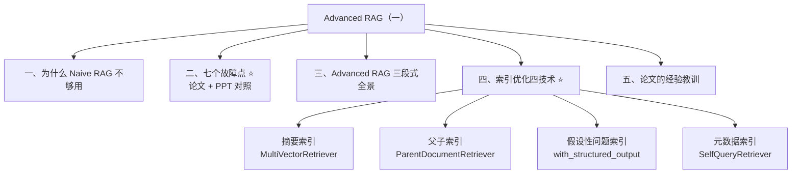
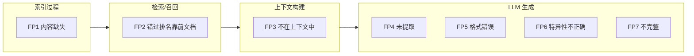
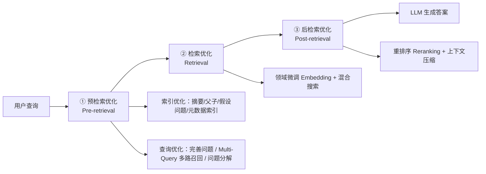
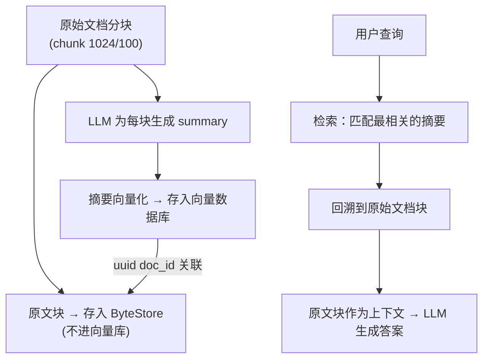
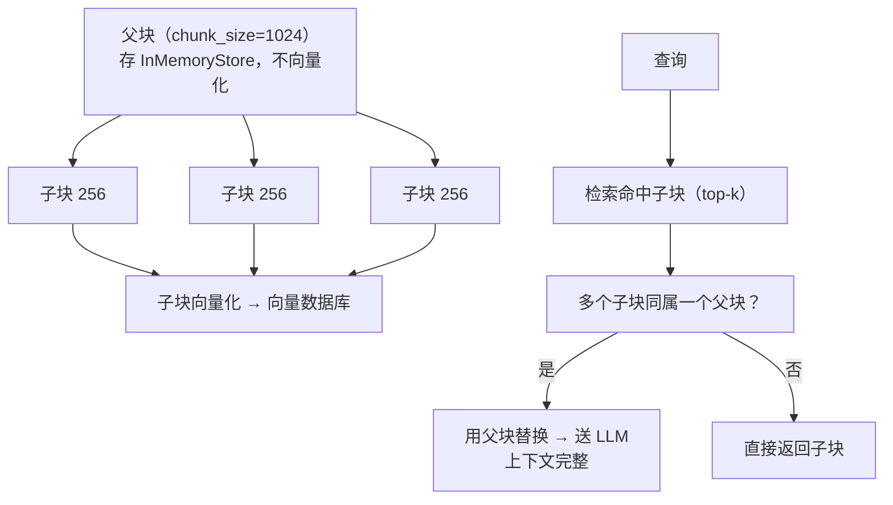
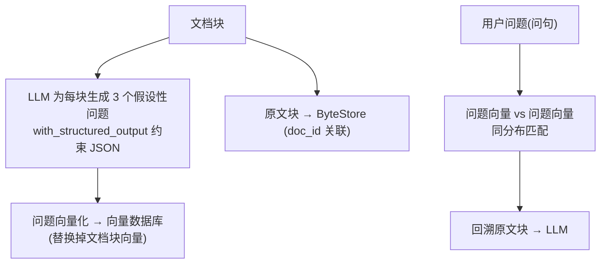

# L2-Advanced RAG（一）RAG 痛点分析与高级索引技术

> [!abstract] 这一篇讲什么
> 前三篇（6/7/8）把 **Naive RAG** 的完整链路走通了。这一篇开始进入 **Advanced RAG**：先借一篇论文（《Seven Failure Points》）把 RAG 的**七个故障点**讲透——知道系统会在哪里坏，再对症下药；然后展开 **Pre-Retrieval 阶段的四种高级索引技术**：摘要索引、父子索引、假设性问题索引、元数据索引，每种都配 LangChain 代码。

## 📚 材料地图

| 材料 | 位置 | 贡献 |
|---|---|---|
| 课程 PPT（34 页） | `3、基于LangChain的RAG系统优化实践.pptx` | 痛点分析框架、七故障点逐一拆解、Advanced RAG 三段式、四种索引技术思路与场景表 |
| 论文中文全译 | `设计检索增强生成系统时的七个故障点.docx` | CAIN 2024 论文原文：三个案例研究、7 个故障点的严格定义、经验教训、研究方向 |
| 代码 | `1.summary.py` 等 4 个 | 四种索引技术的 LangChain 最小实现 |

## 🗺️ 知识地图



---

## 一、RAG 商业化痛点：链路视角

PPT 的开篇框架：RAG 链路分两个过程，痛点会**沿链路传导**。

| 过程 | 内容 | 痛点特点 |
|---|---|---|
| **索引过程** | 内容加载 → 文本切分 → 向量化 → 索引构建 | 知识库质量的核心基石；**质量缺陷会向下传导**，对最终问答产生不可逆的负面影响 |
| **查询过程** | 查询理解 → 相似度匹配 → 上下文构建 → LLM 生成 | 决定检索响应的效率与精准度 |

> [!important] 核心判断（PPT 原文）
> **RAG 失败通常不是单点故障，而是"知识是否存在 → 能否召回 → 上下文是否可用 → LLM 是否按要求输出"的链路问题。** 所以优化不能割裂进行，必须覆盖索引与查询两大过程的每一个环节——这就是"系统性全链路优化"（Advanced RAG）的由来。

---

## 二、七个故障点 ⭐

### 2.1 论文信息卡

| 项目 | 内容 |
|---|---|
| 论文 | 《Seven Failure Points When Engineering a Retrieval Augmented Generation System》 |
| 作者/机构 | Scott Barnett 等 5 人，迪肯大学应用人工智能研究所（澳大利亚） |
| 发表 | CAIN 2024（第 3 届 AI 工程国际会议——AI 软件工程），arXiv:2401.05856 |
| 实证规模 | BioASQ 实验：**15,000 文档索引、1000 个问答对、GPT-4 生成 + OpenAI Evals 验证** |
| 两大要点 | ① RAG 系统的验证**只有在实际操作中才可行**（上线前没有现成测试数据）；② RAG 的**鲁棒性是逐步演进的，不是一开始设计出来的** |

### 2.2 七个故障点全景



### 2.3 逐一拆解（论文定义 + PPT 分析 + 对策）

#### FP1 内容缺失（Missing Content）

- **定义**：问的问题在可用文档里**根本找不到答案**。理想情况系统应回"抱歉，我不知道"，但对"与内容相关却没有答案"的问题，系统可能**被欺骗给出响应**。
- **PPT 分析**：这是 RAG 幻觉的**根本原因**——知识超出覆盖范围后，模型退回预训练的"幻觉模式"，用碎片信息拼凑**看似合理**的答案（逻辑闭环假象）；模型无法准确判断"不知道"（知识边界模糊）。
- **对策（三重防线）**：① **增补**——识别缺失领域，注入权威新知识源；② **清洗**——剔除噪声、重复与错误数据；③ **约束**——Prompt 明确指令"未知即说不知道"。

#### FP2 错过排名靠前的文档（Missed Top Ranked）

- **定义**：**答案在文档里，但排名不够高，未能进入返回的 top-K**。实践中只返回前 K 个文档，K 是按性能折中选的值。
- **三大诱因**：语义鸿沟（提问表述与文档描述语境差异）、模型捕捉局限（识别不了深层语义关联）、**Top-K 设置过低**/检索策略单一（缺乏多路召回与重排序兜底）。
- **业务影响**：答非所问 → 幻觉 → 成本浪费（无效检索消耗算力）。
- **对策**：调大 K（代价是后面 FP3/FP4 风险上升）、混合检索（[[8-混合检索与NaiveRAG项目实战-BM25与HR智能问答]]）、重排序。

#### FP3 不在上下文中（Not in Context — 整合策略限制）

- **定义**：包含答案的文档**已从数据库检索到，却没能进入生成答案的上下文**——整合器（从候选中挑选进 prompt 的环节）把答案挤掉了。
- **PPT 洞察**：它**不是独立问题**，而是 FP1（库里没有）或 FP2（召回失败）的**结果性表现**。诊断思路：**向上游追溯**——先查知识库完整性，再查检索日志的召回结果；缺失则补库，召回差则优化检索与排序。
- **论文补充**：整合器存在的原因是 LLM 的**token 限制和速率限制**——上下文塞不下所有候选块，必须有缩减策略。

#### FP4 未提取（Not Extracted）

- **定义**：**答案就在上下文里，但 LLM 没提取出来**。通常因为上下文里**噪声太多或信息矛盾**。
- **PPT 分析**：信息淹没效应（上下文过长，注意力被无关内容分散）+ 提取能力瓶颈（指令不清晰、模型理解盲区）。本质是**召回成功但提取失败，信噪比过低**。
- **对策**：**上下文压缩（Context Compression）**——提纯关键段落、过滤冗余噪音、降低模型处理负荷。
- **论文相关证据**：引用《Lost in the Middle》（arXiv:2307.03172）——长上下文中模型对中间位置信息的利用率显著下降。

#### FP5 格式错误（Wrong Format）

- **定义**：问题要求特定格式（表格/列表/JSON），LLM **忽略了指令**。典型：**需要 JSON 却返回字符串**。
- **为什么致命**：自动工单、数据同步、API 对接场景中，多余的解释文字或换行符会让下游 JSON 解析器直接报错、服务中断。
- **递进式方案（工业级闭环）**：① **Prompt 调优**（明确规定输出严格 JSON）→ ② **Pydantic 校验**（定义数据模型拦截非法格式）→ ③ **自动修复闭环**（捕获错误提示，引导模型自纠）。

#### FP6 特异性不正确（Incorrect Specificity）

- **定义**：答案返回了，但**不够具体或过于具体**，与用户所需的信息粒度不匹配。
- **两种极端**：过于笼统（问具体问题，得到正确却无信息量的通用结论）↔ 过于细致（问宏观问题，罗列无关细节造成信息过载）。
- **论文场景**：常见于**设计者对答案有预期**的情况（如教师期望答案附带教学内容，而不只是答案）。
- **PPT 现状判断**：属于**高级幻觉问题**，行业**尚无完美解**，依赖更精细的意图识别技术。

#### FP7 不完整（Incomplete）

- **定义**：答案**并非不正确，但遗漏了部分信息**——即使该信息就在上下文里。典型："文档 A、B、C 涵盖了哪些关键点？"这种**多部分问题**。
- **对策（PPT 三步法）**：**复杂问题结构化分解** → **子问题逐一独立 RAG 检索** → **多维度答案整合汇总**。

### 2.4 按链路归类的速查总表（PPT 第 18 页整理）

| 归属 | 故障点 | 一句话 | 主要对策 |
|---|---|---|---|
| 索引过程 | FP1 内容缺失 | 原文里就没有答案 | 增补知识源 + 清洗 + Prompt 约束 |
| 索引过程 | （加载/切分质量） | PDF 提取、分块粒度影响一切下游 | 见 [[6-NaiveRAG构建流程与文档分块]] |
| 查询过程 | FP2 召回错位 | 答案在库但没进 top-K | 混合检索、重排、调 K |
| 查询过程 | FP3 上下文无关 | 常是 FP1/FP2 的结果 | 向上游追溯 |
| 查询过程 | FP5 格式错误 | 要 JSON 给字符串 | Prompt + Pydantic + 修复闭环 |
| 查询过程 | FP7 不完整 | 多部分问题只答了一部分 | 问题分解 → 分别检索 → 汇总 |
| 生成过程 | FP4 未提取 | 上下文有答案没读出来 | 上下文压缩 |
| 生成过程 | FP6 粒度失衡 | 过于笼统/过于细致 | 暂无完美解，靠意图识别 |

> [!tip] 这七个故障点是排障的"地图"
> 以后线上 RAG 效果不好，按链路从上游往下游问：库里有没有（FP1）？召回了吗（FP2）？进上下文了吗（FP3）？读出来了吗（FP4）？格式对吗（FP5）？粒度对吗（FP6）？答全了吗（FP7）？——每一步都有明确的检查手段。

---

## 三、Advanced RAG 三段式全景



> [!info] 本篇（实战一）聚焦 **Pre-Retrieval 的索引优化**；查询优化（Multi-Query、问题分解）和后检索优化（Rerank、压缩）在后续篇章展开。Rerank 已在 [[8-混合检索与NaiveRAG项目实战-BM25与HR智能问答]] 3.2 预告过。

---

## 四、索引优化四技术 ⭐

> [!note] 四种技术的共同哲学
> **Naive RAG 只有一份"原文块向量"，检索全靠它。** 四种索引技术的共同思路是：**额外构建一份"更好检索的东西"（摘要/子块/假设问题/标签），检索时用它，回答时回到原文**——把"检索用什么"和"生成用什么"解耦。

### 4.1 摘要索引（Summary Index）

**痛点**：处理**半结构化数据**（文档里混着文本和表格）时，传统做法两难——文本拆分可能把**表格切碎**损坏数据；直接对表格做嵌入又难以语义匹配。

**基本思路**：



**代码要点（`1.summary.py`）**：

```python
# 核心组件：MultiVectorRetriever = 向量库(存摘要向量) + ByteStore(存原文)
retriever = MultiVectorRetriever(
    vectorstore=Chroma(collection_name="summaries", embedding_function=emb),
    byte_store=InMemoryByteStore(),
    id_key="doc_id",
)
doc_ids = [str(uuid.uuid4()) for _ in docs]          # ① 每块生成 uuid

summary_docs = [Document(page_content=s,
                 metadata={"doc_id": doc_ids[i]})     # ② 摘要携带原文id
                for i, s in enumerate(summaries)]
retriever.vectorstore.add_documents(summary_docs)     # ③ 摘要进向量库
retriever.docstore.mset(list(zip(doc_ids, docs)))     # ④ 原文进 ByteStore

# retriever.invoke(query) 一步完成：检索摘要向量 → 按 doc_id 回溯原文 → 返回原文
```

**三个注意事项（代码注释原文）**：
1. **摘要质量至关重要**——太简单的摘要会丢失关键信息（尤其是高价值表格数据）；
2. **存储开销大**——普通索引只存块向量，摘要索引要**同时存摘要向量和原始文档**；
3. **一致性问题**——靠 uuid 把原文和摘要一一对应，更新时要同步维护。

### 4.2 父子索引（Parent-Child Index）

**痛点**：一对**矛盾的需求**——
1. 希望**块小**：块太大，embedding 就失去意义（一个向量装不下太多语义）；
2. 希望**块大**：块太小，送进 LLM 的上下文太碎，答案不全面。

**基本思路**：**小塊检索、大块回答**——文档切成层级结构，用**最小叶子块**建索引；检索命中 top-K 个叶子块后，若多个叶子块指向同一个父块，**用父块替换它们**送入 LLM。



**代码要点（`2.parent_child.py`）**：

```python
parent_splitter = RecursiveCharacterTextSplitter(chunk_size=1024)  # 父块
child_splitter  = RecursiveCharacterTextSplitter(chunk_size=256)   # 子块

retriever = ParentDocumentRetriever(
    vectorstore=Chroma(collection_name="split_parents", embedding_function=emb),
    docstore=InMemoryStore(),       # 父块存这里
    child_splitter=child_splitter,  # 子块进向量库
    parent_splitter=parent_splitter,
    search_kwargs={"k": 1},         # 取相似度最高的 1 个子块
)
retriever.add_documents(docs)
# similarity_search 返回子块；retriever.invoke() 通过"子找父"返回父块全文
```

> [!warning] 代码注释里的坑：同父不去重
> `k=2` 时若命中的子块 A、B 属于**同一个父块**，父块会被**查询两次、不去重**——既浪费上下文 token 又挤占名额。生产使用时要自己加去重。

**适用判断（PPT 第 29 页）**：适合**文档有清晰结构层次**、需要**保持上下文完整性**、查询**针对具体细节**的场景，如 API 文档检索、书籍内容检索、代码库检索；信息碎片化可能造成误解的场景尤其受益。

> [!tip] 与 Day01 分块笔记的呼应
> 这就是 [[6-NaiveRAG构建流程与文档分块]] 第五章「小-大分块 / 父子块」策略的 LangChain 标准实现。

### 4.3 假设性问题索引（Hypothetical Question Index）

**痛点**：用户的问题是**问句**，文档是**陈述句**——两者的向量分布天然有差异（问句和答案句"长得不像"），影响匹配。

**基本思路**：**换掉被检索的对象**——索引时让 LLM 为每个块**预生成 3 个假设性问题**（这些问题和块内容强相关），把**问题**向量化入库（**用问题向量替换文档块向量**）；运行时"问题找问题"，同分布匹配更准；检索后仍回溯原始文本块给 LLM。



**代码要点（`3.PreQuestionIndex.py`）**——**结构化输出**是本例的精华：

```python
class HypotheticalQuestions(BaseModel):
    """约束生成假设性问题的格式"""
    questions: List[str] = Field(..., description="List of questions")

chain = (
    {"doc": lambda x: x.page_content}
    | prompt   # 要求"必须输出合法 JSON，questions 字段含 3 个问题"
    | client.with_structured_output(HypotheticalQuestions)  # ← 强制按模型输出
    | (lambda x: x.questions)
)
hypothetical_questions = chain.batch(docs, {"max_concurrency": 5})  # 并发 5

question_docs = [Document(page_content=s, metadata={"doc_id": doc_ids[i]})
                 for i, qlist in enumerate(hypothetical_questions)
                 for s in qlist]                     # 每个问题都是一条向量记录
```

> [!note] 🔧 补充：这正是 HyDE 的"反向版"
> 经典 **HyDE**（Hypothetical Document Embeddings）是在**查询时**让 LLM 生成假设答案再去检索；本篇是**索引时**预生成假设问题——两者同属"用 LLM 缩小查询与文档的分布差距"，一个动查询侧、一个动索引侧。索引侧的好处是**离线完成，不增加在线延迟**，代价是**索引成本×3**（每块多 3 次生成 + 3 条向量）。

**适用场景（PPT 小结表）**：需要处理**复杂查询和多样化表达**的场景，如药品咨询——用户问"感冒了吃什么药？"，为每种药品预生成的假设性问题能显著提高命中率。

### 4.4 元数据索引（Metadata Index / Self-Query）

**痛点**：企业场景几百个不同来源的文档，单纯靠文本切分 + top-k 检索会**精度不足、知识相互干扰**——像在医学文献库里查"糖尿病足"，却被海量其他糖尿病并发症信息淹没。需要在**大文档集下分层过滤**。

**基本思路**：**先过滤、后向量检索**——


**代码要点（`4.self_query.py`）**：

```python
# ① 文档带元数据入库
Document(page_content="...", metadata={"year": 2024, "rating": 9.2,
                                        "genre": "AI", "author": "A"})

# ② 告诉 LLM 有哪些字段可筛
metadata_field_info = [
    AttributeInfo(name="genre", description="技术领域，选项:[AI，区块链，云，大数据]", type="string"),
    AttributeInfo(name="year",  description="出版年份", type="integer"),
    AttributeInfo(name="rating", description="技术价值评分(1-10)", type="float"),
]

# ③ SelfQueryRetriever：把自然语言自动转成 结构化查询(文本+过滤器)
retriever = SelfQueryRetriever.from_llm(
    llm, vectorstore, "技术文章简述", metadata_field_info)
retriever.invoke("我想了解评分在9分以上的文章")
# → filter: rating > 9，向量检索只在过滤后的子集上进行
```

**原理拆解**（代码后半段）：`get_query_constructor_prompt(文档描述, 字段信息)` 生成提示模板 → LLM 输出 → `StructuredQueryOutputParser` 解析成 `StructuredQuery`（含 `query` 文本查询和 `filter` 元数据筛选条件）。**本质是让 LLM 当"查询解析器"**——文档没有元数据时，甚至可以让 LLM 推理出问题的元数据。

**适用场景（PPT 小结表）**：需要**快速筛选和分类**的场景，如电商推荐——按类目/价格/品牌先过滤再排序。

### 4.5 四种索引技术小结（PPT 第 34 页）

| 索引技术 | 解决什么 | 检索对象 → 返回对象 | 适用场景 | 代价 |
|---|---|---|---|---|
| **摘要索引** | 半结构化数据（文本+表格）检索难 | 摘要向量 → 原始块 | 新闻资讯快速提取核心内容 | 摘要质量决定上限；**双份存储** |
| **父子索引** | 块小 Embedding 准 vs 块大上下文全的矛盾 | 子块向量 → 父块 | API 文档、书籍、代码库 | 同父不去重；需清晰层级结构 |
| **假设性问题索引** | 问句 vs 陈述句向量分布差异 | 问题向量 → 原始块 | 药品/FAQ 咨询，问法多样 | **索引成本 ×3**；问题生成质量 |
| **元数据索引** | 大文档集知识互相干扰 | 过滤后向量检索 | 电商筛选、多来源企业知识库 | 需维护元数据；依赖 LLM 解析准确率 |

> [!tip] 选型心法
> 痛点在**数据形态**（表格/半结构化）→ 摘要索引；痛点在**块粒度矛盾** → 父子索引；痛点在**问法与文档不像** → 假设性问题索引；痛点在**文档太多太杂** → 元数据索引。先定位是哪个故障点（第二节），再选技术——**索引优化是对症 FP1/FP2 的主要武器**。

---

## 五、论文的经验教训与研究方向

### 5.1 三大案例研究

| 案例 | 场景 | 特点/挑战 |
|---|---|---|
| **认知审稿人** | 支持研究人员分析科学论文（迪肯博士生用于文献综述） | **运行时索引**（用户随时上传，开发时无法做质量控制）+ 排序算法 |
| **AI 导师** | 学生问课程问题，答案可溯源；集成进学习管理系统 | 索引含 **PDF/视频/文本**——视频先用 **Whisper 转录**再分块；含**重写器**（结合聊天历史把"进一步解释这个概念"这类模糊请求重写为完整查询）；200 名学生试点 |
| **生物医学问答** | BioASQ 数据集（4017 篇开放获取文档、1000 个问题） | 用 OpenAI Evals 自动评估；发现**自动评估比人类评估者更悲观**（有效性威胁：BioASQ 是领域数据集，评审者非专家） |

### 5.2 两大关键要点（论文结论）

1. **RAG 系统的验证只有在实际操作中可行**——RAG 系统难以预先测试，因为不存在现成数据，需要 a) 合成数据生成，或 b) 最少测试的试点来实验性发现。这与 [[8-混合检索与NaiveRAG项目实战-BM25与HR智能问答]] 5.4 "测试集是业务积累的过程" 完全一致。
2. **RAG 的鲁棒性是逐步演进的，而非开始时设计好的**——先跑起来，再按故障点逐个加固。

### 5.3 三个研究方向

1. **分块与嵌入**：启发式分块 vs 语义分块的权衡、多模态块（表格/图表/公式）的嵌入、查询预处理（否定、模糊查询）；
2. **RAG vs 微调**：微调把数据"烘焙"进模型（隐私、基础模型升级需重新微调），RAG 可持续更新、可控制访问哪些块；需系统比较两者在**准确性、延迟、运营成本、鲁棒性**上的表现；
3. **测试与监控**：如何用 LLM 从多文档生成现实的领域问答测试集、RAG 的质量指标与自适应监控。

---

## 六、术语速查

| 术语 | 英文 | 一句话解释 |
|---|---|---|
| 故障点 | Failure Point (FP) | RAG 链路上可能导致错误答案的具体环节 |
| 整合器 | Integrator | 从候选块中挑选进入上下文的过程（受 token/速率限制约束） |
| 阅读器 | Reader | 从提示中提取答案、遵守格式指令、过滤噪声的最终环节 |
| 重写器 | Rewriter | 结合对话历史把模糊查询改写为完整查询 |
| 上下文压缩 | Context Compression | 提纯关键段落、剔除噪音，提高信噪比 |
| 多向量检索器 | MultiVectorRetriever | 向量库存"代理向量"（摘要/问题）+ docstore 存原文，按 id 回溯 |
| 父子检索器 | ParentDocumentRetriever | 小块检索、父块回答的层级检索器 |
| 自查询检索器 | SelfQueryRetriever | LLM 把自然语言转成"文本查询+元数据过滤"的结构化查询 |
| 结构化输出 | with_structured_output | 用 Pydantic 模型强制 LLM 输出指定 JSON 结构 |
| 假设性问题 | Hypothetical Question | 由 LLM 预生成的、与文档块强相关的候选问题 |
| 半结构化数据 | Semi-structured Data | 文本与表格混排的文档，切分会破坏表格 |
| 信息淹没 | Lost in the Middle | 长上下文中部信息利用率下降的模型缺陷 |

---

## 七、自检问答

> [!question]- 1. FP3「不在上下文」和 FP2「错过 top-K」有什么区别？
> FP2 是**检索环节**没召回——答案块排名太低没进 top-K；FP3 是答案块**已经被检索到**，但整合策略（受 token 限制）没把它放进 prompt。FP3 常是 FP1/FP2 的下游表现，诊断时要向上游追溯。

> [!question]- 2. 七个故障点里哪几个是"索引侧"问题，哪几个是"生成侧"问题？
> 索引侧：FP1（内容缺失）+ 文档加载/切分质量；检索侧：FP2、FP3；生成侧：FP4（未提取）、FP5（格式）、FP6（粒度）、FP7（不完整）。本篇的四种索引技术主要针对索引侧和检索侧。

> [!question]- 3. 父子索引为什么能同时解决"块要小"和"块要大"的矛盾？
> 把两个需求分配给两个角色：**检索精度由子块负责**（256，embedding 语义聚焦），**上下文完整性由父块负责**（1024，信息全面）。检索用子块向量，回答用父块原文——一鱼两吃。

> [!question]- 4. 摘要索引和假设性问题索引都是"换检索对象"，区别在哪？
> 摘要索引把**陈述**换成了更凝练的**摘要陈述**（应对表格/半结构化），仍是"文本对文本"；假设性问题索引把陈述换成了**问句**（应对问句查询），实现"问句对问句"的同分布匹配。前者改写内容形态，后者改写**话语形态**。

> [!question]- 5. SelfQueryRetriever 的 filter 是谁生成的？出错怎么办？
> 是 **LLM 生成的**——它读取字段描述（AttributeInfo）把自然语言转成结构化过滤条件。所以字段描述的准确性直接决定解析准确率；LLM 幻觉可能导致错误的 filter（如把 2023 过滤成 2024）。这也是为什么论文强调要**测试与监控**。

> [!question]- 6. 为什么说"RAG 的鲁棒性是演进而非设计的"？
> 论文实测发现 RAG 系统难以预先测试（无现成测试数据），七个故障点只有在真实使用中才暴露出来。实践路径是：小范围试点 → 按故障点分类 badcase → 针对性加固（补知识/换索引策略/加约束）→ 再试点，循环演进。

---

## 八、与其他笔记的关联

- [[6-NaiveRAG构建流程与文档分块]]：本篇父子索引 = 那篇"小-大分块/父子块"的 LangChain 落地；分块质量对应 FP1/FP2 的上游；
- [[7-向量化与向量检索-Embedding相似度与向量数据库]]：元数据索引的"先过滤后检索"是那篇"元数据区分文档"的进阶版；一致性铁律同样适用于本篇四种索引（换了 embedding 模型，摘要/子块/问题向量全部要重算）；
- [[8-混合检索与NaiveRAG项目实战-BM25与HR智能问答]]：FP2 的对策之一就是那篇的混合检索 + Rerank；防幻觉 Prompt 是 FP1 的"约束"防线；
- 后续：查询优化（Multi-Query/问题分解，对应 FP7）、后检索优化（Rerank/上下文压缩，对应 FP3/FP4）、RAG 评估（对应论文 5.3 测试与监控）。

> [!info] 环境
> Python 3.11 · LangChain 1.0.4（+ langchain-classic 1.0.0）· chromadb 1.3.7 · `pip install -r requirements.txt` · API-KEY 放系统环境变量。注意 LangChain 1.x 中 `MultiVectorRetriever`/`ParentDocumentRetriever`/`SelfQueryRetriever` 从 `langchain_classic.retrievers` 导入。
