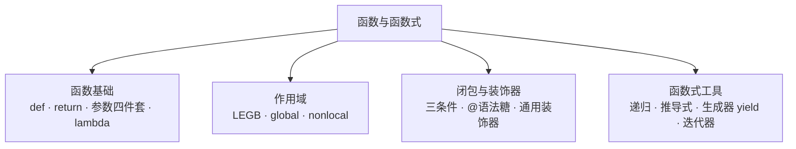

# 模块 3 · 函数与函数式（08~10 课）

> [!tldr] 一句话总结
> 参数四件套（位置/关键字/默认/不定长）、作用域四层（LEGB）、闭包装饰器（`@` 语法糖）、推导式与生成器（Python 式的"惰性"）。
> 这一模块是 **Python 面试出题密度最高**的地方，也是 Java 里没有直接对应的三个概念：装饰器、生成器、for-else。



---

## 一、函数基础【08 课】

### 1.1 定义与调用

```python
def my_sum(a, b):     # def 定义；a,b 是形参
    return a + b

result = my_sum(12, 23)   # 12,23 是实参
```

| 铁律 | 说明 |
| --- | --- |
| 先定义后调用 | 函数定义不会自动执行；调用在上、定义在下 |
| 可多次调用 | 随便调，不限次数 |
| 同名覆盖 | 同文件定义两个同名函数，**后者覆盖前者**（没有重载！） |
| return 语义 | 结束函数；返回多个值 = 元组 `(12, 34, 578)`；没写 return → 返回 **None**；return 下面的代码不执行 |

> [!note] Java 对照
> Python **没有方法重载**——同名函数直接覆盖，所以"不同参数签名"要靠默认参数/不定长参数实现（见下）。`self` 的秘密在模块 5 面向对象。

### 1.2 参数四件套【掌握】⭐

```python
# 1. 位置参数：按顺序对应，个数必须一致
def student(name, age): ...
student("jeff", 18)

# 2. 关键字参数：实参顺序可以乱，按名字匹配
student(age=22, name="lucy")

# 3. 默认参数：定义时给形参赋值；不传就用默认
def get_sum(num1, num2=12): ...
get_sum(23)       # num2 用默认 12
get_sum(23, 87)   # 用传入的 87

# 4. 不定长参数
def fn(*args, **kwargs):
    print(args)      # 元组：收所有位置参数
    print(kwargs)    # 字典：收所有 key=value 关键字参数
fn(1, 2, x=10, y=20)   # args=(1,2)  kwargs={'x':10,'y':20}
```

**顺序铁律**：`位置参数 → 默认参数 → *args → **kwargs`，后面的必须放最后，否则语法错误。

> [!note] Java 对照
> `*args` ≈ `int... nums` 可变参数；`**kwargs` Java 没有直接对应（`Map<String,Object>` 凑合）；默认参数 Java 要靠重载实现，Python 一行搞定。

### 1.3 匿名函数 lambda【掌握】

```python
f1 = lambda n: n ** 2        # 等价于 def fn(n): return n**2
f2 = lambda x, y: x * y
print(f2(12, 3))
```

特点：只是一个**表达式**，一行写完（参数 + 实现 + 返回值），常用于当参数传（配合 map/sorted 的 key）。

---

## 二、作用域【09 课·掌握】

### 2.1 LEGB 四层

| 层 | 名称 | 谁定义的 |
| --- | --- | --- |
| L | Local 局部 | 函数最内层 |
| E | Enclosing 函数外层 | 闭包外函数 |
| G | Global 全局 | 模块级 |
| B | Built-in 内建 | 解释器（print/len/int…） |

**查找顺序 L → E → G → B**，就近取用。

### 2.2 两个反直觉事实

```python
# 事实1：if / for 里定义的变量，外面能直接用！（没有块级作用域）
if 5 > 4:
    a = 11
print(a)          # 11，不报错

# 事实2：函数里的变量，外面不能访问
def fn():
    c = 99
# print(c)       # NameError
```

### 2.3 global 与 nonlocal

```python
num = 11
def test1():
    global num     # 声明"我要改的是全局变量"
    num = 75

def outer():
    x = 19
    def inner():
        nonlocal x  # 声明"我要改的是外层函数的 x"（不是全局）
        x += 1
    return inner

t = outer()
t(); t(); t()      # 闭包记住了 x 的运行环境：20 → 21 → 22
```

> [!note] Java 对照
> Java 变量作用域是**块级**（`{}` 里出的块就没了）；Python 的 if/for **不产生**新作用域，只有 def/class 才产生。Java 里改外部变量靠成员变量/effectively final 限制，Python 用 `global`/`nonlocal` 显式声明。

---

## 三、闭包与装饰器【09 课】

### 3.1 闭包三条件

1. **函数嵌套函数**（外函数里定义内函数）；
2. **内函数引用外函数的变量**；
3. **外函数返回内函数**（返回的是函数名，不带括号）。

```python
def outer(b):
    a = 10
    def inner():
        print(a + b)     # 引用外层变量
    return inner         # 返回内函数

fun = outer(12)          # fun 现在就是 inner
fun()                    # 22
```

**闭包的价值**：执行完毕后**保存住运行环境**——`t()` 每调一次 x 都在上次基础上 +1。

### 3.2 装饰器 = 闭包的应用 ⭐⭐

**定义**：在**不修改原函数**的前提下，动态给函数增加功能。

```python
def outer(fn):              # 装饰器函数，fn 是将来传进来的原函数
    def inner():
        fn()                # 调用原函数
        print("我很好")     # 增加的功能（原函数前/后都行）
    return inner

@outer                      # 语法糖，等价于 test = outer(test)
def test():
    print("你好啊!")

test()                      # 你好啊!  我很好
```

**通用装饰器**（适配任意参数个数）：

```python
def jisuan(fn):
    def inner(*args):          # 用不定长参数接住一切
        print("数学运算的结果是:", end=" ")
        fn(*args)
    return inner

@jisuan
def add(a, b): print(a + b)

@jisuan
def cha(a, b, c): print(a - b - c)

add(12, 34)      # 同一个装饰器装饰多个函数
cha(100, 23, 26)
```

**注意**：用 `@` 简写时，**原函数必须写在装饰器函数下面**（要先有 outer 再 @）。

> [!note] Java 对照（重点）
> Java 的 `@注解` 只是**元数据标记**，本身不执行逻辑，要靠反射/AOP 框架处理；Python 的 `@装饰器` 是**立刻执行的语法糖**（函数对象直接被替换）。语义上最接近 Java 的 **AOP（Spring 的 @Around）**——不改原方法，织入前后逻辑。

---

## 四、递归【10 课·了解】

解题三步：①找**临界条件**（如 `1! = 1`）→ ②找**相邻关系**（`n! = n * (n-1)!`）→ ③写成代码。

```python
def digui(n):
    if n == 1:            # 临界条件，必须有，否则栈溢出
        return 1
    return n * digui(n - 1)

def fib(m):               # 斐波那契
    if m < 3:
        return 1
    return fib(m - 1) + fib(m - 2)
```

> [!warning] 生产环境少用递归
> Python **默认递归深度约 1000 层**，超了直接 `RecursionError`。深层循环请改迭代。

---

## 五、推导式与生成器【10 课·掌握】

### 5.1 推导式（list/dict/set 通用套路）

```python
[i ** 2 for i in range(1, 6)]                  # [1,4,9,16,25]
[i for i in range(1, 11) if i % 2 == 1]        # 奇数（带过滤）
[i + j for i in "xyz" for j in "987"]          # 双重循环

{i: i * i for i in range(1, 6)}                # 字典推导式
{i * i for i in range(1, 6)}                   # 集合推导式
```

读法：**"要什么"在前面，"从哪来、怎么筛"在后面**——从右往左读。

### 5.2 生成器：省内存的惰性序列 ⭐

```python
# 写法一：把推导式的 [] 换成 ()
g = (i ** 2 for i in range(1, 10))
next(g)   # 每调一次出一个数，不一次性算完
# 取完后继续 next → StopIteration

# 写法二：函数里放 yield
def test(m):
    yield m * 2          # 执行到 yield 暂停
    yield (m + 1) * 2    # next 再从暂停处继续

g2 = test(23)            # ⭐ 调用不会执行函数体！
print(next(g2))          # 46
print(next(g2))          # 48
```

| 对比 | 列表 | 生成器 |
| --- | --- | --- |
| 计算 | 立刻全算完，占内存 | **用到才算**（惰性） |
| 场景 | 数据量有限 | **无限序列**、大文件逐行、流式输出 |

> [!note] Java 对照
> 生成器 ≈ Java **Stream 的惰性求值** + Iterator 的按需产出，但 Python 的 yield 是**语言级语法**（写起来像普通循环），Java 没有对应的语法，要自己实现 Iterator 或用 Stream API。

### 5.3 可迭代对象 vs 迭代器

| 概念 | 判定 | 例子 |
| --- | --- | --- |
| **可迭代对象 Iterable** | 能被 for 遍历 | list/tuple/dict/set/str/生成器 |
| **迭代器 Iterator** | 能被 for **且**能被 `next()` 逐个吐出，吐完抛 StopIteration | **目前只有生成器** |

```python
from collections.abc import Iterable, Iterator
isinstance([], Iterable)     # True
isinstance([], Iterator)     # False！

lst1 = iter([12, 4, 5])      # 可迭代 → 迭代器
next(lst1)                   # 12
```

**结论**：迭代器一定是可迭代对象，反之不成立。转换用 `iter()`。

---

## 六、本模块易错点

> [!warning] 7 个高频坑
> 1. 默认参数、`*args`、`**kwargs` 不放参数列表最后 → 语法错误
> 2. return 多个值是**元组**，不是一个神秘对象：`a, b = fn()` 其实是解包
> 3. 同文件定义同名函数，**静默覆盖**不报错
> 4. `fn = outer()` 后 `fn()` 才执行——外层函数返回的是函数本身，**别加括号**
> 5. 生成器函数调用后**什么都不发生**，必须有 `next()`/for 驱动
> 6. yield 之后函数**暂停但不终止**，return 之后就终止了——两者别混
> 7. `@装饰器` 要写在**被装饰函数的上方**，且装饰器函数先定义

---

## 七、自检问答

> [!question]- `*args` 和 `**kwargs` 分别收到什么？
> `*args` 收多余的位置参数 → 元组；`**kwargs` 收多余的 `key=value` → 字典。

> [!question]- 装饰器的执行顺序？
> `@outer` 等价于 `test = outer(test)`：outer 收到原函数 → 返回包装后的 inner → 之后调 `test()` 实际调的是 inner。

> [!question]- 闭包为什么能"记住"变量？
> 内函数引用了外函数的局部变量，外函数返回后该变量的环境被内函数持有，不会被回收（nonlocal 可以改它）。

> [!question]- `g = (x*x for x in range(10))` 和列表推导式差在哪？
> 差一个括号，差一个宇宙：`[]` 立刻算完占内存；`()` 只存算法，next 一次算一个（惰性）。

> [!question]- global 和 nonlocal 区别？
> `global` 改的是**模块级全局变量**；`nonlocal` 改的是**外层函数（闭包）的局部变量**，只能用在嵌套函数里。
