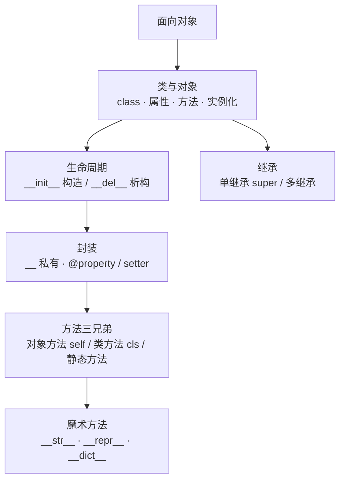

# 模块 5 · 面向对象（12~13 课）

> [!tldr] 一句话总结
> Java 的 class 思想可以整体平移，但有四个大差异要重新校准：
> **① self 必须显式写；② 没有 private 关键字，用 `__` 双下划线；③ 支持多继承（Java 只能接口多实现）；④ @property 代替 getter/setter。**



---

## 一、类与对象【12 课·掌握】

### 1.1 基本定义

```python
class Dog():                 # 类名大驼峰（同 Java）
    # 类属性（所有对象共享）
    name = "旺财"
    sex = "male"

    # 对象方法：第一个参数 self 代表"当前对象"
    def eat(self):
        print(self.name, "吃肉!")

dog = Dog()      # 实例化（Java: new Dog()）
dog.eat()        # 对象.方法()
print(dog.name)  # 对象.属性
```

| 概念 | 说明 |
| --- | --- |
| 类 | 一类事物的**共同特征（属性）+ 行为（方法）**，抽象的 |
| 对象 / 实例 | 类的具体存在，先定义类再创建对象 |
| 类属性 | 定义在类体、方法外，**所有实例共享** |
| 对象属性 | `self.xxx = ...`，每个实例独有一份 |

> [!note] Java 对照（self 是最大的门槛）
> Java 的 `this` 是**隐式**的；Python 的 `self` 是**显式**参数——方法定义必须写 `def eat(self)`，调用时 `dog.eat()` 自动传入 dog。本质：Python 的方法就是"挂在类身上的普通函数"，对象是第一个实参。

### 1.2 构造与析构

```python
class GirlFriend():
    def __init__(self, name, age):   # ⭐ 构造函数：创建对象时自动触发
        self.name = name             #   用它给"对象属性"赋初值
        self.age = age

    def __del__(self):               # 析构（了解）：对象被销毁时触发
        print("释放内存")             #   场景：关数据库、关文件

gf = GirlFriend("小妹", 22)   # 自动调 __init__
```

| 魔术方法 | 触发时机 | 用途 |
| --- | --- | --- |
| `__init__` | 创建对象时**第一个**自动调用 | 初始化对象属性 |
| `__del__` | 对象被销毁（del 变量/脚本结束） | 清理资源 |
| 不写 `__init__` | 系统默认给一个**无参**构造 | — |

---

## 二、封装【13 课】

### 2.1 属性/方法私有化：`__` 双下划线

```python
class Girl():
    def __init__(self, name, age):
        self.name = name        # 公开
        self.__age = age        # ⭐ 私有：类外不能直接访问

    def love(self, relationship):
        if relationship == "情侣关系":
            self.__kiss()       # 类内部可以用私有方法
        else:
            print("不行!")

    def __kiss(self):           # 私有方法
        print("一吻定终身!")
```

| 规则 | 说明 |
| --- | --- |
| 写法 | 属性/方法名前加 `__`（两个下划线） |
| 权限 | 只能**类内部**访问；外部直接 `girl.__age` 报 AttributeError |
| 外部怎么访问 | 类里提供公开方法做**接口**（可加条件判断），或用 @property |

### 2.2 @property：Python 式 getter/setter ⭐

```python
class Girl():
    def __init__(self, name, age):
        self.__age = age

    @property
    def age(self):               # "读"：像访问属性一样调用
        return self.__age

    @age.setter
    def age(self, new_age):      # "写"：girl.age = 19 触发这里
        self.__age = new_age

lan = Girl("小兰", 21)
print(lan.age)      # 21 —— 不是 lan.age()！
lan.age = 19        # 像赋值一样写入
```

> [!note] Java 对照
> Java 的 `getAge()/setAge()` 显式调用；Python 的 `@property` 让**调用方完全感知不到**这是方法——外部看起来就是普通属性，内部却可以加校验。这是 Python 更优雅的地方。另外🔧补充：`__age` 并非真私有，底层改名成 `_Girl__age` 仍可强行访问（Python 的"私有"是君子协定，靠自觉）。

---

## 三、方法三兄弟【13 课·掌握】

```python
class Animal():
    name = "牧羊犬"                          # 类属性

    def __init__(self, name, sex):           # 对象方法（最普通）
        self.name = name                     # 对象属性
        self.sex = sex

    @classmethod
    def run(cls):                            # 类方法：第一个参数 cls = 当前类
        print(cls.name, cls == Animal)

    @staticmethod
    def eat():                               # 静态方法：无 self/cls
        print("我是静态方法")
```

| 维度 | 对象方法 | 类方法 @classmethod | 静态方法 @staticmethod |
| --- | --- | --- | --- |
| 第一参数 | `self`（对象） | `cls`（类） | 无 |
| 能访问 | 对象属性+类属性 | 只能类属性/类方法 | 什么都不建议访问 |
| 调用 | `obj.fn()` | `类名.fn()`（推荐）/ obj.fn() | `类名.fn()`（推荐） |
| 场景 | 操作单个对象的状态 | 操作类级状态/工厂方法 | 独立工具函数，写在类里只是归组 |

> [!note] Java 对照
> 对象方法 ≈ 普通成员方法；类方法 ≈ 没有直接对应（`static` + 手动传 Class 的杂合体）；静态方法 ≈ `static` 方法。**注意 Python 的 static 方法没有隐式 this/cls**，就是普通函数搬进了类。

---

## 四、类中常用属性与魔术方法【13 课·了解】

| 成员 | 通过类访问 | 通过对象访问 |
| --- | --- | --- |
| `__name__` | 返回类名字符串 | ❌ 报错 |
| `__dict__` | 类的属性和方法（字典） | 该对象的所有属性和值（字典） |

`__str__` / `__repr__`（打印对象时自动触发）：

```python
class Person(object):
    def __init__(self, name, age):
        self.name = name
        self.age = age

    def __repr__(self):                      # 或 __str__；两者都在时 __str__ 优先
        return f"姓名:{self.name},年龄:{self.age}"   # ⭐ 必须 return 字符串

p = Person("小红", 18)
print(p)          # 姓名:小红,年龄:18
```

> [!note] Java 对照
> `__str__` ≈ `toString()`。`__repr__` ≈ 调试态的 toString。`__dict__` ≈ 反射拿字段（Java 要靠 Jackson/reflection，Python 自带）。

---

## 五、继承【13 课】

### 5.1 单继承与 super

```python
class Animal(object):                 # 不写父类默认继承 object（同 Java）
    def __init__(self, name, sex):
        self.name = name
        self.sex = sex
    def eat(self):
        print("所有动物都会捕食")

class Cat(Animal):                    # class 子类(父类)
    def __init__(self, name, sex, tail):
        super(Cat, self).__init__(name, sex)   # ⭐ 先借父类构造
        self.tail = tail                       # 再加自己的属性

    def catchMouse(self):
        print("猫抓老鼠")

cat = Cat("波斯猫", "母", "长尾")
cat.eat()          # 子类直接用父类方法
```

**继承的规则**：

- 子类可以访问父类的**非私有**属性/方法；
- 父类**不能**访问子类的任何内容；
- 子类重写 `__init__` 后要**手动 super 调用父类构造**（Python 不会自动调！）。

### 5.2 多继承（Python 独有 ⭐）

```python
class Son(Father, Mother):          # 括号里写多个父类
    def __init__(self, surname, height, weight):
        Father.__init__(self, surname)     # 多继承时手动分别调
        Mother.__init__(self, height)
        self.weight = weight
```

> [!warning] Java 对照（最大差异）
> Java **禁止类多继承**（菱形问题），只能接口多实现 + default 方法凑合；Python **允许类多继承**，顺序按 MRO（方法解析顺序）从左到右查找。多继承强大但耦合高，工程上慎用——课程也提示了：继承的**耦合性高**（改父类牵连所有子类），能用组合就别硬继承。

---

## 六、本模块易错点

> [!warning] 7 个高频坑
> 1. 方法定义忘写 `self` → 调用时 `TypeError: takes 0 arguments but 1 was given`
> 2. `__init__` 里忘 `self.` 前缀：`name = name` 创建的是**局部变量**，对象属性根本没赋上
> 3. `__str__` 里用 `print` 而不是 `return` → 打印出 `None`
> 4. 子类重写 `__init__` 却没调 `super().__init__` → 父类属性全部丢失
> 5. 类属性 vs 对象属性混淆：类属性所有实例共享（改一处全变），对象属性各自独立
> 6. 私有属性"真删不掉"：`_Girl__age` 仍可外部访问（名称改写机制），别依赖它做安全
> 7. `@property` 和 `@age.setter` 的**方法名必须一致**，否则 setter 不生效

---

## 七、自检问答

> [!question]- self 是什么？能不能不叫 self？
> 就是"当前对象"本身，等价 Java 的 this。名字可以换（形参而已），但**约定俗成必须叫 self**。

> [!question]- 类方法和静态方法差在哪？
> 类方法拿 `cls`（能访问类属性、当工厂用）；静态方法什么都不拿，就是个放错了地方的普通函数。

> [!question]- Python 怎么实现 Java 的 private？
> 名称前加 `__`，触发名称改写（`__age` → `_类名__age`），外部直接访问报错。但这是约定不是强制。

> [!question]- 子类 `__init__` 里 `Animal.__init__(self, ...)` 和 `super().__init__(...)` 哪个好？
> 都能跑。`super()` 更好——多继承时自动按 MRO 找，不会重复调用；写 `super(Cat, self).__init__(...)` 或 `super().__init__(...)` 均可。

> [!question]- print(对象) 怎么输出可读内容？
> 实现 `__str__`（或 `__repr__`），必须 **return 字符串**。两者共存时 print 走 `__str__`。
