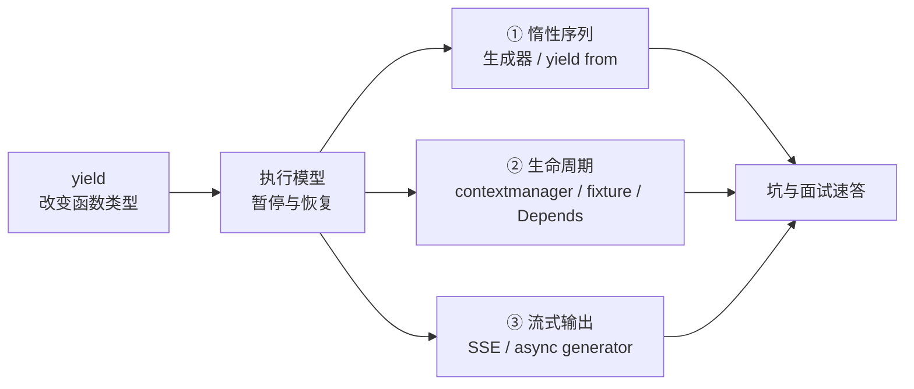

# 🐍 yield 关键字全景 · 从生成器到依赖注入

> [!tldr] 一句话
> `yield` 把普通函数变成**可暂停的函数**：调用时不执行，`next()` 才推进；执行到 `yield` 吐出一个值并**冻结整个栈帧**（局部变量、指令指针全都留着），下次 `next()` 从原处继续。
> 这个「暂停 / 恢复」能力被复用在三件看起来毫不相干的事上：**惰性序列**、**资源清理（setup → teardown）**、**流式输出**。

> [!note] 为什么要单开一篇
> 库里 `yield` 出现在 5 篇笔记中，每篇只讲一个侧面：[[12-基础课08-10-函数与函数式]] 讲生成器语法、[[01-阶段一-语法速通（Java 对照）]] 讲迭代协议与大文件、[[02-阶段二-数据模型与工程化]] 讲 `@contextmanager` 与 pytest fixture、[[04-阶段四-数据与 AI 应用]] 讲 FastAPI 依赖与 SSE 流、[[05-阶段五-项目实战与验收]] 把它列成面试题。
> 本篇把这些收拢成 **「一个语法 + 三种用法」**，并补上执行模型、双向通信和 Java 对照。

---

## 🗺️ 全篇导航



---

## 一、语法本质：一个关键字改变函数的"种类"

只要函数体里出现 `yield`（哪怕在永不执行的分支里），这个函数就**不再是普通函数**，而是生成器函数（generator function）。

| | 普通函数 | 生成器函数 |
|---|---|---|
| 调用时 | **立刻执行**函数体 | **一行都不执行**，只返回一个 generator 对象 |
| 返回 | `return` 的结果 | generator 对象（实现了迭代器协议） |
| 结束 | 函数返回即销毁栈帧 | 每次 `yield` 暂停并**保留栈帧**，耗尽后抛 `StopIteration` |
| 判定 | — | `inspect.isgeneratorfunction(fn)` |

```python
def test(m):
    print("开始执行")
    yield m * 2            # 执行到这里暂停
    print("恢复执行")
    yield (m + 1) * 2     # 再暂停一次

g = test(23)               # 什么都没打印！函数体尚未运行
print(type(g))             # <class 'generator'>
print(next(g))             # 开始执行 → 46
print(next(g))             # 恢复执行 → 48
print(next(g))             # StopIteration
```

> [!important] 三条必须刻进肌肉记忆
> 1. **调用生成器函数 ≠ 执行它**，必须 `next()` / `for` / 被另一个生成器消费来驱动。
> 2. `yield` 是**暂停**，不是返回；`return` 才是终止。
> 3. 暂停期间**局部变量、循环计数、文件句柄全都还在**——这正是后面所有框架用法的物理基础。

---

## 二、执行模型：栈帧是怎么被冻住又解冻的

```python
def counter():
    i = 0
    while True:
        i += 1
        yield i

g = counter()
next(g)   # 1   栈帧停在 yield i，i=1 被记住
next(g)   # 2   从 yield 后恢复，while 继续，i=2
```

| 状态 | 何时 |
|---|---|
| `GEN_CREATED` | 刚调用，还没启动 |
| `GEN_RUNNING` | 正在执行（`next()` 调用期间） |
| `GEN_SUSPENDED` | 停在 `yield` 上（局部变量保留） |
| `GEN_CLOSED` | 耗尽 / `close()` / 被 GC |

`for x in g` 只是语法糖：反复调 `next()`，并**自动捕获 `StopIteration` 结束循环**。所以 `for` 不会让你看到异常，手写 `next()` 才会。

> 底层看，生成器对象里保存着 `gi_frame`（栈帧）、`gi_code`、`gi_yieldfrom`。这跟线程挂起不同——**没有操作系统上下文切换**，纯粹是 Python 解释器把栈帧对象挪出来存着，开销极小。

---

## 三、`yield` 是表达式：生成器可以"收"数据

多数教程只讲「吐值」，其实 `yield` 是一个**表达式**，可以有返回值，于是生成器变成双向通道：

```python
def averager():
    total = count = 0
    avg = None
    while True:
        value = yield avg          # ① 吐出当前均值  ② 接收外部 send 进来的新值
        total += value
        count += 1
        avg = total / count

g = averager()
next(g)          # 预激（priming）：推进到第一个 yield，返回 None
print(g.send(10))   # 10.0
print(g.send(20))   # 15.0
g.close()
```

| 方法 | 作用 |
|---|---|
| `next(g)` | 等价于 `g.send(None)`，恢复执行 |
| `g.send(v)` | 恢复执行，并让 **`yield` 表达式求值为 `v`** |
| `g.throw(Exc)` | 在暂停处抛异常进生成器，可在生成器内 `try/except` 接住 |
| `g.close()` | 在暂停处抛 `GeneratorExit`，触发 `finally` 后关闭 |

> [!warning] 最常见的报错
> `TypeError: can't send non-None value to a just-started generator` —— 刚创建的生成器还**没停在任何一个 yield 上**，没有地方接收值。必须先 `next(g)` 或 `g.send(None)` 预激。
> 工程上常用装饰器 `@contextlib.contextmanager` 或手写 priming 包装来绕开。

**`return` 在生成器里的含义**：`return value` 不把值给调用者，而是终止生成器，值挂在 `StopIteration.value` 上（Python 3.3+）。`yield from` 正是靠这个拿到被委托生成器的返回值。

---

## 四、`yield from`：委托，不是简单展开

```python
# 等价关系（简化版）
def outer():
    yield from inner()      # 自动逐个产出 inner 的元素

# ≈
def outer():
    for x in inner():
        yield x
```

但**不等价**的是：`yield from` 还会把外层的 `send()` / `throw()` **透明转发**给子生成器，并把子生成器的 `return` 值作为自己的结果。这一点是 `asyncio` 早期基于生成器实现协程（`@types.coroutine` + `yield from`）的地基；现在写业务代码用 `await`，不再手写。

```python
def flatten(items):
    for it in items:
        if isinstance(it, (list, tuple)):
            yield from flatten(it)
        else:
            yield it

list(flatten([1, [2, [3, 4]], 5]))   # [1, 2, 3, 4, 5]
```

> [!tip] 记住分工
> `yield from` = 把「驱动下一个生成器」这件苦力活交给解释器；`await` = 把「等一个 Future」交给事件循环。别在 `async def` 里写 `yield from`。

---

## 五、生成器表达式：惰性的最小写法

```python
squares_list = [i ** 2 for i in range(10**7)]   # 立刻算完，占 ~80MB+
squares_gen  = (i ** 2 for i in range(10**7))   # 几乎不占内存，用到才算
```

| | 列表 | 生成器 |
|---|---|---|
| 计算 | 立即全算 | 惰性，取一个算一个 |
| 内存 | 与数据量成正比 | **恒定** |
| 复用 | 可反复遍历、可切片、`len()` | **一次性游标**，只能遍历一次 |
| 场景 | 数据有限、要随机访问 | 无限序列、大文件逐行、流式管道 |

```python
# 管道式处理 1GB 日志，内存恒定（[[01-阶段一-语法速通（Java 对照）]] 的验收题）
def read_large(path):
    with open(path, encoding="utf-8") as f:
        for line in f:
            yield line.rstrip("\n")

count = sum(1 for l in read_large("huge.log") if "ERROR" in l)
```

> [!warning] 一次性
> 生成器是迭代器（自身就是 `iter(g) is g`），遍历完就空了。想再遍历只能重新调用生成函数；需要 `len()` 就 `sum(1 for _ in g)`，需要多次用就先 `list(g)`（但那就失去惰性意义了）。

---

## 六、⭐ 核心整理：把"暂停 / 恢复"当成资源生命周期

前面五节讲的是**吐一串值**。但框架里大量 `yield` **只写一次，甚至后面不带值**，因为它要的根本不是序列：

> [!important] 一句话点破
> `yield` 把函数劈成两半 —— **yield 之前 = setup（获取资源），yield 之后 = teardown（释放资源）**。框架负责驱动两次推进：第一次拿到资源，用完后再推进一次让清理代码跑起来。yield 出来的值就是"交给使用方的资源"。

| 场景 | yield 之前（setup） | yield 之后（teardown） | 谁来驱动 |
|---|---|---|---|
| `@contextmanager` | 计时开始 / 打开文件 | `finally` 里打印耗时 / 关闭 | `with` 语句 |
| pytest fixture | 建连接、初始化 schema | `s.close()` | 测试结束后 pytest |
| FastAPI `Depends` | `db = SessionLocal()` | `db.close()` | 请求处理完成后框架 |
| SSE / LLM 流 | 建立流、订阅 token | `finally` 发 `[DONE]` | `StreamingResponse` 消费流 |

### 6.1 `@contextmanager`

```python
from contextlib import contextmanager

@contextmanager
def timer(label: str):
    import time
    t0 = time.perf_counter()
    try:
        yield                     # 不产出值，只是"在这里暂停"
    finally:
        print(f"{label}: {time.perf_counter()-t0:.3f}s")

with timer("query"):
    do_something()                # with 块 = 暂停期间
```

`@contextmanager` 内部就是拿生成器 implement `__enter__`（`next`）和 `__exit__`（再 `next` / `throw`）。

### 6.2 pytest fixture

```python
@pytest.fixture
def service():
    s = OrderService(dsn="sqlite:///:memory:")
    s.init_schema()
    yield s                       # 交给测试函数用
    s.close()                     # 测试结束后才执行（无论测试是否失败）
```

> **面试题 15 的答案**：`return` 的 fixture 只有 setup，没有清理钩子；`yield` 的 fixture 把 `yield` 之前当 setup、之后当 teardown，且**即使测试抛异常也会执行清理**（pytest 会 `throw` 进去）。

### 6.3 FastAPI 依赖注入

```python
from fastapi import Depends

def get_db():
    db = SessionLocal()
    try:
        yield db                  # 注入给路由函数
    finally:
        db.close()                # 请求处理完（响应发出后）执行

@app.get("/items/")
def read_items(db: Session = Depends(get_db)):
    return db.query(Item).all()
```

> 对应 Java：`yield` 依赖 ≈ `@Bean(destroyMethod=...)` / `@PreDestroy` / try-with-resources，但用的是**同一个函数的前后两半**，不需要再写一个清理方法。见 [[06-服务化部署 FastAPI 与 LangServe]]。

### 6.4 SSE 与 LLM token 流

```python
async def event_stream(req: ChatRequest):
    try:
        async for chunk in llm.stream(req.message):
            yield f"data: {json.dumps({'delta': chunk}, ensure_ascii=False)}\n\n"
    except asyncio.CancelledError:      # 客户端断开
        raise
    finally:
        yield "data: [DONE]\n\n"

@app.post("/chat/stream")
async def chat_stream(req: ChatRequest):
    return StreamingResponse(event_stream(req), media_type="text/event-stream")
```

这里 `yield` 同时用了两种语义：**逐个吐值**（流式 token）+ **finally 里做收尾**。对应 Java 的 `SseEmitter.send()` / `complete()`，见 [[04-阶段四-数据与 AI 应用]]；LangChain 侧的 `.stream()` / `Runnable` 流式也是同一套，见 [[03-链与 LCEL]]。

---

## 七、异步生成器：`async def` + `yield`

```python
async def stream(prompt: str):
    async with await client.chat.completions.create(..., stream=True) as s:
        async for event in s:
            delta = event.choices[0].delta.content
            if delta:
                yield delta        # 异步生成器

async for token in stream("你好"):
    print(token, end="")
```

| 区别 | 同步生成器 | 异步生成器 |
|---|---|---|
| 定义 | `def` + `yield` | `async def` + `yield` |
| 驱动 | `next()` / `for` | `__anext__()` / **`async for`** |
| 能否 `await` | 不能 | 函数体内可以 `await` |
| 常见用途 | 大文件、数据管道 | SSE、LLM token 流、异步分页拉取 |

> [!warning]
> 对异步生成器调 `next()` 会报 `TypeError: 'async_generator' object is not an iterator`。另外别把 `async def` + `yield` 当成普通协程去 `await`——它是 async generator，要用 `async for`。

---

## 八、Java 对照（含一个同名陷阱）

| Python 概念 | Java 里最接近的东西 |
|---|---|
| 生成器 / 惰性求值 | `Stream` 的惰性中间操作 + 手写 `Iterator` / `Spliterator` |
| 暂停并保留栈帧 | **没有语言级对应**；虚拟线程（Loom）是线程调度层，不是函数级协程 |
| `@contextmanager` / yield fixture | try-with-resources、`@PreDestroy`、JUnit `@AfterEach` |
| SSE 里逐个 `yield` | `SseEmitter.send()` 循环推送 |
| 协程雏形（`yield from`） | 无；Java 21 虚拟线程走的是另一条路 |

> [!danger] 最容易混淆的一点：Java 也有 `yield`
> Java 14 起 `yield` 是 **switch 表达式里返回一个值**的关键字，跟 Python 的生成器毫无关系：
>
> ```java
> int n = switch (day) {
>     case "MON", "FRI" -> 1;
>     default -> { yield 0; }     // 只是"从 switch 块返回一个值"
> };
> ```
>
> 名字一样，语义完全不同：**Java 的 yield = 块内返回值；Python 的 yield = 暂停函数并挂起栈帧**。从 Java 过来读 Python 代码时，第一反应别往 switch 上靠。

---

## 九、踩坑清单

| # | 坑 | 处理 |
|---|---|---|
| 1 | 调用生成器函数没反应 | 需要 `next()` / `for` / 被消费驱动 |
| 2 | 第二次遍历得到空 | 生成器一次性；重新调用生成函数 |
| 3 | `len(g)` / `g[0]` 报错 | 生成器不是序列；计数用 `sum(1 for _ in g)` |
| 4 | `send(非None)` 刚创建就报 TypeError | 先 `next(g)` 预激 |
| 5 | `return v` 拿不到值 | 值在 `StopIteration.value`，`yield from` 才拿得到 |
| 6 | `finally` 好像没执行 | 生成器没耗尽 / 没 `close()` 时，清理时机不确定；显式 `close()` 或用 `contextlib.closing` |
| 7 | 推导式里写 `yield` 直接 SyntaxError | Python 3.8+ 禁止在推导式中使用 yield，老实用生成器函数 |
| 8 | 异常"凭空"出现在 `next()` 那行 | 生成器里的异常会传播到驱动方；用 `g.throw()` 可反向注入 |
| 9 | `yield from` 写在 `async def` 里报错 | 用 `await`；`async` 生成器用 `async for` 消费 |
| 10 | async generator 用 `next()` 报错 | 改 `async for` / `__anext__()` |
| 11 | FastAPI yield 依赖里改响应 / 抛异常 | 退出代码在响应处理完成后执行，别指望它影响返回值或错误响应 |
| 12 | 把生成器当"轻量线程" | 它是协作式、单线程、由调用方驱动的；阻塞 IO 照样阻塞整个线程 |

---

## 十、面试速答（对应 [[05-阶段五-项目实战与验收]] 第 3、15 题）

> [!example] Q：生成器和迭代器的区别？为什么生成器只能遍历一次？
> **A**：`Iterable` 只需实现 `__iter__`（list/tuple/str 都是）；`Iterator` 还要实现 `__next__`，且 `iter(it) is it`。生成器函数返回的对象**本身就是迭代器**，所以它同时是 Iterable 和 Iterator。它内部只有一个指向当前位置的游标，没有存下已产出的元素，走到底就抛 `StopIteration`、无法回退，因此只能遍历一次。`len()` 也因此不可用。

> [!example] Q：pytest fixture 里 yield 和 return 的区别？
> **A**：`return` 只做 setup，把值交给测试函数就结束；`yield` 把 fixture 变成生成器，`yield` 之前是 setup、**之后是 teardown**，pytest 在测试结束（含失败/异常）后再次推进生成器执行清理。所以带资源（DB 连接、临时文件、服务进程）的 fixture 一律用 `yield` + `try/finally`。

> [!example] Q：为什么 FastAPI 的依赖函数用 yield 而不是 return db？
> **A**：`return db` 之后函数栈帧已销毁，框架拿不到"什么时候该关连接"的时机；`yield db` 把函数挂在暂停点，框架在请求处理完后再推进一次，`finally` 里的 `db.close()` 必然执行。本质是借用生成器的暂停能力表达"作用域结束"这个事件。

---

## 十一、库内散落内容索引

| 笔记 | 讲的侧面 |
|---|---|
| [[12-基础课08-10-函数与函数式]] | 生成器语法、生成器表达式、Iterable vs Iterator、Java Stream 类比 |
| [[01-阶段一-语法速通（Java 对照）]] | 迭代协议流程图、逐行读大文件、一次性游标 |
| [[02-阶段二-数据模型与工程化]] | `@contextmanager` 计时器、pytest yield fixture |
| [[04-阶段四-数据与 AI 应用]] | FastAPI yield 依赖、SSE `StreamingResponse`、LLM token 流 |
| [[05-阶段五-项目实战与验收]] | 生成器面试题、fixture yield vs return |
| [[08-专题-Python 内存管理与垃圾回收（对比 JVM）]] | 为什么"少分配"要靠生成器而不是调 GC |
| [[06-服务化部署 FastAPI 与 LangServe]] | `Depends` + yield 依赖的完整上下文 |
| [[03-链与 LCEL]] | `Runnable.stream()` 的流式语义 |

> [!tldr] 收束成一句
> `yield` 只做了一件事：**让函数能停在半路，并且下次从原地继续**。
> 停在一串值上 → 生成器 / 惰性序列；停在资源上 → setup/teardown 生命周期；停在一条流上 → SSE 与 token 流。三种用法，一个机制。
