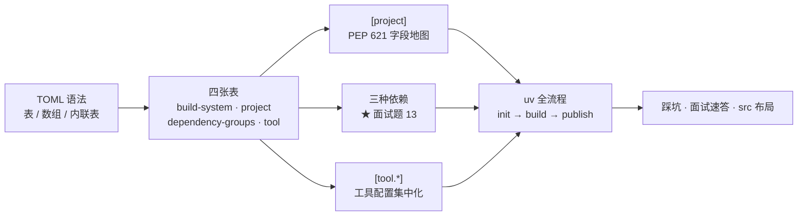

# 🐍 pyproject.toml 全景 · 一个文件管住整个 Python 工程

> [!tldr] 一句话
> `pyproject.toml` 是 Python 项目的**单一事实源**：用四张表分别告诉「构建工具怎么打包」「这个包叫什么、依赖什么」「开发时才用的依赖有哪些」「ruff/mypy/pytest 怎么配」。
> 它只声明**范围**，精确版本交给 `uv.lock`；它同时是配置文件和打包清单，地位约等于 Java 的 `pom.xml` + `application.yml` 合体。

> [!note] 为什么要单开一篇
> 库里 `pyproject.toml` 出现在 6 处，但每处只讲一个侧面：[[02-阶段二-数据模型与工程化]] §五给了一份工程骨架与 toml 样板（唯一成段的），[[06-专题-__name__ 与程序入口]] 用 `[project.scripts]` 讲第四种程序入口，[[01-阶段一-语法速通（Java 对照）]] 的流程图里提了一句「声明包与依赖」，[[00-Python 学习计划总览]] 只有一个 mindmap 节点，[[05-阶段五-项目实战与验收]] 把「`dependencies` 和 `dependency-groups` 的区别」列成面试题 13 **却没给答案**，[[13-基础课10-11-模块与文件IO]] 与 [[15-基础课14-15-异常与虚拟环境]] 讲的是更早的 pip + venv + `requirements.txt` 体系。
> 本篇补齐：**TOML 语法本身 → 四张表逐项拆解 → 三种依赖声明辨析 → uv 全流程与打包发布 → 面试题答案**，并把 `02` 的样板补全到能真正 `uv build`。

---

## 🗺️ 全篇导航



---

## 一、TOML 语法 10 分钟速通

> [!warning] 库里这一块是**完全空白**的
> `02` 直接甩了一份 toml 样板，但没说 `[...]` 是什么、为什么有的值带 `{}`、为什么数组能换行。看不懂语法就只会照抄。

| 语法 | 例子 | 说明 |
|---|---|---|
| 键值对 | `name = "myapp"` | 键名不带引号；字符串必须引号 |
| 表（table） | `[project]` | 之后直到下一个表头的键都归属它 |
| 子表 / 点分键 | `[tool.ruff.lint]` 或 `lint.select = [...]` | 等价的两种写法，子表更常用 |
| 数组 | `dependencies = ["fastapi>=0.115", "httpx"]` | 可跨行，**允许尾逗号** |
| 内联表 | `{ name = "A", email = "a@x.com" }` | 一行写完的小对象，常用于 `authors`、`readme` |
| 数组表 | `[[tool.uv.sources]]` | 表里每个元素是一张表，用于「多条同类配置」 |
| 字符串 | `"..."`、`'...'`、`"""..."""` | 双引号支持转义；单引号是**字面量**（不转义）；三引号多行 |
| 注释 | `# I = 导入排序` | 只有行注释 |
| 其他类型 | `true` / `8080` / `3.14` / `1979-05-27T07:32:00Z` | 布尔、整数、浮点、日期时间 |

**三条最容易踩的**：

1. **同一个表不能定义两次**，`[project]` 写两遍直接解析失败。
2. 表头有「作用域」：在 `[tool.ruff]` 之后写 `line-length = 100`，这个键属于 ruff，**不会**回到 `[project]`。所以字段顺序很重要，官方示例都是先 `[project]` 再 `[project.xxx]` 再 `[tool.xxx]`。
3. 点分键和表头不要混着写同一层级，容易歧义。

**代码里怎么读它**（Python 3.11+ 标准库自带，只读）：

```python
import tomllib

with open("pyproject.toml", "rb") as f:          # 注意必须是 rb
    cfg = tomllib.load(f)

print(cfg["project"]["dependencies"])
print(cfg["tool"]["ruff"]["line-length"])        # 点分键 → 嵌套 dict
```

`tomllib` **只能读不能写**（PyPA 规范页给的参考实现就是用它解析 `[dependency-groups]`）。要保留注释和格式地改写用第三方 `tomlkit`；日常改配置还是手工编辑或 `uv add` 让工具改。

> [!tip] Java 对照
> TOML 本身的定位接近 `.properties` / YAML，但 `pyproject.toml` 承担的职责更像 **`pom.xml`**：既声明坐标与依赖，又塞了各插件的配置（`[tool.*]` ≈ `<plugins>` 里的 `<configuration>`）。

---

## 二、pyproject.toml 是什么：四张表

PyPA 官方明确说这个文件里**只有四种可能的 TOML 表**：

| 表 | 谁读 | 作用 | 规范 |
|---|---|---|---|
| `[build-system]` | 构建前端（pip / uv） | 声明用哪个构建后端、构建时需要什么 | PEP 517 / 518 |
| `[project]` | 构建后端 | 包的名字、版本、元数据、运行依赖、命令行入口 | **PEP 621** |
| `[dependency-groups]` | 开发工具（uv 等） | 只在开发期用的依赖，**不会进包元数据** | **PEP 735**（2024-10 通过） |
| `[tool.*]` | 各工具自己 | ruff / mypy / pytest / hatch / uv 的配置 | 无统一规范，字段由各工具定义 |

### 演进史：为什么会有这么个文件

| 年代 | 做法 | 痛点 |
|---|---|---|
| 早期 | `setup.py` + `requirements.txt` | 装包要**先执行 Python 代码**，元数据无法静态读取；依赖与元数据分家 |
| 过渡 | `setup.cfg` / `Pipfile` / `[tool.poetry]` | 各家自定义格式，工具互不通用 |
| **PEP 518（2018）** | 引入 `pyproject.toml` + `[build-system]` | 先解决「构建隔离」：`pip` 先看这个文件才知道该装什么来构建 |
| **PEP 621（2020）** | 标准化 `[project]` | 元数据终于有了统一写法，不再依赖后端私有格式 |
| **PEP 735（2024）** | 标准化 `[dependency-groups]` | 开发依赖有了不污染发布元数据的位置 |
| **PEP 751（2025）** | `pylock.toml` | 锁文件格式标准化（`uv.lock` 仍是 uv 私有格式，可 `uv export` 成它） |

> [!warning] 库里两套体系并存，不是矛盾
> [[13-基础课10-11-模块与文件IO]] 的 pip / 镜像源、[[15-基础课14-15-异常与虚拟环境]] 的 venv 五步 + `pip freeze > requirements.txt`，是**入门与老项目**的做法；[[02-阶段二-数据模型与工程化]] 直接上 uv + pyproject，是**当前事实标准**。
> 实际项目里 `requirements.txt` 常被保留作导出物，但真源应该是 `pyproject.toml`——见下方踩坑 ①。

| Java / Maven | Python / uv |
|---|---|
| `pom.xml`（坐标 + 依赖 + 插件配置） | `pyproject.toml` |
| `mvn` / `mvn package` | `uv sync` / `uv build` |
| Maven Central | PyPI |
| `target/*.jar` | `dist/*.whl` + `*.tar.gz` |
| `~/.m2/repository` | uv 全局缓存 |
| 没有严格对应（版本写在 pom 里） | `uv.lock` = 精确解析结果 |

---

## 三、`[build-system]`：最容易被漏掉的一张表

PyPA 官方原话：**「The `[build-system]` table should always be present, regardless of which build backend you use」**——因为它**定义了**用哪个构建工具。

```toml
[build-system]
requires = ["hatchling >= 1.26"]
build-backend = "hatchling.build"
```

两个字段：`requires`（构建时需要装的包，通常就是后端自己）、`build-backend`（后端的可导入路径）。常见取值：

| 后端 | `requires` | `build-backend` |
|---|---|---|
| Hatchling | `hatchling >= 1.26` | `hatchling.build` |
| setuptools | `setuptools >= 77.0.3` | `setuptools.build_meta` |
| Flit | `flit_core >= 3.12.0, <5` | `flit_core.buildapi` |
| PDM | `pdm-backend >= 2.4.0` | `pdm.backend` |
| uv（自己的后端） | `uv_build >= 0.13, <0.14` | `uv_build` |

**uv 的一个关键行为**（官方文档确认）：它用「有没有 `[build-system]`」来判断**这个目录是不是一个要被装进 `.venv` 的包**。

- 没有 → 只装依赖，**不构建、不安装项目本身**；
- 有 → 构建并以 editable 方式装进项目环境；
- 可用 `[tool.uv] package = true / false` 强制覆盖；`uv init --package` / `--no-package` / `--build-backend <name>` 控制初始形态；
- 第三方依赖包可以不写这张表（历史兼容，回退到 `setuptools.build_meta:__legacy__`），但**自己的项目必须写**。

> [!danger] `02` 那份样板差的就是这里
> [[02-阶段二-数据模型与工程化]] §五的 toml 从 `[project]` 开始，**没有 `[build-system]`**。所以照抄它：ruff/mypy/pytest 配置照常生效、`uv add` 也能加依赖，但项目本身不会被构建安装，`uv build` 也无从谈起。本篇 §八给出补全版。
> 换句话说，那是一份「**配置清单**」，还不是一份「**可发布的包定义**」。

`[build-system]` 支撑的能力：包含/排除哪些文件进分发包、editable 安装行为、动态元数据、编译 C 扩展、打包共享库——具体怎么配要看所选后端的文档。

---

## 四、`[project]` 字段地图（PEP 621）

### 身份与说明

| 字段 | 说明 | 注意 |
|---|---|---|
| `name` | PyPI 上的项目名 | **必填，唯一不能标为 dynamic**；只含 ASCII 字母数字 `_ - .`，且首尾不能是它们；大小写与 `-_.` 连串视为等价 |
| `version` | 版本 | 必填，但**经常被设成 dynamic**（从 `__version__` 或 git tag 读） |
| `description` | 一行简介 | 显示在 PyPI 搜索结果 |
| `readme` | `README.md` 或 `{file, content-type}` | 扩展名自动识别 md / rst |
| `requires-python` | `">=3.12"` | 别轻易加上界 `<=3.x`，会挡住新版本安装 |
| `license` / `license-files` | SPDX 表达式 / glob | **PEP 639 新格式**：`license = "MIT"`；旧的 `{file=...}` / `{text=...}` 表形式已弃用，需要较新的后端（setuptools ≥77.0.3 等） |
| `authors` / `maintainers` | 内联表数组 | `{name = "...", email = "..."}`，两者都可只给一个字段 |
| `keywords` / `classifiers` / `urls` | 搜索与展示 | `classifiers` 只用于 PyPI 浏览筛选，**不限制安装**，限制靠 `requires-python`；`Private :: Do Not Upload` 可防误传 |

### 安装、入口与动态元数据

| 字段 | 说明 |
|---|---|
| `dependencies` | 运行时依赖数组（见 §五） |
| `optional-dependencies` | 定义 **extras**，`pip install your-pkg[gui]` |
| `scripts` / `gui-scripts` | 命令行入口 `mycmd = "pkg.cli:main"`；两者差别只在 Windows（gui 不弹终端） |
| `entry-points` | 插件机制，例：`[project.entry-points."spam.magical"]` |
| `dynamic` | `["version"]` 等，把字段交给构建后端计算；标为 dynamic 的字段就不能再静态写值 |

```toml
[project]
name = "myapp"
dynamic = ["version"]          # 由后端从 git tag / __version__ 填充

[project.scripts]
mycmd = "pkg.cli:main"         # 等价于 sys.exit(main())，见 [[06-专题-__name__ 与程序入口]]

[project.urls]
Homepage = "https://example.com"
"Bug Tracker" = "https://example.com/issues"   # 标签含空格要加引号
```

依赖字符串的三种写法（官方示例）：

```toml
dependencies = [
  "httpx",                              # 无约束
  "gidgethub[httpx]>4.0.0",            # extras + 版本约束
  "django>2.1; os_name != 'nt'",       # 环境标记（marker）
]
```

> [!tip] `scripts` 为什么值得单记
> 它把「`python -m pkg.cli`」变成装完就能敲的 `mycmd`，等价于 `import sys; from spam import main_cli; sys.exit(main_cli())`。Java 对照就是 jar 清单的 `Main-Class`——详见 [[06-专题-__name__ 与程序入口]] §四。

---

## 五、三种「依赖」到底放哪 ⭐（面试题 13 的答案）

> [!important] 一句话判别
> **给「装你这个包的人」用 → `dependencies`；给「按功能可选、最终用户能勾选」用 → `[project.optional-dependencies]`（extras）；给「只在你自己仓库里开发用」用 → `[dependency-groups]`。**

| 维度 | `project.dependencies` | `project.optional-dependencies` | `dependency-groups` |
|---|---|---|---|
| 规范 | PEP 621 / PEP 508 | PEP 621 | **PEP 735** |
| 是否写进 wheel 的 `METADATA` | ✅ 是 | ✅ 是（作为 `Provides-Extra`） | ❌ **规范明确禁止**（构建后端 MUST NOT 写进去） |
| 谁能装到 | 任何 `pip install 你的包` 的人 | 显式要 extra 的用户 | 只有本仓库的开发者 |
| 安装语法 | 自动 | `pip install pkg[gui]` / `uv sync --extra gui` | `uv sync`（`dev` 组默认）/ `--group docs` |
| 典型内容 | fastapi、httpx、pydantic | `gui = ["PyQt5"]`、`all = [...]` | pytest、ruff、mypy、sphinx |
| uv 默认同步？ | ✅ | ❌ 要 `--extra` / `--all-extras` | ✅ 仅 `dev` 组默认 |

```toml
[project]
dependencies = ["fastapi>=0.115", "httpx>=0.27"]     # 运行时必需

[project.optional-dependencies]                       # 发布给用户的可选功能
cli = ["rich", "click"]
all = ["myapp[cli]"]                                  # 组合 extra，不用手抄一遍依赖

[dependency-groups]                                   # 开发期，不进包元数据
dev = ["pytest>=8", "ruff", "mypy"]
docs = ["sphinx"]
test = ["pytest>7", {include-group = "dev"}]         # PEP 735 的 include-group
```

**PEP 735 的三个细节**：

- `{include-group = "dev"}` 是**就地展开**，等价把被引用组的内容插到那个位置；可嵌套，但**禁止成环**，工具应报错；展开后**不去重**（同一个包出现多次、带不同约束，交给解析器处理）。
- 组名会做**标准化**比较（`re.sub(r"[-_.]+", "-", name).lower()`），所以 `dev-group` 和 `dev_group` 会被判为重复，工具应报错。
- 规范**没有定义**安装语法，由工具自己提供；并建议**不要让 group 名和 extra 名相同**（有些工具会视为错误）。

**uv 侧的开关**（官方 sync 文档）：

```bash
uv sync --no-dev                 # 排除 dev 组（生产镜像常用）
uv sync --only-dev               # 只装 dev 组，不装项目和它的依赖
uv sync --group docs --all-groups
uv sync --extra gui --all-extras
```

排除优先于包含：`uv sync --no-group foo --group foo` 的结果是**不装** `foo`。
另外 `uv add --dev pytest` 默认就是写进名为 `dev` 的 `dependency-groups`——[[02-阶段二-数据模型与工程化]] 里那条命令和它的 `[dependency-groups] dev = [...]` 正好对上。

---

## 六、`[tool.*]`：为什么 linters 都住进来了

`[tool]` 下的子表由**各工具自己定义**，PyPA 不规定内容。把配置收进一个文件，是为了避免项目根堆满 `.ruff.toml`、`mypy.ini`、`pytest.ini`、`.coveragerc`……

```toml
[tool.ruff]
line-length = 100
target-version = "py312"

[tool.ruff.lint]
select = ["E", "F", "I", "UP", "B", "SIM"]   # I=导入排序, B=bugbear, UP=升级语法

[tool.mypy]
strict = true
python_version = "3.12"

[tool.pytest.ini_options]
asyncio_mode = "auto"
addopts = "-q --cov=src --cov-report=term-missing"

[tool.uv]
managed = false                 # 关掉 uv 自动 lock/sync（少见）
package = true                  # 强制把项目当包构建安装
```

- 很多工具**也支持独立配置文件**，且通常**优先于** `pyproject.toml` 里的同名配置——仓库里 [[03-PyCharm 配置详解]] 用的就是 `.ruff.toml`（或 pyproject）二选一。两套同时存在时，先查该工具的优先级文档，最容易出现的现象是「改了 pyproject 却不生效」。
- `[tool.uv]` 还能配 `default-groups`、`build-constraint-dependencies` 等。
- `[tool.poetry]` 是历史例外：Poetry < 2.0（2025-01-05 之前）**不读 `[project]`**，只用 `[tool.poetry]`；2.0 起两者都支持。setuptools 同时兼容 `[project]` 与老的 `setup.cfg` / `setup.py`。

---

## 七、uv 全流程：从 `init` 到 `publish`

### 三份产物，别搞混

| 文件 | 谁写 | 内容 | 进 Git？ |
|---|---|---|---|
| `pyproject.toml` | **你手写** / `uv add` 修改 | 声明**范围**（宽泛约束） | ✅ |
| `uv.lock` | uv 自动生成 | **精确解析结果**；是跨平台 universal lock，覆盖所有 OS/架构/Python 版本的 marker 组合 | ✅ 官方明确建议提交 |
| `.venv/` | uv 自动创建 | 项目环境；uv 自带内部 `.gitignore` 排除 | ❌ |

> [!warning] `uv.lock` 不要手改
> 它是人类可读的 TOML，但格式是 uv 私有的、由 uv 管理，官方文档说得很直接：*should not be edited manually*。想要标准化格式用 `uv export -o pylock.toml`（PEP 751）。

### 命令地图

| 命令 | 作用 |
|---|---|
| `uv init myapp --package` | 建项目；默认用 uv 自己的构建后端，`--no-package` 建扁平的非包项目 |
| `uv add fastapi httpx` | 加运行依赖，**同时写 pyproject 并更新 lock** |
| `uv add --dev pytest ruff` | 加进 `dependency-groups` 的 `dev` 组 |
| `uv run pytest` | 在隔离环境里跑；**执行前会自动 lock + sync** |
| `uv sync` | 显式同步环境；默认 **exact sync**（会删掉多余包），`--inexact` 保留 |
| `uv lock` / `uv lock --check` | 生成锁 / 只检查是否过期（不改） |
| `uv run --locked` | 锁过期就**报错**而不是偷偷更新（CI 推荐） |
| `uv run --frozen` | 直接用现有锁，完全不检查是否过期 |
| `uv run --no-sync` | 不检查环境是否最新 |
| `uv lock --upgrade` / `--upgrade-package X` | 升级；**有新版本发布不会让锁自动过期**，必须显式升级 |
| `uv build` | 先构建 sdist，再从 sdist 构建 wheel，产物落在 `dist/` |
| `uv build --sdist` / `--wheel` / `--out-dir` | 只构建某一种 / 指定输出目录 |
| `uv publish` | 上传到 PyPI 等索引 |
| `uv export --format requirements.txt` | 导出给非 uv 的工具链 |

几个容易忽略的行为：

- `uv run` 默认 **inexact**（不删多余包），`uv sync` 默认 **exact**；`--exact` / `--inexact` 可互换。
- `uv sync` 把项目以 **editable** 装进 `.venv`（`--no-editable` 关闭）；**没有 `[build-system]` 时项目根本不会被安装**——这正是 §三那个坑的实际后果。
- `uv build` 只是 **build frontend**（PEP 517 术语）：它决定用哪个 Python、去调用后端；包含哪些文件、产物怎么命名，全由 `[build-system]` 指定的后端决定。
- 典型产物：`dist/example-0.1.0-py3-none-any.whl` + `dist/example-0.1.0.tar.gz`。
- 防误传：加 `classifiers = ["Private :: Do Not Upload"]`，PyPI 会拒绝；并只发 per-project token。

### src 布局（面试题 14 的答案）

```
myapp/
├── pyproject.toml
├── src/myapp/          ← 包代码藏一层
│   ├── __init__.py
│   └── cli.py
└── tests/
```

**三条理由**：

1. **逼你先安装再测试**。没有 `src/`，项目根就在 `sys.path` 里，`import myapp` 直接命中源码 → 「本地跑得好好的，打包给别人一装就报 ModuleNotFoundError」。`src/` 让源码不在默认搜索路径上，必须真的 editable install 才能 import，测试跑的就是装出来的东西。
2. **避免同名模块遮蔽**——[[06-专题-__name__ 与程序入口]] 坑 6 讲的「项目里有个 `json.py` 就盖掉标准库」。
3. **干净分层**：包代码、测试、脚本、配置互不混放；也便于后端声明分发时只包含 `src/`。

对应到 uv：src 布局要生效，前提是 `[build-system]` 存在、项目真的被构建安装。

---

## 八、把 `02` 的样板补全（可直接抄）

```toml
[build-system]                                  # ★ 相对 02 原文新增，必须有
requires = ["hatchling >= 1.26"]
build-backend = "hatchling.build"

[project]
name = "myapp"
version = "0.1.0"
description = "示例工程"
readme = "README.md"
requires-python = ">=3.12"
license = "MIT"                                 # ★ PEP 639 SPDX 表达式
dependencies = [
    "fastapi>=0.115",
    "pydantic>=2.9",
    "httpx>=0.27",
]

[project.optional-dependencies]                 # ★ 新增：给用户选的 extras
cli = ["rich", "click"]

[project.scripts]                               # ★ 新增：装完直接敲 myapp
myapp = "myapp.cli:main"

[dependency-groups]                             # 02 已有
dev = ["pytest>=8", "pytest-asyncio", "pytest-cov", "mypy", "ruff"]
docs = ["sphinx"]

[tool.ruff]
line-length = 100
target-version = "py312"

[tool.ruff.lint]
select = ["E", "F", "I", "UP", "B", "SIM"]

[tool.mypy]
strict = true
python_version = "3.12"

[tool.pytest.ini_options]
asyncio_mode = "auto"
addopts = "-q --cov=src --cov-report=term-missing"
```

配套命令：

```bash
uv init myapp --package
uv add fastapi httpx
uv add --dev pytest ruff mypy
uv run pytest                 # 自动 lock + sync
uv lock --check               # CI 里确认锁没过期
uv build                      # dist/ 里出 whl + tar.gz
```

---

## 九、踩坑清单

| # | 坑 | 后果 / 解法 |
|---|---|---|
| 1 | **漏 `[build-system]`** | uv 只装依赖不装项目，`src` 布局与 `[project.scripts]` 全部失效；`02` 样板即如此 |
| 2 | **pyproject 与 `requirements.txt` 双真源** | 版本打架。[[00-FastApiAdmin-项目总览]] §5 有真实事故：`uv sync`（读 pyproject）装 `fastapi-limiter` 0.2.x，`pip install -r requirements.txt` 却冻结在 0.1.6，在 FastAPI ≥0.141 下遍历 `app.routes` 直接启动失败。**统一走 `uv sync`，把 requirements 重新冻结或干脆只当导出物** |
| 3 | 把开发依赖写进 `dependencies` | pytest / ruff 被装进生产镜像，且污染 wheel 元数据；挪到 `[dependency-groups]` |
| 4 | group 名与 extra 名撞车 | PEP 735 建议避免，部分工具直接报错 |
| 5 | 改了 pyproject 但配置不生效 | 可能有个 `.ruff.toml` / `mypy.ini` 优先级更高；或忘了 `uv sync` |
| 6 | 手写/提交前漏更新 `uv.lock` | CI 用 `uv lock --check` 或 `uv run --locked` 卡住 |
| 7 | 手动改 `uv.lock` | 格式 uv 私有，升级用 `uv lock --upgrade`；要给别人用 `uv export` |
| 8 | `dynamic = ["version"]` 但后端没配版本来源 | 构建时报错；`name` 永远不能 dynamic |
| 9 | `license = {file = "LICENSE"}` | 旧格式已弃用，新后端会要求 SPDX 字符串；报「license should be a dict/table」说明后端太旧 |
| 10 | `requires-python` 写上界 | 新 Python 发版时所有人都装不上；官方专门有 footnote 提醒慎加 |
| 11 | `plugin.toml` 当成依赖声明 | [[03-插件系统内核]] §八说得很清楚：FastApiAdmin 的 `plugin.toml` 只用于插件拓扑排序，**不触发 pip 安装**，真正依赖只在 `pyproject.toml` |
| 12 | `.python-version` 与 `requires-python` 混淆 | 前者是 uv/工具选**本地**用哪个解释器，后者是发布给别人的**最低版本约束** |

---

## 十、面试速答（补齐 `05` 的工程层空缺）

> [!example] Q13：`pyproject.toml` 里 `dependencies` 和 `dependency-groups` 的区别？
> **A**：`dependencies`（PEP 621）是运行时必需依赖，**会写进 wheel 的 `METADATA`**，任何人 `pip install 你的包` 都会被装上；`dependency-groups`（PEP 735，2024-10）是开发期依赖，**规范明确要求构建后端不得写进分发元数据**，只在本仓库由工具（如 uv）安装。所以 pytest/ruff/mypy 放后者，fastapi/httpx 放前者。uv 里 `dev` 组默认同步，`--no-dev` 可排除；另外还有第三个位置 `[project.optional-dependencies]`，那是给用户按功能勾选的 extras（`pip install pkg[gui]`），也会进元数据，uv 默认不同步、要 `--extra`。

> [!example] Q14：为什么推荐 src 布局？
> **A**：核心是**避免「本地能跑、装完就崩」**。扁平布局下项目根目录就在 `sys.path`，测试直接 import 到源码，掩盖了打包遗漏文件、相对导入错误等问题；`src/` 把包藏一层，必须先 editable install 才能 import，测试跑的就是真实安装结果。附带好处是避免同名模块遮蔽（`json.py` 盖掉标准库）、包代码与 tests/脚本干净分层。前提是 `[build-system]` 存在，否则 uv 根本不会安装项目。

> [!example] Q：`pyproject.toml` 和 `uv.lock` 该提交哪个？
> **A**：两个都提交。前者是人工维护的**范围声明**，后者是 uv 生成的、跨平台的**精确解析结果**（覆盖所有 OS/架构/Python marker 组合），保证不同机器、部署环境版本一致。`.venv/` 不提交。

> [!example] Q：`--locked` 和 `--frozen` 有什么区别？
> **A**：`--locked` 会检查锁是否与 pyproject 匹配，不匹配就**报错**；`--frozen` 直接拿现有锁用，连检查都不做。CI 里用前者防「改了依赖忘了更新锁」，离线/完全信任现有产物时用后者。

---

## 十一、库内散落内容索引

| 笔记 | 讲的侧面 |
|---|---|
| [[02-阶段二-数据模型与工程化]] §五 | 工程骨架目录树、toml 样板（`[project]` + `[dependency-groups]` + `[tool.*]`）、uv 五条命令 |
| [[06-专题-__name__ 与程序入口]] §四 | `[project.scripts]` 作为第四种程序入口、Java `Main-Class` 对照 |
| [[01-阶段一-语法速通（Java 对照）]] §八 | 模块/包流程图里「pyproject.toml 声明包与依赖」、相对导入别用脚本路径跑 |
| [[00-Python 学习计划总览]] §三 | 能力验收 mindmap 的「pyproject 与虚拟环境」节点 |
| [[05-阶段五-项目实战与验收]] | 面试题 13 / 14（本篇补齐答案） |
| [[13-基础课10-11-模块与文件IO]] §二 | pip 与镜像源（老体系）、pip ≈ Maven |
| [[15-基础课14-15-异常与虚拟环境]] §四 | venv 五步、`pip freeze > requirements.txt`、Java pom 对照 |
| [[01-技术栈与工程结构]] / [[00-FastApiAdmin-项目总览]] | 真实项目里「pyproject 是依赖唯一真源」与双真源事故 |
| [[03-PyCharm 配置详解]] | `.ruff.toml` / pyproject 配 ruff |
| [[04-AI 依赖清单与镜像源]] | 声明范围、锁文件进 Git |
| `17-专题-pyproject.toml 全景.drawio` | 本篇的图示版（5 页） |

> [!tldr] 收束成一句
> `pyproject.toml` 只做一件事：**把「这个项目是什么、怎么构建、依赖什么、工具怎么配」写在一个地方**。
> 四张表各管一段：`build-system` 决定能不能打包，`project` 决定别人装到什么，`dependency-groups` 只服务开发者，`tool.*` 收拢配置。范围写进 pyproject，精确版本锁进 `uv.lock`，环境留在 `.venv`——三层分清，工程就不会漂移。

---

> 口径核对日期：2026-11-15。来源：PyPA *Writing your pyproject.toml*、*Dependency Groups* 规范（PEP 735）、uv *Project structure / Configuring projects / Locking and syncing / Building distributions* 官方文档。工具版本迭代快，落地前以 `uv --help` 与所用构建后端文档为准。
