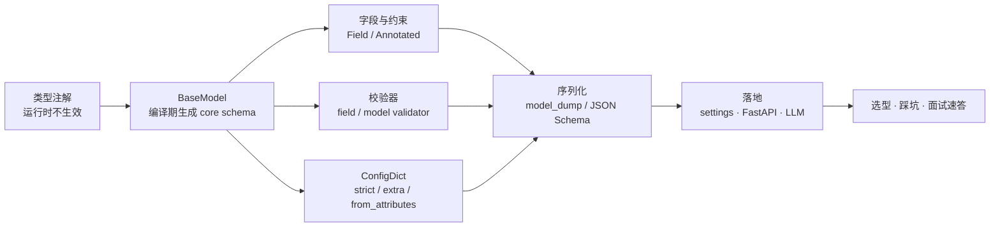

# Pydantic 全景 · 把类型注解变成运行时契约

> [!tldr] 一句话
> 类型注解默认只是**注释**，运行时不生效；Pydantic 读取 `__annotations__`，在类创建时编译出校验器，把「dict / JSON / 环境变量 / ORM 对象」变成「字段类型确定、约束已验证」的对象，并顺带生成 JSON Schema。
> 它是 Python 世界的 **`@RequestBody` + Bean Validation + Jackson** 三合一，也是 FastAPI、LangChain、OpenAI SDK 的默认契约层。

> [!note] 为什么要单开一篇
> 库里 Pydantic 散落在 5 处，每处只讲一个侧面：[[00-Python 学习计划总览]] 只有 mindmap 节点和 W4 计划，[[02-阶段二-数据模型与工程化]] §三给了 `dataclass vs Pydantic` 选型表、§四说「注解运行时不生效但 Pydantic 会真的校验」，[[04-阶段四-数据与 AI 应用]] 拿它写请求/响应模型和 LLM 结构化输出，[[05-阶段五-项目实战与验收]] 把「Pydantic 为什么能校验」列成面试题 16 **却没给答案**，[[17-专题-pyproject.toml 全景]] 只把它当作一条依赖声明。
> 本篇补齐：**运行机制 → v2 API 全览 → 字段与校验器 → 严格模式与 ConfigDict → 序列化 → settings/`.env` → FastAPI 与 LLM 落地 → 选型与踩坑 → 面试题答案**。
>
> **口径**：全文按 **Pydantic v2**（本机实测 `2.14.3`，`pydantic-settings 2.14.2`，FastAPI `0.143.3`）书写，v1 只出现在迁移对照表里。网上大量教程仍是 v1，遇到 `.dict()` / `@validator` / `orm_mode` 直接判定为旧文。

---

## 🗺️ 全篇导航



---

## 一、它到底解决什么问题（面试题 16 的标准答案）

[[02-阶段二-数据模型与工程化]] §四说过三个真相，其中第 2 条就是 Pydantic 的立足点：

```python
def f(x: int) -> int:
    return x

f("abc")   # 不报错。注解只是元数据，CPython 运行时完全不检查
```

`x: int` 会进函数的 `__annotations__` 字典，但**没有任何东西去读它**。Pydantic 做的工作是：

1. **类创建时**（`__init_subclass__` / 元类阶段）扫描类体的 `__annotations__` 与 `Field(...)`，编译成一份 **core schema**；v2 的校验引擎 `pydantic-core` 是 Rust 写的，所以比 v1 快一个量级。
2. **实例化时**按 core schema 逐字段执行：类型解析 → 约束检查 → 自定义校验器 → 构造对象。
3. 类本身还能反向吐出 **JSON Schema**（`model_json_schema()`），给 OpenAPI 文档和 LLM 结构化输出用。

所以一句话：**静态注解是给人/给 mypy 看的，Pydantic 把它变成运行时契约**。

> [!example] 面试题 16：类型注解运行时会生效吗？Pydantic 为什么能校验？
> 不会生效，注解只是存在 `__annotations__` 里的元数据。Pydantic 的能力不来自语言，而来自它在**类定义时主动读取注解**并生成校验器；`BaseModel.__init__` 拿到入参后按这份 schema 逐字段验证与转换。因此它和 mypy 是互补的两条路：mypy 在**运行前**查代码，Pydantic 在**运行时**查数据。这也是为什么「外部数据」必须过 Pydantic——外部数据不会被静态检查覆盖。

| Python / Pydantic | Java 对应物 | 说明 |
|---|---|---|
| 类型注解 | 字段声明上的类型 | 都只是声明，本身不产生校验 |
| `mypy --strict` | 编译器 `javac` | 运行前静态检查 |
| `BaseModel` | DTO / `record` + `@RequestBody` | 承载并约束外部入参 |
| `Field(min_length=1)` | `@NotBlank` / `@Size` | 约束注解 |
| `model_validate()` | Jackson 反序列化 + Hibernate Validator | JSON → 对象并校验 |
| `ValidationError` → FastAPI 422 | `MethodArgumentNotValidException` → 400 | 框架在进入业务代码前拦截 |

---

## 二、最小可用模型：v2 API 全览

```python
from pydantic import BaseModel, ConfigDict, Field, ValidationError, field_validator, model_validator

class ChatRequest(BaseModel):
    model_config = ConfigDict(extra="forbid", str_strip_whitespace=True)

    conversation_id: int
    message: str = Field(min_length=1, max_length=4000)
    stream: bool = True

    @field_validator("message", mode="before")
    @classmethod
    def strip(cls, v):
        return v.strip() if isinstance(v, str) else v

req = ChatRequest(conversation_id="42", message="  hello  ")
# conversation_id 是 str，被宽松转换成 int；message 被 before 校验器清掉首尾空格
```

**核心 API 速查**（v2 命名，括号里是被淘汰的 v1 写法）：

| 方法 | 作用 | v1 旧名 |
|---|---|---|
| `Model(**data)` / `Model.model_validate(obj)` | dict / 对象 → 模型 | `parse_obj()` |
| `Model.model_validate_json(raw)` | JSON 字符串/bytes → 模型 | `parse_raw()` |
| `m.model_dump()` | 模型 → Python dict | `.dict()` |
| `m.model_dump_json()` | 模型 → JSON 字符串 | `.json()` |
| `m.model_json_schema()` | 生成 JSON Schema | `.schema()` |
| `m.model_copy(update=..., deep=True)` | 复制并局部改字段 | `.copy()` |
| `m.model_fields` | 字段元信息（类属性） | `__fields__` |
| `TypeAdapter(T).validate_python(x)` | 校验**任意类型**，不必是 BaseModel | v1 无对应 |
| `m.model_construct(**data)` | 跳过校验直接构造（快，但危险） | `.construct()` |

**校验失败长这样**（实测 `ValidationError.errors()`）：

```python
try:
    ChatRequest(conversation_id="abc", message="x", oops=1)
except ValidationError as e:
    print(e.errors())
# [{'type': 'int_parsing', 'loc': ('conversation_id',), 'msg': '...', 'input': 'abc'},
#  {'type': 'extra_forbidden', 'loc': ('oops',), ...}]
```

`type` 是机器可读的错误码、`loc` 是字段路径、`input` 是原始值。FastAPI 直接把这份结构塞进 **422** 响应，见 [[04-数据层-Model-Schema-CRUD]] §2.2：

```json
{"detail":[{"type":"string_too_short","loc":["body","name"],
  "msg":"String should have at least 2 characters","input":""}]}
```

注意它没有业务信封 `{code, msg, data}`——因为请求**在进入业务代码前**就被拦下了，前端拦截器要单独处理 422。

---

## 三、字段与约束

### 3.1 两种写法，v2 推荐 `Annotated`

```python
from typing import Annotated
from pydantic import BaseModel, Field

PositiveInt = Annotated[int, Field(gt=0)]      # 可复用，且不污染默认值

class Order(BaseModel):
    qty: PositiveInt = 1
    # 旧写法仍可用，但 v2 官方推荐 Annotated：qty: int = Field(default=1, gt=0)
```

> [!tip] 为什么推荐 `Annotated`
> 约束和默认值解耦，类型别名能跨模型复用；静态分析器也能正确推断字段类型。v1 的 `constr(min_length=1)` / `conint(gt=0)` 在 v2 已被 `Annotated[str, Field(...)]` 取代。

### 3.2 `Field` 常用参数

| 分类 | 参数 | 说明 |
|---|---|---|
| 字符串 | `min_length` / `max_length` / `pattern` | 长度与正则 |
| 数值 | `gt` `ge` `lt` `le` `multiple_of` | 开区间用 `gt/ge` 区分（实测错误码 `greater_than_equal`） |
| 默认值 | `default` / `default_factory` | **可变默认值必须用 `default_factory=list`** |
| 必填 | `...`（Ellipsis） | `Field(...)` 表示无默认值 |
| 别名 | `alias` / `validation_alias` / `serialization_alias` | 对接外部驼峰字段 |
| 描述 | `title` / `description` / `examples` | 直接进 JSON Schema，LLM 会读到 |
| 序列化 | `exclude` / `repr` | 从 dump / 打印中剔除 |

### 3.3 别名双向（实测）

```python
class Alias(BaseModel):
    model_config = ConfigDict(populate_by_name=True)   # 允许用字段名而非 alias 传值
    user_name: str = Field(alias="userName")

Alias(userName="a")            # 外部 JSON 用驼峰
Alias(user_name="b")           # 内部代码用蛇形（需要 populate_by_name=True）
Alias(userName="a").model_dump(by_alias=True)   # {'userName': 'a'}
```

### 3.4 `Optional` 陷阱（必考，实测）

```python
class A(BaseModel):
    x: str | None          # 没给默认值 → 仍然是必填字段！
    y: str | None = None    # 可缺省

A()          # ValidationError: missing
A(x=None)    # 通过，x 为 None
```

**`X | None` 只放宽「值可以是 None」，不放宽「字段可以不传」。** 要可缺省必须显式 `= None`。这是从 Java / TypeScript 转过来最容易踩的一坑。

### 3.5 常用特殊类型

| 类型 | 用途 | 备注 |
|---|---|---|
| `SecretStr` | 密码、token | 打印/日志显示 `**********`，取值要 `.get_secret_value()` |
| `EmailStr` | 邮箱 | 需额外装 `email-validator` |
| `HttpUrl` / `AnyUrl` | URL | 会规范化，末尾补 `/` |
| `datetime` / `date` | 时间 | 支持 ISO 字符串与 Unix 时间戳 |
| `UUID` / `Decimal` / `IPvAnyAddress` | ID / 金额 / IP | 金额用 `Decimal` 别用 `float` |
| `Literal["a","b"]` / `Enum` | 枚举约束 | 配合 `use_enum_values` |
| `Json[T]` | 先解析 JSON 字符串再按 T 校验 | 处理「JSON 套 JSON」的字段 |

---

## 四、校验器：三层与 v1 → v2 迁移

```python
class User(BaseModel):
    id: int
    name: str

    @field_validator("name", mode="before")       # 拿原始值，可做清洗/兼容旧格式
    @classmethod
    def normalize(cls, v):
        return v.strip() if isinstance(v, str) else v

    @field_validator("name")                      # mode="after"（默认），拿已转换的值
    @classmethod
    def not_blank(cls, v: str) -> str:
        if not v:
            raise ValueError("姓名不能为空")
        return v

    @model_validator(mode="after")                # 跨字段校验，必须 return self
    def cross_check(self):
        if self.id < 0:
            raise ValueError("id 必须为正")
        return self
```

**三个硬规则**：`@classmethod` 写在 `@field_validator` **下面**；校验器必须 `return` 值/`self`，返回 `None` 会埋下隐患；`raise` 用 `ValueError` / `AssertionError` / `PydanticCustomError`，Pydantic 会统一包成 `ValidationError`。

> [!warning] v1 → v2 迁移对照（搜到旧代码先按这张表改）
>
> | v1 | v2 |
> |---|---|
> | `@validator("x")` | `@field_validator("x")` |
> | `@root_validator` | `@model_validator(mode="before"/"after")` |
> | `class Config: orm_mode = True` | `model_config = ConfigDict(from_attributes=True)` |
> | `class Config: allow_population_by_field_name` | `populate_by_name=True` |
> | `constr` / `conint` / `confloat` | `Annotated[str, Field(...)]` |
> | `.dict()` / `.json()` | `.model_dump()` / `.model_dump_json()` |
> | `.parse_obj()` / `.parse_raw()` | `.model_validate()` / `.model_validate_json()` |
> | `.schema()` / `__fields__` | `.model_json_schema()` / `model_fields` |
> | `from pydantic import BaseSettings` | `from pydantic_settings import BaseSettings`（独立包） |
> | `@validator(..., always=True)` | 语义变了，v2 用 `Field(default=...)` + 校验器或 `model_validator` |

迁移工具：`pip install pydantic-upgrade`，或用兼容层 `from pydantic.v1 import BaseModel` **临时**过渡（不要长期混用，两套模型的实例互不识别）。

---

## 五、类型转换与严格模式

v2 默认是**宽松（lax）模式**，会尽量把值转成目标类型：

| 输入 | 目标 | 结果（实测） |
|---|---|---|
| `"42"` | `int` | `42`，类型真的变成 `int` |
| `"yes"` `"true"` `"1"` | `bool` | `True`；`"no"` `"0"` → `False` |
| `["1","2"]` | `list[int]` | `[1, 2]` |
| `"2026-11-15"` | `date` | `datetime.date` 对象 |
| `3.14` | `str` | 默认**拒绝**，需 `coerce_numbers_to_str=True` |

**要严格就显式开严**：

```python
from pydantic import TypeAdapter, ValidationError

TypeAdapter(int).validate_python("42")                    # 42（宽松）
TypeAdapter(int).validate_python("42", strict=True)       # ValidationError: int_type

class StrictModel(BaseModel):
    model_config = ConfigDict(strict=True)                # 全模型严格
    amount: int
```

> [!tip] 什么时候开 strict
> 金额、ID、状态码、外部回调签名这类**「字符串数字」不该被容忍**的字段；以及做数据清洗时想让脏数据显式报错而不是被悄悄转换。普通 HTTP 入参保持宽松更友好（前端传过来的数字常常就是字符串）。

---

## 六、`ConfigDict` 常用项

| 配置 | 默认 | 作用 |
|---|---|---|
| `extra` | `"ignore"` | `ignore` 静默丢弃多余字段 / `forbid` 报错 / `allow` 收进 `__pydantic_extra__` |
| `strict` | `False` | 关闭宽松转换 |
| `validate_assignment` | `False` | 开启后 `obj.x = ...` 也会校验（实测 `greater_than_equal` 生效） |
| `frozen` | `False` | 不可变 + 可哈希，替代 v1 的 `allow_mutation=False` |
| `from_attributes` | `False` | 允许从 ORM 对象属性读取，替代 `orm_mode` |
| `populate_by_name` | `False` | 允许用字段名（而非 alias）传值 |
| `str_strip_whitespace` | `False` | 自动去首尾空格 |
| `arbitrary_types_allowed` | `False` | 允许第三方类作为字段类型（只做 isinstance 检查） |
| `use_enum_values` | `False` | dump 时输出枚举的值而非枚举对象 |

> [!warning] `extra="ignore"` 是默认值，也是隐患
> 前端把 `userName` 拼成 `username`，请求不会报错，字段静默丢失。对接外部接口建议统一 `extra="forbid"`，让拼写错误立刻暴露。

---

## 七、序列化与 ORM 往返

```python
m.model_dump()                                   # Python dict，datetime 仍是 datetime 对象
m.model_dump(mode="json")                        # JSON 兼容 dict，datetime → ISO 字符串
m.model_dump_json()                              # 直接给 JSON 字符串
m.model_dump(exclude_none=True)                  # 去掉 None，接口响应常用
m.model_dump(exclude_unset=True)                 # 只输出显式传过的字段 → PATCH 部分更新
m.model_dump(include={"id", "name"}, by_alias=True)
```

**对接 SQLAlchemy**（呼应 [[04-数据层-Model-Schema-CRUD]]，正确做法永远是 `OutSchema.model_validate(orm_obj).model_dump()`）：

```python
class UserOut(BaseModel):
    model_config = ConfigDict(from_attributes=True)
    id: int
    name: str

row = session.get(UserModel, 1)
UserOut.model_validate(row)        # 直接读 ORM 对象属性，不需要 model.dict()
```

> [!warning] 别把 ORM 对象直接塞进响应
> 会带上 `relationship` 触发懒加载（异步 Session 下抛 `MissingGreenlet`）、泄露内部字段、改表结构就改了接口契约。**Model 描述表，Schema 描述契约，两者必须分层。**

`model_dump()` 与 `model_dump_json()` 的另一个差别：`SecretStr` 在 Python 模式下仍是 `SecretStr` 对象，`mode="json"` 下变成 `**********` 字符串；要真值必须显式 `.get_secret_value()`。

---

## 八、`pydantic-settings`：配置与 `.env`

v2 把 `BaseSettings` **拆成独立包**了，这是最常踩的迁移坑：

```bash
pip install pydantic-settings
```

```python
from pydantic import SecretStr
from pydantic_settings import BaseSettings, SettingsConfigDict

class Settings(BaseSettings):
    model_config = SettingsConfigDict(
        env_file=".env",
        env_file_encoding="utf-8",
        env_nested_delimiter="__",     # DB__HOST → 嵌套 db.host
        case_sensitive=False,
        extra="ignore",
    )
    redis_host: str = "127.0.0.1"
    redis_port: int = 6379
    password: SecretStr = SecretStr("")

settings = Settings()
```

**优先级**（高 → 低）：构造参数 `Settings(redis_host=...)` > **环境变量** > `.env` 文件 > secrets 目录 > 字段默认值。

> [!danger] 与今天踩的坑直接相关：配置只在进程启动时读一次
> `load_dotenv()` / `Settings()` 都是**启动时一次性**把值读进内存并固化到模块级单例。改了 `.env.dev` 之后，运行中的进程仍然拿着旧值——必须**重启后端进程**才生效（PyCharm 里 Stop → Run 即可，不必重启整个 IDE）。
> 另外 `python-dotenv` 的 `load_dotenv()` 默认 `override=False`：**外部已存在的环境变量优先**，后加载的 `.env` 不会覆盖它。项目里同时存在 `.env` 和 `.env.dev` 且指向不同 Redis 时，这个语义很容易造成「改了文件却没生效」的错觉。

参考 [[08-启动流程与配置管理]] 与 [[00-FastApiAdmin-项目总览]] 里项目的实际配置分层；[[17-专题-pyproject.toml 全景]] 说明 `pydantic>=2.9` 该写在 `[project].dependencies` 而不是依赖组。

---

## 九、在 FastAPI 里的位置

```python
from fastapi import FastAPI

@app.post("/chat", response_model=ChatResponse)
async def chat(body: ChatRequest) -> ChatResponse:   # body 已是校验过的对象，不是 dict
    ...
```

- **请求体**：`body: ChatRequest` 触发 `model_validate`；失败自动 **422**，业务代码一行 try/except 都不用写。
- **响应**：`response_model` 会再校验一次并**过滤掉模型里没声明的字段**（防止把 ORM 内部字段泄露出去）。
- **部分更新**：`body.model_dump(exclude_unset=True)` 区分「没传」和「传了 None」，PATCH 语义才正确。
- **文档**：`model_json_schema()` 自动进 OpenAPI，`Field(description=..., examples=...)` 直接变成文档内容。
- **依赖注入**：`Depends` 与 Pydantic 无关但常一起出现，见 [[16-专题-yield 关键字全景（从生成器到依赖注入）]]。

Java 对照：`@RequestBody` + `@Valid` + Jackson + springdoc 这一整套，FastAPI 用一个类型注解全包了，代价是错误信息格式（422 `detail`）和 Spring 的 `MethodArgumentNotValidException` 不同，见 [[10-FastAPI与SpringBoot全面对比]]。

---

## 十、LLM 结构化输出：为什么 Pydantic 成了事实标准

```python
class Intent(BaseModel):
    action: Literal["query", "refund", "human"]
    order_id: str | None = Field(None, description="用户提到的订单号")

Intent.model_json_schema()   # 直接作为 JSON Schema / tool schema 传给模型
```

模型输出不可控，但**契约可以被约束**：把 schema 塞进 prompt 或 `response_format`，拿回来的 JSON 用 `Intent.model_validate_json(raw)` 一验，类型不对就抛 `ValidationError`，可以重试或修。

| 场景 | 常用做法 |
|---|---|
| LangChain 早期 | `PydanticOutputParser` / `JsonOutputParser(pydantic_object=Intent)` |
| LangChain 1.0 | `create_agent(response_format=Intent)`，结构化输出已进主循环，见 [[02-Model I-O 模型提示词与输出解析]] |
| OpenAI / 兼容接口 | `response_format` + `Intent.model_json_schema()` |
| 函数调用 / Tool | 参数 schema 直接由 `BaseModel` 生成 |

> [!tip] 写 `description` 不是给自己看的
> `Field(description=...)` 会进 JSON Schema，模型就是靠它理解字段含义的。字段描述写得含糊，结构化输出的准确率会明显下降。

---

## 十一、选型表与 Java 对照

| 维度 | `@dataclass` | `TypedDict` | Pydantic `BaseModel` |
|---|---|---|---|
| 运行时校验 | 无 | 无（仅静态） | **有，且强制** |
| 类型转换 | 无 | 无 | 有（可关严格模式） |
| 本质 | 带方法的类 | 就是 dict | 校验器 + 对象 |
| 性能 | 最快 | 最快（零开销） | 有校验开销（v2 Rust 内核已很快） |
| JSON / Schema | 手写 | 手写 | 内建 |
| 适合 | 边界内的领域对象 | 纯类型提示、dict 形状 | **跨边界**：HTTP、DB、配置、LLM |

> [!tip] 沿用 [[02-阶段二-数据模型与工程化]] 的一句话选型
> **跨边界用 Pydantic，边界内用 dataclass。** 外部数据不可信，必须验；内部数据已经可信，没必要为每次赋值付校验成本。

| Java | Python / Pydantic |
|---|---|
| `record` / Lombok `@Data` | `@dataclass`（`frozen=True, slots=True`） |
| Jakarta Bean Validation `@NotNull @Size @Min` | `Field(...)` / `Annotated[int, Field(ge=0)]` |
| 自定义 `ConstraintValidator` | `@field_validator` / `@model_validator` |
| Jackson `@JsonProperty("userName")` | `Field(alias="userName")` + `populate_by_name` |
| Jackson `ObjectMapper.readValue` | `model_validate_json()` |
| `@Valid` 触发的 400 | FastAPI 自动 422 |
| `application.yml` + `@ConfigurationProperties` | `pydantic-settings` + `.env` |
| MapStruct / BeanUtils 拷贝 | `model_validate(orm_obj)`（`from_attributes=True`） |

---

## 十二、踩坑清单 Top 10（带实测结论）

1. **`Optional` ≠ 可缺省**：`x: str | None` 无默认值仍必填，实测 `A()` 报 `missing`。要写 `= None`。
2. **v1/v2 API 混用**：搜到 `.dict()`、`@validator`、`orm_mode` 就是旧教程；装了 v2 会直接 `AttributeError` 或弃用警告。
3. **可变默认值**：`tags: list[str] = []` 会被 Pydantic 拒绝/深拷贝处理，但概念上仍应写 `Field(default_factory=list)`（与 dataclass 一致，见 [[02-阶段二-数据模型与工程化]]）。
4. **宽松转换太宽容**：`"no" → False`、`"42" → 42` 实测成立；金额/ID 字段要 `strict=True`。
5. **校验器写法**：漏 `@classmethod`、漏 `return`、`mode="after"` 里改原始 `dict` 都无效；跨字段校验必须 `return self`。
6. **`extra` 默认 ignore**：字段名拼错静默丢失，外部入参统一 `extra="forbid"`。
7. **对接 ORM 忘配 `from_attributes=True`**：`model_validate(orm_obj)` 直接报 `validation_error`。
8. **`SecretStr` 不是 str**：打印/日志是掩码，比较和传参要 `.get_secret_value()`；`model_dump()` 里仍是对象。
9. **`model_dump()` ≠ JSON**：`datetime` / `Decimal` / `UUID` 仍是 Python 对象，直接 `json.dumps()` 会报错，要用 `mode="json"` 或 `model_dump_json()`。
10. **性能与绕过**：高频循环里用 `TypeAdapter(T)` 复用（别每次建类）；`model_construct()` 跳过校验很快但只适合可信数据；配置对象在启动时构造一次，别放请求链路上反复 `Settings()`。

---

## 十三、面试速答

| 问题 | 一句话答案 |
|---|---|
| **类型注解运行时生效吗？Pydantic 为什么能校验？（05 面试题 16）** | 不生效；Pydantic 在类创建时读 `__annotations__` 编译 core schema，实例化时按 schema 校验与转换，与 mypy 的静态检查互补。 |
| Pydantic v2 比 v1 快在哪？ | 校验核心换成 Rust 编写的 `pydantic-core`，schema 在类定义期预编译。 |
| `Optional[str]` 字段可以不传吗？ | 不可以，只表示值允许为 `None`；可缺省必须给默认值 `= None`。 |
| `model_validate` 和 `model_validate_json` 区别？ | 前者收 dict / 任意对象，后者收 JSON 字符串或 bytes。 |
| 怎么让 FastAPI 返回时过滤字段？ | `response_model` 会自动按模型裁剪；需要更细用 `response_model_exclude_none` / `model_dump(exclude=...)`。 |
| ORM 对象怎么转 Schema？ | `ConfigDict(from_attributes=True)` + `Out.model_validate(orm_obj)`，不要 `orm_obj.__dict__`。 |
| Pydantic 和 dataclass 怎么选？ | 跨边界（HTTP/DB/配置/LLM）用 Pydantic，边界内用 dataclass。 |
| 配置改了 `.env` 为什么不生效？ | 配置在进程启动时一次性读入并固化，必须重启进程；且 `load_dotenv` 默认 `override=False`，外部环境变量优先。 |

---

## 十四、速查卡

```python
from typing import Annotated
from pydantic import (
    BaseModel, ConfigDict, Field, TypeAdapter,
    ValidationError, SecretStr,
    field_validator, model_validator,
)
from pydantic_settings import BaseSettings, SettingsConfigDict

class M(BaseModel):
    model_config = ConfigDict(extra="forbid", from_attributes=True)
    id: int
    tags: list[str] = Field(default_factory=list)
    score: Annotated[float, Field(ge=0, le=100)] = 0.0

M.model_validate({"id": "1"})          # dict → 对象（宽松转换）
M.model_validate_json('{"id":1}')      # JSON → 对象
m = M(id=1)
m.model_dump(exclude_none=True)        # 对象 → dict
m.model_dump_json()                    # 对象 → JSON
M.model_json_schema()                  # JSON Schema（OpenAPI / LLM）
TypeAdapter(list[M]).validate_python([{"id": 1}])
m.model_copy(update={"score": 10})     # 复制并覆盖
```

**延伸**：[[04-阶段四-数据与 AI 应用]]（FastAPI 请求链路与结构化输出）、[[04-数据层-Model-Schema-CRUD]]（Schema 与 ORM 分层）、[[08-启动流程与配置管理]]（配置加载）、[[17-专题-pyproject.toml 全景]]（依赖声明与打包）、[[05-阶段五-项目实战与验收]]（面试题全集）。

> 官方口径以 docs.pydantic.dev 为准；本文所有示例在 `pydantic 2.14.3 / pydantic-settings 2.14.2 / FastAPI 0.143.3` 下实测通过。
