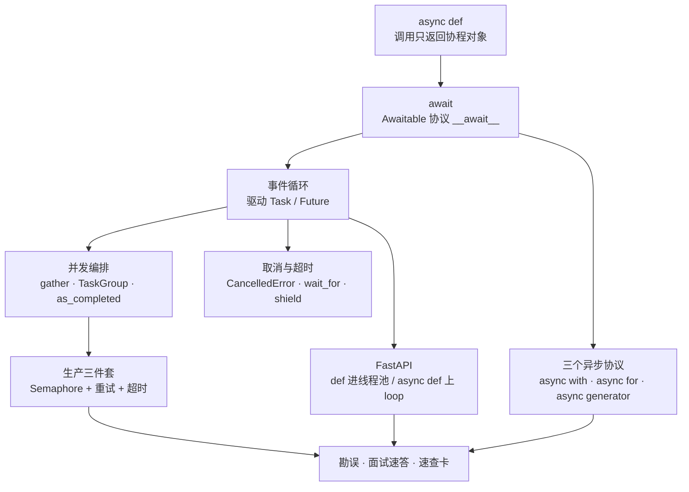
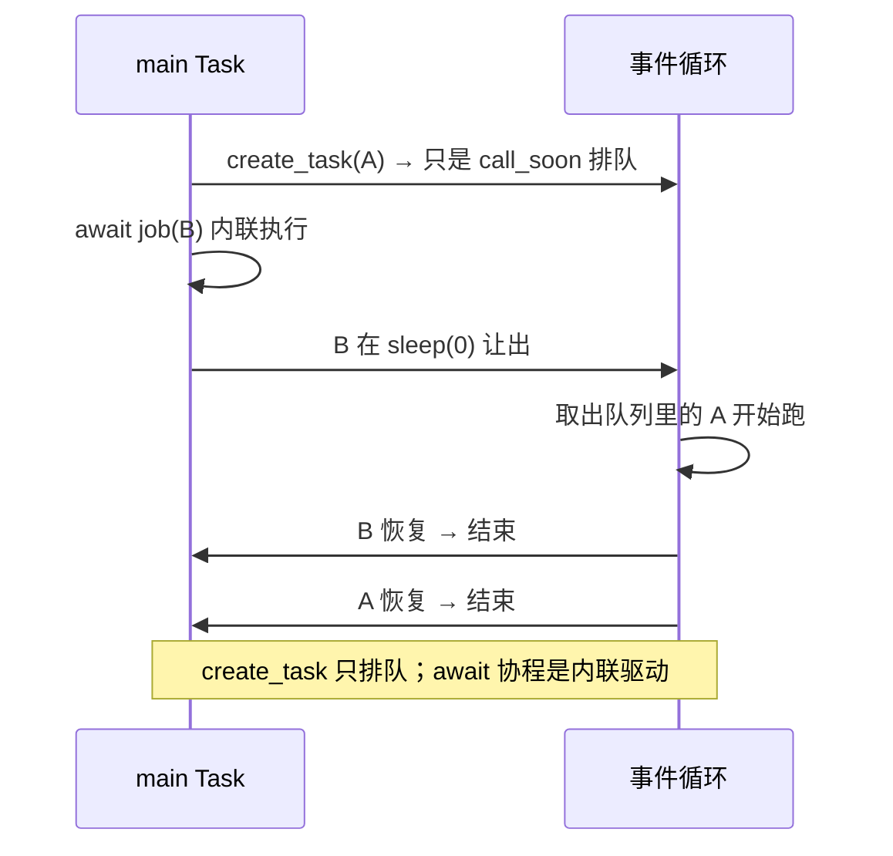

# async / await 全景 · 从生成器到事件循环

> [!tldr] 一句话
> `async def` 把一个函数从「调用即执行」改成「调用只造一个**协程对象**」；`await` 是唯一能驱动它前进的操作，在挂起点把控制权**交还事件循环**，由循环在 IO 就绪时把结果送回来。
> 单线程、协作式、**只让出不阻塞** —— 这就是 GIL 还在、`asyncio` 却能提升吞吐的全部原因。它不是并行，是把等待时间重叠起来。

> [!note] 为什么单开一篇
> 库里已有 [[03-阶段三-并发与异步]]（GIL、三模型选型、生产三件套、五个坑）和 [[16-专题-yield 关键字全景（从生成器到依赖注入）]] §七（异步生成器），但都停在「怎么用」，没讲**语言机制**。
> 本篇只啃机制：`async def` 改变了什么 → Awaitable 协议 → 事件循环与 Task 的调度时序 → 取消/超时 → 三个异步协议 → FastAPI 里 `def` / `async def` 的分派 → 勘误与面试题标准答案。
> 对应 [[00-Python 学习计划总览]] 硬指标 2/3/4，以及 [[05-阶段五-项目实战与验收]] 并发层面试题 8–12。

> [!warning] 两处库内讹误（本机实测）
> 1. [[03-阶段三-并发与异步]] §五说「漏 `await` 用 ruff `RUF006` + `-W error::RuntimeWarning` 拦住」——实测 **`RUF006` 是 `asyncio-dangling-task`**（管 `create_task` 返回值未保存），`ruff check --select ALL` 也扫不出漏 `await`；而 `-W error::RuntimeWarning` 下，协程析构期的警告只打印 `Exception ignored in`，**进程退出码仍为 0**。详见 §十二。
> 2. [[03-阶段三-并发与异步]] §四与 §四·限流示例用了 `asyncio.TaskGroup()` 和 `asyncio.timeout()`（都要 3.11+），而本项目 `RuoYiFastAPI` 环境是 **Python 3.10.22**，这两行会直接 `AttributeError`。§五给出 3.10 兼容写法。

---

## 🗺️ 全篇导航



---

## 一、三组词先分开：并发 / 并行 / 异步

| 词 | 含义 | Python 里的落地 |
|---|---|---|
| **并发** concurrency | 一段时间内**交替**处理多个任务 | `threading`、`asyncio` |
| **并行** parallelism | 同一时刻**真的同时**跑在多个核上 | `multiprocessing`、NumPy / C 扩展释放 GIL |
| **异步** async | 调用方不干等结果，**让出控制权**，完成后被通知 | `await` + 事件循环 |

> [!success] 硬指标 2 的标准答案：GIL 还在，为什么 `asyncio` 能提升吞吐？
> GIL 只保证「同一时刻只有一个线程执行 Python 字节码」。它锁的是 **CPU 执行**，锁不住 **IO 等待**：socket / 文件操作在 C 层会主动释放 GIL，`await` 则更彻底 —— 连线程都不占，直接让事件循环去跑别的协程。
> 所以 100 个 HTTP 请求从 100 × 0.1s 变成 ≈ 0.1s，**不是因为多核，是因为等待被重叠了**。一旦协程里出现纯 CPU 循环或 `time.sleep()`，重叠立刻失效。
> GIL 的三模型选型表见 [[03-阶段三-并发与异步]] §一～§三，[[08-专题-Python 内存管理与垃圾回收（对比 JVM）]] §free-threading 讲了 3.13t 之后的变化。

---

## 二、`async def` 到底改变了什么

```python
import asyncio, inspect

async def f():
    print("函数体执行了")     # 调用 f() 时这行不会跑
    return 42

c = f()
print(type(c).__name__)             # coroutine
print(inspect.iscoroutinefunction(f))   # True
print(inspect.isawaitable(c))           # True
print(asyncio.run(c))               # 先打印「函数体执行了」，再打印 42
```

**关键：`async def` 改变的是函数的「种类」，不是执行速度。** 编译器给它打上 `CO_COROUTINE` 标记，调用时不再执行函数体，而是返回一个保存了参数与栈帧的协程对象；函数体要等到被 `await` / 包成 `Task` 才真正开始跑。

这和 [[16-专题-yield 关键字全景（从生成器到依赖注入）]] §一是同一个套路：`yield` 让函数返回生成器，`async def` 让函数返回协程，两者都把「执行」从「调用」里剥离出来。

| 定义方式 | 调用返回 | 驱动方式 | 能否 `await` |
|---|---|---|---|
| `def` | 返回值 | 立即执行 | ❌ |
| `def` + `yield` | `generator` | `next()` / `for` | ❌ |
| `async def` | `coroutine` | `await` / `asyncio.run` | ✅ |
| `async def` + `yield` | `async_generator` | `async for` | ❌（要用 `async for`） |

> [!warning] 协程对象是一次性的
> 实测：`c = once(); asyncio.run(c); asyncio.run(c)` → 第二次抛 `RuntimeError: cannot reuse already awaited coroutine`。
> 要跑两次就**重新调用函数**生成新协程对象，不要缓存 `c`。

---

## 三、`await` 的本质：Awaitable 协议

`await x` 不挑 `x` 的具体类型，只要求它是 **awaitable**。三类对象满足协议：

| 类别 | 例子 | `inspect.isawaitable` |
|---|---|---|
| 原生协程 | `async def f()` 返回的 `coroutine` | ✅ |
| `Task` / `Future` | `create_task(...)`、`loop.create_future()`、`asyncio.sleep(...)` | ✅ |
| 自定义对象 | 实现了 `__await__()` 并返回一个迭代器 | ✅ |
| 普通值 | `42`、`"abc"`、普通 `def` 的返回值 | ❌ |

### 3.1 手写最小 awaitable（实测通过）

```python
import asyncio, inspect

class Tick:
    def __await__(self):
        yield                 # 裸 yield：把控制权交还事件循环一次
        return "TICK-DONE"

async def main():
    return await Tick()

print(inspect.isawaitable(Tick()))   # True
print(asyncio.run(main()))           # TICK-DONE
```

`await` 做的事只有三步：

1. 取 `x.__await__()`（协程/Task 内建）拿到一个**迭代器**；
2. 迭代器 `yield` 出「我要等什么」，当前 Task 挂起，控制权回到事件循环；
3. 条件就绪后循环重新推进迭代器，`StopIteration.value` 就是 `await` 表达式的值，从挂起点继续往下跑。

所以 **`await` 是「让出」，不是「等待」**：它不阻塞线程、不占 GIL 去轮询，只是把剩余栈帧冻结在那里等通知。这也是 §二里「协程 = 冻结的栈帧」的由来。

### 3.2 语法边界（三条，都实测过）

```python
await f()          # 顶层（async def 外）→ SyntaxError: 'await' outside function
await 42           # → TypeError: object int can't be used in 'await' expression
await plain_def()  # 普通函数没返回 awaitable → 同样 TypeError
```

`await` 只能出现在 `async def` 函数体内（REPL / Jupyter 的顶层 `await` 是解释器特例）。反过来，`async def` 里也**可以一个 `await` 都没有** —— 语法允许，但函数退化成同步执行，`ruff RUF029` 会标 `unused-async`。

### 3.3 演进史：async/await 不是凭空来的

| 版本 | 语法 | 解决什么 |
|---|---|---|
| 2.2 · PEP 255 | `yield` | 函数能停在半路、下次从原地继续 |
| 3.3 · PEP 380 | `yield from` | 委托给子生成器，形成可嵌套的调用链 |
| 3.4 | `asyncio` + `@types.coroutine` | 用生成器**模拟**协程，`yield from` 就是 `await` 的前身 |
| 3.5 · PEP 492 | `async def` / `await` | 原生协程成为独立类型，不再借用生成器；语法与生成器正式分家 |
| 3.7 | `asyncio.run()` | 统一入口，取代手动 `get_event_loop().run_until_complete()` |
| 3.11 | `TaskGroup` / `timeout` / `except*` | 结构化并发 |
| 3.12+ | `eager_task_factory` | 让 Task 可以立即启动而非等下一个循环 tick |

> 记住这条链，就能回答「为什么 `yield` 和 `await` 长得像」：它们是**同一个暂停/恢复机制**的两代语法。细节见 [[16-专题-yield 关键字全景（从生成器到依赖注入）]] §四 `yield from`。

---

## 四、事件循环与 Task：谁在驱动谁

`asyncio.run(main())` 干四件事：

1. 新建事件循环，设为当前线程的 running loop；
2. 把 `main()` 这个协程包成 **`Task`**；
3. 反复 `_run_once()`：跑就绪回调 → 轮询 selector（epoll / kqueue）→ 把 IO 就绪的 Future 标为完成 → 唤醒对应 Task；
4. `main` 完成后取消并等待残留 Task、关闭异步生成器、关闭 loop。

| 对象 | 本质 | 谁驱动它 |
|---|---|---|
| **coroutine** | 冻结的栈帧，`await` 协议的实现 | 自己不会跑，必须被 `await` 或包成 Task |
| **Task** | 协程 + 调度状态机（`Future` 的子类） | 事件循环 |
| **Future** | 低层的「结果占位符」，由库代码 `set_result()` | 一般不直接 `await`，交给库 |
| **自定义 awaitable** | 实现 `__await__` 的对象 | 当前 Task 内联推进 |

### 4.1 `create_task` 不是立即执行（实测调度顺序）

```python
async def sched():
    async def job(name):
        print("  job", name, "开始")
        await asyncio.sleep(0)      # 让出一次
        print("  job", name, "结束")

    t = asyncio.create_task(job("A"))
    print("  create_task 返回后立即执行到这行")
    await job("B")                  # 直接 await：内联执行，不新建 Task
    await t

asyncio.run(sched())
```

实测输出：

```
create_task 返回后立即执行到这行
job B 开始
job A 开始
job B 结束
job A 结束
```



> [!danger] 最容易搞错的一点：`await coro` **不会**产生并发
> `await f(a)` 之后 `await f(b)` 是**串行**（实测 3 × 0.1s = 0.303s）；`asyncio.gather(f(a), f(b))` 或 `create_task()` 才把协程交给循环调度，变成 **≈ 0.100s**。
> 判断标准很简单：**有没有把协程包成 Task**。`gather` 内部会自动帮你包，所以也能并发。

### 4.2 两个 RuntimeError（实测）

```python
asyncio.run(...)     # 在协程内部再调 → asyncio.run() cannot be called from a running event loop
asyncio.create_task(f())   # 同步上下文、loop 外 → RuntimeError: no running event loop
```

`asyncio.run` 是**程序入口**，全进程只调一次；`create_task` 必须在运行中的 loop 内调用。

---

## 五、并发编排：`gather` / `TaskGroup` / `as_completed`

### 5.1 实测对比

```python
t0 = time.perf_counter()
await asyncio.gather(*(asyncio.sleep(0.1) for _ in range(3)))   # 0.100s
for _ in range(3):
    await asyncio.sleep(0.1)                                    # 0.303s
```

| 写法 | 行为 | 版本 |
|---|---|---|
| `gather(*coros)` | 自动包成 Task，按**入参顺序**返回结果；默认任一失败立即抛出（其余不取消） | 全版本 |
| `gather(..., return_exceptions=True)` | 把异常当结果返回（实测返回 `['a', ValueError]`） | 全版本 |
| `as_completed(tasks)` | 按**完成顺序**产出（实测 `[0.01, 0.02, 0.03]`），适合边完成边处理 | 全版本 |
| `asyncio.TaskGroup()` | 结构化并发：任一子任务失败 → 取消其余 → 抛 `ExceptionGroup` | **3.11+** |
| `asyncio.timeout()` | 上下文管理器式超时 | **3.11+** |

实测 `TaskGroup`：一个子任务抛 `ValueError`，另一个长任务收到取消，最终抛 `ExceptionGroup`（含 1 个异常）。这才是生产代码该有的收敛语义，见 [[03-阶段三-并发与异步]] §四的说明。

### 5.2 ⚠️ 版本差异：本项目是 Python 3.10

| API | 3.10.22（RuoYiFastAPI 环境） | 3.13.12（系统 Python） |
|---|---|---|
| `asyncio.TaskGroup` | ❌ 不存在 | ✅ 3.11+ |
| `asyncio.timeout` | ❌ 不存在 | ✅ 3.11+ |
| `asyncio.Runner` | ❌ 不存在 | ✅ 3.11+ |
| `eager_task_factory` | ❌ 不存在 | ✅ 3.12+ |
| `asyncio.to_thread` | ✅ | ✅ 3.9+ |
| `asyncio.TimeoutError` | **独立类**，`is not TimeoutError` | 内置 `TimeoutError` 的别名 |
| `CancelledError` | 继承 `BaseException` | 继承 `BaseException` |

**这是最容易踩的兼容坑**：3.10 里 `wait_for` 抛的是 `asyncio.TimeoutError`，`except TimeoutError` **抓不到**；3.11 起两者统一。写跨版本代码用 `except (asyncio.TimeoutError, TimeoutError)` 或显式升级到 3.11+。

### 5.3 3.10 兼容写法

```python
async def run_all(urls, client):
    sem = asyncio.Semaphore(10)
    async def one(url):
        async with sem:
            return await asyncio.wait_for(client.get(url), timeout=10)   # 3.10 用 wait_for
    results = await asyncio.gather(
        *(one(u) for u in urls), return_exceptions=True
    )
    return [r if not isinstance(r, BaseException) else None for r in results]
```

3.11+ 才可写成：

```python
async def run_all(urls, client):
    sem = asyncio.Semaphore(10)
    async def one(url):
        async with sem, asyncio.timeout(10):
            return await client.get(url)
    async with asyncio.TaskGroup() as tg:
        tasks = [tg.create_task(one(u)) for u in urls]
    return [t.result() for t in tasks]      # 退出 with 时全部完成，失败抛 ExceptionGroup
```

---

## 六、阻塞：最致命的坑（实测数据）

并发跑 3 个耗时 0.15s 的任务，三种写法的实测总耗时：

| 写法 | 实测 | 原因 |
|---|---|---|
| `async def` 里 `time.sleep(0.15)` | **0.462s** | 完全串行，loop 被独占 |
| `await asyncio.sleep(0.15)` | **0.151s** | 真让出，等待重叠 |
| `await asyncio.to_thread(time.sleep, 0.15)` | **0.160s** | 线程池桥接，不占 loop |

> [!danger] 判据（沿用 [[03-阶段三-并发与异步]] §五）
> 只要函数是 `async def`，**里面每一行业务代码都必须是异步的**。一个 `time.sleep` 就能让同进程所有请求一起卡住。

隐形炸弹清单：`requests`、`pymysql` / `psycopg2`、同步版 `redis-py`、`time.sleep`、`open()` 大文件读、CPU 密集纯 Python 循环、同步日志写盘。

桥接三件套：

```python
await asyncio.to_thread(requests.get, url)          # 3.9+，最简
await loop.run_in_executor(pool, blocking_fn, arg)   # 需要自定义线程池
# CPU 密集 → ProcessPoolExecutor（注意 pickle 与 __main__ 保护，见 03 §六）
```

> [!note] 但 `to_thread` 不是万能药
> [[07-操作日志与审计]] 里有一组真实项目实测：`asyncio.to_thread` 在并发 ≥ 4 时对事件循环停顿**无改善**（实测 1.0×），单请求反而从 3.0 ms 变 6.0 ms —— 因为工作线程和事件循环仍争抢同一个 GIL。它解决的是「别卡住 loop」，不是「获得并行算力」。

---

## 七、取消、超时与 `shield`

### 7.1 `CancelledError` 不是 `Exception`

实测：`issubclass(asyncio.CancelledError, BaseException) == True`，`issubclass(..., Exception) == False`（Python 3.8 起改的）。

```python
async def forever():
    try:
        await asyncio.sleep(10)
    except Exception:        # ❌ 抓不到取消信号，TaskGroup / timeout 无法收敛
        pass

t = asyncio.create_task(forever())
await asyncio.sleep(0)
t.cancel()
try:
    await t
except asyncio.CancelledError:   # ✅ 必须显式捕获，或干脆不捕
    ...
```

常见事故：写了 `except Exception: pass` 做兜底，结果把取消信号吞掉，`wait_for` / `TaskGroup` 一直等不到任务结束，程序 hang。正确做法是 `finally:` 做清理、把 `CancelledError` 继续往上抛。客户端断开连接时也走这条路径，见 [[04-阶段四-数据与 AI 应用]] 的 SSE `except asyncio.CancelledError`。

### 7.2 超时与 `shield`（实测）

```python
# 3.10：wait_for 抛 asyncio.TimeoutError（≠ 内置 TimeoutError）
try:
    await asyncio.wait_for(asyncio.sleep(1), 0.05)
except asyncio.TimeoutError: ...

# 3.11+：wait_for / asyncio.timeout 都抛内置 TimeoutError
async with asyncio.timeout(0.05):
    await asyncio.sleep(1)

# shield：外层超时，内层 Task 仍存活
inner = asyncio.create_task(asyncio.sleep(0.15))
try:
    await asyncio.wait_for(asyncio.shield(inner), 0.05)
except asyncio.TimeoutError:
    print(not inner.done())      # 实测 True
await inner                      # 实测仍能正常完成
```

`shield` 的用途是「给等待方设超时，但不杀掉真正的工作」；代价是必须自己负责 `await inner`，否则又变成 dangling task。

---

## 八、硬指标 3：手写「限流 + 重试 + 超时」

**3.10 兼容完整实现**（本机实跑：12/12 成功、6 次重试、峰值并发 3）：

```python
import asyncio, random

sem = asyncio.Semaphore(3)          # ① 限流：最多 3 个在飞
FLAKY = {0, 4, 8}                  # 模拟这几个 id 前两次必失败

async def fetch(i: int, attempt: int) -> str:
    if i in FLAKY and attempt < 2:
        raise ConnectionError(f"临时失败 {i}")
    await asyncio.sleep(0.01)
    return f"ok-{i}"

async def safe_call(i: int) -> str | None:
    for attempt in range(3):                                   # ③ 重试
        try:
            async with sem:
                return await asyncio.wait_for(                  # ② 超时（3.10 写法）
                    fetch(i, attempt), timeout=0.5
                )
        except (asyncio.TimeoutError, ConnectionError):        # 3.11+ 换成 TimeoutError
            if attempt == 2:
                return None                                    # 重试耗尽，降级
            await asyncio.sleep(0.005 * 2 ** attempt + random.random() * 0.001)

async def main():
    return await asyncio.gather(*(safe_call(i) for i in range(12)))
```

3.11+ 可把内层换成 `async with sem, asyncio.timeout(0.5):`，外层换成 `async with asyncio.TaskGroup() as tg:`，失败自动收敛成 `ExceptionGroup`。

| 要素 | 关键点 |
|---|---|
| 限流 | `Semaphore` 必须在**循环外**创建，复用同一个实例；`async with` 保证异常时也释放 |
| 超时 | 每次尝试单独计时，别把重试总时长当单次超时 |
| 退避 | `2 ** attempt` 指数退避 + `random.random()` 抖动，避免重试风暴同时打满下游 |
| 异常白名单 | 只重试可恢复错误（超时、连接断开），别重试 4xx / 参数错误 |
| 降级 | 重试耗尽必须返回 `None` 或抛明确异常，不能悄悄吞掉 |

[[00-Python 学习计划总览]] W6 的验收题「100 个请求 10s 内完成、无泄漏」就是这段的放大版；[[07-专题-Python 的分布式能力边界（对比 Java 生态）]] §限流给了 Redis + Lua 的分布式版本。

---

## 九、三个异步协议：`async with` / `async for` / 异步生成器

| 语法 | 协议方法 | 典型场景 |
|---|---|---|
| `async with x` | `__aenter__` / `__aexit__` | 连接池、`AsyncClient`、`asyncio.Lock`、Semaphore |
| `async for x in y` | `__aiter__` / `__anext__` | SSE、LLM token 流、异步分页 |
| `async def` + `yield` | 异步生成器 | 流式响应 |
| `await x` | `__await__` | 一切 |

```python
from contextlib import asynccontextmanager

@asynccontextmanager
async def conn():
    try:
        yield "CONN"          # setup
    finally:
        ...                   # teardown：即使异常/取消也会执行

async def agen():
    for i in range(3):
        await asyncio.sleep(0)     # 异步生成器体内可以 await
        yield i

async def main():
    async with conn() as c: ...                    # 实测拿到 CONN
    items = [x async for x in agen()]              # 实测 [0, 1, 2]
    g = agen()
    next(g)        # ❌ TypeError: 'async_generator' object is not an iterator
    await g.aclose()
```

> [!warning]
> 异步生成器**不能**被 `next()` 驱动，也**不能**当成普通协程去 `await`；只能用 `async for` 或手动 `await g.__anext__()`。提前退出循环时记得 `await g.aclose()`，否则底层连接/流可能不释放。

落地位置：[[04-阶段四-数据与 AI 应用]] 的 `@asynccontextmanager lifespan`、SSE `StreamingResponse`、`async for chunk in llm.stream(...)`；[[16-专题-yield 关键字全景（从生成器到依赖注入）]] §七有同步/异步生成器对照表；[[06-服务化部署 FastAPI 与 LangServe]] 讲了 `Depends` + yield 依赖的完整上下文。

---

## 十、在 FastAPI 里：`def` 和 `async def` **不等价**

Starlette 用 `inspect.iscoroutinefunction(endpoint)` 分派，**不是**风格选择：

| 路由定义 | `iscoroutinefunction` | 实测执行线程 |
|---|---|---|
| `def sync_route()` | `False` | `AnyIO worker thread` |
| `async def async_route()` | `True` | `MainThread`（事件循环所在线程） |

同步路由被框架自动丢进 `anyio.to_thread` 线程池（默认 40 个 worker），所以**同步阻塞不会卡住 loop**。实测并发发一个慢请求 + 一个快请求，各自完成时刻：

| 慢路由 | 慢请求 | 快请求 `/fast` |
|---|---|---|
| `async def` + `time.sleep(0.2)` | 0.204s | **0.205s（被一起卡住）** |
| `def` + `time.sleep(0.2)` | 0.219s | **0.013s（正常返回）** |

| 情况 | 该写什么 |
|---|---|
| 全链路都是 async 库（`httpx.AsyncClient`、`asyncmy`、`redis.asyncio`） | `async def` |
| 只有同步库、或拿不准 | **`def`**，让框架帮你隔离到线程池 |
| `async def` 里必须调同步库 | 显式 `await asyncio.to_thread(fn, arg)` |
| SSE / WebSocket / 长连接 | `async def`（要长期持有 loop 上下文） |

> [!tip] 一条很实用的经验
> 「把 `def` 全改成 `async def` 以为会更快」是常见反优化：内部仍是同步阻塞时，改完反而把线程池隔离也弄丢了。改之前先确认**每一层调用链**都是 async 的 —— 见 [[02-五层架构与请求全链路]] 的 controller → service → CRUD 全 async 调用链，以及 [[04-数据层-Model-Schema-CRUD]] 的 `await` 链。

---

## 十一、Java 对照

| Python | Java 里最接近 | 本质差异 |
|---|---|---|
| `async def` 协程 | `CompletableFuture` 链 / Reactor `Mono` | Python 是**语言级**暂停恢复栈帧；Java 靠回调 + 组合子，没有 `suspend` |
| `await` | `future.join()` / `mono.block()` | **`await` 让出 loop、不阻塞线程**；`join()` / `block()` 直接阻塞线程。名字像，语义相反 |
| 事件循环 | Netty `EventLoop` | 都是单线程 + IO 多路复用，但 Python 挂起的是函数栈帧 |
| Java 21 虚拟线程（Loom） | 无直接对应 | Loom 走 JVM 调度层，用**阻塞式写法**自动挂起线程；asyncio 是显式协作式，必须自己写 `await` |
| `TaskGroup` | `StructuredTaskScope`（Java 21+ 预览） | 都是结构化并发：子任务随作用域收敛 |
| `asyncio.Lock` | `ReentrantLock` | 前者不跨线程、不阻塞 loop；后者阻塞 OS 线程 |
| GIL | 无 | JVM 多线程可真并行，所以 Java 的并发模型一直是「线程 + 线程池」 |

> 从 Java 转过来最大的思维切换：**`await` 不是 `Thread.join()`**。看到 `await` 不要想「这个线程在等」，要想「这个函数把剩下的活儿寄存给事件循环，线程已经去干别的了」。

---

## 十二、踩坑清单 Top 10（带实测结论）

| # | 坑 | 实测结论 / 处理 |
|---|---|---|
| 1 | **漏写 `await`** | 只创建协程对象、函数体不执行，析构时 `RuntimeWarning: coroutine ... was never awaited`。**§12.1 有勘误**，`RUF006` 与 `-W error` 都不可靠 |
| 2 | **3.10 里用 `TaskGroup` / `asyncio.timeout`** | 直接 `AttributeError`；项目环境 3.10.22 请用 `gather` + `wait_for`（§五） |
| 3 | 协程里调阻塞函数 | 3 × 0.15s 从 0.151s 劣化到 0.462s；用 `to_thread` 桥接（§六） |
| 4 | 未保存 `create_task` 返回值 | loop 只持弱引用，Task 可能被 GC → 这才是 **`RUF006`** 管的（实测正面用例命中） |
| 5 | `except Exception` 吞掉 `CancelledError` | 它继承 `BaseException`；吞掉后 `timeout` / `TaskGroup` 永远等不到收敛（§七） |
| 6 | 复用同一个协程对象 | `RuntimeError: cannot reuse already awaited coroutine`（§二） |
| 7 | 协程里混 `threading.Lock` / 同步 `with` | 会阻塞 OS 线程，不能 await；改用 `asyncio.Lock` / `async with` |
| 8 | 对异步生成器调 `next()` | `TypeError: 'async_generator' object is not an iterator`（§九） |
| 9 | 嵌套 `asyncio.run` / loop 外 `create_task` | 分别报 `cannot be called from a running event loop` / `no running event loop`（§四） |
| 10 | 把 CPU 密集计算放进协程 | 单线程无并行，还拖垮同进程所有请求 → 进程池或向量化 |

### 12.1 勘误：漏 `await` 到底怎么拦

```bash
# 实测（Python 3.10.22）
$ python -W error::RuntimeWarning demo.py
Exception ignored in: <coroutine object f at 0x...>
RuntimeWarning: coroutine 'f' was never awaited
$ echo $?
0                       # ← 进程照样成功退出，CI 不会红
```

警告发生在协程对象的 `__del__` 析构期，Python 只能打印 `Exception ignored in`，**`-W error` 无法把它变成失败退出码**。

| 手段 | 真实作用（ruff 0.17.1 实测） | 能抓漏 `await` 吗 |
|---|---|---|
| `RUF006` | `asyncio-dangling-task`：`create_task` / `ensure_future` 返回值未保存 | ❌ |
| `RUF029` | `unused-async`：`async def` 里没有任何 await（preview 规则） | ❌ |
| `ruff check --select ALL` | 全量规则扫描漏 await 的示例文件 | ❌ 无相关命中 |
| `-W error::RuntimeWarning` | 只让 warning 更刺眼 | ❌ 退出码仍是 0 |

可靠防线（按优先级）：

1. **静态类型检查**：`mypy` / `pyright` 会把未 await 的调用结果标成 `Coroutine[Any, Any, T]`，一旦你把它当 `T` 用（取属性、传参、比较、返回）立刻报错。单纯丢弃返回值它们也不报，所以要配合 review。[[01-技术栈与工程结构]] 已经记了这条项目经验：**ruff 不做类型检查，只跑 ruff 会漏「协程漏 await」这类真实缺陷** —— 与实测完全一致（本机 `mypy` 尚未安装，[[02-阶段二-数据模型与工程化]] 的 dev 依赖里已列）。
2. **开发期开 debug**：`PYTHONASYNCIODEBUG=1 python -X dev app.py`，warning 会带 `Enable tracemalloc` 的对象创建栈，能直接定位是哪一行漏的；`asyncio.run(main(), debug=True)` 还会报慢回调。
3. **让 ruff 管它真正能管的**：`ruff check --select RUF006,ASYNC`，抓 dangling task 与阻塞式调用。
4. **测试兜底**：`pytest-asyncio`（[[02-阶段二-数据模型与工程化]] 里配了 `asyncio_mode = "auto"`）对协程返回值做断言，或用 `pytest.warns(RuntimeWarning)` 主动检查。

---

## 十三、面试速答（05 面试题 8–12 + 00 硬指标 2/3/4）

| 问题 | 一句话答案 |
|---|---|
| **GIL 是什么？为什么 IO 密集多线程仍有效？（05-8）** | GIL 只锁「同一时刻一个线程执行字节码」；socket / 文件 IO 在 C 层会释放 GIL，等待不占锁，多线程依然能并发等待。 |
| **`asyncio` 和线程池怎么选？协程里调阻塞函数会怎样？（05-9）** | 全链路 async 库用 asyncio，老同步库用线程池桥接；阻塞函数独占 loop，所有协程一起卡（实测 3×0.15s → 0.462s）。 |
| **`TaskGroup` 和 `gather` 的区别（05-10）** | `TaskGroup`（3.11+）是结构化并发，任一失败取消其余并抛 `ExceptionGroup`；`gather` 只收集结果，`return_exceptions=True` 把异常当值返回，失败不取消其余。 |
| **进程池传参为什么要 pickle？`lambda` 为什么不行（05-11）** | 跨进程必须序列化参数与返回值，`lambda` / 闭包 / 打开的文件句柄不可 pickle；还要放 `if __name__ == "__main__"` 下，见 [[03-阶段三-并发与异步]] §六。 |
| **怎么做限流、超时、重试（05-12 / 硬指标 3）** | `Semaphore` 限流 + `wait_for`（3.10）/ `timeout`（3.11+）单次超时 + 指数退避加抖动，完整代码见 §八。 |
| **GIL 存在时 `asyncio` 为什么还能提升吞吐（硬指标 2）** | 单线程内把等 IO 的时间让给别的协程，同一时刻仍只有一个字节码在跑；提升的是并发重叠，不是并行。 |
| **忘记 `await` 会怎样，怎么拦（硬指标 4）** | 只造协程对象、函数体不跑、析构时 `RuntimeWarning`；`RUF006` 抓不到，靠 mypy/pyright 类型检查 + `PYTHONASYNCIODEBUG` + 测试 + review（§12.1）。 |
| **`await` 到底做了什么** | 取 `__await__` 迭代器 → 挂起当前 Task 交还 loop → 结果以 `StopIteration.value` 送回；**不阻塞线程**。 |
| **`async def` 里能没有 `await` 吗** | 语法允许，但退化成同步执行，`RUF029` 会标 `unused-async`。 |
| **`def` 与 `async def` 路由的区别（FastAPI）** | Starlette 按 `iscoroutinefunction` 分派：同步 `def` 进 AnyIO 线程池，异步 `async def` 跑在 loop 线程；后者里写阻塞代码会卡住全进程（实测 0.205s vs 0.013s）。 |

---

## 十四、速查卡（3.10 兼容为主）

```python
import asyncio, inspect

# 入口：整个程序只调一次
asyncio.run(main())

coro = fetch(url)                      # 造协程对象，函数体一行不跑
await coro                             # 内联驱动（不产生并发）
task = asyncio.create_task(coro)       # 交给 loop 排队 → 才并发；必须保存引用！
await task

# 并发编排
await asyncio.gather(*coros)                          # 按入参顺序返回
await asyncio.gather(*coros, return_exceptions=True)  # 异常当结果
for done in asyncio.as_completed(tasks):              # 按完成顺序
    result = await done

# 3.11+ 结构化并发（本项目 3.10 不可用）
async with asyncio.TaskGroup() as tg:
    t = tg.create_task(fetch(url))

# 超时 / 桥接 / 取消
await asyncio.wait_for(coro, timeout=3)              # 3.10；3.11+ 可用 asyncio.timeout
await asyncio.to_thread(blocking_fn, arg)            # 3.9+
t.cancel()                                           # 抛 CancelledError（BaseException）
await asyncio.shield(t)                              # 只保护内层不被外层取消

# 三个异步协议
async with conn() as c: ...                          # __aenter__ / __aexit__
async for chunk in stream(): ...                     # __aiter__ / __anext__
async def gen(): yield ...                           # 异步生成器，只能 async for

# 常用原语
asyncio.Semaphore(10); asyncio.Lock(); asyncio.Queue(); asyncio.Event()
await asyncio.sleep(0)                               # 让出一次控制权，不休眠
inspect.iscoroutinefunction(fn); inspect.isawaitable(obj)
```

**延伸**：[[03-阶段三-并发与异步]]（GIL 与三模型选型）、[[16-专题-yield 关键字全景（从生成器到依赖注入）]]（生成器 → 协程演进）、[[04-阶段四-数据与 AI 应用]]（FastAPI lifespan、SSE、LLM token 流）、[[02-五层架构与请求全链路]]（全 async 调用链）、[[07-操作日志与审计]]（`to_thread` 真实项目实测）、[[05-阶段五-项目实战与验收]]（面试题全集）。

> [!tldr] 收束成一句
> `async def` 让函数**停在调用之后**，`await` 让它**停在等待之上**，事件循环负责在结果就绪时把栈帧接回去继续执行。
> 三者合起来只做了一件事：**把「干等」变成「让出」**。所有坑几乎都源于忘了这一点 —— 写了阻塞代码（没让出）、漏写 `await`（根本没启动）、或吞掉 `CancelledError`（让不出去了）。

> 本文所有示例与数字均在 `Python 3.10.22`（RuoYiFastAPI 环境）+ `Python 3.13.12`、`ruff 0.17.1`、`FastAPI 0.143.3` 下实测；3.11+ 专属 API 已单独标注。官方口径以 docs.python.org/3/library/asyncio.html 为准。
