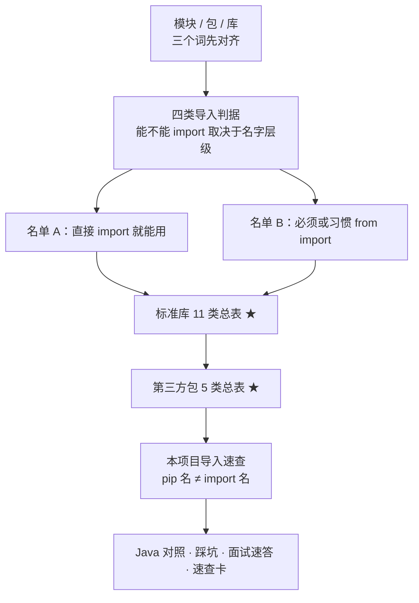

# Python 包与 import 全景 · 谁能直接 import，谁必须 from import

> [!tldr] 一句话
> **严格说，任何模块/包都能直接 `import`。** `from x import y` 之所以到处都是，不是因为「这个包不支持 import」，而是因为你想要的 `y` 要么是**模块里的属性**（`Path`、`datetime`、`Any` 这些类/函数，`import` 语法根本找不到），要么是**没自动挂载的子模块**（`urllib.request`、`xml.etree`、`sqlalchemy.ext.asyncio`，光 `import urllib` 拿不到）。
> 本文把标准库 + 项目里真实安装的第三方包按用途归类，逐个标出推荐写法和常用度。

> [!note] 为什么单开一篇
> [[13-基础课10-11-模块与文件IO]] §1.1/§1.2 讲了包与模块的层级和四种导入写法，但没有给出「哪些包属于哪种」的清单；[[06-专题-__name__ 与程序入口]] 讲入口与 `sys.path`，[[17-专题-pyproject.toml 全景]] 讲依赖该写在哪，[[18-专题-Pydantic 全景]] / [[19-专题-async 与 await 全景]] 里则散落着大量 `from x import Y`。
> 本篇补上这份**可查的清单**：四类导入判据 → 两张名单 → 标准库 11 类表格 → 第三方包 5 类表格 → 本项目实际导入速查 → 踩坑与面试速答。

> [!info] 常用度星标图例
> | 星标 | 含义 |
> |---|---|
> | ★★★★★ | **5★** 几乎每个项目、几乎每天都写 |
> | ★★★★☆ | **4★** 多数项目会用到 |
> | ★★★☆☆ | **3★** 特定场景下的主力 |
> | ★★☆☆☆ | **2★** 偶尔用到，知道即可 |
> | ★☆☆☆☆ | **1★** 小众、专用或已弃用 |
>
> 星标按「Web 后端 + AI 应用」视角评定，与你当前项目栈对齐，不是绝对客观值。

---

## 🗺️ 全篇导航



---

## 一、先把三个词分清

| 词 | 是什么 | 例子 | 判断方法 |
|---|---|---|---|
| **模块** module | 一个 `.py` 文件（或编译扩展），`import` 的**唯一目标** | `json.py`、`os.py` | 有 `__file__`，无 `__path__` |
| **包** package | 含 `__init__.py` 的目录（3.3+ 也支持无 `__init__.py` 的命名空间包） | `urllib/`、`xml/`、`fastapi/` | `hasattr(m, "__path__") == True` |
| **库** library | 口头说法，指一组模块/包 | 「标准库」「requests 库」 | 不是语言级概念 |

> [!warning] 关键判据
> `import` 后面跟的必须是**模块或包**；`from X import Y` 里的 `Y` 可以是模块，也可以是模块里**任意名字**（类、函数、常量）。
> 所以 `import pathlib.Path` 必然失败 —— `Path` 是个类，`typing` 甚至不是包（实测报错 `'typing' is not a package`）。这是理解全文的第一块砖。

导入一次会发生三件事：找到文件 → **执行模块顶层所有代码** → 把模块对象缓存进 `sys.modules`。实测 `import json as a, json as b` 有 `a is b == True`，所以重复 import 不会重复执行。这条也是 [[06-专题-__name__ 与程序入口]] 里 `if __name__ == "__main__":` 守卫存在的前提。

---

## 二、⭐ 核心答案：四类导入

### 2.1 四种写法

```python
import os                                  # ① 绑定模块对象 os
import xml.etree.ElementTree as ET          # ② 绑定子模块，起别名
from pathlib import Path                   # ③ 从模块里取一个名字（类/函数/常量）
from datetime import datetime as dt        # ④ 取名字 + 起别名
from concurrent import futures             # ③ 的变体：取的是一个子模块
```

### 2.2 判据表（全篇最该记的一张）

| 类型 | 典型 | `import x` 够不够 | 推荐写法 | 为什么 |
|---|---|---|---|---|
| **A 顶层模块 / 已导出常用名的包** | `os`、`json`、`re`、`fastapi` | ✅ 够 | `import os` | 模块本身就是入口，`os.path.join` 直接可用 |
| **B 包里的子模块（未自动挂载）** | `urllib.request`、`xml.etree`、`concurrent.futures`、`sqlalchemy.ext.asyncio` | ❌ 父包上没这个属性 | `import urllib.request` 或 `from urllib import request` | 实测 `import urllib; urllib.request` → `AttributeError` |
| **C 模块里的类 / 函数 / 常量** | `pathlib.Path`、`datetime.datetime`、`typing.Any`、`dataclasses.dataclass` | ❌ 语法就找不到 | **只能** `from x import Y` | `import pathlib.Path` → `ModuleNotFoundError` |
| **D 合法但啰嗦（习惯用 from）** | `datetime.datetime.now()`、`functools.lru_cache`、`collections.defaultdict` | ✅ 够，但要写一长串 | `from x import Y` | 纯风格，为可读性 |

> [!tip] 一句话记住
> **B 类是「必须」（或必须 `import x.y`），C 类是「只能」，D 类是「图省事」。** 网上常见的「哪些包需要 from import」其实问的是 B + C 两类。

### 2.3 名单 A：直接 `import x` 就能用（常见）

| 包 | ★ | 直接用法 |
|---|---|---|
| `os` | ★★★★★ | `os.getenv()`、`os.path.join()`（`path` 自动绑定，见 §2.6） |
| `sys` | ★★★★★ | `sys.argv`、`sys.path`、`sys.exit()` |
| `json` | ★★★★★ | `json.dumps()` / `json.loads()` |
| `re` | ★★★★★ | `re.compile()`、`re.findall()` |
| `time` | ★★★★★ | `time.time()`、`time.perf_counter()`、`time.sleep()` |
| `datetime` | ★★★★★ | 能 import，但要写 `datetime.datetime.now()`（见 §三） |
| `pathlib` | ★★★★★ | `pathlib.Path` 可用，但通常 `from pathlib import Path` |
| `typing` | ★★★★★ | `typing.Any` 可用，但通常 `from typing import Any` |
| `logging` | ★★★★★ | `logging.getLogger()`（子模块 `handlers` 要单独导） |
| `asyncio` | ★★★★★ | `asyncio.run()`、`asyncio.gather()` |
| `math` | ★★★★☆ | `math.ceil()`、`math.pi` |
| `random` | ★★★★☆ | `random.choice()`、`random.seed()` |
| `itertools` | ★★★★☆ | `itertools.chain()`、`itertools.groupby()` |
| `collections` | ★★★★☆ | `collections.Counter` / `defaultdict` |
| `functools` | ★★★★☆ | `functools.lru_cache` |
| `shutil` | ★★★★☆ | `shutil.copytree()`、`shutil.rmtree()` |
| `subprocess` | ★★★★☆ | `subprocess.run()` |
| `csv` | ★★★★☆ | `csv.DictReader()` |
| `hashlib` | ★★★★☆ | `hashlib.sha256()` |
| `uuid` | ★★★★☆ | `uuid.uuid4()` |
| `sqlite3` | ★★★☆☆ | `sqlite3.connect()` |
| `fastapi` | ★★★★★ | `fastapi.FastAPI`（`__init__.py` 已导出） |
| `pydantic` | ★★★★★ | `pydantic.BaseModel` |
| `httpx` | ★★★★★ | `httpx.AsyncClient` |
| `sqlalchemy` | ★★★★★ | `sqlalchemy.select`（但 `ext` 子包不自动挂载） |
| `redis` | ★★★★★ | `redis.Redis`、`redis.asyncio`（实测 True） |
| `pytest` | ★★★★★ | `pytest.fixture`、`pytest.raises` |
| `yaml` | ★★★★☆ | `yaml.safe_load()` |
| `jwt` | ★★★★☆ | `jwt.encode()` |

> 注意最后一组：**很多第三方包 `import x` 也能直接拿到主类**，因为它们把常用名字在 `__init__.py` 里导出了。此时 `from fastapi import FastAPI` 只是**简写（D 类）**，不是「必须」。

### 2.4 名单 B：必须 / 习惯 `from x import y`

| 包与写法 | ★ | 归类 | 原因 |
|---|---|---|---|
| `from pathlib import Path` | ★★★★★ | **C** | `Path` 是类，不能 import |
| `from datetime import datetime, timedelta, timezone` | ★★★★★ | **C / D** | 模块与类同名，直接 import 要写两层 |
| `from typing import Any, Optional, Annotated, Literal` | ★★★★★ | **C** | 类型对象是模块属性；`typing` 不是包 |
| `from dataclasses import dataclass, field` | ★★★★★ | **C** | 装饰器是函数 |
| `from collections import defaultdict, Counter` | ★★★★☆ | **D** | 纯粹少写字 |
| `from functools import lru_cache, wraps` | ★★★★☆ | **D** | 同上 |
| `from contextlib import contextmanager, asynccontextmanager` | ★★★★☆ | **C / D** | 装饰器 |
| `from abc import ABC, abstractmethod` | ★★★☆☆ | **C** | 类与装饰器 |
| `from enum import Enum, IntEnum` | ★★★★☆ | **C** | 类 |
| `from urllib import request, parse, error` | ★★★★☆ | **B** | 子模块未挂载 |
| `import xml.etree.ElementTree as ET` | ★★★☆☆ | **B** | 二级子模块 |
| `from concurrent import futures` | ★★★★☆ | **B** | 子模块未挂载 |
| `from logging import handlers` 或 `import logging.handlers` | ★★★☆☆ | **B** | `RotatingFileHandler` 在这里 |
| `from unittest import mock` 或 `from unittest.mock import patch` | ★★★★☆ | **B** | 子模块未挂载 |
| `import importlib.resources` / `import importlib.metadata` | ★★★☆☆ | **B** | 子模块未挂载 |
| `from http import client` / `import http.client` | ★★☆☆☆ | **B** | 子模块未挂载 |
| `from email.mime.text import MIMEText` | ★★☆☆☆ | **B** | 多级子模块 |
| `from sqlalchemy.ext.asyncio import AsyncSession, create_async_engine` | ★★★★★ | **B** | 实测 `import sqlalchemy` 后 `sqlalchemy.ext` 为 False |
| `from redis.asyncio import Redis` | ★★★★☆ | **B / D** | 实测 `redis.asyncio` 已挂载，但显式写更清楚 |
| `from apscheduler.schedulers.asyncio import AsyncIOScheduler` | ★★★☆☆ | **B** | 深层子模块 |
| `from fastapi import FastAPI, Depends, APIRouter, Request` | ★★★★★ | **D** | 简写，`import fastapi` 也拿得到 |
| `from pydantic import BaseModel, Field, ConfigDict` | ★★★★★ | **D** | 简写 |
| `from pydantic_settings import BaseSettings` | ★★★★★ | **D** | 简写 |
| `from httpx import AsyncClient` | ★★★★★ | **D** | 简写 |
| `from loguru import logger` | ★★★★☆ | **D** | 直接取全局实例 |
| `from openai import OpenAI, AsyncOpenAI` | ★★★★☆ | **D** | 简写 |
| `from langchain_openai import ChatOpenAI` | ★★★★☆ | **C / D** | 注意 import 名带下划线 |
| `from pytest import fixture, mark, raises` | ★★★★★ | **D** | 简写 |

### 2.5 实测：`import` 父包后，子模块自动可用吗？

每个用例都在**独立子进程**里跑（避免前面的 import 把子模块挂上去造成假阳性），3.10.22 与 3.13.12 结果完全一致：

| 写法 | 子模块 | `import` 父包后可用？ |
|---|---|---|
| `import urllib` | `request` / `parse` / `error` | ❌ 全部 False |
| `import xml` | `etree` | ❌ |
| `import http` | `client` | ❌ |
| `import email` | `mime` | ❌ |
| `import concurrent` | `futures` | ❌ |
| `import importlib` | `resources` / `metadata` | ❌ |
| `import logging` | `handlers` | ❌ |
| `import unittest` | `mock` | ❌ |
| `import multiprocessing` | `pool` | ❌ |
| `import sqlalchemy` | `ext` | ❌（第三方，项目里最常踩） |
| `import os` | `path` | ✅ True（特例） |
| `import collections` | `abc` | ✅ True |
| `import asyncio` | `subprocess` | ✅ True |
| `import json` | `decoder` | ✅ True |
| `import sqlite3` | `dbapi2` | ✅ True |
| `import redis` | `asyncio` | ✅ True（redis-py 8.1.0） |

**结论：默认假设「不可用」更安全。** 想用子模块就显式写 `import x.y` 或 `from x import y`，别指望父包帮你挂上。

### 2.6 为什么 `os.path` 是特例

`os` 不是普通包，它在 `os.py` 里根据平台把 `posixpath` / `ntpath` 直接**绑定成自己的属性**：

```python
import os.path
print(os.path.__name__)     # 实测：posixpath
```

所以 `import os` 之后 `os.path` 天然可用，`from os import path` 也合法，两者是同一个对象。`collections.abc`、`asyncio.subprocess` 同理，都是父模块 `__init__` 主动导入的结果。

---

## 三、最容易写错的 12 个导入（逐条实测）

| 错误写法 | 实测结果 | 正确写法 |
|---|---|---|
| `import datetime; datetime.now()` | `AttributeError: module 'datetime' has no attribute 'now'` | `from datetime import datetime; datetime.now()` |
| `import typing.Any` | `ModuleNotFoundError: ... 'typing' is not a package` | `from typing import Any` |
| `import pathlib.Path` | `ModuleNotFoundError` | `from pathlib import Path` |
| `import urllib; urllib.request.urlopen(...)` | `AttributeError: module 'urllib' has no attribute 'request'` | `import urllib.request` |
| `import xml; xml.etree...` | `AttributeError` | `import xml.etree.ElementTree as ET` |
| `import concurrent; concurrent.futures...` | `AttributeError` | `from concurrent import futures` |
| `import logging; logging.handlers...` | `AttributeError` | `import logging.handlers` |
| `import sqlalchemy; sqlalchemy.ext.asyncio...` | `sqlalchemy.ext` 为 False | `from sqlalchemy.ext.asyncio import AsyncSession` |
| `import tomllib`（项目 3.10） | `ModuleNotFoundError` | 3.11+ 才有；3.10 用 `tomli`（本机 2.5.0） |
| `import distutils` / `imp` / `asyncore`（3.13） | `ModuleNotFoundError`（3.12 已移除） | `setuptools` / `importlib` / `asyncio` |
| `from . import foo`（直接跑脚本） | `ImportError: attempted relative import with no known parent package` | 相对导入只能用在包内，或用 `python -m pkg.mod` |
| `from json import *` 后想用 `decoder` | `decoder` 不在结果里（`__all__` 限制） | `import json.decoder` |

两个都合法、效果等价的写法（别纠结）：

```python
import xml.etree.ElementTree as ET   # 实测 OK，并自动绑定父名 xml
from xml.etree import ElementTree as ET   # 实测 OK
from os import path                  # 实测 path.sep == '/'
import os.path                       # 实测 os.path.basename('/a/b') == 'b'
```

---

## 四、标准库分类总表（按用途归类，带常用度）

> 表中「推荐写法」是**日常最省事**的写法，不等于唯一写法。3.10.22 下逐项验证过可导入。

### 4.1 系统、运行时与路径

| 包/模块 | ★ | 推荐写法 | 代表 API / 用途 |
|---|---|---|---|
| `os` | ★★★★★ | `import os` | 环境变量、`os.path`、进程信息 |
| `sys` | ★★★★★ | `import sys` | `argv`、`path`、`stdout`、`exit` |
| `pathlib` | ★★★★★ | `from pathlib import Path` | 面向对象路径，`Path.read_text()` |
| `shutil` | ★★★★☆ | `import shutil` | 复制/移动/删目录、磁盘用量 |
| `subprocess` | ★★★★☆ | `import subprocess` | `run()`、`Popen` |
| `argparse` | ★★★★☆ | `import argparse` | CLI 参数解析 |
| `glob` | ★★★☆☆ | `import glob` | 通配符找文件（`Path.glob` 更现代） |
| `tempfile` | ★★★☆☆ | `import tempfile` | 临时文件/目录 |
| `platform` | ★★☆☆☆ | `import platform` | 系统/解释器信息 |
| `getpass` | ★★☆☆☆ | `from getpass import getpass` | 无回显输入密码 |
| `fnmatch` / `stat` | ★★☆☆☆ | `import fnmatch` | 文件名匹配、文件模式位 |

### 4.2 时间与日期

| 包/模块 | ★ | 推荐写法 | 代表 API / 用途 |
|---|---|---|---|
| `datetime` | ★★★★★ | `from datetime import datetime, timedelta, timezone` | 主力日期时间；注意模块/类同名 |
| `time` | ★★★★★ | `import time` | 时间戳、`perf_counter()`、`sleep()` |
| `zoneinfo` | ★★★☆☆ | `from zoneinfo import ZoneInfo` | 3.9+ IANA 时区（项目装了 `tzdata`） |
| `calendar` | ★★☆☆☆ | `import calendar` | 日历、`monthrange()` |

### 4.3 数据与序列化

| 包/模块 | ★ | 推荐写法 | 代表 API / 用途 |
|---|---|---|---|
| `json` | ★★★★★ | `import json` | `dumps` / `loads`，Web 事实标准 |
| `dataclasses` | ★★★★★ | `from dataclasses import dataclass, field` | 边界内的数据类，见 [[18-专题-Pydantic 全景]] |
| `csv` | ★★★★☆ | `import csv` | `DictReader` / `DictWriter` |
| `copy` | ★★★★☆ | `from copy import deepcopy` | 深/浅拷贝 |
| `base64` | ★★★★☆ | `import base64` | Base64 编解码 |
| `configparser` | ★★★☆☆ | `import configparser` | INI 配置 |
| `struct` / `binascii` | ★★☆☆☆ | `import struct` | 二进制打包 |
| `pickle` | ★★☆☆☆ | `import pickle` | Python 对象序列化（**别反序列化不可信数据**） |
| `xml.etree.ElementTree` | ★★★☆☆ | `import xml.etree.ElementTree as ET` | XML 解析（B 类子模块） |
| `tomllib` | ★★★☆☆ | `import tomllib` | **3.11+**；3.10 用 `tomli` |

### 4.4 文本、正则与编码

| 包/模块 | ★ | 推荐写法 | 代表 API / 用途 |
|---|---|---|---|
| `re` | ★★★★★ | `import re` | 正则 |
| `string` | ★★★☆☆ | `import string` | 常量集、模板 |
| `textwrap` | ★★★☆☆ | `from textwrap import dedent` | 清理多行缩进（写 prompt 常用） |
| `urllib.parse` | ★★★★☆ | `from urllib import parse` | URL 编解码、`urlencode` |
| `html` / `html.parser` | ★★★☆☆ | `import html` | `escape()`、HTML 解析 |
| `unicodedata` | ★★☆☆☆ | `import unicodedata` | 规范化、字符属性 |
| `difflib` | ★★☆☆☆ | `from difflib import SequenceMatcher` | 文本差异 |
| `codecs` | ★★☆☆☆ | `import codecs` | 编解码器注册 |

### 4.5 数学、随机与迭代

| 包/模块 | ★ | 推荐写法 | 代表 API / 用途 |
|---|---|---|---|
| `math` | ★★★★☆ | `import math` | 数学函数、`pi`、`isfinite` |
| `random` | ★★★★☆ | `import random` | 随机、抖动（重试退避） |
| `itertools` | ★★★★☆ | `import itertools` | `chain`、`groupby`、`product` |
| `functools` | ★★★★☆ | `from functools import lru_cache, wraps` | 缓存、装饰器保留元信息 |
| `decimal` | ★★★☆☆ | `from decimal import Decimal` | 金额计算，别用 float |
| `statistics` | ★★☆☆☆ | `import statistics` | 均值/中位数 |
| `operator` | ★★☆☆☆ | `import operator` | `itemgetter` 排序键 |
| `fractions` / `cmath` | ★☆☆☆☆ | `from fractions import Fraction` | 有理数 / 复数 |

### 4.6 容器、类型与函数式

| 包/模块 | ★ | 推荐写法 | 代表 API / 用途 |
|---|---|---|---|
| `typing` | ★★★★★ | `from typing import Any, Optional, Annotated, Literal` | 类型标注；`typing` 不是包 |
| `collections` | ★★★★☆ | `from collections import defaultdict, Counter, deque` | 高频容器 |
| `collections.abc` | ★★★★☆ | `from collections.abc import Sequence, Mapping` | 判断抽象基类（注意要显式导入子模块） |
| `enum` | ★★★★☆ | `from enum import Enum, IntEnum` | 枚举 |
| `contextlib` | ★★★★☆ | `from contextlib import contextmanager, asynccontextmanager` | 上下文管理器，见 [[16-专题-yield 关键字全景（从生成器到依赖注入）]] |
| `abc` | ★★★☆☆ | `from abc import ABC, abstractmethod` | 抽象基类 |
| `heapq` / `bisect` | ★★☆☆☆ | `import heapq` | 堆、有序插入 |
| `types` / `weakref` | ★★☆☆☆ | `import types` | `MappingProxyType`、弱引用 |
| `contextvars` | ★★★☆☆ | `import contextvars` | 异步上下文（请求 ID / trace） |

### 4.7 文件、压缩与 IO

| 包/模块 | ★ | 推荐写法 | 代表 API / 用途 |
|---|---|---|---|
| `io` | ★★★★☆ | `from io import StringIO, BytesIO` | 内存文件 |
| `zipfile` | ★★★☆☆ | `import zipfile` | ZIP 读写 |
| `gzip` / `bz2` / `lzma` | ★★★☆☆ | `import gzip` | 压缩流 |
| `tarfile` | ★★☆☆☆ | `import tarfile` | tar 归档 |
| `fileinput` | ★★☆☆☆ | `import fileinput` | 多文件逐行 |
| `mmap` | ★☆☆☆☆ | `import mmap` | 内存映射大文件 |

### 4.8 并发、进程与异步

| 包/模块 | ★ | 推荐写法 | 代表 API / 用途 |
|---|---|---|---|
| `asyncio` | ★★★★★ | `import asyncio` | 事件循环，详见 [[19-专题-async 与 await 全景]] |
| `threading` | ★★★★☆ | `import threading` | 线程、锁（GIL 下只适合 IO） |
| `concurrent.futures` | ★★★★☆ | `from concurrent import futures` | `ThreadPoolExecutor` / `ProcessPoolExecutor` |
| `multiprocessing` | ★★★☆☆ | `import multiprocessing` | CPU 密集并行 |
| `queue` | ★★★☆☆ | `import queue` | 线程间队列（协程用 `asyncio.Queue`） |
| `signal` | ★★☆☆☆ | `import signal` | 信号/优雅退出 |
| `selectors` / `sched` | ★☆☆☆☆ | `import selectors` | IO 多路复用底层、定时任务 |

### 4.9 网络、HTTP 与邮件

| 包/模块 | ★ | 推荐写法 | 代表 API / 用途 |
|---|---|---|---|
| `urllib.request` | ★★★★☆ | `from urllib import request, parse, error` | 标准库 HTTP（B 类） |
| `http.client` / `http.server` | ★★☆☆☆ | `import http.client` | 底层 HTTP / 简易服务 |
| `socket` | ★★★☆☆ | `import socket` | 原始 socket |
| `ssl` | ★★★☆☆ | `import ssl` | TLS 上下文 |
| `email.mime.text` | ★★☆☆☆ | `from email.mime.text import MIMEText` | 构造邮件 |
| `smtplib` / `ftplib` | ★★☆☆☆ | `import smtplib` | 发信 / FTP |
| `wsgiref` | ★☆☆☆☆ | `import wsgiref` | WSGI 参考实现（已被 ASGI 取代） |

### 4.10 加密、日志、测试与调试

| 包/模块 | ★ | 推荐写法 | 代表 API / 用途 |
|---|---|---|---|
| `logging` | ★★★★★ | `import logging` | 结构化日志 |
| `logging.handlers` | ★★★☆☆ | `import logging.handlers` | `RotatingFileHandler`（B 类） |
| `hashlib` | ★★★★☆ | `import hashlib` | 摘要 |
| `secrets` | ★★★★☆ | `import secrets` | 安全随机（token/密钥，别用 `random`） |
| `uuid` | ★★★★☆ | `import uuid` | `uuid4()` |
| `hmac` | ★★★☆☆ | `import hmac` | 签名校验 |
| `unittest` | ★★★★☆ | `import unittest` | 标准库测试框架 |
| `unittest.mock` | ★★★★☆ | `from unittest.mock import patch, MagicMock` | Mock（B 类） |
| `traceback` | ★★★★☆ | `import traceback` | 打印堆栈 |
| `warnings` | ★★★☆☆ | `import warnings` | 警告控制 |
| `inspect` | ★★★☆☆ | `import inspect` | 反射、`iscoroutinefunction` |
| `pdb` / `doctest` | ★★☆☆☆ | `import pdb` | 断点 / 文档测试 |
| `timeit` / `cProfile` | ★★☆☆☆ | `import timeit` | 性能测量 |

### 4.11 元编程、打包与版本差异

| 包/模块 | ★ | 推荐写法 | 说明 |
|---|---|---|---|
| `importlib` | ★★★★☆ | `import importlib` | 动态导入 |
| `importlib.metadata` | ★★★☆☆ | `import importlib.metadata as md` | 读已安装包版本（B 类） |
| `importlib.resources` | ★★★☆☆ | `from importlib import resources` | 读包内资源文件（B 类） |
| `pkgutil` / `sysconfig` | ★★☆☆☆ | `import pkgutil` | 包发现、安装路径 |
| `__future__` | ★★★★☆ | `from __future__ import annotations` | 延迟注解求值（3.10 项目里常用） |
| `ast` / `dis` | ★★☆☆☆ | `import ast` | 语法树、字节码 |
| `venv` / `site` / `graphlib` | ★★☆☆☆ | `import venv` | 虚拟环境、拓扑排序（3.9+） |
| `distutils` / `imp` / `asyncore` | ★☆☆☆☆ | ⛔ 别再用 | **3.12 已移除**，3.10 有、3.13 `ModuleNotFoundError` |

---

## 五、第三方包分类总表（本机实测，带常用度）

> 版本取自 `importlib.metadata.version()`（项目环境 3.10.22，来源 `ruoyi-fastapi-backend/requirements.txt`）。`★` 按本项目使用频率评定。

### 5.1 ⚠️ pip 名 ≠ import 名（最容易装完还 import 失败）

| pip 包名 | 实际 import | 备注 |
|---|---|---|
| `PyYAML` | `import yaml` | 大小写都不同 |
| `PyJWT` | `import jwt` | |
| `Pillow` | `from PIL import Image` | |
| `pydantic-settings` | `from pydantic_settings import BaseSettings` | 连字符 → 下划线 |
| `langchain-openai` | `from langchain_openai import ChatOpenAI` | 同上 |
| `python-dotenv` | `from dotenv import load_dotenv` | 见 [[18-专题-Pydantic 全景]] §八 |
| `SQLAlchemy` | `import sqlalchemy` | 全小写 |
| `APScheduler` | `from apscheduler.schedulers.asyncio import AsyncIOScheduler` | 全小写 + 深层子模块 |
| `beautifulsoup4` | `from bs4 import BeautifulSoup` | 本项目未装 |

### 5.2 Web 框架与 API

| 包 | ★ | 推荐写法 | 版本 | 用途 |
|---|---|---|---|---|
| `fastapi` | ★★★★★ | `from fastapi import FastAPI, Depends, APIRouter, Request` | 0.143.3 | 路由与依赖注入 |
| `starlette` | ★★★★☆ | `from starlette.responses import StreamingResponse` | 1.7.0 | ASGI 底层、SSE |
| `uvicorn` | ★★★★☆ | `import uvicorn` | 0.54.0 | ASGI 服务器 |
| `pydantic` | ★★★★★ | `from pydantic import BaseModel, Field, ConfigDict` | 2.14.3 | 请求/响应契约 |
| `pydantic-settings` | ★★★★★ | `from pydantic_settings import BaseSettings` | 2.15.0 | `.env` 配置 |
| `httpx` | ★★★★★ | `from httpx import AsyncClient` | 0.28.1 | 异步 HTTP / 测试客户端 |
| `requests` | ★★★★☆ | `import requests` | 2.34.2 | 同步 HTTP（协程里要 `to_thread`） |
| `aiohttp` | ★★★☆☆ | `import aiohttp` | 3.14.5 | 异步 HTTP / 客户端会话 |
| `jinja2` | ★★★☆☆ | `from jinja2 import Template` | 3.1.6 | 模板渲染 |
| `anyio` | ★★★☆☆ | `import anyio` | 4.16.0 | FastAPI 底层线程池/任务组 |

### 5.3 数据库、缓存与迁移

| 包 | ★ | 推荐写法 | 版本 | 用途 |
|---|---|---|---|---|
| `SQLAlchemy` | ★★★★★ | `from sqlalchemy import select; from sqlalchemy.ext.asyncio import AsyncSession` | 2.0.55 | ORM / 异步会话（**ext 必须显式导入**） |
| `redis` | ★★★★★ | `from redis.asyncio import Redis` | 8.1.0 | 缓存、会话、限流 |
| `asyncmy` | ★★★★☆ | `import asyncmy` | 0.2.16 | 异步 MySQL 驱动 |
| `PyMySQL` | ★★★☆☆ | `import pymysql` | 1.2.3 | 同步 MySQL 驱动 |
| `alembic` | ★★★★☆ | `from alembic import command` | 1.20.0 | 数据库迁移 |
| `aiosqlite` | ★★★☆☆ | `import aiosqlite` | 见 requirements-test | 测试用异步 SQLite |
| `sqlglot` | ★★☆☆☆ | `import sqlglot` | 29.0.1 | SQL 解析/转换 |

### 5.4 AI / LLM 与数据

| 包 | ★ | 推荐写法 | 版本 | 用途 |
|---|---|---|---|---|
| `openai` | ★★★★☆ | `from openai import OpenAI, AsyncOpenAI` | 3.49.0 | OpenAI 兼容 API（含 DeepSeek） |
| `langchain` | ★★★★☆ | `from langchain_core.prompts import ChatPromptTemplate` | 1.4.10 | 1.x 已拆包，`langchain.core` 不存在（实测 False） |
| `langchain-openai` | ★★★★☆ | `from langchain_openai import ChatOpenAI` | 1.7.4 | 模型适配 |
| `dashscope` | ★★★★☆ | `from dashscope import Generation` | 2.1.0 | 阿里百炼 / embedding |
| `numpy` | ★★★★☆ | `import numpy as np` | 2.2.6 | 向量、数值计算 |
| `pandas` | ★★★★☆ | `import pandas as pd` | 2.3.3 | 表格与导出 |
| `openpyxl` | ★★★☆☆ | `from openpyxl import load_workbook, Workbook` | 3.1.5 | Excel 读写 |
| `Pillow` | ★★☆☆☆ | `from PIL import Image` | 12.3.0 | 图片处理 |

### 5.5 工程化、安全与运维

| 包 | ★ | 推荐写法 | 版本 | 用途 |
|---|---|---|---|---|
| `pytest` | ★★★★★ | `from pytest import fixture, mark, raises` | 9.1.1 | 测试框架 |
| `pytest-asyncio` | ★★★★★ | 只配置，不 import | 1.4.0 | `asyncio_mode = "auto"`，见 [[02-阶段二-数据模型与工程化]] |
| `ruff` | ★★★★★ | 命令行工具，不 import | 0.17.1 | lint/format |
| `loguru` | ★★★★☆ | `from loguru import logger` | 0.7.3 | 日志（项目主力） |
| `PyJWT` | ★★★★☆ | `from jwt import encode, decode` | 2.15.1 | JWT，见 [[05-认证鉴权-JWT与RBAC]] |
| `bcrypt` | ★★★★☆ | `import bcrypt` | 5.0.0 | 密码哈希 |
| `cryptography` | ★★★☆☆ | `from cryptography.fernet import Fernet` | 50.0.2 | 加密原语 |
| `APScheduler` | ★★★☆☆ | `from apscheduler.schedulers.asyncio import AsyncIOScheduler` | 3.11.3 | 定时任务 |
| `aiofiles` | ★★★☆☆ | `from aiofiles import open as aio_open` | 25.1.0 | 异步文件 IO |
| `PyYAML` | ★★★☆☆ | `import yaml` | 6.0.3 | YAML 配置 |
| `tzdata` | ★★★☆☆ | 只安装，不 import | 2026.5 | Windows/容器里的时区数据 |
| `tomli` | ★★☆☆☆ | `import tomli` | 2.5.0 | 3.10 下替代 `tomllib` |
| `psutil` | ★★☆☆☆ | `import psutil` | 7.2.2 | 进程/系统监控 |
| `click` / `typer` | ★★☆☆☆ | `import typer` | 8.5.1 / 0.29.1 | CLI |
| `nh3` | ★★☆☆☆ | `import nh3` | 0.3.7 | HTML 消毒 |
| `textual` | ★☆☆☆☆ | `from textual.app import App` | 8.2.8 | 终端 TUI |

> [!warning] 版本口径提醒
> 本机 `python3` 是 **3.13.12**，`RuoYiFastAPI` 环境是 **3.10.22**。实测差异：`tomllib` 只有 3.11+ 有；`distutils` / `imp` / `asyncore` / `asynchat` 在 3.12 被移除；`typing_extensions` 是**第三方包**（3.10 环境装了，系统 3.13 没装）。写跨版本代码时别踩。

---

## 六、本项目（RuoYi-FastAPI）导入速查

以下写法**全部在本机项目环境实测通过**，可直接复制到 `ruoyi-fastapi-backend` 下：

| 场景 | 标准写法 | 类别 |
|---|---|---|
| 应用与路由 | `from fastapi import FastAPI, Depends, APIRouter, Request, HTTPException` | D（简写） |
| 请求/响应模型 | `from pydantic import BaseModel, Field, ConfigDict, ValidationError` | D |
| 配置 | `from pydantic_settings import BaseSettings, SettingsConfigDict` | D |
| 类型标注 | `from typing import Annotated, Optional, Sequence` | C |
| 异步 ORM 会话 | `from sqlalchemy.ext.asyncio import AsyncSession, create_async_engine, async_sessionmaker` | **B（必须）** |
| SQL 构造 | `from sqlalchemy import select, update, delete, func` | D |
| 异步 Redis | `from redis.asyncio import Redis` | B / D |
| 日志 | `from loguru import logger` | D |
| JWT | `from jwt import encode, decode, ExpiredSignatureError` | D |
| 定时任务 | `from apscheduler.schedulers.asyncio import AsyncIOScheduler` | **B（必须）** |
| 异步文件 | `from aiofiles import open as aio_open` | D（起别名避免遮蔽内置 `open`） |
| Excel 导出 | `from openpyxl import load_workbook, Workbook` | D |
| 生命周期 | `from contextlib import asynccontextmanager` | C / D，见 [[04-阶段四-数据与 AI 应用]] |
| 测试 | `import pytest` + `pytest.ini` 里 `asyncio_mode = "auto"` | — |

> [!tip] 一条项目经验
> 看到 `ModuleNotFoundError` / `AttributeError` 时，先问「我要的是包、子模块，还是包里的类？」：`sqlalchemy.ext` 属于 B 类，必须显式 `from ... import`；`FastAPI` 属于 D 类，`import fastapi` 后写 `fastapi.FastAPI` 也行。

---

## 七、Java 对照

| 维度 | Python | Java |
|---|---|---|
| `import` 做了什么 | **执行模块顶层代码** + 写入 `sys.modules` | 仅**编译期名字解析**，不执行、不加载类 |
| import 的目标 | 模块 / 包 | 类 / 静态成员 / 包内全部类型 |
| 取模块里的类 | `from pathlib import Path` | `import java.nio.file.Path`（直接写类名） |
| `import typing.Any` | ❌ 报错，`typing` 不是包 | ✅ 合法，`Any` 换成任意类名即可 |
| 取静态常量 | `from math import pi` | `import static java.lang.Math.PI` |
| 通配导入 | `from os import *`（受 `__all__` 限制） | `import java.util.*`（按类型解析） |
| 搜索路径 | `sys.path` | classpath / module path |
| 目录与包 | 包 = 目录 + `__init__.py`（或命名空间包） | 包 = `package` 声明 + 目录结构，影响访问权限 |
| 相对导入 | `from . import x`，**仅包内可用** | 无对应概念（都按全限定名） |
| 同名遮蔽 | 自己建个 `json.py` 就把标准库遮了 | 同名类需写全限定名区分 |

> 从 Java 过来最容易犯的错：以为 `import` 后面可以跟「类名」。**Python 的 `import` 只接模块，取名字必须用 `from ... import`**。另外 Java 的 import 没有运行时开销，Python 的 import 会真的跑代码（所以有循环导入、副作用、导入耗时这些问题）。

---

## 八、踩坑清单 Top 10

| # | 坑 | 实测结论 / 处理 |
|---|---|---|
| 1 | `import urllib` 后用 `urllib.request` | `AttributeError`；显式 `import urllib.request`（§2.5 一大串同理） |
| 2 | `import datetime` 后 `datetime.now()` | `AttributeError`；模块和类同名，`from datetime import datetime` |
| 3 | `import typing.Any` / `import pathlib.Path` | `ModuleNotFoundError`；这些是模块里的名字，只能 `from ... import` |
| 4 | 以为 `import sqlalchemy` 就能用 `ext` | 实测 False，`from sqlalchemy.ext.asyncio import ...` |
| 5 | `from x import *` 以为能拿全部 | 受 `__all__` 限制：实测 `from os import *` 有 `path`，但 `from json import *` 没有 `decoder`；生产代码别用 |
| 6 | 以为改 `from math import pi` 的 `pi` 会改模块 | 实测改成本地 `pi=3` 后 `math.pi` 仍是 3.14159 —— `from` 只是**绑定一份引用** |
| 7 | 相对导入 `from . import x` 在脚本里跑 | `ImportError: attempted relative import with no known parent package`；改用 `python -m pkg.mod`，见 [[06-专题-__name__ 与程序入口]] |
| 8 | 自己建 `json.py` / `redis.py` / `test.py` | 遮蔽标准库或第三方包，报错很诡异；改文件名，检查 `sys.path[0]` |
| 9 | 顶层代码有副作用的模块被循环导入 | 把可执行逻辑收进 `if __name__ == "__main__":`，用局部 import 打破环 |
| 10 | 3.10 里 `import tomllib`、3.13 里 `import distutils` | 跨版本 `ModuleNotFoundError`；用 `tomli` / `setuptools` / `importlib` 替代 |

补充：`import xml.etree.ElementTree` 会自动把**父名 `xml`** 绑到当前命名空间（实测 True），但反过来 `import xml` 不会把 `etree` 挂上去 —— 这是单向的。

---

## 九、面试速答 / 自测（对应 13 §八、17 面试题 13/14）

| 问题 | 一句话答案 |
|---|---|
| 模块和包的区别？ | 模块是一个 `.py` 文件；包是含 `__init__.py` 的目录（有 `__path__`），用来组织模块。 |
| `__init__.py` 干什么？ | 标记包、执行包级初始化、把常用名字导出到包命名空间（`fastapi.FastAPI` 就是这么来的）；3.3+ 命名空间包可省略它。 |
| `import x` 和 `from x import y` 的区别？ | 前者把**模块对象**绑到 `x`；后者执行模块后只把**名字 `y`** 绑到当前作用域，且不绑定 `x`。 |
| 为什么 `import xml` 后 `xml.etree` 不能用？ | 子模块不会自动挂载，父包 `__init__` 没导入它；显式 `import xml.etree.ElementTree` 或 `from xml import etree`。 |
| `os.path` 为什么特殊？ | `os.py` 按平台把 `posixpath` / `ntpath` 直接绑定为自己的属性，实测 `os.path.__name__ == 'posixpath'`。 |
| `__all__` 有什么用？ | 定义 `from x import *` 导出哪些名字，不影响显式 `from x import y`。 |
| 重复 import 会重复执行吗？ | 不会，模块对象缓存在 `sys.modules`，实测 `a is b == True`。 |
| 绝对导入和相对导入怎么选？ | 库代码对外用绝对导入；包内部可用 `from . import x`，但相对导入不能在直接运行的脚本里用。 |
| pip 名和 import 名不一样怎么办？ | 查包的 `__init__` 或文档；常见映射见 §5.1（`PyYAML→yaml`、`PyJWT→jwt`、`Pillow→PIL`）。 |
| 依赖该写在哪？ | `[project.dependencies]` 放运行时依赖，`[dependency-groups]` / `[project.optional-dependencies]` 放开发依赖，详见 [[17-专题-pyproject.toml 全景]] §五。 |

---

## 十、速查卡

```python
# ① 直接 import（模块本身就是入口）
import os, sys, json, re, time, math, random, logging, asyncio, hashlib, uuid

# ② 取模块里的名字（类 / 函数 / 常量）——只能 from
from pathlib import Path
from datetime import datetime, timedelta, timezone
from typing import Any, Optional, Annotated, Literal
from dataclasses import dataclass, field
from collections import defaultdict, Counter
from functools import lru_cache, wraps
from contextlib import contextmanager, asynccontextmanager
from enum import Enum

# ③ 子模块——必须显式导入父包下的这一层
import urllib.request
import xml.etree.ElementTree as ET
from concurrent import futures
import logging.handlers
from unittest.mock import patch, MagicMock
import importlib.metadata as md
from sqlalchemy.ext.asyncio import AsyncSession
from redis.asyncio import Redis
from apscheduler.schedulers.asyncio import AsyncIOScheduler

# ④ 第三方常用（简写，import 包也能拿到）
from fastapi import FastAPI, Depends, Request
from pydantic import BaseModel, Field, ConfigDict
from pydantic_settings import BaseSettings
from httpx import AsyncClient
from loguru import logger
from pytest import fixture, mark, raises

# ⑤ 判断层级 / 排查
import inspect, sys
inspect.ismodule(obj)          # 是不是模块
hasattr(pkg, '__path__')      # 是不是包
md.version('fastapi')         # 读已安装版本
```

**延伸**：[[13-基础课10-11-模块与文件IO]]（四种导入写法、os/time/json）、[[06-专题-__name__ 与程序入口]]（导入副作用与 `sys.path`）、[[17-专题-pyproject.toml 全景]]（依赖声明与 src 布局）、[[18-专题-Pydantic 全景]]（v2 导入清单）、[[19-专题-async 与 await 全景]]（`asyncio` API 速查）、[[04-阶段四-数据与 AI 应用]]（FastAPI lifespan 与 LLM 流式）。

> [!tldr] 收束成一句
> 先判断你想要的 `y` 是**模块**、**子模块**，还是**模块里的名字**：是模块就 `import`，是子模块就 `import x.y` / `from x import y`，是名字就只能 `from x import Y`。
> 剩下的 `from fastapi import FastAPI` 之类，都只是为了少敲几个字。

> 本文所有导入写法、子模块可用性与版本号，均在 `Python 3.10.22`（RuoYiFastAPI 环境）与 `Python 3.13.12` 下用独立子进程实测；第三方包版本取自 `importlib.metadata.version()`。星标为按「Web 后端 + AI 应用」视角的常用度评估，非官方排名。
