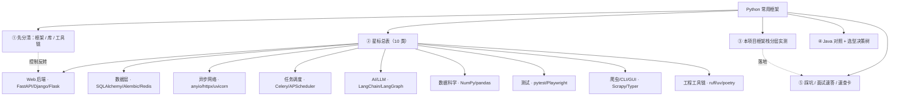
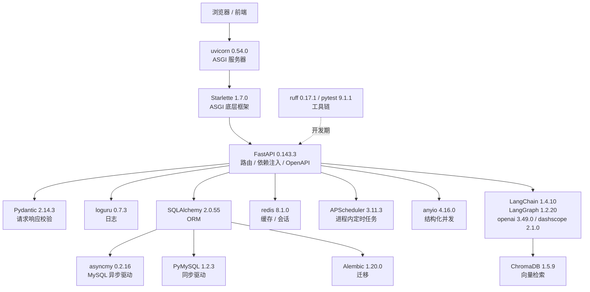

# Python 常用框架全景 · 分类、常用度与选型

> [!tldr] 一句话
> 日常说的「Python 框架」其实是三层东西混在一起：**框架**（它调用你，如 FastAPI / Django / pytest）、**库**（你调用它，如 requests / pandas / NumPy）、**工具链**（命令行跑的，如 ruff / uvicorn / alembic）。
> 本文按用途分成 **10 类**，逐个给出 `pip` 名、推荐导入写法、常用度 ★ 和选型建议；版本全部按本机 `RuoYiFastAPI` 环境（Python 3.10.22）实测标注。

> [!note] 为什么要单开一篇
> 库里 [[04-阶段四-数据与 AI 应用]] 讲了 pandas / FastAPI / LangChain **怎么用**，[[20-专题-Python 包与 import 全景]] 讲的是**包和导入写法**，[[知识点-主流开发框架]] 只覆盖了 **AI 应用层**（LangChain / LlamaIndex / Dify）。
> 缺的是一张「从 Web 到数据、从测试到运维」的**全景地图** —— 什么时候该用哪个、彼此什么关系、Java 里对应什么。这篇补这一层，不重复前几篇的代码细节。

---

## 🗺️ 全篇导航



---

## ⭐ 常用度图例

| 星标 | 含义（按「Web 后端 + AI 应用」视角） | 典型 |
|---|---|---|
| `★★★★★` | 几乎每个项目都写，天天见 | FastAPI、Pydantic、SQLAlchemy、pytest、NumPy |
| `★★★★☆` | 主流项目标配，隔三差五用 | uvicorn、Alembic、redis、httpx、pandas、LangChain、ruff |
| `★★★☆☆` | 特定场景必用，不是人人都装 | Celery、APScheduler、Scrapy、LangGraph、ChromaDB、Typer |
| `★★☆☆☆` | 小众或领域专用 | Django、Flask、Tornado、Streamlit、Playwright、Polars |
| `★☆☆☆☆` | 已过时 / 被替代 / 学习用 | `distutils`、Bottle、web.py、旧版 `imp` |

> 星标是**按你这套技术栈（FastAPI + AI 应用）评估的**，不是官方排名。做数据分析的人会把 pandas 打 5★、FastAPI 打 2★，很正常。

---

## 一、先把三个词分清：框架 / 库 / 工具链

判断标准只有一条 —— **控制反转（Inversion of Control）**：谁调用谁。

| 类别 | 判据 | Python 例子 | Java 类比 |
|---|---|---|---|
| **框架 Framework** | **它调用你**：你按约定写好函数/类，注册进去，由框架在特定时机回调 | `@app.get("/x")` → FastAPI 在请求到来时调你的函数；`test_*` → pytest 自动发现并执行；`class User(Base)` → SQLAlchemy 管理生命周期 | Spring Boot、JUnit、Hibernate、MyBatis |
| **库 Library** | **你调用它**：主动调 API，控制权始终在你手里 | `requests.get(url)`、`json.dumps(x)`、`np.array([...])` | Guava、Jackson、HttpClient、Apache Commons |
| **工具链 Tooling** | 命令行程序，不进业务代码，管的是开发/构建/运行过程 | `ruff check .`、`uvicorn app:app`、`alembic upgrade head`、`pytest` | Maven、Gradle、Checkstyle、SpotBugs |
| **SDK** | 某个服务的官方客户端封装，形态上是库 | `openai.OpenAI()`、`dashscope.Generation`、`boto3` | AWS SDK、阿里云 SDK |

```python
# 库：我调用它
import requests
r = requests.get("https://api.example.com")     # 控制权在我

# 框架：它调用我
from fastapi import FastAPI
app = FastAPI()

@app.get("/hi")                                  # 我只是"登记"
async def hi(name: str = "world"):
    return {"msg": f"hi {name}"}                # 请求进来时框架回调我
# uvicorn app:app  → 进程归 uvicorn 管，生命周期也归框架管
```

> [!warning] 最常见的认知偏差
> 把 `uvicorn` 当成「Web 框架」、把 `pydantic` 当成「框架」。**uvicorn 是 ASGI 服务器（工具链）、pydantic 是校验库**。真正的框架是 FastAPI/Starlette：它定义了路由、依赖注入、生命周期这些「你往里填东西」的骨架。
> 详见 [[19-专题-async 与 await 全景]] 里 FastAPI 同步/异步路由的线程分派实测。

---

## 二、⭐ 核心总表：一眼看完全部常用框架

| 类别 | 5★ 必会 | 4★ 主流 | 3★ 场景向 | 2★ 小众 / 1★ 过时 |
|---|---|---|---|---|
| **Web 后端** | FastAPI、Pydantic | Starlette、uvicorn | Tornado、aiohttp（服务端） | Django、Flask(2★)、Quart/Sanic(1★) |
| **数据层** | SQLAlchemy | Alembic、redis-py | PyMySQL/asyncmy、ChromaDB | Peewee/Tortoise(2★) |
| **异步网络** | `asyncio`（标准库） | anyio、httpx | aiohttp、aiofiles | trio(2★) |
| **任务调度** | — | APScheduler | Celery、ARQ、RQ | Dramatiq/Prefect(2★) |
| **AI / LLM** | — | LangChain、openai SDK | LangGraph、LlamaIndex、ChromaDB | Dify/Coze(低代码平台，非 Python 库) |
| **数据科学** | NumPy、pandas | openpyxl、Matplotlib | SciPy、scikit-learn、Polars | Streamlit/Gradio(2★)、Jupyter(3★) |
| **测试** | pytest | pytest-asyncio | Playwright、Hypothesis、Faker | Selenium(2★)、doctest(1★) |
| **爬虫 / CLI** | — | BeautifulSoup、Typer、Click | Scrapy、Rich、Textual | — |
| **工程质量** | — | ruff、loguru | mypy、black、uv、poetry | flake8/pylint(2★)、distutils(1★) |
| **安全 / 序列化** | — | PyJWT、cryptography、PyYAML | orjson、bcrypt、tenacity | `python-jose`(1★) |

> 这一张表是「按常用度」排的；下面按类别展开，给出每个的 `pip` 名、导入写法、定位和本机状态。

---

## 三、Web 后端框架（最核心的一类）

### 3.1 三大框架横向对比

| 维度 | **FastAPI** `★★★★★` | **Django** `★★☆☆☆` | **Flask** `★★☆☆☆` |
|---|---|---|---|
| 定位 | 现代异步 API 框架 | 全功能「电池全包」 | 微框架，只给路由 |
| 一句话 | 写接口 / AI 服务首选 | 自带后台、ORM、Admin 的整站方案 | 小工具、老项目、教学 |
| 异步 | **原生 `async def`** | 3.1+ 支持，但生态仍偏同步 | 需扩展，原生同步 |
| 数据校验 | **内置 Pydantic** | 自带 Form / Serializer | 无，自己配 marshmallow |
| API 文档 | **自动生成 OpenAPI / Swagger** | 需 `drf-spectacular` | 需 flask-smorest |
| ORM | 不绑定（常用 SQLAlchemy） | **自带 Django ORM** | 不绑定 |
| Admin 后台 | 无 | **自带，开箱即用** | 无 |
| 学习成本 | 低（会类型注解就会） | 高（约定多、体系大） | **最低** |
| 本机 | ✅ `0.143.3` | ❌ 未装 | ❌ 未装 |

> [!tip] 给 Java 团队的选型结论
> 你要做的是**给前端/小程序提供 JSON 接口**（RuoYi-FastAPI、AI 对话服务），就选 FastAPI —— 它最像 Spring Boot 的 `@RestController` + 自动文档。
> 要的是**带后台管理页面的完整 CMS / 内容站**，Django 的 Admin 能省几周工；但它的 ORM 和同步模型跟 Spring 那套差异大，团队迁移成本反而更高。
> 详见 [[10-FastAPI与SpringBoot全面对比]]。

### 3.2 Web 分层清单（含「不是框架」的配套件）

| 框架 / 组件 | `pip install` | 推荐写法 | ★ | 定位 | 本机 |
|---|---|---|---|---|---|
| FastAPI | `fastapi` | `from fastapi import FastAPI, Depends, APIRouter` | `★★★★★` | API 框架、依赖注入、OpenAPI | ✅ `0.143.3` |
| Pydantic | `pydantic` | `from pydantic import BaseModel, Field, ConfigDict` | `★★★★★` | 请求/响应模型与校验（**库**，非框架） | ✅ `2.14.3` |
| pydantic-settings | `pydantic-settings` | `from pydantic_settings import BaseSettings` | `★★★★☆` | `.env` 配置管理 | ✅ `2.15.0` |
| Starlette | `starlette` | `from starlette.applications import Starlette` | `★★★★☆` | ASGI 底层框架，FastAPI 的父类 | ✅ `1.7.0` |
| uvicorn | `uvicorn` | 命令行 `uvicorn app:app --reload` | `★★★★☆` | ASGI 服务器（**工具链**） | ✅ `0.54.0` |
| gunicorn | `gunicorn` | 命令行 `gunicorn -k uvicorn.workers.UvicornWorker` | `★★★☆☆` | 生产多进程管理 | ❌ 未装 |
| Django | `Django` | `from django.http import HttpResponse` | `★★☆☆☆` | 全栈 Web 框架 | ❌ 未装 |
| Flask | `Flask` | `from flask import Flask, request` | `★★☆☆☆` | 微框架 | ❌ 未装 |
| Tornado | `tornado` | `import tornado.web` | `★★★☆☆` | 老牌异步 Web / 长连接 | ✅ `6.5.10` |
| aiohttp（服务端） | `aiohttp` | `from aiohttp import web` | `★★★☆☆` | 客户端 + 服务端双用途 | ✅ `3.14.5` |
| Sanic / Quart / Litestar | 同名 | — | `★☆☆☆☆` | FastAPI 的同类替代，生态小 | ❌ 未装 |

> 实测：`issubclass(fastapi.FastAPI, starlette.applications.Starlette) == True` —— FastAPI 是**站在 Starlette 肩上**加了一层 Pydantic 校验和 OpenAPI 生成，不是另起炉灶。这也解释了为什么它的中间件、 lifespan 都沿用 Starlette 的写法。

---

## 四、数据层：ORM / 迁移 / 缓存

| 框架 / 组件 | `pip install` | 推荐写法 | ★ | 定位 | 本机 |
|---|---|---|---|---|---|
| SQLAlchemy | `SQLAlchemy[asyncio]` | `from sqlalchemy.orm import DeclarativeBase, Mapped, mapped_column` | `★★★★★` | ORM + Core，事实标准 | ✅ `2.0.55` |
| Alembic | `alembic` | `alembic upgrade head`（SQLAlchemy 官方迁移工具） | `★★★★☆` | 数据库版本迁移 | ✅ `1.20.0` |
| redis-py | `redis` | `from redis.asyncio import Redis` | `★★★★☆` | Redis 客户端（**同步/异步双 API**） | ✅ `8.1.0` |
| asyncmy | `asyncmy` | `from sqlalchemy.ext.asyncio import create_async_engine` | `★★★☆☆` | MySQL 异步驱动 | ✅ `0.2.16` |
| PyMySQL | `PyMySQL` | `import pymysql` | `★★★☆☆` | MySQL 同步驱动 | ✅ `1.2.3` |
| aiomysql | `aiomysql` | `import aiomysql` | `★★☆☆☆` | MySQL 异步驱动（asyncmy 更常用） | ❌ 未装 |
| Tortoise ORM / Peewee | 同名 | — | `★★☆☆☆` | 轻量异步 / 小型 ORM | ❌ 未装 |
| motor / pymongo | 同名 | `from motor.motor_asyncio import AsyncIOMotorClient` | `★★☆☆☆` | MongoDB 异步/同步驱动 | ❌ 未装 |
| ChromaDB | `chromadb` | `import chromadb` | `★★★☆☆` | 本地向量库，RAG 起步用 | ✅ `1.5.9` |
| pymilvus | `pymilvus` | `from pymilvus import MilvusClient` | `★★★☆☆` | 生产向量库客户端 | ❌ 未装（项目用 `192.168.0.106` 服务端） |

> [!tip] SQLAlchemy 2.0 的写法变了
> 老教程里的 `declarative_base()` + `Column(Integer, primary_key=True)` 是 1.4 风格；2.0 推荐 `class Base(DeclarativeBase)` + `Mapped[int]`/`mapped_column()`，能拿到完整类型提示。本机 `2.0.55` 实测两种都能跑，但新代码统一用 2.0 风格。
> 导入层级坑（[[20-专题-Python 包与 import 全景]] 已实测）：`import sqlalchemy` 之后 `sqlalchemy.ext` **不可用**，必须 `from sqlalchemy.ext.asyncio import AsyncSession`。

---

## 五、异步 / 网络 / 并发栈

| 框架 / 组件 | 类型 | 推荐写法 | ★ | 定位 | 本机 |
|---|---|---|---|---|---|
| `asyncio` | **标准库框架** | `import asyncio` | `★★★★★` | 事件循环、Task、TaskGroup | 内置 |
| anyio | 库 | `import anyio` | `★★★★☆` | 结构化并发抽象层，**Starlette/FastAPI 底层用它** | ✅ `4.16.0` |
| httpx | 库 | `from httpx import AsyncClient, ASGITransport` | `★★★★☆` | 同步/异步 HTTP 客户端，测 FastAPI 接口首选 | ✅ `0.28.1` |
| requests | 库 | `import requests` | `★★★★★` | 同步 HTTP 客户端（老牌，但阻塞） | ✅ `2.34.2` |
| aiohttp | 库 | `import aiohttp` | `★★★☆☆` | 异步 HTTP 客户端 + 服务端 | ✅ `3.14.5` |
| aiofiles | 库 | `from aiofiles import open as aio_open` | `★★★☆☆` | 把文件 IO 丢进线程池 | ✅ `25.1.0` |
| greenlet | 库 | `import greenlet` | `★★★☆☆` | SQLAlchemy 异步桥接的底层依赖 | ✅ `3.5.6` |
| trio | 库 | `import trio` | `★★☆☆☆` | 另一个结构化并发实现 | ❌ 未装 |
| tenacity | 库 | `from tenacity import retry, stop_after_attempt` | `★★★☆☆` | 重试 / 退避装饰器 | ✅ `9.2.1` |

> `anyio` 没有 `__version__` 属性（实测 `AttributeError`），查版本要用 `importlib.metadata.version('anyio')`。这类「延迟导入优化」的包别用 `mod.__version__`。

---

## 六、任务调度与消息队列

| 框架 | `pip install` | ★ | 定位 | 适用 | 本机 |
|---|---|---|---|---|---|
| **APScheduler** | `APScheduler` | `★★★☆☆` | **进程内**定时调度，轻量、无外部依赖 | 定时清理、报表、心跳；FastAPI 项目里最省事 | ✅ `3.11.3` |
| **Celery** | `celery` | `★★★☆☆` | **分布式**任务队列，需 Broker（Redis/RabbitMQ） | 跨机器、大批量、要重试/重试策略 | ❌ 未装 |
| ARQ / RQ | `arq` / `rq` | `★★☆☆☆` | 基于 Redis 的轻量异步队列 | 中小项目，Celery 嫌重时 | ❌ 未装 |
| Dramatiq | `dramatiq` | `★★☆☆☆` | Celery 的现代简化替代 | — | ❌ 未装 |
| Prefect / Airflow | 同名 | `★★☆☆☆` | 工作流编排 / 数据管道 DAG | 数据工程，非业务后端 | ❌ 未装 |

> [!warning] 选型分界线
> **只要一个进程内跑定时任务，别上 Celery**。APScheduler 的 `AsyncIOScheduler` 能直接挂在 FastAPI 的事件循环里（本机实测可构造）；Celery 要额外部署 worker + broker + 结果后端，运维成本翻几倍。
> 判断句：任务要不要**跨机器 / 跨进程 / 需要持久化和失败重试**？要 → Celery；不要 → APScheduler。参见 [[07-专题-Python 的分布式能力边界（对比 Java 生态）]]。

---

## 七、AI / LLM 框架（库内已有专门笔记）

| 框架 | `pip install` | 推荐写法 | ★ | 定位 | 本机 |
|---|---|---|---|---|---|
| LangChain | `langchain` / `langchain-core` | `from langchain_core.prompts import ChatPromptTemplate` | `★★★★☆` | LLM 编排：Model / Prompt / Chain / Retriever / LCEL | ✅ `1.4.10` (core `1.7.7`) |
| langchain-openai | `langchain-openai` | `from langchain_openai import ChatOpenAI` | `★★★★☆` | OpenAI 兼容模型接入（DeepSeek 也走这个） | ✅ `1.7.4` |
| openai SDK | `openai` | `from openai import OpenAI, AsyncOpenAI` | `★★★★☆` | **直接调 API，不上框架** | ✅ `3.49.0` |
| dashscope | `dashscope` | `from dashscope import Generation` | `★★★☆☆` | 阿里百炼官方 SDK | ✅ `2.1.0` |
| LangGraph | `langgraph` | `from langgraph.graph import StateGraph` | `★★★☆☆` | Agent 状态机 / 多步编排 | ✅ `1.2.20` |
| LlamaIndex | `llama-index` | `from llama_index.core import VectorStoreIndex` | `★★★☆☆` | 专注 RAG 的数据框架 | ❌ 未装 |
| ChromaDB / pymilvus | 同名 | 见 §四 | `★★★☆☆` | 向量存储 | ✅ / ❌ |
| Dify / Coze / FastGPT | 低代码平台 | — | — | **不是 Python 库**，是可部署的产品 | — |

> [!tip] 别为了用框架而用框架
> 「调一次模型 + 解析 JSON」直接 `openai` SDK + Pydantic 结构化输出就够了；只有需要**多步编排、工具调用、检索增强、状态管理**时才上 LangChain / LangGraph。
> LangChain 0.x → 1.x API 变动大，**版本必须锁死**（项目里 `langchain 1.4.10`）。详见 [[知识点-主流开发框架]]、[[阶段3-Python生态框架]]、[[知识点-LangChain实战]]、[[04-阶段四-数据与 AI 应用]] §五/§六。

---

## 八、数据科学与可视化

| 框架 / 库 | `pip install` | 推荐写法 | ★ | 定位 | 本机 |
|---|---|---|---|---|---|
| NumPy | `numpy` | `import numpy as np` | `★★★★★` | 多维数组 / 向量化，所有数据栈的地基 | ✅ `2.2.6` |
| pandas | `pandas` | `import pandas as pd` | `★★★★★` | DataFrame，表格数据处理 | ✅ `2.3.3` |
| openpyxl | `openpyxl` | `from openpyxl import load_workbook, Workbook` | `★★★★☆` | Excel 读写 | ✅ `3.1.5` |
| Matplotlib / Seaborn | 同名 | `import matplotlib.pyplot as plt` | `★★★☆☆` | 静态图表 | ❌ 未装 |
| SciPy / scikit-learn | `scipy` / `scikit-learn` | `from sklearn.linear_model import LinearRegression` | `★★★☆☆` | 科学计算 / 传统机器学习 | ❌ 未装 |
| Polars / PyArrow | `polars` / `pyarrow` | `import polars as pl` | `★★☆☆☆` | 高性能 DataFrame，pandas 替代品 | ❌ 未装 |
| PyTorch / TensorFlow | `torch` / `tensorflow` | `import torch` | `★★★☆☆` | 深度学习（本环境未装，用云端/API 推理） | ❌ 未装 |
| Jupyter / ipykernel | `jupyter` / `ipykernel` | 命令行 `jupyter lab` | `★★★☆☆` | 交互式笔记本（**工具链**） | ipykernel ✅ `7.3.0` |
| Streamlit / Gradio | 同名 | `import streamlit as st` | `★★☆☆☆` | 几行代码做 AI Demo UI | ❌ 未装 |

> 本机实测：`pd.DataFrame({'a':[1,2]}).shape == (2,1)`、`np.__version__` 报 `2.2.5` 而 `metadata` 报 `2.2.6` —— **`__version__` 与发行版元数据可能不一致，以 `importlib.metadata.version()` 为准**。用法见 [[04-阶段四-数据与 AI 应用]] §一。

---

## 九、测试 / 爬虫 / CLI / GUI

| 类别 | 框架 | `pip install` | 推荐写法 | ★ | 本机 |
|---|---|---|---|---|---|
| 测试 | **pytest** | `pytest` | `from pytest import fixture, mark, raises` | `★★★★★` | ✅ `9.1.1` |
| 测试 | pytest-asyncio | `pytest-asyncio` | `@pytest.mark.asyncio` | `★★★★☆` | ✅ `1.4.0` |
| 测试 | Playwright | `playwright` | `from playwright.async_api import async_playwright` | `★★★☆☆` | ❌ 未装 |
| 测试 | Hypothesis / Faker / Selenium | 同名 | — | `★★☆☆☆` | ❌ 未装 |
| 爬虫 | BeautifulSoup | `beautifulsoup4` | `from bs4 import BeautifulSoup` | `★★★★☆` | ✅ `4.15.0` |
| 爬虫 | **Scrapy** | `scrapy` | `scrapy startproject`（**框架**，自带调度/中间件） | `★★★☆☆` | ❌ 未装 |
| 爬虫 | lxml | `lxml` | `from lxml import etree` | `★★★☆☆` | ❌ 未装 |
| CLI | Typer / Click | `typer` / `click` | `import typer` / `import click` | `★★★★☆` | ✅ `0.29.1` / `8.5.1` |
| CLI/TUI | Rich / Textual | `rich` / `textual` | `from rich.console import Console` | `★★★☆☆` | ✅ `15.0.0` / `8.2.8` |
| Web 数据采集 | Requests + BS4 | 见 §五 | 组合使用，比 Scrapy 轻 | `★★★★☆` | ✅ |

> 判别练习：**pytest 是框架**（你写 `test_*`，它来发现并执行 + 注入 fixture）；**BeautifulSoup 是库**（你主动调 `.find_all()`）；**Scrapy 是框架**（你写 Spider，它调度请求、去重、走管道）。三者别混为一谈。

---

## 十、工程质量与安全工具链

| 类别 | 工具 | `pip install` | ★ | 定位 | 本机 |
|---|---|---|---|---|---|
| Lint / Format | **ruff** | `ruff` | `★★★★☆` | Rust 写的极快 linter + formatter，替代 flake8/isort/black | ✅ `0.17.1` |
| 类型检查 | mypy / pyright | `mypy` | `★★★☆☆` | 静态类型；**抓漏 `await` 靠类型检查不靠 ruff** | ❌ 未装 |
| 格式化 | black / isort / flake8 / pylint | 同名 | `★★☆☆☆` | 老一代工具，ruff 基本可替 | ❌ 未装 |
| 环境/打包 | uv / poetry / pip / venv | `uv` / `poetry` | `★★★☆☆` | 依赖解析、锁文件、虚拟环境 | pip ✅ `26.3`，其余未装 |
| 日志 | loguru / structlog | `loguru` | `★★★★☆` | 开箱即用的结构化日志 | ✅ `0.7.3` |
| 配置 | python-dotenv / PyYAML | 同名 | `★★★★☆` | `.env` / YAML 读取 | ✅ `1.2.2` / `6.0.3` |
| 认证 | PyJWT / bcrypt / passlib | 同名 | `★★★★☆` | JWT、密码哈希 | ✅ PyJWT `2.15.1`、bcrypt `5.0.0` |
| 加密 | cryptography | `cryptography` | `★★★★☆` | 国密/对称非对称底层 | ✅ `50.0.2` |
| 序列化 | orjson / msgpack | `orjson` | `★★★☆☆` | 高性能 JSON | ✅ `3.11.9` |
| 依赖声明 | — | — | — | `pyproject.toml` / `requirements.txt`，见 [[17-专题-pyproject.toml 全景]] | — |

> [!warning] 承接 19 号笔记的勘误
> `RUF006` 是 `asyncio-dangling-task`（管 `create_task` 返回值没保存），**不是「漏 await」规则**；`--select ALL` 也扫不出漏 `await`。可靠防线是 **mypy / pyright 类型检查 + `PYTHONASYNCIODEBUG=1` + 单测**，不是 ruff。详见 [[19-专题-async 与 await 全景]] §十二。

---

## 十一、本项目（RuoYi-FastAPI）框架栈 · 实测分层

来源：`ruoyi-fastapi-backend/requirements.txt` + `importlib.metadata.version()` 实测（Python 3.10.22）。



| 层 | 用到的框架/库 | 实测版本 | 备注 |
|---|---|---|---|
| 接入 | uvicorn / Starlette / FastAPI | `0.54.0` / `1.7.0` / `0.143.3` | `fastapi[all]` 装全套 |
| 校验/配置 | Pydantic / pydantic-settings / python-dotenv | `2.14.3` / `2.15.0` / `1.2.2` | `requirements.txt` 里 pydantic 钉 `2.14.1`，实测已装 `2.14.3` |
| ORM | SQLAlchemy / Alembic / asyncmy / PyMySQL | `2.0.55` / `1.20.0` / `0.2.16` / `1.2.3` | `SQLAlchemy[asyncio]` extra |
| 缓存 | redis-py | `8.1.0` | `from redis.asyncio import Redis` |
| 调度 | APScheduler | `3.11.3` | `AsyncIOScheduler` |
| AI | LangChain / LangGraph / openai / dashscope / ChromaDB | `1.4.10` / `1.2.20` / `3.49.0` / `2.1.0` / `1.5.9` | 这些**不在 requirements.txt**，是环境里额外装的 |
| 数据 | pandas / NumPy / openpyxl / Pillow | `2.3.3` / `2.2.6` / `3.1.5` / `12.3.0` | 导入导出、验证码 |
| 工具链 | ruff / pytest / pytest-asyncio | `0.17.1` / `9.1.1` / `1.4.0` | — |
| CLI/TUI | Typer / Click / Rich / Textual | `0.29.1` / `8.5.1` / `15.0.0` / `8.2.8` | — |

> [!note] 一个值得注意的偏差
> `requirements.txt` 里 **没有** LangChain / openai / dashscope / ChromaDB / pytest / pydantic-settings，但环境里都装了。说明这些是后续手动 `pip install` 加的。
> 换机器按 requirements 重建会**缺 AI 相关依赖** —— 要么补进 `requirements.txt`，要么迁到 `pyproject.toml` 的 `[project.optional-dependencies]`，见 [[17-专题-pyproject.toml 全景]]。另外 `pydantic` 声明 `2.14.1`、实测 `2.14.3`，锁文件没跟上。

---

## 十二、Java 对照（Spring 开发者速查）

| Python | Java / Spring | 对应关系 |
|---|---|---|
| **FastAPI** | Spring Boot + Spring MVC | Web 框架 + 自动配置 + 内嵌服务器 |
| `@app.get("/x")` | `@GetMapping("/x")` | 路由注册 |
| `Depends(...)` | `@Autowired` / 构造器注入 | 依赖注入（FastAPI 是**函数参数级**，Spring 是**容器级**） |
| **Pydantic** `BaseModel` | Jackson DTO + Bean Validation (`@Valid`) | 请求校验 + 序列化，Python 一个东西干两件事 |
| `422 Unprocessable Entity` | `400 Bad Request` / `MethodArgumentNotValidException` | 校验失败的默认响应 |
| **SQLAlchemy** | Hibernate / MyBatis-Plus | ORM（SQLAlchemy 更偏「SQL 工具包 + ORM」双面） |
| **Alembic** | Flyway / Liquibase | 数据库迁移 |
| **APScheduler** | `@Scheduled` / Quartz（轻量档） | 进程内定时任务 |
| **Celery** | Quartz 集群 / RabbitMQ + 消费者 | 分布式任务队列 |
| **pytest** + `fixture` | JUnit 5 + `@BeforeEach` / Mockito | 测试框架与依赖装配 |
| **ruff** | Checkstyle + SpotBugs + PMD（合体） | 静态检查 + 格式化 |
| **uv / poetry** | Maven / Gradle | 依赖管理与锁文件 |
| **uvicorn** | Tomcat / Netty（内嵌） | 服务器容器 |
| `requirements.txt` | `pom.xml` 的 `<dependencies>` | 依赖清单（无传递依赖解析能力） |
| `pyproject.toml` | `pom.xml` + build 插件 | 项目元数据 + 构建配置 |
| **LangChain** | LangChain4j / Spring AI | LLM 编排，概念一一对应 |

> 最大的思维差异：Spring 是**容器管一切 Bean**，FastAPI 是**函数参数声明依赖**。前者靠反射和注解扫描，后者靠 Python 类型注解 + 运行时签名解析 —— 所以 FastAPI 里类型注解不是可选的装饰，是框架的工作依据。参见 [[18-专题-Pydantic 全景]]、[[04-数据层-Model-Schema-CRUD]]、[[10-FastAPI与SpringBoot全面对比]]。

---

## 十三、选型决策树

| 你的需求 | 直接选 | 别选 |
|---|---|---|
| 给前端/小程序写 JSON API | **FastAPI** + Pydantic + SQLAlchemy | Django（太重）、Flask（啥都得自己装） |
| AI 对话 / RAG 服务 | **FastAPI** + `openai` SDK；复杂编排再加 **LangChain / LangGraph** | 一上来就上全套 Agent 框架 |
| 带后台管理页的内容站 / CMS | **Django**（Admin 白送） | FastAPI（Admin 要从零做） |
| 一次性脚本 / 数据分析 | **NumPy + pandas**（+ requests/BS4） | 任何 Web 框架 |
| 定时跑个清理任务 | **APScheduler**（挂 FastAPI lifespan） | Celery（要部署 broker + worker） |
| 跨机器大批量异步任务 | **Celery** + Redis/RabbitMQ | APScheduler（进程一挂任务全丢） |
| 大规模爬取 / 需要去重调度 | **Scrapy** | requests + BS4 硬撸（没有调度和管道） |
| 抓两三个页面 | **requests + BeautifulSoup** | Scrapy（脚手架成本不值） |
| 做个命令行工具 | **Typer**（+ Rich 输出） | 裸 `argparse`（除非零依赖） |
| 快速给模型做个可视化 Demo | **Streamlit / Gradio** | 自己写前端 |
| 写库 / 写 SDK | **纯库**，别引框架 | 把 Web 框架塞进底层包 |

> 一句话原则：**能被「库」解决的，别上「框架」；能被「进程内」解决的，别上「分布式」**。每多一层框架，就多一套生命周期、配置和排障成本。

---

## 十四、踩坑清单 Top 10

| # | 坑 | 实测结论 / 处理 |
|---|---|---|
| 1 | 把 `uvicorn`/`ruff`/`alembic` 叫「框架」 | 它们是**工具链**，不进业务代码；框架是 FastAPI/pytest/Scrapy |
| 2 | `requirements.txt` 与实际环境不一致 | 本项目 requirements 里没有 LangChain/openai/ChromaDB/pytest，换机重建必缺依赖 |
| 3 | `mod.__version__` 取版本 | `anyio` 没有该属性（实测 `AttributeError`）；统一用 `importlib.metadata.version()` |
| 4 | 同一个包 `metadata` 与 `__version__` 打架 | `numpy` 实测 metadata `2.2.6` / `__version__` `2.2.5`，以 metadata 为准 |
| 5 | 以为 `import sqlalchemy` 就能用 `sqlalchemy.ext` | 实测 `False`，必须 `from sqlalchemy.ext.asyncio import AsyncSession` |
| 6 | 老教程的 SQLAlchemy 1.4 写法 | 2.0 用 `DeclarativeBase` + `Mapped[]`/`mapped_column()`；旧写法虽能跑但没类型提示 |
| 7 | 靠 `ruff RUF006` 抓漏 `await` | 该规则是 `asyncio-dangling-task`，抓不到；用 mypy/pyright + `PYTHONASYNCIODEBUG=1` |
| 8 | LangChain 不锁版本 | 0.x → 1.x API 变动大；本项目 `1.4.10`，升级前先读 changelog |
| 9 | 简单需求硬上 Agent 框架 | 一次模型调用直接 `openai` SDK + Pydantic 结构化输出，排查链路短得多 |
| 10 | `pip` 名当 `import` 名 | `beautifulsoup4→bs4`、`PyYAML→yaml`、`PyJWT→jwt`、`Pillow→PIL`、`scikit-learn→sklearn`；完整映射见 [[20-专题-Python 包与 import 全景]] |

---

## 十五、面试速答 / 自测

> **Q1：Python 里「框架」和「库」怎么区分？**
> 看控制反转：你主动调 API 的是库（`requests.get`），你按约定注册、由它在特定时机回调的是框架（`@app.get`、`test_*`、Scrapy 的 Spider）。工具链是第三类，命令行运行、不进业务代码（`ruff`、`uvicorn`、`alembic`）。

> **Q2：FastAPI / Django / Flask 怎么选？**
> FastAPI 原生异步 + 内置 Pydantic 校验 + 自动 OpenAPI，最适合纯 API / AI 服务；Django 自带 ORM 和 Admin，适合需要后台的完整站点但体系重、迁移成本高；Flask 是微框架，只适合小工具或维护老项目。

> **Q3：FastAPI 和 Starlette、uvicorn、Pydantic 是什么关系？**
> 实测 `issubclass(FastAPI, Starlette) == True`：Starlette 提供 ASGI 骨架和中间件，FastAPI 在其上加了 Pydantic 校验/依赖注入/OpenAPI 生成；uvicorn 是跑 ASGI 应用的服务器；anyio 是 Starlette 底层用的结构化并发抽象层。

> **Q4：什么时候该用 Celery，什么时候 APScheduler 就够？**
> 任务是否需要跨进程/跨机器、持久化、失败重试和独立 worker：需要 → Celery + broker；只是单进程内定时跑清理/报表 → `AsyncIOScheduler` 挂在 FastAPI lifespan 即可，省掉整套运维。

> **Q5：为什么 FastAPI 里类型注解不能省？**
> 它不像 Java 注解那样只是元数据 —— FastAPI 在启动时解析函数签名里的类型注解，据此生成校验规则、依赖注入项和 OpenAPI schema。写 `def hi(name)` 不标 `str`，框架就不知道该怎么校验和生成文档。

---

## 十六、速查卡

```python
# ① Web 后端（框架 + 配套库）
from fastapi import FastAPI, Depends, APIRouter, HTTPException, Request
from pydantic import BaseModel, Field, ConfigDict
from pydantic_settings import BaseSettings, SettingsConfigDict
# uvicorn app:app --reload     ← 工具链，命令行跑

# ② 数据层
from sqlalchemy.orm import DeclarativeBase, Mapped, mapped_column, sessionmaker
from sqlalchemy.ext.asyncio import AsyncSession, create_async_engine
from redis.asyncio import Redis
# alembic revision --autogenerate -m "xxx" && alembic upgrade head

# ③ 异步与网络
import asyncio, anyio
from httpx import AsyncClient, ASGITransport
from aiofiles import open as aio_open
from tenacity import retry, stop_after_attempt

# ④ AI / LLM
from openai import AsyncOpenAI
from langchain_core.prompts import ChatPromptTemplate
from langchain_openai import ChatOpenAI
from langgraph.graph import StateGraph
import chromadb

# ⑤ 数据 / 测试 / CLI
import numpy as np, pandas as pd
from openpyxl import load_workbook
from pytest import fixture, mark, raises
import typer
from rich.console import Console

# ⑥ 工具链（命令行，不是 import）
# ruff check . && ruff format .
# pytest -q
# pip install -r requirements.txt
# python -c "from importlib.metadata import version; print(version('anyio'))"
```

**延伸**：[[20-专题-Python 包与 import 全景]]（包名/导入写法/pip 名映射）、[[18-专题-Pydantic 全景]]（v2 模型与校验）、[[19-专题-async 与 await 全景]]（事件循环与 FastAPI 分派）、[[04-阶段四-数据与 AI 应用]]（FastAPI / SSE / LangChain 实操）、[[17-专题-pyproject.toml 全景]]（依赖声明）、[[07-专题-Python 的分布式能力边界（对比 Java 生态）]]（选型边界）、[[10-FastAPI与SpringBoot全面对比]]、[[知识点-主流开发框架]]（AI 框架选型）、[[RuoYi-AI-技术栈全景]]。

> [!tldr] 收束成一句
> **先分清是框架、库还是工具链，再按「能不能被更轻的方案解决」往下选。** 对你这套栈，主干就是 `FastAPI → Pydantic → SQLAlchemy → Redis` 四件套，AI 侧按需加 `openai SDK → LangChain → LangGraph`，其余全是场景插件。

> 本文所有已装框架的版本取自 `importlib.metadata.version()`，最小示例（FastAPI 路由、SQLAlchemy 建表查询、Alembic Config、AsyncIOScheduler、LangChain LCEL、LangGraph、ChromaDB、pandas、Typer/Textual/Rich、BS4、openpyxl）均在 `Python 3.10.22`（RuoYiFastAPI 环境）实跑通过；系统 `Python 3.13.12` 为干净环境，未安装任何第三方框架。星标为按「Web 后端 + AI 应用」视角的常用度评估，非官方排名。
