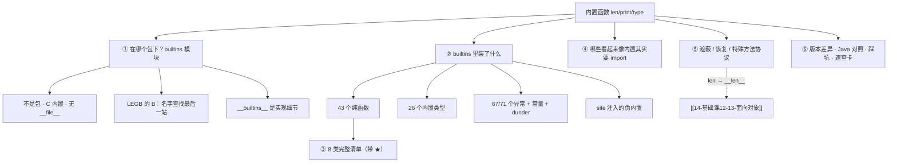

# Python 内置函数与 builtins 全景 · 默认函数在哪、一共有哪些

> [!tldr] 一句话
> `len()`、`print()`、`type()` 这些「不用 import 就能用」的函数，全部来自 **`builtins` 模块**。
> 但它**不是一个包**：没有 `__path__`、没有 `__file__`，是**编译进解释器的 C 内置模块**（`origin='built-in'`，由 `BuiltinImporter` 加载）。解释器启动时把它的名字自动注入每个模块的名字查找链，所以你不需要、也不应该 `import builtins` 才能用 `len`。
> 本机实测：**43 个纯内置函数 + 26 个内置类型构造器 + 67/71 个内置异常 + 常量**，Python 3.10 与 3.13 的**内置函数清单完全一致**。

> [!note] 为什么要单开一篇
> 库里 [[10-基础课01-04-语法与流程控制]]、[[11-基础课05-07-容器与字符串]]、[[12-基础课08-10-函数与函数式]] 里散落着 `len()` / `range()` / `sorted()` 的用法，[[14-基础课12-13-面向对象]] 讲了 `__len__` 这类特殊方法，但**没有一处回答「它们从哪来、一共几个、为什么不用 import」**。
> [[20-专题-Python 包与 import 全景]] 讲的是第三方包和导入写法，[[21-专题-Python 常用框架全景]] 讲的是框架；这篇补最底下那一层 —— **解释器自带的名字空间**。

---

## 🗺️ 全篇导航



---

## ⭐ 常用度图例

| 星标 | 含义（按「Web 后端 + AI 应用」视角） |
|---|---|
| `★★★★★` | 天天写，不会就没法写代码：`len` `print` `range` `type` `isinstance` `open` `str` `int` `list` `dict` |
| `★★★★☆` | 高频但要动脑：`sorted` `enumerate` `zip` `sum` `max` `min` `getattr` `hasattr` `any/all` `repr` `format` |
| `★★★☆☆` | 特定场景必用：`iter/next` `map/filter` `super` `property` `staticmethod` `vars` `dir` `round` `divmod` |
| `★★☆☆☆` | 少见但有用：`compile` `eval/exec` `breakpoint` `aiter/anext` `memoryview` `slice` `classmethod` |
| `★☆☆☆☆` | 几乎不用 / 交互式专用：`ascii` `bin/oct/hex` `copyright` `credits` `license` `quit/exit` |

---

## 一、⭐ 核心答案：这些函数「在哪个包下」

**答案：`builtins` 模块。但要澄清四层，否则容易答错。**

| # | 说法 | 实测结论 |
|---|---|---|
| 1 | 「在某个包下」 | ❌ **不是包**。`hasattr(builtins, '__path__') == False`，包必须有 `__path__` 才能有子模块 |
| 2 | 「在标准库某个 `.py` 文件里」 | ❌ **没有源文件**。实测 `builtins.__file__` **属性根本不存在**（直接访问抛 `AttributeError`，只有 `getattr(builtins,'__file__',None)` 才给 `None`）；`__spec__` 显示 `origin='built-in'`、loader 是 `_frozen_importlib.BuiltinImporter` —— 它编译在解释器二进制里 |
| 3 | 「要 import 才能用」 | ❌ **不需要**。解释器启动时把 `builtins` 的名字挂到每个模块的查找链末端；当然你**可以** `import builtins` 显式访问（用于恢复被遮蔽的名字） |
| 4 | 「`__builtins__` 就是这个模块」 | ⚠️ **是实现细节**。实测：在 `__main__` 里 `__builtins__` 是 **module 对象**；在被导入的 `json` 模块里是 **dict**。别依赖它，用 `import builtins` |

```python
import builtins, inspect

len is builtins.len          # True —— 就是同一个对象
type(len).__name__           # 'builtin_function_or_method'（C 实现）
len.__module__               # 'builtins'
inspect.signature(len)       # (obj, /)
len.__doc__.splitlines()[0]  # 'Return the number of items in a container.'

getattr(builtins, '__file__', None)   # None —— 属性不存在，直接访问 builtins.__file__ 会 AttributeError
hasattr(builtins, '__path__')         # False
builtins.__spec__            # ModuleSpec(name='builtins', loader=BuiltinImporter, origin='built-in')
```

### 名字是怎么「自动可用」的 —— LEGB 的 B


```python
# 你写 len(x) 时，解释器按 L → E → G → B 逐层找名字
# 前三层都没有 len，最后在 builtins 里找到 → 调用
# 所以「默认函数」不是被 import 进来的，是查找链的最后一站

def f():
    len = lambda x: 'FAKE'   # Local 命中，遮住 Builtins
    return len([1, 2, 3])    # → 'FAKE'（实测）
# 出了函数，len([1,2,3]) 仍是 3

import builtins
builtins.len([1, 2])         # 即使全局被遮蔽，也能这样拿到真身 → 2
```

> **验证**：把全局 `len = 999` 后调用 `len([1,2])` → `TypeError: 'int' object is not callable`；`builtins.len([1,2])` 仍返回 `2`。删掉遮蔽即恢复。
> 所以「内置函数」**不是关键字**（实测 `keyword.iskeyword('len') == False`，3.10 共 35 个关键字 / 3 个软关键字 `_, case, match`），它们只是普通名字，可以被重新赋值 —— 这也是「别拿 `list`、`id`、`type` 当变量名」的原因。

---

## 二、`builtins` 里到底装了什么（双版本实测）

| 类别 | 3.10.22 | 3.13.12 | 说明 |
|---|---|---|---|
| **纯内置函数** | **43** | **43** | `inspect.isbuiltin()` 或 `inspect.isfunction()` 为真（42 个 C 函数 + 1 个 Python 层函数 `open`） |
| **内置类型（非异常类）** | 26 | 26 | `int`/`str`/`list`/`dict`/`type`/`object`… 可调用的构造器 |
| **内置异常类** | 67 | **71** | 3.13 多了 4 个 |
| **其他名字** | 11 | 11 | 5 个真常量 + 6 个 `site` 注入对象 |
| **公开名字合计** | **147** | **151** | 不含 `__` 开头的 dunder |
| **dunder 名字** | 8 | 8 | `__build_class__`、`__debug__`、`__doc__`、`__import__`、`__loader__`、`__name__`、`__package__`、`__spec__` |

> [!info] 为什么官方说「内置函数有 71 个」，我这里只有 43 个？
> 官方文档 `docs.python.org/3/library/functions.html` 把 **26 个内置类型构造器**（`int()`、`list()`、`dict()`…）也算进「内置函数」页，因为它们同样可调用、同样不用 import。
> **43 + 26 = 69 个可调用对象**，再加上 `__import__` 和交互式用的 `help`，就接近常见的「~71 个」说法。
> 本文按 `inspect` 的真实对象类型分开统计，口径更精确：**43 个是纯函数，26 个是类**。
> ⚠️ 自查时注意：其中 `open` 其实是 `io.open`（**Python 层函数**），`inspect.isbuiltin(open)` 为假。所以「只用 `isbuiltin` 数」会得到 **42**，要加上 `inspect.isfunction()` 才是 43。

---

## 三、⭐ 43 个内置纯函数 · 8 类完整清单

> 下面 8 张表覆盖全部 43 个函数，**不重不漏**（脚本按 `inspect.isbuiltin` + `isfunction` 双判定校验：遗漏 `[]`、重复 `[]`）。
> 签名取自 `inspect.signature()`；`无签名` 表示该函数用 C 的 `METH_VARARGS` 实现，`signature()` 拿不到，要查 `__doc__`。

### 3.1 数值与聚合（7 个）

| 函数 | 签名 | ★ | 说明 / 实测坑 |
|---|---|---|---|
| `abs` | `(x, /)` | `★★★★☆` | 绝对值；调 `__abs__` |
| `divmod` | `(x, y, /)` | `★★★☆☆` | 一次拿商和余：`divmod(17,5) == (3,2)` |
| `pow` | `(base, exp, mod=None)` | `★★★☆☆` | 三参数模幂 `pow(2,10,97) == 54`，比先幂后取模快 |
| `round` | `(number, ndigits=None)` | `★★★★☆` | **银行家舍入**：`round(0.5)=0`、`round(1.5)=2`、`round(2.5)=2`、`round(2.675,2)=2.67` |
| `sum` | `(iterable, /, start=0)` | `★★★★★` | 只加数字；`sum(['a','b'])` → `TypeError` |
| `max` / `min` | 无签名 | `★★★★★` | 支持 `key=`；空序列 → `ValueError: min() arg is an empty sequence` |

### 3.2 进制与字符编码（5 个）

| 函数 | 签名 | ★ | 说明 |
|---|---|---|---|
| `bin` / `oct` / `hex` | `(number, /)` | `★★☆☆☆` | 转 `0b` / `0o` / `0x` 字符串；也可用 `format(255,'08b') == '11111111'` |
| `chr` | `(i, /)` | `★★★☆☆` | Unicode 码点 → 字符，`chr(0x4e2d) == '中'` |
| `ord` | `(c, /)` | `★★★☆☆` | 逆操作，`ord('中') == 20013` |

### 3.3 迭代与异步迭代（6 个）

| 函数 | 签名 | ★ | 说明 / 实测坑 |
|---|---|---|---|
| `len` | `(obj, /)` | `★★★★★` | 调 `__len__`；返回 `int`，不能对生成器用 |
| `iter` | 无签名 | `★★★★☆` | 两种形式：`iter(x)` 或 `iter(callable, sentinel)` |
| `next` | 无签名 | `★★★★☆` | `next(it, default)` 可避免 `StopIteration` |
| `sorted` | `(iterable, /, *, key=None, reverse=False)` | `★★★★★` | **返回新列表**；`list.sort()` 原地且返回 `None` |
| `aiter` | `(async_iterable, /)` | `★★☆☆☆` | **3.10 新增**，异步版 `iter`，见 [[19-专题-async 与 await 全景]] |
| `anext` | 无签名 | `★★☆☆☆` | **3.10 新增**，异步版 `next` |

> 实测死循环坑：`iter(lambda: next(iter([1,2,0])), 0)` 里的 lambda 每次都**新建生成器**、永远返回 1，哨兵 `0` 永不出现 → 无限循环（我这次实测直接被 `SIGTERM` 杀掉）。
> 正确写法要**有状态**：`nums = iter([3,1,0,9]); list(iter(lambda: next(nums), 0)) == [3,1]`。

### 3.4 布尔判定与类型判断（5 个）

| 函数 | 签名 | ★ | 说明 / 实测坑 |
|---|---|---|---|
| `all` | `(iterable, /)` | `★★★★☆` | 空序列返回 **`True`** |
| `any` | `(iterable, /)` | `★★★★☆` | 空序列返回 **`False`** |
| `callable` | `(obj, /)` | `★★★☆☆` | 判断能否调用（有 `__call__`） |
| `isinstance` | `(obj, class_or_tuple, /)` | `★★★★★` | **认继承**：`isinstance(True, int) == True` |
| `issubclass` | `(cls, class_or_tuple, /)` | `★★★☆☆` | 类之间的关系；与 `type(x) is T` 的严格判断区分 |

### 3.5 对象表示与格式化（3 个）

| 函数 | 签名 | ★ | 说明 |
|---|---|---|---|
| `repr` | `(obj, /)` | `★★★★☆` | 给开发者看的、尽量可 `eval` 还原；调 `__repr__` |
| `ascii` | `(obj, /)` | `★☆☆☆☆` | `repr` 的非 ASCII 转义版：`ascii('中文') == "'\\u4e2d\\u6587'"` |
| `format` | `(value, format_spec='', /)` | `★★★★☆` | `format(1234.5678, ',.2f') == '1,234.57'`；调 `__format__` |

> `str()` 不在这张表里 —— 它是**内置类型构造器**（见 §四），`repr` 和 `str` 的差别：对字符串 `'中文'`，`repr` 给 `'中文'`（带引号），`str` 给 `中文`。

### 3.6 属性与反射（8 个）

| 函数 | 签名 | ★ | 说明 / 实测坑 |
|---|---|---|---|
| `getattr` | 无签名 | `★★★★☆` | `getattr({}, 'x', 'DEFAULT')` 用默认值避免 `AttributeError` |
| `setattr` | `(obj, name, value, /)` | `★★★☆☆` | 动态设属性；Pydantic 的 `validate_assignment` 会拦它，见 [[18-专题-Pydantic 全景]] |
| `delattr` | `(obj, name, /)` | `★★☆☆☆` | 动态删属性 |
| `hasattr` | `(obj, name, /)` | `★★★★☆` | 内部就是「调 `getattr` 看是否抛 `AttributeError`」 |
| `dir` | 无签名 | `★★★☆☆` | **不带参数时返回当前局部作用域的名字**（实测）；带参数返回对象可用属性 |
| `vars` | 无签名 | `★★★☆☆` | 等价于 `obj.__dict__`；无 `__dict__` 的对象会 `TypeError` |
| `id` | `(obj, /)` | `★★★☆☆` | CPython 里是内存地址（**实现细节**，别当业务 ID 用），见 [[08-专题-Python 内存管理与垃圾回收（对比 JVM）]] |
| `hash` | `(obj, /)` | `★★★☆☆` | 字符串 hash **按进程随机化**，别持久化；同一进程内一致 |

### 3.7 动态执行与作用域（6 个）

| 函数 | 签名 | ★ | 说明 / 风险 |
|---|---|---|---|
| `globals` | `()` | `★★★☆☆` | 返回当前模块全局名字空间的 **dict**（可写） |
| `locals` | `()` | `★★★☆☆` | 返回局部名字快照；**函数内改它不一定生效**（CPython 优化） |
| `eval` | `(source, globals=None, locals=None, /)` | `★★☆☆☆` | 执行**表达式**并返回结果 |
| `exec` | `(source, globals=None, locals=None, /)` | `★★☆☆☆` | 执行**语句**，返回 `None` |
| `compile` | `(source, filename, mode, flags=0, ...)` | `★★☆☆☆` | 把源码编成 code object，再交给 `eval/exec` |
| `breakpoint` | 无签名 | `★★☆☆☆` | **3.7+**，进 `pdb`；受 `PYTHONBREAKPOINT` 环境变量控制 |

> [!warning] `eval` / `exec` 的安全边界
> 传用户输入 = 任意代码执行。即便传了 `{"__builtins__": {}}` 限制全局，历史上仍有通过对象继承链逃逸的手法。**业务代码里不要用它们处理外部输入**；要解析数据用 `json.loads()` / `ast.literal_eval()`。

### 3.8 输入输出（3 个）

| 函数 | 签名 | ★ | 说明 |
|---|---|---|---|
| `print` | 无签名 | `★★★★★` | **Python 3 起是函数**（Python 2 是语句），可赋值、可传参：`sep` `end` `file` `flush` |
| `input` | `(prompt='', /)` | `★★★★☆` | **永远返回 `str`**，`int(input())` 才转数字 |
| `open` | `(file, mode='r', buffering=-1, encoding=None, ...)` | `★★★★★` | 返回文件对象；**始终用 `with open(...) as f:`** |

```python
# print 是普通函数，可以塞进变量、可以重定向
import io, contextlib
p = print
buf = io.StringIO()
with contextlib.redirect_stdout(buf):
    p('hi')
buf.getvalue()   # 'hi\n'（实测）
```

---

## 四、26 个内置类型：也在「内置函数」页里

它们**是类不是函数**，但同样不用 import、同样可调用，官方文档把它们和函数列在同一页。

| 分组 | 成员 | ★ |
|---|---|---|
| 标量 | `bool` `int` `float` `complex` `str` `bytes` `bytearray` `memoryview` | `★★★★★` |
| 容器 | `list` `tuple` `dict` `set` `frozenset` | `★★★★★` |
| 迭代器 / 惰性 | `range` `enumerate` `zip` `map` `filter` `reversed` | `★★★★☆` |
| 切片 / 基类 | `slice` `object` | `★★★☆☆` |
| 元编程 / 描述符 | `type` `super` `property` `classmethod` `staticmethod` | `★★★☆☆` |

> 判别方法：`inspect.isbuiltin(len) == True`，但 `inspect.isbuiltin(list) == False`、`inspect.isclass(list) == True`。
> `type` 比较特殊：**一个参数**返回对象的类型，**三个参数**动态创建类 —— 它是所有类的元类，见 [[14-基础课12-13-面向对象]]。

---

## 五、常量、异常、dunder 与「伪内置」

| 类别 | 成员 | 说明 |
|---|---|---|
| **真常量（5）** | `True` `False` `None` `Ellipsis`(`...`) `NotImplemented` | 单例对象；`NotImplemented` 用于二元运算回退，**不是** `NotImplementedError` |
| **dunder 常量** | `__debug__` | 默认 `True`；`python -O` 优化模式变 `False`，`assert` 随之被剥离 |
| **dunder 函数（2）** | `__import__` | `import` 语句背后的真实实现；见 [[20-专题-Python 包与 import 全景]] |
| | `__build_class__` | `class` 语句背后的类构建函数 |
| **内置异常** | 3.10 = 67 个 / 3.13 = 71 个 | 顶层只有 `BaseException`；常用 `Exception` `ValueError` `TypeError` `KeyError` `NameError` `ImportError` `AttributeError` `StopIteration`… 见 [[15-基础课14-15-异常与虚拟环境]] |
| **site 注入（6）** | `help` `exit` `quit` `license` `credits` `copyright` | ⚠️ **不是内置**！来自 `_sitebuiltins`，启动时由 `site` 模块塞进 `builtins` |

> [!tip] 一个能验证「伪内置」的实验
> ```bash
> python -c "print(hasattr(__import__('builtins'),'help'))"   # True
> python -S -c "print(hasattr(__import__('builtins'),'help'))" # False
> ```
> 实测：正常启动可调用对象 142 个（3.10）/ 146 个（3.13），加 `-S` 跳过 `site` 后变成 **136 / 140**，正好少 6 个。
> 它们的真实类型：`help` 是 `_Helper`，`exit`/`quit` 是 `Quitter`，`license`/`credits`/`copyright` 是 `_Printer` —— 全是 `_sitebuiltins` 里的**实例**，所以 `inspect.isclass()` 和 `isbuiltin()` 都为假。
> **结论：脚本里退出用 `sys.exit()` 或 `raise SystemExit`，别用 `exit()` / `quit()`** —— 生产环境若以 `-S` 启动，它们直接 `NameError`。

---

## 六、⭐ 哪些「看起来像内置」其实要 import

实测下面每一条在裸解释器里都是 `NameError`：

| 想用的东西 | 真实归属 | 正确写法 |
|---|---|---|
| `sqrt()` / `ceil()` / `pi` | `math` | `import math; math.sqrt(4)` |
| `randint()` / `random()` | `random` | `import random` |
| `sleep()` / `time()` | `time` | `import time` |
| `dumps()` / `loads()` | `json` | `import json` |
| `join()` / `basename()` | `os.path` | `import os.path` 或 `from pathlib import Path` |
| `chain()` / `product()` | `itertools` | `import itertools` |
| `reduce()` | `functools` | `from functools import reduce`（**3.0 起被移出 builtins**） |
| `Counter()` / `defaultdict()` | `collections` | `from collections import Counter` |
| `deepcopy()` | `copy` | `import copy` |
| `pprint()` | `pprint` | `from pprint import pprint` |
| `exit()` | `sys` / `_sitebuiltins` | `sys.exit()`（见 §五） |
| `list.append(x)` | **对象方法**，不是函数 | `xs.append(x)`；`append` 单独用是 `NameError` |
| `'abc'.upper()` | **对象方法** | 属于 `str` 类，不属于 `builtins` 顶层名字 |

> 判别口诀：**能直接写名字调用的**（`len(x)`、`print(x)`）才在 `builtins`；**带点号的**（`math.sqrt`、`os.path`、`s.upper`）都是模块属性或对象方法。详见 [[20-专题-Python 包与 import 全景]]、[[11-基础课05-07-容器与字符串]]。

---

## 七、内置函数背后的特殊方法协议

内置函数大多只是**薄封装**，真正干活的是对象上的双下方法。这也是「Python 的鸭子类型」能成立的原因。

| 内置调用 | 实际找的特殊方法 | 内置调用 | 实际找的特殊方法 |
|---|---|---|---|
| `len(x)` | `x.__len__()` | `iter(x)` | `x.__iter__()` |
| `next(it)` | `it.__next__()` | `repr(x)` | `x.__repr__()` |
| `str(x)` | `x.__str__()` | `format(x, s)` | `x.__format__(s)` |
| `bool(x)` | `x.__bool__()`（无则退回 `__len__`） | `hash(x)` | `x.__hash__()` |
| `abs(x)` | `x.__abs__()` | `int(x)` / `float(x)` | `__int__` / `__float__` |
| `getattr(x, n)` | 走 `__getattribute__` / `__getattr__` | `setattr` / `delattr` | `__setattr__` / `__delattr__` |
| `dir(x)` | `x.__dir__()` | `x[i]` | `x.__getitem__(i)` |
| `x()` | `x.__call__()` | `x + y` | `x.__add__(y)` |

```python
class Bag:
    def __init__(self, xs): self.xs = xs
    def __len__(self):   return len(self.xs)
    def __iter__(self):  return iter(self.xs)
    def __repr__(self):  return f'Bag({self.xs})'
    def __bool__(self):  return bool(self.xs)
    def __getitem__(self, i): return self.xs[i]

b = Bag([1, 2, 3])
len(b), next(iter(b)), repr(b), bool(b), b[0], f'{b}'
# → (3, 1, 'Bag([1, 2, 3])', True, 1, 'Bag([1, 2, 3])')   实测全部通过
```

> 面试点：**`len()` 为什么不是 `x.len()`？** 因为内置函数统一走 C 层协议，能跳过属性查找、对内置容器做快速路径；同时给自定义类一个统一钩子。Java 里没有这套协议，只能靠实现接口（`Collection.size()`）。

---

## 八、版本差异（3.10.22 ↔ 3.13.12 实测）

| 项目 | 3.10.22 | 3.13.12 | 差异 |
|---|---|---|---|
| 纯内置函数 | 43 | 43 | **完全一致，一个不差** |
| 内置类型 | 26 | 26 | 完全一致 |
| 内置异常 | 67 | **71** | 3.13 多 4 个 |
| 公开名字总数 | 147 | 151 | +4 |
| 关键字 | 35 | 35 | 完全一致 |
| 软关键字 | `_, case, match` | `_, case, match, type` | 3.13 多 `type`（3.12 随 `type X = ...` 类型别名语句引入） |

**3.13 相对 3.10 新增的 4 个异常**：`BaseExceptionGroup`、`ExceptionGroup`（3.11 引入，配合 `except*`）、`PythonFinalizationError`（3.13）、`_IncompleteInputError`（3.13，REPL 内部用）。3.10 独有项：**无**。

> 顺带一提：软关键字 `type` 只在 `type X = int` 这种语法位置才当关键字用，**不影响**你继续写 `type(x)` 这个内置函数 —— 实测 `keyword.iskeyword('type') == False`，它同时在硬关键字表之外。

> 值得记的时间点：`aiter`/`anext` 是 **3.10 新增**（本机 3.10 已有），`breakpoint()` 是 **3.7 新增**，`ExceptionGroup`/`except*` 是 3.11，`tomllib` 是 3.11 进标准库（但它是**模块**不是内置函数）。
> 对本项目（3.10.22）来说：**别用 `asyncio.TaskGroup` / `asyncio.timeout`**（3.11+），但 `aiter`/`anext` 可以放心用。详见 [[19-专题-async 与 await 全景]] §十二勘误。

---

## 九、Java 对照

| 维度 | Python | Java |
|---|---|---|
| 全局函数 | **有**：`len(x)`、`print(x)` 直接调 | **没有**，一切方法必须属于类 |
| 存放位置 | `builtins` 模块（C 内置，自动注入） | `java.lang.*` 类（`Math`、`String`、`System`），自动 import |
| 「不用 import」的原因 | LEGB 名字查找链的最后一站 | `java.lang` 包由编译器隐式导入 |
| 求长度 | `len(x)` 统一走 `__len__` | 分裂成 `s.length()` / `list.size()` / `arr.length` / `map.size()` |
| 打印 | `print(...)` 函数 | `System.out.println(...)` 静态方法 |
| 类型判断 | `isinstance(x, T)` 函数 | `x instanceof T` **运算符/关键字** |
| 取类型 | `type(x)` / `isinstance` | `x.getClass()` / `Class.forName()` |
| 反射 | `getattr/setattr/hasattr/dir` | `java.lang.reflect.*` |
| 动态执行 | `eval()` / `exec()` | 无原生等价（要编译/脚本引擎） |
| 常量 | `True/False/None`（单例对象） | `true/false/null`（**关键字字面量**） |
| 能否被覆盖 | ✅ `len = 1` 就能遮蔽（LEGB） | ❌ 关键字不可覆盖；静态方法可被本类方法遮蔽但语法层面安全 |
| 数字舍入 | `round()` 银行家舍入 | `Math.round()` 是 `floor(x+0.5)` 逻辑，`Math.round(2.5)==3` |

> 从 Java 过来最需要适应的一点：**Python 的内置名字是可以被覆盖的普通变量**。所以别用 `list` / `dict` / `id` / `type` / `sum` / `input` 当变量名 —— 不会立刻报错，但会在几十行之后以莫名其妙的 `TypeError` 爆出来。Java 里 `String` 当变量名虽也合法，但类型系统不会让你把它当类用而不报错。

---

## 十、踩坑清单 Top 10（全部实测）

| # | 坑 | 实测结果 / 处理 |
|---|---|---|
| 1 | 拿内置名当变量名 | `len = 999` 后 `len([1,2])` → `TypeError: 'int' object is not callable`；用 `import builtins; builtins.len(...)` 恢复 |
| 2 | `all([])` / `any([])` 的语义 | `True` / `False`（空真）；判断「列表非空且全满足」要写 `bool(xs) and all(xs)` |
| 3 | `round()` 不是四舍五入 | 银行家舍入：`round(0.5)=0`、`round(2.5)=2`、`round(2.675,2)=2.67`；金额用 `Decimal` |
| 4 | 混淆 `sorted()` 与 `.sort()` | `sorted(a)` 返回新列表、`a` 不变；`a.sort()` 原地改且**返回 `None`**（`b = a.sort()` 得到 `None`） |
| 5 | `sum()` 拼字符串 | `sum(['a','b'])` → `TypeError`；用 `''.join(xs)` |
| 6 | `type(x) is T` 做类型判断 | `type(True) is int` 为 `False` 但 `isinstance(True,int)` 为 `True`；有继承关系一律用 `isinstance` |
| 7 | `iter(callable, sentinel)` 无状态 | lambda 每次新建迭代器 → 哨兵永不出现 → **死循环**（实测被 `SIGTERM` 杀掉）；callable 必须持有状态 |
| 8 | 用 `exit()` / `quit()` 退脚本 | 来自 `site` 注入，`python -S` 下 `NameError`；用 `sys.exit()` |
| 9 | 把 `id()` / `hash()` 持久化 | `id` 是 CPython 内存地址（实现细节），`hash(str)` 每进程随机化；都不能存库 |
| 10 | `eval/exec` 处理用户输入 | 任意代码执行风险；解析数据用 `json.loads()` / `ast.literal_eval()` |

---

## 十一、面试速答 / 自测

> **Q1：`len()` 这些内置函数在哪个包下？**
> 在 **`builtins` 模块**，但它不是包 —— 没有 `__path__`、没有 `__file__`，是编译进解释器的 C 内置模块（`origin='built-in'`）。不需要 import：解释器把它的名字挂到每个模块名字查找链 **LEGB 的 B** 上。`import builtins` 只是让你显式拿到那个模块对象，`len is builtins.len` 为 `True`。

> **Q2：`__builtins__` 和 `builtins` 是一回事吗？**
> 不是。`builtins` 是正式的模块名；`__builtins__` 是 CPython 的**实现细节**，在 `__main__` 里是 module 对象、在被导入模块里通常是 dict，别依赖它。

> **Q3：Python 3 有多少个内置函数？**
> 按 `inspect.isbuiltin()` + `inspect.isfunction()` 严格算 **43 个纯函数**（3.10 与 3.13 完全一致；其中 42 个是 C 内置函数，`open` 是 Python 层函数）；官方文档把 26 个内置类型构造器也算进「内置函数」页，合计 **69 个可调用对象**，加上 `__import__`、`help` 就是常见的「~71 个」说法。此外还有 67/71 个内置异常类和 5 个真常量。

> **Q4：为什么 `len(x)` 不是 `x.len()`？**
> 内置函数统一调用对象上的特殊方法协议（`len` → `__len__`），能在 C 层做快速路径、跳过属性查找，同时给自定义类一个统一钩子。自定义类只要实现 `__len__`，`len(obj)` 就能工作。

> **Q5：`help` / `exit` / `quit` 是内置函数吗？**
> 不是。它们是 `site` 模块启动时从 `_sitebuiltins` 注入到 `builtins` 的实例（`_Helper`/`Quitter`/`_Printer`）。实测 `python -S` 下这 6 个名字全部消失，可调用对象数从 142/146 降到 136/140。

> **Q6：内置函数能被覆盖吗？**
> 能，它们只是普通名字，不是关键字（`keyword.iskeyword('len') == False`）。赋值 `len = ...` 会在 LEGB 的 L/G 层命中，遮住 B 层。用 `import builtins; builtins.len(...)` 可绕过遮蔽。

---

## 十二、速查卡

```python
# ① 查「有哪些内置函数」—— 本机自查，不用背清单
import builtins, inspect
funcs = [n for n in dir(builtins)
         if not n.startswith('__')
         and (inspect.isbuiltin(getattr(builtins, n))
              or inspect.isfunction(getattr(builtins, n)))]
print(len(funcs), funcs)                 # 3.10 / 3.13 都是 43 个
# 只用 isbuiltin 会得到 42：open 是 io.open，Python 层函数

# ② 看签名 / 文档
inspect.signature(len)                   # (obj, /)
help(len)                                # 交互式；脚本里用 len.__doc__

# ③ 被遮蔽时恢复
import builtins
builtins.len([1, 2])                     # 不管全局 len 被改成什么

# ④ 哪些是「伪内置」（site 注入）
# python -S -c "import builtins; print(hasattr(builtins,'help'))"  → False

# ⑤ 分类记忆（8 类 43 个）
# 数值聚合  abs divmod pow round sum max min
# 进制字符  bin hex oct chr ord
# 迭代      iter next aiter anext sorted len
# 布尔判定  all any callable isinstance issubclass
# 对象表示  repr ascii format
# 属性反射  getattr setattr delattr hasattr dir vars id hash
# 动态执行  globals locals eval exec compile breakpoint
# 输入输出  open input print

# ⑥ 常用协议钩子（自定义类实现这些，内置函数就能用）
# __len__ __iter__ __next__ __bool__ __repr__ __str__ __format__
# __hash__ __abs__ __int__ __float__ __getitem__ __call__

# ⑦ 别踩
# xs.sort() 返回 None | round(2.5)==2 | all([])==True
# isinstance(True,int)==True | 别用 id()/hash() 持久化 | 别 eval 用户输入
```

**延伸**：[[20-专题-Python 包与 import 全景]]（包/模块/导入写法）、[[21-专题-Python 常用框架全景]]（框架/库/工具链分层）、[[14-基础课12-13-面向对象]]（特殊方法与元类）、[[19-专题-async 与 await 全景]]（`aiter`/`anext` 与 3.11+ API 差异）、[[08-专题-Python 内存管理与垃圾回收（对比 JVM）]]（`id()` 的真相）、[[15-基础课14-15-异常与虚拟环境]]（内置异常层级）、[[06-专题-__name__ 与程序入口]]（模块全局名字空间）、[[18-专题-Pydantic 全景]]（`validate_assignment` 与 `setattr`）。

> [!tldr] 收束成一句
> **`len()` 不在任何「包」里 —— 它在 `builtins` 这个编译进解释器的 C 模块里，靠 LEGB 查找链的最后一站自动可见。**
> 记住三个数字：**43 个纯函数、26 个内置类型、67/71 个内置异常**；记住一个动作：`import builtins` 能查全清单、也能救回被你覆盖掉的名字。

> 本文所有清单、签名、版本差异、遮蔽行为与踩坑数据，均在 `Python 3.10.22`（RuoYiFastAPI 环境）与 `Python 3.13.12` 下用独立子进程实测；8 类分类经脚本校验覆盖全部 43 个纯函数，**遗漏 0、重复 0**。星标为按「Web 后端 + AI 应用」视角的常用度评估，非官方排名。
