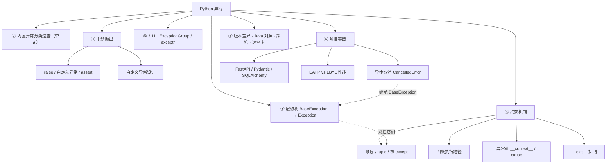

# Python 异常全景 · 层级、捕获、异常链与框架实践

> [!tldr] 一句话
> Python 的异常是一棵以 **`BaseException`** 为根的类树，关键分叉是 **`Exception`（业务可恢复错误）** 和另外三个「别拦我」的兄弟：`SystemExit` / `KeyboardInterrupt` / `GeneratorExit`。
> 所以 **`except Exception` 才是正确的兜底写法**，裸 `except:` 会把 Ctrl-C 和 `sys.exit()` 一起吞掉。
> 本机实测：**内置异常 3.10 = 67 个、3.13 = 71 个**；完整层级、执行路径、异常链、框架异常继承链见下。

> [!note] 定位：和 15 号笔记互补
> [[15-基础课14-15-异常与虚拟环境]] 已经讲了「错误 vs 异常」、四种捕获姿势、`raise`/`assert`、6 个易错点 —— 那是**入门会用**。
> 这篇补**进阶会用与讲得清**：完整层级树、`try/except/else/finally` 的四条实测路径、`__context__`/`__cause__` 异常链、`__exit__` 抑制、3.11+ `ExceptionGroup`/`except*`、以及 **FastAPI / Pydantic / SQLAlchemy 项目里到底该 catch 什么**。
> 内置异常也都在 `builtins` 里，见 [[22-专题-Python 内置函数与 builtins 全景]]。

---

## 🗺️ 全篇导航



---

## ⭐ 常用度图例

| 星标 | 含义（按「Web 后端 + AI 应用」视角） |
|---|---|
| `★★★★★` | 天天见：`Exception` `ValueError` `TypeError` `KeyError` `AttributeError` `HTTPException` `ValidationError` |
| `★★★★☆` | 高频：`ImportError` `OSError` `FileNotFoundError` `RuntimeError` `ZeroDivisionError` `StopIteration` `CancelledError` |
| `★★★☆☆` | 特定场景：`IndexError` `NameError` `AssertionError` `TimeoutError` `ConnectionError` `IntegrityError` |
| `★★☆☆☆` | 少见但要认得：`KeyboardInterrupt` `SystemExit` `GeneratorExit` `UnicodeError` `Warning` 家族 |
| `★☆☆☆☆` | 几乎不直接用：`BufferError` `ReferenceError` `FloatingPointError` `SystemError` `TabError` |

---

## 一、完整层级树（3.10.22 实测，3.13 差异另标）

```mermaid
flowchart TD
    BE["BaseException"] --> EX["Exception ★★★★★"]
    BE --> SE["SystemExit ★★☆☆☆"]
    BE --> KI["KeyboardInterrupt ★★☆☆☆"]
    BE --> GE["GeneratorExit ★★☆☆☆"]
    BE --> BEG["BaseExceptionGroup（3.11+）"]
    BEG --> EG["ExceptionGroup（3.11+）"]
    EX --> AR["ArithmeticError"] --> ZD["ZeroDivisionError ★★★★☆"]
    EX --> AE["AssertionError ★★★☆☆"]
    EX --> AT["AttributeError ★★★★★"]
    EX --> IM["ImportError ★★★★☆"] --> MN["ModuleNotFoundError"]
    EX --> LU["LookupError"] --> IE["IndexError ★★★☆☆"]
    LU --> KE["KeyError ★★★★★"]
    EX --> NE["NameError ★★★☆☆"] --> UL["UnboundLocalError"]
    EX --> OS["OSError ★★★★☆"]
    OS --> FN["FileNotFoundError"]
    OS --> CE["ConnectionError ★★★☆☆"]
    EX --> RT["RuntimeError ★★★★☆"] --> NI["NotImplementedError"]
    EX --> SI["StopIteration ★★★★☆"]
    EX --> TE["TypeError ★★★★★"]
    EX --> VE["ValueError ★★★★★"] --> UE["UnicodeError ★★☆☆☆"]
    EX --> WN["Warning ★★☆☆☆"]
    style BE fill:#7f1d1d,color:#fff
    style EX fill:#2d6a4f,color:#fff
    style SE fill:#7c5800,color:#fff
    style KI fill:#7c5800,color:#fff
    style GE fill:#7c5800,color:#fff
```



### 1.1 关键分叉：为什么 `BaseException` 和 `Exception` 要分开

| 类 | 继承 `Exception`？ | 用途 | 谁抛的 |
|---|---|---|---|
| `Exception` | ✅ | **所有业务可恢复错误**的父类 | 你的代码、标准库、框架 |
| `SystemExit` | ❌ | `sys.exit()` 触发，要正常退出进程 | 解释器 / `sys` |
| `KeyboardInterrupt` | ❌ | 用户按 Ctrl-C，要立刻中断 | 解释器 |
| `GeneratorExit` | ❌ | 生成器/协程 `close()` 时的清理信号 | 解释器 |
| `BaseExceptionGroup` | ❌ | 3.11+ 异常组基类（可装上面任意一类） | `TaskGroup` 等 |

实测：

```python
for n in ('KeyboardInterrupt','SystemExit','GeneratorExit','Exception'):
    c = getattr(__import__('builtins'), n)
    print(n, issubclass(c, BaseException), issubclass(c, Exception))
# KeyboardInterrupt True False
# SystemExit        True False
# GeneratorExit     True False
# Exception         True True
```

> 实测对照：抛 `KeyboardInterrupt` 时，`except Exception` **放行**（异常继续上抛），裸 `except:` **吞掉**。
> 所以框架里写「全局兜底」必须是 `except Exception as e`，绝不能是裸 `except:`。另见 [[19-专题-async 与 await 全景]]：`asyncio.CancelledError` 的 MRO 是 `CancelledError → BaseException → object`，`except Exception` 同样抓不到 —— 这正是取消能穿透任务的原因。

### 1.2 内置异常分类总表（按用途，带 ★）

| 分组 | 成员 | ★ |
|---|---|---|
| 通用兜底 | `Exception` `BaseException` | `★★★★★` |
| 类型 / 值 | `TypeError` `ValueError` `AttributeError` | `★★★★★` |
| 查找 / 索引 | `KeyError` `IndexError` `LookupError` | `★★★★★`/`★★★☆☆` |
| 名字 / 作用域 | `NameError` `UnboundLocalError` | `★★★☆☆` |
| 数值 | `ArithmeticError` `ZeroDivisionError` `OverflowError` `FloatingPointError` | `★★★★☆` |
| 导入 | `ImportError` `ModuleNotFoundError` | `★★★★☆` |
| 系统 / IO | `OSError` `FileNotFoundError` `PermissionError` `TimeoutError` `ConnectionError` 家族 | `★★★★☆`/`★★★☆☆` |
| 流程控制 | `StopIteration` `StopAsyncIteration` | `★★★★☆` |
| 运行时 | `RuntimeError` `NotImplementedError` `RecursionError` | `★★★★☆` |
| 编码 | `UnicodeError` → `UnicodeDecodeError` / `UnicodeEncodeError` / `UnicodeTranslateError` | `★★☆☆☆` |
| 调试 / 断言 | `AssertionError` | `★★★☆☆` |
| 语法 | `SyntaxError` → `IndentationError` → `TabError` | `★★☆☆☆` |
| 警告（也是异常） | `Warning` → `DeprecationWarning` `RuntimeWarning` `ResourceWarning` `UserWarning` 等 11 个 | `★★☆☆☆` |
| 别拦它们 | `SystemExit` `KeyboardInterrupt` `GeneratorExit` | `★★☆☆☆` |
| 3.11+ | `ExceptionGroup` `BaseExceptionGroup` | `★★☆☆☆` |
| 3.13+ | `PythonFinalizationError` `_IncompleteInputError` | `★☆☆☆☆` |

---

## 二、⭐ 常见代码 → 具体异常（逐条实测）

| 代码 | 抛出的异常 | 说明 |
|---|---|---|
| `1/0` | `ZeroDivisionError` | `ArithmeticError` 子类 |
| `int("abc")` | `ValueError` | 类型对、值不合法 |
| `"1" + 1` | `TypeError` | 类型不匹配 |
| `len(1)` / `1()` | `TypeError` | 无 `__len__` / 不可调用 |
| `[1][9]` / `[][0]` | `IndexError` | `LookupError` 子类 |
| `{}["k"]` | `KeyError` | `LookupError` 子类 |
| `x`（未定义） | `NameError` | — |
| 函数内先 `print(a)` 后 `a=1` | `UnboundLocalError` | `NameError` 子类，局部变量被判定成本地 |
| `object().missing` | `AttributeError` | — |
| `import no_such_mod` | **`ModuleNotFoundError`** | `ImportError` 子类 |
| `from math import nope` | **`ImportError`** | ⚠️ 模块存在、名字不存在，不是 `ModuleNotFoundError` |
| `open("/no/such/file")` | `FileNotFoundError` | `OSError` 子类 |
| `"é".encode("ascii")` | `UnicodeEncodeError` | `UnicodeError` → `ValueError` 子类 |
| `b"\xff".decode("utf-8")` | `UnicodeDecodeError` | 同上 |
| `assert False` | `AssertionError` | `-O` 下整条被剥离 |
| `next(iter([]))` | `StopIteration` | for 循环靠它结束 |
| 无限递归 | `RecursionError` | `RuntimeError` 子类 |

> 判别口诀：**`TypeError` 是「这类型不该这么用」，`ValueError` 是「类型对但值不对」，`KeyError`/`IndexError` 是「找不到」**。
> 顺序细节：`except ImportError` 能同时接住 `ModuleNotFoundError`；反过来不行。

---

## 三、`try / except / else / finally` 的四条执行路径（实测）

| 路径 | 执行顺序 | 结果 |
|---|---|---|
| try 正常 | `try → else → finally` | 跳过所有 except |
| try 抛异常且**匹配** | `try → except → finally` | **跳过 else**，异常被处理 |
| try 抛异常但**不匹配** | `try → finally` | 异常继续上抛 |
| except 里又抛异常 | `try → except(抛) → finally` | 新异常上抛，原异常挂进 `__context__` |

```python
# 实测输出
# ok      : ['try', 'else', 'finally']
# caught  : ['try', 'except', 'finally']
# uncaught: try → finally → 异常继续上抛（else / except 都不进）
```

> **`else` 的价值**：把「成功后才做的事」放进 else，能缩小 try 的范围，避免把成功路径里自己抛的异常也误抓进 except。Java 没有 else 分支，只能把成功逻辑塞在 try 尾部 —— 这是 15 号笔记已经点过的差异。

> [!warning] `finally` 里的 `return` 会吞掉一切
> 实测 `try: 1/0; finally: return 'FINALLY-WINS'` → 函数返回字符串，**`ZeroDivisionError` 凭空消失**；`finally: pass` 时异常正常上抛。
> `return` / `break` / `continue` 出现在 `finally` 里都会丢弃正在传播的异常。**finally 只做清理，绝不放控制流语句。**

---

## 四、捕获的规矩（四条实测）

| # | 规矩 | 实测 |
|---|---|---|
| 1 | **子类分支写前面** | `except Exception` 在前 → `ValueError` 分支**不可达**；反过来才正确 |
| 2 | 多个类型用一个 tuple | `except (ValueError, TypeError)` 接住前两个；`KeyError` 需另写分支 |
| 3 | **绝不写裸 `except:`** | 会吞 `KeyboardInterrupt`；`except Exception` 正确放行 |
| 4 | `as e` 的变量**块结束即删除** | 块外访问 `e` → `NameError`（Python 3 主动断开异常 ↔ traceback ↔ 栈帧的循环引用）；要留存就 `saved = e` |

```python
try:
    ...
except ValueError as e:          # ① 精确在前
    ...
except (TypeError, KeyError) as e:  # ② tuple 合并
    ...
except Exception as e:           # ③ 兜底必须写 Exception
    logger.exception("未预期错误")   # 自动带 traceback
```

> 补充：`except` 匹配的是**类及其子类**（`isinstance` 语义），不是精确相等。所以 `except OSError` 能接住 `FileNotFoundError` / `ConnectionError` / `TimeoutError` 全家。

---

## 五、异常链与 traceback（排障的核心）

Python 会自动把「处理异常期间又抛出的异常」串成链，这是 traceback 里那两段英文的来源。

| 场景 | 写法 | `__context__` | `__cause__` | traceback 提示语 |
|---|---|---|---|---|
| 隐式链 | `except` 里直接 `raise ValueError(...)` | 原异常 | `None` | `During handling of the above exception, another exception occurred:` |
| 显式链 | `raise ValueError(...) from orig` | 原异常 | **原异常** | `The above exception was the direct cause of the following exception:` |
| 隐藏上下文 | `raise ValueError(...) from None` | 原异常（仍存） | `None` | 不打印上下文（`__suppress_context__ = True`） |
| 裸 `raise` | 在 except 里原样重抛 | — | — | **保留原 traceback**，不新增栈帧噪音 |

```python
# 实测：隐式链
try:
    try: 1/0
    except ZeroDivisionError: raise ValueError('转换失败')
except ValueError as e:
    e.__context__           # ZeroDivisionError('division by zero')
    e.__cause__             # None
    e.__suppress_context__  # False

# 显式链：语义是「我把底层错误包装成业务错误，因果关系明确」
raise ValueError('包装') from orig     # e.__cause__ = orig, __suppress_context__ = True

# 想给用户看干净报错
raise ValueError('干净') from None     # traceback 里不再出现 "During handling"
```

> **实践建议**：做异常转译（DB 错误 → 业务错误）时一律用 `raise ... from e`，让日志保留根因；只在「底层异常纯属实现细节、暴露出去会误导」时才用 `from None`。
> `raise e` 会**重置 traceback 起点**，尽量用裸 `raise`。打印用 `logging.exception()` 或 `traceback.print_exc()`，别只 `print(e)`（丢了堆栈和链）。

---

## 六、主动抛出、自定义异常与 `assert`

### 6.1 自定义异常的正确设计

```python
class AppError(Exception):
    """业务异常基类：所有自定义异常的统一入口"""
    def __init__(self, msg: str, code: int = 500):
        super().__init__(msg)     # 别漏，e.args / str(e) 都靠它
        self.code = code

class NotFoundError(AppError):
    def __init__(self, resource: str, rid):
        super().__init__(f'{resource} {rid} 不存在', 404)
        self.resource, self.rid = resource, rid

e = NotFoundError('User', 42)
# repr(e) = NotFoundError('User 42 不存在') | str(e) = 'User 42 不存在'
# e.args = ('User 42 不存在',) | e.code = 404
```

| 原则 | 说明 |
|---|---|
| 定义**一个项目基类** | 全局兜底只需 `except AppError`，也能和第三方异常区分开 |
| 继承 `Exception`，不是 `BaseException` | 否则会突破所有 `except Exception` 兜底 |
| 类名以 `Error` 结尾 | 社区惯例；`Warning` 结尾的应继承 `Warning` |
| 调 `super().__init__(msg)` | 保证 `str(e)`、`e.args`、日志、序列化都正常 |
| 结构化字段放属性 | `code` / `resource` / `rid`，方便全局处理器直接映射成响应 |
| 别把所有错误塞一个类 | 用继承分层，让调用方能按类型精确处理 |

### 6.2 `assert` 不是校验工具

实测：正常启动 `__debug__ = True`、`assert False` 抛 `AssertionError`；**`-O` 启动 `__debug__ = False`，整条 assert 被剥离，校验完全失效**。

> 生产参数校验一律 `if not ok: raise ValueError(...)`。`assert` 只用于「内部不变量 / 开发期自检」，且要假设它随时可能不存在。

---

## 七、上下文管理器与异常抑制

`with` 退出时，`__exit__(exc_type, exc_value, traceback)` 会收到异常三元组；**返回真值就抑制异常**。

```python
class Suppress:
    def __init__(self, suppress): self.suppress = suppress
    def __enter__(self): return self
    def __exit__(self, et, ev, tb):
        print(et.__name__, ev)      # 实测收到 ValueError: boom
        return self.suppress

with Suppress(True):  raise ValueError('boom')   # 被吞掉，代码继续
with Suppress(False): raise ValueError('boom')   # 正常上抛
```

| 工具 | 作用 |
|---|---|
| `contextlib.suppress(FileNotFoundError)` | 官方版「静默忽略指定异常」，比 `try/except/pass` 清晰 |
| `contextlib.ExitStack` | 动态组合多个上下文管理器 |
| `@contextmanager` | 生成器写上下文，异常会在 `yield` 处抛进生成器，见 [[16-专题-yield 关键字全景（从生成器到依赖注入）]] |

> `with open(...)` 能自动关文件，靠的就是 `__exit__` 里做清理并**返回 `None`（假值）**让异常继续传播。自己写上下文管理器时，`__exit__` 别习惯性 `return True`。

---

## 八、3.11+ `ExceptionGroup` / `except*`（本项目 3.10 用不了）

| 项 | 3.10.22 | 3.13.12 |
|---|---|---|
| `ExceptionGroup` 内置可用 | ❌ `False` | ✅ `True` |
| `except*` 语法编译 | ❌ **`SyntaxError: invalid syntax`** | ✅ 支持 |
| 来源 | 3.11 引入 | — |

> ⚠️ 这是**语法级**差异：`except*` 在 3.10 连编译都过不了，不是运行时 `AttributeError`。本项目（3.10.22）别抄 3.11+ 的 `asyncio.TaskGroup` 示例，见 [[19-专题-async 与 await 全景]] §十二勘误。

3.13 实测行为：

```python
try:
    raise ExceptionGroup('批量校验失败', [
        ValueError('字段 a'), TypeError('字段 b'), ValueError('字段 c')])
except* ValueError as eg:
    print(len(eg.exceptions))   # 2 → ['字段 a', '字段 c']
except* TypeError as eg:
    print(len(eg.exceptions))   # 1 → ['字段 b']
# 两个分支都会执行，不是传统 except 的「短路」
```

| 要点 | 实测结论 |
|---|---|
| 分支匹配 | 按类型**拆分**组内异常，每个 `except*` 拿到一个子 group |
| 执行方式 | 所有匹配分支**都执行**，不像 `except` 命中即停 |
| `subgroup(T)` / `split(T)` | 返回匹配子集 / `(匹配, 剩余)` 两份，嵌套 group 也能处理 |
| 继承关系 | `issubclass(ExceptionGroup, Exception) == True`；`issubclass(BaseExceptionGroup, Exception) == **False**` |

> 设计意图：并发任务（TaskGroup）、批量校验会同时产生多个异常，传统单异常模型装不下。`BaseExceptionGroup` 之所以不继承 `Exception`，是为了能装 `KeyboardInterrupt` 这类「不该被吞」的异常。

---

## 九、异步与取消：`CancelledError` 的坑

```python
import asyncio
issubclass(asyncio.CancelledError, BaseException)  # True
issubclass(asyncio.CancelledError, Exception)      # False
# MRO: CancelledError → BaseException → object
```

实测：`except Exception` **抓不到** `CancelledError`，必须写专门的 `except asyncio.CancelledError:` 或 `except BaseException:`（后者要立刻 `raise` 回去）。

| 后果 | 说明 |
|---|---|
| 取消能穿透业务代码 | 超时 / `TaskGroup` 子任务失败时，取消信号不会被 `except Exception` 吞掉 |
| `except Exception:` 里做清理要小心 | 清理逻辑写在 `finally` 才保证取消时也执行 |
| 吞掉取消 = 任务永不收敛 | 若用裸 `except:` 接住且不重抛，`wait_for` / `TaskGroup` 会一直等 |
| 3.10 与 3.13 一致 | 3.8 起 `CancelledError` 就从 `Exception` 改挂到 `BaseException` |

> 呼应 [[19-专题-async 与 await 全景]]：`except Exception` 吞掉 `CancelledError` 会导致超时/结构化并发永远收敛不了。

---

## 十、项目里的异常体系（RuoYi-FastAPI 实测）

### 10.1 框架异常继承链（全部实测）

| 异常 | 继承链 | 备注 |
|---|---|---|
| `fastapi.HTTPException` | → `starlette.HTTPException` → `Exception` | ✅ 前者是后者子类 |
| `starlette.HTTPException` | → `Exception` | ASGI 层基类 |
| `pydantic.ValidationError` | → **`ValueError`** → `Exception` | v2 实现在 `pydantic_core`，但仍是 `ValueError` 子类 |
| `fastapi.exceptions.RequestValidationError` | → `ValidationException` → `Exception` | ⚠️ **不是** `pydantic.ValidationError` 子类，也不是 `ValueError` |
| `sqlalchemy.exc.IntegrityError` | → `DatabaseError` → `DBAPIError` → `StatementError` → `SQLAlchemyError` | 唯一约束/外键冲突 |
| `sqlalchemy.exc.NoResultFound` | → `InvalidRequestError` → `SQLAlchemyError` | `.one()` 查不到 |
| `redis.exceptions.ConnectionError` | → `RedisError` → `Exception` | 今天踩过的 Error 65 就是它，见 [[09-开发实战与踩坑清单]] |
| `httpx.ConnectError` | → `NetworkError` → `TransportError` → `RequestError` → `HTTPError` | 外部调用超时/连不上 |

> [!warning] 两个「ValidationError」不是一回事（实测 `issubclass(...) == False`）
> - `pydantic.ValidationError`（**模型校验**，你直接 `Model(**data)` 时抛）—— 继承 `ValueError`
> - `fastapi.exceptions.RequestValidationError`（**请求参数校验**，FastAPI 内部抛）—— 继承 `ValidationException`，**不继承 ValueError**
>
> 所以 `@app.exception_handler(...)` 要**分别注册**，别指望写一个 `except ValueError` 通吃。

### 10.2 FastAPI 全局异常处理（实测响应）

```python
from fastapi import FastAPI, HTTPException
from fastapi.exceptions import RequestValidationError
from fastapi.responses import JSONResponse

app = FastAPI()

@app.exception_handler(RequestValidationError)
async def validation_handler(request, exc):
    return JSONResponse(status_code=422,
                        content={'code': 422, 'errors': exc.errors()[:1]})

@app.exception_handler(HTTPException)
async def http_handler(request, exc):
    return JSONResponse(status_code=exc.status_code,
                        content={'code': exc.status_code, 'msg': exc.detail})

@app.exception_handler(Exception)      # 兜底：只兜 Exception，别用裸 except
async def unhandled(request, exc):
    logger.exception('未处理异常')
    return JSONResponse(status_code=500, content={'code': 500, 'msg': '服务器内部错误'})
```

实测三种请求：

| 请求 | 响应 | 说明 |
|---|---|---|
| `GET /ok?age=18` | `200 {"age": 18}` | 正常 |
| `GET /ok?age=abc` | `422 {"code":422,"errors":[{"type":"int_parsing","loc":["query","age"],...}]}` | 参数校验失败，走自定义 handler |
| `GET /http` | `404 {"code":404,"msg":"用户不存在"}` | `HTTPException` 走自定义 handler |

> 捕获顺序：**具体业务异常 → `HTTPException` / `RequestValidationError` → `SQLAlchemyError` / `RedisError` → `AppError`（自定义基类）→ `Exception` 兜底 → 记录 `logger.exception()`**。
> 项目分层与异常归属见 [[02-五层架构与请求全链路]]、[[09-开发实战与踩坑清单]]。

---

## 十一、EAFP vs LBYL：异常不该当控制流

| 风格 | 写法 | Python 倾向 |
|---|---|---|
| **LBYL**（Look Before You Leap） | `if k in d: v = d[k] else: ...` | 先检查再动手 |
| **EAFP**（Easier to Ask Forgiveness than Permission） | `try: v = d[k] except KeyError: ...` | **Python 惯例**，先干再兜 |

10 万次实测（3.10.22）：

| 场景 | EAFP | LBYL | 结论 |
|---|---|---|---|
| 键**命中** | `0.0021s` | `0.0033s` | EAFP **更快**（try 成功路径几乎零成本） |
| 键**未中** | `0.0092s` | `0.0021s` | EAFP 慢 **4.3 倍**（抛异常 + 建 traceback 很贵） |

> **结论**：异常频繁发生的路径不要用 `try/except` 当分支。命中率高时 EAFP 既简洁又快；失败是常态时改成 `if` 预检。
> 另：Python 3.11 起 try 块「无异常路径」做了零成本优化（zero-cost exception handling），成功路径比老版本更便宜 —— 但抛异常的成本没变。

---

## 十二、版本差异（3.10.22 ↔ 3.13.12 实测）

| 项目 | 3.10.22 | 3.13.12 |
|---|---|---|
| 内置异常总数（`dir(builtins)` 排除 `__`） | **67** | **71** |
| 只算公开名（再排除单下划线） | 67 | 70（差 `_IncompleteInputError`） |
| `BaseException` 直属子类 | `Exception` `GeneratorExit` `KeyboardInterrupt` `SystemExit` | 再加 `BaseExceptionGroup` |
| `ExceptionGroup` / `except*` | ❌ 语法都不支持 | ✅ |
| `Exception` 直属子类 | 21 个 | 22 个（多 `ExceptionGroup`） |
| 3.13 新增异常 | — | `BaseExceptionGroup`、`ExceptionGroup`（3.11 引入）、`PythonFinalizationError`、`_IncompleteInputError` |
| 3.10 独有 | 无 | — |
| `CancelledError` 继承 `BaseException` | ✅ | ✅ |

> 口径说明：[[22-专题-Python 内置函数与 builtins 全景]] 里写的「67 / 71」是**排除双下划线**口径，`_IncompleteInputError` 单下划线开头被算进公开名字；本篇按「只算公开名」则是 67 / 70。两者不矛盾，差的就是那一个私有异常。

---

## 十三、Java 对照

| 维度 | Python | Java |
|---|---|---|
| 根类 | `BaseException` | `Throwable` |
| 业务错误父类 | `Exception` | `Exception`（`RuntimeException` 是非受检分支） |
| 系统级错误 | `SystemExit` / `KeyboardInterrupt`（继承 `BaseException`） | `Error`（`OutOfMemoryError` 等，继承 `Throwable`） |
| **受检异常** | ❌ **完全没有**，编译器不逼你声明或捕获 | ✅ `checked exception` 必须 `catch` 或 `throws` 声明 |
| 声明抛出 | 无 `throws`，靠文档 / 类型提示 | `throws IOException` 是方法签名的一部分 |
| 语法分支 | `try / except / else / finally` | `try / catch / finally`（**无 else**；有 try-with-resources） |
| 抛出 | `raise ValueError(...)` | `throw new IllegalArgumentException(...)` |
| 异常链 | `raise ... from e`（`__cause__`） | `initCause()` / 构造器传 cause |
| 资源清理 | `with`（`__enter__`/`__exit__`） | try-with-resources（`AutoCloseable`） |
| 多异常 | `except (A, B)` | `catch (A | B e)`（3.7+ 也前身 multi-catch） |
| 批量异常 | `ExceptionGroup` / `except*`（3.11+） | 无原生等价（`suppressed` 只是附加） |
| 断言 | `assert`（-O 可关闭） | `assert`（-ea 才**开启**，默认关闭） |
| 兜底写法 | `except Exception` | `catch (Exception e)`（都不该裸抓 `Throwable`/`BaseException`） |

> 最容易踩的迁移差异：**Java 编译器会强制你处理受检异常，Python 全靠自觉**。所以 Python 项目里漏 catch 是常态，必须靠全局异常处理器 + 日志 + 测试兜底，不能靠编译器。

---

## 十四、踩坑清单 Top 10（全部实测）

| # | 坑 | 实测结论 / 处理 |
|---|---|---|
| 1 | 裸 `except:` | 吞掉 `KeyboardInterrupt`；`except Exception` 才正确放行 |
| 2 | `finally` 里 `return` | 吞掉 `ZeroDivisionError` 和返回值；finally 只做清理 |
| 3 | 宽分支写在前面 | `except Exception` 在前 → 后面的 `except ValueError` **永远不可达** |
| 4 | `except Exception` 抓取消 | `asyncio.CancelledError` 继承 `BaseException`，抓不到也**不该抓** |
| 5 | 块外用 `as e` 的变量 | `NameError`（Python 3 自动清理）；要留存 `saved = e` |
| 6 | `raise e` 重抛 | 重置 traceback 起点；用裸 `raise` |
| 7 | 只 `print(e)` | 丢堆栈、丢异常链；用 `logging.exception()` / `traceback.print_exc()` |
| 8 | `assert` 做业务校验 | `-O` 下整条被剥离（实测 `__debug__` 变 `False`），校验失效 |
| 9 | 以为两个 `ValidationError` 有继承关系 | `fastapi.RequestValidationError` **不继承** `pydantic.ValidationError`（实测 False），handler 要分别注册 |
| 10 | 把异常当循环控制流 | 未中时 EAFP 比 LBYL 慢 **4.3 倍**；高频失败改用 `if` 预检 |

---

## 十五、面试速答 / 自测

> **Q1：`BaseException` 和 `Exception` 有什么区别？为什么不能直接 `except BaseException`？**
> `BaseException` 是根类，直接子类除 `Exception` 外还有 `SystemExit`、`KeyboardInterrupt`、`GeneratorExit`（3.11+ 再加 `BaseExceptionGroup`）。后三个是进程/生成器级控制信号，不是业务错误。抓 `BaseException` 会让 Ctrl-C 失效、`sys.exit()` 退不掉、取消信号被吞。正确兜底是 `except Exception as e`。

> **Q2：`try/except/else/finally` 的执行顺序？**
> 正常：`try → else → finally`；异常且匹配：`try → except → finally`（**跳过 else**）；异常不匹配：`try → finally` 后继续上抛。`finally` 不论哪种都执行，但里面有 `return`/`break` 会吞掉正在传播的异常。

> **Q3：`raise ... from e`、`raise ... from None`、裸 `raise` 的区别？**
> `from e` 设 `__cause__`，traceback 显示「direct cause」，用于包装并保留根因；`from None` 设 `__suppress_context__ = True`，隐藏上下文但 `__context__` 仍在；裸 `raise` 原样重抛并**保留原 traceback**，而 `raise e` 会重置起点。

> **Q4：`finally` 里能 `return` 吗？**
> 语法能，语义上是 bug。实测 `try: 1/0; finally: return 'x'` 会让函数返回 `'x'`、`ZeroDivisionError` 凭空消失。finally 只做资源清理。

> **Q5：Python 有受检异常吗？**
> 没有。不需要 `throws` 声明，编译器不强制处理，全部自愿。代价是容易漏 catch，得靠全局异常处理器、日志和测试兜底。

> **Q6：`except*` 是什么？我项目能用吗？**
> 3.11 引入的「异常组」语法，配合 `ExceptionGroup` 把多个并发异常按类型拆分给多个分支，且**所有匹配分支都会执行**（不像 `except` 短路）。本项目是 Python 3.10.22，`except*` 会直接 `SyntaxError: invalid syntax`，不能用。

> **Q7：FastAPI 里 `RequestValidationError` 和 `pydantic.ValidationError` 一样吗？**
> 不一样，实测 `issubclass(RequestValidationError, pydantic.ValidationError) == False`。前者 MRO 是 `RequestValidationError → ValidationException → Exception`（连 `ValueError` 都不是），后者是 `ValidationError → ValueError → Exception`。全局 handler 要分别注册。

---

## 十六、速查卡

> 下面是**模板示意**（含 `service` / `BizError` / `os` / `asyncio` 等业务符号，需按需补 import 与替换，不能整块直接执行）；§一、§五、§六、§七、§九、§十 的代码块都是可运行示例，已实跑验证。§八 的 `except*` 示例只在 3.11+ 可跑。

```python
# ① 正确兜底模板（顺序：精确 → 框架 → 兜底）
try:
    result = service.do(x)
except NotFoundError as e:                 # 自定义业务异常
    raise HTTPException(404, str(e)) from e   # 保留根因
except (ValueError, TypeError) as e:       # 参数/类型
    ...
except SQLAlchemyError as e:               # 数据层
    logger.exception('DB 失败')
    raise
except Exception as e:                     # 兜底（绝不裸 except）
    logger.exception('未预期错误')
    raise
finally:
    cleanup()                              # 只清理，绝不 return

# ② 异常链
raise BizError('包装') from e     # __cause__ = e，显示 direct cause
raise BizError('干净') from None  # 隐藏上下文
raise                            # 裸重抛，保留原 traceback
e.__context__ / e.__cause__ / e.__suppress_context__ / e.__traceback__

# ③ 打印与抑制
import logging, traceback, contextlib
logging.exception('...')                   # 自动带 traceback
traceback.print_exc()
with contextlib.suppress(FileNotFoundError):
    os.remove(path)

# ④ 自定义异常
class AppError(Exception):
    def __init__(self, msg, code=500):
        super().__init__(msg); self.code = code

# ⑤ 自查层级（3.10 / 3.13 都可用）
import builtins, inspect
excs = [n for n in dir(builtins)
        if not n.startswith('__') and inspect.isclass(getattr(builtins, n))
        and issubclass(getattr(builtins, n), BaseException)]
print(len(excs))                           # 3.10 → 67 | 3.13 → 71
print(issubclass(asyncio.CancelledError, Exception))   # False！

# ⑥ 别踩
# 裸 except / finally return / 宽分支在前 / raise e / assert 做校验
# except Exception 抓不到 CancelledError / KeyboardInterrupt / SystemExit
```

**延伸**：[[15-基础课14-15-异常与虚拟环境]]（入门四种姿势）、[[22-专题-Python 内置函数与 builtins 全景]]（异常也在 `builtins`）、[[19-专题-async 与 await 全景]]（取消与 TaskGroup）、[[18-专题-Pydantic 全景]]（v2 校验错误结构）、[[21-专题-Python 常用框架全景]]（框架分层）、[[16-专题-yield 关键字全景（从生成器到依赖注入）]]（生成器 `close()` 与 `GeneratorExit`）、[[14-基础课12-13-面向对象]]（`__exit__` 协议）、[[02-五层架构与请求全链路]] / [[09-开发实战与踩坑清单]]（项目全局异常处理）、[[10-FastAPI与SpringBoot全面对比]]、[[05-阶段五-项目实战与验收]]。

> [!tldr] 收束成一句
> **记住一条分界线：`Exception` 是「业务能处理的错误」，`BaseException` 下另外三个兄弟是「别拦的控制信号」。**
> 兜底写 `except Exception`、包装用 `raise ... from e`、重抛用裸 `raise`、清理只在 `finally`、断言不进生产、日志要带 traceback —— 剩下的就是按具体类型分层捕获。

> 本文所有层级、触发映射、执行路径、异常链行为、版本差异与框架继承链，均在 `Python 3.10.22`（RuoYiFastAPI 环境）与 `Python 3.13.12` 下实跑验证；FastAPI 的 200 / 422 / 404 响应、性能倍数（4.3×）、`ExceptionGroup` 分支行为均为本机实测数据。星标为按「Web 后端 + AI 应用」视角的常用度评估，非官方排名。
