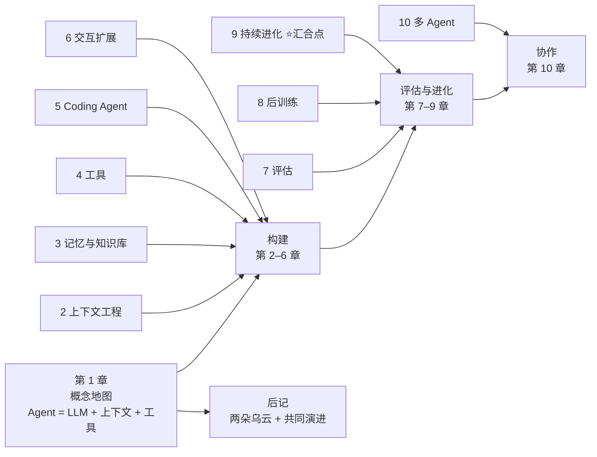

# 深入理解 AI Agent · 全书总览与阅读导航

> 《深入理解 AI Agent：设计原理与工程实践》v2.0，李博杰著，2026-09-23。源 PDF 共 **313 页**（印刷页码 305 页 + 8 页前置），文本层完整、非扫描件。本目录把它按章节整理成一套可检索的 Obsidian 笔记。

## 这个目录怎么组织

```
6-ai/02-深入理解 AI Agent/
├── 00-全书总览与阅读导航.md      ← 本文件：索引 + 全书地图 + 学习路径
├── 01 … 10-第N章 ….md           ← 10 份章节笔记（提炼版，配页码与 wikilink）
├── 11-后记.md                    ← 两朵乌云与共同演进
└── _原文/                        ← 12 份按章切分的完整抽取全文（保真、可全文检索）
```

- **笔记层**：每章按「一句话定位 → 本章地图 → 核心知识点 → 结论金句 → 思考题精选 → 关联 → 原文位置」组织，页码统一标 **PDF 页**（`p15` 指 PDF 第 15 页）。
- **原文层**：由 `workbuddy-pdf -f md-plain` 完整版面识别后按页切分，保留 `<!-- PDF pN · 印刷 pM -->` 回溯标记；`md-plain` 比轻量 `md` 多识别到 8,254 段落 / 152 张表，补回了轻量抽取漏掉的段落行。
- **页码换算**：`PDF 页 = 印刷页 + 8`，已用 10 个章首页与页脚页码交叉验证。
- **原 PDF 不在 vault 内**，在 `~/PycharmProjects/ls-quickstart/`；本目录不复制 PDF，也不改动原文件。

## 全书结构（作者的三段式）



第 1 章 1.2.6 特别说明：**第 6 章不属于 Harness 五要素**——五要素管「怎么组织已有的上下文与工具」，第 6 章扩展的是观察 / 动作空间本身的**模态与时机**。第 9 章是全书汇合点，依赖前面全部基础。

## 十章速查

| # | 章节 | 印刷页 | PDF 页 | 一句话 | 必记概念 |
|---|---|---|---|---|---|
| 1 | [[01-第1章 AI Agent 入门\|AI Agent 入门]] | 7–29 | 15–37 | 全书概念地图 | 两个公式 · 观察/动作空间 · ReAct · ACI 三原则 · 五个设计模式 |
| 2 | [[02-第2章 上下文工程\|上下文工程]] | 30–72 | 38–80 | 显式管理信息 | 四种角色 · 静态前缀 · KV Cache vs Prompt Cache · Skills · 状态栏 · 压缩 |
| 3 | [[03-第3章 用户记忆和知识库\|用户记忆和知识库]] | 73–102 | 81–110 | 跨会话持久化 | 双层记忆 · 四种存储格式 · 稠密/稀疏/混合检索 · RAPTOR/GraphRAG/OpenViking |
| 4 | [[04-第4章 工具\|工具]] | 103–121 | 111–129 | 能力形态 × 披露量 | ACI · MCP / Skill Hub · 工具爆炸 · 主动发现 · 感知/执行/协作 |
| 5 | [[05-第5章 Coding Agent 与通用 Agent\|Coding Agent 与通用 Agent]] | 122–153 | 130–161 | 代码是元能力 | Coding Agent + 文件系统 · 五步流程 · 故障恢复 · 六个应用方向 |
| 6 | [[06-第6章 交互与动作空间扩展\|交互与动作空间扩展]] | 154–183 | 162–191 | 打破回合制 | 模态 × 时机 · 事件循环 · 语音三范式 · Computer Use · VLA |
| 7 | [[07-第7章 Agent 的评估\|Agent 的评估]] | 184–215 | 192–223 | 发现循环的证据段 | Pass@k vs Pass^k · 验证器 · LLM-as-a-Judge · 失败归因 · 边界集 |
| 8 | [[08-第8章 模型后训练\|模型后训练]] | 216–255 | 224–263 | 唯一一次改模型之内 | 四阶段 · Mid/SFT/RL 选择规则 · GRPO · On-Policy · 奖励设计 |
| 9 | [[09-第9章 Agent 的持续进化\|Agent 的持续进化]] | 256–271 | 264–279 | 全书汇合点 | 四种载体 · 双循环 · 可验证闭环边界 · 睡眠学习 |
| 10 | [[10-第10章 多 Agent 协作\|多 Agent 协作]] | 272–302 | 280–310 | 信息增量是第一判据 | 共享/隔离 × 三种拓扑 · A2A · 六种失败模式 · Agent 社会 |
| — | [[11-后记\|后记]] | 303–305 | 311–313 | 收束与两朵乌云 | 实时交互 · 小世界/大世界假设 · Harness 飞轮 |

## 两条主线，串起十章

**主线 A：三个问题**（后记给出的收束）

| 问题 | 对应组件 | 主要章节 |
|---|---|---|
| **看到什么** | 上下文 | 第 2、3、6 章 |
| **能做什么** | 工具 | 第 4、5、6 章 |
| **如何验证做得对不对** | 评估 | 第 7、8、9 章 |

**主线 B：发现循环的四个角色**（把散落各章的伏笔接起来）

```
观察/证据   →  第 7 章（证据段）：Pass^k、失败归因、trajectory prefix 边界集
提案       →  第 3 章（提案段）：把一条证据变成最小、可审查、可回滚的修改
验证/发布  →  第 9 章（双循环）：离线进化循环 + 验证门槛 + 版本化经验库
载体       →  第 9 章：知识 / 指令 / 程序 / 参数（参数部分 = 第 8 章）
```

## 五个贯穿全书的设计模式（第 1 章 §1.3）

| 模式 | 一句话 | 典型出现 |
|---|---|---|
| 提议者—审核者 | 产出与评判**不共享上下文**，前提是自审不可靠 | 3/4/5/7/9/10 章 |
| 渐进式披露 | 先给目录、按需加载；同时优化预算与选择精度 | Skills、分层检索、主动工具发现 |
| 只增不改 | 状态只追加 → 可缓存、可重放、可审计 | KV Cache 前缀、事件式记忆 |
| 边界集 + 保留集 | 同时在「应改变」和「不应影响」两批样本上验证 | `PASS_TO_PASS`、prefix 边界集 |
| 最小 diff + 可回滚 | 改动尽量小且可撤销 | 知识更新、Coding Agent |

## 建议读法

- **时间紧**：第 1 章 → 第 2 章 §2.3（缓存即架构约束）→ 第 7 章 §7.2（两个 Pass 指标）→ 第 9 章（双循环）→ 后记。这条线能拿到全书的判断框架。
- **做 RAG / 知识库**：第 2 章（前缀与压缩）→ 第 3 章（记忆 + 检索全链）→ 第 7 章（recall@k、验证器）。
- **做 Agent 工程 / 工具调用**：第 1 章 → 第 4 章 → 第 5 章 → 第 10 章。
- **做评估与迭代**：第 7 章 → 第 8 章 → 第 9 章，按这个顺序，别跳。
- 每章末尾的**思考题按 ★ / ★★ / ★★★ 标难度**（原书约定），实验代码按「实验 X-Y」编号，去对应 `chapter X/README.md` 找目录。

## 与 vault 已有材料的关系

| 材料 | 定位 | 与本目录关系 |
|---|---|---|
| `6-ai/0.1-langchain/0~4` 五册 drawio | LangChain 1.0 **工程实现 / API** 视角 | 互补：本书是**原理与判断框架**，图是具体 API 与链路 |
| `18-LangChain/04.x`、`05`、`09` 笔记 | 课堂讲义 V1.0、API 速查 | 第 2/3/4 章可与之对照；注意课程口径与官方 1.3~1.5 的版本差 |
| `14-AI agent/1-LangChain/2~5` 进阶图 | HITL / Subgraph / 多 Agent / RAG 进阶 / 可观测评估 | 对应本书第 7、10 章，偏工程落地 |
| `6-ai/0-LLM/9~13` | AdvancedRAG、Ragas、LLM-as-a-Judge | 第 3、7 章的理论延展 |
| `6-ai/0-Agent 面试通关：8 站通关作战地图.md` | 面试概念视角 | 与本书第 1 章同为总纲，但粒度不同 |
| `6-ai/2.3-Hermes Agent/` | 真实框架的 Persistent Memory / Skills / Curator | 第 9 章双循环的现实实现，本章小结脚注直接引用 |

**一个值得对照的口径差**：官方 LangChain 1.0 文档写 `Agent = Model + Harness`；本书把它当作「同一事物在生产形态下的展开」，全书骨架仍是 `Agent = LLM + 上下文 + 工具`。两者不冲突，看资料时留意语境（详见第 1 章 §1.2.6）。

## 配套资源与版本提醒

- 官方仓库：`https://github.com/bojieli/ai-agent-book`（正文、配图、实验代码开源）。本地 `~/PycharmProjects/ls-quickstart/` 下已有 `ch01-code.zip` ~ `ch12-code.zip`、`travel-agent.zip` 等。
- 书中出现的模型与产品名（GPT-6 Astra、DeepSeek V4、Qwen3、MiMo、Taalas HC1、Open Claw 等）是 **2026-09 时点**的表述，迭代很快；**方法与判断框架比具体 API/榜单更值得记**——这也正是后记的结论。
- 抽取口径核对日期：2026-11-17。整份 PDF 313 页全部有文本层，0 扫描页；324 张内嵌配图已确认可导出，但本目录的 `_原文/` 是文字抽取，**图表需回看原 PDF 对应页**。

## 生成与维护

- 切分脚本：`.workbuddy/scripts/split_agent_book.py`；素材脚本：`.workbuddy/scripts/book_material.py`（隐藏目录，Obsidian 不索引）。
- 需要重做：先用 `workbuddy-pdf -f md-plain` 重新抽取整份 PDF 到 `/tmp/pdfread-agent-book/plain.md`，再依次跑这两个脚本，然后按章节笔记手工校订。
