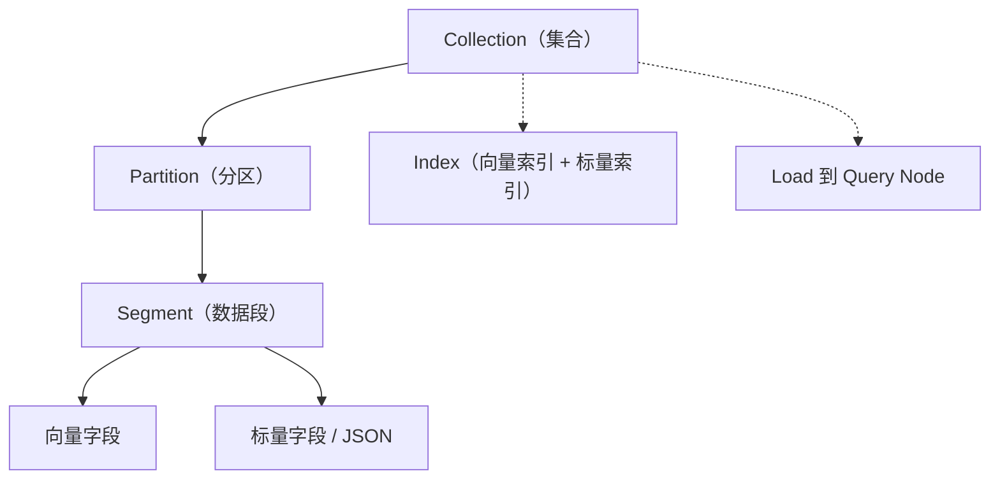
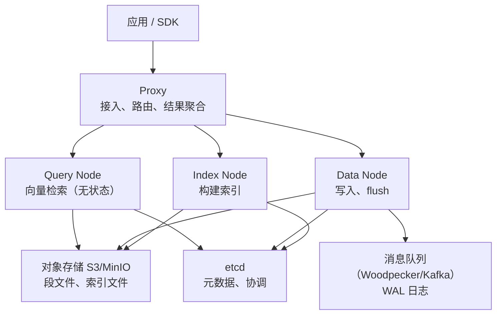
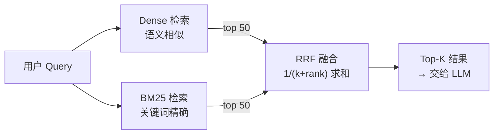

# Milvus 学习文档

> [!abstract] 一句话认识 Milvus
> 一个**为向量而生的分布式数据库**：把"相似度检索"做成了一等公民，同时支持标量过滤、BM25 全文检索、混合检索与多租户隔离。
> 它是独立系统，不是某个数据库的插件——这决定了它的能力上限，也决定了它的运维成本。

> 对比选型看这篇：[[pgvector vs Milvus 选型对比]]

---

## 一、先建立心智模型

### 1.1 Milvus 里都有什么

| 概念 | 类比关系型数据库 | 说明 |
| --- | --- | --- |
| **Collection** | 表 | 一组同构向量 + 标量字段的集合 |
| **Field** | 列 | 支持 INT/VARCHAR/FLOAT/BOOL/JSON/ARRAY/向量 |
| **Partition** | 分区 | Collection 内的物理分区，查询可只扫指定分区 |
| **Partition Key** | 分片键 | 按某个标量字段哈希自动分桶，多租户利器 |
| **Segment** | 数据段 | 存储层单位，插入后先成 growing segment，flush 后 sealed |
| **Index** | 索引 | 向量索引（HNSW/IVF/DiskANN…）+ 标量索引 |
| **Load** | 加载 | 查询前必须 `load_collection`，把数据/索引进内存 |
| **Consistency** | 一致性 | 四级可调：Strong / Bounded / Session / Eventually |



### 1.2 架构：存算分离的四层



> [!tip] 为什么这个架构重要
> **写入不阻塞查询、索引构建不阻塞在线服务**，每一层都能独立扩缩——这是 Milvus 能上十亿级的根本原因，也是它组件多的原因。

---

## 二、跑起来：三种形态

| 形态 | 适用 | 启动方式 |
| --- | --- | --- |
| **Milvus Lite** | 本地调试、小数据（< 100 万） | `MilvusClient("./milvus.db")`，纯 Python，无需服务 |
| **Standalone** | 单机生产、中小规模 | Docker Compose（etcd + MinIO + milvus 三容器） |
| **Distributed** | 大规模、高可用 | K8s + Helm Chart，各角色独立部署 |

```bash
# Standalone 最快路径
wget https://github.com/milvus-io/milvus/releases/download/v2.6.x/milvus-standalone-docker-compose.yml -O docker-compose.yml
docker compose up -d
# 默认端口：19530（gRPC）/ 9091（metrics）
```

> 你环境里已有 Milvus（`192.168.0.106`），学习时可以先连它，不必本地再起一套。

---

## 三、Schema 设计：一次设计，长期受益

### 3.1 一个能打的 RAG Collection

```python
from pymilvus import MilvusClient, DataType, Function, FunctionType

client = MilvusClient(uri="http://192.168.0.106:19530")

DIM = 1024                      # 必须与 embedding 模型输出一致（DashScope v3 默认 1024）

schema = client.create_schema(auto_id=True, enable_dynamic_field=False)
schema.add_field("id",        DataType.INT64,  is_primary=True)
schema.add_field("doc_id",    DataType.VARCHAR, max_length=64)
schema.add_field("tenant_id", DataType.VARCHAR, max_length=64, is_partition_key=True)  # 多租户
schema.add_field("chunk_no",  DataType.INT32)
schema.add_field("text",      DataType.VARCHAR, max_length=8192,
                 enable_analyzer=True, analyzer_params={"type": "chinese"})            # 中文分词
schema.add_field("dense",     DataType.FLOAT_VECTOR, dim=DIM)
schema.add_field("sparse",    DataType.SPARSE_FLOAT_VECTOR)                            # BM25 输出
schema.add_field("meta",      DataType.JSON)

# 关键：服务端自动把 text 转成 BM25 稀疏向量，无需自己算
schema.add_function(Function(
    name="text_bm25",
    input_field_names=["text"],
    output_field_names=["sparse"],
    function_type=FunctionType.BM25,
))

index_params = client.prepare_index_params()
index_params.add_index("dense",  index_type="HNSW", metric_type="COSINE",
                       params={"M": 24, "efConstruction": 200})
index_params.add_index("sparse", index_type="SPARSE_INVERTED_INDEX", metric_type="BM25")

client.create_collection("rag_chunks", schema=schema,
                         index_params=index_params, num_partitions=64)
```

> [!warning] 三个必须一次做对的点
> 1. **维度**：`dim` 与 embedding 模型输出不一致 → 插入直接报错
> 2. **BM25 Function 只能在建集合时定义**，事后加不上，要重建
> 3. **Partition Key 字段一旦设定不可改**，租户模型要想清楚

### 3.2 字段类型速查

| 类型 | 用途 | 注意 |
| --- | --- | --- |
| `INT64/VARCHAR` + `is_primary` | 主键 | 建议用确定性 ID（如 `md5(doc_id:chunk_no)`），方便 upsert |
| `FLOAT_VECTOR` | dense 向量 | 需给 `dim` |
| `SPARSE_FLOAT_VECTOR` | 稀疏向量 | 配 `SPARSE_INVERTED_INDEX` + `BM25` |
| `VARCHAR` + `enable_analyzer` | 全文检索源字段 | 中文要选 `chinese` 分词器 |
| `JSON` | 灵活元数据 | 2.6 默认 JSON Shredding，过滤快 3~5 倍 |
| `ARRAY` | 多值标签 | 可配合 `ARRAY_CONTAINS` 过滤 |

---

## 四、写入与更新

```python
# 批量插入（强烈建议批量，单条循环会很慢）
rows = [{
    "doc_id": "doc-001", "chunk_no": 0,
    "text": "退款政策：签收后 7 天内可无理由退款。",
    "dense": embed(text), "meta": {"source": "policy.pdf"},
} for text in chunks]
client.insert(collection_name="rag_chunks", data=rows)

# 更新用 upsert（不存在 insert，同名覆盖需主键确定）
client.upsert(collection_name="rag_chunks", data=rows)

# flush（一般不必手动，自动 flush 会触发；离线批量导入后可显式 flush）
client.flush("rag_chunks")
```

> [!tip] 写入节奏
> Milvus 是 LSM 式写入：先写 WAL → growing segment → flush 成 sealed segment → 建索引。
> 高频小批量写入会积累大量小 segment，**拖慢查询**。建议：攒批（500~2000 条/次）+ 控制 flush 频率。

---

## 五、检索：从单路到混合

### 5.1 纯向量检索

```python
client.load_collection("rag_chunks")          # 查询前必须 load

res = client.search(
    collection_name="rag_chunks",
    data=[query_vec],
    anns_field="dense",
    limit=10,
    filter='doc_id == "doc-001"',             # 标量过滤直接下推
    output_fields=["text", "doc_id", "chunk_no"],
    search_params={"metric_type": "COSINE", "params": {"ef": 100}},
)
```

### 5.2 混合检索（Dense + BM25 + RRF）—— 生产推荐

```python
from pymilvus import AnnSearchRequest, RRFRanker

dense_req = AnnSearchRequest(
    data=[query_vec], anns_field="dense",
    param={"metric_type": "COSINE", "params": {"ef": 100}}, limit=50,
)
sparse_req = AnnSearchRequest(
    data=[query_text],                         # 直接传原始文本，BM25 自动算
    anns_field="sparse",
    param={"metric_type": "BM25"}, limit=50,
)
res = client.hybrid_search(
    collection_name="rag_chunks",
    reqs=[dense_req, sparse_req],
    ranker=RRFRanker(k=60),                    # 倒数排名融合
    limit=10,
    filter='tenant_id == "t-1001"',
    output_fields=["text", "doc_id"],
)
```



> [!important] 为什么要混合
> 纯向量搜不到"错误码 E-1042""函数名 validateToken"这类**无语义的精确串**；
> 纯 BM25 搜不到"同义改写、跨语言"的语义查询。真实 Query 两种都有——**RRF 只融合、不补召回**，两路各自的候选质量才是上限。

### 5.3 度量怎么选

| 度量 | 适用 | 说明 |
| --- | --- | --- |
| `COSINE` | 文本 embedding | 最常用，长度不敏感 |
| `IP`（内积） | 已归一化向量 | 与 COSINE 等价但更快 |
| `L2` | 图像/特征向量 | 欧氏距离 |
| `BM25` | 稀疏文本 | 只能配 `SPARSE_INVERTED_INDEX` |
| `JACCARD/HAMMING` | 二值向量 | 去重、指纹 |

### 5.4 索引怎么选

| 索引 | 适用规模 | 特点 |
| --- | --- | --- |
| `AUTOINDEX` | 通用（Milvus/Zilliz 托管） | 自动选，最省心 |
| `HNSW` | 百万~千万，内存充足 | 召回高、延迟低；`M`/`efConstruction` 调优 |
| `IVF_FLAT/SQ8/PQ` | 千万~亿，内存敏感 | 有损压缩，省内存换精度 |
| `DISKANN` | 亿级以上，成本优先 | 索引落盘，NVMe 友好 |
| `GPU_CAGRA` | 超大规模、吞吐优先 | 需要 GPU，建索引快 |
| `SPARSE_INVERTED_INDEX` | 稀疏/BM25 | 配 `BM25` 度量 |

---

## 六、过滤、多租户与一致性

### 6.1 过滤表达式

```python
filter='tenant_id == "t-1001" and chunk_no < 50'
filter='meta["source"] like "policy%"'
filter='ARRAY_CONTAINS(tags, "退款")'
filter='TEXT_MATCH(text, "退款")'          # 精确词命中（需 enable_match）
```

> 标量过滤默认**下推到索引层**（不是先取 topK 再过滤），这是 Milvus 相比"向量库 + 应用层过滤"的核心优势。

### 6.2 多租户三种隔离

| 方式 | 隔离级别 | 适用租户数 | 成本 |
| --- | --- | --- | --- |
| Database / 独立 Collection | 物理隔离（最强） | 几十以内 | 高（每集合独立资源） |
| **Partition Key** | 逻辑隔离（推荐） | 几百 ~ 百万 | 低，单集合内分桶 |
| 普通标量字段过滤 | 无隔离 | 任意 | 最低，但需自己保证不漏数据 |

> [!tip] 2.6 单集群支持 10 万+ Collection——租户少而重时，可以一租户一集合。

### 6.3 一致性级别

| 级别 | 语义 | 场景 |
| --- | --- | --- |
| `Strong` | 读到最新写入 | 写入后立刻要查到（如"我刚上传的文档"） |
| `Bounded` | 落后不超过时间窗 | 默认，多数场景 |
| `Session` | 客户端能读到自己的写 | 会话内一致性 |
| `Eventually` | 最终一致 | 吞吐优先，离线分析 |

---

## 七、调优与常见坑

> [!warning] 踩过的坑，别再踩
> - **每次查询都 `load_collection`** → 只 load 一次，保持常驻
> - **HNSW 硬扛 2 亿向量** → OOM，该换 DiskANN
> - **同时开 BM25 Function 和手动写 sparse** → 冲突，二选一
> - **所有集合都用 Strong 一致性** → 写入吞吐暴跌
> - **Partition Key 基数过大**（如用户 ID 千万级）→ 海量小 segment，查询变慢，建议 16~256 个逻辑桶
> - **频繁小批量写入不 flush** → segment 碎片化

| 调优项 | 手段 |
| --- | --- |
| 召回不足 | 提 `ef`（HNSW）/ `nprobe`（IVF）/ `search_list`（DiskANN）；上混合检索 |
| 延迟高 | 降 `ef`；用 `MMAP` 省内存换冷页延迟；索引/数据分层 |
| 内存高 | 量化（SQ8/PQ/RaBitQ）；`DISKANN`；存算分离冷热分层 |
| 写入慢 | 攒批；提高 Data Node 并行度；减少 flush |

---

## 八、Spring AI 集成要点

```yaml
spring:
  ai:
    vectorstore:
      milvus:
        client:
          host: 192.168.0.106
          port: 19530
        database-name: default
        collection-name: rag_chunks
        embedding-dimension: 1024      # 必填，且与模型一致
        index-type: HNSW
        metric-type: COSINE
        initialize-schema: true        # 首次自动建集合
```

```java
// 写入
vectorStore.add(List.of(new Document(text, Map.of("docId", docId, "tenantId", tenant))));
// 检索（带过滤）
SearchRequest req = SearchRequest.builder()
        .query(question).topK(5)
        .filterExpression("tenantId == 't-1001'")
        .build();
List<Document> docs = vectorStore.similaritySearch(req);
```

> [!note] Spring AI 的 Milvus 实现走 `MilvusServiceClient`（gRPC），BM25/混合检索需自行扩展，标准 `VectorStore` 接口只覆盖 dense 检索。

---

## 九、学习路径（建议顺序）


**动手清单**：
- [ ] 用 Milvus Lite 建一个 384 维小集合，跑通 insert + search
- [ ] 换成 1024 维 + 中文分词 + BM25 Function，验证混合检索效果
- [ ] 用 `filter` 做租户隔离，对比 Partition Key 的延迟差异
- [ ] 灌 100 万条假数据，观察 `ef` 对延迟/召回的影响曲线

---

## 十、要点速记

- **Collection → Partition → Segment → Index → Load**：五个词串起全部概念
- **存算分离**：写入、索引、查询各管一摊，能独立扩，也意味着组件多
- **BM25 是杀手锏**：一个系统搞定语义 + 关键词，不用再养 Elasticsearch
- **过滤下推 + Partition Key**：多租户别用应用层过滤
- **一致性可调**：别处处 Strong，写入会疼
- **索引按规模选**：千万 HNSW，亿级 DiskANN，成本敏感上量化

---

*整理：2026-11-04 · 关联 [[pgvector vs Milvus 选型对比]]、[[2-RAG]]*
