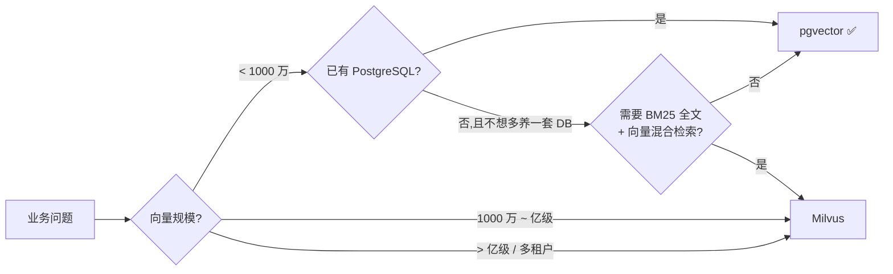
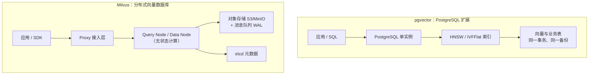
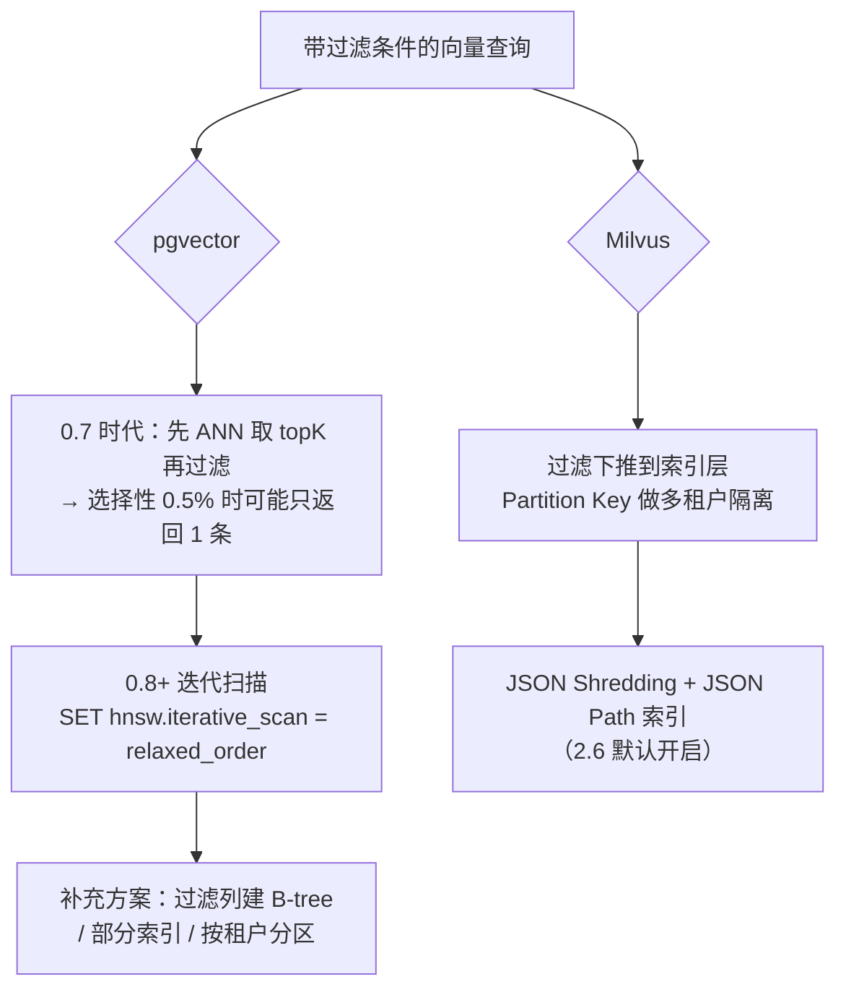
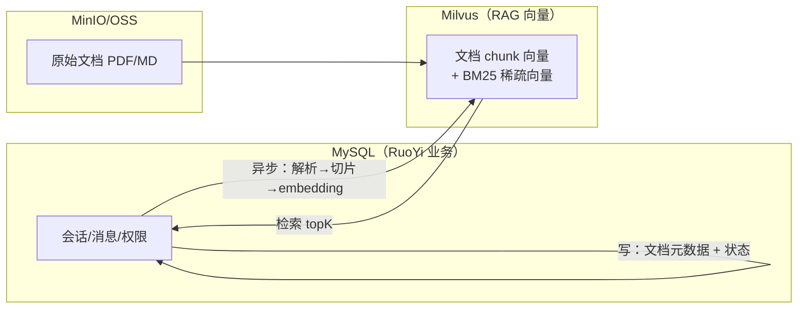

# pgvector vs Milvus 选型对比

> [!abstract] 一句话结论
> **pgvector 是"给 PostgreSQL 加一个向量索引"**，胜在零新增组件、事务一致、SQL 生态；**Milvus 是"为向量而生的分布式数据库"**，胜在十亿级规模、原生混合检索与存算分离。
> 分界线不在"谁更快"，而在**数据量、过滤复杂度、运维意愿**这三件事。



---

## 一、本质差异：扩展 vs 独立系统



| 维度 | pgvector | Milvus |
| --- | --- | --- |
| 形态 | PostgreSQL **扩展**（`CREATE EXTENSION vector`） | **独立分布式系统**（etcd + MinIO + MQ + 多角色节点） |
| 部署单元 | 0（复用现有 PG） | 单机 Docker 3 容器起，集群需 K8s |
| 数据模型 | 向量就是表里的一列，可与业务字段同表 | Collection + Partition + Partition Key，向量与标量字段同集合 |
| 一致性 | 完整 ACID，向量与业务数据**同事务** | 四种一致性级别可调（Strong / Bounded / Session / Eventually） |
| 扩展方式 | 垂直扩（加 CPU/内存）+ 读副本 + 分区表 | 水平扩（加 Query/Data Node），存算分离 |
| 故障域 | 与业务库共用，DB 挂则 RAG 挂 | 独立，互不影响（但组件多） |

---

## 二、能力对比

### 2.1 检索能力

| 能力 | pgvector | Milvus |
| --- | --- | --- |
| 索引类型 | HNSW、IVFFlat | HNSW、IVF_FLAT/PQ/SQ8、DiskANN、GPU 索引、稀疏倒排 |
| 距离度量 | L2 / 内积 / 余弦 / L1 / Hamming / Jaccard | L2 / IP / COSINE / Jaccard / Hamming / BM25 |
| 标量过滤 | `WHERE` 任意 SQL 条件（能力最强，但需配合索引策略） | 布尔表达式过滤，支持下推；JSON Path 索引 |
| 混合检索 | 需手写 SQL 融合（向量 + 全文 `tsvector` 或 pg_trgm） | **原生** dense + sparse（BM25）+ RRF/加权融合，一次查询完成 |
| 全文检索 | 依赖 PG 的 `tsvector`（中文需 zhparser/pg_jieba） | 2.5+ 内置 BM25 全文检索，2.6 官方称比 ES 快 4~7 倍 |
| 多向量/多模态 | 多列向量即可（但索引与查询要自己拼） | 一个实体多向量 + `MAX_SIM` 聚合函数 |
| 向量维度上限 | `vector` 索引 **2000 维**（存储 16000）；`halfvec` 4000；`bit` 64000 | 无硬性 2000 限制，按内存规划 |

> [!warning] 维度坑
> 用 OpenAI/Qwen 的 1536 维没问题；但若换 3072 维（text-embedding-3-large）**pgvector 的 HNSW 索引建不了**，必须降维（Matryoshka）或改 `halfvec`。这是 pgvector 最容易被忽略的硬约束。

### 2.2 规模与性能

| 指标 | pgvector | Milvus |
| --- | --- | --- |
| 舒适区 | 十万 ~ 千万级 | 千万 ~ 十亿级 |
| 单表/集合上限 | 非分区表 32 TB；靠分区扩展 | 2.6 支持单集群 **10 万+ Collection** |
| 内存模型 | 索引需驻留内存才快（HNSW 每 768 维约 4 KB/条） | 存算分离：热数据内存、冷数据对象存储，按需加载 |
| 典型延迟 | 1M×1536 维、16 核：约 270 QPS @ recall 0.99（Supabase 基准） | 官方称分层存储下 P99 < 20ms；实际强依赖集群规格 |
| 构建加速 | 0.8.0+ 迭代扫描（`iterative_scan`）+ 并行构建 | 独立 Index Node 弹性扩缩，索引构建不阻塞查询 |
| 内存压缩 | `halfvec`（半精度）、`bit`（二值） | 标量/二值量化，2.6 的 RaBitQ 1-bit 称降内存 72%、提速 4× |

> 数字来自官方/第三方基准，**只能当量级参考**：真正的瓶颈往往在 embedding 生成、网络往返和过滤策略，而不是数据库本身。

### 2.3 过滤召回：两边都有"坑"，解法不同

这是 RAG 落地最容易踩的坑——**带 `WHERE` 的向量查询召回率暴跌**。



**pgvector 实践建议**（来自基准与官方 README）：

```sql
-- 查询期调优：过滤查询优先用 relaxed_order（召回更好）
SET hnsw.iterative_scan = 'relaxed_order';
SET hnsw.ef_search = 200;            -- 召回优先时可提到 200
SET hnsw.max_scan_tuples = 20000;    -- 兜底上限，防扫爆 shared_buffers

-- 高选择性过滤（如租户 ID）→ 建 B-tree 让规划器走精确扫描
CREATE INDEX ON chunks (tenant_id);

-- 索引构建：确保图能放进 maintenance_work_mem，否则退化为磁盘构建（慢 3 倍+）
```

**Milvus 实践建议**：租户数几百~百万用 **Partition Key**（单集合内轻隔离）；租户少而重、要物理隔离用独立 Collection/Database；需要 JSON 字段过滤就走 JSON Path 索引。

---

## 三、运维与成本

| 维度 | pgvector | Milvus |
| --- | --- | --- |
| 新增组件 | 0 | etcd + 对象存储 + MQ（单机版用 embedded 简化） |
| 学习成本 | 会 SQL 就会用 | 要理解 Collection/Partition/Index/Load 概念 |
| 备份恢复 | 复用 PG 的 `pg_dump`/PITR | 需 backup 工具，跨存储一致性要设计 |
| 监控 | PG 现有体系（慢查询、pg_stat） | 需接 Prometheus + 各组件指标 |
| 扩容 | 升配 + 只读副本（写仍单点） | 水平加节点，滚动扩 |
| 成本 | 几乎为零增量（复用现有 PG） | 独立集群成本；自建比托管便宜 5~10 倍 |
| 团队要求 | 1 个 DBA 足够 | 需要懂分布式系统的运维 |

> [!tip] 一句话
> pgvector 的成本是**隐性**的（索引内存、DB 资源争抢、过滤调优）；
> Milvus 的成本是**显性**的（机器、组件、人力）。

---

## 四、选型决策

### 4.1 选 pgvector 的场景

- ✅ 向量量级 **< 1000 万**，QPS 要求不高（几十~几百）
- ✅ **已经在用 PostgreSQL**，且能接受向量与业务表同库
- ✅ 需要**强一致**：向量与业务数据同事务提交/回滚（如文档入库与状态流转）
- ✅ 团队小、不想为 RAG 单独养一套分布式系统
- ✅ 过滤条件是**简单等值/范围**，且基数可控

### 4.2 选 Milvus 的场景

- ✅ 向量量级 **千万 ~ 十亿**，或 QPS 高、需要水平扩
- ✅ 需要**原生混合检索**（BM25 + 向量 + RRF），不想自己拼两套索引
- ✅ **多租户**：10 万级 Collection / Partition Key 隔离
- ✅ 冷热分层诉求明显（历史文档多、访问稀疏）
- ✅ 已经在用 Spring AI / LangChain4j 的 Milvus starter，团队有 K8s 能力

### 4.3 一张表定生死

| 你的情况 | 推荐 |
| --- | --- |
| 个人项目 / 内部知识库（几万文档） | pgvector |
| 创业公司 MVP，快速验证 RAG | pgvector（先跑起来） |
| 已有 PG，业务表 + 向量要事务一致 | pgvector |
| 已有 **MySQL**（如 RuoYi），不想再引入 PG | **Milvus**（引入 PG 只为向量不划算） |
| 十万级商品/文档，要 BM25 + 语义混检 | Milvus |
| 多租户 SaaS，每租户独立数据 | Milvus（Partition Key） |
| 亿级向量 / 高并发在线检索 | Milvus |
| 边缘/离线小设备 | pgvector（或 SQLite 向量扩展） |

> [!important] 对你（RuoYi + MySQL）的直白建议
> 你的业务库是 MySQL，**pgvector 的"零新增组件"优势不成立**——为了向量再单独维护一套 PostgreSQL，等于多一个数据库。此时二者都是"新增系统"，那就该按**能力**选：RAG 要 BM25 混合检索、文档量会涨、已有 Milvus 环境（`192.168.0.106`）→ **直接上 Milvus** 更顺。
> 反过来，如果只是几十万条对话记忆做语义召回、且团队更熟 PG，pgvector 更省心。

---

## 五、混合与迁移

### 5.1 常见混合架构



**要点**：业务库存"元数据 + 状态机"，向量库存"chunk 向量 + 标量过滤字段"，两者用 `doc_id` 关联；向量写入走**异步任务 + 幂等 upsert**，避免事务跨库。

### 5.2 从 pgvector 迁到 Milvus 的信号

| 信号 | 说明 |
| --- | --- |
| 索引内存压不住 | HNSW 常驻内存超过机器上限，查询开始磁盘换页 |
| 过滤召回不稳 | 调完 `iterative_scan` 仍偶发返回不足 |
| 写入拖慢业务库 | 批量 embedding 入库影响 PG 的 OLTP 事务 |
| 要 BM25 混检 | 手写 SQL 融合越来越难维护 |
| 单表过亿 | 分区表管理成本超过收益 |

**迁移不是重写**：`chunk` 表结构可平移（id / doc_id / content / embedding / metadata），只需把 SQL 写入换成 SDK 批量 insert，检索换 `search()` 调用；Spring AI 里就是换一个 `VectorStore` 实现类。

---

## 六、Spring AI 落地对照

| 项 | pgvector | Milvus |
| --- | --- | --- |
| Starter | `spring-ai-pgvector-store` | `spring-ai-milvus-store` |
| 关键配置 | `spring.ai.vectorstore.pgvector.*`（dimensions、index-type、distance） | `spring.ai.vectorstore.milvus.*`（host、port、collection、embedding-dimension、index-type） |
| 建表 | 首次写入自动建表（需 `initialize-schema=true`） | 自动建 Collection（需显式给 dimension） |
| 过滤 | `filterExpression` 转 SQL | `filterExpression` 转 Milvus 表达式 |
| 删除 | `DELETE WHERE` | `delete(ids)` / 表达式删除 |

> [!note] 若用 JDK 17 + Spring Boot 3.2，两个 starter 都要求**显式指定向量维度**，且维度必须与 embedding 模型输出一致（DashScope text-embedding-v3 默认 1024 维，可选 768/1024/1536）。

---

## 七、要点速记

- **pgvector = 扩展**，赢在零组件、ACID、SQL；天花板是单机 PG 的内存与维度（2000 维硬限）
- **Milvus = 系统**，赢在规模、混合检索、多租户、存算分离；代价是组件多、要懂分布式
- **过滤召回**是共同坑：pgvector 靠 `iterative_scan` + B-tree/分区，Milvus 靠过滤下推 + Partition Key
- **选型三问**：多少条向量？要不要 BM25 混检？愿不愿多养一套系统？
- **业务库是 MySQL 时**，pgvector 的"复用"优势消失，按能力选 → Milvus

---

*整理：2026-11-04 · 关联 [[2-RAG]]、[[0-milvus.excalidraw]]*
