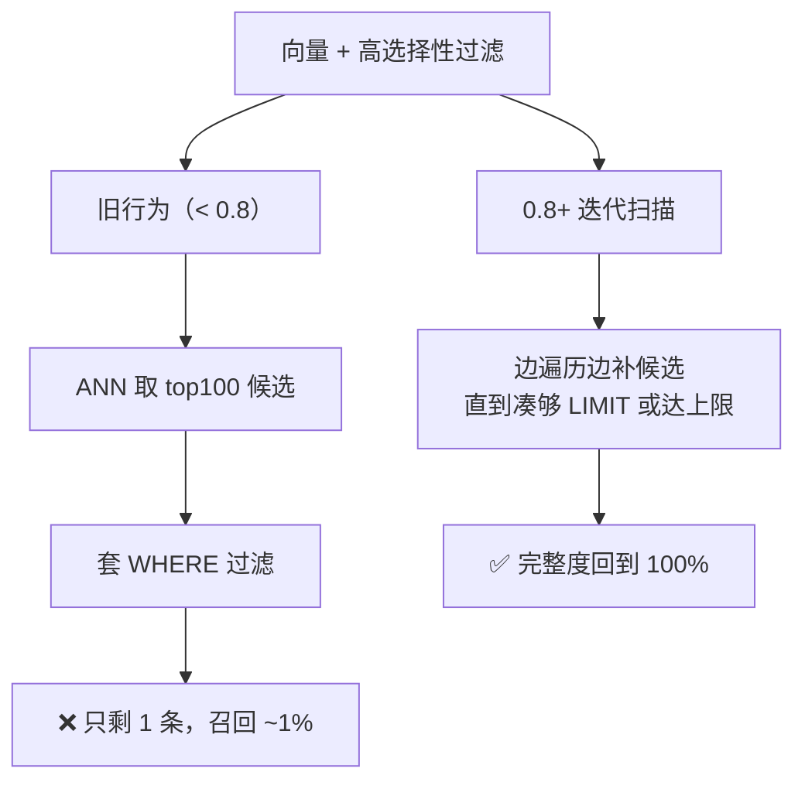

# pgvector 学习文档

> [!abstract] 一句话认识 pgvector
> **一个 PostgreSQL 扩展**，给普通表加一列向量，然后就能用 SQL 做相似度检索。
> 没有新服务、没有新 SDK、没有新备份策略——向量和业务数据在同一个事务里。

> 对比选型看这篇：[[pgvector vs Milvus 选型对比]]

---

## 一、心智模型：向量只是"一种列类型"


**关键认知**：pgvector 不是数据库，是**类型 + 运算符 + 索引方法**三件套。你写的还是 SQL，只是多了一个能算距离的列。

---

## 二、安装

```bash
# macOS
brew install pgvector

# Ubuntu/Debian（PG 16 为例）
sudo apt install postgresql-16-pgvector

# Docker：直接用官方 pgvector 镜像
docker run -d --name pgv -e POSTGRES_PASSWORD=pg -p 5432:5432 pgvector/pgvector:pg16
```

```sql
CREATE EXTENSION vector;   -- 每个库执行一次
SELECT extversion FROM pg_extension WHERE extname = 'vector';   -- 确认版本 0.8.x
```

---

## 三、数据类型：四种精度，四种取舍

| 类型 | 存储 | 索引维度上限 | 用途 |
| --- | --- | --- | --- |
| `vector(n)` | 4n + 8 字节（float32） | **2000** | 默认，精度最高 |
| `halfvec(n)` | 2n + 8 字节（float16） | 4000 | 省一半内存，精度略降 |
| `bit(n)` | n/8 字节 | 64000 | 二值化向量、指纹去重 |
| `sparsevec(n)` | 非零元素存储 | 1000 非零 | 稀疏检索（BM25 类） |

> [!danger] 最容易踩的硬约束
> **`vector` 列建 HNSW/IVFFlat 索引，维度不能超过 2000。**
> 1536 维（OpenAI/Qwen 常见）没问题；换成 3072 维的 `text-embedding-3-large` 就建不了索引，必须：
> ① 用 Matryoshka 截断到 1536/1024；② 改 `halfvec(3072)`；③ 换二值化方案。

```sql
CREATE TABLE chunks (
    id          bigserial PRIMARY KEY,
    doc_id      bigint NOT NULL,
    tenant_id   text   NOT NULL,
    chunk_no    int    NOT NULL,
    content     text   NOT NULL,
    embedding   vector(1024) NOT NULL,
    meta        jsonb  DEFAULT '{}'::jsonb,
    created_at  timestamptz DEFAULT now()
);
```

---

## 四、距离运算符：三个符号走天下

| 运算符 | 含义 | 索引 ops 类 | 适用 |
| --- | --- | --- | --- |
| `<->` | 欧氏距离（L2） | `vector_l2_ops` | 图像、未归一化特征 |
| `<#>` | **负**内积 | `vector_ip_ops` | 已归一化向量（越大越相似，取负号排序） |
| `<=>` | 余弦距离 | `vector_cosine_ops` | 文本 embedding（最常用） |
| `<+>` | L1 曼哈顿 | — | 稀疏/特殊场景 |
| `<~>` / `<%>` | Hamming / Jaccard | `bit_hamming_ops` / `bit_jaccard_ops` | 二值向量 |

```sql
-- 查最相似的 10 条（余弦）
SELECT id, content, 1 - (embedding <=> $1) AS similarity
FROM chunks
WHERE tenant_id = 't-1001'
ORDER BY embedding <=> $1
LIMIT 10;
```

> [!warning] 索引能不能用上，取决于 `ORDER BY` 的写法
> 必须是 `ORDER BY 列 <运算符> 常量 LIMIT k` 的形式，且**运算符对应的 ops 类**与索引一致。
> `WHERE similarity > 0.8` 这种**过滤式相似度**不会走索引（要全表算），应改成 `ORDER BY ... LIMIT`。

---

## 五、索引：HNSW 与 IVFFlat 怎么选

| | **HNSW** | **IVFFlat** |
| --- | --- | --- |
| 原理 | 多层可导航小世界图 | 聚类分桶 + 探测若干桶 |
| 查询速度 | 快 | 较快 |
| 召回 | 高（同延迟下更优） | 依赖 `lists`/`probes` |
| 建索引 | 慢、吃内存 | 快、省内存 |
| 空表建索引 | ✅ 可以 | ❌ 必须先有数据（要聚类） |
| 增量写入 | 友好 | 数据分布漂移后需重建 |
| 推荐度 | **默认选它** | 数据量极大、内存紧张时 |

```sql
-- HNSW：m 是每个节点的邻居数，ef_construction 是建图时候选队列大小
CREATE INDEX idx_chunks_emb_hnsw ON chunks
USING hnsw (embedding vector_cosine_ops)
WITH (m = 16, ef_construction = 64);

-- IVFFlat：lists 建议为 sqrt(行数)，probes 查询时再调
CREATE INDEX idx_chunks_emb_ivf ON chunks
USING ivfflat (embedding vector_cosine_ops)
WITH (lists = 100);
```

### 5.1 参数怎么定

| 参数 | 默认 | 调大 | 调小 |
| --- | --- | --- | --- |
| `m`（HNSW） | 16 | 召回↑、内存↑、建索引慢 | 省内存、召回↓ |
| `ef_construction` | 64 | 图质量↑、建索引慢 | 建得快、质量↓ |
| `hnsw.ef_search`（查询期） | 40 | 召回↑、延迟↑ | 快、召回↓ |
| `lists`（IVF） | — | 每桶更小、需更多 probes | 桶大、单桶扫得久 |
| `ivfflat.probes`（查询期） | 1 | 召回↑、延迟↑ | 快、召回↓ |

```sql
-- 查询期调优（会话级）
SET hnsw.ef_search = 100;        -- 召回优先；实测 100 可到 recall@10 ≈ 0.99
SET ivfflat.probes = 10;
```

### 5.2 建索引前必做：把内存给够

```sql
SHOW maintenance_work_mem;                     -- 默认 64MB，远不够
SET maintenance_work_mem = '4GB';              -- 会话级临时提高
SET max_parallel_maintenance_workers = 4;      -- 并行构建
```

> [!warning] 会悄悄退化的坑
> 图放不进 `maintenance_work_mem` 时，PG 只打一条 **notice** 就转磁盘构建，**慢 3 倍以上**。
> 经验值：768 维 HNSW 每条约 3.8 KB 构建内存 → 100 万条约需 4 GB。

---

## 六、带过滤的查询：pgvector 最大的坑

### 6.1 问题长什么样

```sql
-- 期望 10 条，实际可能只返回 1 条，而且不报错
SELECT * FROM chunks
WHERE tenant_id = 'long-tail-tenant'      -- 只占全表 0.5%
ORDER BY embedding <=> $1
LIMIT 10;
```

**原因**：HNSW 是近似图遍历，先取候选再套 `WHERE`。长尾租户在候选集里几乎不出现 → 召回崩塌。



### 6.2 四种解法（按性价比排序）

```sql
-- ① 开迭代扫描（0.8.0+，首选）
SET hnsw.iterative_scan = 'relaxed_order';   -- 延迟优先；strict_order 召回优先
SET hnsw.max_scan_tuples = 20000;            -- 兜底，防扫爆 shared_buffers

-- ② 过滤列建 B-tree，让规划器走"精确扫描 + 排序"
CREATE INDEX ON chunks (tenant_id);

-- ③ 部分索引（过滤值只有少数几个时）
CREATE INDEX ON chunks USING hnsw (embedding vector_cosine_ops)
WHERE tenant_id = 't-1001';

-- ④ 按租户分区（租户多、隔离要求高）
CREATE TABLE chunks PARTITION BY HASH (tenant_id);   -- 或 LIST
```

> [!tip] 判断该用哪种
> **过滤后剩余行数少**（< 1 万）→ 让规划器走精确扫描最快，B-tree 就够；
> **过滤后剩余行数多但选择性低**（如某个大租户）→ 开 `relaxed_order` 即可；
> **租户之间数据量差异极大** → 分区 + 分区内 HNSW。

---

## 七、容量与性能估算

| 项 | 估算公式 | 例子（100 万条 × 1024 维 float32） |
| --- | --- | --- |
| 向量数据 | `(4 × dim + 8) × 行数` | 4.1 GB |
| HNSW 索引（磁盘） | 约 `4 KB × 行数`（768 维实测） | 约 4~5 GB |
| 构建内存 | 约 `3.8 KB × 行数`（768 维） | 约 4 GB（1024 维更高） |
| 查询内存 | 索引热数据应常驻 `shared_buffers`/OS cache | 建议内存 ≥ 索引大小 × 1.2 |

> [!important] 性能的真相
> pgvector 的瓶颈通常不在索引算法，而在：
> **① 索引放不进内存（换页）② 过滤策略选错（召回崩/全表扫）③ 向量与业务表争抢同一实例的 IO/CPU。**
> 这也是"向量和 OLTP 混布"要谨慎的原因。

---

## 八、与全文检索结合（做混合检索）

pgvector 没有内置 BM25，需要用 PG 自带全文检索拼：

```sql
ALTER TABLE chunks ADD COLUMN tsv tsvector
  GENERATED ALWAYS AS (to_tsvector('simple', content)) STORED;
CREATE INDEX idx_chunks_tsv ON chunks USING gin (tsv);

-- 两路召回后用 RRF 融合（k=60 是经验值）
WITH vec AS (
  SELECT id, row_number() OVER (ORDER BY embedding <=> $1) AS r
  FROM chunks WHERE tenant_id = 't-1001' ORDER BY embedding <=> $1 LIMIT 50
), kw AS (
  SELECT id, row_number() OVER (ORDER BY ts_rank_cd(tsv, query) DESC) AS r
  FROM chunks, plainto_tsquery('simple', $2) query
  WHERE tenant_id = 't-1001' AND tsv @@ query LIMIT 50
)
SELECT id, SUM(1.0 / (60 + r)) AS score
FROM (SELECT * FROM vec UNION ALL SELECT * FROM kw) t
GROUP BY id ORDER BY score DESC LIMIT 10;
```

> [!note] 中文分词
> PG 自带分词对中文不友好，需要 `zhparser` 或 `pg_jieba` 扩展；
> 若中文场景是主力，**这恰恰是 Milvus 内置 BM25 更省事的地方**。

---

## 九、多租户实践

| 方案 | 做法 | 隔离性 | 适用 |
| --- | --- | --- | --- |
| 行级过滤 + RLS | `tenant_id` 列 + `ROW LEVEL SECURITY` | 逻辑隔离（DB 强制） | 中小租户数，最省事 |
| 部分索引 | 每个大租户一条 `WHERE tenant_id=...` 索引 | 逻辑 | 少数超大租户 |
| 分区表 | `PARTITION BY LIST/HASH (tenant_id)` | 较强 | 租户多、数据量悬殊 |
| 独立 schema/库 | 一租户一 schema | 最强 | 强合规要求 |

```sql
ALTER TABLE chunks ENABLE ROW LEVEL SECURITY;
CREATE POLICY tenant_isolation ON chunks
  USING (tenant_id = current_setting('app.tenant_id', true));
```

---

## 十、Spring AI 集成

```yaml
spring:
  ai:
    vectorstore:
      pgvector:
        index-type: HNSW
        distance-type: COSINE_DISTANCE
        dimensions: 1024
        initialize-schema: true
        table-name: chunks
        schema-name: public
        max-document-batch-size: 1000
```

```java
// 依赖
// <artifactId>spring-ai-pgvector-store</artifactId>

@Bean
VectorStore vectorStore(JdbcTemplate jdbcTemplate, EmbeddingModel model) {
    return PgVectorStore.builder(jdbcTemplate, model)
            .dimensions(1024)
            .indexType(PgVectorStore.PgIndexType.HNSW)
            .distanceType(PgVectorStore.PgDistanceType.COSINE_DISTANCE)
            .initializeSchema(true)
            .build();
}
```

> [!note] 默认表结构
> Spring AI 自动建的表是 `vector_store(id uuid, content text, metadata json, embedding vector(n))`。
> 若要复用业务表（带 `tenant_id`/`doc_id`），需自定义 `schemaName`/`tableName` 并自己建表，字段名必须对齐。

---

## 十一、运维与坑

| 维度 | 要点 |
| --- | --- |
| 备份 | 复用 PG 的 `pg_dump` / PITR，**无额外成本** |
| 复制 | 流复制照旧；只读副本可分担查询 |
| 监控 | `pg_stat_statements` 看慢查询；关注索引命中与 `shared_buffers` 命中率 |
| 迁移 | 换 embedding 模型 = 全量重算 + 重建索引（维度变了还要改列类型） |
| 版本 | 0.8.0 引入迭代扫描；小版本含安全修复，别长期停在 0.7 |

> [!warning] 五个高频坑
> 1. **维度超 2000 建不了索引**（最常见）
> 2. **`WHERE 相似度 > x` 写法不走索引**，必须 `ORDER BY ... LIMIT`
> 3. **`maintenance_work_mem` 太小** → 静默退化为磁盘建图
> 4. **高选择性过滤召回崩** → 开 `iterative_scan` 或加 B-tree
> 5. **向量表与业务表混布**，大批量 embedding 写入拖慢线上事务

---

## 十二、学习路径


**动手清单**：
- [ ] 建 1024 维表，插 1000 条随机向量，验证 `<=>` 排序
- [ ] `EXPLAIN ANALYZE` 对比：有无 HNSW 索引、`ef_search` 40 vs 200
- [ ] 造一个占 0.5% 的租户，复现"只返回 1 条"，再开 `relaxed_order` 修复
- [ ] 用 RRF SQL 拼一次混合检索，和纯向量结果对比

---

## 十三、要点速记

- **pgvector = 类型 + 运算符 + 索引**，写的还是 SQL
- **三个符号**：`<->` L2、`<#>` 负内积、`<=>` 余弦
- **HNSW 默认选**，IVFFlat 留给内存紧张场景；建索引前先调 `maintenance_work_mem`
- **2000 维是硬限**，超了要么降维要么 `halfvec`
- **过滤召回是最大坑**：`relaxed_order` + B-tree/分区，三件套
- **优势在事务与运维**：同库同事务、同备份、同监控——这是 Milvus 给不了的

---

*整理：2026-11-04 · 关联 [[pgvector vs Milvus 选型对比]]、[[Milvus 学习文档]]、[[2-RAG]]*
