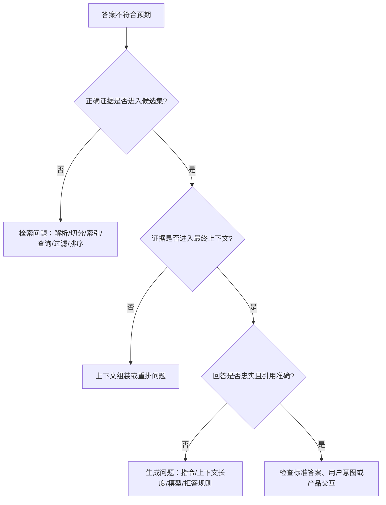

# RAG 评测与复盘

## 评测集设计

先从目标用户的真实任务整理问题，再用脱敏或合成材料建立可分享的测试集。每条样本建议包含：

| 字段 | 含义 |
| --- | --- |
| id | 稳定样本编号 |
| question | 用户问题 |
| expected_answer | 标准答案要点或可接受答案范围 |
| expected_sources | 应命中的文档/页码/段落 ID |
| category | 事实查找、多跳、歧义、无答案、权限边界等 |
| principal | 用于验证权限过滤的测试身份 |
| notes | 题目来源、特殊判定规则 |

先做 20–50 条覆盖不同问题类型的样本作为起点；数量不是质量保证，样本需人工复核并持续补充线上失败案例。

## 指标分层

### 检索层

- Recall@K：标准来源是否出现在前 K 个候选中。
- MRR / NDCG：相关来源排序是否靠前。
- 权限违规率：不应可见的文档是否出现在检索上下文中，目标应为 0。

### 生成层

- 答案正确性：与标准答案的事实要点是否一致。
- 忠实度：回答主张是否能由给定上下文支持。
- 引用正确性：引用是否支持对应结论，且来源定位可核验。
- 无答案处理：证据不足时是否拒答或澄清，而非编造。

### 系统层

- 端到端延迟及分阶段延迟（解析、检索、重排、生成）。
- 成功率、超时率、重试率和每次请求成本估算。
- 结果按问题类别、文档类型和权限场景分组；总平均值可能掩盖薄弱场景。

## 错误归因流程



## 实验记录模板

```markdown
## 实验：
- 日期：
- 数据集版本/样本数：
- 代码提交：
- 模型与版本：
- Embedding/向量索引版本：
- 切分配置：
- 检索配置（Top-K/混合权重/过滤）：
- Rerank 配置：
- Prompt 版本：
- 检索指标：
- 生成指标：
- 延迟/成本口径：
- 失败样本及归因：
- 结论与下一步：
```

## 迭代顺序

1. 先检查数据解析、切分和元数据，再调检索参数。
2. 若相关来源未召回，优先改进索引、查询和检索；不要先靠更长 Prompt 掩盖问题。
3. 若来源已召回但没进入上下文，检查排序、过滤和上下文预算。
4. 若上下文充分但回答错误，检查指令、冲突证据、模型输出约束和拒答行为。
5. 每次只改少量变量，对比固定数据集，并保留回归结果。

