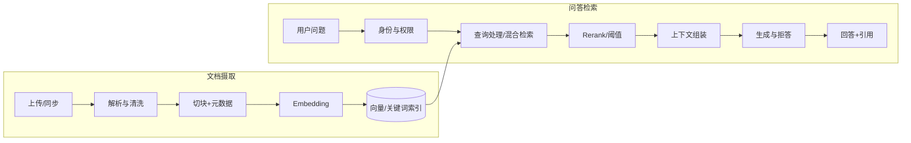

# RAG 端到端设计

## 两条链路

## 摄取设计

- 文档记录稳定 ID、版本、来源、所有者/租户、状态和更新时间。
- 解析器保留标题层级、页码等可用于引用的定位信息。
- 切块同时考虑语义边界、长度限制、检索粒度和来源定位；不存在适用于所有语料的固定 chunk 大小。
- 重试要可控且可观察；索引任务重复执行应尽量幂等。
- 更新和删除需考虑原文、向量和关键词索引的一致性及失败补偿。

## 查询设计

- 认证与授权先确定可见范围；查询过滤必须在检索层应用。
- 可组合关键词和向量检索，之后做去重、融合或重排。
- 限制上下文数量和长度；保留每个片段的来源元数据。
- Prompt 明确证据边界；回答中的引用应能映射到实际片段。
- 证据不足时澄清或拒答；不要把低相似度结果包装成确定事实。

## 常见问题定位

| 现象 | 优先检查 |
| --- | --- |
| 找不到正确文档 | 解析遗漏、切分边界、Embedding、查询改写、过滤条件、Top-K |
| 找到了但答案没用上 | 重排位置、上下文截断、上下文拼装和提示约束 |
| 引用错误 | 片段 ID 映射、版本更新、引用生成与验证 |
| 越权内容泄漏 | 身份传递、检索过滤、缓存键隔离及返回层复核 |
| 更新后仍出现旧答案 | 索引版本、删除补偿、缓存失效和并发写入 |

按 [[05-RAG评测与复盘]] 记录和验证每次调整。

