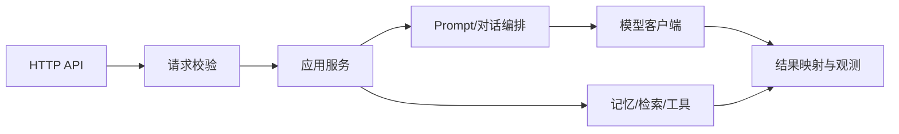

# Spring AI 应用服务

> 框架 API 会随版本变化。实践时记录所用 Spring AI、Spring Boot 和 Java 版本，并以对应版本官方文档为准。

## 服务边界

Controller 负责 HTTP 请求/响应和校验；应用服务编排用例；模型适配层处理模型供应方和 API 细节。Prompt、检索和工具逻辑应有可测试边界。

## 需要掌握的能力

- ChatClient：消息构造、调用、响应转换及流式调用。
- Prompt：系统约束、用户输入、上下文和输出格式分层管理。
- 结构化输出：定义目标类型、校验字段、处理无法解析的响应。
- 对话记忆：明确会话标识、保存范围、过期和隐私策略；记忆并不等于无限上下文。
- 工具调用：模型提出调用意图，应用执行前必须验证参数与权限。
- 配置：模型端点、超时、密钥通过配置注入；本地样例不包含真实凭据。

## API 设计起点

- 请求：会话 ID（如适用）、用户问题、可选受限参数。
- 响应：答案、来源/工具结果摘要、请求 ID；错误有稳定的错误码。
- 流式接口：明确 SSE 事件格式、结束事件、错误事件和客户端断开处理。
- 对请求大小、速率、会话访问权限和工具可用范围设边界。

## 验收检查

- [ ] Controller 不直接承担所有模型编排逻辑。
- [ ] 参数校验和统一异常映射完整。
- [ ] 模型超时、无效输出和客户端断开有确定处理。
- [ ] 可替换模型客户端进行应用层测试。
- [ ] 日志能关联请求，但不泄漏凭据或不必要的敏感内容。

