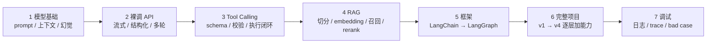

# 🧭 Agent 开发七步学习路线（视频笔记）

> [!abstract] 这篇笔记是什么
> 原始视频《假如从 11 月 11 号转型 Agent 开发，要达到的强度》，讲的是**「Agent 到底该按什么顺序学」**——不是技术细节，而是主线顺序与验收标准。
> 本篇由自动字幕整理而成，用于给自己的 [[01-学习路径总览|8 周学习规划]] 做**外部路线校验**。

> [!tldr] 一句话结论
> 学不出来不是不够努力，是**顺序乱了**。别一上来追 RAG / MCP / Multi-Agent，按「模型基础 → 裸调 API → Tool Calling → RAG → 框架 → 完整项目 → 调试」七步走。唯一的验收标准是：把一个真实项目从**能跑**做到**能调、能测、能排错、能讲清楚**。

> [!info] 来源与整理说明
> - 视频：[BV1DLWQ64EG5](https://www.bilibili.com/video/BV1DLWQ64EG5/?spm_id_from=333.337.search-card.all.click&vd_source=4e77ae7ca658e9a4c71fc3cc7a378962) · UP 主「老闫讲大模型」· 2026-11-12 发布 · 时长约 4 分 10 秒
> - 整理方式：去掉时间戳、合并断句、修正语音识别误差（对照表见 §六），按主题重排为结构化笔记
> - **§一~§四、§六 为视频内容的重组与勘误；§五 为整理时补充的本地索引与对照，非视频内容**
> - 原始字幕完整保留在文末折叠区，未删改

---

## 🔍 一、先说问题：为什么学了 2~3 个月还是做不出项目

| 现象 | 根因 |
| --- | --- |
| 今天看 RAG，明天 function calling，后天研究 MCP，再过两天刷 workflow / memory | 学习顺序乱，被热点牵着走，没有主线 |
| 每天都在学视频，也看了不少 | 输入多、输出少，没从头做过一个项目 |
| 真让你从零做一个 Agent 项目，还是不知道第一步该干什么 | 缺一条可执行路径 |
| 最后什么都听过，什么都没真正做出来 | Agent 方向更新快，概念永远追不完，没有收敛点 |

一句话：**如果没有一条清晰主线，很容易一直追概念。**

---

## 🗺️ 二、七步学习主线



| 步骤 | 阶段 | 核心动作 | 验收线（做到什么算过） |
| --- | --- | --- | --- |
| 1 | 大模型本身 | 搞懂能力边界与基础概念 | 异常能归因到模型 / prompt / 代码 |
| 2 | 直接调 API | 不依赖框架跑通调用链路 | 能独立实现流式、结构化返回、多轮对话、报错处理 |
| 3 | Tool Calling | 亲手写 tool 并跑通闭环 | 说得出「判断 → 选工具 → 执行 → 回灌」全过程 |
| 4 | RAG | 从零搭一遍知识库 | 能解释并复现几个典型 bad case |
| 5 | Agent 框架 | 看框架如何组织已懂的能力 | 说得清框架解决什么问题，不是背 API |
| 6 | 完整项目 | 一个场景迭代出多个版本 | 有一个能讲深的项目，而非十个 demo |
| 7 | 调试 | 看日志 / trace / 测 bad case | 能定位「能跑但效果不对」的问题 |

### 第 1 步 · 先把大模型本身搞明白

很多人一上来就学 Agent 框架，但连模型擅长什么、不擅长什么都没弄清楚。**至少要掌握**：

- prompt 是什么
- 上下文怎么工作
- `temperature` 这类参数大概控制什么
- 为什么会产生幻觉
- 结构化输出又解决什么问题

> [!important] 为什么排第一
> 后面不管做 RAG 还是 Agent，本质上都还在和大模型打交道。**如果连模型的能力边界都不知道，项目一出问题，根本分不清到底是模型、prompt 还是代码的问题。**

（口播：UP 主提到整理了一份「大模型 + Agent 系统学习路线和配套教程」，属引流内容，不作为知识点收录。）

### 第 2 步 · 学会直接调用大模型 API

这个阶段**先别急着上 LangChain，也别陷进各种框架**，先用简单代码把 API 调通。递进顺序：

1. 输入一句话 → 拿到返回结果
2. 流式输出
3. 结构化返回
4. 聊天记录保存
5. 多轮对话

**至少要搞清楚**这四件事，因为「以后换什么框架都绕不开」：

| 要搞懂 | 具体问题 |
| --- | --- |
| 请求怎么发 | 消息（`messages`）怎么组织 |
| 历史怎么组织 | 多轮上下文怎么拼进请求 |
| 返回结构 | 模型返回的数据结构是什么 |
| 异常处理 | 接口报错以后怎么处理 |

### 第 3 步 · 开始做 Tool Calling

Tool Calling 是 **Agent 最核心的基础能力之一**。查天气、查数据库、发邮件、搜索网页，本质都是同一个闭环：

```text
模型判断需不需要调用工具
  → 选择合适的 tool 并生成参数
  → 由程序真正执行
  → 把结果重新交给模型
  → 继续判断
```

> [!tip] 一定要动手
> 亲手写几个 tool，把 **参数 schema、参数校验、返回结果、异常处理** 一起跑一遍。后面绝大多数 Agent 项目都绕不开工具调用。

### 第 4 步 · 学 RAG

Agent 相关岗位里 RAG 依然是高频能力。很多人天天说知识库，却连 **embedding 为什么存在、向量库解决什么问题** 都没真正搞懂。

**重点不是背定义，而是自己从头搭一遍知识库**：

`PDF / Word 导入 → 文档解析 → chunk 切分 → embedding → 向量入库 → 召回 → rerank → 把最终内容交给模型生成答案`

过程中顺手测几个 bad case：

| bad case | 说明 |
| --- | --- |
| 文档里明明有答案，为什么没召回 | 检索链路是否真的覆盖到目标片段 |
| chunk 太大或者太小会发生什么 | 切分粒度对召回质量的影响 |
| 为什么只用向量检索，有时找不到产品编号和专业名词 | 视频把它列为必须踩过的问题，未展开解决方案 |

> 把这些问题真正踩过一遍，才算理解 RAG，而不是只会调一个 `retriever`。

### 第 5 步 · 再开始接触 Agent 框架

**前提**：模型 API、Tool Calling、RAG 都自己跑过以后，再去看 LangChain / LangGraph 会轻松很多。这时学的不是陌生 API，而是**看框架怎么组织你已经理解的能力**。

| 场景 | 先看哪个 |
| --- | --- |
| 简单 Agent、快速集成 | LangChain |
| 任务开始出现状态、循环、失败恢复、人工介入 | LangGraph |

前期没必要两套一起死磕。**关键不是把框架 API 背下来，而是知道它解决了什么问题。**

### 第 6 步 · 做一个完整项目

> [!warning] 反面做法
> 学一个知识点就做一个 demo：今天聊天机器人、明天翻译助手、后天总结工具，最后**简历上一个能讲深的项目都没有**。

更好的方式是选一个完整场景：**简历优化 Agent / 面试助手 / 企业知识助手 / 客服 Agent**，让它有真实输入、有 RAG 知识库、有 tool calling、有状态管理，也有完整 workflow。

迭代节奏 —— 一个项目一层层往上加，比同时做十个 demo 有效得多：

| 版本 | 增加的能力 |
| --- | --- |
| v1 | 先跑通主流程 |
| v2 | 加知识库（RAG） |
| v3 | 加工具（Tool Calling） |
| v4 | 补 memory、异常处理、状态恢复 |

### 第 7 步 · 多调试，少背八股

Agent 开发里很多问题**不是直接报错，而是「系统能跑，但效果不对」**：

- 为什么 tool 没有被调用 / 选错工具
- 为什么 RAG 召回不相关
- 为什么任务一直循环停不下来

这些问题光看教程学不会，必须自己 **看日志 → 看 trace → 调 prompt → 调流程 → 测 bad case**，一点点定位。

---

## ✅ 三、「要达到的强度」：自测清单

把视频里散落的「至少要知道 / 至少要搞清楚 / 才算理解」归拢成可勾选项：

- [ ] 能说清模型的能力边界，异常能归因到模型 / prompt / 代码
- [ ] 不依赖框架，裸 API 就能完成流式输出、结构化返回、多轮对话与报错处理
- [ ] 独立写过 tool（含 schema、参数校验、异常处理），能讲清一次工具调用的完整闭环
- [ ] 从零搭过一遍知识库全链路，并能解释至少 3 个 RAG bad case
- [ ] 说得清 LangChain 与 LangGraph 各自解决什么问题，而不只是记得 API
- [ ] 有一个能讲深的完整项目，且是逐版本迭代出来的
- [ ] 面对「效果不对」，会用日志 / trace 定位，而不是翻八股

---

## 🚧 四、最后一定要避开的坑

> [!danger] 一直学，从来不做
> 今天收藏一个教程、明天收藏一个开源项目，看起来学了很多，实际上**连一个完整 Agent 都没有从头跑通过**。

- **Agent 这个方向，不可能等你把所有概念学完再开始做项目。**
- 最有效的方式：**先选一个真实项目 → 把最小版本做出来 → 遇到什么问题再去补对应知识**（按需补课，而不是按目录补课）。
- 真正让你快速入门的，不是再多看几十个教程，而是把一个项目从 **能跑 → 能调 → 能测 → 能排错 → 能讲清楚**。

---

## 🔗 五、放进我的学习体系（整理者补充，非视频内容）

### 5.1 与本地「8 周规划」的对照

视频给的是**「从零到能做项目」的教学顺序**，本地的 [[01-学习路径总览]] 是**「8 周速成求职」的执行顺序**，两者取舍不同：

| 视频七步 | 本地四阶段 | 差异与取舍 |
| --- | --- | --- |
| 1 模型基础 | [[02-基础阶段\|阶段一 Day1]] 概念扫盲 | 一致 |
| 2 裸调 API | [[02-基础阶段\|阶段一 Day3]] API 实战 | 视频强调**不依赖框架**；本地用 Spring AI 起步 |
| 3 Tool Calling | [[03-Java开发阶段\|阶段二 Week1]] | 视频要求裸写一遍；本地在框架里学 |
| 4 RAG | [[03-Java开发阶段\|阶段二 Week2]] | 一致：都要求切分→向量化→检索→Rerank→注入全链路 |
| 5 Agent 框架 | [[04-高级架构阶段\|阶段三]] | ⚠️ **顺序相反**：本地框架先行，视频主张最后才上框架 |
| 6 完整项目 | [[05-项目与求职阶段\|阶段四]] | 一致 |
| 7 调试 | 分散在工程化里 | 视频单列成一步，本地未单列 |

> [!tip] 怎么用这份对照
> - 不必推翻现有规划：求职导向下「框架先行」是合理压缩，[[01-学习路径总览]] 里砍掉 LangChain4j 对比也是同一逻辑。
> - 值得吸收的是两点：**① 第 7 步「调试」单独留时间**（日志 / trace / bad case）；**② 第 2 步补一次裸 API 练习**，避免离开框架就写不出一次完整调用。

### 5.2 每一步对应的本地笔记

| 步骤 | 对应笔记 |
| --- | --- |
| 1 模型基础 | [[4-大模型核心原理与Transformer架构]]、[[1-提示词工程]] |
| 2 裸调 API / 多轮对话 | [[02-Model I-O 模型提示词与输出解析]]、[[07-Day02 课堂复盘 LCEL 与会话记忆]] |
| 3 Tool Calling | [[05-Agent 工具调用与中间件]]、[[5-Agent工具调用]] |
| 4 RAG | [[04-RAG 数据连接与检索]]、[[6-NaiveRAG构建流程与文档分块]]、[[7-向量化与向量检索-Embedding相似度与向量数据库]]、[[8-混合检索与NaiveRAG项目实战-BM25与HR智能问答]] |
| 5 框架 | [[00-LangChain V1.0 学习总览]]、[[01-V1.0 重构与整体体系]]、[[2-LangChain学习地图]] |
| 6 完整项目 | [[实战项目]]、[[06-服务化部署 FastAPI 与 LangServe]] |
| 7 调试 / 评测 | [[12-RAG评估-指标体系Ragas与检索器对比实验]]、[[13-LLM-as-a-Judge 评测与监控脚手架]]、[[0-Agent 面试通关：8 站通关作战地图]] |

---

## 🔤 六、字幕识别误差对照

| 字幕原文 | 实际应为 |
| --- | --- |
| A证 / A真的 | Agent |
| r a g / NIAG / RG | RAG |
| to calling / To calling / to | Tool Calling / tool |
| line ch / land cha / 蓝chain / land cha line graph | LangChain / LangGraph |
| land gra | LangGraph |
| 唱可切分 | chunk 切分 |
| 参数C码 | 参数 schema |
| 不是被定义 | 不是背定义 |
| 完整work | 完整 workflow |
| 在一点点定位 | 再一点点定位 |
| 给大家猜一下 | 给大家拆一下 / 讲一下 |
| 通agent这个方向不可能 | Agent 这个方向不可能（等所有概念学完再做项目） |

---

## 📼 附录：原始字幕（vCaptions 生成，含识别误差）

> [!note]- 点击展开 179 行原始字幕
> 00:00 假如从11月11号开始学agent，
> 00:02 我建议你先别急着追r a g MCP multi agent，
> 00:05 这些热点很多人学了两三个月还做不出项目，
> 00:08 不是因为不够努力，
> 00:09 而是一开始顺序就乱了，
> 00:11 今天看RAG，
> 00:12 明天看function calling，
> 00:13 后天研究MCP，
> 00:14 再过两天又开始刷workflow memory，
> 00:16 感觉每天都在学视频，
> 00:18 也看了不少，
> 00:18 但真让你从零做一个A证的项目，
> 00:20 还是不知道第一步该干什么，
> 00:22 A真的这个方向更新很快，
> 00:24 如果没有一条清晰主线，
> 00:26 很容易一直追概念，
> 00:27 最后什么都听过，
> 00:28 但什么都没真正做出来，
> 00:30 接下来就给大家猜一下，
> 00:31 agent到底应该按照什么顺序学，
> 00:33 第一步，
> 00:34 先把大模型本本身搞明白，
> 00:36 很多人一上来就学agent的框架，
> 00:37 但连大模型擅长什么，
> 00:39 不擅长什么都没弄清楚，
> 00:40 至少要知道prompt是什么，
> 00:42 上下文怎么工作，
> 00:43 temperature这类参数大概控制什么模型，
> 00:45 为什么会产生幻觉，
> 00:47 结构化输出又解决什么问题，
> 00:48 因为后面不管做RAG还是agent，
> 00:50 本质上都还在和大模型打交道，
> 00:52 如果连模型的能力边界都不知道，
> 00:54 项目一出问题，
> 00:55 你根本分不清到底是模型，
> 00:57 prompt还是代码的问题，
> 00:58 这里我也整理了一份大模型加agent的系统，
> 01:01 学习路线和配套教程，
> 01:02 需要的可以来个777，
> 01:03 第二步，
> 01:04 学会直接调用大模型API，
> 01:06 这个阶段先别急着上line ch，
> 01:07 也别一开始就陷进各种框架里，
> 01:09 先用简单代码把模型API调通，
> 01:11 输入一句话拿到返回结果，
> 01:13 再继续做流式输出，
> 01:15 结构化返回。
>
> 01:15 聊天记录保存和多轮对话，
> 01:17 做到这里，
> 01:18 你至少要搞清楚请求怎么发消息，
> 01:20 历史怎么组织模型，
> 01:21 返回的数据结构是什么，
> 01:22 接口报错以后怎么处理，
> 01:24 因为这些东西以后换什么框架都绕不开，
> 01:26 第三步开始做to calling，
> 01:28 To calling，
> 01:28 可以说是agent最核心的基础能力之一，
> 01:31 查天气，
> 01:31 查数据库，
> 01:32 发邮件，
> 01:33 搜索网页，
> 01:34 本质上都是模型先判断需不需要调用工具，
> 01:36 再选择合适的to生成参数，
> 01:38 由程序真正执行，
> 01:40 最后把结果重新交给模型，
> 01:42 继续判断，
> 01:42 这个阶段一定要亲手写几个to，
> 01:45 把参数C码参数校验，
> 01:47 返回结果和异常处理一起跑一遍，
> 01:49 因为后面绝大多数A证的项目都绕不开，
> 01:51 工具调用，
> 01:52 第四步学RAG现在agent相关岗位里，
> 01:55 NIAG依然是高频能力，
> 01:57 很多人天天说知识库，
> 01:58 但连embedding为什么存在向量库，
> 02:00 解决什么问题都没真正搞懂，
> 02:02 这个阶段重点不是被定义，
> 02:03 而是自己从头搭一遍知识库，
> 02:05 把PDF或者word导进去做文档解析，
> 02:08 唱可切分，
> 02:09 embedding向量入库，
> 02:11 召回RERANK，
> 02:12 再把最终内容交给模型，
> 02:13 生成答案过程中顺手测几个bad case，
> 02:15 比如文档里明明有答案，
> 02:17 为什么没召回，
> 02:18 chunk太大或者太小会发生什么，
> 02:20 为什么只用向量检索，
> 02:21 有时候找不到产品编号和专业名词，
> 02:23 把这些问题真正踩过一遍，
> 02:25 你才算理解rag，
> 02:27 而不是只会调一个retriever，
> 02:29 第五步，
> 02:29 在开始接触agent的框架，
> 02:31 前面的模型API tool calling r a g都自己跑过以后。
>
> 02:35 再去看land cha line graph，
> 02:36 会轻松很多，
> 02:37 这个时候你学的不是陌生API，
> 02:39 而是在看框架怎么组织你已经理解的能力，
> 02:41 前期没必要两套一起死磕，
> 02:43 简单agent快速集成，
> 02:44 可以先看蓝chain，
> 02:45 任务开始出现状态，
> 02:46 循环失败，
> 02:47 恢复人工介入，
> 02:48 再重点看land gra，
> 02:49 关键不是把框架API背下来，
> 02:51 而是知道它解决了什么问题，
> 02:53 第六步，
> 02:53 做一个完整项目，
> 02:55 不要再学一个知识点，
> 02:56 就做一个demo，
> 02:57 今天聊天机器人，
> 02:58 明天翻译助手，
> 02:59 后天总结工具，
> 03:00 最后简历上一个能讲深的项目都没有，
> 03:02 更好的方式是选一个完整场景，
> 03:04 比如简历优化agent，
> 03:05 面试助手，
> 03:06 企业知识助手或者客服agent，
> 03:08 让他有真实输入，
> 03:09 有RG知识库，
> 03:10 有to calling，
> 03:11 有状态管理，
> 03:12 也有完整work，
> 03:13 第一版先跑通，
> 03:14 第二版加知识库，
> 03:15 第三版加工具，
> 03:16 第四版再补memory，
> 03:18 异常处理和状态恢复一层一层往上加，
> 03:21 比同时做十个demo有效得多，
> 03:23 第七步，
> 03:23 多调试，
> 03:24 少背八股，
> 03:25 agent的开发里，
> 03:26 很多问题不是直接报错，
> 03:27 而是系统能跑，
> 03:28 但效果不对，
> 03:29 为什么to没有被调用，
> 03:30 为什么选错工具，
> 03:31 为什么RAG召回不相关，
> 03:33 为什么任务一直循环停不下来，
> 03:36 这些问题光看教程学不会，
> 03:37 必须自己看日志，
> 03:39 看trace，
> 03:39 调prompt，
> 03:40 调流程，
> 03:41 测bad case，
> 03:41 在一点点定位，
> 03:42 最后一定要避开的坑，
> 03:44 就是一直学，
> 03:45 从来不做，
> 03:45 今天收藏一个教程，
> 03:46 明天收藏一个开源项目，
> 03:48 看起来学了很多，
> 03:49 实际上连一个完整agent都没有从头跑，
> 03:52 通agent这个方向不可能。
>
> 03:53 等你把所有概念学完再开始做项目，
> 03:55 最有效的方式就是先选一个真实项目，
> 03:58 把最小版本做出来，
> 03:59 遇到什么问题再去补对应知识，
> 04:01 真正能让你快速入门的，
> 04:03 不是再多看几十个教程，
> 04:05 而是把一个项目从能跑做到能调能测，
> 04:08 能排错，
> 04:09 能讲清楚。
>
> --- 由 vCaptions 生成 ---

---

*本文由字幕整理，Obsidian 渲染支持双链、Mermaid、Callout 与折叠块。*
