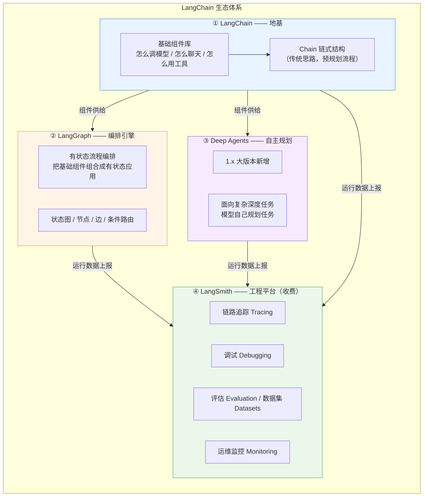
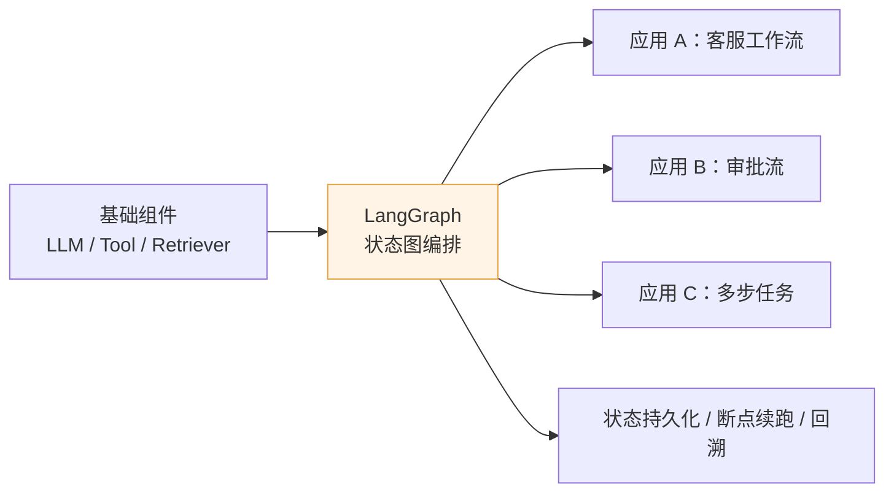
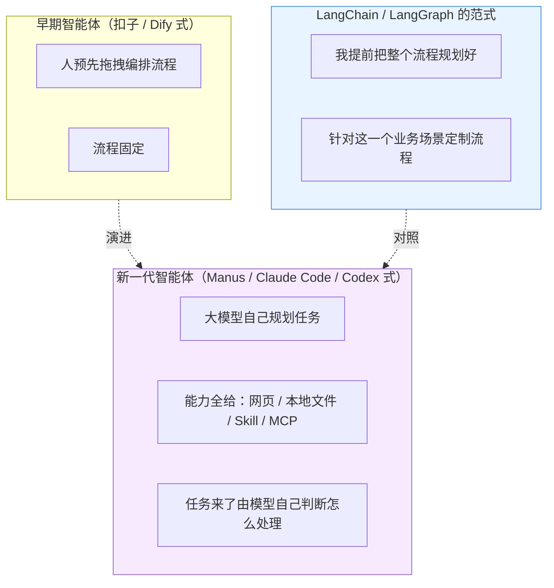
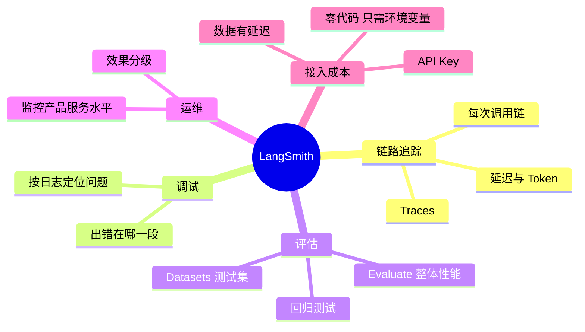
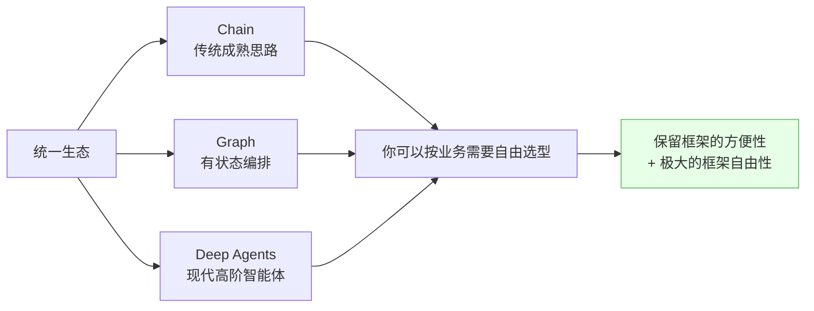
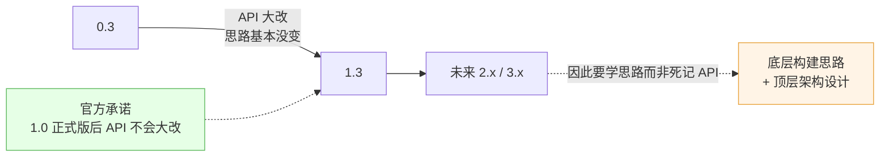

# 🧩 生态体系：四大模块与三种范式

> [!abstract] 本节回答一个问题
> **LangChain 1.3 生态到底由哪几块组成？各自负责什么？什么时候用哪个？**

## 1. 四大模块全景

![[0-LangChain1.3-生态全景.drawio]]

## 2. 四大模块逐个拆解

### 2.1 LangChain —— 两个身份

| 身份 | 定位 | 关键问题 |
| --- | --- | --- |
| **生态底层基础组件库** | 提供各种基于大模型的基础组件：怎么和模型交互、怎么调模型能力、怎么聊天 | "我该有哪些能力可用？" |
| **Chain 链式构建形式** | 基于链式结构构建复杂应用 / 智能体的一种实现形式 | "这些能力怎么串起来？" |

> [!note] Chain 范式的现状
> 讲师明确：**基于 Chain 链式结构的智能体思路，现在用得相对不多**（后面章节会详细分析原因）。但它是历史沉淀的成熟思路，框架仍保留。

> [!important] 讲师原话
> "只有这个地基足够扎实，你才可能搭建出上层的应用。"
> 生态组件库不只支撑 LangChain 自己，**LangGraph、Deep Agents 都复用同一套组件**。

### 2.2 LangGraph —— 有状态流程编排引擎

| 能力 | 说明 |
| --- | --- |
| 有状态 | 流程中间状态可保存、恢复、回溯 |
| 可组合 | 把 LangChain 的基础组件装配成业务应用 |
| 复杂问题 | 提供"处理复杂业务问题"的能力 |
| 与 LangChain 密不可分 | **只学 LangGraph 不学 LangChain 不现实**，一定会碰到组件 |

### 2.3 Deep Agents —— 模型自主规划

| 范式 | 谁做决策 | 特点 | 代价 |
| --- | --- | --- | --- |
| **Chain / Graph** | **人**（预先规划） | 流程可控、可测试、成本可预估 | 灵活性差，流程外的场景处理不了 |
| **Deep Agents** | **模型**（自主规划） | 灵活、能应对开放任务 | 不确定性高，需要评估与护栏 |

> [!tip] 选型判据
> - 流程**确定**、要审计/合规 → 用 **Graph**（人编排）。
> - 任务**开放**、路径无法穷举 → 用 **Deep Agents**（模型规划）。
> - 生产系统通常是 **Graph 为主 + 关键节点放行给 Agent**（Human-in-the-loop）。

### 2.4 LangSmith —— 商业化工程平台

| 维度 | 说明 |
| --- | --- |
| 定位 | 依托工程平台，为大模型应用提供**链路追踪 / 调试 / 评估 / 运维**能力 |
| 是否必需 | **Demo 不需要**；做"严谨的产品"就需要 |
| 为什么必需 | 出问题要知道在哪、要看日志定位、要看模型效果、要监控产品等级 |
| 效果分级的意义 | 回答效果差 → 只能做陪伴式玩伴；回答精准 → 可以做医疗机器人 |
| 接入成本 | **功能强，但接入极简单**，基本零开发（设几个环境变量即可） |
| 成本 | 收费（LangChain 的商业化产品），深度玩可充少量金额 |

## 3. 为什么 LangChain 是当前最成熟的客户端框架

> [!quote] 讲师的判断
> "就在于它对各种思想都是**兼收并蓄**的：传统构建的思想保留、成熟的思路保留、现代化的思路也保留，各种思路都有，并提供统一支撑。"

> [!important] 对比要点
> 传统框架"一旦把功能做出来，就一定对功能有**限制**"，只能针对具体问题；
> **LangChain 体系下保留了框架的方便性，同时极大保留了框架的自由性**——这是它最重要的架构价值。

## 4. 版本演进与学习策略

| 事实 | 推论 |
| --- | --- |
| 0.3 → 1.3 最大变化是 **API 层**，基础思路变化不大 | 有 0.3 经验的人迁移很快（讲师亲历："准备得非常快、非常顺手"） |
| 很多方法在 0.3 有、1.3 没了 | **不要背 API** |
| 1.0 后官方承诺 API 稳定 | 产品化更可预期 |
| 新版本永远追不完 | **学"构建 Agent 的不同思路"**（Chain 链式 / 有状态编排 / 自主规划） |

> [!tip] 学习策略
> 1. **思路层必须自己清楚** —— 你得知道怎么跟 AI 提需求，而不是"你帮我做个应用出来"。
> 2. **API 层要求熟悉** —— 这一阶段（1.3）API 不熟悉会拖慢后续学习。
> 3. 但即使 API 不熟也没关系 —— **随时可以问 AI**，前提是思路清楚。

## 5. 对应到 Spring AI（你的主线）

| LangChain 1.3 | Spring AI | 说明 |
| --- | --- | --- |
| `init_chat_model` | `ChatClient` / `ChatModel` | 模型访问抽象 |
| `@tool` / Function Calling | `@Tool` / Function Calling | 工具定义 |
| `create_agent` | Advisor / Tool Calling 循环 | 智能体编排 |
| `ChatPromptTemplate` | `PromptTemplate` | 提示词模板 |
| `InMemorySaver` | `ChatMemory` / `MessageWindowChatMemory` | 短期记忆 |
| LangGraph | Workflow / Advisor 链 | 流程编排 |
| LangSmith | Langfuse / OpenTelemetry | 可观测与评估 |

## 🏷️ 标签

#AI #LangChain #LangGraph #DeepAgents #LangSmith #架构

---
返回 [[README]] · 下一篇：[[02-环境安装与依赖管理]]
