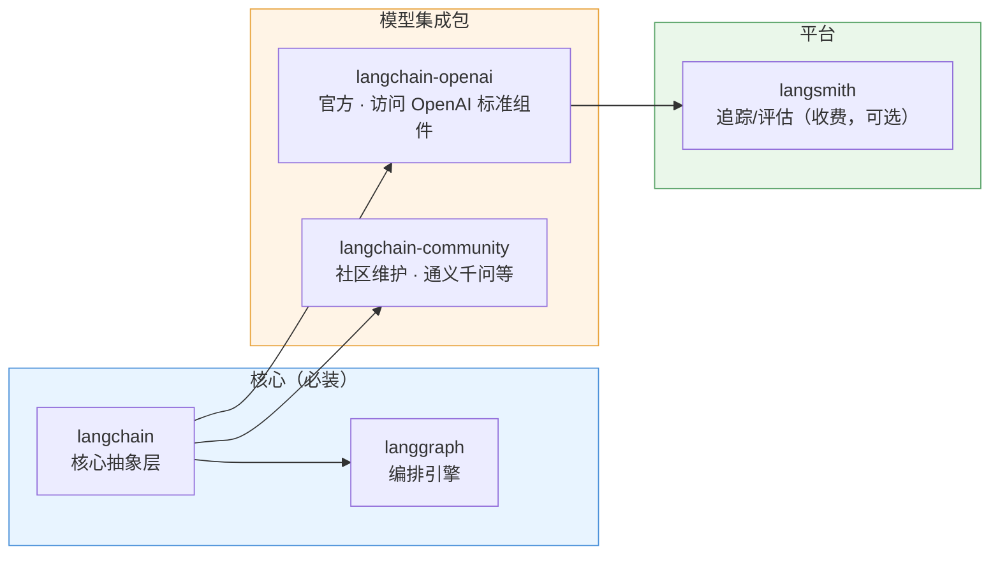
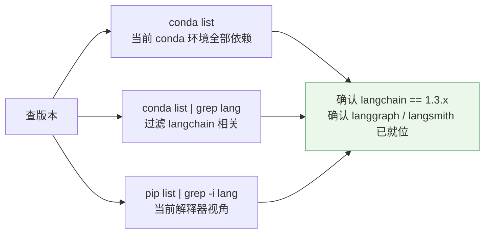
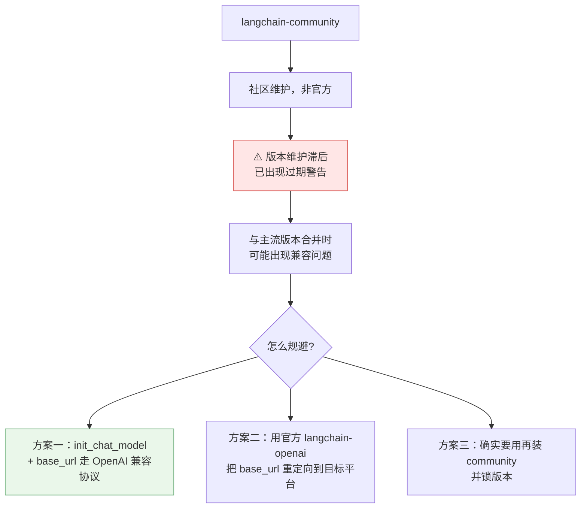
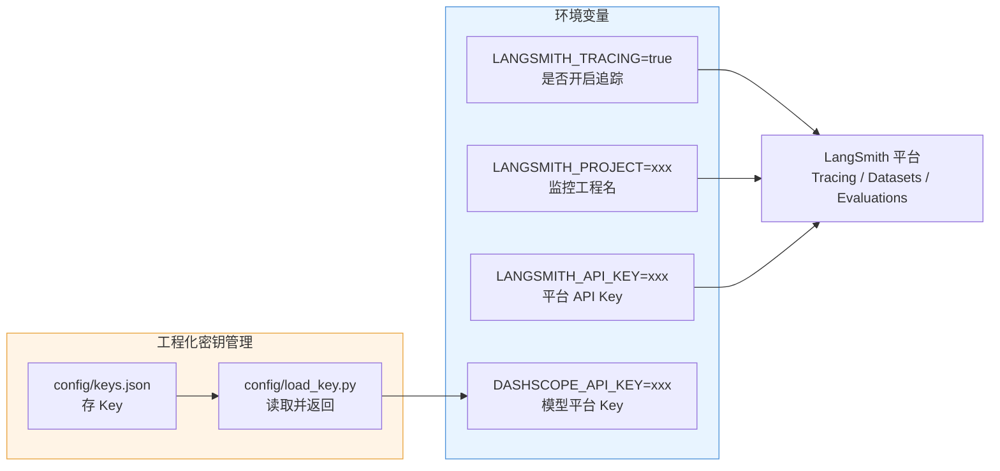

# 📦 环境安装与依赖管理

> [!abstract] 本节回答
> 装哪些包？版本怎么查？社区包有什么坑？装在哪？

## 1. 依赖清单



| 包 | 作用 | 必装 | 维护方 |
| --- | --- | --- | --- |
| `langchain` | 核心抽象层 + Chain 范式 | ✅ | 官方 |
| `langgraph` | 有状态流程编排引擎 | ✅ | 官方 |
| `langchain-openai` | 访问 OpenAI 系列模型的标准组件 | ✅ | 官方 |
| `langchain-community` | 社区扩展包（通义千问等国内模型） | ⚠️ 按需 | **社区**（非官方） |
| `langsmith` | 追踪 / 评估平台 SDK | ⚠️ 按需 | 官方（**收费产品**） |

> [!important] 安装方式的差异
> 讲师明确区分两种做法：
> - **课程/学习阶段**：一个一个依赖地装 → **形成体系认知**，知道未来有哪些库可用、怎么规划项目依赖。
> - **实际工程阶段**：把需要的都写进一个文件，**一次装满**，装完不再管。

## 2. 安装命令

```bash
# 复用已有环境（推荐：见 [[6-ai/AI 学习规划/环境搭建/README|环境搭建]]）
conda create -n ai-agent python=3.11 -y
conda activate ai-agent

# 先配镜像（不配的话 langgraph/smith 依赖树会拉到吐）
python -m pip config set global.index-url https://pypi.tuna.tsinghua.edu.cn/simple

# 学习阶段：逐个装
python -m pip install langchain
python -m pip install langgraph
python -m pip install langchain-openai
python -m pip install langchain-community
python -m pip install langsmith
```

```bash
# 工程阶段：一次装满
python -m pip install langchain langgraph langchain-openai langchain-community langsmith
```

> [!warning] Python 版本
> 课程强调 **Python 不能低于 3.8**；课程演示环境用的是 **3.13**。
> 但工程上建议 **3.11**（torch / faiss / 多数 wheel 对 3.13 支持仍不完整），与你现有的 `ai-core` / `ai-agent` 环境保持一致。

## 3. 版本查看



```bash
# 1. 当前 conda 环境 + 全部依赖
conda list

# 2. 过滤出 langchain 系列（讲师演示的方式）
conda list lang

# 3. pip 视角
python -m pip list | grep -i lang

# 4. 直接问包
python -c "import langchain, langgraph; print(langchain.__version__, langgraph.__version__)"
```

| 检查项 | 期望 |
| --- | --- |
| `langchain` | `1.3.x`（课程录制时为 `1.3.7`） |
| `langgraph` | 已安装 |
| `langsmith` | 已安装（要用追踪才必须） |

> [!tip] 版本策略
> 1.3 之后官方承诺 API 稳定，但**仍建议在项目里 pin 主版本**：
> `langchain>=1.3,<2.0`，避免将来 2.0 的破坏性变更打脸。

## 4. 社区包（langchain-community）的风险



> [!quote] 讲师提醒
> "longchain-community 现在已经提示警告是过期了，因为它版本维护没有跟上。"
> "这个合并随时可能会出现版本兼容的问题，目前我觉得这个还是可以用。"

**结论**：能用 `init_chat_model` + `base_url` 解决的，就别引入 community 包。

## 5. 官方 Provider 与社区 Provider

| Provider | 支持方 | 备注 |
| --- | --- | --- |
| `openai` | 官方内置 | 同时覆盖所有 OpenAI 兼容平台 |
| `anthropic` | 官方内置 | Claude |
| `google_genai` | 官方内置 | Gemini |
| `deepseek` | 官方内置 | DeepSeek |
| `xai` | 官方内置 | 马斯克 xAI |
| 通义千问 / 星月智阶 / 百川 等 | **community** | 官方认为"不够格"，故未内置 |
| 阿里云百炼（通义系列） | community 或 OpenAI 兼容 | 课程用 OpenAI 兼容方式接入 |

> [!note] 官网查全部 Provider
> LangChain 官网 → **Integrations** 页面，可查所有已集成 provider 与安装包名。

## 6. 密钥与环境变量配置



### 6.1 LangSmith 三个变量

| 变量 | 作用 | 说明 |
| --- | --- | --- |
| `LANGSMITH_TRACING` | 开关 | 设成 `true` 开启追踪 |
| `LANGSMITH_PROJECT` | 工程名 | 在 LangSmith 平台上的"监控工程"名，自己取 |
| `LANGSMITH_API_KEY` | 平台密钥 | 到 LangSmith 官网 → Settings → 创建 API Key |

> [!note] 变量名版本说明
> 1.x 推荐 `LANGSMITH_*`；旧教程常见 `LANGCHAIN_TRACING_V2` / `LANGCHAIN_PROJECT` / `LANGCHAIN_API_KEY`，属兼容别名。**以官方文档当前写法为准**。

> [!tip] 零开发接入
> 后面所有监控、调试、测试工作，**只要设好这几个环境变量就自动生效**，不需要写任何额外代码。

### 6.2 密钥管理组件（工程化做法）

```python
# config/load_key.py
import json
from pathlib import Path

KEYS_FILE = Path(__file__).parent / "keys.json"

def load_key(name: str) -> str:
    """从 config/keys.json 读取密钥，避免硬编码到代码里。"""
    with open(KEYS_FILE, "r", encoding="utf-8") as f:
        return json.load(f)[name]
```

```json
// config/keys.json
{
  "dashscope_api_key": "sk-xxxxxxxx",
  "langsmith_api_key": "lsv2_xxxxxxxx"
}
```

> [!danger] 必须遵守
> `keys.json` **必须进 `.gitignore`**（课程演示用的 `load_key` 组件思路正确，但真实项目要用环境变量 / 密钥管理服务）。
> 详见 [[6-ai/AI 学习规划/环境搭建/04-AI 依赖清单与镜像源#8. 密钥管理]]。

## 7. 验收清单

- [ ] `conda list lang` 能看到 `langchain 1.3.x`
- [ ] `langgraph`、`langsmith` 已安装
- [ ] LangSmith 三个环境变量已设置且平台能查到对应 Project
- [ ] 密钥没有硬编码在代码里（`keys.json` 已 gitignore）
- [ ] 装包走的是国内镜像（`pip config list`）

## 🏷️ 标签

#AI #LangChain #依赖管理 #Conda #LangSmith

---
返回 [[README]] · 上一篇：[[01-生态体系：四大模块与三种范式]] · 下一篇：[[03-模型接入：init_chat_model 与多模型切换]]
