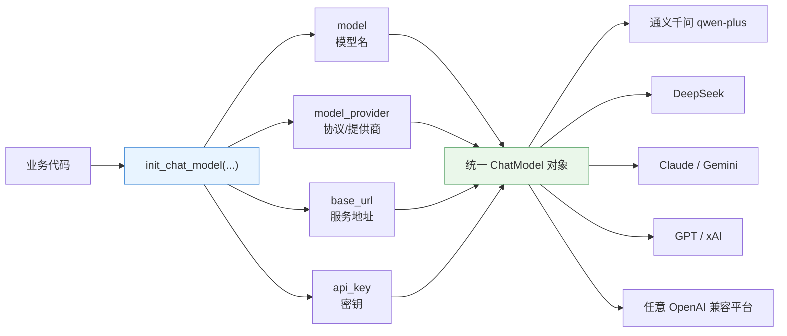
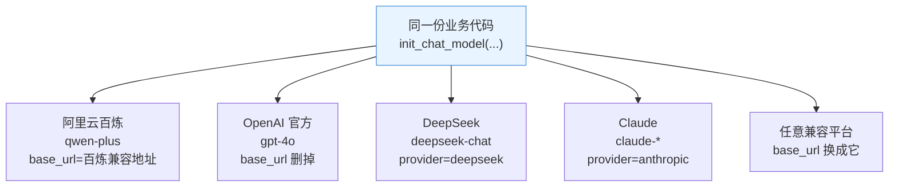
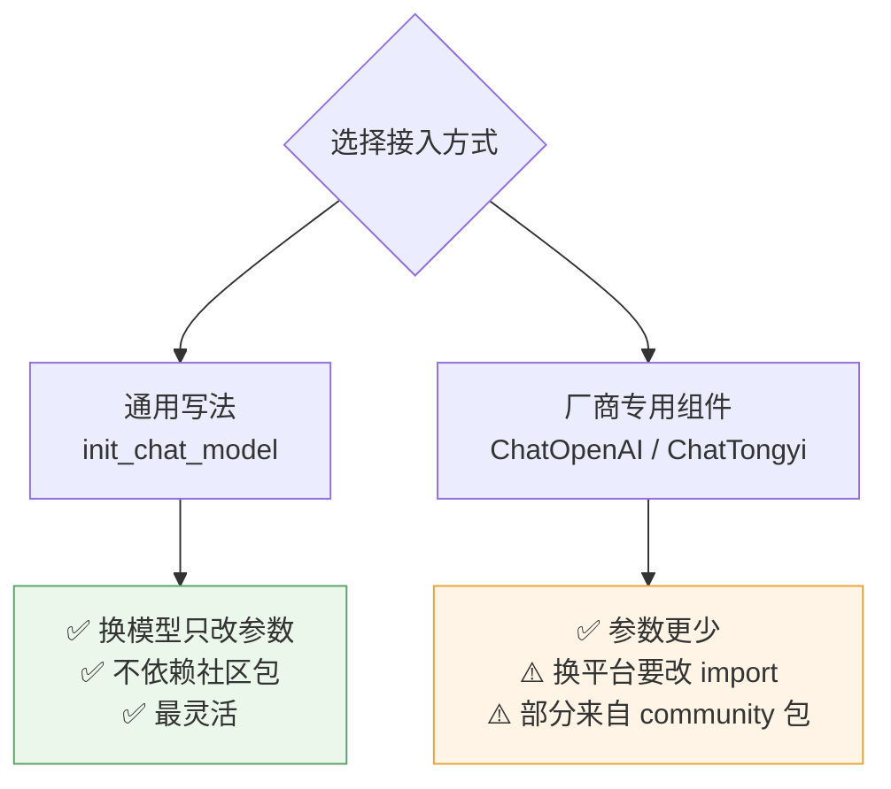
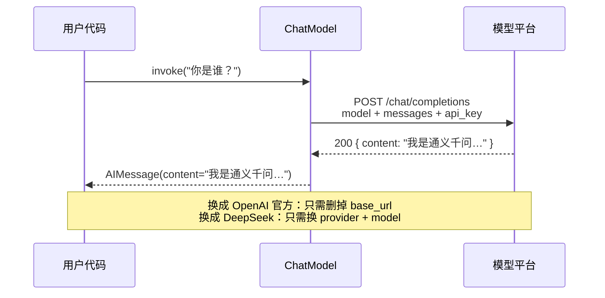

# 🔌 模型接入：`init_chat_model` 与多模型切换

> [!abstract] 本节回答
> LangChain 怎么"一套代码访问所有主流大模型"？换模型要改什么？三种写法怎么选？

## 1. 统一入口：`init_chat_model`

![[1-模型接入与工具调用链路.drawio]]



> [!quote] 讲师的表述
> "在 LangChain 的体系下，它提供了一种**很统一的方式**可以访问所有的主流大模型……`init_chat_model`，我要跟大模型聊天，那就初始化一个聊天的大模型就行了。"

## 2. 四个参数

| 参数 | 含义 | 必需 | 课程示例 |
| --- | --- | --- | --- |
| `model` | 具体模型名 | ✅ | `qwen-plus` / `deepseek-chat` / `gpt-4o` |
| `model_provider` | 提供商（决定请求协议与默认地址） | ✅ | `openai`（走 OpenAI 兼容协议） |
| `base_url` | 服务地址，覆盖默认 | 官方默认地址时可省略 | 阿里云百炼兼容地址 |
| `api_key` | 密钥 | ✅ | 从 `keys.json` / 环境变量读取 |

```python
from langchain.chat_models import init_chat_model

model = init_chat_model(
    model="qwen-plus",
    model_provider="openai",
    base_url="https://dashscope.aliyuncs.com/compatible-mode/v1",
    api_key=load_key("dashscope_api_key"),
)

response = model.invoke("你是谁？")
print(response.content)
```

> [!info] 为什么用 `model_provider="openai"` 去调阿里云？
> 因为阿里云百炼提供 **OpenAI 兼容接口**，LangChain 的 `openai` provider 本质是一种"协议实现"。
> **凡是 OpenAI 兼容的平台，都用 `model_provider="openai"` + 改 `base_url` 即可。**

## 3. 切换模型 = 改参数，不改代码



| 目标平台 | `model` | `model_provider` | `base_url` |
| --- | --- | --- | --- |
| 阿里云百炼 | `qwen-plus` | `openai` | 百炼兼容地址（需填） |
| OpenAI 官方 | `gpt-4o` | `openai` | **删掉这行**（官方地址已内置） |
| DeepSeek | `deepseek-chat` | `deepseek` | 删掉（内置） |
| Claude | `claude-*` | `anthropic` | 删掉（内置） |
| 私有化 / 自建 | 任意 | `openai` | 换成自己的地址 |

> [!tip] 讲者的经验
> "只要这个组件构建出来了，你就可以通过 `invoke` 调用了……基本上几乎所有主流大模型都是这样的。"
> **甚至 `base_url` 都可以不写**——如果是官方支持的 provider（如 OpenAI、DeepSeek），内置了默认地址。

## 4. 阿里云百炼地址的两个细节

> [!important] 课程特有信息（以官方文档为准）
> 讲师提到百炼的 OpenAI 兼容地址正在迁移：
> - **旧地址（课程录制时可用）**：`https://dashscope.aliyuncs.com/compatible-mode/v1`
> - **新地址**：按 **业务空间（workspace id）** 指定，形如 `https://dashscope.aliyuncs.com/compatible-mode/v1` + workspace 标识

| 概念 | 解释 |
| --- | --- |
| 业务空间 | 阿里云百炼平台上的资源隔离单元，有自己的 id 与资源 |
| 查找路径 | 百炼控制台 → 业务空间 → 取 id → 填入地址 |
| 迁移含义 | **未来统一地址会下线**，新项目直接用带 workspace 的地址 |

> [!warning] 地址以官方文档为准
> 百炼地址仍在演进中，**每次接入前先去阿里云百炼文档确认当前 endpoint**，别直接抄笔记里的旧地址。

## 5. 三种写法怎么选



| 写法 | 示例 | 优点 | 缺点 |
| --- | --- | --- | --- |
| **通用（推荐）** | `init_chat_model("qwen-plus", model_provider="openai", base_url=..., api_key=...)` | 换模型只改参数；不依赖过期社区包 | 4 个参数要记 |
| **OpenAI 专用组件** | `ChatOpenAI(model="qwen-plus", base_url=..., api_key=...)` | 少写 `model_provider` | 仍要填 `base_url`；本质是 OpenAI 组件重定向 |
| **厂商封装** | `ChatTongyi(...)`（来自 `langchain-community`） | 参数最少 | **社区维护、已出现过期警告**，有兼容风险 |

> [!quote] 讲师建议
> "更简单的方法就是针对每个不同的组件，LangChain 里面也提供了不同的扩展包……"
> 但同时提醒 community 包"已经提示警告是过期了，因为它版本维护没有跟上"。
> **结论：优先 `init_chat_model`；用 `ChatOpenAI` 重定向 base_url 是安全的第二选择；community 谨慎引入。**

## 6. 调用与输出



```python
res = model.invoke("你是谁？")
print(res.content)     # 文本内容
print(res.type)        # 'ai'（AIMessage）
```

| 常用方法 | 用途 |
| --- | --- |
| `invoke(msg)` | 单次调用，返回 AIMessage |
| `stream(msg)` | 流式输出 |
| `batch([m1, m2])` | 批量调用 |

## 7. 与 Spring AI 的对应

| LangChain | Spring AI | 备注 |
| --- | --- | --- |
| `init_chat_model(...)` | `ChatModel` / `ChatClient` | 都是"统一访问多模型" |
| `model_provider` | `spring.ai.openai.*` 等 starter 切换 | 配置驱动而非代码驱动 |
| `base_url` | `base-url` / `uri` 配置项 | 私有化部署必备 |
| `invoke()` | `call()` / `stream()` | 语义一致 |

> [!tip] 迁移提示
> Spring AI 是**配置切换**（改 yaml 不改代码），LangChain 是**参数切换**（改代码里的 4 个参数）。想彻底解耦，可把 4 个参数收敛到配置文件里。

## 8. 排错

| 症状 | 原因 | 处理 |
| --- | --- | --- |
| `401 Unauthorized` | api_key 不对/没生效 | 确认 `load_key` 读对文件、Key 未过期 |
| `404 model not found` | 模型名与平台不匹配 | 百炼用 `qwen-plus` 等百炼侧真实模型名 |
| `Connection refused` | base_url 写错 | 去掉 `/chat/completions` 后缀，只留 base |
| 401 且用了 DeepSeek | provider 写错但仍用 openai 协议 | 改 `model_provider="deepseek"` |
| 报 `openai` 包缺失 | 只装了 langchain 没装集成包 | `pip install langchain-openai` |
| `422 tools[0]: missing field type` | 直传 `tools=` 而没走 `bind_tools` | 见 [[04-工具调用与 Agent]] 的坑 1 |

> [!tip] 实测记录（2026-10-26，langchain 1.4.2 + langchain-openai + DeepSeek）
> 装 `langchain-openai` 后，**DeepSeek / 百炼 / OpenAI 全部走 `model_provider="openai"` + 改 `base_url`**，
> 只需换 4 个参数，业务代码零改动。
> 参考实现：`~/PycharmProjects/PythonProject2/examples/config.py`（模型配置表 + 一键切换）。

## 🏷️ 标签

#AI #LangChain #init_chat_model #多模型切换 #阿里云百炼

---
返回 [[README]] · 上一篇：[[02-环境安装与依赖管理]] · 下一篇：[[04-工具调用与 Agent]]
