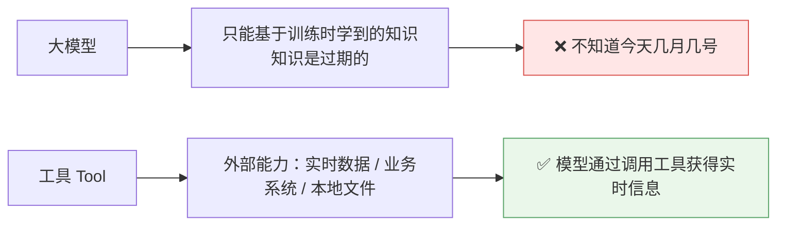
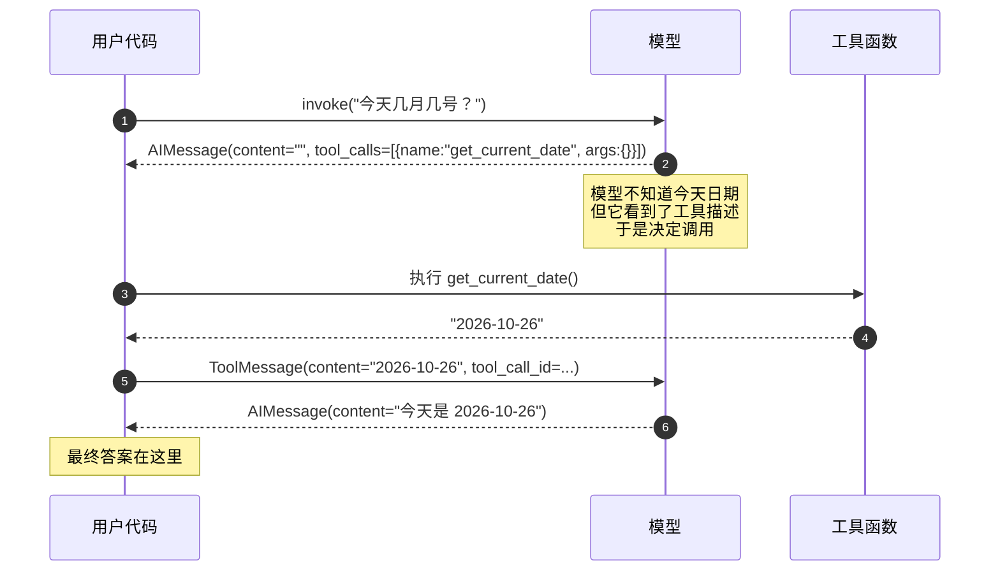
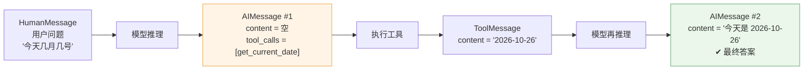
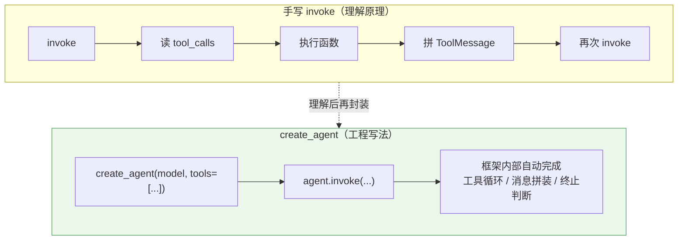
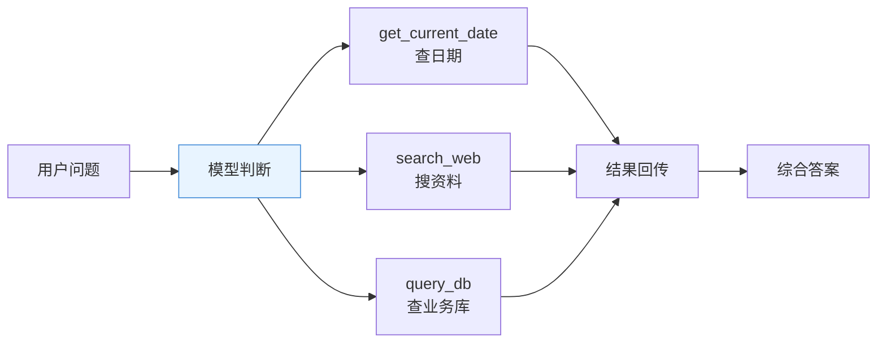

# 🔧 工具调用与 Agent

> [!abstract] 本节回答
> 大模型怎么用工具？`tool_calls` 到底发生了什么？`create_agent` 又省掉了什么？

## 1. 为什么需要工具



> [!quote] 讲师的例子
> "大模型只知道以往学过的知识，学的是过期的知识，它怎么知道今天是几月几号呢？所以这就需要一些特殊能力，让它能够通过别的渠道获取到实时的信息——**这个渠道其实就是工具**。"

> [!important] 工具是后续一切的扩展点
> "实际上把这个 tools 你用好了，像 **MCP**、像 **Skill**，这些都是基于工具来的。"（详见 [[14-AI agent  ]] 与 RAG 专题）

## 2. 定义一个工具：`@tool`

```python
from datetime import datetime
from langchain_core.tools import tool

@tool
def get_current_date() -> str:
    """获取今天的日期。当用户询问今天日期时调用此工具。"""
    return datetime.now().strftime("%Y-%m-%d")
```

| 要素 | 作用 |
| --- | --- |
| `@tool` 装饰器 | 把普通函数**注册为工具**，并自动生成 schema |
| 函数体 | 你想干什么就干什么，框架不限制 |
| **docstring** | **告诉大模型这个工具是干什么的** —— 唯一必需的"说明书" |

> [!tip] 讲者的关键点
> "对工具你只需要按照给它一个**普通的函数**，这个函数里面你想干嘛就干嘛，你只要**有一个描述告诉大模型是干什么的**……就可以快速接入大模型了。"

> [!warning] docstring 就是给模型的 Prompt
> 描述写得含糊，模型就调不准。写法：`动词开头 + 什么时候用 + 参数含义 + 返回值`。
> 例：`"""查询指定城市未来 N 天的天气。当用户问天气时调用。参数 city 为城市名。"""`

## 3. 工具调用的完整时序（核心）

![[1-模型接入与工具调用链路.drawio]]



### 3.1 三个关键观察

| # | 观察 | 意义 |
| --- | --- | --- |
| 1 | **第一次 AIMessage 的 `content` 是空的** | 模型没编答案，而是给出 `tool_calls`（"你调一下这个函数，参数不需要"） |
| 2 | 工具结果用 **ToolMessage** 回传 | 三类消息（Human / AI / Tool）构成完整循环 |
| 3 | 第二次 AIMessage 才有内容 | 这才是用户最终看到的结果 |

> [!warning] 最容易踩的坑
> 看到 `content` 为空就以为模型坏了——**不是**，它是把"怎么答"换成了"调哪个工具"。

## 4. 消息类型全景



| 消息类型 | 含义 | 谁产生 | 关键字段 |
| --- | --- | --- | --- |
| `HumanMessage` | 用户输入的问题 | 用户 | `content` |
| `AIMessage` | 模型的回复 / 工具调用意图 | 模型 | `content`、`tool_calls` |
| `ToolMessage` | 工具执行结果 | 你的代码 | `content`、`tool_call_id` |

> [!note] 与 Spring AI 的差别
> Spring AI 里工具调用结果通常由框架内部循环自动拼回；LangChain 1.x 的 `create_agent` 也做了这个封装，**但手写 `invoke` 时你必须自己完成第 3–5 步**——这正是理解底层原理的价值。

## 5. `create_agent`：把循环封装掉



```python
from langchain.agents import create_agent

agent = create_agent(
    model=model,                      # init_chat_model 得到的统一模型对象
    tools=[get_current_date],         # 已注册的工具列表
)

result = agent.invoke("今天几月几号？")
print(result["messages"][-1].content)   # 最终答案
```

| 组件 | 在 Agent 里的角色 |
| --- | --- |
| 大模型 | 决策者：判断要不要调工具、调哪个 |
| 工具 | 能力：实时数据 / 业务操作 |
| Agent 封装 | 中间所有编排逻辑由框架消化 |

> [!danger] 坑 1：必须用 `bind_tools`，不能直传 `tools=`
> 手写 `invoke` 时，**`model.invoke(msgs, tools=[tool])` 在 DeepSeek 等严格实现上会报 422**：
> ```
> Error code: 422 - tools[0]: missing field `type`
> ```
> 正确写法（`bind_tools` 会生成 `{"type": "function", ...}` 标准 schema）：
> ```python
> llm = model.bind_tools(tools)
> resp = llm.invoke(messages)
> ```
> `create_agent` 内部走的就是 bind_tools，所以 Agent 方式反而不会踩这个坑。

> [!warning] 坑 2：`prompt.invoke()` 返回的是 `ChatPromptValue`
> 不是消息列表，要再取一层 `.messages`：
> ```python
> msgs = prompt.invoke({"question": "...", "language": "Chinese"}).messages
> ```
> 另外 `invoke([("human", "...")])` 这种 **tuple 形式不能直接取 `.content`**，要转成 `HumanMessage(content=...)` 对象。

> [!quote] 讲师的描述
> "这个 Agent 里面有什么？有大模型，有工具……中间的逻辑他全部给你封装清楚了。"
> "你把那些基础组件给他就行了，中间的过程 Agent 自己去规划，组件内部去消化。"

> [!note] API 变更提醒
> 1.x 推荐 `create_agent`；旧教程里的 `initialize_agent` / `AgentExecutor` 属于旧范式，遇到旧代码要能识别。

## 6. 多工具与工具编排



| 设计要点 | 建议 |
| --- | --- |
| 工具粒度 | **一个工具一件事**，不要做成"万能工具" |
| 数量 | 工具太多模型选不准，先给 3–5 个核心工具 |
| 描述 | 写清"什么时候用 / 什么时候不用" |
| 副作用 | 写操作（删数据、付款）要加确认环节 |
| 错误处理 | 工具内部异常要返回可读信息，别直接抛栈给模型 |

## 7. 与 Spring AI 对应

| LangChain 1.3 | Spring AI | 说明 |
| --- | --- | --- |
| `@tool` | `@Tool` / Function Calling | 都是普通函数 + 描述 |
| `tool_calls` | `AssistantMessage.toolCalls` | 结构一致 |
| `ToolMessage` | `ToolResponseMessage` | 语义一致 |
| `create_agent` | ChatClient + Advisor 循环 | 编排位置不同 |
| `InMemorySaver` | `ChatMemory` | 见 [[05-提示词模板与短期记忆]] |

## 8. 验收清单

- [ ] 能用 `@tool` 定义一个工具并写清 docstring
- [ ] 手写 `invoke` 时能读出 `tool_calls` 并执行工具
- [ ] 能把工具结果作为 `ToolMessage` 回传
- [ ] 能用 `create_agent` 一行完成同样的事
- [ ] 知道 `content` 为空是正常的（模型在请求调用工具）

## 🏷️ 标签

#AI #LangChain #Tool #Agent #FunctionCalling

---
返回 [[README]] · 上一篇：[[03-模型接入：init_chat_model 与多模型切换]] · 下一篇：[[05-提示词模板与短期记忆]]
