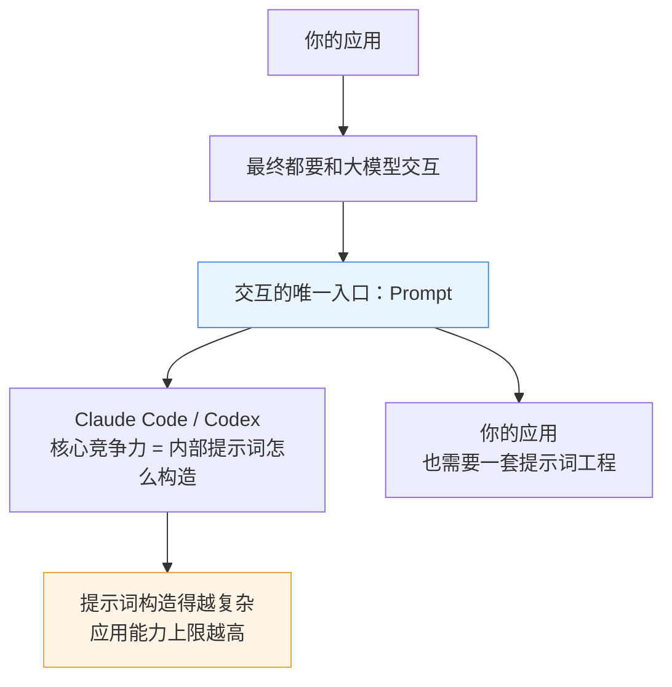
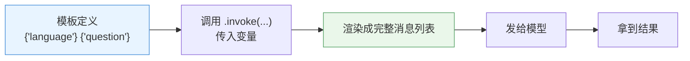
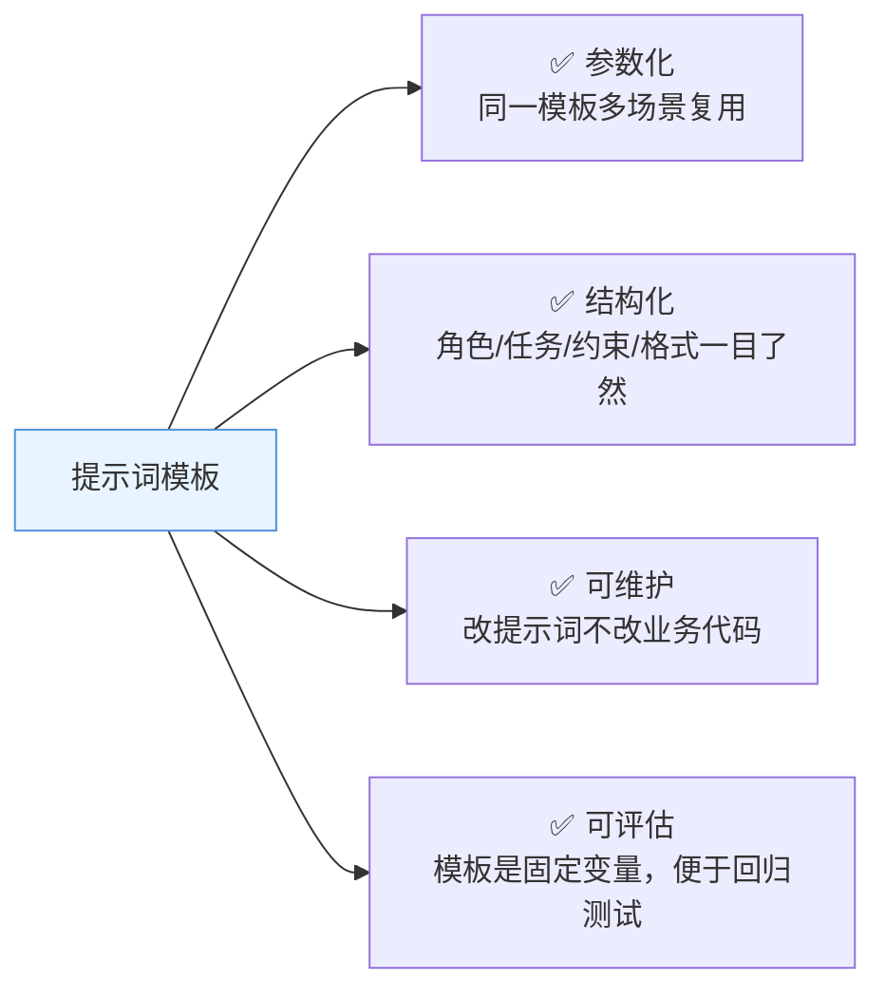
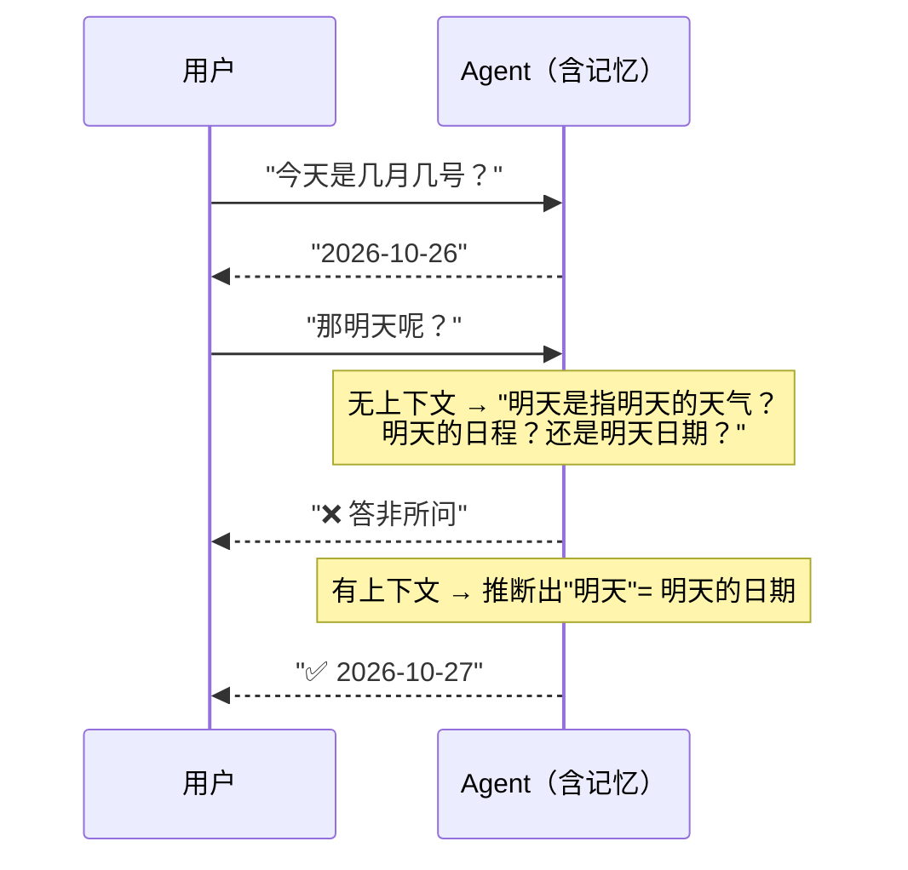
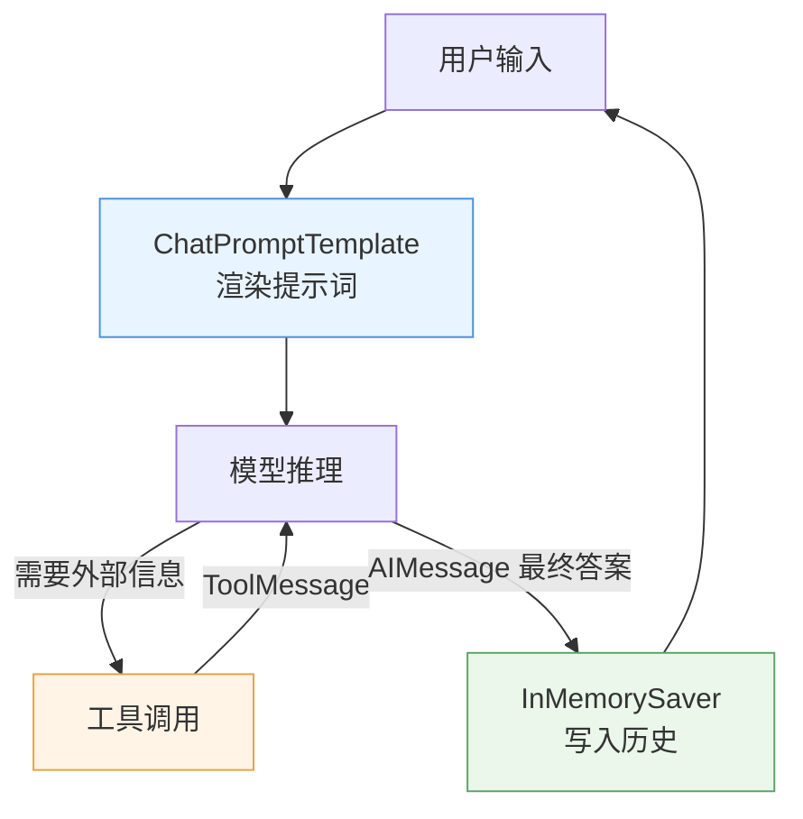

# 🧠 提示词模板与短期记忆

> [!abstract] 本节回答
> 怎么把提示词变成"填参数"？怎么让模型记住上下文？

## 1. 为什么提示词模板是"最关键的一块"



> [!quote] 讲师观点
> "提示词实际上是**与大模型交互的唯一入口**……Claude Code、Codex 最核心的能力，绝大部分就是它内部提示词是怎么构建的，只不过它的提示词构建相当复杂，远远不是我们这样填几个参数就完事了。"

## 2. `ChatPromptTemplate`：把提示词变成模板



```python
from langchain_core.prompts import ChatPromptTemplate

prompt = ChatPromptTemplate.from_messages([
    ("system", "你是一个专业翻译，请把下面内容翻译成 {language}。"),
    ("human", "{question}"),
])

messages = prompt.invoke({
    "question": "Today is a good day.",
    "language": "Chinese",
})
```

| 消息角色 | 模板变量 | 业务含义 |
| --- | --- | --- |
| `system` | `{language}` | 应用封装的信息（角色、任务、约束、输出格式） |
| `human` | `{question}` | 用户/客户真正问的问题 |

> [!tip] 讲者的核心价值判断
> "通过这个 Agent，我可以把很多系统内部的提示词封装起来，**对外只接收几个固定的业务参数**就可以了——所以这就很像传统应用的方式。"
> **这就是"把 LLM 接进业务系统"的正确姿势：提示词进内部，参数出外部。**

### 2.1 模板化带来的三个好处



## 3. 提示词工程的落地模板

```python
system_prompt = """你是一个{role}，擅长{domain}。

背景：{context}

任务：{task}

要求：
1. {constraint_1}
2. {constraint_2}
3. 输出格式：{output_format}

信息不足时直接说明，不要编造。"""
```

| 组成 | 作用 | 反例 |
| --- | --- | --- |
| 角色 role | 约束语气与知识范围 | "你是助手" |
| 背景 context | 业务上下文 | 空 |
| 任务 task | 明确要做什么 | "帮我处理一下" |
| 约束 constraint | 硬性规则 | 缺失 |
| 输出格式 | 结构化，便于下游解析 | "随便说说" |
| 兜底 | 不确定时说明而非编造 | 缺失 |

> [!important] 与你现有笔记呼应
> 这套模板与 [[02-基础阶段#结构化 Prompt 模板|基础阶段的万能模板]] 完全一致——**Java 线与 Python 线共用同一套提示词方法论**。

## 4. 短期记忆（Checkpointer）

### 4.1 问题：从"今天几号"到"明天呢"



> [!quote] 讲师解释
> "我问'今天是几月几号'，再问'明天呢'——这个问题是不是就需要有上下文才知道？不然你就问个'明天呢'，我不知道你是想问明天的日期、还是明天的天气。"

### 4.2 实现

```python
from langgraph.checkpoint.memory import InMemorySaver

agent = create_agent(
    model=model,
    tools=[get_current_date],
    checkpointer=InMemorySaver(),      # ← 只加这一行
)
```

| 要素 | 说明 |
| --- | --- |
| `InMemorySaver` | LangGraph 提供的**短期记忆**实现（进程内） |
| 作用 | 保存与模型交互的**全部历史消息** |
| 效果 | 模型能根据**以往的问题**推断当前问题的真实意图 |
| 底层 | 把历史聊天记录 + 大模型回复整合后，再发给模型 |

> [!note] 框架替你做了什么
> "你要做的事是把之前的聊天记录，还有包括大模型的回复，还要做一个整合再发给大模型——但在 LangChain 体系当中，你不需要管那么多，反正你只要指定这个 in-memory server 就可以了。"

> [!warning] 内存记忆的边界
> `InMemorySaver` **进程重启即丢失**，且不适合多实例部署。生产上需要持久化 Checkpointer（数据库/Redis）或改用"摘要式记忆"（超长对话自动截断/摘要），见 [[12周AI应用开发路线/专题-Python与模型API基础]]。

### 4.3 记忆类型对照

| 类型 | 范围 | 实现 | 用途 |
| --- | --- | --- | --- |
| 短期记忆 | 同一会话窗口 | `InMemorySaver` | 多轮对话上下文 |
| 长期记忆 | 跨会话/跨用户 | 向量库 + 检索 | 用户画像、偏好、历史事实 |
| 摘要记忆 | 超长对话 | 摘要压缩 | 控制 Token 成本 |

## 5. 组合：Agent + 模板 + 记忆



> [!important] 本章总结（讲师原话归纳）
> "LangChain 作为一个应用框架提供了很多基础组件，这些基础组件包含**和大模型对接的各种基础能力**。未来我们构建 Agent 实际上要做的事情，就是把这些基础能力拿出来，构建得更具体一点，然后拼装成完整的应用出来。"

## 6. 组件速查表

| 组件 | API | 作用 |
| --- | --- | --- |
| 模型 | `init_chat_model(...)` | 统一访问大模型 |
| 工具 | `@tool` | 给模型加外部能力 |
| 智能体 | `create_agent(model, tools, checkpointer)` | 封装工具循环 |
| 提示词 | `ChatPromptTemplate.from_messages([...])` | 提示词参数化 |
| 记忆 | `InMemorySaver()` | 短期上下文 |
| 多模态 | LangChain 多模态组件 | 图/音/视频（后续章节） |
| 可观测 | LangSmith | 追踪/评估/运维 |

## 7. 与 Spring AI 对应

| LangChain | Spring AI | 备注 |
| --- | --- | --- |
| `ChatPromptTemplate` | `PromptTemplate` | 结构几乎一致 |
| `InMemorySaver` | `ChatMemory` / `MessageWindowChatMemory` | 都做窗口截断 |
| 摘要记忆 | `SummarizationChatMemory` | Spring 内置 |
| 长期记忆 | `VectorStore` + Advisor | 概念一致 |

## 🏷️ 标签

#AI #LangChain #PromptTemplate #Memory #InMemorySaver

---
返回 [[README]] · 上一篇：[[04-工具调用与 Agent]] · 下一篇：[[06-LangSmith：追踪、评估与运维]]
