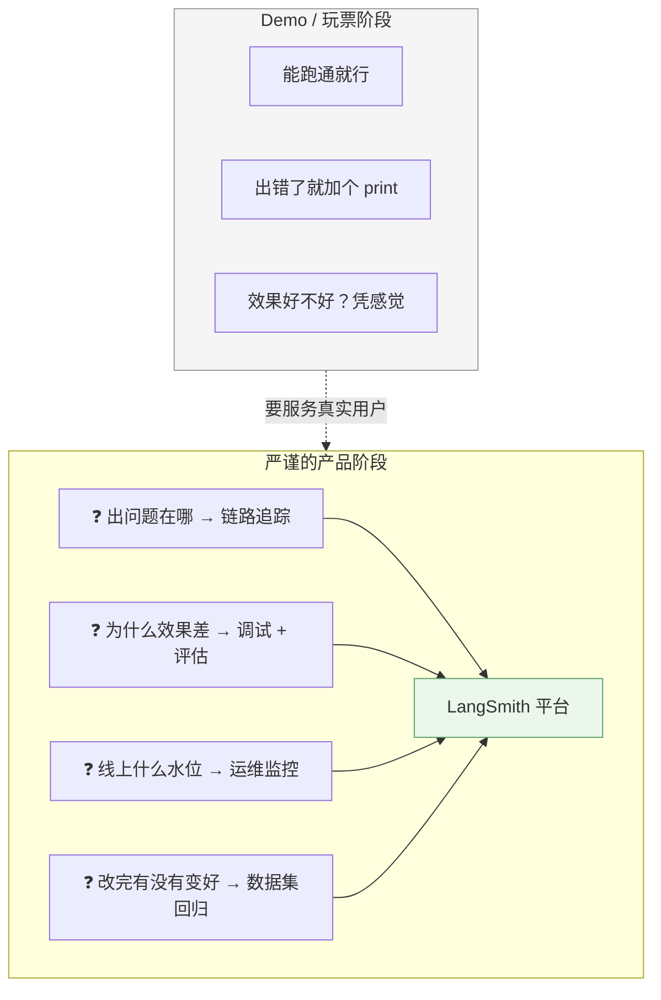
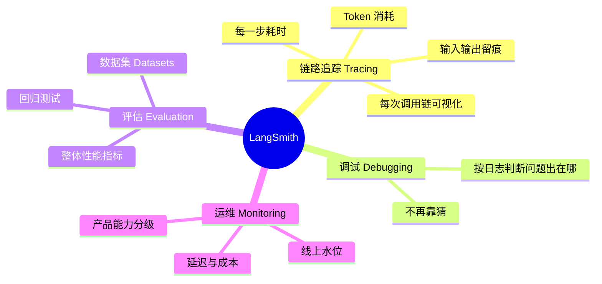
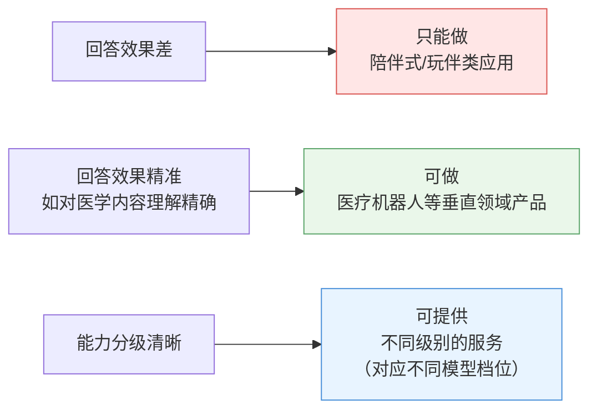
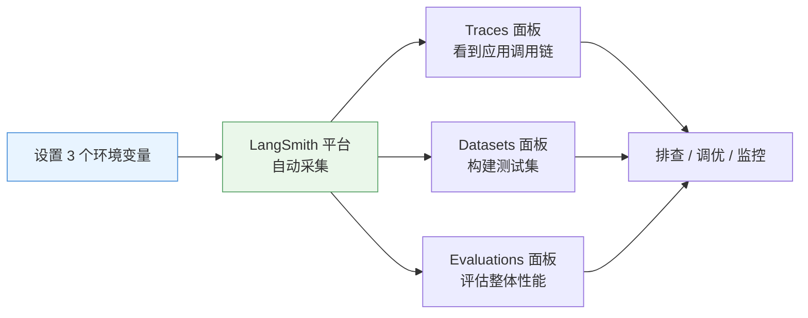
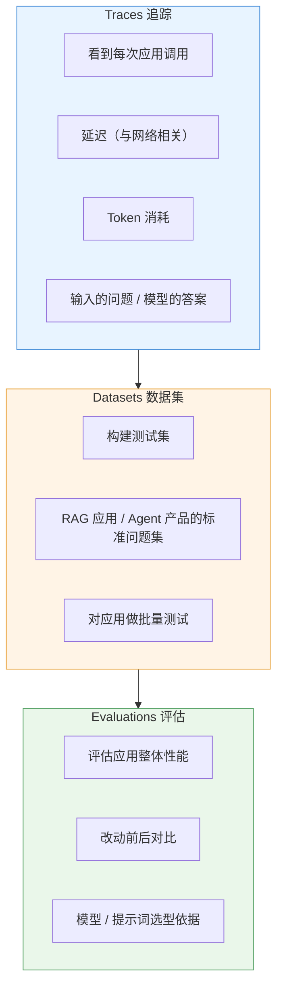

# 📈 LangSmith：追踪、评估与运维

> [!abstract] 本节回答
> LangSmith 到底解决什么问题？为什么"做严谨的产品"必须用它？接入成本有多高？

## 1. 为什么 Demo 不需要，产品必须要



> [!quote] 讲师的判断
> "你简单写 demo 可能完全不需要 LangSmith 存在；但如果说你要做一个严谨的产品，人家（用户）用你这个应用你得花钱啊——那你的产品就需要具备这种**产品化的能力**了。"

## 2. 四大能力



| 能力 | 解决的问题 | 关键指标 |
| --- | --- | --- |
| **链路追踪** | 调用链是啥样、慢在哪、花了多少 | Trace、Span、Latency、Token |
| **调试** | 出错出在哪个环节 | 输入输出快照、异常信息 |
| **评估** | 模型效果到底怎么样 | Evaluation 分数、Datasets 回归 |
| **运维** | 放到互联网上是什么水平 | 请求量、延迟分布、失败率 |

## 3. 效果分级 → 产品分级



> [!quote] 讲师的论证链
> "大模型也分不同模型，有便宜的、免费的、收费的。那**我的应用如果做得完整，它的能力有一个分级，分级很清晰了，那我也可以提供不同级别的服务**——这都是产品化的能力。"

## 4. 接入方式：几乎零开发



```bash
export LANGSMITH_TRACING=true
export LANGSMITH_PROJECT=my-langchain-demo
export LANGSMITH_API_KEY=lsv2_xxxx
python main.py
```

| 步骤 | 操作 | 说明 |
| --- | --- | --- |
| 1 | 打开 LangSmith 官网平台 | LangChain 官网 → LangSmith 入口 |
| 2 | Settings → 创建 API Key | 未来要收费，Key 在这里申请 |
| 3 | 设 3 个环境变量 | Tracing 开关 / Project 名 / API Key |
| 4 | 跑应用 | 平台自动出现 trace |
| 5 | 看 Traces | 调用链、延迟、Token 全在里面 |

> [!tip] 零开发接入的价值
> "基本上零开发啊……不要你开发，你总不会觉得难了吧。"
> **所有监控、调试、测试工作，不需要写一行额外代码。**

## 5. 三个面板的实战用途



| 面板 | 用来做什么 | 典型场景 |
| --- | --- | --- |
| Traces | 看单次调用链 | 线上出问题 → 定位到具体 Span |
| Datasets | 存测试集 | 为 RAG / Agent 产品建"标准问题集" |
| Evaluations | 打分 / 对比 | 新提示词 vs 老提示词哪个好 |

## 6. 注意事项

> [!warning] 数据有延迟
> 讲师实测："这个监控我刚试了一下，它是有一点点延迟的，并不是说你立即调完这就有，而是要稍微过一点——毕竟要数据传输。"
> **调试时不要刚跑完就急着去平台看，稍等几十秒。**

| 事项 | 说明 |
| --- | --- |
| 收费 | LangChain 商业化产品，深度使用需充值；Demo 可先不接入 |
| 延迟 | 上报是异步的，平台数据滞后几十秒 |
| 隐私 | 上报内容包含**用户原始问题与模型回答**，生产环境需脱敏 |
| 成本 | Traces 数量随调用量线性增长，注意采样策略 |

## 7. 与你的技术栈对应

| LangSmith 能力 | 你在笔记中的选择 | 位置 |
| --- | --- | --- |
| Tracing | Langfuse（自建） | [[技术栈地图]] § 企业级工程化 |
| Tracing | OpenTelemetry | [[技术栈地图]] |
| Evaluation | RAGAS + 固定测试集 | [[12周AI应用开发路线/05-RAG评测与复盘]] |
| Datasets | 自建测试集（JSONL / DB） | [[12周AI应用开发路线/专题-RAG端到端设计]] |

> [!tip] 迁移思路
> LangSmith 是**云端 SaaS**，Langfuse / OTel 是**可自建**。
> 企业级落地更常见的是：本地/内网自建 Langfuse，指标口径与 LangSmith 对齐（Trace → Span → Gen/Retriever 层级）。
> **学 LangSmith 学的是"要观测哪些指标"，不是这个具体产品。**

## 8. 最小接入清单

- [ ] LangSmith 账号已注册，API Key 已创建
- [ ] `LANGSMITH_TRACING` / `LANGSMITH_PROJECT` / `LANGSMITH_API_KEY` 已配置
- [ ] 跑一次应用后，平台 Traces 能看到记录（记得等几十秒）
- [ ] 建一个最小测试集（10 条标准问题）
- [ ] 上线前确认**用户数据是否允许上报**

## 🏷️ 标签

#AI #LangSmith #可观测 #评估 #工程化

---
返回 [[README]] · 上一篇：[[05-提示词模板与短期记忆]] · 下一篇：[[6-ai/AI 学习规划/12周AI应用开发路线/README|12 周 AI 应用开发路线]]
