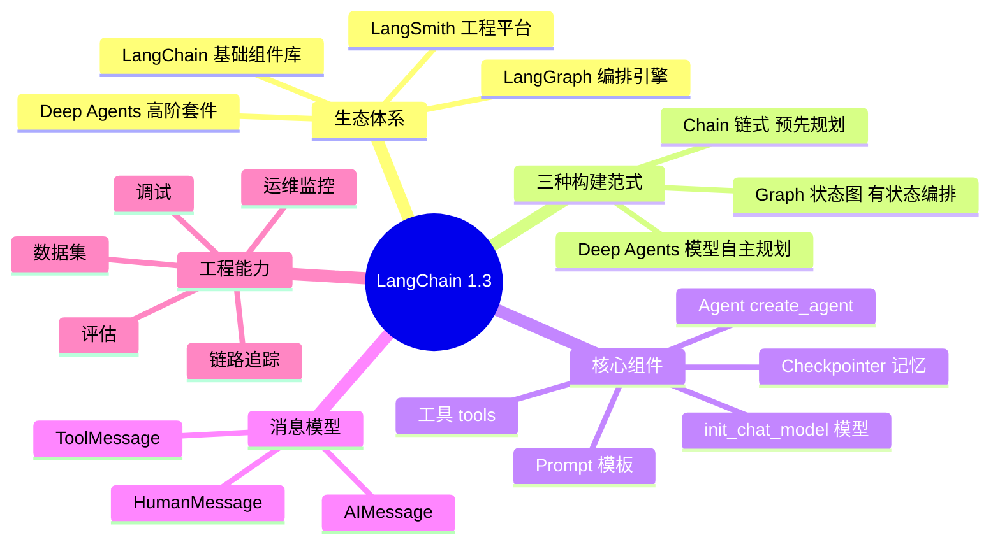
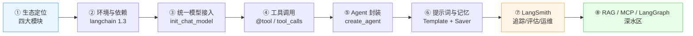
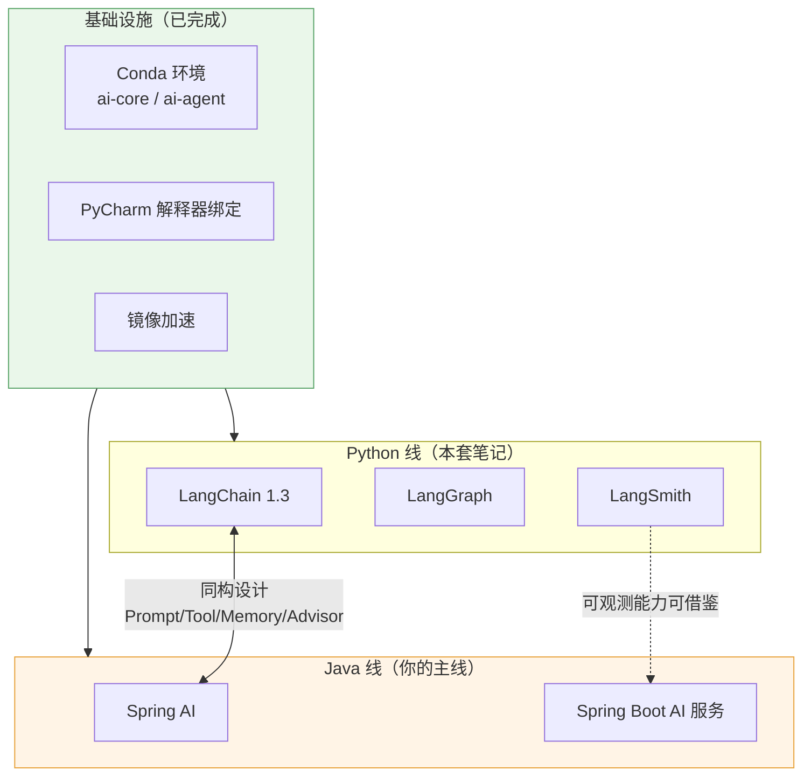

# 🦜 LangChain 1.3 精讲笔记

> [!abstract] 来源与整理原则
> 来源：图灵课堂 B 站教程《这绝对是 B 站唯一将 LangChain1.3 从入门到精通讲明白的教程》第一章（P3）字幕。
> 整理原则：**去掉"我们接下来看一下/哈/对吧"等口水话与重复表述，保留知识骨架、可执行结论、架构判断**。

> [!quote] 讲师的核心观点
> "各种 API 重要性已经没有那么重要了……更重要的是理解整个生态体系：**框架给你方便的同时，极大保留了框架的自由性**。"

## 一句话看懂 LangChain 1.x

> [!tip] 定位
> **LangChain 1.x = 一套统一抽象层（组件） + 三种构建范式（Chain / Graph / Deep Agents） + 一个产品化平台（LangSmith）**。
> 学习重点是**构建 Agent 的思路**，不是背 API——API 随时可以问 AI，**思路必须自己清楚**。

## 📚 文档导航

| 笔记 | 内容 | 核心产出 |
| --- | --- | --- |
| [[01-生态体系：四大模块与三种范式]] | LangChain / LangGraph / Deep Agents / LangSmith 定位与边界 | 知道"该用哪个" |
| [[02-环境安装与依赖管理]] | 依赖清单、版本查看、镜像加速、社区包风险 | 跑起 `langchain 1.3.x` |
| [[03-模型接入：init_chat_model 与多模型切换]] | 统一模型抽象、4 个参数、阿里云百炼实践 | 任意模型可切换 |
| [[04-工具调用与 Agent]] | `@tool`、tool_calls 时序、`create_agent` | 会写第一个 Agent |
| [[05-提示词模板与短期记忆]] | `ChatPromptTemplate`、`InMemorySaver`、上下文 | 会封装业务入口 |
| [[06-LangSmith：追踪、评估与运维]] | Tracing / Datasets / Evaluations / 零代码接入 | 具备产品化能力 |

## 🧭 知识地图

## 🎯 学习路线（本套笔记对应第 1 章）

## ⚡ 一页速记（面试/复习用）

| 问题 | 答案 |
| --- | --- |
| LangChain 1.3 生态分几块？ | **4 块**：LangChain、LangGraph、Deep Agents、LangSmith |
| LangChain 有几个身份？ | **2 个**：① 底层基础组件库 ② Chain 链式结构的构建形式 |
| LangGraph 是什么？ | 基于 LangChain 组件库的**有状态流程编排引擎** |
| Deep Agents 何时出现？ | **1.x 大版本新增**，面向复杂深度任务，**模型自主规划** |
| LangSmith 收费吗？ | **收费**（LangChain 商业化产品），Demo 可不接入 |
| 0.3 → 1.3 最大变化？ | **API 层变化大，基础思路变化不大**；1.0 后官方承诺 API 稳定 |
| 统一访问所有大模型的入口？ | `init_chat_model(model, model_provider, base_url, api_key)` |
| 切换模型要改什么？ | **改参数，不改代码**（4 个参数） |
| 工具怎么注册？ | `@tool` 装饰器 + docstring 描述 |
| 第一次工具调用时 AIMessage 的 content？ | **为空**，真正结果在 `tool_calls` 里 |
| 工具执行结果用什么消息回传？ | **ToolMessage** |
| 短期记忆怎么加？ | `create_agent(..., checkpointer=InMemorySaver())` |
| LangSmith 能干什么？ | 链路追踪、调试、评估、运维、数据集 |

## 🔗 与你现有 AI 学习体系的衔接

> [!important] 对你的价值
> 你的主线是 **Java + Spring AI**（见 [[技术栈地图]]），LangChain 的价值在于：
> 1. **Spring AI 的对标物** —— 两者概念几乎一一对应（ChatModel / Tool / PromptTemplate / Memory / Advisor / VectorStore）。
> 2. **补上"编排与可观测"短板** —— LangGraph 对应 Spring AI 的 Advisor/工作流，LangSmith 对应你选的 Langfuse/OTel。
> 3. **读得懂** —— 以后看 LangChain 系教程、论文、招聘 JD 都不怵。

> [!tip] 学习配比建议
> 本套 Python 笔记**读懂 + 能跑 demo 即可**（约 3–5 天），不要喧宾夺主；主线仍按 [[01-学习路径总览]] 的 Java 路线推进。
> 环境准备直接复用 [[6-ai/AI 学习规划/环境搭建/README|环境搭建]]。

## 🏷️ 标签

#AI #LangChain #LangGraph #LangSmith #Agent #图灵课程

---
原始字幕：[[6-ai/AI 学习规划/图灵-AI 大模型/【2026最新版】这绝对是B站唯一将LangChain1.3从入门到精通讲明白的教程！ Agent智能体✚RAG✚MCP✚LangGraph]]
