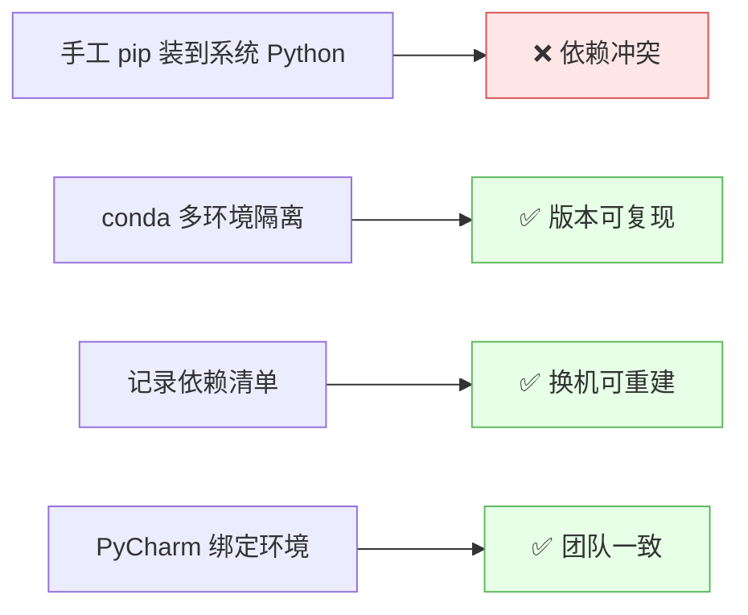
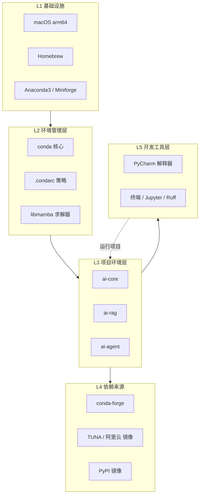
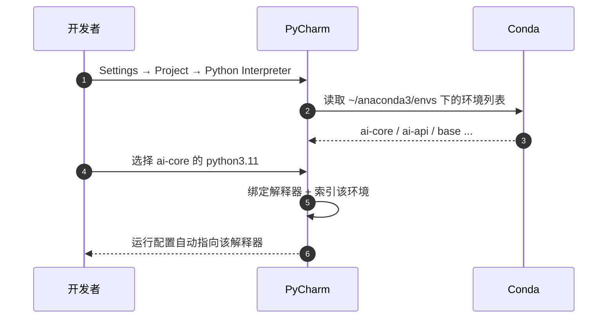

# 🧱 环境搭建总览

> [!goal] 验收标准
> 换一台新 Mac，按本文从零执行 **30 分钟内**跑通"创建环境 → 装依赖 → PyCharm 绑定 → 跑通一次模型 API 调用"。

## 1. 为什么必须标准化



AI 方向的依赖树又深又臭（torch → transformers → accelerate → numpy 版本连锁），**没有环境隔离 = 随时会炸**。

## 2. 分层架构



![[0-环境搭建全景.drawio]]

## 3. 标准搭建流程（7 步）

### Step 1 — 装环境管理器

```bash
# 已有 Anaconda3（/opt/anaconda3），无需重装。
# 若要重装或换 Miniforge（更轻、默认 conda-forge）：
# brew install --cask miniforge
# conda init zsh
```

> [!info] Anaconda vs Miniforge
> - **Anaconda**：预装 250+ 包，体积大，**默认 channel 有商业授权限制**（企业用需注意）。
> - **Miniforge**：只给 conda + conda-forge，干净，**推荐**。
> - 二者**不要并存**，`which -a conda` 确认只有一个。

```bash
which -a conda       # 期望只有一行
```

### Step 2 — 让 shell 认识 conda

```bash
conda init zsh        # 写入 ~/.zshrc，自动加 conda shell hook
exec zsh              # 或重开终端
conda activate base   # 提示符前出现 (base)
```

### Step 3 — 配镜像（**最关键的一步**）

```bash
conda config --add channels https://mirrors.tuna.tsinghua.edu.cn/anaconda/cloud/conda-forge
conda config --set show_channel_urls yes
conda config --set solver libmamba   # conda 23.10+ 支持，比 classic 快 10 倍
conda config --set channel_priority strict
```

生成 `~/.condarc`：

```yaml
channels:
  - defaults
show_channel_urls: true
default_channels:
  - https://mirrors.tuna.tsinghua.edu.cn/anaconda/pkgs/main
  - https://mirrors.tuna.tsinghua.edu.cn/anaconda/pkgs/r
custom_channels:
  conda-forge: https://mirrors.tuna.tsinghua.edu.cn/anaconda/cloud
  - https://mirrors.tuna.tsinghua.edu.cn/anaconda/cloud/conda-forge
solver: libmamba
channel_priority: strict
```

### Step 4 — 创建 AI 环境

```bash
# 核心环境
conda create -n ai-core python=3.11 -y
conda activate ai-core

# 轻量环境（只装 API 客户端，不装 torch，省 3GB）
conda create -n ai-api python=3.11 -y
```

### Step 5 — 装依赖

```bash
conda activate ai-core
python -m pip install -U pip
python -m pip config set global.index-url https://pypi.tuna.tsinghua.edu.cn/simple
python -m pip install torch torchvision transformers accelerate openai httpx
```

详见 [[04-AI 依赖清单与镜像源]]。

### Step 6 — PyCharm 绑定



详见 [[03-PyCharm 配置详解]]。

### Step 7 — 验证

```bash
conda activate ai-core
python -c "import torch; print(torch.__version__, torch.backends.mps.is_available())"
python -c "import transformers; print(transformers.__version__)"
python -c "import openai; print(openai.__version__)"
```

## 4. 验收清单

- [ ] `conda --version` 正常，`conda activate` 有提示符变化
- [ ] `conda config --show channels` 显示镜像地址
- [ ] `ai-core` / `ai-api` 环境存在，base 里没有 torch
- [ ] PyCharm 解释器指向 `.../envs/ai-core/bin/python`
- [ ] PyCharm 内置终端里 `python` 就是该环境的解释器
- [ ] 终端内 `pip list` 与 `conda list` 一致（没走错环境）
- [ ] `environment.yml` 已提交，密钥只在 `.env`/环境变量

## 5. 换机 / 重装路线


> [!tip] 迁移用哪个文件
> - `environment.yml`（人写）：**可移植、可手改**，但不含 pip 装的包 → 补 `pip:` 段。
> - `conda env export`（机器写）：全量快照，`--from-history` 才干净。
> - `pip freeze`：只管 PyPI 包，**丢掉 conda 装的 CUDA 轮子**。

## 6. 环境命名规范

| 规范 | 说明 |
| --- | --- |
| `ai-<用途>` | 一律 `ai-` 前缀，`conda env list` 一眼分清业务/非业务环境 |
| 不用 `test` / `tmp` / `test1` | 临时实验用 `ai-scratch`，用完即删 |
| 版本不写进名字 | 用 `python=3.11` 指定，靠环境本身表达职责 |
| 一个环境一个 README | 记录用途、关键依赖、启动方式 |

## 🏷️ 标签

#AI #环境搭建 #Conda #PyCharm #流程

---
返回 [[README]] · 下一篇：[[02-Conda 配置详解]]
