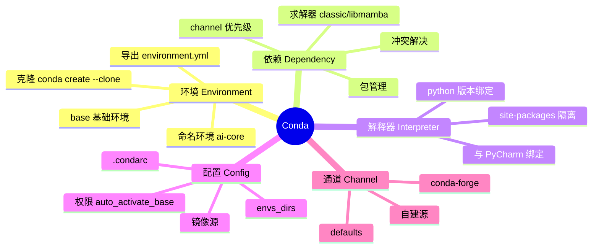
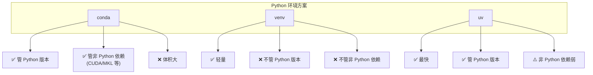
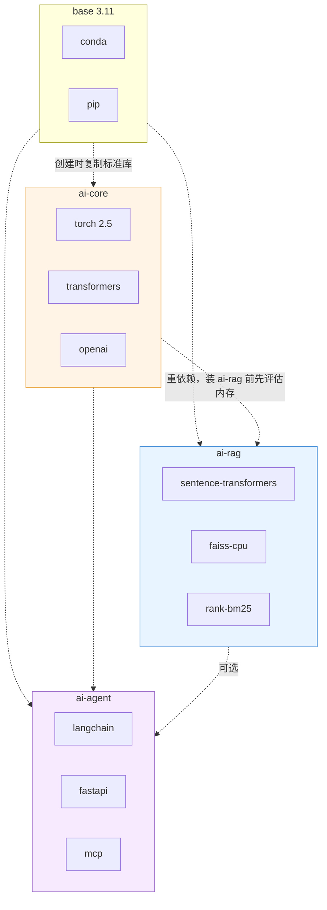

# 🐍 Conda 配置详解

> [!abstract] 一句话
> **Conda = 环境 + 依赖 + 解释器** 三合一管理器。它管的是"这一组包和它们之间的依赖关系"，pip 只管"这个包本身"。

## 1. 核心概念图



## 2. Conda vs venv vs uv vs pip



| 维度 | conda | venv | uv |
| --- | --- | --- | --- |
| Python 版本管理 | ✅ `python=3.11` | ❌ 依赖已装解释器 | ✅ `uv python install` |
| 非 Python 依赖（CUDA/MKL） | ✅ | ❌ | ❌ |
| 装包速度 | 中（libmamba 很快） | 快 | 最快（Rust 实现） |
| 体积 | 大 | 小 | 小 |
| 求解冲突能力 | ✅ 强 | ❌ 无 | ⚠️ 弱 |
| 生态成熟度 | 极高 | 极高 | 新但增长快 |

> [!tip] 选型建议
> **AI/深度学习 → conda 兜底**（torch 的 CUDA/MPS 轮子仍依赖 conda 生态）；纯 Web/脚本项目 → uv 更省心。两者可共存：conda 管环境，uv 在环境里装包。

## 3. 初始化与 Shell 集成

```bash
# 初始化（写入 ~/.zshrc 的 conda shell hook）
conda init zsh
conda init bash
exec zsh          # 生效

# 验证
conda activate base
type conda        # 应显示 conda 是 shell function
```

### 3.1 `conda init` vs `conda shell hook`

| 方式 | 写法 | 适用 |
| --- | --- | --- |
| `conda init` | 自动改 `~/.zshrc` | 交互式终端（**推荐**） |
| `conda shell hook` | `eval "$(conda shell.bash hook)"` | 手动管理 dotfiles |
| 直接调脚本 | `/opt/anaconda3/bin/conda` | CI / Docker |

### 3.2 脚本里无法 activate 时

```bash
# 方式一：不激活，直接跑
conda run -n ai-core python train.py

# 方式二：显式 source
source /opt/anaconda3/etc/profile.d/conda.sh
conda activate ai-core
python train.py
```

> [!warning] 常见坑
> `bash script.sh` 里 `conda activate` 报 `command not found: conda` —— 因为 conda 只是 shell 函数，**非交互式非登录 shell 不会加载 `.zshrc`**。改用 `conda run`。

## 4. `.condarc` 完整配置

文件位置：`~/.condarc`（用户级）、`$CONDA_PREFIX/.condarc`（环境级）、`./.condarc`（项目级，覆盖优先级更高）。

```yaml
# ~/.condarc
channels:
  - https://mirrors.tuna.tsinghua.edu.cn/anaconda/cloud/conda-forge
  - defaults
show_channel_urls: true
solver: libmamba
channel_priority: strict

default_channels:
  - https://mirrors.tuna.tsinghua.edu.cn/anaconda/pkgs/main
  - https://mirrors.tuna.tsinghua.edu.cn/anaconda/pkgs/r
  - https://mirrors.tuna.tsinghua.edu.cn/anaconda/pkgs/msys2

custom_channels:
  conda-forge: https://mirrors.tuna.tsinghua.edu.cn/anaconda/cloud/conda-forge

# 不自动进 base，避免污染
auto_activate_base: false

# 环境目录（默认放在第一个 envs_dirs）
envs_dirs:
  - /Users/vic/.conda/envs
pkgs_dirs:
  - /Users/vic/.conda/pkgs
```

### 4.1 关键字段说明

| 字段 | 作用 | 建议 |
| --- | --- | --- |
| `channels` | 包搜索源，**顺序即优先级** | conda-forge 放最前 |
| `channel_priority` | `strict`=严格按序；`flexible`=取最高版本 | **`strict`**（避免大版本混装） |
| `solver` | `classic` / `libmamba` | **`libmamba`**（conda 23.10+，快 10 倍） |
| `show_channel_urls` | 安装时打印下载源 | `true`（便于排查镜像是否生效） |
| `default_channels` | `defaults` 的镜像替换 | 国内必配 |
| `custom_channels` | 指定渠道的镜像 | 加速 conda-forge |
| `auto_activate_base` | 打开终端是否自动进 base | `false` |

### 4.2 常用配置命令

```bash
conda config --show                     # 查看全部配置
conda config --show channels            # 只看 channels
conda config --set solver libmamba
conda config --set channel_priority strict
conda config --add channels https://mirrors.tuna.tsinghua.edu.cn/anaconda/cloud/conda-forge
conda config --remove channels defaults
conda config --set auto_activate_base false
conda config --export                   # 导出当前配置
conda config --import conda-config.yaml
```

## 5. pip 镜像（另一半速度）

```bash
# 全局
python -m pip config set global.index-url https://pypi.tuna.tsinghua.edu.cn/simple
python -m pip config set global.trusted-host mirrors.tuna.tsinghua.edu.cn
python -m pip config set global.timeout 120

# 查看
python -m pip config list
```

写入 `~/.pip/pip.conf`：

```ini
[global]
index-url = https://pypi.tuna.tsinghua.edu.cn/simple
extra-index-url = https://mirrors.aliyun.com/pypi/simple/
timeout = 120
```

> [!note] 镜像源选择
> 清华源稳，阿里云快，腾讯/网易备选；公司内网**优先用内网源**，公网镜像只做兜底。

## 6. 环境管理命令速查

### 创建 / 删除

```bash
conda create -n ai-core python=3.11 -y
conda create -n ai-core python=3.11 numpy=1.26 pandas          # 带依赖
conda create -n ai-core --clone ai-api                            # 克隆环境
conda create -n ai-core -f environment.yml                       # 按文件创建
conda env remove -n ai-scratch -y
conda env update -n ai-core --all
```

### 激活 / 查看

```bash
conda activate ai-core
conda deactivate
conda env list                       # 或 conda info --envs
conda list -n ai-core                # 该环境装了什么
conda list | grep torch
conda info                          # 路径、求解器、channel 全览
```

### 装卸包

```bash
# 优先 conda 装（能一起解决依赖）
conda install -n ai-core numpy pandas -y
conda install -n ai-core pytorch -c pytorch          # 指定 channel
conda update -n ai-core --all
conda remove -n ai-core numpy

# PyPI 独有包用 pip
python -m pip install openai httpx
python -m pip uninstall -y openai

# ★ 永远用 python -m pip，不要裸 pip
#   裸 pip 可能指向另一个解释器 → 装错环境
```

### 导出 / 迁移

```bash
# 人写的最小可复现文件（推荐进 Git）
conda env export -n ai-core --from-history > environment.yml

# 全量快照（含所有间接依赖）
conda env export -n ai-core > environment-full.yml

# 只导出 pip 装的包
conda run -n ai-core python -m pip freeze > requirements.txt

# 导出 pip 段合并进 yml
conda env export -n ai-core --from-history --no-builds > environment.yml
```

`environment.yml` 示例：

```yaml
name: ai-core
channels:
  - conda-forge
dependencies:
  - python=3.11
  - pip
  - pip:
      - torch==2.5.1
      - transformers==4.47.0
      - openai==1.51.0
```

## 7. 跨环境共享与隔离



> [!danger] 绝对不要
> - 不要 `conda install -n base <业务包>`。
> - 不要在 `ai-core` 里既用 conda 装 torch 又用 pip 装 torch（两个发行版冲突）。
> - 不要 `pip install --user` 到系统 Python（macOS 13+ 已移除 Python 2，但仍会污染）。

## 8. 与 PyCharm 联动的 conda 注意点

| 事项 | 说明 |
| --- | --- |
| 解释器路径 | `/Users/vic/.conda/envs/ai-core/bin/python`（**用 `conda env list` 的真实路径**） |
| 新建环境 | PyCharm 可直接建 conda 环境，但**建议先在 CLI 建好再绑定**，便于版本控制 |
| 新版 PyCharm | `Settings → Project → Python Interpreter → Add Interpreter → Conda Environment` |
| 终端激活 | PyCharm 内置终端默认激活项目解释器；若提示符无环境名，见 [[03-PyCharm 配置详解]] |
| solver | PyCharm 建 conda 环境时可能用 classic，耗时更久 → 先 CLI 建再绑定 |

## 9. 排错速记

| 症状 | 原因 | 处理 |
| --- | --- | --- |
| `conda activate` 报 command not found | 未 init / 非交互 shell | `conda init zsh` 或 `conda run -n` |
| `CondaSSLError` | 证书链或镜像握手失败 | `conda config --set ssl_verify false`（临时）；换镜像 |
| `Solving environment: ...` 卡死 | classic 求解器慢 | `conda config --set solver libmamba` |
| `RemoveError: package not found` | 混装 pip/conda | `conda list` 排查来源，删干净再建 |
| 装包极慢 | 未配镜像 | 检查 `conda config --show channels` |
| `environment location already exists` | 环境已存在 | `conda env remove -n X` 后重建 |

## 🏷️ 标签

#AI #Conda #环境管理 #镜像源 #Python

---
返回 [[README]] · 上一篇：[[01-环境搭建总览]] · 下一篇：[[03-PyCharm 配置详解]]
